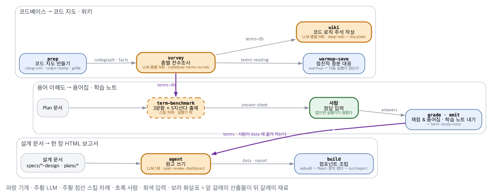

# report-builder

<div align=center>
    
    <h5></h5>
</div>

설계 문서와 코드베이스를 **사람이 판정하기 좋은 산출물**로 바꾸는 도구 모음이다.
세 갈래(mode)가 있고, 앞 갈래의 산출물이 뒤 갈래의 재료가 된다.

| mode | 진입점 | 하는 일 |
|---|---|---|
| 1 | `report-wiki` | 코드베이스를 읽어 코드 지도와 위키를 만든다 |
| 1.5 | `report-term` | 그 용어를 사람이 얼마나 아는지 객관식으로 재고, 학습 노트와 용어집을 낸다 |
| 2 | `report-spec` | 설계 문서를 표·배지·다이어그램으로 압축한 단일 HTML 보고서로 만든다 |

산출물은 **의존성 없는 단일 HTML** 이다. React 는 빌드 시점에만 쓰고 결과물에는 남지 않는다.

## 다른 컴퓨터에서 시작하기

### 1. 필요한 것

| | 무엇 | 왜 |
|---|---|---|
| **필수** | Node 22.13+ | 진입점과 보고서 빌드. 하한은 `package.json` 의 `engines` |
| **필수** | Python 3.12+ | `machine/`, `runner/` 등 파이썬 도구 및 실행기. `requirements.txt` 의 numpy · scipy 판이 요구한다 |
| **필수** | Graphviz 10.0.1+ (`dot`) | 모듈·클래스 다이어그램. `-Tsvg_inline` 이 이 판부터 있다. Ubuntu 24.04 의 apt 판은 이보다 낮다 — `tools/cloud_env.sh` 가 공식 `.deb` 로 까는 법이다 |
| **필수** | git | 커밋 해시와 파일 목록을 읽는다 |
| 선택 | `clang-uml` | C++ 저장소를 분석할 때만 |
| 선택 | .NET SDK | C# 저장소를 분석할 때만 (`machine/roslyn-dump`) |
| 선택 | `clangd` | C++ 역참조를 뽑을 때만 |
| 선택 | `@mermaid-js/mermaid-cli` | 위키의 Mermaid 를 SVG 로 구울 때 (npm 의존성에 들어 있다) |

macOS 예시 — `brew install node python graphviz clang-uml`

### 2. 설치

```bash
npm run setup      # tools/setup.sh — 아래 셋을 하고 끝에 doctor 를 돌린다
```

`setup.sh` 가 하는 일을 손으로 하면 이렇다(윈도우처럼 bash 가 없을 때):

```bash
python3 -m venv .venv
.venv/bin/pip install -r requirements.txt      # 윈도우는 .venv\Scripts\pip — 판이 고정돼 있다
npx --yes npm@11.11.0 ci                       # package-lock.json 은 npm 11 이 썼다. npm 10 의 npm ci 는 거부한다
```

### 3. 확인

```bash
npm run doctor
```

무엇이 있고 무엇이 없는지 한 화면으로 말한다. **필수가 하나라도 없으면 exit 1** 이다.

### 4. 진입점을 PATH 에 넣기 (선택)

```bash
export PATH="<이 저장소>/bin:$PATH"
```

넣지 않아도 `node bin/report-spec …` 으로 직접 부를 수 있다.

## 경로는 기계마다 다르다 — 그래서 박지 않는다

문서와 테스트는 **절대경로를 적지 않는다.** 대신 환경변수로 쓴다.

| 변수 | 가리키는 곳 | 없으면 |
|---|---|---|
| `REPORT_PYTHON` | 쓸 파이썬 해석기 | 저장소 안 `.venv` → PATH 의 `python3` 순으로 찾는다 |
| `GRAPHICS_REPO` · `CSHARP_REPO` · `CPP_REPO` | 골든 테스트가 쓰는 실제 저장소 | 해당 테스트들을 **건너뛴다.** 실패가 아니다 |

## 명령

```bash
npm test           # node --test — 컴포넌트와 스크립트
npm run typecheck  # tsc --noEmit
npm run doctor     # 이 컴퓨터의 환경 점검
python -m pytest machine/ runner/ viz/ tools/    # .venv 를 켠 뒤

report-spec init <slug>   # 스펙 디렉토리에 보고서 뼈대를 만든다
report-spec build         # → out/report.html
report-spec check         # script 수 · 타입 · 링크 무결성 · 용어집 대조
```

## 더 읽을 것

- `CLAUDE.md` — 저장소 규약, 확정된 결정, 함정
- `docs/handoffs/` — 결정 기록과 세션 인계 문서
- `docs/superpowers/plans/` — 실행 계획
