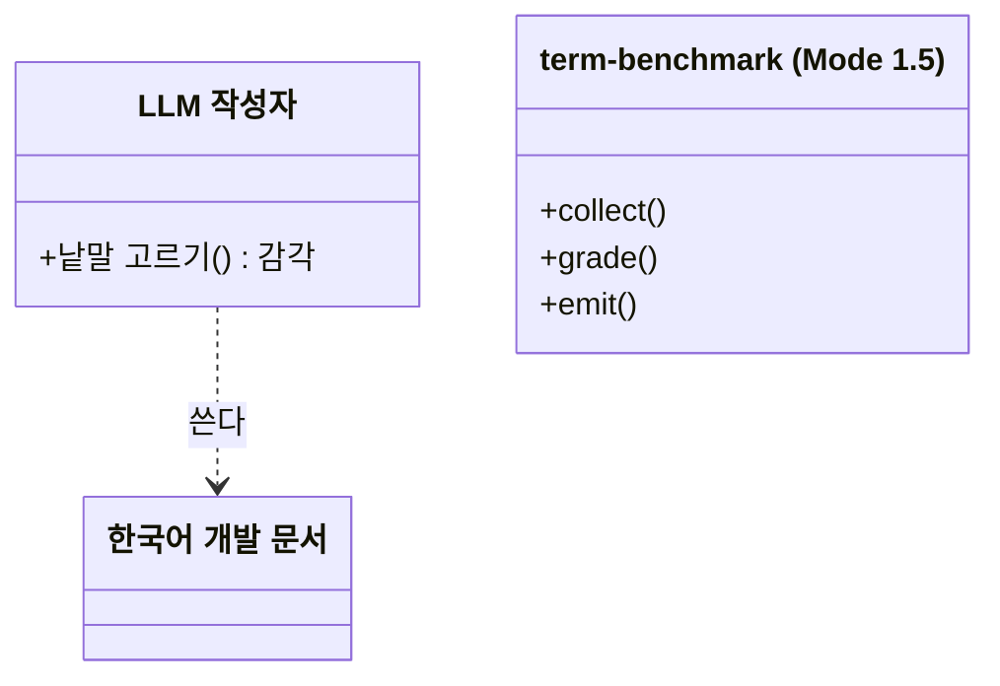
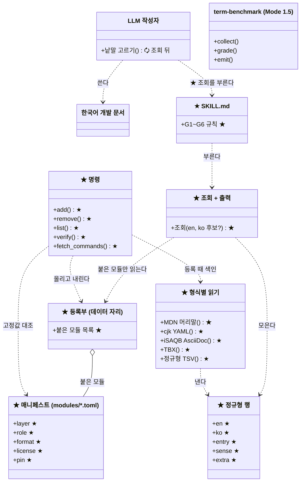
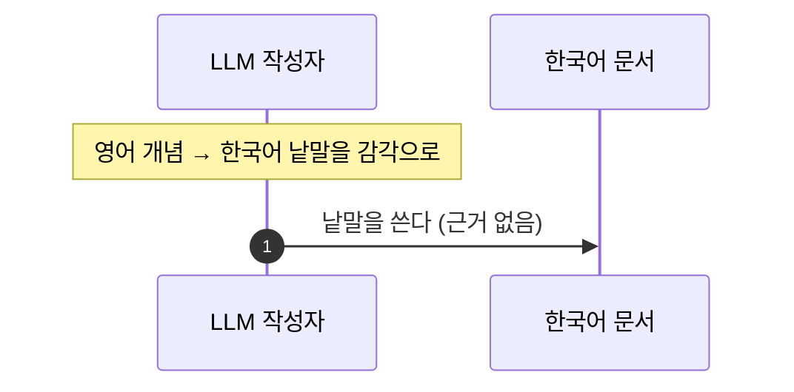
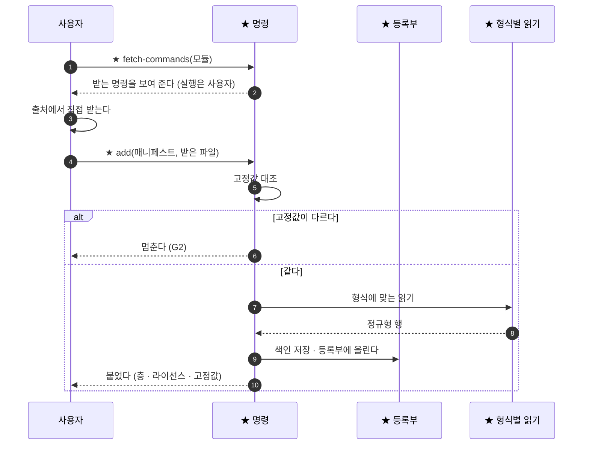
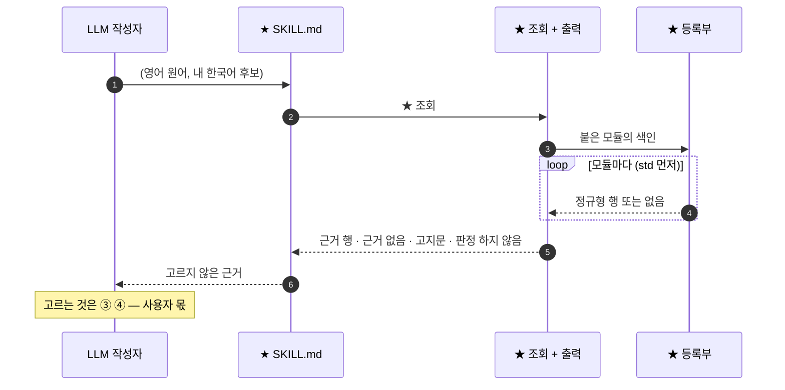
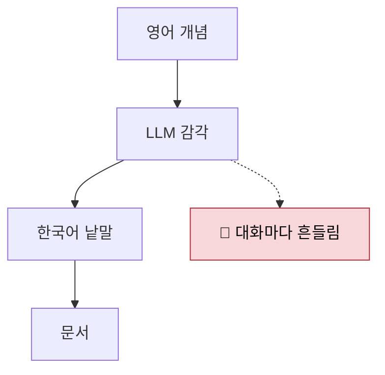
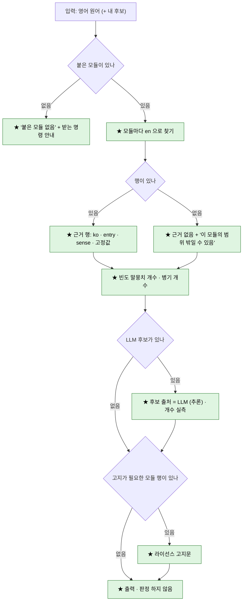

# 🧭 계획 — `ko-dev-terms` : 영어 개발 용어 → 한국어 표기 근거 스킬

> 📅 2026-10-29 · 브랜치 `claude/loving-knuth-0tuhzs` · **Before = `dd110df`** — 이 저장소에 `ko-dev-terms` 는 아직 없다(코드 0줄)
> 📄 근거 : 사용자 답 2026-10-28 ~ 29 · [인계 문서](../../handoffs/HANDOFF-2026-10-28-official-term-grounding.md) · [재개 문서](../../handoffs/RESUME-2026-10-28-official-term-grounding.md) · 리서치 보고서 [1](<../../../reports/한국어 개발 용어 근거 방법.md>) · [2](<../../../reports/언어 불문 설계 용어 출처.md>) · [30개 확인](<../../../research_notes/언어 불문 설계 용어 출처/isaqb_30_check.md>)
> 🔒 지킬 규칙 : 고르지 않는다(G5) · 근거 없으면 `근거 없음`(G1) · 고정값 대조, 다르면 멈춤(G2) · 원본 · 색인 · 등록부는 저장소 밖(MS 라이선스 2(i)) · 모듈의 코드를 실행하지 않음 · 다른 축 import 금지 · 파이썬 표준 라이브러리만 · 리소스와 코드를 가른다
> 🧪 검증 방식 : 같은 파일 두 번 등록 → 색인 바이트 동일 · 형식별 읽기를 고정 커밋의 **실제 파일**로 시험 · 세기 정밀도 표본 · 시범 표본 5행 손 대조 · 게이트(pytest · pyright strict · 인용 · 리소스 · README · 격리)
> ✋ 승인 : **승인 전** — 데이터도 받지 않고 코드도 짜지 않는다

## 0. 🎯 한 장

| 구분 | 내용 |
|---|---|
| 🎯 다루는 것 | LLM 이 한국어 개발 문서를 쓰다 고른 (영어 개념, 한국어 낱말) 쌍이 개발 도메인에서 실제로 쓰이는 표기인지 **확인할 때 꺼내 보는 조회 자료**. 1차 목표는 기본 층(std) |
| 🧩 한 줄 결론 | <span style="color:cyan">단어집 모듈</span>을 붙이고 떼는 틀 + 형식별 내장 읽기 + 고르지 않는 조회. 데이터는 전부 사용자가 받아 등록한다 |
| 🟰 그대로 | Mode 1 · 1.5 · 2 의 코드와 산출물. `term-benchmark` 스킬. 기존 게이트의 판정 기준 |
| 🗘 바뀜 | ★ 최상위 폴더 `ko-dev-terms/` 가 새로 생긴다. 🗘 게이트 설정 넷(`pyrightconfig.json` · 인용 시험 · 리소스 시험 · README 표류 명령)에 그 폴더가 들어간다 |
| ⚠️ 함정 | std 의 **소프트웨어 공학 · 테스트 & 품질은 실측한 한국어 짝이 0** 이다. MS 한국어판은 아직 못 열었다(이 세션에서 차단). 같은 낱말의 다른 뜻(coupling = CRM 레코드 연결)이 근거로 섞인다 |
| 🚫 범위 밖 | 한국어 → 영어 역조회 · Mode 1.5 · 2 · 위키 연결 · 판정 순서와 강제 도구(④) · 개인어 그래프(⑤, [결정 0013](../../decisions/0013-personal-language-graph-deferred.md)) · 요구공학 · 프로젝트 관리의 std 편입 |

## 0-1. 🧭 9 단계 한눈에

```text
📍 Before (dd110df)              │ 🛠️ After · 제안
─────────────────────────────────┼──────────────────────────────────────────────
LLM 작성자                        │ 0 ✋ 이 계획 승인
  └ 감각으로 낱말을 고른다         │ 1 🔎 3차 조회 — std 공백 · MS 한국어판 실물(V1)
     (간선/엣지가 대화마다 흔들림) │ 2 ★ 모듈 틀 — 매니페스트 · 등록부 · add/remove/list/verify
                                  │ 3 ★ 내장 읽기 — MDN 머리말 · cjk YAML · iSAQB AsciiDoc · TBX
근거 자료 : 없음                   │ 4 ★ 세기 — MDN 본문의 병기 · 낱말 개수
게이트 : machine runner viz tools │ 5 ★ 조회 + 출력 — 고르지 않음 · 근거 없음 · 고지문
                                  │ 6 ★ SKILL.md + 링크 · 🗘 게이트 편입
                                  │ 7 🧪 시범 — 인계 문서 1절 원어 + std 탐침
                                  │ 8 ✋ 결과를 사용자에게 — ③④ 재료
```

| 🧬 패턴 | 뜻 |
|---|---|
| 데이터만 붙는다 | 모듈은 <span style="color:cyan">매니페스트</span> + 사용자가 받은 파일. 새 형식은 스킬의 코드 변경으로만 |
| 모든 읽기는 한 꼴로 | 형식이 달라도 <span style="color:cyan">정규형 행</span> 하나로 모인다 |
| 행은 출처를 끌고 다닌다 | 모듈 이름 · <span style="color:cyan">고정값</span> · <span style="color:cyan">의미 표지</span>가 행마다 붙는다 |

## 0-2. 🚦 현황 · 정한 것

| 항목 | 진행 |
|---|---|
| 인계 받기 · 0단계 확인(V2 ~ V6) | ✅ 됨 — V1 은 ⚠️ 차단(MS 다운로드 서버) |
| 리서치 두 번 · 30개 확인 | ✅ 됨 |
| 계획서 — 결정 반영 · 이 양식으로 다시 씀 | ✅ 됨 |
| 계획 승인 | ❌ 안 됨 |
| 3차 조회 (13절 T1 ~ T7) | ❌ 안 됨 — 사용자가 미룸 |
| 모듈 틀 · 읽기 · 세기 · 조회 · SKILL.md · 시범 | ❌ 안 됨 |

| 무엇 | 👍 고른 것 | 👎 버린 것 | 누가 · 언제 |
|---|---|---|---|
| 스킬 자리 | 👍 이 저장소 최상위 폴더 `ko-dev-terms/` (Mode 처럼) | 👎 사용자 전역만 · 👎 `.claude/skills` 아래 | 사용자 · 10-28 |
| 이름 | 👍 `ko-dev-terms` | 👎 `official-term-grounding` · 👎 `term-grounding` | 사용자 · 10-28 |
| 범위 | 👍 독립 스킬까지 | 👎 Mode 1.5 산출물 연결 · 👎 Mode 1.5 앞 표기 점검 | 사용자 · 10-28 |
| 조회 방향 | 👍 영어 → 한국어만 | 👎 양방향 | 사용자 · 10-28 |
| 캐시 | 👍 출처에서 직접 + 클라우드 환경 캐시 | 👎 비공개 GitHub 캐시 · 👎 클라우드는 MS 없이 | 사용자 · 10-28 |
| MS 라이선스 (D1) | 👍 조건부 수락 | 👎 zip 약관 확인 뒤 · 👎 MS 빼기 | 사용자 · 10-28 |
| LLM 후보 (D4) | 👍 표시 붙여서만 | 👎 허용하지 않음 | 사용자 · 10-28 |
| 판정 순서 (D5) | 👍 스킬에 넣지 않음 — ④ 는 사용자 몫 | — | 사용자 · 10-28 |
| 프로젝트 용어집의 갈래 | 👍 ① 권위 출처 | 👎 ② 말뭉치 · 👎 셋째 갈래 | 사용자 · 10-28 |
| 인계 문서 공개 | 👍 원 프로젝트 고유 내용만 일반화해 둔다 | 👎 그대로 · 👎 넣지 않음 | 사용자 · 10-28 |
| 무게 | 👍 범위 · 우선순위의 뜻 (G5 유지) | 👎 후보에 점수 | 사용자 · 10-28 |
| 범위 목록 | 👍 국제 표준 어휘 + 사용자 목록 | 👎 사용자 목록만 · 👎 범위 두지 않음 | 사용자 · 10-28 |
| 단어집 출처 | 👍 언어 불문 설계 · 소프트웨어 공학 쪽 | 👎 프레임워크 종속 단어집 · 👎 쿠버네티스 · 👎 python-docs-ko | 사용자 · 10-28 |
| 막힌 호스트 측정 | 👍 3차 조회로 미루고 표시만 | — | 사용자 · 10-28 |
| 단어집의 꼴 | 👍 단어집 = 모듈 (DLL 처럼 붙이고 뗀다) | — | 사용자 · 10-29 |
| 기본 층 std | 👍 구조 · 설계 · 소프트웨어 공학 · 프로그래밍 언어(특히 OOP) · 테스트 & 품질 | — | 사용자 · 10-29 |
| 축 A 모듈의 꼴 | 👍 데이터 모듈 + 내장 읽기 | 👎 공통 정규형만 · 👎 코드 플러그인 | 사용자 · 10-29 |
| 축 B 제공 방식 | 👍 전부 매니페스트만 — 데이터는 사용자가 받는다 | 👎 허락되는 것은 동봉 · 👎 첫 실행 때 자동 받기 | 사용자 · 10-29 |
| 축 C 소프트웨어 공학 경계 | 👍 요구공학 · 프로젝트 관리 제외 | 👎 요구공학만 포함 · 👎 둘 다 포함 | 사용자 · 10-29 |
| 축 D 시작 시점 | 👍 계획서만 먼저 다듬기 | 👎 지금 모듈 틀부터 · 👎 3차 조회 먼저 | 사용자 · 10-29 |

## 0-3. 📖 용어

| 한국어 용어 | 코드 이름 [제안] | 뜻 |
|---|---|---|
| <span style="color:cyan">단어집 모듈</span> | `ko-dev-terms/modules/<이름>.toml` + 사용자 파일 | 붙이고 뗄 수 있는 단어집 하나 |
| <span style="color:cyan">매니페스트</span> | `modules/<이름>.toml` | 모듈의 이름 · 층 · 역할 · 형식 · 받는 곳 · 라이선스 · 고정값 |
| <span style="color:cyan">정규형 행</span> | `en` · `ko` · `entry` · `sense` · `extra` | 모든 읽기가 내는 한 꼴의 행 |
| <span style="color:cyan">의미 표지</span> | `sense` | 출처 자신의 정의 · 분류 — 같은 낱말의 다른 뜻을 가른다 |
| <span style="color:cyan">고정값</span> | `pin` | 파일 SHA-256 · 커밋 SHA · 판 |
| <span style="color:cyan">데이터 자리</span> | `KO_DEV_TERMS_DATA` | 원본 · 색인 · 등록부가 사는 저장소 밖 폴더 |
| <span style="color:cyan">std 층</span> | `layer = "std"` | 기본으로 매니페스트를 제공하는 층 |
| <span style="color:cyan">붙이기 · 떼기</span> | `add` · `remove` | 모듈 등록 · 제거 |
| <span style="color:cyan">받는 명령</span> | `fetch-commands` | 매니페스트의 받는 명령을 보여 주기만 한다 |
| 등록부 · 형식별 읽기 | 이름 미정 | 붙은 모듈 목록 / 형식마다 함수 하나 |

## 1. 🔁 Before → After

| 대상 | 📍 이전 (안 되던 것 · 지금) | 🛠️ After · 제안 | 🎉 해결되는 것 | 🔭 기대 | 진행 |
|---|---|---|---|---|---|
| 낱말 고르기 | 🐞 LLM 이 감각으로 고른다 — 같은 대화에서 `간선` / `엣지` 가 흔들렸다(인계 문서 1절) | 조회가 근거 행을 낸다 | 추론 대신 근거 | 같은 질문 + 같은 등록부 = 바이트까지 같은 답 | ❌ |
| 근거 자료 | 없음 | <span style="color:cyan">단어집 모듈</span>을 사용자가 받아 붙인다 | 출처를 골라 쓰고 바꿀 수 있다 | `list` 에 층 · 라이선스 · <span style="color:cyan">고정값</span>이 보인다 | ❌ |
| 동형이의 | 🐞 coupling = CRM 레코드 연결, node = Node.js 가 설계 뜻으로 섞인다(실측) | 행마다 <span style="color:cyan">의미 표지</span> | 다른 뜻을 근거로 오인하지 않는다 | 행에 출처의 정의 첫 줄이 따라온다 | ❌ |
| 라이선스 | MS 원본은 남이 복사하도록 게시할 수 없다 | 데이터는 전부 저장소 밖 · 저장소에는 매니페스트만 | 공개 저장소에 원본이 들어갈 길이 없다 | `git status` 에 데이터가 안 보인다 | ❌ |
| 설계 어휘 공백 | ⚠️ SOLID · side effect · postcondition 근거 0 | std 층 + 3차 조회 + 사용자 목록 | 공백 크기를 안다 | `근거 없음` 의 비율이 시범에서 나온다 | ❌ |

## 2. 🧱 구조 — classDiagram

### ★ 신규 · 🗘 변경 항목 · After 제안

| 순서 | 종류 | 항목 | 구분 | 소속/역할 |
|---|---|---|---|---|
| 1 | 모듈 | ★ `ko-dev-terms` (최상위 프로젝트 · 스킬) | 신규 | 단어집 모듈 틀과 조회. 다른 축을 import 하지 않는다 |
| 2 | 파일 | ★ `ko-dev-terms/CLAUDE.md` · ★ `README.md` · ★ `SKILL.md` | 신규 | 나침반 · 목록 · 사용법 |
| 2 | 파일 | ★ `ko-dev-terms/modules/*.toml` | 신규 | std 모듈 매니페스트 — 데이터 없음 |
| 2 | 파일 | ★ `ko-dev-terms/resources/` (조사 목록 · 출력 템플릿 · 고지문) | 신규 | 리소스 — 파이썬은 읽기만 |
| 2 | 파일 | ★ `ko-dev-terms/ko_dev_terms/*.py` · ★ `ko-dev-terms/test_*.py` | 신규 | 패키지와 시험. 파일 이름 미정 |
| 2 | 파일 | ★ `.claude/skills/ko-dev-terms` (링크) | 신규 | Claude 가 스킬을 찾는 자리 |
| 2 | 파일 | 🗘 `pyrightconfig.json` · 🗘 `test/test_docs_citations.py` · 🗘 `test/test_prompt_resources.py` · 🗘 `CLAUDE.md` | 변경 | 게이트 편입 |
| 2 | 파일 | 🗘 `tools/cloud_env.sh` | 변경 | 클라우드 설정 스크립트에 받는 명령 · `add` (사용자가 환경 설정에 다시 붙여 넣는다) |
| 3 | 클래스 | 미정 | — | 개념은 정해짐 — <span style="color:cyan">매니페스트</span> · <span style="color:cyan">정규형 행</span> · 등록부. 클래스로 둘지와 이름은 미정 |
| 4 | 함수 | ★ 명령 `add` · `remove` · `list` · `verify` · `fetch-commands` | 신규 | 명령 이름은 제안 |
| 4 | 함수 | ★ 형식별 읽기 — MDN 머리말 · cjk YAML · iSAQB AsciiDoc · TBX · 정규형 TSV | 신규 | 형식마다 함수 하나. 이름 미정 |
| 4 | 함수 | ★ 세기 · ★ 조회 · ★ 출력 그리기 | 신규 | 이름 미정 |
| 5 | 멤버 | ★ <span style="color:cyan">정규형 행</span>의 열 `en` · `ko` · `entry` · `sense` · `extra` | 신규 | [제안] |
| 5 | 멤버 | ★ <span style="color:cyan">매니페스트</span>의 칸 — 이름 · 층 · 영역 · 역할 · 형식 · 받는 곳/명령 · 라이선스 · <span style="color:cyan">고정값</span> · <span style="color:cyan">의미 표지</span>를 읽는 곳 | 신규 | [제안] |

범례: **★ 신규 생성 · 🗘 변경/업데이트/갱신 · 표식 없음 = 그대로 재사용 · ✕ 삭제**. 이 표식은 바뀌는 종류이지 구현 · 검증 상태가 아니다.

### 📍 Before · `dd110df`



### 🛠️ After · 제안 (클래스 이름은 개념 — 미정)



`term-benchmark` 는 그대로이고 연결선이 없다 — Mode 1.5 연결은 범위 밖이다.

## 3. ⏱️ 호출 순서 — sequenceDiagram

### 📍 Before



### 🛠️ After · 제안 — 모듈 붙이기



### 🛠️ After · 제안 — 조회



## 4. 🔀 분기 — flowchart

### 📍 Before



### 🛠️ After · 제안 — 조회



범례: 초록 = ★ 신규 · 노랑 = 🗘 변경 · 회색 = 그대로 · 빨강 = 막는 문제.

## 5. 📝 고칠 곳과 제안 diff

| 파일 · 심볼 | 바뀜 | 이유 | 근거 |
|---|---|---|---|
| ★ `ko-dev-terms/` 전부 | 신규 | 1절 자리 결정 | 사용자 · 10-28 |
| 🗘 `pyrightconfig.json` `include` · `extraPaths` | 폴더 추가 | pyright strict 가 지금 네 축만 본다 | [코드 확인] `pyrightconfig.json` |
| 🗘 `test/test_docs_citations.py` `contextDocs()` | 문서 둘 추가 | 새 컨텍스트 문서는 인용 검사 대상에 올린다(`test/CLAUDE.md`) | [코드 확인] |
| 🗘 `test/test_prompt_resources.py` `CODE_TOPS` | 폴더 추가 | 리소스와 코드를 가르는 게이트 | [코드 확인] 15행 |
| 🗘 `CLAUDE.md` 게이트 표 | README 표류 명령에 폴더 추가 | `tools/gen_readme.py` 가 이 폴더 꼴을 읽는지 먼저 본다 | [코드 확인] 117행 |
| 🗘 `tools/cloud_env.sh` | 받는 명령 · `add` 추가 | 클라우드 환경 캐시 | [코드 확인] · 클라우드 환경 문서 |

**🗘 `pyrightconfig.json` — 변경 · 제안 diff**

```diff
-  "include": ["machine", "runner", "viz", "tools"],
+  "include": ["machine", "runner", "viz", "tools", "ko-dev-terms"],
@@
-  "extraPaths": ["machine", "runner", "viz", "tools"],
+  "extraPaths": ["machine", "runner", "viz", "tools", "ko-dev-terms"],
```

**🗘 `test/test_docs_citations.py` `contextDocs()` — 변경 · 제안 diff**

```diff
             ".claude/skills/term-benchmark/SKILL.md",
-            ".agents/skills/codebase-terms-survey/SKILL.md"]
+            ".agents/skills/codebase-terms-survey/SKILL.md",
+            "ko-dev-terms/CLAUDE.md",
+            "ko-dev-terms/SKILL.md"]
```

**🗘 `test/test_prompt_resources.py` — 변경 · 제안 diff** (하이픈이 든 폴더 이름을 이 시험이 받는지는 ❓ 미검증)

```diff
-CODE_TOPS = ("runner", "viz", "machine", "tools")   # 긴 글을 찾는 폴더 — 시험 파일은 뺀다
+CODE_TOPS = ("runner", "viz", "machine", "tools", "ko-dev-terms")   # 긴 글을 찾는 폴더 — 시험 파일은 뺀다
```

**🗘 `CLAUDE.md` 게이트 표 — 변경 · 제안 diff** (개수는 편입 뒤 실측)

```diff
-| README 표류 | `.venv/bin/python tools/gen_readme.py --check machine runner viz tools` | 4개 일치 |
+| README 표류 | `.venv/bin/python tools/gen_readme.py --check machine runner viz tools ko-dev-terms` | (편입 뒤 실측) |
```

**★ `ko-dev-terms/modules/mdn-glossary-ko.toml` — 신규 · 요점만 · 의사코드** (칸 이름은 제안, 커밋은 실측한 값)

```toml
name    = "mdn-glossary-ko"
layer   = "std"
role    = "ko-pair"            # ko-pair | en-scope | corpus
format  = "mdn-frontmatter"
domains = ["programming", "design"]
license = { name = "CC-BY-SA-2.5", url = "https://github.com/mdn/translated-content/blob/main/LICENSE.md", share_alike = true }
pin     = { commit = "2a7c03a449507969b925ac954f41c340d7c50263", path = "files/ko/glossary" }
sense   = "subfolder"
fetch   = [
  "git clone --filter=blob:none --no-checkout https://github.com/mdn/translated-content",
  "git -C translated-content sparse-checkout set --no-cone files/ko/glossary/",
  "git -C translated-content checkout 2a7c03a449507969b925ac954f41c340d7c50263",
]
```

**★ <span style="color:cyan">정규형 행</span> — 출력 꼴 예시** (값은 MDN 고정 커밋에서 본 것)

```text
en                 ko         entry                                            sense     extra
callback function  콜백 함수  files/ko/glossary/callback_function/index.md      Glossary
```

## 6. 📦 std 모듈 후보 — 지금까지 실측한 자료

탐침 목록과 갈래 판정은 연구 도구이지 정답이 아니다.

| 모듈 | 역할 | 형식 | 고정 | 라이선스 | std 영역 | 상태 |
|---|---|---|---|---|---|---|
| Microsoft Terminology (`ko`) | 한국어 짝 | TBX | zip SHA-256 | MS Globalization License (👍 조건부 수락) | 전 영역 — `sense` 로 다른 뜻을 가른다 | ⚠️ 한국어판 미측정(T2). 프랑스어 · 독일어판의 영어 표제로 대신 재니 탐침 63개 중 36개, 그중 13개는 다른 뜻으로만 [실측] |
| MDN 용어집 | 한국어 짝 | 머리말 Markdown | 커밋 `2a7c03a4` | CC-BY-SA 2.5 | 프로그래밍 언어(일반 159) · 설계(37) | [실측] 항목의 58% 는 웹 플랫폼 고유 — ❓ E4 |
| MDN 한국어 본문 | 빈도 말뭉치 | Markdown 산문 | 같음 | 같음 | 전 영역 | [실측] 탐침 병기 9개 낱말 18건 |
| cjk-compsci-terms | 한국어 짝 | YAML 표 | 커밋 `65a7584` | CC BY-SA 4.0 | `design-patterns` · `software-eng` · `programming` · `paradigms` | [실측] 28표 · 259항목, 표마다 10개 안팎 — ❓ E11 |
| iSAQB 아키텍처 용어집 | 영어 범위 | AsciiDoc | 커밋 `bd3ce64` | CC BY 4.0 | 구조 · 설계 | [실측] 표제 274 — ❓ E7 |
| GoF · SOLID · 패키지 원칙 · GRASP | 영어 범위 | 이름 목록 | 책 판 | 이름은 저작물 아님(미국법) | 설계 | ❓ 축 B 대상인지 |
| SEVOCAB (ISO/IEC/IEEE 24765) | 영어 범위 (손 조회) | 정규형 TSV | 조회 날짜 · 판 | IEEE · ISO — 정의는 싣지 않음 | 소프트웨어 공학 | [미검증] T1 |
| ktword | 한국어 짝 (손 조회) | 정규형 TSV | 항목 번호 · 날짜 · 본문 해시 | 출처 표시 시 자유(검색 요약) | 설계 · 소프트웨어 공학 | [미검증] T4 |
| ISTQB · KSTQB · ISO/IEC 25010 | 영어 범위 · 한국어 짝 | 미정 | 미정 | 미정 | 테스트 & 품질 | [미검증] 조사 전 T7 |
| 한국어 위키백과 | 한국어 짝 | 덤프 | 덤프 날짜 | CC BY-SA | 전 영역 | [미검증] T3 — 개념어 공백의 최대 후보 |
| 사용자 목록 | 영어 범위 + 한국어 후보 | 정규형 TSV | 파일 해시 | 사용자 | 전 영역 | [내 판단] 범위의 주된 수단이 될 수 있다 |

| std 영역 | 실측한 한국어 짝 | [내 판단] |
|---|---|---|
| 구조 · 설계 | cjk-compsci-terms 20 · MDN 설계 37 — MS 한국어판 미측정 | 얇다 |
| 소프트웨어 공학 | 없음 | 거의 공백 |
| 프로그래밍 언어 · OOP | MDN 일반 159 · cjk-compsci-terms 19 | 중간 |
| 테스트 & 품질 | 없음 | 공백 |

## 7. 📐 규칙 — 후보 · 세기 · 출력 · 데이터 자리

**한국어 후보를 어디서 얻나**

| 기호 | 후보 출처 | 결정적인가 |
|---|---|---|
| (a) | 한국어 짝 모듈의 대상어 | 예 |
| (b) | 빈도 말뭉치의 병기 `<한글 낱말>\s*\(\s*<영어>\s*\)` | 예 |
| (c) | 사용자가 준 후보 — 조회 입력의 한국어 후보도 여기 | 예 |
| (d) | LLM 후보 — `후보 출처 = LLM (추론)`, 개수 실측, 0 이면 0 | 아니오 (표시) |

**세기** — 산문만(머리말 · 코드 블록 · 인라인 코드 · MDN 매크로 `{{ … }}` · HTML 주석 제외). 경계 규칙 v1: 앞 글자가 한글이 아니고 뒤가 조사이거나 한글이 아닐 때만(`트리` ⊂ `트리거` 를 막는다), 조사 목록은 리소스 파일. 정밀도 표본: 100 이상이면 무작위 100줄, 아니면 전부. MDN `conflicting` · `orphaned` 는 뺀다.

**출력** — 한 행 = 원어 · 한국어 후보 · 모듈 · 근거(항목 id / `파일:줄` · 개수) · `sense` · <span style="color:cyan">고정값</span> · 후보 출처. 줄 세우기는 층(std 먼저)과 역할 순서뿐 — 판정이 아니다. 끝에 `판정 : 하지 않음`. 고지를 요구하는 모듈의 행이 있으면 고지문(MS: "Entry from Microsoft Learn's Globalization Essentials. © … Microsoft Corporation. All rights reserved."). 글 꼴은 리소스 템플릿.

**<span style="color:cyan">데이터 자리</span>** — 원본 · 색인 · 등록부는 `KO_DEV_TERMS_DATA`, 없으면 Linux · Mac `~/.cache/ko-dev-terms`, Windows `%LOCALAPPDATA%\ko-dev-terms`. GitHub 출처는 `git clone --filter=blob:none --no-checkout` + sparse + 고정 커밋 — `codeload.github.com` 아카이브는 쓰지 않는다(클라우드 GitHub 프록시가 붙이지 않은 저장소의 아카이브를 403 으로 막는다). 클라우드는 사용자가 허용 도메인을 더하고 설정 스크립트에 받는 명령 · `add` 를 넣는다 — 약 5분 안에 끝나면 약 7일 스냅숏 재사용, 넘기면 받기만 SessionStart 훅의 배경 작업으로.

**<span style="color:cyan">매니페스트</span>의 꼴** — TOML 을 제안한다(저장소의 `config/*.toml` 관례). `tomllib` 은 파이썬 3.11 부터라 ⚠️ M5 를 본 뒤 정하고, 낮으면 JSON.

## 8. 🧪 확인과 다음 단계

**구현 조각 — 의존 순서** (전부 ❌ 안 됨)

| # | 결과물 | 확인 | 앞선 조건 |
|---|---|---|---|
| 0 | ✋ 이 계획 승인 | 사용자 | — |
| 1 | 🔎 3차 조회 결과 (13절) | std 공백 크기 · MS 한국어판 실물(V1)이 사실로 채워짐 | 사용자가 허용 도메인을 연다 |
| 2 | ★ 모듈 틀 — 매니페스트 꼴 · 등록부 · 명령 다섯 · 정규형 TSV 읽기 | 같은 파일 두 번 등록 → 색인 바이트 동일 · `remove` 뒤 흔적 없음 | 0 |
| 3 | ★ 내장 읽기 — MDN · cjk · iSAQB · TBX | 고정 커밋의 실제 파일 전부에 돌려 꼴 예외를 센다 · 원어 다섯 개 손 대조 | 2 (TBX 는 1 도) |
| 4 | ★ 세기 — MDN 본문 | 정밀도 표본 | 2 |
| 5 | ★ 조회 + 출력 | 고르지 않음 · `근거 없음` · 고지문 · 범위 표시 | 3 · 4 |
| 6 | ★ SKILL.md + 링크 · 🗘 게이트 편입 | 새 게이트 초록 — 기존 빨강 둘(위키 표류 · 층 분포)은 별개 | 5 |
| 7 | 🧪 시범 — 인계 문서 1절 원어 + std 탐침 | 행마다 근거 또는 `근거 없음` · 두 번 돌려 같음 · 표본 5행 손 대조 | 6 |
| 8 | ✋ 시범 결과 보고 — ③④ 재료 | 사용자 확인 | 7 |

시범 원어 목록은 [제안] 으로 먼저 보인다 — 인계 문서 1절 표의 영어 병기에서 기계적으로 뽑고, 병기가 없는 행(`나무` · `입장권`)은 사용자가 채운다.

**❓ 남은 결정**

| # | 무엇 | 근거 | [내 판단] | 영향 |
|---|---|---|---|---|
| E4 | MDN 용어집을 std 에서 거르나 (일반 159 · 설계 37 만) | [실측] 웹 플랫폼 항목 325개. 갈래 판정은 한 연구자의 판단 | 거른다 — std 의 뜻과 맞다 (65) | 거르면 MDN 행의 대부분이 std 밖 선택 모듈로 간다 |
| E7 | iSAQB 를 "국제 표준 어휘" 에 넣나 | [실측] 30개 확인 — `node` 거짓 적중, `open-closed principle` 은 SOLID 가 덮음 | 표준이 아니라 "인증 단체 범위 목록" 으로 따로 표시하고 넣는다 (60) | 범위 목록의 기계 판독 부분이 사실상 iSAQB 하나다 |
| E11 | cjk-compsci-terms 를 std 모듈로 | [실측] 깨끗하지만 표마다 10개 안팎 | 넣는다 — 실무 음차 진영의 독립 근거 (60) | CC BY-SA 동일조건이 파생 행에 걸린다 |
| — | 이름 목록(GoF · SOLID · …)을 `modules/` 리소스로 둘지 | 제3자 단어집이 아니라 우리가 적는 목록 | 리소스로 둔다 — 축 B 는 제3자 데이터에 대한 결정으로 본다 (55) | 아니면 사용자 목록에 합친다 |
| — | 3차 조회 시점 | 2 · 3 단계 중 TBX 읽기가 여기 걸린다 | — | 늦을수록 MS 행 없이 시범 |
| — | 리서치 보고서의 나머지 후보 K1 ~ K12 · E1 ~ E13 | 이 계획에 녹인 것: E2 · E6 → `sense`, E9 · E10 → 손 조회 모듈, E3 · E5 → 제외 | — | — |

**⚠️ 실행할 때 재야 할 것**

| # | 무엇 | 왜 모르나 |
|---|---|---|
| M1 | MS zip 안의 구조와 별도 약관 | 이 세션에서 `download.microsoft.com` 차단 |
| M2 | MS 다운로드 시간 — 설정 스크립트 5분 안 | 같은 이유 |
| M3 | 설정 스크립트가 돌 때 저장소 클론이 있나 | 문서에서 못 찾음 |
| M4 | GitHub 이 커밋 SHA 로 얕은 fetch 를 받나 | 안 돌려 봄 |
| M5 | Windows PC 의 파이썬 판 — 매니페스트 꼴이 걸림 | 인계 문서는 "python 있음" 만 |
| M6 | MDN 용어집의 꼴 예외 | 표본 2개만 봄 |

## 9. 🔎 3차 조회 — 표시만, 아직 하지 않는다

사용자 답: "다음 3차 조회 내용으로 당장 말고 노트에 마크업만". 호스트는 사용자가 허용 도메인에 더하고, 새 세션부터 적용된다.

| # | 잴 것 | 열어야 할 호스트 |
|---|---|---|
| T1 | SEVOCAB 에서 iSAQB · 이름 목록 밖 탐침 33개 · 내보내기 · 이용 조건 · SWEBOK v4 용어집 | `pascal.computer.org` · `www.computer.org` (· `www.swebok.org`) |
| T2 | MS 한국어 TBX 실물 — V1 · 상태 필드 · 한국어 대상어와 정의 · 스타일 가이드의 음역 규칙 | `download.microsoft.com` · `aka.ms` |
| T3 | 한국어 위키백과 · Wikidata — 표제 · 넘겨주기 · 첫 문장 병기 · 한국어 label | `dumps.wikimedia.org` · `ko.wikipedia.org` · `www.wikidata.org` |
| T4 | ktword — 탐침 재측정 · 본문 영어 병기 · `robots.txt` | `www.ktword.co.kr` · `ktword.co.kr` |
| T5 | KS X 0001 소프트웨어 부 · 24765 KS 부합화판 · TTA 소프트웨어 공학 용어 표준 | `standard.go.kr` · `e-ks.kr` · `standard.tta.or.kr` · `terms.tta.or.kr` |
| T6 | NCS · 정보처리기사 · refactoring.guru · 리팩터링 · PoEAA · EIP · DDD 목록. IREB 는 std 밖 선택 모듈 후보로만 | `www.ncs.go.kr` · `www.q-net.or.kr` · `refactoring.guru` · `martinfowler.com` · `refactoring.com` · `www.enterpriseintegrationpatterns.com` · `domainlanguage.com` (· `cockpit.ireb.org`) |
| T7 | 테스트 & 품질 — ISTQB 용어집 · KSTQB · ISO/IEC 25010 과 KS 부합화판 | 조사 때 정한다 |

## 10. 🧱 새 구조 공개 (`design-decision-discipline` §2.5)

| 항목 | 새 최상위 폴더 `ko-dev-terms/` | 단어집 모듈 경계 |
|---|---|---|
| 구현자 수 | 0 → 1. TBX · `.po` 를 읽는 파이썬 0건 [코드 확인] (`termEntry` · `.tbx` · `msgstr` grep — 걸린 1건은 `runner/run_mode1_5.py` 의 `TermEntry` 형) | 실측한 형식만 다섯(TBX · 머리말 Markdown · YAML · AsciiDoc · 이름 목록) + 정규형 TSV |
| 소비자 수 | 지금 0. 예정 둘(report-builder · 코드베이스 위키)은 사용자 진술 | 1 — 조회 |
| 삭제 시험 | 지우면 되살아나는 곳 0 — 소비자가 아직 없다 | 지우면 출처마다의 읽기 · 라이선스 · 범위 · 고정값이 조회 코드로 흩어진다 — 출처 수만큼 |
| 계획과의 관계 | 인계 문서 7-1 의 `scripts/` 안 → 👍 "새로운 스킬 프로젝트로 … Mode 개발하듯" | 1판의 "레지스트리 · 플러그인을 두지 않는다" → 👍 단어집 = 모듈. 경계는 코드 인터페이스가 아니라 데이터 꼴이고 모듈은 코드를 들고 오지 않는다(👍 축 A) |
