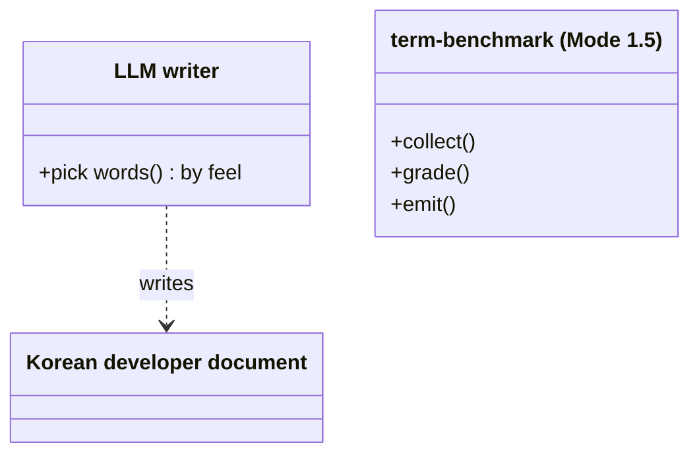
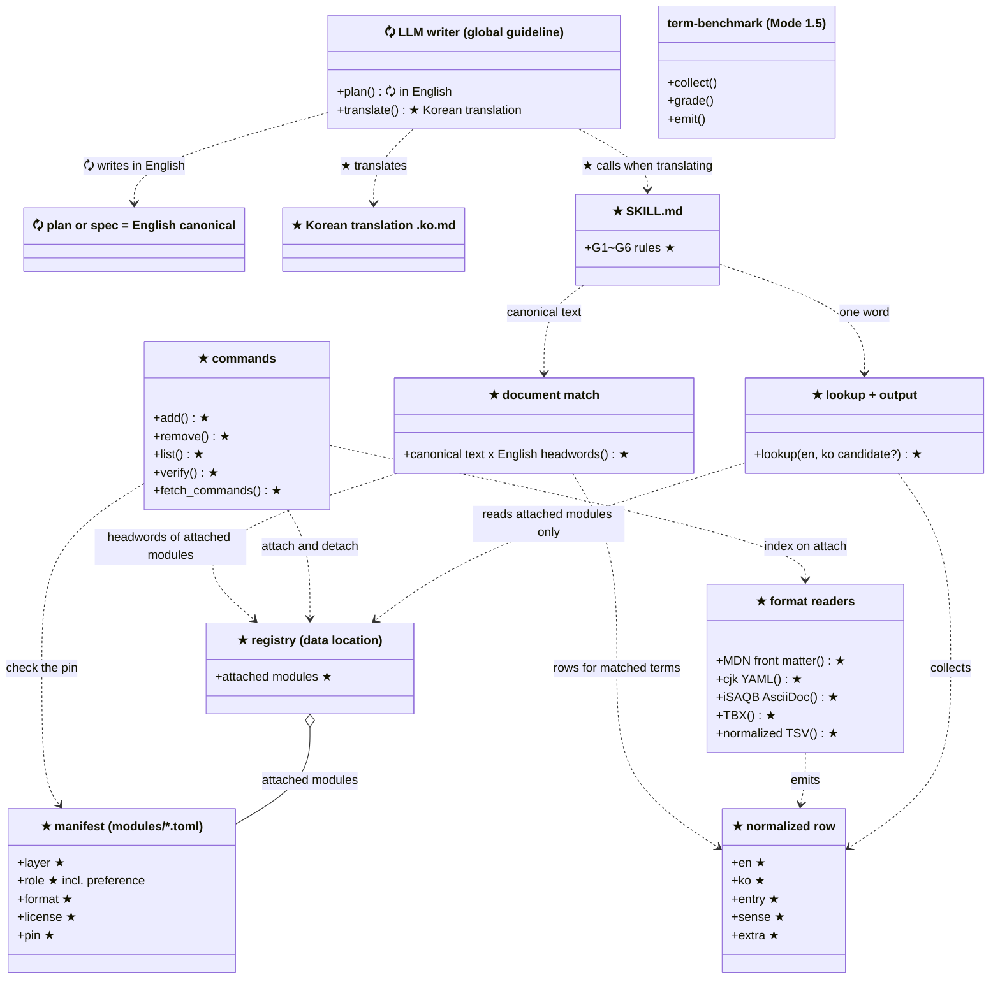
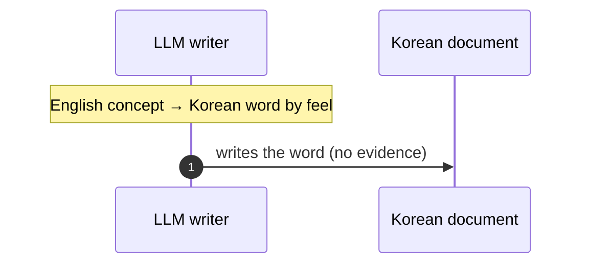
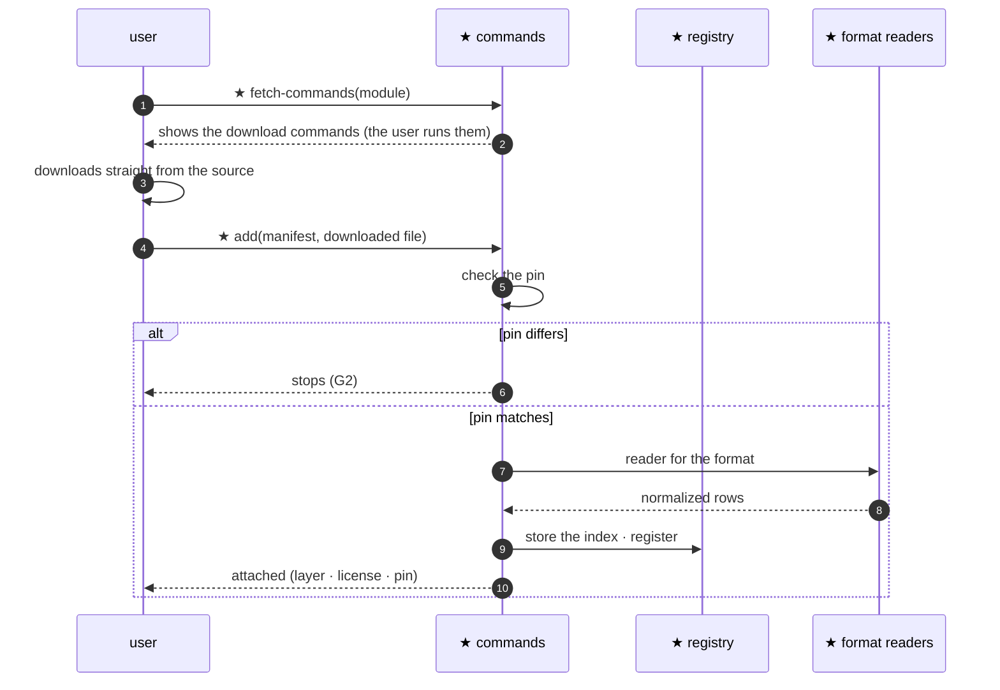
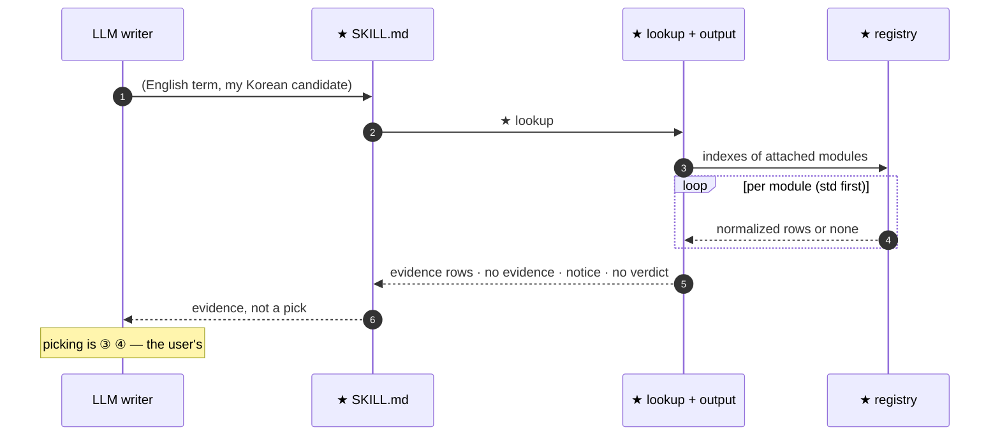
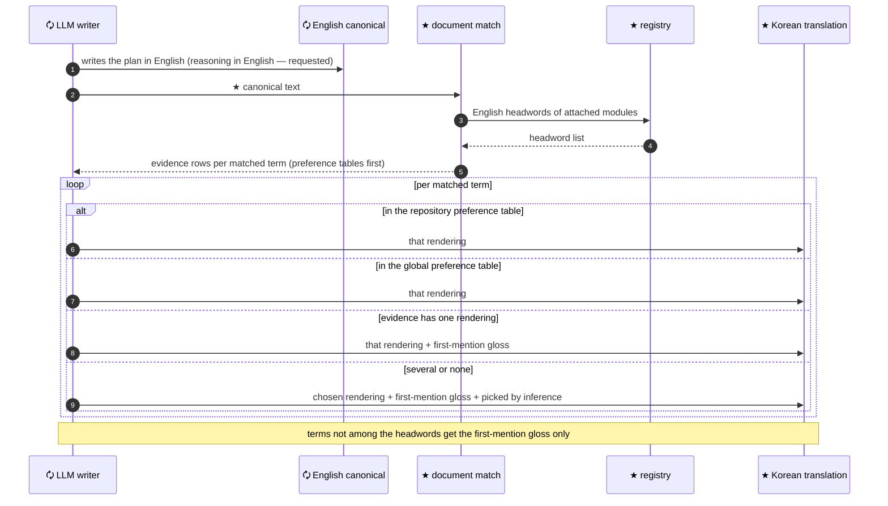
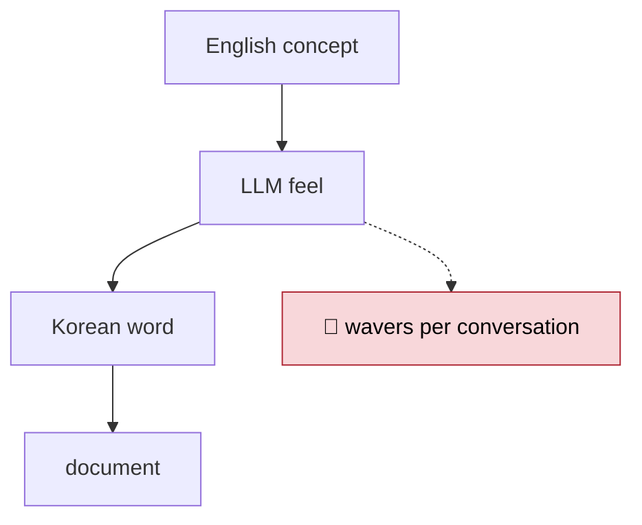
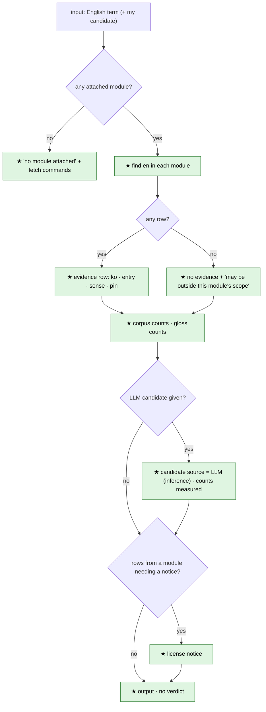
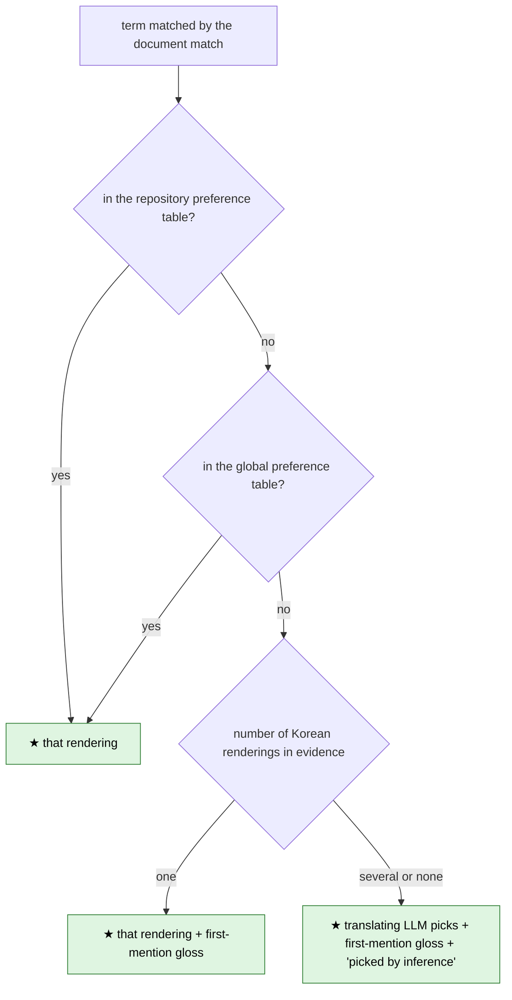

# 🧭 Plan — `ko-dev-terms` : grounding the Korean rendering of English developer terms

> 🌐 **Canonical (English).** Korean translation: [`2026-10-28-ko-dev-terms.ko.md`](2026-10-28-ko-dev-terms.ko.md). Edit this file only, then regenerate the translation
> 📅 2026-10-30 · branch `claude/loving-knuth-0tuhzs` · **Before = `cfb1e5c`** (same as main) — `ko-dev-terms` does not exist in this repository yet (0 lines of code)
> 📄 Evidence: user answers 2026-10-28 to 30 · [handoff](../../handoffs/HANDOFF-2026-10-28-official-term-grounding.md) · [resume](../../handoffs/RESUME-2026-10-28-official-term-grounding.md) · research reports [1](<../../../reports/한국어 개발 용어 근거 방법.md>) · [2](<../../../reports/언어 불문 설계 용어 출처.md>) · [30-term check](<../../../research_notes/언어 불문 설계 용어 출처/isaqb_30_check.md>)
> 🔒 Rules to keep: no word restriction while planning — evidence is used only when translating into Korean · the skill never picks (G5) — the pick comes from a preference table (③) or from the translating LLM (marked as inference) · no evidence → `근거 없음` / "no evidence" (G1) · check the pin, stop on mismatch (G2) · source files, indexes and registry live outside the repository (MS license 2(i)) · never execute code shipped by a module · no imports from other axes · Python standard library only · resources separate from code
> 🧪 Verification: register the same file twice → byte-identical index · test each format reader against **real files** at pinned commits · precision sample for counting · hand-check 5 sample rows in the pilot · gates (pytest · pyright strict · citations · resources · README · isolation)
> ✋ Approval: **not approved** — no data is downloaded and no code is written

## 0. 🎯 One page

| Item | Content |
|---|---|
| 🎯 Scope | A lookup that **injects evidence for Korean renderings of developer terms when a plan or spec written in English is translated into Korean**. Also consulted to check whether a Korean word an LLM chose is the rendering actually used in the developer domain. First goal: the base layer (std) |
| 🧩 One-line conclusion | A frame to attach and detach glossary modules + built-in readers per format + a lookup that never picks + a document match that compares the English canonical text against registered headwords at translation time. All data is downloaded and registered by the user |
| 🟰 Unchanged | Code and outputs of Mode 1 · 1.5 · 2. The `term-benchmark` skill. The pass criteria of existing gates |
| 🗘 Changed | ★ new top-level folder `ko-dev-terms/`. 🗘 four gate settings (`pyrightconfig.json` · citation test · resource test · README drift command) include that folder. 🗘 one line in the repository `CLAUDE.md` working rules: "new plans and specs are two files". 🗘 this plan becomes an English canonical plus a Korean translation |
| ⚠️ Pitfalls | For the std layer, **software engineering and testing & quality have 0 measured Korean pairs**. The Korean MS file has not been opened yet (blocked in this session). Other senses of the same word (coupling = CRM record link) mix into the evidence. Without a preference table and with competing renderings, the translating LLM picks — that is inference, so it is marked. Because of the two-file form, `report-spec init` lists the `.ko.md` separately |
| 🚫 Out of scope | Korean → English reverse lookup · Mode 1.5 · 2 · wiki integration · judgment order and enforcement tools (④) · personal-idiolect graph (⑤, [decision 0013](../../decisions/0013-personal-language-graph-deferred.md)) · requirements engineering and project management in std · restricting words during planning · a pre-implementation effect experiment |

## 0-1. 🧭 Nine stages at a glance

```text
📍 Before (cfb1e5c)              │ 🛠️ After · proposal
─────────────────────────────────┼──────────────────────────────────────────────
LLM writer                        │ 0 ✋ approve this plan
  └ picks words by feel           │ 1 🔎 third lookup — std gaps · real MS Korean file (V1)
     (간선/엣지 wavered per chat) │ 2 ★ module frame — manifest · registry · add/remove/list/verify
                                  │ 3 ★ built-in readers — MDN front matter · cjk YAML · iSAQB AsciiDoc · TBX
evidence: none                    │ 4 ★ counting — glosses and word counts in MDN prose
gates: machine runner viz tools   │ 5 ★ lookup + output — never picks · no evidence · notice
                                  │ 6 ★ SKILL.md + link · 🗘 gate inclusion
                                  │ 7 🧪 pilot — handoff §1 source terms + std probes
                                  │ 8 ✋ results to the user — material for ③④
```

| 🧬 Pattern | Meaning |
|---|---|
| Only data attaches | A module is a manifest + a file the user downloaded. New formats arrive only through code changes in the skill |
| Every reader emits one shape | Whatever the format, everything becomes one normalized row |
| Rows carry their origin | Each row carries the module name, the pin and the sense label |

## 0-2. 🚦 Status · decided

| Item | Progress |
|---|---|
| Handoff received · stage-0 checks (V2 to V6) | ✅ done — V1 ⚠️ blocked (MS download server) |
| Two research rounds · 30-term check | ✅ done |
| Plan — decisions folded in · rewritten in this style | ✅ done |
| This plan as English canonical + Korean translation · one repository rule line | ✅ done |
| Plan approval | ❌ not done |
| Third lookup (§9 T1 to T7) | ❌ not done — deferred by the user |
| Module frame · readers · counting · lookup · SKILL.md · pilot | ❌ not done |

| What | 👍 Chosen | 👎 Rejected | Who · when |
|---|---|---|---|
| Skill location | 👍 top-level folder `ko-dev-terms/` in this repository (like a Mode) | 👎 user-global only · 👎 under `.claude/skills` | user · 10-28 |
| Name | 👍 `ko-dev-terms` | 👎 `official-term-grounding` · 👎 `term-grounding` | user · 10-28 |
| Scope | 👍 a standalone skill | 👎 wiring into Mode 1.5 outputs · 👎 a rendering check before Mode 1.5 | user · 10-28 |
| Lookup direction | 👍 English → Korean only | 👎 both directions | user · 10-28 |
| Cache | 👍 straight from the source + cloud environment cache | 👎 private GitHub cache · 👎 no MS in the cloud | user · 10-28 |
| MS license (D1) | 👍 conditional acceptance | 👎 decide after reading terms inside the zip · 👎 drop MS | user · 10-28 |
| LLM candidates (D4) | 👍 only with a label | 👎 not allowed | user · 10-28 |
| Judgment order (D5) | 👍 not in the skill — ④ belongs to the user | — | user · 10-28 |
| Class of project glossaries | 👍 ① authoritative source | 👎 ② corpus · 👎 a third class | user · 10-28 |
| Publishing the handoff | 👍 generalize only content specific to the original project | 👎 as received · 👎 keep it out | user · 10-28 |
| Weight | 👍 means scope and priority (G5 kept) | 👎 scoring candidates | user · 10-28 |
| Scope list | 👍 international standard vocabulary + user list | 👎 user list only · 👎 no scope | user · 10-28 |
| Glossary sources | 👍 language-agnostic design and software engineering | 👎 framework-bound glossaries · 👎 Kubernetes · 👎 python-docs-ko | user · 10-28 |
| Measuring blocked hosts | 👍 defer to the third lookup, mark only | — | user · 10-28 |
| Glossary form | 👍 glossary = module (attach and detach like a DLL) | — | user · 10-29 |
| Base layer std | 👍 architecture · design · software engineering · programming languages (especially OOP) · testing & quality | — | user · 10-29 |
| Axis A module form | 👍 data module + built-in readers | 👎 normalized form only · 👎 code plugins | user · 10-29 |
| Axis B delivery | 👍 manifests only — the user downloads all data | 👎 bundle what licenses allow · 👎 auto-download on first run | user · 10-29 |
| Axis C software-engineering boundary | 👍 exclude requirements engineering and project management | 👎 include requirements only · 👎 include both | user · 10-29 |
| Axis D when to start | 👍 refine the plan first | 👎 build the module frame now · 👎 third lookup first | user · 10-29 |
| Pre-implementation effect experiment | 👍 proceed without it | 👎 a four-condition comparison | user · 10-30 |
| Rationale 1 — unified terms reduce review misjudgment | 👍 assumed true (user experience — decoding terms is the bottleneck) | — | user · 10-30 |
| Rationale 2 — resource search gets faster | — | 👎 dropped — Korean is a rule inside the repository; outside it (search · external tools · reasoning) there is no language restriction | user · 10-30 |
| Planning language | 👍 English canonical plan + reasoning in English requested (cannot be verified) — refined by the "global guideline form" and "repositories without the skill" rows below | 👎 plan documents only | user · 10-30 |
| When word evidence is used | 👍 only when translating into Korean | 👎 a "use only DB words" rule during planning | user · 10-30 |
| Guideline location | 👍 user-global `~/.claude/CLAUDE.md` | 👎 this repository's CLAUDE.md · 👎 SKILL.md only | user · 10-30 |
| Side-by-side form | 👍 two files — English `<name>.md` canonical + Korean `<name>.ko.md` copy (when the skill is used, and in this repository) | 👎 one file, English above Korean · 👎 alternating paragraphs | user · 10-30 |
| Documents covered | 👍 plans and specs only | 👎 + handoffs · 👎 every document in the repository | user · 10-30 |
| Comment and commit language | 👍 keep each repository's current convention | 👎 inject translations into comments too · 👎 comments in English | user · 10-30 |
| Finding terms at translation time | 👍 string match against registered English headwords | 👎 the LLM extracts terms · 👎 both | user · 10-30 |
| Competing renderings or no evidence | 👍 preference table first; otherwise the translating LLM picks, glosses the English at first mention and marks "picked by inference" | 👎 LLM picks and glosses only · 👎 keep the English as is | user · 10-30 |
| Preference table location | 👍 per repository + user-global (the repository's wins) | 👎 per repository only · 👎 global only | user · 10-30 |
| Unknown terms | 👍 learned through Mode 1.5 — matches its goal | — | user · 10-30 |
| Global guideline form | 👍 in English · shortest · no skill dependency | 👎 Korean text · 👎 text that depends on the skill | user · 10-30 |
| Plans and specs in repositories without the skill | 👍 think and draft in English → one Korean file + first-mention gloss | 👎 one English file · 👎 leave it to each repository | user · 10-30 |
| Where the two-file rule lives | 👍 when the skill is used (SKILL.md) + this repository's rules — before the skill exists, first-mention gloss only | 👎 only this plan first | user · 10-30 |
| This plan | 👍 under the new rule — English canonical + Korean translation | — | user · 10-30 |

## 0-3. 📖 Terms

| English term | Korean | Code name [proposal] | Meaning |
|---|---|---|---|
| glossary module | <span style="color:cyan">단어집 모듈</span> | `ko-dev-terms/modules/<name>.toml` + the user's file | One glossary that can be attached and detached |
| manifest | <span style="color:cyan">매니페스트</span> | `modules/<name>.toml` | Module name · layer · role · format · source · license · pin |
| normalized row | <span style="color:cyan">정규형 행</span> | `en` · `ko` · `entry` · `sense` · `extra` | The single row shape every reader emits |
| sense label | <span style="color:cyan">의미 표지</span> | `sense` | The source's own definition or category — separates other senses of the same word |
| pin | <span style="color:cyan">고정값</span> | `pin` | File SHA-256 · commit SHA · edition |
| data location | <span style="color:cyan">데이터 자리</span> | `KO_DEV_TERMS_DATA` | Folder outside the repository holding source files, indexes and the registry |
| std layer | <span style="color:cyan">std 층</span> | `layer = "std"` | The layer whose manifests ship by default |
| attach · detach | <span style="color:cyan">붙이기 · 떼기</span> | `add` · `remove` | Register and unregister a module |
| fetch commands | <span style="color:cyan">받는 명령</span> | `fetch-commands` | Only shows the manifest's download commands |
| preference table | <span style="color:cyan">선호표</span> | `role = "preference"` module — per repository · user-global | The user's or team's table followed first when renderings compete (③). The repository's wins over the global one |
| Korean translation | <span style="color:cyan">한국어 번역본</span> | `<name>.ko.md` | Copy beside the English canonical — edit only the canonical and translate again |
| registry · format readers · document match | 등록부 · 형식별 읽기 · <span style="color:cyan">문서 대조</span> | names undecided | List of attached modules / one function per format / string-match the English canonical text against registered English headwords |
| first-mention gloss | 첫 등장 병기 | (a rule — no code name) | Only at a term's first appearance in a document, add the English original in parentheses after the Korean: `부수 효과(side effect)` |

## 1. 🔁 Before → After

| Target | 📍 Before (what failed · now) | 🛠️ After · proposal | 🎉 Resolved | 🔭 Expected | Progress |
|---|---|---|---|---|---|
| Picking words | 🐞 the LLM picks by feel — `간선` / `엣지` wavered within one conversation (handoff §1) | the lookup returns evidence rows | evidence instead of inference | same question + same registry = byte-identical answer | ❌ |
| Evidence | none | the user downloads and attaches glossary modules | sources can be chosen and swapped | `list` shows layer · license · pin | ❌ |
| Homonyms | 🐞 coupling = CRM record link, node = Node.js mix in as design senses (measured) | a sense label on every row | other senses are not mistaken for evidence | the first line of the source's definition follows each row | ❌ |
| License | the MS source may not be published for others to copy | all data outside the repository · only manifests inside | no path for source files into the public repository | `git status` never shows data | ❌ |
| Planning language | planning in Korean may hurt reasoning (🟡 MGSM-line research) · no guarantee the LLM thinks in English | user-global guideline (English · shortest) — think and draft in English, leave one Korean file + first-mention gloss in the repository. With the skill and in this repository: English canonical + Korean translation | free thinking, review in the mother tongue | with the skill and in this repository `.md` + `.ko.md`; elsewhere one Korean file + gloss | ❌ |
| Renderings at translation time | the translating LLM picks by feel | inject evidence rows through the document match · preference table first · when they compete, first-mention gloss + inference mark | renderings are tied to evidence or to the user's table | every developer term in the translation is backed by a preference table, by evidence, or by "picked by inference" | ❌ |
| Design vocabulary gap | ⚠️ 0 evidence for SOLID · side effect · postcondition | std layer + third lookup + user list | the size of the gap is known | the pilot yields the share of "no evidence" | ❌ |

## 2. 🧱 Structure — classDiagram

### ★ New · 🗘 changed items · After proposal

| Order | Kind | Item | Change | Owner/role |
|---|---|---|---|---|
| 1 | Module | ★ `ko-dev-terms` (top-level project · skill) | new | Glossary-module frame and lookup. Imports no other axis |
| 2 | File | ★ `ko-dev-terms/CLAUDE.md` · ★ `README.md` · ★ `SKILL.md` | new | Compass · listing · usage |
| 2 | File | ★ `ko-dev-terms/modules/*.toml` | new | std module manifests — no data |
| 2 | File | ★ `ko-dev-terms/resources/` (particle list · output template · notice) | new | Resources — Python only reads them |
| 2 | File | ★ `ko-dev-terms/ko_dev_terms/*.py` · ★ `ko-dev-terms/test_*.py` | new | Package and tests. File names undecided |
| 2 | File | ★ `.claude/skills/ko-dev-terms` (link) | new | Where Claude finds the skill |
| 2 | File | 🗘 `pyrightconfig.json` · 🗘 `test/test_docs_citations.py` · 🗘 `test/test_prompt_resources.py` · 🗘 `CLAUDE.md` | changed | Gate inclusion |
| 2 | File | 🗘 `tools/cloud_env.sh` | changed | Download commands · `add` · writing the global guideline into the cloud setup script (the user pastes it into the environment settings again) |
| 2 | File | 🗘 `~/.claude/CLAUDE.md` (outside the repository · per machine) | changed | One section added — English · shortest · no skill dependency. Pasted by the user (text in §5) |
| 2 | File | 🗘 `CLAUDE.md` (this repository) working rules | changed | One line — new plans and specs are two files; before the skill exists, first-mention gloss only |
| 2 | File | 🗘 `docs/superpowers/plans/2026-10-28-ko-dev-terms.md` → English canonical · 🗘 Korean version renamed to `.ko.md` | changed · renamed | This plan |
| 2 | File | ★ `<name>.ko.md` per plan or spec | new | Korean translation — repositories using the skill, and this repository |
| 3 | Class | undecided | — | Concepts are decided — manifest · normalized row · registry. Whether they become classes, and their names, is undecided |
| 4 | Function | ★ commands `add` · `remove` · `list` · `verify` · `fetch-commands` | new | Command names are proposals |
| 4 | Function | ★ format readers — MDN front matter · cjk YAML · iSAQB AsciiDoc · TBX · normalized TSV | new | One function per format. Names undecided |
| 4 | Function | ★ counting · ★ lookup · ★ output rendering · ★ document match | new | Names undecided |
| 5 | Member | ★ normalized-row columns `en` · `ko` · `entry` · `sense` · `extra` | new | [proposal] |
| 5 | Member | ★ manifest fields — name · layer · domains · role (`ko-pair` · `en-scope` · `corpus` · `preference`) · format · source/commands · license · pin · where the sense label is read | new | [proposal] |

Legend: **★ newly created · 🗘 changed/updated/refreshed · no mark = reused as is · ✕ removed**. These marks describe the kind of change, not implementation or verification status.

### 📍 Before · `cfb1e5c`



### 🛠️ After · proposal (class names are concepts — undecided)



`term-benchmark` is unchanged and has no edge — Mode 1.5 integration is out of scope.

## 3. ⏱️ Call order — sequenceDiagram

### 📍 Before



### 🛠️ After · proposal — attaching a module



### 🛠️ After · proposal — lookup



### 🛠️ After · proposal — translation (plans and specs)



## 4. 🔀 Branches — flowchart

### 📍 Before



### 🛠️ After · proposal — lookup



### 🛠️ After · proposal — one term at translation time



Legend: green = ★ new · amber = 🗘 changed · gray = unchanged · red = blocking problem.

## 5. 📝 Where to change and proposed diffs

| File · symbol | Change | Why | Evidence |
|---|---|---|---|
| ★ all of `ko-dev-terms/` | new | the location decision in §0-2 | user · 10-28 |
| 🗘 `pyrightconfig.json` `include` · `extraPaths` | add the folder | pyright strict covers only four axes today | [code checked] `pyrightconfig.json` |
| 🗘 `test/test_docs_citations.py` `contextDocs()` | add two documents | new context documents join the citation check (`test/CLAUDE.md`) | [code checked] |
| 🗘 `test/test_prompt_resources.py` `CODE_TOPS` | add the folder | the resources-versus-code gate | [code checked] line 15 |
| 🗘 `CLAUDE.md` gate table | add the folder to the README drift command | first confirm that `tools/gen_readme.py` reads this folder's layout | [code checked] line 117 |
| 🗘 `tools/cloud_env.sh` | add download commands · `add` · write the global guideline into `~/.claude/CLAUDE.md` | cloud environment cache · global guideline in cloud sessions too | [code checked] · cloud environment docs ("a setup script that writes `~/.claude/CLAUDE.md`") |
| 🗘 `~/.claude/CLAUDE.md` (outside the repository) | add a section | think in English · Korean file · first-mention gloss — English text, no skill dependency | 👍 user · 10-30 |
| 🗘 `CLAUDE.md` working rules | add one line | new plans and specs are two files; before the skill, gloss only | 👍 user · 10-30 |

**🗘 `pyrightconfig.json` — changed · proposed diff**

```diff
-  "include": ["machine", "runner", "viz", "tools"],
+  "include": ["machine", "runner", "viz", "tools", "ko-dev-terms"],
@@
-  "extraPaths": ["machine", "runner", "viz", "tools"],
+  "extraPaths": ["machine", "runner", "viz", "tools", "ko-dev-terms"],
```

**🗘 `test/test_docs_citations.py` `contextDocs()` — changed · proposed diff**

```diff
             ".claude/skills/term-benchmark/SKILL.md",
-            ".agents/skills/codebase-terms-survey/SKILL.md"]
+            ".agents/skills/codebase-terms-survey/SKILL.md",
+            "ko-dev-terms/CLAUDE.md",
+            "ko-dev-terms/SKILL.md"]
```

**🗘 `test/test_prompt_resources.py` — changed · proposed diff** (whether this test accepts a folder name with a hyphen is ❓ unverified)

```diff
-CODE_TOPS = ("runner", "viz", "machine", "tools")   # 긴 글을 찾는 폴더 — 시험 파일은 뺀다
+CODE_TOPS = ("runner", "viz", "machine", "tools", "ko-dev-terms")   # 긴 글을 찾는 폴더 — 시험 파일은 뺀다
```

**🗘 `CLAUDE.md` gate table — changed · proposed diff** (count measured after inclusion)

```diff
-| README 표류 | `.venv/bin/python tools/gen_readme.py --check machine runner viz tools` | 4개 일치 |
+| README 표류 | `.venv/bin/python tools/gen_readme.py --check machine runner viz tools ko-dev-terms` | (편입 뒤 실측) |
```

**🗘 `~/.claude/CLAUDE.md` (outside the repository) — added section · text [proposal]** — the user pastes it into the global file on the Mac and the Windows PC

```markdown
## Plans in English, Korean for people

- For plans and specs, reason and draft in English (this cannot be verified — follow it anyway), then write the repository file in Korean.
- In that Korean file, gloss each technical term with its English original at its first mention: `부수 효과(side effect)`.
- Korean is a rule for files left in the repository. Searches, tool calls and reasoning have no language restriction.
- Code comments and commit messages follow each repository's convention.
- If a repository or skill asks for more — for example an English canonical plan beside a Korean `.ko.md` — follow it.
```

**🗘 `CLAUDE.md` working rules — changed · diff** (this repository — ✅ applied now)

```diff
 - 커밋 메시지는 `personal-commit-messages` 스킬을 따른다 (소문자 `[tag] : subject` 한 줄, 한국어, 본문 없음).
+- 새 계획 · 사양 문서는 영어 정본 `<이름>.md` 와 한국어 번역본 `<이름>.ko.md` 두 파일로 쓴다. 고칠 때는 정본만 고치고 번역본을 다시 만든다. `ko-dev-terms` 가 생기기 전에는 번역할 때 첫 등장 영어 병기만 한다.
```

**🗘 `tools/cloud_env.sh` — changed · proposed diff** (appended at the end; same text as above)

```diff
 echo 'digraph { a -> b }' | dot -Tsvg_inline > /dev/null
 echo 'digraph { a -> b }' | dot -Tpng > /dev/null
+mkdir -p ~/.claude
+cat >> ~/.claude/CLAUDE.md <<'EOF'
+## Plans in English, Korean for people
+(the text above, verbatim)
+EOF
```

**★ `ko-dev-terms/modules/mdn-glossary-ko.toml` — new · outline · pseudocode** (field names are proposals; the commit is a measured value)

```toml
name    = "mdn-glossary-ko"
layer   = "std"
role    = "ko-pair"            # ko-pair | en-scope | corpus | preference
format  = "mdn-frontmatter"
domains = ["programming", "design"]
license = { name = "CC-BY-SA-2.5", url = "https://github.com/mdn/translated-content/blob/main/LICENSE.md", share_alike = true }
pin     = { commit = "2a7c03a449507969b925ac954f41c340d7c50263", path = "files/ko/glossary" }
sense   = "subfolder"
fetch   = [
  "git clone --filter=blob:none --no-checkout https://github.com/mdn/translated-content",
  "git -C translated-content sparse-checkout set --no-cone files/ko/glossary/",
  "git -C translated-content checkout 2a7c03a449507969b925ac954f41c340d7c50263",
]
```

**★ Normalized row — output shape example** (values seen at the pinned MDN commit)

```text
en                 ko         entry                                            sense     extra
callback function  콜백 함수  files/ko/glossary/callback_function/index.md      Glossary
```

## 6. 📦 std module candidates — measured so far

The probe list and the class judgments are research instruments, not ground truth.

| Module | Role | Format | Pin | License | std area | Status |
|---|---|---|---|---|---|---|
| Microsoft Terminology (`ko`) | Korean pair | TBX | zip SHA-256 | MS Globalization License (👍 conditional acceptance) | all areas — `sense` separates other senses | ⚠️ Korean file not measured (T2). Measured through the English headwords of the French and German files instead: 36 of 63 probes, 13 of them only in other senses [measured] |
| MDN glossary | Korean pair | front-matter Markdown | commit `2a7c03a4` | CC-BY-SA 2.5 | programming languages (general 159) · design (37) | [measured] 58% of entries are web-platform specific — ❓ E4 |
| MDN Korean prose | frequency corpus | Markdown prose | same | same | all areas | [measured] probe glosses: 18 hits for 9 words |
| cjk-compsci-terms | Korean pair | YAML tables | commit `65a7584` | CC BY-SA 4.0 | `design-patterns` · `software-eng` · `programming` · `paradigms` | [measured] 28 tables · 259 entries, about 10 per table — ❓ E11 |
| iSAQB architecture glossary | English scope | AsciiDoc | commit `bd3ce64` | CC BY 4.0 | architecture · design | [measured] 274 headwords — ❓ E7 |
| GoF · SOLID · package principles · GRASP | English scope | name lists | book edition | names are not copyrightable (US law) | design | ❓ whether axis B applies |
| SEVOCAB (ISO/IEC/IEEE 24765) | English scope (manual lookup) | normalized TSV | lookup date · edition | IEEE · ISO — definitions not stored | software engineering | [unverified] T1 |
| ktword | Korean pair (manual lookup) | normalized TSV | entry number · date · body hash | free use with attribution (search summary) | design · software engineering | [unverified] T4 |
| ISTQB · KSTQB · ISO/IEC 25010 | English scope · Korean pair | undecided | undecided | undecided | testing & quality | [unverified] not yet researched, T7 |
| Korean Wikipedia | Korean pair | dump | dump date | CC BY-SA | all areas | [unverified] T3 — the largest candidate for the concept-term gap |
| User list | English scope + Korean candidates | normalized TSV | file hash | user | all areas | [my judgment] may become the main scope instrument |
| Preference table — per repository · user-global | preference (`preference`) | normalized TSV | file hash | user · team | all areas | filled by the user. The repository's wins over the global one |

| std area | Measured Korean pairs | [my judgment] |
|---|---|---|
| architecture · design | cjk-compsci-terms 20 · MDN design 37 — Korean MS file not measured | thin |
| software engineering | none | almost empty |
| programming languages · OOP | MDN general 159 · cjk-compsci-terms 19 | moderate |
| testing & quality | none | empty |

## 7. 📐 Rules — candidates · counting · output · data location

**Where Korean candidates come from**

| Mark | Candidate source | Deterministic? |
|---|---|---|
| (a) | target terms of Korean-pair modules | yes |
| (b) | gloss pattern in the frequency corpus `<Hangul word>\s*\(\s*<English>\s*\)` | yes |
| (c) | candidates given by the user — including the Korean candidate in a lookup input | yes |
| (d) | LLM candidates — `candidate source = LLM (inference)`, counts measured, 0 reported as 0 | no (labeled) |

**Counting** — prose only (front matter · code blocks · inline code · MDN macros `{{ … }}` · HTML comments excluded). Boundary rule v1: count only when the preceding character is not Hangul and what follows is a particle or not Hangul (stops `트리` ⊂ `트리거`); the particle list is a resource file. Precision sample: 100 random lines when a count is 100 or more, otherwise all. MDN `conflicting` · `orphaned` excluded.

**Output** — one row = source term · Korean candidate · module · evidence (entry id / `file:line` · count) · `sense` · pin · candidate source. Ordering is only by layer (std first) and role — not a verdict. Ends with `판정 : 하지 않음` ("no verdict"). If any row comes from a module that requires a notice, append it (MS: "Entry from Microsoft Learn's Globalization Essentials. © … Microsoft Corporation. All rights reserved."). The text shape comes from a resource template.

**Data location** — source files, indexes and the registry live in `KO_DEV_TERMS_DATA`; if unset, `~/.cache/ko-dev-terms` on Linux · Mac and `%LOCALAPPDATA%\ko-dev-terms` on Windows. GitHub sources use `git clone --filter=blob:none --no-checkout` + sparse + a pinned commit — never `codeload.github.com` archives (the cloud GitHub proxy returns 403 for archives of repositories not attached to the session). In the cloud, the user adds allowed domains and puts the download commands and `add` into the setup script — if it finishes within about 5 minutes, the snapshot is reused for about 7 days; otherwise move only the download into a background SessionStart hook.

**Translation rules** (rules of the skill — they live in SKILL.md and in this repository's rules, not in the global guideline) — the document match finds terms whose English headword appears verbatim in the English canonical text (no inference). Renderings follow: repository preference table → global preference table → the single rendering in the evidence, if there is exactly one → if several or none, the translating LLM picks and marks "picked by inference". Anything not from a preference table gets the first-mention gloss. Terms not among the headwords also get the first-mention gloss. The skill only **applies** this order as given by the user (D5 — "apply it if the user provides it").

**Manifest form** — TOML is proposed (the repository's `config/*.toml` convention). `tomllib` exists from Python 3.11, so decide after ⚠️ M5; below 3.11, use JSON.

## 8. 🧪 Checks and next steps

**Implementation slices — dependency order** (all ❌ not done)

| # | Deliverable | Check | Precondition |
|---|---|---|---|
| 0 | ✋ approve this plan | user | — |
| 0b | ✋ paste the user-global guideline (English · five lines) — `~/.claude/CLAUDE.md` on the Mac and the Windows PC; the setup script in the cloud | user | 0 |
| 1 | 🔎 third-lookup results (§9) | std gap sizes and the real Korean MS file (V1) are filled in as facts | the user opens allowed domains |
| 2 | ★ module frame — manifest form · registry · five commands · normalized TSV reader | register the same file twice → byte-identical index · nothing left after `remove` | 0 |
| 3 | ★ built-in readers — MDN · cjk · iSAQB · TBX | run against every real file at the pinned commits and count format exceptions · hand-check five source terms | 2 (TBX also needs 1) |
| 4 | ★ counting — MDN prose | precision sample | 2 |
| 5 | ★ lookup + output | never picks · "no evidence" · notice · scope label | 3 · 4 |
| 5b | ★ document match + preference order | same canonical twice → same evidence list · preference order follows the user's tables | 5 |
| 6 | ★ SKILL.md + link · 🗘 gate inclusion | new gates green — the two existing reds (wiki drift · layer distribution) are separate | 5 |
| 7 | 🧪 pilot — handoff §1 source terms + std probes + translating one English plan | evidence or "no evidence" per row · same result twice · hand-check 5 sample rows | 6 |
| 8 | ✋ report pilot results — material for ③④ | user confirmation | 7 |

시범 원어 목록은 [제안] 으로 먼저 보인다 — 인계 문서 1절 표의 영어 병기에서 기계적으로 뽑고, 병기가 없는 행(`트리` · `입장권`)은 사용자가 채운다.

**❓ Open decisions**

| # | What | Evidence | [my judgment] | Impact |
|---|---|---|---|---|
| E4 | Filter the MDN glossary for std (general 159 · design 37 only)? | [measured] 325 web-platform entries. The class judgment is one researcher's | filter — it matches what std means (65) | most MDN rows move to an optional non-std module |
| E7 | Count iSAQB as "international standard vocabulary"? | [measured] 30-term check — `node` is a false hit, `open-closed principle` is covered by SOLID | include it, labeled separately as a "certification-body scope list", not a standard (60) | iSAQB is practically the only machine-readable part of the scope list |
| E11 | cjk-compsci-terms as a std module? | [measured] clean but about 10 entries per table | include — independent evidence for the practitioners' loanword spellings (60) | CC BY-SA share-alike applies to derived rows |
| — | Keep the name lists (GoF · SOLID · …) as `modules/` resources? | lists we write, not third-party glossaries | keep them as resources — axis B is read as a decision about third-party data (55) | otherwise merge them into the user list |
| — | When to run the third lookup | TBX reading in stages 2 · 3 depends on it | — | the later it runs, the longer the pilot goes without MS rows |
| — | Form of the "picked by inference" mark | it stays in the translation | a short marker after the first-mention gloss (e.g. `†`) plus a list at the end of the document (55) | the marker must not clutter the body |
| — | Remaining research candidates K1 to K12 · E1 to E13 | already folded in: E2 · E6 → `sense`, E9 · E10 → manual-lookup modules, E3 · E5 → excluded | — | — |

**⚠️ To measure during execution**

| # | What | Why unknown |
|---|---|---|
| M1 | layout of the MS zip and any separate terms | `download.microsoft.com` blocked in this session |
| M2 | MS download time — within the 5-minute setup-script window? | same reason |
| M3 | is the repository clone present when the setup script runs? | not found in the docs |
| M4 | does GitHub accept a shallow fetch by commit SHA? | not tried |
| M5 | Python version on the Windows PC — the manifest form depends on it | the handoff only says "python is installed" |
| M6 | format exceptions in the MDN glossary | only 2 samples seen |

## 9. 🔎 Third lookup — marked only, not done yet

User answer: "다음 3차 조회 내용으로 당장 말고 노트에 마크업만" (make it the next, third lookup — not now; only mark it up in the notes). The user adds the hosts to the allowed domains; changes apply from the next session.

| # | What to measure | Hosts to open |
|---|---|---|
| T1 | in SEVOCAB: the 33 probes outside iSAQB and the name lists · export · terms of use · whether SWEBOK v4 has a glossary | `pascal.computer.org` · `www.computer.org` (· `www.swebok.org`) |
| T2 | the real Korean MS TBX — V1 · status fields · Korean targets and definitions · transliteration rules in the style guide | `download.microsoft.com` · `aka.ms` |
| T3 | Korean Wikipedia · Wikidata — titles · redirects · glosses in first sentences · Korean labels | `dumps.wikimedia.org` · `ko.wikipedia.org` · `www.wikidata.org` |
| T4 | ktword — re-measure the probes · English glosses in the body · `robots.txt` | `www.ktword.co.kr` · `ktword.co.kr` |
| T5 | software part of KS X 0001 · a KS adoption of 24765 · a TTA software-engineering terminology standard | `standard.go.kr` · `e-ks.kr` · `standard.tta.or.kr` · `terms.tta.or.kr` |
| T6 | NCS · Engineer Information Processing exam · refactoring.guru · refactoring, PoEAA, EIP and DDD catalogs. IREB only as an optional non-std module candidate | `www.ncs.go.kr` · `www.q-net.or.kr` · `refactoring.guru` · `martinfowler.com` · `refactoring.com` · `www.enterpriseintegrationpatterns.com` · `domainlanguage.com` (· `cockpit.ireb.org`) |
| T7 | testing & quality — ISTQB glossary · KSTQB · ISO/IEC 25010 and its KS adoption | decided during research |

## 10. 🧱 New-structure disclosure (`design-decision-discipline` §2.5)

| Item | New top-level folder `ko-dev-terms/` | Glossary module boundary |
|---|---|---|
| Implementers | 0 → 1. Python that reads TBX · `.po`: 0 hits [code checked] (`termEntry` · `.tbx` · `msgstr` grep — the one hit is the `TermEntry` type in `runner/run_mode1_5.py`) | five measured formats (TBX · front-matter Markdown · YAML · AsciiDoc · name lists) + normalized TSV |
| Consumers | 0 today. Two expected (report-builder · codebase wiki) — the user's statement | 1 — the lookup |
| Deletion test | nothing reappears if removed — no consumer yet | if removed, per-source reading · license · scope · pin scatter into the lookup code — once per source |
| Relation to the plan | handoff §7-1 put scripts under `scripts/` → 👍 "새로운 스킬 프로젝트로 … Mode 개발하듯" (a new skill project, developed like a Mode) | version 1's "no registry · no plugins" → 👍 glossary = module. The boundary is a data shape, not a code interface, and modules carry no code (👍 axis A) |
