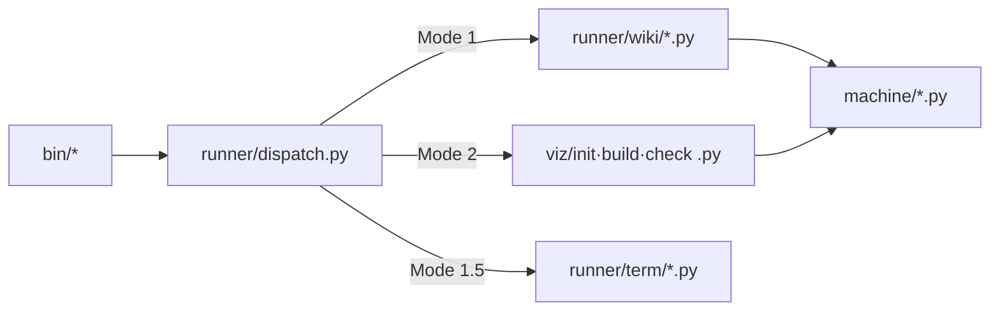

# 세 축과 두 저장소 구조

이 문서는 report-builder 저장소를 처음 보는 사람이 "코드가 어디서 시작해서 어디로 흘러가는가"를
알 수 있게 하는 개괄이다. 특정 함수나 클래스의 세부 동작은 다루지 않는다.

## 이 저장소가 하는 일

report-builder 는 **다른 저장소의 문서를 읽어 보고서(HTML)나 위키(Markdown)를 만들어내는 렌더러**다.
스스로 무엇을 검토하거나 판정하지 않는다 — 판정은 항상 사람의 몫이고, 이 도구는 사람이 판정을
내리기 쉬운 형태로 자료를 압축해서 보여줄 뿐이다.

**이 저장소는 두 종류의 코드베이스를 오간다.**

1. **도구 저장소** — 지금 이 저장소(report-builder). 렌더링 로직·CLI 진입점·React 컴포넌트가 산다.
2. **대상 저장소** — 사람이 실제로 작업 중인 프로젝트. 검토 대상 문서(`specs/*.md`, `plans/*.md`)와
   빌드된 산출물(`out/report.html`)이 여기 생긴다.

즉 `report-spec build` 명령을 대상 저장소의 스펙 디렉토리에서 실행하면, **코드는 이 저장소에서
오지만 산출물은 대상 저장소 안에 남는다.** 이 저장소 자신의 계획서를 이 저장소 자신의 도구로
검토하는 자기호스팅 구조도 가능하다(`docs/superpowers/specs/`).

## 세 축 — 언어가 아니라 하는 일로 가른다

코드는 디렉토리별로 크게 세 가지 성격(축)으로 나뉜다. 어떤 파일이 파이썬인지 JavaScript 인지가
아니라, **그 파일이 무엇을 하는가**로 나눴다.

| 축 | 자리 | 가르는 질문 | 예시 |
|---|---|---|---|
| 러너(runner) | `runner/` + `bin/` | **시키는가** — 실행 순서를 잡고 자식 프로세스를 띄운다 | `runner/dispatch.py` |
| 기계(machine) | `machine/` | **계산하는가** — 정적 수집·정규화·용어 사전. 그림은 그리지 않는다 | `machine/normalize.py` |
| 시각(viz) | `viz/` | **그리는가** — HTML·SVG·다이어그램. 계산된 결과를 받아서 굽는다 | `viz/build.py` |

세 축 어디에도 속하지 않는 것(파이썬 해석기 탐색, 환경 점검, 경로 세척 같은 잡무)은 `tools/`
에 모인다(`tools/CLAUDE.md:1-5`).

**한 방향으로만 흐르지 않는 이유.** `runner/run_mode1.py` 같은 최상위 실행기는 반대로
`machine/`·`viz/` 를 직접 호출하기도 한다(`runner/CLAUDE.md`). 다만 이것은 순환 참조가 아니라
**자식 프로세스 경계로 갈린 두 방향**이다 — 같은 메모리 안에서 import 로 얽힌 것이 아니라, 파이썬
실행기가 최상위 오케스트레이터로서 그 아래 단계를 `subprocess` 로 부르는 구조다.

기계로 측정한 실제 모듈 의존 관계는 다음과 같다(`out/codegraph-raw/facts/modules.md:6-17`, 순환 0개):

| 모듈 | 클래스 수 | 의존 대상 |
|---|---:|---|
| machine | 409 | — (아무도 부르지 않는다, 불려 가기만 한다) |
| runner | 296 | machine |
| viz | 60 | — |
| tools | 21 | machine |

## 진입점 넷 — `bin/` 이 PATH 에 걸려 있다

`bin/` 에 실행 파일 네 개가 있고 전부 사용자 셸의 PATH 에 등록돼 있다(`~/.zshrc:211`, 도구 저장소
밖의 설정이라 이 저장소 안에서는 확인할 수 없다 — **Unknown, verify in `~/.zshrc`**).

| 진입점 | Mode | 명령 |
|---|---|---|
| `report-wiki` | 1 — 코드베이스 위키 | `prep` · `build` · `check` |
| `report-term` | 1.5 — 용어 이해도 점검 | `collect` · `grade` · `emit` |
| `report-spec` | 2 — 설계 검토 보고서 | `init` · `build` · `check` |
| `report` | 옛 이름 | `report-spec` 으로 위임 |

`report-wiki`·`report-spec`·`report-term` 셋은 `runner/dispatch.py:15` 의 `run_dispatch` 를
공유하고, 각자 자기 명령표만 갖는다(`bin/report-spec:16-20`). `run_dispatch` 는 명령 이름을
스크립트 경로로 바꾼 뒤(`runner/dispatch.py:9-13`), **확장자로 해석기를 고른다** — `.py` 면
파이썬, 아니면 node(`runner/dispatch.py:32-34`). `report` 만 이 표를 쓰지 않고, `report-spec` 을
통째로 자식 프로세스로 실행해 그대로 위임한다(`bin/report:14-15`).

## 산출물 불변식 — `<script>` 태그는 1개를 넘지 않는다

Mode 2 가 만드는 `out/report.html` 은 React `renderToStaticMarkup` 으로 정적 HTML 을 만드는 것이
원칙이라, 빌드가 끝나면 `<script>` 개수를 세어 1개를 넘으면 경고를 낸다(`viz/build.py:157-160`).
용어집이 있는 보고서만 용어 그래프 런타임 스크립트 1개를 싣는다(`viz/CLAUDE.md:69-73` — 이
저장소 안에서는 이 조건을 코드로 재확인하지 않았다: **Unknown, verify in `viz/build.py` 의 조건
분기**).

## 외부 의존

이 저장소가 실제로 끌어오는 외부 노드는 표준 라이브러리 위주다(`out/codegraph-raw/facts/external.md:6-10`,
접촉 간선 141건). 진입점 재료 표는 이 언어(Python)에 대해서는 비어 있다 — C# 수집기처럼
`--detail` 옵션으로 별도 덤프를 줘야 채워진다(`out/codegraph-raw/facts/entrypoints.md:6-8`).
**Unknown — 실제 진입점 후보 목록은 이 저장소에서 아직 만들어지지 않았다.**
