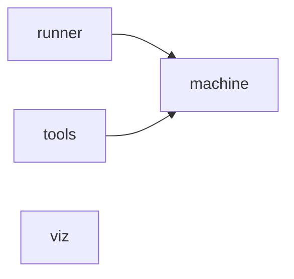

# 이 저장소는 무엇인가

## 한 줄 요약

`report-builder` 는 **렌더러**다. 다른 저장소에 있는 spec/plan 문서나 코드베이스를 읽어서,
사람이 판정을 내리기 좋은 형태의 산출물 — HTML 보고서 한 장, 또는 위키 — 로 구워낸다.
이 저장소 자신은 보고서를 담고 있지 않는다. 보고서는 항상 **대상 저장소** 쪽 디렉토리
(`<프로젝트>/specs/<slug>/`)에 생긴다.

## 세 갈래 명령 (Mode 1 / 1.5 / 2)

PATH 에 등록된 진입점 네 개가 `bin/` 에 있다(`bin`, `(표준) stdlib` 등과 함께 용어 사전에 등재된
모듈 — `bin` 은 "PATH 에 등록되는 진입점 네 개가 있는 디렉토리"라고 기록돼 있다).

| 진입점 | 하는 일 | 산출물 |
|---|---|---|
| `report-wiki` | 코드베이스를 읽어 위키를 만든다(Mode 1) | `docs/wiki/*.md` 류 |
| `report-term` | Plan 이 요구하는 용어의 이해도를 사람에게 객관식으로 묻고 채점한다(Mode 1.5) | 용어집 DB, 학습 노트 |
| `report-spec` | Spec/Plan 을 검토용 대시보드 HTML 한 장으로 압축한다(Mode 2) | `out/report.html` |
| `report` | `report-spec` 의 옛 이름. 그대로 위임한다 | `report-spec` 과 동일 |

세 진입점은 `runner/dispatch.py` 의 공통 디스패치 함수를 나눠 쓰고, 각자 자기 명령표만 갖는다.
(Unknown - verify in `runner/dispatch.py`: 공유 함수의 정확한 이름과 시그니처)

## Mode 2 흐름의 예 — 가장 자주 쓰는 경로

```
report-spec init <slug>   # specs/YYYY-MM-DD-<slug>-design.md 를 찾아 스펙 디렉토리를 만든다
report-spec build         # → out/report.html 을 굽는다. <script> 태그는 1개 이하만 허용된다
report-spec check         # script 수 · 타입 · 링크 무결성 · 용어집 대조를 검사한다
```

빌드된 `out/report.html` 이 이 도구의 최종 산출물 형태다. `viz/build.py:154` 부근에서
"구워진 보고서 하나짜리 HTML 파일. `<script>` 태그는 1개까지만 허용된다"는 제약을 강제한다
(용어 사전 `build.report.html` 항목).

## 성격축 셋 — 코드가 무엇을 하는지로 나눈 4개 모듈

정적 분석(`out/codegraph-raw/facts/modules.md`)에 따르면 이 저장소는 모듈 4개, 모듈 간
의존 2개, 순환 0개로 구성된다.

| 모듈 | 클래스/함수 수 | PageRank 합 | 의존 대상 |
|---|---|---|---|
| machine | 409 | 0.5255 | — |
| runner | 296 | 0.3900 | machine |
| viz | 60 | 0.0609 | — |
| tools | 21 | 0.0237 | machine |

순환 의존은 없다 — `runner` 와 `tools` 가 `machine` 을 향해 단방향으로 의존한다.

각 모듈이 하는 일:

- **runner** — *시키는가.* 명령 갈림길을 잡고 자식 프로세스를 띄운다. 세 CLI 의 디스패치가 여기에 있다.
- **machine** — *계산하는가.* 정적 수집·정규화·용어 DB 계산. 그림을 그리지 않는다.
- **viz** — *그리는가.* HTML·SVG 산출. esbuild 로 트랜스파일하고 React `renderToStaticMarkup` 으로
  마크업을 만든 뒤, 파이썬 문자열 조립으로 단일 파일 HTML 을 완성한다.
- **tools** — 위 세 축 어디에도 속하지 않는 것만 받는다(해석기 탐색, 환경 점검 등).



(viz 는 다른 모듈에 의존하지 않지만, 실제 데이터 흐름에서는 machine 이 계산한 결과를
build 단계 입력으로 받는다 — 정적 분석이 잡는 것은 코드 참조 의존뿐이라 이 흐름은 표에 나타나지 않는다.
Unknown - verify in `viz/build.py`: machine 산출물을 읽는 정확한 경로)

## 스택에서 확정된 것

- 트랜스파일: **esbuild** — `viz/build.py` 가 `npx esbuild` 를 자식 프로세스로 부른다
- 렌더: **React `renderToStaticMarkup`** — 마크업 생성은 템플릿 엔진으로 하지 않는다
- 확대/축소 UX: 다이어그램은 **CSS 체크박스 토글**(JavaScript 0줄), 용어 그래프만 런타임
  스크립트 1개를 예외로 둔다
- 파이썬이 본체이고 JavaScript 는 React 컴포넌트 원본과 esbuild 가 실제로 읽는 파일 몇 개에만 남는다

## 외부 의존은 거의 없다

`out/codegraph-raw/facts/external.md` 기준으로, 이 저장소가 접촉하는 외부 노드는
표준 라이브러리(stdlib) 하나뿐이다 — 접촉 간선 141개, 접힌 타입 8종(대표: `typing.IO`,
`re.Pattern`, `typing.Required` 등). 서드파티 패키지 의존이 사실상 없는 작은 도구라는 뜻이다.

## 자주 바뀌는 파일 — 변경 hotspot 상위

`out/codegraph-raw/facts/hotspot.md`(git 이력 기준, 추적 코드 파일 57개 중 상위 30개)에서
커밋 수가 가장 많은 파일은 다음과 같다.

| # | 파일 | 모듈 | 커밋 수 |
|---|---|---|---|
| 1 | `runner/run_mode1_5.py` | runner | 6 |
| 2 | `runner/test_run_mode1_5.py` | runner | 6 |
| 3 | `runner/run_mode1.py` | runner | 6 |
| 4 | `runner/test_run_mode1.py` | runner | 5 |
| 5 | `runner/run_mode2.py` | runner | 5 |

runner 모듈, 그중에서도 Mode 1.5(`run_mode1_5.py`)와 Mode 1(`run_mode1.py`)이 지금
가장 활발히 바뀌는 자리다.

## 더 볼 것

- 모듈 간 관계의 큰 그림: `out/codegraph-raw/modules.svg`
- 클래스/함수 786개 전량 표(PageRank 순): `out/codegraph-raw/facts/classes.md`
- 용어 하나하나의 뜻: `out/codegraph-raw/terms-db.json`
- 진입점 후보 표는 이 언어(Python)에서는 비어 있다 — `entrypoints.md` 는
  "C# 은 `--detail` 로 `roslyn-dump.json` 을 줘야 한다"고 적어, Python 쪽 진입점 판정은
  `codegraph-rules.toml` 에 사람이 직접 적는 방식임을 시사한다(Unknown - verify in
  `codegraph-rules.toml`: 실제로 그 파일에 Python 진입점이 등록돼 있는지)
