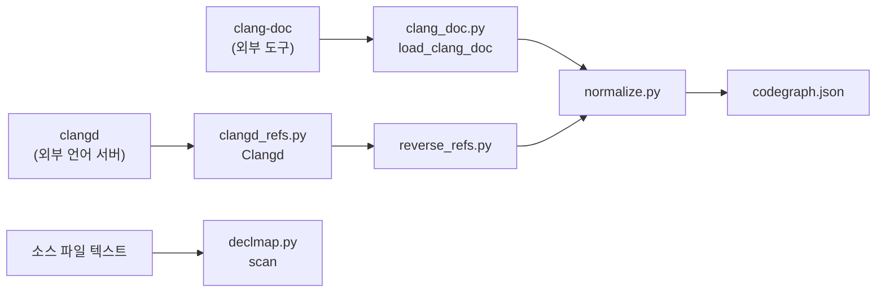

# 기계축 — C++ 정적 수집기 (clang-doc·clangd)

## 이 장이 다루는 문제

C++ 코드를 코드 지도(`codegraph.json`)로 옮기려면 두 가지가 필요하다. 하나는 "이 저장소에
어떤 클래스와 함수가 있고, 어디(파일:줄)에 있는가"라는 **심볼 전량 목록**이고, 다른 하나는
"이 심볼을 실제로 누가 쓰고 있는가"라는 **역방향 참조**다. 이 저장소는 이 둘을 서로 다른
외부 도구에게 맡긴다.

| 도구 | 무엇을 내는가 | 이 저장소가 부르는 얇은 층 |
|---|---|---|
| `clang-doc` | 클래스·함수·열거형 등 심볼과 그 위치, 저자 문서 주석 | `machine/clang_doc.py` |
| `clangd`(언어 서버) | 특정 위치에 있는 심볼을 참조하는 자리 목록 | `machine/clangd_refs.py` |

이 둘은 관계(상속·합성·의존)를 만들지 않는다. 관계는 `clang-uml`이 따로 내고
`normalize.py`가 그쪽에서 가져온다(machine/clang_doc.py:10-11). 여기서 내는 것은 **심볼과
좌표**, 그리고 **누가 참조하는가**뿐이다.

같은 계열의 세 번째 도구로 `machine/declmap.py`가 있다 — clang-doc·clangd처럼 컴파일러
지식에 기대지 않고, **정규식만으로** 소스를 훑어 "선언 한 줄 + 그 위 문서 주석"을 뽑는
가벼운 대안이다. 넷 중 어디를 쓸지는 이 장의 범위 밖이고(`machine/lang_select.py`가 고른다),
여기서는 declmap 자체의 자료 모양만 다룬다.

객체지향 프로그래밍을 갓 배운 사람이라면 "컴파일러 도구가 이미 있는데 왜 정규식 스캐너가
또 있나?" 싶을 수 있다. 답은 정확도와 비용의 저울질이다 — clang-doc·clangd는 컴파일
데이터베이스(compile_commands.json)를 요구하고 느리지만 정확하고, declmap은 어떤 저장소에도
바로 돌지만 문법을 이해하지 못한다(machine/declmap.py:9-10).

## `clang_doc.py` — 흩어진 JSON을 심볼 하나의 목록으로

### 왜 clang-doc이 필요한가

`clang-uml`은 클래스 다이어그램 도구라 네임스페이스 안의 **자유 함수**(클래스에 안 속한 함수)를
내지 않는다. `clang-doc`이 그 층을 파일:줄과 함께 채운다(machine/clang_doc.py:7-8).

### `Symbol` — 심볼 하나의 공통 틀

`Symbol`은 clang-doc이 클래스든 함수든 뽑아낸 정보를 담는 딕셔너리의 모양을 파이썬의
`TypedDict`로 못박은 것이다(machine/clang_doc.py:42). 필드는 일곱 개다.

```python
class Symbol(TypedDict):
    name: str
    kind: str
    namespace: str
    file: str
    line: int
    signature: str
    doc: str
```

(machine/clang_doc.py:42-54)

`TypedDict`는 실행될 때는 평범한 딕셔너리와 똑같이 동작한다. 다른 점은 타입 검사기(`pyright`)가
코드를 실행하지 않고도 "이 딕셔너리에 `kind`라는 열쇠가 있는가?"를 미리 검사해 준다는
것뿐이다. 주석은 이 틀이 왜 필요한지도 적어 둔다 — `TypedDict` 없이 함수가 그냥 `dict`를
돌려주면, 타입 검사기는 여러 반환 경로의 dict 타입을 전부 합쳐 뭉뚱그리는 바람에 `kind`
필드까지 "값이 없을 수도 있다(`None` 가능)"고 잘못 읽는다(machine/clang_doc.py:44-46).
`Symbol`을 실제로 만들어 돌려주는 것은 이 장 아래에서 다룰 `load_clang_doc`이다
(machine/normalize.py의 `merge_clang_doc`이 그 결과를 그대로 받아 읽는다,
machine/clang_doc.py:43).

### `qualified_namespace` — 뒤집어야 맞는 순서

`qualified_namespace`는 심볼이 속한 네임스페이스 목록을 사람이 읽는 `A::B::C` 형태의 문자열
하나로 합친다(machine/clang_doc.py:60).

```python
def qualified_namespace(item: dict[str, Any]) -> str:
    namespaces: list[Any] = item.get("Namespace") or []
    parts: list[str] = [p for p in reversed(namespaces) if p != GLOBAL_NAMESPACE]
    return "::".join(parts)
```

(machine/clang_doc.py:60-69)

여기 비직관적인 함정이 하나 있다. clang-doc의 원본 JSON은 `Namespace` 배열을 **안쪽부터**
준다 — 예를 들어 `SJH::Core::Panorama`에 속한 심볼이면 배열은
`["Panorama", "Core", "SJH"]` 순서로 온다(machine/clang_doc.py:15-16). 그대로 이어 붙이면
`Panorama::Core::SJH`라는 뒤집힌 이름이 나오고, 이 저장소가 첫째 판정에서 쓰는 네임스페이스
허용목록(`CPP_FIRST_PARTY_NS`)이 통째로 빗나간다. 그래서 `qualified_namespace`는 `reversed()`로
순서를 뒤집는다.

또 하나 — clang-doc은 전역 네임스페이스에 `"GlobalNamespace"`라는 문자열을 이름처럼 끼워
준다. 이것은 실제 이름이 아니라 "네임스페이스가 없다"는 표시일 뿐이라, `qualified_namespace`는
이 값을 목록에서 걸러내고 잇는다(machine/clang_doc.py:22, 32).

### `load_clang_doc` — 두 종류의 JSON을 합쳐야 하는 이유

`load_clang_doc`은 `clang-doc`이 출력 디렉토리 아래 여러 조각 파일로 흩어 놓은 결과를 하나의
정돈된 심볼 목록으로 모으는 함수다(machine/clang_doc.py:153). 흐름은 이렇다.

1. 출력 디렉토리 아래 모든 `.json` 파일을 훑는다.
2. `index.json` 안의 `Functions`·`Enums` 항목은 위치 정보가 이미 들어 있어 바로 담는다.
3. 나머지 파일 중 `InfoType`이 `"record"`(클래스·구조체·union)인 것은 `TagType`으로 종류를
   가려 담는다.
4. 각 항목을 앞서 본 `Symbol` 꼴로 바꾸고(내부 도우미 `_symbol`), 함수는 사람이 읽는 시그니처
   문자열도 붙인다(`function_signature`).
5. `USR`(clang의 전역 고유 식별자)이 있으면 그것을, 없으면 `(file, line, name)` 조합을 키로
   삼아 중복을 걸러낸다.
6. 최종 목록을 `(file, line, name)` 순으로 정렬해 돌려준다.

(machine/clang_doc.py:153-206)

**왜 두 종류를 다 읽어야 하는가.** `index.json`에는 `Functions`와 `Enums`가 위치까지
통째로 들어 있지만, `Records`(클래스·구조체) 배열은 이름과 USR뿐인 **얕은 참조**라 위치가
없다. 클래스의 실제 위치는 clang이 맹글링한 이름을 파일명으로 쓰는 개별 JSON 파일에만 있다
(machine/clang_doc.py:19-21, 160-163). 그래서 `load_clang_doc`은 파일 이름으로 레코드 파일을
찾지 않고, 파일 내용의 `InfoType` 필드로 "이것이 레코드 파일인가"를 가른다. `index.json`만
훑으면 클래스가 0개로 나온다는 것이 이 함수 주석이 특별히 경고하는 함정이다.

**정렬하는 이유도 우연이 아니다.** 파일 시스템이 파일을 나열하는 순서는 기계마다 다를 수
있다. 정렬 없이 그 순서에 기댄 채로 `codegraph.json`을 만들면, 같은 저장소를 같은 코드로
읽어도 기계마다 노드 번호가 달라진다(machine/clang_doc.py:157-158).

### 위치 정보가 없으면 통째로 버린다

내부 도우미 `_symbol`은 clang-doc이 뱉은 항목 하나를 공통 `Symbol` 꼴로 바꾸는데, 이때
`Location` 필드가 없는 항목은 `None`을 돌려줘서 `load_clang_doc`이 그 심볼을 버리게 만든다
(machine/clang_doc.py:123-129). clang-doc은 "정의를 못 본 타입"(선언만 있고 본문이 다른 곳,
혹은 아예 못 읽은 헤더)에도 항목을 만들어 내는데, 위치가 없는 항목은 코드 지도에 실을 수
없는 반쪽짜리 정보이기 때문이다.

### 문서 주석은 구조를 훑어서 모은다

`flatten_description`은 저자가 남긴 문서 주석을 한 줄짜리 짧은 문자열로 편다
(machine/clang_doc.py:75). clang-doc의 `Description` 필드는
`{"ParagraphComments": [[{"TextComment": "…"}, …]]}`처럼 **리스트의 리스트**이고, 문단·인자·
반환값 주석이 서로 다른 키 아래 흩어져 있다. `flatten_description`은 이 키 이름을 일일이
나열하는 대신, 구조 전체를 재귀로 훑어(`walk`) 키 이름이 `TextComment`이고 값이 문자열인
조각만 순서대로 모아 공백으로 이어 붙인다(machine/clang_doc.py:84-99).

## `clangd_refs.py` — 언어 서버에 직접 말 걸기

### 왜 필요한가

`clang-doc`과 `clang-uml`은 "이 심볼이 어디 선언됐는가"는 알려주지만 "이 심볼을 **누가**
쓰는가"는 알려주지 않는다. 이 역방향 참조(reverse reference)를 얻으려면 실제로 코드를
분석할 수 있는 언어 서버가 필요하고, 이 저장소는 `clangd`를 표준 프로토콜인
LSP(Language Server Protocol)로 직접 말을 걸어 얻는다(machine/clangd_refs.py:5).

산출물은 엔진 중립을 지킨다 — LSP가 쓰는 `uri`/`range` 표현을 그대로 내보내지 않고
`{저장소 상대경로, line, col}`로 정규화해서 낸다(machine/clangd_refs.py:7-8). 이렇게 하는
이유는 산출물을 읽는 다른 코드(`normalize.py` 등)가 clangd라는 구체적인 도구를 몰라도
되게 하기 위해서다 — 나중에 다른 언어 서버로 바꿔도 산출물의 모양은 그대로다.

### `Clangd` — 언어 서버 프로세스 하나를 감싼 상자

`Clangd` 클래스는 clangd 언어 서버 프로세스 하나를 자식 프로세스로 띄우고, 그 표준
입출력(stdin/stdout/stderr)을 JSON-RPC 프로토콜로 주고받기 쉽게 감싼다
(machine/clangd_refs.py:18).

생성자(`__init__`)가 하는 일:

1. `subprocess.Popen`으로 `clangd --compile-commands-dir=<컴파일DB경로> --log=error`를
   자식 프로세스로 띄운다(machine/clangd_refs.py:25).
2. stdin/stdout/stderr 세 파이프를 필드로 붙든다(machine/clangd_refs.py:33-35) — 파이프
   전부를 `subprocess.PIPE`로 고정해 넘겼으므로 `None`일 수 없다는 것이 코드 옆 주석의 근거다.
3. **읽기 스레드**와 **stderr 배수(drain) 스레드**를 백그라운드로 시작한다
   (machine/clangd_refs.py:41-42, `threading.Thread`). clangd는 응답을 언제 보낼지 예측할
   수 없으므로, 별도 스레드가 항상 stdout을 읽고 있어야 요청-응답을 짝지을 수 있다.

`Clangd`가 감싸는 메서드 중 이 장이 특히 짚어야 할 것은 세 갈래다.

- **요청/응답 짝짓기** — `request()`는 JSON-RPC 메시지에 순번 있는 `id`를 붙여 보내고,
  같은 `id`가 붙은 응답이 `_pending` 딕셔너리에 들어올 때까지 폴링한다
  (machine/clangd_refs.py:87-97). 시간 안에 안 오면 `TimeoutError`를 던진다.
- **색인 완료 판정** — `wait_for_index()`는 clangd가 `$/progress` 알림으로 보내는 색인
  진행 상태가 전부 `"end"`가 될 때까지 기다린다(machine/clangd_refs.py:156-178). `settle`
  유예 시간을 두는 이유는 "아직 색인을 시작도 안 한" 상태와 "이미 다 끝난" 상태를
  구분하기 위해서다 — `$/progress`가 한 번도 안 왔는데 곧바로 "끝났다"고 판정하면 콜드
  스타트 상태를 오판한다.
- **`references()`** — 실제로 역방향 참조를 요청하는 메서드다. `line`/`col`은 clang-uml과
  같은 **1-based**(1부터 세는) 좌표로 받고, LSP 프로토콜이 요구하는 **0-based** 좌표로
  변환해서 보낸다(machine/clangd_refs.py:123-131). 두 좌표계를 섞어 쓰면 참조를 한 줄
  어긋난 자리에서 찾게 된다.

이 클래스를 실제로 부르는 곳은 `machine/reverse_refs.py`의 `main`이다
(machine/clangd_refs.py:17). `reverse_refs.py`는 clang-uml이 낸 심볼 좌표를 하나씩
`Clangd.references()`에 넣어 역참조 전수를 뽑는 도구다(machine/reverse_refs.py:5-13).
그 스크립트 자체의 자료형(`_SourceLocation`·`_UmlElement` 등)은 이 장의 범위 밖이다.

### `did_open` — 참조를 묻기 전에 먼저 "열었다"고 알린다

`did_open`은 clangd에게 특정 파일을 열었다고 알려주는 메서드다
(machine/clangd_refs.py:116).

```python
def did_open(self, rel: str) -> None:
    path = os.path.join(self.root, rel)
    with open(path, encoding="utf-8", errors="replace") as fh:
        text = fh.read()
    self.notify("textDocument/didOpen", {"textDocument": {
        "uri": "file://" + path, "languageId": "cpp", "version": 1, "text": text}})
```

(machine/clangd_refs.py:116-121)

이 메서드는 저장소 상대경로(`rel`)를 절대경로로 바꿔 파일을 읽고, 그 내용을 담아
`textDocument/didOpen`이라는 LSP 알림(notification)을 clangd에 보낸다. LSP는 요청-응답
쌍인 `request`와 응답을 기대하지 않는 일방 통보인 `notify`를 구분하는데, `didOpen`은
후자다 — 그래서 `notify()`를 부르지, `id`를 붙여 응답을 기다리는 `request()`를 부르지
않는다.

**왜 미리 열어야 하는가.** LSP는 서버가 파일의 내용을 알아야만 그 파일 안의 위치를 기준으로
한 질의(`textDocument/references` 등)를 처리할 수 있다는 전제로 설계돼 있다
(machine/clangd_refs.py:120-121의 주석). 파일을 열었다고 알리지 않은 채로 `references()`를
부르면 clangd는 그 파일의 최신 내용을 모르는 채로 응답하거나 아예 처리하지 못한다. 그래서
`reverse_refs.py`는 참조를 묻기 전에 대상 파일마다 `did_open`을 먼저 호출하는 순서를
지킨다(Unknown — 정확한 호출 순서는 machine/reverse_refs.py의 main 본문에서 확인).

## `declmap.py` — 정규식만으로 뽑는 가벼운 대안

### `Decl` — 선언 한 줄의 자료 모양

`Decl`은 소스 코드에서 뽑아낸 선언(클래스·함수 등) 하나를 담는 자료 모양이다
(machine/declmap.py:76).

```python
class Decl(TypedDict):
    line: int
    kind: str
    name: str
    doc: str
```

(machine/declmap.py:76-82)

네 필드의 뜻은 이렇다 — `line`은 1부터 시작하는 줄 번호, `kind`는 `class`·`def`처럼
언어별 정규식이 잡아낸 선언의 종류, `name`은 선언의 이름, `doc`은 그 선언 바로 위에 붙은
문서 주석이다. 이 자료 모양을 실제로 만들어 내는 것은 `scan()` 함수이고, 사람이 읽는
글자로 바꾸는 `render()`, 그리고 전수조사 증분 캐시를 담당하는 `machine/warmup.py`와
Mode 1 실행기 `runner/run_mode1.py`가 이 값을 읽는다(machine/declmap.py:77, 89-93).

`declmap.py`는 clang-doc·clangd와 달리 컴파일 데이터베이스나 언어 서버 없이, 저장소의
소스 파일을 텍스트로 열어 언어별 정규식(`LANGS` 표, machine/declmap.py:43-68)으로 선언 줄만
잡아낸다. 대가는 명확하다 — 이 파일의 모듈 docstring이 스스로 경고하듯, 정규식은 문법을
이해하지 못해 문자열 안의 `class` 같은 낱말에 속을 수 있고, 여러 줄에 걸친 선언은 첫 줄만
본다(machine/declmap.py:9-10). 그래서 declmap의 산출물은 "코드 지도"가 아니라 "읽을 자리를
좁혀 주는 목록"이라고 이 파일 스스로 선을 긋는다(machine/declmap.py:10-11) — 진짜 지도는
정적 수집기(clang-uml·roslyn-dump, 그리고 이 장의 clang-doc)가 만든다.

## 세 수집기가 만나는 자리



세 갈래 다 목적지는 결국 `machine/normalize.py`가 조립하는 `codegraph.json`(또는 declmap의
경우 `warmup.py`의 증분 판정)이지만, 서로 대체재가 아니라 **역할이 다른 보완재**다.
`clang_doc.py`는 "무엇이 있는가"(심볼 전량), `clangd_refs.py`는 "누가 쓰는가"(역참조),
`declmap.py`는 "정확도를 포기하는 대신 어디서든 즉시 도는" 값싼 스캔이다.

## 확인하지 못한 것

- `reverse_refs.py`가 `did_open`을 부르는 정확한 순서와 빈도(파일마다 매번 새로 여는지,
  한 번만 여는지)는 `machine/reverse_refs.py`의 `main` 본문을 실제로 읽어야 확정할 수 있다.
  이 장은 `machine/clangd_refs.py`와 그 모듈 docstring만 근거로 삼았다
  (Unknown - verify in machine/reverse_refs.py).
- `declmap.py`의 `LANGS["cpp"]` 정규식이 실제로 놓치는 C++ 문법 패턴의 목록은 이 장에서
  실측하지 않았다 — declmap 자신의 경고(machine/declmap.py:9-10)만 인용한다
  (Unknown - verify in machine/test_declmap.py).
