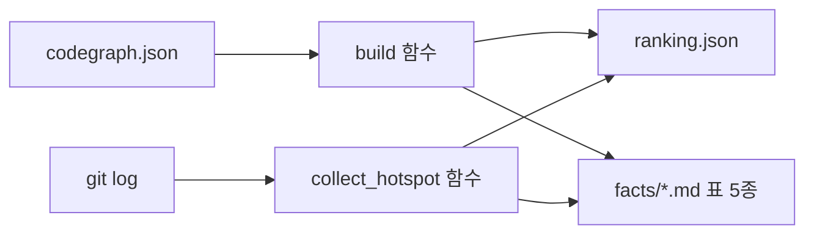

# 기계축 — facts.py 사실 표 생성

`machine/facts.py`(machine/facts.py:1)는 코드 지도(codegraph.json)를 읽어서 사람이 그대로 읽을 수 있는
표(`facts/*.md`)와 중요도 순위(`ranking.json`)를 만드는 도구다. **기계축**(machine/)에 속한다 —
계산만 하고 그림은 그리지 않는다. 산문을 쓰지 않고, 무엇이 "좋은 설계"인지 판정하지도 않는다.
codegraph.json 안의 숫자와 이름을 결정론적으로 재배열해 표로 낼 뿐이다.

객체지향을 갓 배운 독자를 기준으로 설명한다: 여기서 "클래스"라는 말은 C++/C#/Python 이
섞인 코드 지도에서 함수 · 클래스 · 메서드처럼 코드 지도가 "1차(first-class)" 노드로 다루는
대상 전체를 가리킨다(외부 라이브러리 노드는 제외).

## 입력과 출력

- 입력: 코드 지도 `codegraph.json`(machine/facts.py:57 의 `CodeGraph` 타입), 그리고
  `git log --numstat`로 뽑는 파일별 변경 이력(machine/facts.py:165 의 `collect_hotspot`)
- 출력: `ranking.json` 한 개(machine/facts.py:124 의 `Ranking` 타입)와
  `facts/modules.md` · `facts/classes.md` · `facts/external.md` · `facts/entrypoints.md` ·
  `facts/hotspot.md` 다섯 개 표(machine/facts.py:432)

이 저장소 자신을 대상으로 실제로 돌린 결과가 `out/codegraph-raw/`에 있다. 예를 들어
`facts/modules.md`에는 모듈 4개(machine · runner · viz · tools), 모듈 간 의존 2개, 순환 0개가
적혀 있다(out/codegraph-raw/facts/modules.md:6). `facts/classes.md`에는 1차 클래스 786개가
PageRank 내림차순으로 전량 실려 있다(out/codegraph-raw/facts/classes.md:6). 모듈 관계의 큰 그림은
`out/codegraph-raw/modules.svg`를 본다 — 이 도구가 자기 자신을 그린 그림이다.

## 핵심 자료형 셋

`facts.py`는 딕셔너리 모양을 `TypedDict`로 미리 못 박아 둔다. 파이썬 실행 시에는 아무 검사도
하지 않지만, `pyright` 같은 정적 타입 검사기가 필드 이름 오타나 빠진 값을 미리 잡아 준다.

### ClassRow — 클래스(넓은 의미) 한 줄

`ClassRow`(machine/facts.py:88)는 1차 클래스 하나에 대한 사실 행 한 줄의 모양이다. `build`
함수가 이 모양으로 행을 만들고, `facts/classes.md` 표가 그대로 이 값을 옮겨 적는다
(facts.machine.facts.ClassRow, terms-db.json). 필드 아홉 개를 담는다:

| 필드 | 뜻 |
|---|---|
| `name` | 이름 |
| `kind` | 종류(함수 · 클래스 등) |
| `module` | 소속 모듈 |
| `file` · `line` | 선언 위치 |
| `pagerank` | 중요도 점수(아래 참고) |
| `in_deg` | 나를 끌어가는(의존하는) 남의 수 |
| `out_deg` | 내가 끌어오는(의존하는) 수 |
| `ext_touch` | 외부 라이브러리 접촉 횟수 |

실제 표의 1행은 `runner.test_run_mode1_5.good_doc`, PageRank 0.010926, 받는← 33, 주는→ 1,
선언 위치 `(runner/test_run_mode1_5.py:44)`다(out/codegraph-raw/facts/classes.md:12).

### ModuleRow — 모듈 한 줄

`ModuleRow`(machine/facts.py:104)는 `ranking.json`에 실리는 모듈 하나의 요약이다. `id`(모듈
이름) · `classes`(그 모듈에 속한 클래스 수) · `pagerank_sum`(소속 클래스들의 PageRank 합) ·
`in_cycle`(모듈 의존 순환에 끼어 있는지) 네 필드를 담는다(facts.machine.facts.ModuleRow,
terms-db.json). 예: `machine` 모듈은 클래스 409개, PageRank 합 0.525543, 순환 참여 아니오
(out/codegraph-raw/facts/modules.md:10).

### HotspotBlock — 변경 빈도 블록

`HotspotBlock`(machine/facts.py:114)은 "어느 파일이 자주 바뀌는가"를 담는 블록의 모양이다.
`note`(설명글) · `available`(git log 를 실제로 읽었는지) · `code_files`(코드 지도에 노드가
있는 파일만 골라 담은 변경 통계 행 목록, 자료형은 `HotspotRow`) · `total_tracked_in_log`
(git log 에 잡힌 전체 추적 파일 수) 네 필드를 담는다(facts.machine.facts.HotspotBlock,
terms-db.json). `main` 함수가 이 모양대로 채워 `ranking.json`의 `hotspot` 키에 넣는다
(machine/facts.py:305). 실측: 이 저장소는 git 이 추적하는 파일 459개 중 코드 지도에 노드가
있는 코드 파일 57개만 표에 올랐고, 1위는 `runner/run_mode1_5.py`(커밋 6번, +331/-503줄)다
(out/codegraph-raw/facts/hotspot.md:6-9).

## build 함수 — 중요도와 순환을 계산한다

`build`(machine/facts.py:203)가 이 파일의 계산 핵심이다. 코드 지도(`g`)에서 종류가
`external`(외부 라이브러리)이 아닌 노드만 골라 "1차 클래스"로 삼고(machine/facts.py:205),
두 가지를 계산한다(facts.machine.facts.build, terms-db.json):

1. **PageRank** — 1차 클래스들 사이의 의존 관계만으로 방향 그래프를 만들고, 간선의
   `occurrences`(그 관계가 실제 코드에서 몇 번 나타났는지) 값을 가중치로 삼아 PageRank
   점수를 구한다(machine/facts.py:209-222). 외부 노드를 넣지 않는 이유는 코드 주석에
   직접 적혀 있다: 외부 노드를 넣으면 "R3 섬"(외부 라이브러리 쪽에서만 오는 단방향 간선
   무더기)이 점수를 전부 빨아들이기 때문이다(machine/facts.py:207-208).
2. **모듈 순환** — 모듈들 사이의 의존 관계로 별도 그래프(`MG`)를 만들고
   `networkx.simple_cycles`로 순환 고리를 전부 찾는다(machine/facts.py:225-231). 이
   저장소 자신은 순환이 0개였다(out/codegraph-raw/facts/modules.md:6).

`build`는 이렇게 만든 `ClassRow` 목록(PageRank 내림차순 정렬)과 모듈 그래프 `MG`, 순환
목록, 순환에 참여하는 모듈 집합을 튜플 하나로 함께 돌려준다(machine/facts.py:243-244). PageRank
점수가 높다는 것은 "다른 코드가 나에게 많이 의존한다"는 뜻이라, 표에서는 위쪽이 "기반이 되는"
쪽으로 읽힌다(out/codegraph-raw/facts/classes.md:6).

⚠ 순환이 있다고 해서 이 함수가 "이건 나쁘다"고 판정하지는 않는다. `modules.md`에는 순환
목록만 전량 나열되고, 그 순환을 허용할지 위반으로 볼지는 사람이 `codegraph-rules.toml`에
따로 적는다(machine/facts.py:332).

## cite 함수 — 인용 문자열 만들기

`cite`(machine/facts.py:250)는 `ClassRow` 하나를 받아 사람이 읽는 인용 문자열로 바꾸는
작은 함수다. `file` 값이 있으면 `(file:line)` 형태 문자열을, 없으면 `(위치 없음)`을
돌려준다(machine/facts.py:251, facts.machine.facts.cite, terms-db.json). 이 형식이
deep-wiki 로컬 인용 규격이다 — 위키 산문이 이 문자열을 그대로 옮겨 적으면 인용 검증기
(`machine/verify_citations.py`)의 L3 단계가 "그 줄 근처에 정말 그 이름이 있는가"를 잴 수 있다
(machine/facts.py:254-255).

## 하나로 이어 보면

`main`(machine/facts.py:262)이 이 모든 조각을 붙인다: codegraph.json 을 읽고 → `build`로
PageRank·순환을 구하고 → `collect_hotspot`으로 git 이력을 읽고 → 그 둘을 합쳐
`ranking.json`을 쓰고 → `facts/` 아래 다섯 표를 각각 문자열로 조립해 파일로 쓴다. C# 전용
`--detail` 옵션(roslyn-dump.json)이 주어지면 `entrypoints.md`에 Unity `MonoBehaviour` ·
`ScriptableObject` 파생 클래스 표까지 더 붙는다(machine/facts.py:376-403) — 이 저장소는
Python 이라 해당하지 않는다(out/codegraph-raw/facts/entrypoints.md, 언어별 표 없음).

## 확인하지 못한 것

- `facts/entrypoints.md`의 C++ · C# 경로(machine/facts.py:376, machine/facts.py:404)는
  이 저장소가 Python 이라 실제 산출물로 대조하지 못했다. `(Unknown - verify in
  $CSHARP_REPO 또는 $CPP_REPO 로 돌린 out/codegraph-raw/facts/entrypoints.md)`.
- `collect_hotspot`의 이름변경(rename) 귀속 규칙(machine/facts.py:181-188)은 코드를
  읽고 옮겨 적었을 뿐, 실제 rename 이력이 있는 커밋으로 직접 대조하지는 못했다.
