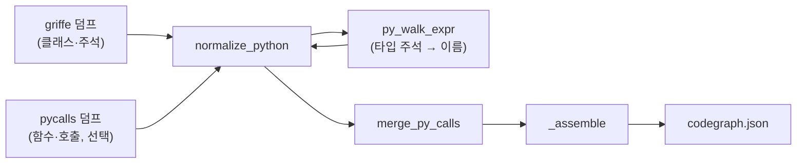

# 기계축 — normalize.py 언어별 정규화

이 장은 이 저장소에서 가장 큰 파이썬 파일인 `machine/normalize.py`(1364줄) 가운데
파이썬 갈래(`normalize_python` · `py_walk_expr`)와, 세 언어가 공유하는 "1차 코드 판정"
개념(`is_first_party` · `defines_at` · `SourceLocation`), 그리고 C# 입력 계약
(`RoslynDump`)을 다룬다. 나머지 함수(C++ 갈래 전체, `_assemble`, C# 갈래 나머지)는
이 장의 범위 밖이다.

## 이 파일이 왜 있는가 — 세 도구, 한 모양

이 저장소는 C++·C#·Python 세 언어의 코드를 분석한다. 언어마다 정적 분석 도구가 다르고
(clang-uml/clang-doc, roslyn-dump, griffe), 그 도구들이 내는 JSON 의 모양도 서로 다르다.
`normalize.py` 는 그 세 가지 서로 다른 원시 출력을 **한 가지 공통 모양**
(`codegraph.json` — 노드 목록과 간선 목록)으로 바꾸는 역할만 한다(machine/normalize.py:1-12).
분석 도구는 "사실"만 내고, 그 사실을 어떻게 노드·간선으로 접을지에 대한 **정책**은 전부
이 파일 하나가 쥔다(machine/normalize.py:10-11).

"노드"는 클래스나 함수 하나, "간선"은 그 둘 사이의 관계(상속·호출·소유 등) 하나라고
생각하면 된다. `codegraph.json` 자체의 계약(스키마)은 이 파일이 아니라
`machine/codegraph_types.py` 한 곳에 있다(machine/normalize.py:20-21) — 이 장에서는
그 계약을 만드는 쪽만 본다.

## 파이썬 갈래 — `normalize_python`

`normalize_python(dump, repo, source_tool, calls=None)` 는 griffe(외부 도구)가 낸
파이썬 코드 구조 덤프를 codegraph 로 바꾸는 함수다(machine/normalize.py:1073). C++·C#
을 다루는 두 함수와 같은 3단계 구조를 따른다 — **노드를 정한다 → 간선을 정한다 →
`_assemble` 로 마무리한다**.

파이썬 갈래에는 C++ 처럼 "1차 코드인지 아닌지" 를 가리는 별도 판정 함수가 없다. griffe
자체가 지정한 패키지(예: `machine`, `runner`)만 읽어 들이므로, **덤프에 클래스로 나온
것이 곧 1차 코드**이고, 상속이나 타입 주석에서 이름이 나오지만 덤프 안에는 없는 것이
외부 코드다(machine/normalize.py:1077-1078).

내부 흐름은 다섯 단계다.

1. **0패스 — 모듈 나무를 평평하게 편다.** griffe 는 클래스와 모듈을 서로를 담는
   `members` 딕셔너리로 중첩해서 준다. 이름도 완전한 형태(`machine.normalize.Foo`)로
   주지 않는다. `walk_module`/`walk_class` 두 내부 함수가 이 나무를 재귀적으로 훑으며
   이름을 직접 이어 붙인다(machine/normalize.py:1090-1119). 중첩 클래스도 노드가 된다
   (machine/normalize.py:1113-1115).
2. **1패스 — 클래스마다 노드 하나.** 사전순으로 정렬한 클래스 이름마다 새 노드 ID
   (`C1`, `C2`, …)를 붙인다(machine/normalize.py:1124-1133).
3. **2패스 — 간선.** 클래스의 상속 기반 클래스, 클래스 속성의 타입 주석, 메서드
   매개변수·반환값의 타입 주석을 각각 훑어 [py_walk_expr](#py_walk_expr--타입-주석-트리를-따라-내려가기)
   로 관계가 될 만한 이름을 뽑고, 그 이름마다 간선을 하나씩 만든다
   (machine/normalize.py:1172-1201). 이 저장소 밖 이름(외부 코드)은 `to_node` 함수가
   배포 이름 하나로 접는다 — 예를 들어 `os`, `re`, `json` 처럼 흩어진 표준 라이브러리
   이름을 전부 `"(표준) stdlib"` 라는 노드 하나로 뭉친다(machine/normalize.py:1137-1150,
   954-965). 이걸 규칙 R2 라고 부른다.
4. **호출 병합(선택).** `calls` 인자로 `pycalls.py`(이 저장소가 만든 보조 도구)의
   결과를 주면, `merge_py_calls` 가 함수 호출 관계까지 간선으로 더한다
   (machine/normalize.py:1203-1204). griffe 는 클래스·상속·타입 주석은 알지만 "어느
   함수가 어느 함수를 부르는가" 는 전혀 모르기 때문에 필요한 보강이다
   (machine/CLAUDE.md 의 "Python 수집기 — 왜 둘인가" 절 참고).
5. **마무리.** `_assemble` 을 불러 최종 `codegraph.json` 모양(딕셔너리)으로 포장한다
   (machine/normalize.py:1209). `_assemble` 자체는 이 장의 범위 밖이다.

`normalize_python` 이 반환하는 값은 `(코드지도, 통계)` 튜플이다. 통계(`Counter`)는
"R5 투과 컨테이너 경유", "외부 원본 타입" 처럼 정규화 과정에서 몇 번씩 규칙이
적용됐는지 세는 진단 정보다.

## `py_walk_expr` — 타입 주석 트리를 따라 내려가기

파이썬 타입 주석(예: `dict[str, Node] | None`)은 griffe 가 이미 문자열이 아니라
**트리 구조**로 잘라서 준다. `py_walk_expr(expr, mod_path, imports, first_party, stats,
depth=0)` 는 이 트리를 재귀적으로 따라 내려가며, "관계로 쳐줄 만한" 타입 이름들만
뽑아내는 함수다(machine/normalize.py:1014). 사람이 정규식으로 타입 문법을 직접
파싱하는 대신, griffe 가 이미 만들어 둔 트리를 그대로 타는 방식이다.

트리 마디는 세 가지가 있고, 마디가 아니면 이름이다.

| 마디 종류 | 뜻 | 처리 |
|---|---|---|
| `ExprBinOp` | `Node \| None` 처럼 `\|` 로 묶인 합집합 | 왼쪽·오른쪽 둘 다 재귀 탐색한다(machine/normalize.py:1032-1034) |
| `ExprTuple` | `dict[str, Node]` 의 대괄호 속처럼 콤마로 나뉜 여러 항목 | 항목마다 재귀 탐색한다(machine/normalize.py:1036-1040) |
| `ExprSubscript` | `dict[...]`, `list[...]` 같은 대괄호 표기(제네릭) | 아래 설명 |
| (그 외 — 이름) | `Node`, `abc.Mapping` 같은 단순 이름 | 아래 설명 |

`ExprSubscript` 를 만나면 대괄호 앞부분(`dict`, `list` 등)이 **투과 컨테이너**
목록(`PY_TRANSPARENT` — machine/normalize.py:937-941)에 있는지 본다. 있으면 이것은
규칙 **R5**다 — 컨테이너 자체는 노드로 만들지 않고 껍데기를 벗겨서 속 타입으로
곧장 내려간다(machine/normalize.py:1042-1046). 없으면(예: 사용자가 만든 제네릭
클래스나 `collections.abc.Mapping` 같은 추상 인터페이스) 컨테이너 자기 자신을
관계 상대로 삼는다(machine/normalize.py:1047-1048).

마디가 아니라 단순 이름을 만나면, 그 이름이 원시 타입 목록(`PY_R7` —
machine/normalize.py:926-932, 예: `str`, `int`, `None`, `typing.Any`)에 있는지
본다. 있으면 규칙 **R7** — 관계로 치지 않고 버린다(machine/normalize.py:1054-1056).
아니면 `py_resolve` 로 짧은 이름을 완전한 이름으로 풀어보고(예: `Foo` → 그 모듈의
import 표에 있으면 `machine.normalize.Foo`), 그 완전한 이름도 원시 타입이면 다시
버리고, 1차 코드 목록에도 없고 점(`.`)도 없는 이름(빌트인이나 타입변수로 추정)이면
역시 버린다(machine/normalize.py:1057-1064). 여기까지 살아남은 이름만 관계의
상대로 반환된다.

재귀 깊이가 8을 넘으면 더 내려가지 않고 빈 목록을 반환한다 — 순환·과도하게 중첩된
타입 표현으로부터 이 함수를 보호하는 안전장치다(machine/normalize.py:1021-1023).

## 1차 코드 판정 — C++ 세 함수 (파이썬·C# 과 공유하는 개념)

파이썬 갈래와 달리, C++ 갈래는 "이 타입이 우리가 직접 쓴 코드인가, 아니면 Qt·OpenCV·
표준 라이브러리처럼 남이 만든 코드인가" 를 판정하는 전용 함수가 필요하다. clang-uml
(C++ 을 읽는 외부 도구)이 코드의 위치 정보를 줄 때 특이한 버릇이 있기 때문이다 — 아래
`SourceLocation` 항목을 먼저 보면 이해하기 쉽다.

### `SourceLocation`

`SourceLocation` 은 "파일 경로 하나 + 줄 번호 하나" 를 나타내는 자료형(TypedDict —
실행되는 코드가 아니라 데이터 모양 약속) 정의다(machine/normalize.py:31, 필드는
`file`·`line`). 이것이 clang-uml 이 어떤 타입을 어디서 찾았는지 알려주는 방식이다.

**함정 — clang-uml 이 주는 위치는 "정의된 곳" 이 아니라 "이 저장소에서 처음 쓰인 곳"
일 때가 있다.** 예를 들어 `std::string` 이라는 표준 라이브러리 타입을 저장소 어딘가에서
처음 쓰면, clang-uml 은 그 타입의 `source_location` 으로 표준 헤더 파일이 아니라 저장소
안의 그 사용 지점을 알려줄 수 있다(machine/normalize.py:32-33, 99-101). 그래서 "위치가
저장소 안에 있다" 는 사실만으로는 그 타입이 우리 코드라고 결론 내릴 수 없다 — 아래
`is_first_party` 의 거름망 세 겹이 이 함정을 막기 위한 장치다.

### `is_first_party`

`is_first_party(el, repo=None, ns=CPP_FIRST_PARTY_NS, tracked=None)` 는 C++ 타입
하나가 1차 코드(우리 코드)인지 참/거짓으로 가려내는 함수다(machine/normalize.py:229).
두 갈래로 판정한다.

1. **네임스페이스 허용목록** — 빠른 길이다. 타입의 네임스페이스 첫 부분이
   `CPP_FIRST_PARTY_NS`(예: `"SJH"`, `"TopdownShooter"` — machine/normalize.py:102)에
   있으면 그것만으로 참이다(machine/normalize.py:243-245).
2. **선언 위치가 저장소 안** — 전역 네임스페이스를 쓰는 코드를 위한 길이다. 이 갈래는
   거름망을 세 겹 통과해야 참이 된다(machine/normalize.py:236-241):
   - `std`, `__gnu_cxx` 같은 네임스페이스는 절대 1차가 아니다(`NEVER_FIRST_PARTY_NS` —
     machine/normalize.py:168, 248-249).
   - 빌드가 자동으로 만든 파일(예: Qt 의 `Ui::*` 자동 생성 코드)이 아니어야 한다
     (`GENERATED_MARKERS` — machine/normalize.py:167, 258-259).
   - git 이 그 파일을 실제로 추적하고 있어야 한다(machine/normalize.py:263-264) — Qt 의
     `QWidget`, OpenCV 의 `cv::Mat` 처럼 저장소 안에서 쓰이지만 저장소가 소유하지 않는
     타입을 이 검사가 걸러낸다.
   - 마지막으로 [defines_at](#defines_at) 을 불러, 그 줄이 실제로 그 타입을
     **정의**하는 줄인지 확인한다(machine/normalize.py:266-267).

이 네 단계를 전부 통과해야 비로소 참이 된다. 하나라도 걸리면 그 타입은 외부 코드로
분류된다.

### `defines_at`

`defines_at(repo, rel_file, line_no, name)` 는 `is_first_party` 의 마지막 거름망이다
— `source_location` 이 가리키는 줄이 그 타입을 **정의**하는 줄인지, 아니면 전방 선언
(`class QWidget;`)이나 그냥 사용하는 줄(`cv::Mat3b img;`)인지 확인한다
(machine/normalize.py:180-184).

동작은 세 단계다.

1. 이름에서 중첩 타입 구분자 `##` 를 `::` 로 바꾸고, 마지막 조각(제네릭 꺾쇠 앞부분)만
   남긴다(machine/normalize.py:189).
2. 그 파일을 직접 열어 지정된 줄을 읽는다. 줄 끝이 세미콜론(`;`)이면 전방 선언이나
   멤버 선언으로 보고 곧바로 거짓을 반환한다(machine/normalize.py:203-205).
3. 그렇지 않으면 `class`/`struct`/`enum`/`union` 뒤에 그 이름이 오는지 정규식으로
   검사한다. 이름별 정규식은 `DEFINES_RE_CACHE` 에 캐싱해 재사용한다
   (machine/normalize.py:206-212).

## C# 입력 계약 — `RoslynDump`

`RoslynDump` 는 `roslyn-dump.json`(이 저장소가 만든 C# 분석 도구 `machine/roslyn-dump`
의 산출물) 전체의 모양을 나타내는 최상위 자료형(TypedDict) 정의다
(machine/normalize.py:633). 네 필드를 갖는다(machine/normalize.py:634-639).

| 필드 | 필수? | 무엇 |
|---|---|---|
| `tool` | 아니오 | 도구 이름 문자열. 없을 수 있어 `main` 함수가 기본값을 채운다(machine/normalize.py:636) |
| `compilation` | 예 | `RoslynCompilation` — 컴파일 요약(어셈블리 이름, 오류 수, 미해결 타입 수) |
| `types` | 예 | `RoslynType` 목록 — C# 타입(클래스·구조체·열거형 등) 하나하나 |
| `relations` | 예 | `RoslynRelation` 목록 — 타입 사이의 관계(상속·의존 등) 하나하나 |

C# 갈래(`normalize_csharp`, 이 장의 범위 밖)에서 1차 코드 판정은 C++ 처럼 위치를 보지
않는다 — `compilation.assembly` 와 같은 어셈블리에 속하는지만 본다
(machine/normalize.py:598-599, 752-756). `compilation.errors` 나
`compilation.unresolved_types` 가 0 이 아니면 그 즉시 실패로 종료한다
(machine/normalize.py:740-744) — 참조 집합이 잘못되면 모든 관계의 도착점이 통째로
쓰레기가 되기 때문이다.

## 그림 — 파이썬 갈래가 codegraph.json 이 되기까지

이 그림은 파이썬 갈래 하나만 보여준다. C++·C# 갈래를 포함한 저장소 전체 모듈
관계는 이 그림보다 훨씬 크므로 `out/codegraph-raw/modules.svg` 를 직접 연다.

## 확인하지 못한 것

- `_assemble` 이 세 갈래를 어떻게 하나로 합치는지(R1 전이 확장 금지, 모듈 의존 유도)는
  이 장에서 다루지 않았다. `machine/normalize.py:536` 부터 직접 읽는다.
- `merge_clang_doc`, `normalize_cpp`, `normalize_csharp`, `merge_py_calls` 의 세부
  동작은 이 장의 대상 심볼 목록 밖이라 다루지 않았다.
- 이 장이 인용한 줄 번호는 이번 조사 시점(machine/normalize.py, 총 1364줄)의 스냅샷이다.
  파일이 바뀌면 줄 번호가 밀린다 — `machine/xmldoc.py check` 로 재검증한다.
