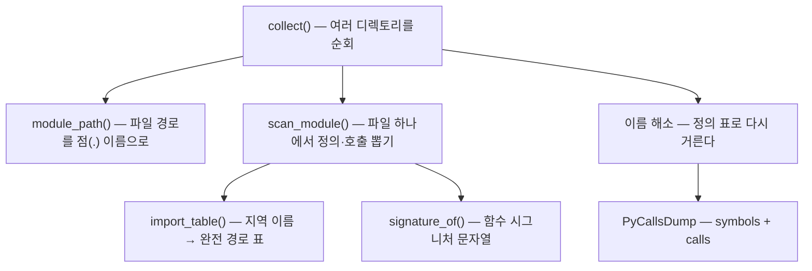
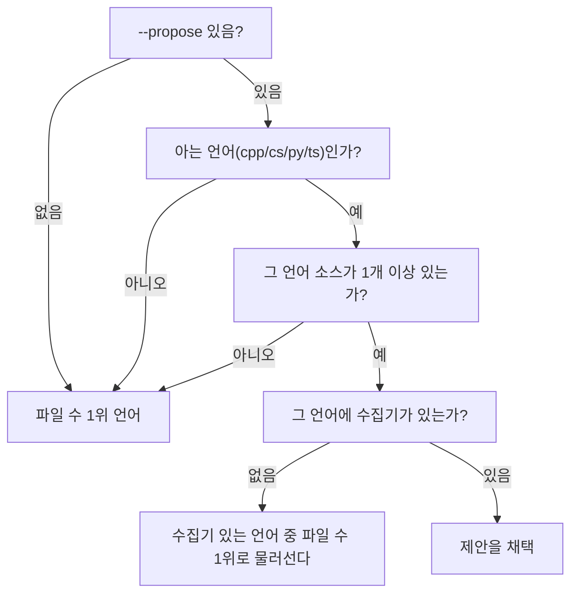
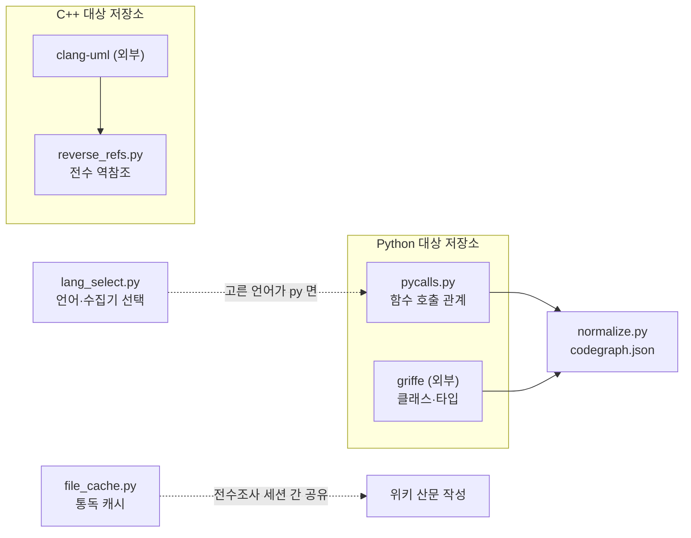

# 기계축 — 파이썬 수집기와 그 외

이 문서는 `machine/` 디렉토리 안에서 서로 직접 부르고 부르이지 않는 독립된 도구 넷을 묶어
설명한다. 넷의 공통점은 "코드를 직접 실행하지 않고 정적으로 읽어서 사실을 뽑는다"는
성격뿐이고, 서로를 import 하지 않는다. 하나씩 따로 읽어도 된다.

| 도구 | 한 줄 | 정체 |
|---|---|---|
| `pycalls.py` | 파이썬 소스에서 함수·클래스와 "누가 누구를 부르는가"를 뽑는다 | 정적 수집기 |
| `lang_select.py` | 저장소에 어떤 언어 소스가 많은지 세어 수집기를 고른다 | 결정 도우미 |
| `reverse_refs.py` | C++ 심볼을 clangd 에 물어 "누가 이 심볼을 참조하는가"를 뽑는다 | 정적 수집기(C++ 대상) |
| `file_cache.py` | 파일 하나를 통독한 결과(개요)를 디스크에 남겨 재사용한다 | 캐시 |

읽는 사람이 파이썬의 `ast` 모듈이나 LSP(Language Server Protocol), TypedDict 를 몰라도
따라올 수 있도록, 각 절 앞에 "왜 필요한가"부터 적는다.

---

## 1. `pycalls.py` — 파이썬 소스에서 호출 관계 뽑기

### 왜 필요한가

이 저장소는 파이썬 코드의 구조를 그림(코드 지도, code graph)으로 그리는데, 그러려면
"어느 함수가 어느 함수를 부르는가" 라는 관계를 알아야 한다. 그런데 이 저장소가 원래 쓰던
외부 도구 `griffe` 는 클래스 상속이나 함수 시그니처(매개변수와 반환 타입)는 뽑아 주지만
**호출 관계는 아예 내지 않는다** — griffe 는 "이 함수가 어떤 모양인가"를 보는 도구이지
"이 함수가 실행 중에 무엇을 부르는가"를 보는 도구가 아니기 때문이다
(`machine/pycalls.py:9`). 그 빈자리를 채우는 것이 `pycalls.py` 다.

방식은 파이썬 표준 라이브러리 `ast`(Abstract Syntax Tree, 추상 구문 트리)만 쓴다. 코드를
실제로 실행하지 않고 문서처럼 "읽기만" 하므로, import 부작용(예: 모듈을 불러오는 순간
어떤 초기화 코드가 도는 것)이 없고 의존성을 설치하지 않아도 문법만 맞으면 읽힌다
(`machine/pycalls.py:13-14`).

### 핵심 데이터 모양 — TypedDict 셋

이 파일은 실제로 동작하는 클래스가 아니라 "값의 모양"만 정해 두는 타입 정의
(TypedDict) 셋을 먼저 선언한다. 파이썬을 갓 배운 사람에게는 낯설 수 있는데, TypedDict 는
"이 딕셔너리(사전)는 이런 키와 값 타입을 가져야 한다"는 계약일 뿐 그 자체로 동작하지
않는다.

- `PySymbol`(`machine/pycalls.py:32`) — 함수·메서드·클래스 정의 하나. `name` 필드는
  모듈 경로를 앞에 붙인 완전한 점(.) 이름이다 (예: `machine.pycalls.collect`).
- `PyCall`(`machine/pycalls.py:46`) — 호출 관계 하나. `caller`(부르는 쪽)와
  `callee`(불리는 쪽) 모두 `PySymbol.name` 과 같은 꼴이다.
- `PyCallsDump`(`machine/pycalls.py:58`) — 이 도구가 최종적으로 내놓는 결과 전체의 모양.
  `symbols` 목록과 `calls` 목록을 담는다.

### 처리 흐름 — 세 단계



1. **`collect(repo, roots)`**(`machine/pycalls.py:229`) — 지정한 디렉토리들(예: `machine`,
   `runner`) 아래의 모든 `.py` 파일을 찾아 하나씩 읽는다. 먼저 파일 이름(확장자를 뺀
   "stem")과 그 파일의 점 경로를 짝지은 표(`stem_to_module`)를 만든다. 이름이 같은
   파일이 여러 디렉토리에 있으면(충돌) **어느 쪽인지 알 수 없으므로 조용히 하나를
   고르지 않고 둘 다 표에서 뺀다** — 잘못 이은 관계가 없는 관계보다 나쁘다는 판단이다
   (`machine/pycalls.py:247-248`).
2. **`scan_module(tree, mod, rel, stem_to_module)`**(`machine/pycalls.py:156`) — 파일
   하나의 구문 트리(AST)를 훑어 함수·클래스·메서드 정의를 모으고, 그 안에서 벌어지는
   함수 호출(`ast.Call` 노드)을 "쓰인 그대로의 이름"으로 수집한다. 이 시점에는 호출
   대상 이름이 아직 최종 해소되지 않은 상태다 — 예를 들어 `foo()` 라는 호출이 실제로
   어느 모듈의 `foo` 인지는 `import_table` 로 1차 해소하고, 그래도 안 풀리면 "같은
   모듈 안의 정의"로 가정한다(`machine/pycalls.py:210-220`).
3. **`import_table(tree, stem_to_module)`**(`machine/pycalls.py:124`) — 한 파일 안의
   `import` 문을 읽어 "이 파일 안에서 짧게 부르는 이름"이 실제로 어느 모듈의 무엇을
   가리키는지 사전으로 만든다. 예: `from warmup import status` 를 `{"status":
   "machine.warmup.status"}` 로 바꾼다.
4. **`collect` 로 되돌아가 최종 해소** — 모든 파일을 다 읽어 전체 정의 목록(`defined`)이
   갖춰진 뒤에야, 호출 양끝이 **둘 다** 이 저장소 안의 실제 정의일 때만 최종 `calls`
   목록에 남긴다(`machine/pycalls.py:274-283`). 그래서 같은 파일 안에서 앞에 나온
   함수든 뒤에 나온 함수든 다 잡히고, 외부 라이브러리(`json`, `subprocess` 같은)로
   나가는 호출은 자연히 걸러진다.

### 왜 파일 이름(stem)을 열쇠로 잡는가 — 이 도구의 급소

이 저장소는 `import machine.warmup` 처럼 패키지 경로로 import 하지 않고,
`sys.path`(파이썬이 모듈을 찾는 경로 목록)에 형제 디렉토리를 미리 넣어 두고
`import warmup` 처럼 **평평한 이름**으로 부르는 관습을 쓴다
(`machine/pycalls.py:127-129`). 만약 디렉토리 구조(예: `machine/`, `runner/`)를
기준으로 이름을 해소하려 하면 이 평평한 import 패턴을 풀지 못해서, 모듈을 넘나드는
호출 관계가 대부분 사라진다. 실제로 `../CLAUDE.md` 는 이 실수 한 번으로 모듈 간 호출이
338개에서 1개로 떨어졌었다고 기록한다. 그래서 `import_table` 은 디렉토리가 아니라
**파일 이름 자체**를 열쇠로 삼는다.

### `signature_of` — 사람이 읽는 함수 시그니처

`signature_of(fn)`(`machine/pycalls.py:88`) 는 함수 정의의 AST 노드를 받아
`(a, b: int = 1, *args, **kw) -> T` 같은 문자열을 만든다. 위치 인자, 기본값, `*args`,
키워드 전용 인자, `**kwargs`, 반환 타입 주석까지 다 처리하며, PEP 8 관례에 맞춰 타입
주석이 있는 매개변수의 기본값에는 `=` 양옆에 공백을 두고 없으면 붙여 쓴다
(`machine/pycalls.py:96-99`).

### CLI

```bash
python3 machine/pycalls.py machine runner --repo . -o pycalls.json
```

`main()`(`machine/pycalls.py:294`) 이 진입점이다. 결과를 JSON 파일로 쓰고, 심볼 종류별
개수와 "그중 모듈을 넘는 호출이 몇 건인가"를 표준 오류(stderr)가 아니라 표준 출력에
찍는다.

---

## 2. `lang_select.py` — 어떤 정적 수집기를 돌릴지 고르기

### 왜 필요한가

이 저장소(report-builder)는 자기 자신뿐 아니라 다른 저장소(C++·C#·Python·TypeScript로
쓰인)를 대상으로 "코드베이스 위키"를 만든다. 그런데 대상 저장소가 어떤 언어로 쓰였는지는
사람이 매번 알려주지 않아도 되어야 한다. `lang_select.py` 는 "이 저장소는 어느 언어
소스가 많으니 이 수집기를 쓰자"는 결정을 자동으로 내린다.

### 세는 것은 기계, 읽는 것은 모형 — 두 갈래를 합친다

`../CLAUDE.md` 의 표현을 그대로 빌리면 "세는 것은 기계가, 읽는 것은 모형이 한다"
(`machine/lang_select.py:10`). 이 도구는 두 입력을 합쳐서 최종 판단을 내린다.

1. **`count_sources(repo)`**(`machine/lang_select.py:63`) — 결정론적 계산이다. `git
   ls-files` 로 그 저장소가 git 에 실제로 추적하는 파일 목록을 얻어(빌드 산출물이나
   `node_modules` 같은 것을 자연히 피한다), 확장자별로 개수를 센다. `git` 명령이
   실패하면(예: git 저장소가 아니면) `os.walk` 로 디렉토리를 직접 훑되 `.git`,
   `node_modules`, `__pycache__`, `.venv` 는 건너뛴다(`machine/lang_select.py:67-71`).
2. **모형의 제안(`--propose`)** — 사람 또는 LLM 이 그 저장소의 루트 문서(`README.md`,
   `CLAUDE.md`, `ARCHITECTURE.md`, `AGENTS.md`)를 읽고 "이 언어가 맞다"고 낸 판단
   하나를 `select()` 에 넘길 수 있다. 문서를 모으는 함수가
   `read_docs(repo, limit=6000)`(`machine/lang_select.py:83`) 이다 — 각 문서를 앞의
   6000자까지만 잘라 이어 붙인다.

이 제안은 **검사를 통과할 때만** 받아들여진다는 것이 이 도구의 규율이다
(`machine/lang_select.py:15-16`). "모형은 근거를 대는 자리이지 결정하는 자리가
아니다."

### `select()` — 최종 판단



`select(repo, proposed)`(`machine/lang_select.py:100`) 는 제안이 다음 세 검사 중 하나라도
실패하면 파일 수가 가장 많은 언어로 되돌아간다(`why` 필드에 이유를 남긴다):

- 제안이 `cpp`/`cs`/`py`/`ts` 넷 중 하나가 아니다.
- 제안한 언어의 소스가 그 저장소에 한 개도 없다.
- 제안한 언어에 아직 수집기가 없다(`COLLECTOR` 표에서 TypeScript 는 아직 `"none"`이다
  — `machine/lang_select.py:40`). 이 경우 수집기가 없는 언어를 고르면 뒷단계(`prep`)가
  막히므로, 수집 가능한 언어들 중에서만 다시 1위를 고른다
  (`machine/lang_select.py:132-138`).

언어와 수집기의 대응은 다음과 같다(`machine/lang_select.py:36-41`):

| 언어 | 수집기 |
|---|---|
| `cpp` | `clang-uml` |
| `cs` | `roslyn-dump` |
| `py` | `griffe+pycalls` (바로 위 1절의 그 도구) |
| `ts` | `none` — 아직 없다 |

### CLI

```bash
python3 lang_select.py <저장소> -o lang-select.json
python3 lang_select.py <저장소> --propose py -o lang-select.json
```

`main()`(`machine/lang_select.py:150`) 은 종료 코드로도 신호를 준다 — 언어를 하나도
고르지 못하면(소스가 전혀 없으면) 0이 아닌 코드로 끝난다.

---

## 3. `reverse_refs.py` — C++ 심볼의 전수 역참조

### 왜 필요한가

이 도구는 이름은 `machine/` 안에 있지만 성격이 다르다. 앞의 둘은 순수하게 소스 텍스트를
읽어 스스로 판단을 내리는 반면, 이 도구는 **`clangd`(C++ 언어 서버)라는 외부 프로그램을
직접 띄우고 대화**해서 "이 심볼(클래스나 함수)을 코드 어디에서 참조하고 있는가"를
전수로 알아낸다. 대상은 C++ 저장소이고, 입력은 `clang-uml` 이라는 또 다른 외부 도구가
미리 뽑아 둔 JSON 이다(`machine/reverse_refs.py:13`).

"1차 심볼"이란 이 저장소가 관심 있는 네임스페이스(`FIRST_PARTY_PREFIXES = ("SJH",
"MyApp")`, `machine/reverse_refs.py:20`)로 시작하는 심볼만 추린 것이다 — 표준
라이브러리나 외부 라이브러리 심볼까지 다 뒤지지 않는다.

### LSP(Language Server Protocol)와 "엔진 중립" 원칙

`clangd` 는 LSP 라는 표준 프로토콜로 말한다. LSP 의 위치 표현은 `uri`(파일 경로를
URI 형태로 감싼 것)와 0-based(0부터 세는) 줄·칸 좌표를 쓴다. 그런데 이 도구가 만드는
최종 산출물은 **LSP 를 몰라도 되는 형태**로 정규화한다 — 저장소 상대경로와
1-based(1부터 세는, 사람이 읽는 방식) 줄·칸으로 바꾼다(`machine/reverse_refs.py:6-9`).
그래서 나중에 clangd 가 아닌 다른 엔진으로 바꿔도 산출물의 소비자 쪽 코드는
바뀌지 않는다.

이 변환이 일어나는 지점이 `main()` 안의 다음 부분이다(`machine/reverse_refs.py:183-186`):

```python
refs: list[_Loc] = [{"file": to_repo_relative(loc["uri"], root),
                     "line": loc["range"]["start"]["line"] + 1,
                     "col": loc["range"]["start"]["character"] + 1}
                    for loc in locs]
```

`+ 1` 이 바로 0-based 에서 1-based 로의 변환이다.

### 색인이 끝나기를 기다려야 한다 — clangd 의 함정

주석에 적힌 경고를 그대로 옮기면: "clangd 는 색인이 덜 찬 상태에서 부분 결과를 **에러
없이** 돌려준다"(`machine/reverse_refs.py:10-11`). 즉 아직 전체 코드를 다 읽지 않은
상태에서 질의해도 clangd 는 "모르겠다"고 실패하는 대신 조용히 일부만 맞는 답을 준다.
그래서 `main()` 은 `Clangd.wait_for_index()` 로 LSP 의 `$/progress` 알림이 끝(end)을
알릴 때까지 최대 900초 기다린 뒤에만 실제 질의를 시작한다
(`machine/reverse_refs.py:156-169`). 기다리다 시간 안에 완료 신호를 못 받으면 결과가
부분일 수 있다는 경고를 표준 오류에 남기고 계속 진행한다.

### 데이터 모양 — 두 겹의 TypedDict

이 파일에는 TypedDict 가 유난히 많다. 이유는 **입력(clang-uml 의 JSON)과 산출물(이
도구가 만드는 JSON)의 모양이 다르고, 그 사이를 잇는 LSP 응답의 모양까지 셋을 다
구분해야 하기 때문**이다.

| 그룹 | 타입 | 뜻 |
|---|---|---|
| 입력(clang-uml) | `_SourceLocation`(`machine/reverse_refs.py:28`) | 심볼이 선언된 자리(1-based) |
| | `_UmlElement`(`machine/reverse_refs.py:38`) | 심볼 하나(클래스나 함수) |
| | `_Uml`(`machine/reverse_refs.py:54`) | 전체 입력 JSON |
| LSP 응답 | `_LspPosition`(`machine/reverse_refs.py:61`) | 0-based 좌표 한 점 |
| | `_LspRange`(`machine/reverse_refs.py:70`) | 시작~끝 범위 |
| | `_LspLocation`(`machine/reverse_refs.py:78`) | clangd 가 돌려주는 위치 하나 |
| 산출물 | `_Loc`(`machine/reverse_refs.py:86`) | 정규화된 위치(1-based, 상대경로) |
| | `_Symbol`(`machine/reverse_refs.py:96`) | 심볼 하나의 선언(`decl`)과 참조 목록(`refs`) |
| | `_IndexStat`(`machine/reverse_refs.py:107`) | 색인 소요 시간·완료 여부 |
| | `_QueryStat`(`machine/reverse_refs.py:116`) | 질의한 심볼 수·참조 수·소요 시간 |
| | `ReverseRefs`(`machine/reverse_refs.py:125`) | 전체 산출물. `schema` 필드가 `"reverse_refs/1"` 로 버전을 박아 둔다 |

### CLI

```bash
python3 reverse_refs.py <repo_root> <compdb_dir> <clang_uml_json> <out_json>
```

`main(root, compdb, uml_path, out_path, binary=None)`(`machine/reverse_refs.py:138`) 이
진입점이다. `clangd` 실행 파일은 인자로 안 주면 `PATH` 에서 찾고, 못 찾으면 그 사실을
그대로 말하며 종료한다(`machine/reverse_refs.py:141-143`) — 경로를 코드에 박아 두지
않는다는 이 저장소의 경로 규약을 따른다.

---

## 4. `file_cache.py` — 파일 통독 결과를 디스크에 남기기

### 왜 필요한가

이 저장소의 전수조사(코드베이스를 LLM 이 읽어 용어 사전을 쌓는 절차)는 여러 "배치
세션"으로 나뉘어 도는데, 세션끼리는 대화 맥락(컨텍스트)을 공유하지 못한다. 그런데
같은 파일을 층(layer)이 다른 여러 배치가 겹쳐서 다시 읽어야 하는 경우가 생긴다
(`../CLAUDE.md` 의 실측: 유일 파일 41개에 층별 합계 84개, 즉 43회 중복 통독). 매번
전체 파일을 처음부터 다시 읽는 대신, **먼저 읽은 세션이 그 파일의 개요(outline)를
디스크에 남기고, 나중 세션이 그 개요를 재사용**하면 이 중복을 줄일 수 있다.
`file_cache.py` 가 그 저장·조회를 담당한다(`machine/file_cache.py:6-8`).

⚠ 이 캐시는 어디까지나 "개요"이지 근거가 아니다. 자기가 실제로 맡아 레코드를 쓸
심볼은 캐시만 보지 말고 실제 줄 범위를 열어 읽어야 하며, 캐시만 보고 쓴 레코드는
확신도(confidence)가 HIGH 일 수 없다는 규율이 주석에 명시돼 있다
(`machine/file_cache.py:13-14`).

### 캐시 무효화 — 내용 해시, mtime 이 아니다

`_paths(repo, rel)`(`machine/file_cache.py:28`) 는 캐시 파일의 경로와, 그 파일이
바뀌었는지 확인할 지문을 만든다. 파일이 수정된 시각(mtime)을 쓰지 않고 **파일 내용의
SHA-1 해시**를 쓴다 — git 체크아웃(브랜치를 바꾸는 것 같은 동작)은 파일을 실제로
고치지 않아도 mtime 을 흔들어 놓기 때문에 mtime 은 못 믿는다는 판단이다
(`machine/file_cache.py:29`).

캐시 파일 자신은 저장소 상대경로를 다시 해시해 만든 파일명으로,
`out/codegraph-raw/_filecache/` 아래에 산다(`machine/file_cache.py:33`).

### `get` / `put` — 읽기와 쓰기

- **`get(repo, rel)`**(`machine/file_cache.py:39`) — 캐시가 있고 그 안에 적힌 `sha1` 이
  지금 파일의 해시와 같으면 캐시된 개요를 돌려준다. 다르면(파일이 바뀌었으면) `None`
  을 돌려주고, 그러면 부르는 쪽이 직접 통독해야 한다. 파일이 아예 없거나 캐시가
  깨져 있어도(JSON 파싱 실패 등) 예외를 던지지 않고 조용히 `None` 이다
  (`machine/file_cache.py:44-50`).
- **`put(repo, rel, outline)`**(`machine/file_cache.py:56`) — 개요를 저장한다. 파일에
  바로 쓰지 않고 임시 파일(`.tmp`)에 먼저 쓴 뒤 `os.replace` 로 원래 이름으로 갈아
  끼운다. `os.replace` 는 POSIX 시스템에서 원자적(atomic, 중간 상태 없이 한 번에
  끝나는 연산)이므로, 다른 프로세스가 그 파일을 읽는 도중에 반쯤 쓰인 내용을 보는
  일이 없다(`machine/file_cache.py:10-11`, `:57-64`). 이 저장소는 파일 lock(잠금)을
  쓰지 않는데, 그 이유가 바로 이 원자적 교체다.

### CLI

```bash
python3 file_cache.py get <repo> <파일경로>            # 캐시 출력. 없거나 낡았으면 종료 코드 1
python3 file_cache.py put <repo> <파일경로> <개요json>  # 캐시 기록
```

`get` 이 실패(캐시 없음/무효)하면 종료 코드 1로 끝나므로, 셸 스크립트에서
`file_cache.py get ... || <직접 읽기>` 식으로 분기할 수 있다.

---

## 이 넷이 전체 그림에서 있는 자리



`lang_select.py` 가 대상 저장소의 언어를 정하면, 파이썬인 경우에만 `pycalls.py` 가 쓰인다
(`../machine/CLAUDE.md` 의 "Python 수집기 — 왜 둘인가" 절). `reverse_refs.py` 는 C++
대상 저장소에서 별도로 쓰이고, `pycalls.py`/`lang_select.py` 와는 서로 부르지 않는다.
`file_cache.py` 는 언어와 무관하게 전수조사가 도는 어느 파이프라인에서도 재사용될 수
있는 독립 유틸리티다.

## 확인하지 못한 것 (Unknown)

- `reverse_refs.py` 가 실제 파이프라인의 어느 단계에서 호출되는지 — 이 문서가 읽은
  코드 안에는 진입점(`main`)만 있고, 이 스크립트를 자식 프로세스로 부르는 다른 파일은
  찾지 못했다. (Unknown - verify by grepping for "reverse_refs.py" across the repo)
- `file_cache.py` 를 실제로 부르는 쪽 코드(예: 전수조사 배치 스크립트)의 이름 —
  이 문서는 `machine/file_cache.py` 자체와 그 테스트만 근거로 삼았다.
  (Unknown - verify in `runner/` or `machine/warmup.py`)

---

## 요약

| 요청 대상 | 다룬 함수/타입 |
|---|---|
| `pycalls.collect` | `machine/pycalls.py:229` |
| `pycalls.scan_module` | `machine/pycalls.py:156` |
| `lang_select.select` | `machine/lang_select.py:100` |
| `reverse_refs.ReverseRefs` | `machine/reverse_refs.py:125` |
| `file_cache.get` | `machine/file_cache.py:39` |
| `file_cache.put` | `machine/file_cache.py:56` |
