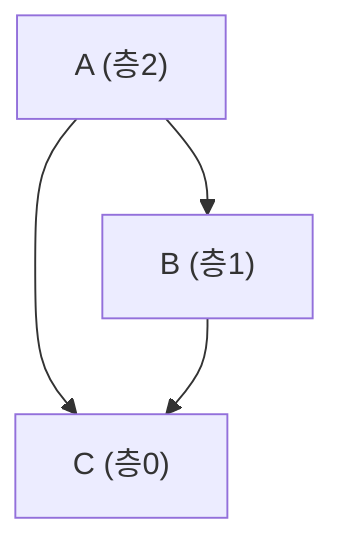
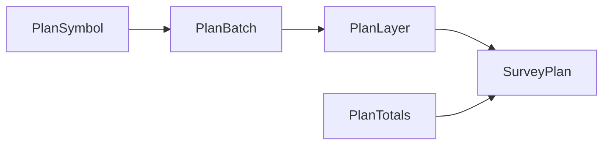

# 기계축 — survey_plan.py 심볼 층 분할

## 이 장이 다루는 것

`machine/survey_plan.py` 는 전수조사(全數調査, codebase survey)를 **어떤 순서로, 얼마나 큰
묶음으로** 돌릴지 계산하는 파일이다. 코드를 실행하지 않고, 코드가 무엇을 하는지 판정하지도
않는다. 오직 `codegraph.json`(코드 지도)에 적힌 "누가 누구를 부르는가"라는 관계만 보고
숫자를 매긴다. 이 장에서는 그 계산의 핵심인 `layer_of` 함수와, 계산 결과를 담는 그릇인
네 가지 타입(`PlanLayer` · `PlanBatch` · `PlanSymbol` · `PlanTotals`)을 다룬다.

읽는 사람이 "그래프(graph)"나 "위상 정렬(topological sort)" 같은 개념을 몰라도 이해할 수
있도록, 아래에서 그림과 함께 하나씩 풀어 쓴다.

## 왜 이런 계산이 필요한가

큰 코드베이스를 사람(또는 LLM 세션)이 읽고 이해하려면, 한 번에 전부 읽을 수 없어 여러
묶음으로 쪼개야 한다. 이때 순서가 중요하다. 만약 `A`라는 함수가 `B`라는 함수를 호출한다면,
`B`를 먼저 읽어야 `A`를 읽을 때 "이 함수가 무엇을 하는 B를 부르는구나"라고 이해할 수 있다.
거꾸로 `A`부터 읽으면 `B`의 뜻을 아직 모른 채로 `A`를 설명하게 되어, 추측이 섞인 부정확한
기록이 남는다.

`survey_plan.py` 의 핵심 아이디어는 **"아무것도 의존하지 않는 것부터 한 겹씩 올라가며
읽는다"**는 것이다(machine/survey_plan.py:5-8). 이렇게 겹겹이 나눈 단계를 이 파일은
**층(layer)**이라고 부른다. 같은 층에 속한 심볼(함수·클래스 등)은 서로 의존하지 않으므로,
같은 층 안에서는 병렬로(동시에 여러 세션이) 읽어도 안전하다.

## 간선의 방향 — 헷갈리기 쉬운 지점

`codegraph.json` 의 간선(edge, 화살표) `{"from": A, "to": B}` 는 **"A 가 B 에 의존한다"**는
뜻이다(machine/survey_plan.py:10-21). 예를 들어 함수 `A` 의 본문 안에서 함수 `B` 를
호출하면, 그 관계는 `{"from": "A", "to": "B"}` 로 기록된다.

이 방향을 뒤집어 읽으면 정렬이 정반대가 된다. 그래서 이 파일은 두 가지 "차수(degree, 연결된
간선의 개수)"를 구분한다.

| 차수 | 뜻 | 층 |
|---|---|---|
| `out_deg`(나가는 차수) | 이것이 끌어오는(의존하는) 개수 | 0이면 **층0** — 여기서 조사를 시작한다 |
| `in_deg`(들어오는 차수) | 이것을 끌어가는(의존받는) 개수 | 0이면 **진입점**(entry point) — 맨 나중에 읽는다 |

만약 실수로 `in_deg` 가 0인 것부터 시작하면 위에서 아래로(top-down) 읽는 순서가 되어, 예를
들어 프로그램의 시작점인 `main` 함수가 정작 자신이 호출하는 함수들의 뜻을 모른 채로 먼저
설명되는 문제가 생긴다(machine/survey_plan.py:12-21). `layer_of` 함수는 이 함정을 피하도록
설계되어 있다(아래 참고).

## `layer_of` — 층 번호를 계산하는 함수

`layer_of(first, edges)` 는 심볼 집합(`first`)과 의존 관계 목록(`edges`)을 받아, 각 심볼이
몇 번째 층에 속하는지 계산한다(machine/survey_plan.py:127-151).

규칙은 간단하다:

- 아무것에도 의존하지 않으면(의존 대상이 0개) **층0**
- 무언가에 의존하면, 그 의존 대상들 중 **가장 깊은 층 번호 + 1**

예를 들어 함수 `C` 가 아무것도 안 부르면 `C` 는 층0이다. 함수 `B` 가 `C` 만 부르면 `B` 는
층1이다. 함수 `A` 가 `B` 와 `C` 를 모두 부르면, `A` 는 `B`(층1)와 `C`(층0) 중 더 깊은
`B` 를 기준으로 `1 + 1 = 층2` 가 된다.

### 왜 "의존 개수"가 아니라 "깊이"인가

`layer_of` 의 독스트링은 "의존을 몇 개 갖는지(out_deg)로 정렬하면 안 된다"고 명시한다
(machine/survey_plan.py:133). 의존 대상을 딱 하나만 가져도, 그 하나가 이미 3층 깊이에
있다면 이 심볼은 4층이 되어야 한다. 개수가 아니라 **사슬의 길이(깊이)**가 기준이다.

실제로 이 저장소 자신을 대상으로 층을 매겨 본 결과(`machine/CLAUDE.md` 의 실측), out_deg
1인 무리(31개) 안에도 깊이 1·2·3·4가 전부 섞여 있었다. out_deg 로 정렬했다면 이 넷을
구분하지 못했을 것이다.

### 순환은 어떻게 다루는가

만약 함수 `X` 가 `Y` 를 부르고, `Y` 가 다시 `X` 를 부르는 **순환(cycle)** 관계가 있으면,
"가장 깊은 층 + 1"이라는 규칙이 무한히 반복되어 층 번호를 정할 수 없다. `layer_of` 는 이
문제를 **강결합 성분(SCC, Strongly Connected Component)으로 접어** 해결한다
(machine/survey_plan.py:135, 143). SCC 는 그래프 이론 용어로, "서로가 서로에게 도달할 수
있는 노드들의 묶음"을 뜻한다. 순환에 갇힌 심볼들을 통째로 하나의 덩어리로 묶어 취급하면,
그 덩어리 안에는 더 이상 순환이 없는 상태(DAG, 방향성 비순환 그래프)가 되어 층을 매길 수
있다. 같은 순환에 속한 심볼은 결과적으로 같은 층 번호를 받고, 같은 배치의 후보가 된다.

구현은 `networkx` 라이브러리의 `nx.condensation` 함수를 그대로 쓴다
(machine/survey_plan.py:138-151). 순서는:

1. `first` 의 심볼들로 방향 그래프 `G` 를 만든다(자기 자신을 가리키는 간선은 제외).
2. `nx.condensation(G)` 으로 순환을 접어 DAG `C` 를 만든다.
3. `C` 를 위상 정렬(topological sort)하되, **뒤에서부터** 순회한다 — 의존 대상(더 아래
   층)을 먼저 계산해야 그 위의 층을 "1 + 최댓값"으로 계산할 수 있기 때문이다.
4. 각 원래 심볼은 자신이 속한 성분의 층 번호를 그대로 물려받는다.

반환값은 튜플 둘이다: `(층 번호 사전, 순환 여부 사전)`. 후자는 각 심볼이 크기 2 이상인
성분(즉 순환)에 속하는지를 나타내는 불(bool) 값이다(machine/survey_plan.py:149-151).

## 층 계산 결과를 담는 네 가지 타입

`layer_of` 가 계산한 층 번호는 `plan()` 함수(machine/survey_plan.py:185-238)를 거쳐 최종
결과물인 `survey-plan.json` 으로 조립된다. 이 조립 과정에서 쓰이는 그릇이 아래 네 개의
`TypedDict`(파이썬에서 딕셔너리의 모양을 정해 두는 타입)다. 넷 다 **동작하는 코드가 아니라
자료 모양만 정의**하며, 실제 값을 채우는 것은 `plan()` 함수다.

### `PlanSymbol` — 심볼 하나

계획서에 들어가는 가장 작은 단위로, 함수나 클래스 하나의 정보를 담는다
(machine/survey_plan.py:70-78).

| 필드 | 뜻 |
|---|---|
| `id` | 심볼의 고유 이름 |
| `name` | 사람이 읽는 이름(없을 수 있음) |
| `file` / `line` | 어느 파일 몇 번째 줄에 있는지 |
| `kind` | 함수·클래스 등 종류 |
| `in_cycle` | 순환에 갇힌 심볼인지(`layer_of` 의 두 번째 반환값에서 옴) |
| `depends_on` | 이 심볼이 의존하는 다른 심볼들의 `id` 목록 |

`plan()` 함수 안에서 `depends_on` 은 이 심볼이 `from` 인 간선들 중 `to` 만 모아 정렬한
목록으로 채워진다(machine/survey_plan.py:223-224). 이 목록은 나중에
`runner/run_mode1.py` 의 `dep_excerpt` 함수가 "이미 완성된 아래층 레코드의 발췌"를 뽑는
재료로 쓰인다(runner/run_mode1.py:414-425) — 아직 레코드가 없는 의존 대상은 발췌에서
빠지는데, 이는 "없는 것을 가리키면 세션이 그 자리를 추측으로 메운다"는 문제를 막기 위해서다
(runner/run_mode1.py:420).

### `PlanBatch` — 배치(한 세션이 맡을 몫)

같은 층 안의 심볼들을 실제로 조사할 단위로 더 잘게 묶은 것이 배치다
(machine/survey_plan.py:83-87).

| 필드 | 뜻 |
|---|---|
| `id` | 배치 고유 이름. `"L%d-B%02d"` 꼴(예: `L2-B00`) |
| `files` | 이 배치가 다루는 파일 목록 |
| `symbols` | 이 배치에 속한 `PlanSymbol` 목록 |

배치를 만드는 것은 `pack()` 함수다(machine/survey_plan.py:157-179). 같은 파일에 있는
같은 층의 심볼들은 **반드시 한 배치에** 몰아넣는다 — 이렇게 하면 한 층 안에서 같은 파일을
두 배치가 동시에 읽는 일이 없어 "층 안 중복 통독"이 0이 된다. 파일 하나의 심볼 수가
목표치(`target`, 기본 8)를 넘으면 그 파일 하나만으로 배치 하나를 이룬다 — 즉 `target` 은
절대 상한이 아니라 "대략 이 정도로 나눠 달라"는 목표값이다(machine/survey_plan.py:161).
파일명을 정렬한 뒤 그리디(greedy, 앞에서부터 순서대로 채워 넣는 방식)로 묶으므로, 같은
입력이면 항상 같은 출력이 나온다(결정론적).

### `PlanLayer` — 층 하나

`level`(층 번호)과 그 층에 속한 배치들의 목록을 담는다(machine/survey_plan.py:92-103).

| 필드 | 뜻 | 언제 값이 있나 |
|---|---|---|
| `level` | 층 번호 | 항상 |
| `symbol_count` | 이 층의 심볼 개수 | 항상(단 아래 "비노드 층"만 예외로 `None`) |
| `batches` | 이 층의 `PlanBatch` 목록 | 항상 |
| `file_count` | 이 층에 걸친 파일 개수 | 심볼 층에만 |
| `kind` / `note` | 층의 특수 표기와 설명 | 아래에서 설명하는 "비노드 층"에만 |

독스트링이 밝히듯, "심볼 층과 맨 끝 비노드 층이 한 목록에 섞여 있다"
(machine/survey_plan.py:93). `file_count` · `kind` · `note` 세 필드가 전부
선택 항목(`NotRequired`)인 이유가 여기 있다 — 비노드 층만 `kind` 와 `note` 를 갖고,
`file_count` 는 갖지 않는다.

**비노드 층이란 무엇인가.** `plan()` 함수는 계산이 끝난 뒤, 코드 그래프의 노드가 아닌
용어들 — 파일 · 모듈 · 산출물(artifact) · 키(key) · 개념(concept) — 을 위한 자리를
맨 마지막에 별도의 층으로 하나 더 추가한다(machine/survey_plan.py:230-235). 이 층은
`symbol_count` 가 `None` 이라는 점으로 나머지 심볼 층과 구분된다. 코드 문서 자체는 이를
"K5"라는 결정 번호로 부른다(`machine/CLAUDE.md`) — 비노드 용어는 심볼 층이 전부 끝난
뒤 한 세션으로 처리한다는 규칙이다.

### `PlanTotals` — 전체 합계

계획 전체를 요약하는 숫자 네 개를 담는다(machine/survey_plan.py:108-112).

| 필드 | 뜻 |
|---|---|
| `symbols` | 전체 심볼 개수 |
| `edges` | 전체 간선(의존 관계) 개수 |
| `levels` | 심볼 층의 개수(비노드 층 제외) |
| `cyclic_symbols` | 순환에 갇힌 심볼의 개수 |

`plan()` 함수 끝부분에서 이 넷을 계산해 채운다(machine/survey_plan.py:236-238).

## 이 네 타입을 담는 그릇 — `SurveyPlan`

네 타입은 최종적으로 `SurveyPlan`(machine/survey_plan.py:118-121) 안에 모인다:
`target`(배치당 목표 심볼 수) · `layers`(`PlanLayer` 목록) · `totals`(`PlanTotals`). 이
`SurveyPlan` 이 그대로 JSON 으로 직렬화되어 `survey-plan.json` 파일이 된다
(machine/survey_plan.py:257-259). `SurveyPlan` 자체는 이번 장의 다루는 범위 밖이므로
자세한 다이어그램은 생략한다 — 위 표에서 각 타입이 어디로 흘러 들어가는지만 확인하면
충분하다.

## 이 계산 결과를 실제로 누가 쓰는가

`survey_plan.py` 자신은 "아무도 부르지 않는다 — 불려 가기만 한다"는 특징을 갖는다
(`machine/CLAUDE.md` 의 "다른 모듈과의 의존" 표). 실제로 층·배치 계획을 소비하는 곳은
러너축의 `runner/run_mode1.py` 다:

- `dep_excerpt(merged, batch)` — 배치가 의존하는 아래층 심볼 중 이미 완성된 레코드만
  발췌한다(runner/run_mode1.py:417).
- `symbol_layers(plan)` — 계획에서 "심볼 id → 층 번호" 사전을 뽑아, 위키 페이지가 어느
  층에 속하는지 판단하는 재료로 쓴다(runner/run_mode1.py:568).
- `plan_summary(plan)` — 층·배치·합계를 사람이 읽을 문자열 줄로 요약한다
  (runner/run_mode1.py:782).

이 세 함수는 코드 지도 전체 그림에서 `survey_plan.py` 가 러너축과 맞닿는 접점이다. 더 넓은
모듈 관계는 `out/codegraph-raw/modules.svg` 를 참고한다 — 이 장에서는 `survey_plan.py`
내부에 집중한다.

## 확인하지 못한 것

- `pack()` 함수와 `plan()` 함수 자체는 이 장의 대상 심볼 목록(`layer_of` ·
  `PlanLayer` · `PlanBatch` · `PlanSymbol` · `PlanTotals`)에 포함되지 않아, 본문에서
  필요한 만큼만 인용하고 별도 장으로 다루지 않았다. 두 함수의 상세 동작은
  `machine/survey_plan.py:154-179`(pack), `machine/survey_plan.py:182-238`(plan)을
  직접 참고할 것을 권한다.
- `SurveyPlan` 과 `CodeGraph` · `GraphNode` · `GraphEdge` · `PackedBatch` 타입도 이번
  장의 대상 심볼이 아니라 표에서 위치만 밝히고 본문 서술은 생략했다.
- 실제로 여러 세션이 층 단위로 병렬 실행되는 절차(러너축의 `run_survey`)의 세부 동작은
  `runner/CLAUDE.md` 와 `runner/run_mode1.py` 를 다루는 다른 장의 몫으로 남긴다 —
  (Unknown - verify in runner/run_mode1.py 의 run_survey 관련 장).
