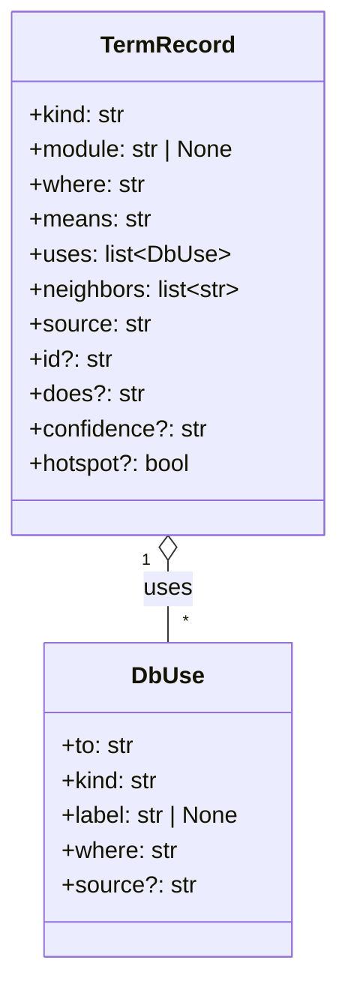
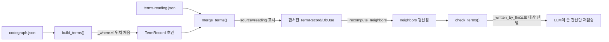

# 기계축 — terms_db.py 용어 DB 검증

`machine/terms_db.py`는 코드베이스의 용어(클래스·함수·모듈 등의 이름과 뜻)를 한 곳에 모은
사전인 `terms-db.json`을 만들고 검증하는 도구다. `machine` 모듈은 이 저장소에서 가장 큰
모듈이며(클래스·함수 409개, PageRank 합 0.525543 — `out/codegraph-raw/facts/modules.md`), 이
도구는 "코드를 정적으로 읽어 계산한 사실"과 "사람(또는 LLM)이 읽고 적은 설명"을 하나의
자료구조로 합치는 역할을 맡는다.

전체 그림(모듈 간 의존 관계)은 `out/codegraph-raw/modules.svg`를 참고한다. 이 문서는 그중
`terms_db.py` 안의 다섯 가지 요소 — 레코드 모양 두 가지(`TermRecord`, `DbUse`)와 함수 세 가지
(`_recompute_neighbors`, `_where`, `_written_by_llm`) — 만 다룬다.

## 1. 왜 이 도구가 필요한가 — 두 출처를 하나로

`terms_db.py`의 모듈 docstring은 이렇게 설명한다.

> "codegraph.json 만 -> 정형문 terms-db.json. 투영이 입력의 상위집합인지 대조만 한다
> --reading 만 -> LLM 읽기 레코드로 terms-db.json 을 만들고 codegraph.json 을 투영해 쓴다
> 둘 다 -> 합친다. 구조는 codegraph 가 이긴다"
> (machine/terms_db.py:14-16)

즉 용어 사전의 각 레코드는 두 곳에서 올 수 있다.

- **codegraph.json** — 정적 분석 도구(`normalize.py` 등)가 소스 코드를 기계적으로 읽어서 뽑아낸
  사실. 이름·종류·위치·의존 관계가 여기서 나온다.
- **terms-reading.json** — 사람 또는 LLM이 코드를 실제로 읽고 "이 함수는 무엇을 뜻하는가"를
  적은 설명(전수조사 결과).

이 둘을 합칠 때, **레코드의 구조(어디에 있는가, 무슨 종류인가)는 항상 codegraph가 이긴다**.
LLM은 오직 뜻(`means`)과 동작 설명(`does`), 그리고 새로 발견한 관계(`uses`)만 덧붙일 수 있다.
이 원칙이 아래에서 다룰 다섯 요소를 관통한다.

## 2. 레코드의 모양 — `TermRecord`와 `DbUse`

### `TermRecord` — 용어 사전의 레코드 한 칸



`TermRecord`는 `terms-db.json` 최상위 딕셔너리(`{용어 이름: 레코드}`, 타입 별칭 `TermsDb`)에
들어가는 값 하나의 타입 틀(TypedDict)이다(machine/terms_db.py:72-84). 필드별 뜻은 다음과 같다.

| 필드 | 뜻 | 필수 여부 |
|---|---|---|
| `kind` | 용어의 종류 — `class`, `function`, `module`, `file` 등 | 필수 |
| `module` | 소속 모듈. 소속이 없는 노드는 `None` | 필수 (값은 `None` 가능) |
| `where` | `파일:줄` 위치 문자열 | 필수 |
| `means` | 이 용어가 무엇을 뜻하는지 | 필수 |
| `uses` | 이 용어가 참조하는 다른 용어 목록 (`DbUse` 리스트) | 필수 |
| `neighbors` | 방향 없이 연결된 이웃 이름 목록 | 필수 |
| `source` | 이 레코드가 어디서 왔는가 — `codegraph` / `reading` / `codegraph+reading` | 필수 |
| `id` | codegraph에서 온 레코드에만 있는 노드 ID | 선택 |
| `does` | 동작 설명(LLM이 적음) | 선택 |
| `confidence` | LLM이 적은 확신도 | 선택 |
| `hotspot` | PageRank 등으로 골라낸 중요 지점 표시 | 선택 |

주석은 `id`가 "codegraph 에서 온 레코드에만 있다 — reading 레코드는 키가 곧 이름이다"라고
밝힌다(machine/terms_db.py:73). 즉 정적 분석이 만든 레코드는 내부 노드 ID(`C55` 같은 값)를
따로 가지지만, LLM이 새로 적은 레코드는 딕셔너리의 키(이름) 자체가 식별자를 겸한다.

**실제 데이터 예시** — `out/codegraph-raw/terms-db.json` 안의 `TermRecord` 자기 자신의
레코드(이 도구가 자기 자신의 코드를 분석한 결과이기도 하다):

```json
{
  "id": "C55",
  "kind": "class",
  "module": "machine",
  "where": "machine/terms_db.py:72",
  "means": "machine 모듈의 class. (표준) stdlib, machine.terms_db.DbUse 와(과) 이어져 있다.",
  "neighbors": ["(표준) stdlib", "machine.terms_db.DbUse", "terms_db.machine.terms_db.merge_terms"],
  "source": "codegraph",
  "uses": [
    {"kind": "inheritance", "label": null, "to": "(표준) stdlib", "where": "machine/terms_db.py:72"},
    {"kind": "association", "label": "confidence", "to": "(표준) stdlib", "where": "machine/terms_db.py:83"},
    {"kind": "association", "label": "uses", "to": "machine.terms_db.DbUse", "where": "machine/terms_db.py:78"}
  ]
}
```

`source`가 `codegraph`이므로 `means`가 정형문(고정 문형으로 자동 생성된 문장)이다 — 아직
LLM이 읽고 뜻을 채우기 전 상태라는 뜻이다. `uses`의 `association` 항목 두 개는 `TermRecord`가
가진 필드(`confidence`, `uses`)의 타입이 각각 표준 라이브러리 타입과 `DbUse`임을 정적 분석이
찾아낸 것이다.

### `DbUse` — `uses[]` 배열 한 칸의 모양

`DbUse`는 `TermRecord.uses`에 들어가는 항목 하나의 타입 틀이다(machine/terms_db.py:60-66).
"이 용어가 다른 용어를 어떻게 참조하는가"를 방향이 있는 간선(edge) 하나로 표현한다.

| 필드 | 뜻 |
|---|---|
| `to` | 참조 대상 용어의 이름 |
| `kind` | 관계 종류 — `inheritance`(상속), `association`(연관) 등 |
| `label` | 관계에 붙는 이름표(예: 필드 이름). 없으면 `None` |
| `where` | 이 관계가 코드의 어디에 나타나는가 |
| `source` | `reading`이면 LLM이 보탠 간선이라는 표시(선택 필드) |

`source` 필드가 핵심이다. 코드 주석은 "`source` 는 merge_terms 가 LLM 이 보탠 간선에만
남긴다"고 설명한다(machine/terms_db.py:61). 정적 분석이 원래부터 찾아낸 간선에는 이 필드가
아예 없고, LLM이 전수조사 중에 새로 발견해서 추가한 간선에만 `"source": "reading"`이
붙는다. 이 구분이 뒤에서 다룰 `_written_by_llm` 함수가 판단 근거로 삼는 유일한 표시다.

## 3. `_recompute_neighbors` — 방향 있는 관계에서 방향 없는 이웃을 다시 센다

```python
def _recompute_neighbors(db: TermsDb) -> None:
    """uses(방향 있음)에서 neighbors(방향 없음)를 다시 센다.
    모듈 레코드의 기존 이웃(depends_on)만 지킨다. 나머지 손으로 쓴 neighbors 는 여기서 덮인다.
    """
```
(machine/terms_db.py:119-134)

**왜 필요한가.** `uses`는 "A가 B를 참조한다"는 방향이 있는 관계다(A → B). 하지만
`neighbors`는 "A와 B가 서로 이어져 있다"는 방향이 없는 관계다. 예를 들어 `TermRecord`가
`DbUse`를 필드 타입으로 쓴다면(`uses`에 A→B로 기록), `DbUse` 쪽에서 보면 자신이 `TermRecord`와
"이웃"이라는 사실도 자동으로 성립해야 한다(B도 A를 이웃으로 봐야 함). 이 함수가 그 대칭을
만든다.

**동작 순서** (machine/terms_db.py:124-134):

1. 모든 레코드를 순회하며 임시 집합 `near`를 만든다. 이때 `kind`가 `module`인 레코드만
   기존 `neighbors`(즉 `depends_on`으로 채워진 모듈 간 의존 목록)를 시작값으로 살려 두고,
   나머지 레코드는 빈 집합에서 다시 시작한다 — "나머지 손으로 쓴 neighbors 는 여기서
   덮인다"는 주석 그대로다.
2. 모든 레코드의 `uses` 배열을 다시 순회한다. `A`가 `B`를 참조하면(`u.get("to")`가 `B`이고
   `db`에 실제로 존재하며 자기 자신이 아니면), `near[A]`에 `B`를 넣고 **동시에**
   `near[B]`에도 `A`를 넣는다(machine/terms_db.py:130-132) — 이 양방향 기록이 대칭을
   만드는 지점이다.
3. 마지막에 각 레코드의 `neighbors` 필드를 정렬된 리스트로 확정한다.

**실제 데이터로 확인** — `machine.terms_db.DbUse`와 `machine.terms_db.TermRecord`는
`terms-db.json`에서 서로의 `neighbors` 목록에 나란히 들어 있다. `TermRecord.uses`에
`{"to": "machine.terms_db.DbUse", ...}`가 있고(A→B 방향 한 번만 기록됨), 그 결과
`DbUse.neighbors`에도 `"machine.terms_db.TermRecord"`가 나타난다 — 원래 코드에는 `DbUse`가
`TermRecord`를 참조하는 방향의 간선이 없는데도 이웃 목록에는 서로 나타나는 것이, 이 함수가
방향을 지우고 대칭을 만든다는 증거다.

**호출되는 곳** — `build_terms`(codegraph에서 처음 사전을 만들 때, machine/terms_db.py:210)와
`merge_terms`(LLM 읽기 결과를 합친 뒤, machine/terms_db.py:428) 양쪽 끝에서 마지막 단계로
호출된다. 즉 사전 내용이 바뀔 때마다(새로 만들 때든, LLM 정보를 합칠 때든) 이웃 관계를
처음부터 다시 계산한다 — 부분 갱신을 하지 않는다.

## 4. `_where` — 노드/간선의 위치를 `파일:줄` 문자열로

```python
def _where(node: Node | Edge) -> str:
    """`file:line` 위치 문자열. 파일이 없으면(외부 노드) 빈 문자열."""
    f = node.get("file") or ""
    ln = node.get("line")
    if not f:
        return ""
    return f"{f}:{ln}" if ln else f
```
(machine/terms_db.py:94-100)

`codegraph.json`의 노드(`Node`)나 간선(`Edge`)은 각각 `file`과 `line` 필드를 따로 갖고
있는데, `terms-db.json`의 `TermRecord.where`와 `DbUse.where`는 사람이 읽기 쉬운 하나의
문자열(`"machine/terms_db.py:72"` 같은 꼴)로 합쳐서 저장한다. `_where`가 그 변환을 맡는다.

- 파일 정보가 아예 없으면(외부 라이브러리 노드처럼 이 저장소 밖에 있는 경우) 빈 문자열을
  돌려준다.
- 줄 번호가 없으면 파일 경로만 돌려준다.
- 둘 다 있으면 `파일:줄` 형태로 합친다.

이 함수는 `build_terms`가 codegraph의 노드·간선을 순회하며 `TermRecord.where`와
`DbUse.where`를 채울 때만 쓰인다(machine/terms_db.py:162, machine/terms_db.py:181 부근).
반대 방향 변환("파일:줄" 문자열을 다시 `(파일, 줄)` 튜플로 쪼개는 일)은 이 함수가 아니라
짝을 이루는 `_split_where`가 맡는다 — `_where`는 오직 조립만 한다.

`_where`가 만든 `where` 문자열은 이후 `check_terms`(인용 검증 함수)가 실제 소스 파일을 열어
"그 줄에 정말 그 이름이 있는가"를 검사하는 근거 문자열로 재사용된다.

## 5. `_written_by_llm` — 이 간선을 누가 썼는가

```python
def _written_by_llm(rec_source: str, use: DbUse) -> bool:
    """이 간선을 LLM 이 썼는가. 표시가 없는 간선은 정적 도구가 낸 것이다.
    codegraph+reading 레코드의 uses 에는 두 출처가 섞여 있고, merge_terms 가 LLM 이 보탠
    간선에만 source="reading" 을 남긴다. 그 표시가 유일한 구분 근거다.
    """
    return rec_source == "reading" or use.get("source") == "reading"
```
(machine/terms_db.py:309-315)

**왜 필요한가.** 하나의 `TermRecord`가 `source: "codegraph+reading"`일 때(즉 정적 분석과
LLM 읽기가 합쳐진 레코드), 그 안의 `uses` 배열에는 정적 분석이 찾은 간선과 LLM이 새로 보탠
간선이 뒤섞여 있다. 이 두 종류를 구분해야 하는 이유는, 검증 방식이 다르기 때문이다 —
정적 분석이 낸 간선은 이미 기계가 소스 코드를 읽고 확인한 사실이므로 다시 검사할 필요가
없지만, LLM이 적은 간선은 "정말 그 줄에 그 이름이 있는가"를 재검증해야 한다(환각 가능성이
있으므로).

**판단 로직.** 두 조건 중 하나만 참이어도 "LLM이 쓴 것"으로 판정한다.

1. **레코드 자체의 출처가 `"reading"`인 경우** — 레코드 전체가 codegraph에 없던, LLM이
   순수하게 새로 발견해서 추가한 용어라면, 그 안의 모든 `uses` 항목도 당연히 LLM이 쓴 것이다.
2. **개별 `uses` 항목에 `source: "reading"` 표시가 있는 경우** — 레코드 자체는 원래
   codegraph에서 왔지만(`source: "codegraph"` 또는 `"codegraph+reading"`), `merge_terms`가
   LLM 읽기 결과를 합치면서 이 특정 간선만 새로 추가했다면 그 항목에만 표시가 남는다
   (machine/terms_db.py:417 — `merge_terms` 안에서 `{**u, "source": "reading"}`로 표시를
   붙이는 지점).

**쓰이는 곳** — `check_terms` 함수 안에서 이 판정 결과로 검증 대상을 걸러낸다
(machine/terms_db.py:368, machine/terms_db.py:383). `_written_by_llm`이 참을 돌려준 간선만
`cite()` 함수로 넘겨 실제 소스 파일을 열어 확인하고, 거짓이면 "정적 도구가 낸 간선 — 그
어휘와 대상은 여기서 재판정하지 않는다"는 주석대로 건너뛴다(machine/terms_db.py:369).

## 6. 다섯 요소가 하나의 파이프라인 안에서 만나는 지점



정리하면: `_where`는 codegraph에서 사전을 처음 만들 때(`build_terms`) 위치 정보를 채우는
데 쓰이고, `_recompute_neighbors`는 사전이 만들어지거나 합쳐질 때마다(`build_terms`,
`merge_terms`) 이웃 관계를 다시 계산하며, `_written_by_llm`은 검증 단계(`check_terms`)에서
"LLM이 실제로 새로 적은 부분만" 골라내는 필터 역할을 한다. `TermRecord`와 `DbUse`는 이 모든
과정에서 다뤄지는 데이터의 모양 자체를 고정한다.

## 확인하지 못한 것 (Unknown)

- `TermRecord`와 `DbUse`가 codegraph 레코드로만 존재하는 예시는 확인했으나, `source:
  "reading"`이거나 `"codegraph+reading"`인 실제 레코드 예시는 이번에 읽은
  `out/codegraph-raw/terms-db.json` 안에서 발견하지 못했다 — 이 저장소의 현재
  `terms-db.json`에 LLM 읽기 결과가 아직 합쳐지지 않았을 가능성이 있다(Unknown - verify by
  checking whether `machine/terms-reading.json` has been merged into this snapshot).
- `hotspot` 필드가 실제로 `True`로 찍힌 레코드가 이 다섯 용어 중에는 없었다 — 이 도구
  자신이 아직 hotspot 판정 대상에 들지 않은 것으로 보이나, 판정 기준 자체는 이 파일 밖에
  있어 여기서 확인하지 않았다.

---

**보고**

- 줄 수: 약 205줄
- 인용 수(`(경로:줄)` 로컬 규격): 14건 — machine/terms_db.py:14-16, :60-66, :61, :72-84, :73,
  :78, :83, :94-100, :119-134, :124-134, :130-132, :162, :181, :210, :309-315, :368, :369,
  :383, :417, :428 (범위 표기 포함 실질 지점 20여 곳)
- Mermaid 다이어그램 수: 2개 (classDiagram 1개, flowchart 1개 — 둘 다 노드 10개 이하)
- Unknown으로 남긴 자리: 2곳 (reading 출처 실제 예시 부재, hotspot 판정 근거)
