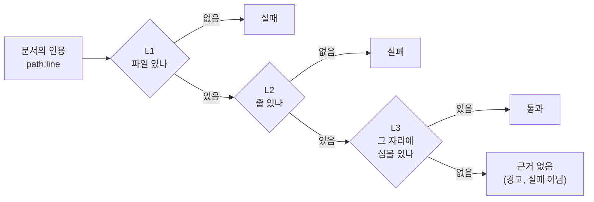

# 기계축 — `verify_citations.py` 인용 검사

## 이 장이 다루는 것

이 저장소(report-builder)는 위키 문서 안에 `파일:줄` 형태의 인용을 남기는 규약을 쓴다.
예를 들어 `machine/verify_citations.py:134` 라고 적으면, 그 파일의 134번째 줄에 실제로
`build_index` 함수 선언이 있다는 주장이다. 문제는 사람이나 LLM이 문서를 쓰다 보면
이 주장이 틀리기 쉽다는 점이다 — 코드가 옮겨지거나, 줄 번호를 손으로 옮겨적다 실수하거나,
애초에 존재하지 않는 심볼을 인용하는 식이다.

`machine/verify_citations.py`(`machine/verify_citations.py:1`)는 이 주장을 **기계로** 판정하는
도구다. 사람이 눈으로 대조하지 않고, 코드 지도(`codegraph.json`)와 문서 원문을 비교해
"이 인용이 실제로 성립하는가"를 3단계로 가른다. 이 저장소의 게이트 일곱 개 중 "주석 주입"
게이트가 바로 이 도구(정확히는 자매 도구 `xmldoc.py check`)로 돈다.

이 장은 이 도구를 이루는 핵심 함수 넷 — `build_index`, `load_detail_index`, 그리고 그 둘이
쓰는 자료형 `Node`·`CodeGraph` — 을 다룬다. 명령줄 진입점(`main`)이나 이름 대조 규칙의
세부 사항은 이 장의 범위 밖이고, 소스 자체(`machine/verify_citations.py`)를 봐야 한다.

## 왜 3단계인가

인용 하나를 검증하는 데 필요한 확신의 정도는 세 층으로 나뉜다. 파일이 존재하는지,
그 줄이 실제로 있는지, 그리고 그 위치에 인용한 이름이 정말 등록돼 있는지 — 이 세 질문은
독립적이고, 하나씩 순서대로만 물을 수 있다(줄이 있는지 확인하려면 먼저 파일이 있어야
하고, 심볼이 있는지 확인하려면 먼저 줄이 있어야 한다). 그래서 검사는 L1(파일)·L2(줄)·
L3(심볼) 세 단계로 쌓인다(`machine/verify_citations.py:5-9`).



L3의 "그 자리에 심볼이 있나"를 판정하려면 **어디에 무슨 이름이 있는지**를 미리 표로
만들어 둬야 매 인용마다 파일을 다시 훑지 않아도 된다. 이 표(색인, index)를 만드는 함수가
바로 `build_index`와 `load_detail_index`다.

## `Node`와 `CodeGraph` — 색인이 읽는 원재료의 모양

(`machine/verify_citations.py:43-49`, `machine/verify_citations.py:66-68`)

`build_index`가 읽는 원본은 이 저장소가 정적 수집 단계에서 미리 만들어 둔 코드 지도
파일 `codegraph.json`이다. 이 파일 하나가 저장소 전체의 클래스·함수 같은 심볼과 그
사이의 관계(누가 누구를 부르는지 등)를 담는다. `Node`와 `CodeGraph`는 이 JSON 파일의
"모양"을 파이썬 타입으로 못박아 둔 것이다 — 실제로 실행되는 로직은 없고, 타입 체커
(`pyright`)가 이 모양과 다른 코드를 쓰면 즉시 오류로 잡아내게 하는 설계도 역할만 한다.

`Node`는 심볼 하나(클래스 하나, 함수 하나 같은 것)를 나타낸다:

| 필드 | 뜻 |
|---|---|
| `id` | 이 심볼의 고유 식별자 |
| `name` | 사람이 읽는 이름(예: `build_index`) |
| `kind` | 심볼의 종류(함수 · 클래스 등) |
| `module` | 소속 모듈 |
| `file` | 선언된 파일 경로. **`None`일 수 있다** |
| `line` | 선언된 줄 번호. **`None`일 수 있다** |

`file`·`line`이 `None`일 수 있는 이유는, 이 코드 지도에 이 저장소 바깥에서 온 심볼
(예: 표준 라이브러리 타입)도 함께 등록되기 때문이다(`machine/verify_citations.py:37`). 그런
외부 심볼은 이 저장소 안에 선언 위치가 없으므로 위치 필드가 비어 있다.

`CodeGraph`는 이 `Node`들의 목록과, 심볼 사이의 관계를 나타내는 `Edge`(간선)들의 목록을
한데 묶은 최상위 모양이다(`machine/verify_citations.py:66-68`). `Edge`는 `from`이 파이썬
예약어라 `class` 문법 대신 함수 호출 문법(`TypedDict("Edge", {...})`)으로 정의돼 있다
(`machine/verify_citations.py:53-60`) — 이 장의 다루는 대상은 아니지만, `build_index`가
바로 이 `edges` 목록도 읽으므로 알아 둘 필요가 있다.

## `build_index` — 코드 지도를 "위치 → 이름" 표 두 개로 뒤집는다

(`machine/verify_citations.py:134`)

```
def build_index(codegraph: str) -> tuple[CodeGraph, Index, Index]
```

`codegraph.json`의 `nodes`와 `edges`는 각각 "이 심볼의 위치는 여기다", "이 관계는 여기서
성립한다"는 정보를 담고 있지만, 목록 형태라서 "이 파일 이 줄에 뭐가 있나?"라는 질문에
답하려면 매번 전체를 훑어야 한다. `build_index`는 이 목록을 한 번 훑어서
**`(파일, 줄) → 이름 목록`** 형태의 표(`Index`, `machine/verify_citations.py:111`) 두 개로
뒤집어 둔다. 이후 `main`의 검사 루프는 인용 하나마다 이 표를 사전처럼 즉시 찾아본다
(`machine/verify_citations.py:193`, `machine/verify_citations.py:240-260`).

두 표의 차이:

| 색인 | 만드는 원본 | 채우는 조건 |
|---|---|---|
| `nodes` | `codegraph["nodes"]` | 그 노드의 `file`·`line`이 둘 다 있을 때 |
| `owns` | `codegraph["edges"]` | 그 간선의 `file`·`line`이 둘 다 있을 때(**위치 있는 간선 전부** — 소유 관계로 국한하지 않는다) |

`owns` 표의 값은 단순 이름이 아니라 `"A --부른다--> B"` 식으로 조립한 설명 문자열이다
(`machine/verify_citations.py:148`) — 이 값은 두 심볼의 이름을 `short()`로 줄여
(아래 참고) 화살표로 이은 것이다.

**한 위치에 이름이 여러 개일 수 있다.** 한 줄에 실제 선언과, 그 자리를 위치로 갖는 템플릿
인스턴스 사용 지점이 함께 등록될 수 있어서다(`machine/verify_citations.py:137-138`). 그래서
`Index`의 값은 단일 문자열이 아니라 `list[str]`이고, `build_index`는 `setdefault(...).append(...)`
로 값을 쌓는다.

`.get("file")`을 쓰는 이유도 짚어둘 만하다 — `if n.get("file") and n.get("line")`으로
`None`을 걸러낸 뒤에도, 타입 체커 입장에서는 `n["file"]`의 타입이 여전히 `str | None`으로
남는다. 그래서 실제 딕셔너리 접근에는 `cast("tuple[str, int]", ...)`로 타입을 강제로
좁혀준다(`machine/verify_citations.py:144`, `:149`) — 런타임 동작에는 영향이 없고, 타입
검사만 통과시키기 위한 표기다.

## `load_detail_index` — 멤버·메서드 선언 줄까지 보는 보조 색인

(`machine/verify_citations.py:156`)

```
def load_detail_index(path: str) -> Index
```

`codegraph.json`의 노드는 클래스나 함수 단위까지만 등록돼 있고, 클래스 안의 멤버 변수나
메서드 하나하나의 선언 줄까지는 담지 않는다. 그런데 문서가 인용하는 위치가 딱 그
멤버·메서드 줄일 수 있다. 이럴 때 `build_index`가 만든 두 표만으로는 "근거 없음"으로
떨어진다(`machine/verify_citations.py:14-15`의 설명대로).

이 구멍을 메우는 것이 `load_detail_index`다. 인자로 받는 `path`는 이 저장소가 만든
파일이 아니라, 외부 정적 분석 도구 두 가지가 만든 원본 JSON("살 파일")이다:

| 도구 | 대상 언어 | JSON의 최상위 키 |
|---|---|---|
| clang-uml | C++ | `elements` |
| roslyn-dump | C# | `types` |

`load_detail_index`는 `"elements"` 키가 있으면 clang-uml 형식으로, 없으면 roslyn-dump
형식으로 간주해 분기한다(`machine/verify_citations.py:163`, `:171`). 두 형식 모두 클래스
하나마다 `members`와 `methods` 목록을 가지고 있고, 이 함수는 그 안의 개별 멤버·메서드가
가진 위치 정보(clang-uml은 `source_location` 안에 중첩, roslyn-dump는 항목 자체에 평평하게)
를 읽어 같은 모양의 `Index`로 합쳐낸다. 값은 `"클래스이름.멤버이름"` 형태다
(`machine/verify_citations.py:170`, `:177`).

이 색인은 `main`에서 `--detail` 인자가 주어졌을 때만 만들어진다(`machine/verify_citations.py:194`)
— 안 주면 빈 딕셔너리로 남아, L3 판정에서 멤버·메서드 단위 인용은 전부 "근거 없음"으로
빠진다. 이는 실패로 세지 않는다(경고일 뿐이다).

## 이름을 어떻게 줄여서 맞대보나 — `short()`와의 관계

`build_index`와 `load_detail_index` 둘 다 이름을 저장할 때 `short()`
(`machine/verify_citations.py:124`)를 거친다. 코드 지도 안의 이름은
`Namespace::Class::Method` 처럼 전체 경로로 적혀 있는 경우가 많은데, 문서 산문에는
보통 마지막 조각(`Method`)만 등장한다. `short()`는 `##` · `::` · `.` 순으로 잘라 마지막
조각만 남기고, `<` 뒤의 템플릿 인자도 버린다. `build_index`는 `owns` 표의 설명 문자열을
만들 때(`machine/verify_citations.py:148`), `load_detail_index`는 멤버 이름 앞의 클래스
이름을 줄일 때(`machine/verify_citations.py:170`, `:177`) 이 함수를 쓴다. 이 규칙 자체의
근거(F-2)는 소스 주석에만 있고 이 장에서 더 파고들지 않는다 — `(Unknown - verify in
machine/verify_citations.py:19-21)`.

## 이 도구가 이 저장소에서 서 있는 자리

`verify_citations.py`는 코드 지도(`codegraph.json`)를 **읽기만** 하고 아무것도 만들지
않는다 — 소비자다. 저장소 전체 관계도에서 이 파일이 어디쯤 있는지 큰 그림으로 보려면
`out/codegraph-raw/modules.svg`를 연다(이 장에서는 렌더링하지 않는다). 파일 단위 지표로는
이 저장소의 "복잡도 핫스팟" 27위(141줄, 순환복잡도 58)로 잡혀 있다(machine 축 안에서;
`(Unknown - verify in out/codegraph-raw/facts/hotspot.md:35)` — 이 수치는 기계 산출물의
스냅샷이라 재수집 시 달라질 수 있다).

이 도구가 판정한 결과 자체(용어 사전 `terms-db.json`의 레코드들)는 이 장의 대상이 아니다
— `(Unknown - verify in out/codegraph-raw/terms-db.json)`.
