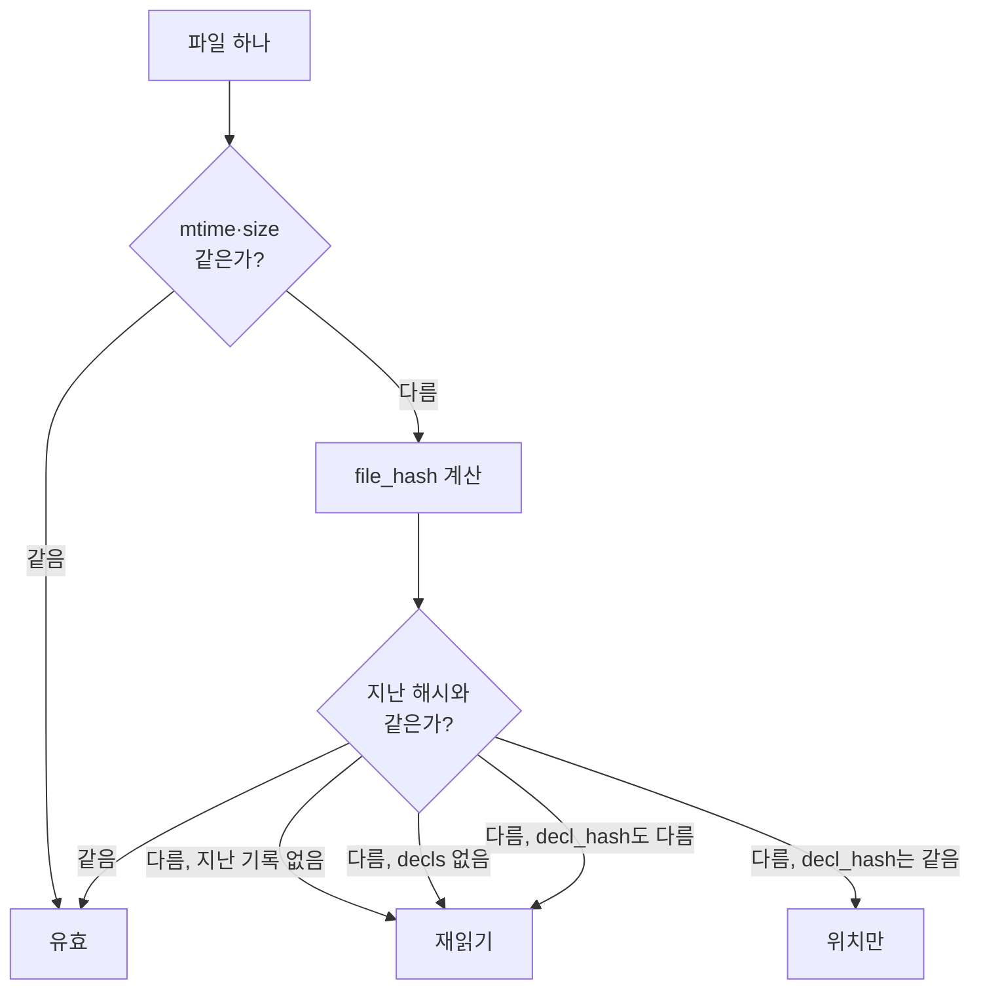

# 기계축 — warmup.py 재읽기 판정

`machine/warmup.py`는 코드베이스 전수조사(全數調査, 저장소의 모든 소스 파일을 훑어 요약 레코드를
만드는 작업)를 실행할 때마다 처음부터 전량을 다시 훑지 않도록, "이 파일은 지난번과 같으니
건너뛰어도 되는가"를 판정하는 캐시 겸 무효화(invalidation, 캐시가 낡았다고 표시해 다시 계산하게
만드는 것) 계층이다. 요약 자체(파일이 무엇을 하는지 서술한 문장)는 LLM이 만들고, 이 파일은
그 요약을 다시 만들어야 하는지 여부만 결정한다(`machine/warmup.py:5-7`).

## 왜 필요한가 — 판정 없이 돌리면 벌어지는 일

전수조사는 저장소의 파일마다 LLM을 불러 "이 파일은 무엇을 하는가"를 적게 하는 작업이다. 파일
수가 수백 개면 매번 전량을 다시 도는 것은 시간과 비용이 크다. `warmup.py`는 지난 실행 때 남긴
기록(매니페스트, manifest)과 이번 파일 상태를 비교해, 다시 읽어야 할 파일만 골라낸다.

## 판정 네 갈래

`status()` 함수(아래)가 파일마다 다음 네 갈래 중 하나로 판정한다(`machine/warmup.py:14-18`):

| 판정 | 뜻 | 해야 할 일 |
|---|---|---|
| 유효 | 파일 내용이 지난번과 같다 | 아무것도 안 한다 |
| 위치만 | 내용은 달라졌지만 선언(함수·클래스 이름과 종류) 목록은 같다 | 좌표만 고친다. LLM을 다시 부르지 않는다 |
| 재읽기 | 내용도 선언도 달라졌다 | 그 파일만 LLM에게 다시 읽힌다 |
| 삭제됨 | git은 아는데 디스크에 파일이 없다 | 레코드를 지울지 사람에게 묻는다 |

무효화 열쇠는 **파일 내용의 sha256**이지, git이 매기는 blob SHA(커밋된 내용에 대한 식별자)가
아니다. 작업 트리를 고쳤지만 아직 커밋하지 않은 상태에서 blob SHA만 비교하면 "유효"로
잘못 판정되어 낡은 요약이 그대로 재사용된다(`machine/warmup.py:9-11`). git은 오직 "이 파일이
추적 대상인가"(= 삭제 판정의 근거)를 묻는 데만 쓴다.

## 두 겹 무효화 — 파일 해시와 선언 해시

판정은 두 겹으로 이루어진다. 첫째 겹(파일 해시)이 다르다고 바로 LLM을 다시 부르지 않고, 둘째
겹(선언 해시)까지 같으면 좌표만 고치고 끝낸다(`machine/warmup.py:13`).

### 1) `file_hash` — 파일 내용의 지문

```
machine.warmup.file_hash(path: str) -> str | None
```

파일 바이트를 그대로 읽어 sha256 지문을 낸다(`machine/warmup.py:66-79`). 줄바꿈 변환이나
공백 정리 같은 정규화를 하지 않는다 — 정규화를 넣으면 "안 바뀌었다"는 거짓 판정이 생겨 낡은
요약이 조용히 재사용되기 때문이다(`machine/warmup.py:69-70`). 파일을 열 수 없으면(`OSError`)
`None`을 낸다.

### 2) `decl_hash` — 선언 목록만의 지문

```
machine.warmup.decl_hash(entry: declmap.FileDecls | None) -> str | None
```

한 파일 안에 어떤 이름의 선언(클래스, 함수 등)이 있는지를 지문으로 바꾼다
(`machine/warmup.py:82-96`). 해싱 대상은 `(kind, name)` 쌍뿐이고, 줄 번호와 문서 주석은
일부러 뺀다. 그래서 **함수 본문만 통째로 다시 써도 선언 이름과 종류가 그대로면 이 지문은
바뀌지 않는다** — 그 결과가 "위치만" 판정이다. `entry`가 `None`(선언이 하나도 없는 파일)이면
`None`을 낸다.

`decl_hash`가 받는 `entry`는 `declmap.scan`이 낸 결과의 파일 하나 몫이다(`FileDecls`).
`declmap.py`는 이 저장소의 다른 모듈이라, 정확한 동작은 (Unknown - verify in
`machine/declmap.py`)로 남긴다.

## 자료 모양 — `Entry`와 매니페스트

```
class machine.warmup.Entry(TypedDict):
    mtime: float
    size: int
    seen: float
    file_hash: str | None
    decl_hash: str | None
```

`Entry`는 파일 하나 몫의 기록을 담는 자료 모양이다(`machine/warmup.py:48-54`). `TypedDict`(파이썬
표준 라이브러리 `typing` 모듈의 타입, 실제로 동작하는 코드 없이 딕셔너리의 필드 이름과 타입만
정한다)이므로 런타임에 검사를 강제하지 않는다. `file_hash`는 파일을 못 읽었으면 `None`이다.

매니페스트(`Manifest`)는 `{상대경로: Entry}` 꼴의 딕셔너리다(`machine/warmup.py:58`). 기본
저장 위치는 `out/codegraph-raw/warmup.json`이고, 파생물이라 `out/` 아래 있으며 git이 무시하는
자리다(`machine/warmup.py:40`).

### `load` — 매니페스트 읽기

```
machine.warmup.load(cache_path: str) -> Manifest
```

캐시 파일을 읽는다(`machine/warmup.py:102-111`). 파일이 없거나 JSON이 깨졌으면 빈 딕셔너리를
낸다 — 그러면 다음 판정에서 모든 파일이 "처음 보는 파일"로 취급되어 전량 재읽기가 된다.
디스크의 매니페스트는 두 가지 꼴을 받아들인다: `{"files": {...}}`로 감싼 것과, 감싸지 않은 맨
딕셔너리. 둘 다 읽어 `Manifest` 꼴로 맞춘다.

### `save` — 매니페스트 쓰기

```
machine.warmup.save(cache_path: str, entries: Manifest) -> Manifest
```

이번에 판정한 결과를 파일로 쓴다(`machine/warmup.py:117-122`). 상위 폴더가 없으면 만든다.
쓰는 꼴은 `load`가 읽는 두 꼴 중 `{"files": entries}`로 감싼 쪽이다.

## `status` — 판정의 본체

```
machine.warmup.status(cache_path: str, repo: str, files: list[str],
                       decls: dict[str, declmap.FileDecls] | None = None
                       ) -> tuple[Verdicts, Manifest]
```

파일 목록을 받아 판정 네 갈래와 갱신된 매니페스트를 함께 낸다(`machine/warmup.py:128-187`).
**이 함수는 매니페스트를 디스크에 쓰지 않는다** — 쓰기는 별도로 `save`를 불러야 한다
(`machine/warmup.py:130`).

인자:
- `files` — 이번에 훑을 상대경로 목록. `declmap.tracked_files`가 낸 것이며, git이 아는 파일만
  들어온다(`machine/warmup.py:132`).
- `decls` — `declmap.scan`의 결과. 없으면 둘째 겹(선언 해시)을 판정할 수 없으므로, 내용이
  바뀐 파일은 전부 "재읽기"로 간다 — 안전한 쪽으로 기운다(`machine/warmup.py:133-134,167`).

판정 절차는 파일마다 다음 순서를 따른다(`machine/warmup.py:146-179`):

1. **1차 관문 — mtime과 size만 비교.** 지난 기록의 수정 시각(`mtime`)과 크기(`size`)가
   지금과 같으면 해싱조차 하지 않고 곧바로 "유효"로 판정한다(`machine/warmup.py:157-160`).
   이 관문이 있어야 안 바뀐 파일 대부분에서 sha256 계산을 건너뛸 수 있다.
2. 1차 관문을 통과하지 못하면 `file_hash`로 실제 내용을 비교한다.
   - 지난 해시와 같으면 "유효"다 — mtime만 밀린 경우(체크아웃 등)로 본다
     (`machine/warmup.py:163-164`).
   - 지난 기록이 아예 없으면(`prev is None`) "재읽기"다 — 처음 보는 파일이다
     (`machine/warmup.py:165-166`).
   - `decls`가 없거나, 새 선언 해시가 지난 선언 해시와 다르면 "재읽기"다
     (`machine/warmup.py:167-168`).
   - 그 외(내용은 바뀌었지만 선언은 같음)는 "위치만"이다(`machine/warmup.py:169-170`).
3. `files`에는 있지만 매니페스트에 없던 파일, 그리고 파일 목록에 없어진(=git이 모르게 된)
   지난 기록은 "삭제됨"으로 모은다(`machine/warmup.py:150-151,181-183`). 삭제 판정은 `files`가
   git이 아는 목록이라는 점에 기댄다 — git이 더 이상 추적하지 않는 파일은 자연히 `files`에서
   빠지므로, 이번에 못 본 매니페스트 항목이 곧 삭제됨이다(`machine/warmup.py:138-139`).



⚠ 알려진 구멍 — "위치만"이 본문 재작성까지 삼킨다. `decl_hash`는 `(kind, name)`만 해싱하므로,
함수 본문을 통째로 새로 써도 선언 이름과 종류가 같으면 "위치만"으로 판정된다. `machine/CLAUDE.md`가
이를 실측(2026-08-30)으로 확인했다고 적고 있으며, 그래서 뒤에서 설명할 `blast_radius`에는
"재읽기"뿐 아니라 "재읽기 ∪ 위치만"을 함께 넘겨야 한다고 명시한다. 이 규약은 `warmup.py`
자신의 CLI(`main`, 아래)에서도 그대로 따른다(`machine/warmup.py:262`).

## `blast_radius` — 파급 범위

```
machine.warmup.blast_radius(codegraph: str, changed_files: list[str], hops: int = 1) -> list[str]
```

매니페스트는 파일 단위 판정이라, "파일 A는 안 바뀌었는데 A를 서술한 문장이 B의 변경 때문에
틀려지는 경우"를 볼 수 없다(`machine/warmup.py:20-21`). `blast_radius`는 이 구멍을 codegraph(코드
지도, 저장소의 심볼과 그 사이 의존 관계를 담은 JSON)의 의존 간선으로 메운다.

동작(`machine/warmup.py:193-218`):
1. `codegraph` JSON을 읽어 노드 id → 노드 딕셔너리를 만든다.
2. 모든 간선(`edges`)에 대해, 양쪽 노드가 각각 속한 파일(`file` 필드)을 인접 집합에 **양방향으로**
   등록한다. 방향을 하나만 타면 "내가 쓰는 것이 바뀐" 경우나 "나를 쓰는 것이 바뀐" 경우 중
   한쪽을 놓치기 때문이다(`machine/warmup.py:196-197`).
3. `file`이 없는 노드(외부 심볼, 즉 이 저장소 밖의 표준 라이브러리 등)는 뺀다 — 다시 읽을 소스가
   없기 때문이다(`machine/warmup.py:198`).
4. `changed_files`를 시작 집합(frontier)으로 두고, `hops`번만큼 인접 파일을 넓혀 나가며 이미
   본 파일(`seen`)을 누적한다.
5. 정렬된 파일 목록을 낸다.

## 호출자 — `runner/run_mode1.py`가 이 모듈을 어떻게 쓰는가

`warmup.py` 자신은 아무도 부르지 않는다 — 불려 가기만 하는 모듈이다(`machine/CLAUDE.md`의
"다른 모듈과의 의존" 표). 실제로 부르는 쪽은 러너축의 `runner/run_mode1.py`이며, Mode 1
파이프라인에서 `warmup`과 `warmup-save`라는 **서로 다른 두 단계**로 나뉘어 배선돼 있다.

```
lang-select ─▶ prep ─▶ warmup ─▶ survey-plan ─▶ survey ─▶ warmup-save ─▶ terms ─▶ wiki ─▶ build ─▶ check
```

- `run_warmup()`(`runner/run_mode1.py:1022`)이 `warmup.status()`를 불러 판정만 하고, 판정
  결과 중 "재읽기 ∪ 위치만"을 씨앗(`changed_seed`, `runner/run_mode1.py:224`)으로 삼아
  `warmup.blast_radius()`로 넓힌 목록을 다음 단계(`survey-plan`, `survey`)에 넘긴다
  (`runner/run_mode1.py:1046,1051`). 이 단계는 매니페스트를 아직 디스크에 쓰지 않는다.
- `save_warmup()`(`runner/run_mode1.py:1075`)이 `warmup.save()`를 불러 매니페스트를 실제로
  확정한다. 이 단계는 **전수조사(`survey`)가 끝난 바로 뒤**에 있다.

두 단계로 가른 것이 이 배선의 급소다: 한 단계로 합쳤다면 `survey` 단계에서 LLM 에이전트가
실패해도 그 파일이 이미 "유효"로 기록되어, 실제로는 읽지 않은 파일이 읽은 것처럼 남는다.
판정을 아예 못 한 경우(언어를 모르거나 코드가 전혀 없는 경우)에는 옛 동작인 전량 조사로
되돌아간다. 증분 조사 자체를 끄려면 `--skip warmup,warmup-save`를 준다
(`runner/run_mode1.py:77`).

## 명령줄 진입점 — `main`

```
python machine/warmup.py status <저장소> --lang cs
python machine/warmup.py blast  <저장소> --lang cs --codegraph <codegraph.json> --hops 1
```

`main()`(`machine/warmup.py:224-278`)은 `declmap.tracked_files`로 git이 아는 파일 목록을 얻고,
`declmap.scan`으로 선언 목록을 얻은 뒤 `status()`를 불러 판정 넷의 개수와 재읽기 비율을
출력한다. `action`이 `blast`이면 `--codegraph`를 반드시 받아 "재읽기 + 위치만" 목록을
`blast_radius()`로 넓힌 파급 범위와 그 비율을 추가로 출력한다(`machine/warmup.py:258-269`).
`--write` 플래그를 주면 판정 뒤 매니페스트를 실제로 갱신한다(`save()` 호출,
`machine/warmup.py:271-273`) — 주지 않으면 읽기 전용으로 판정만 하고 끝난다.

## 확인하지 못한 것

- `declmap.FileDecls`와 `declmap.scan`의 정확한 반환 모양은 `machine/declmap.py`를 직접
  읽지 않았다. (Unknown - verify in `machine/declmap.py`)
- `run_mode1.py`의 `changed_seed`가 "위치만"을 반드시 포함시키는 정확한 이유(주석 인용문)는
  `runner/run_mode1.py:227-229`에 있으나, 이 문서는 그 파일 자체를 담당 장이 아니므로 본문만
  요약했다.
