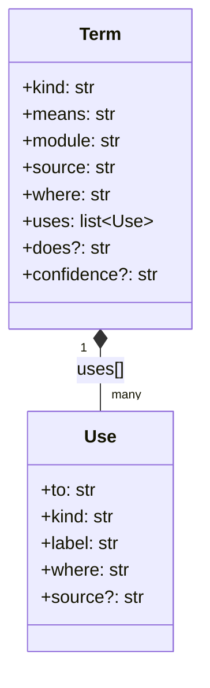
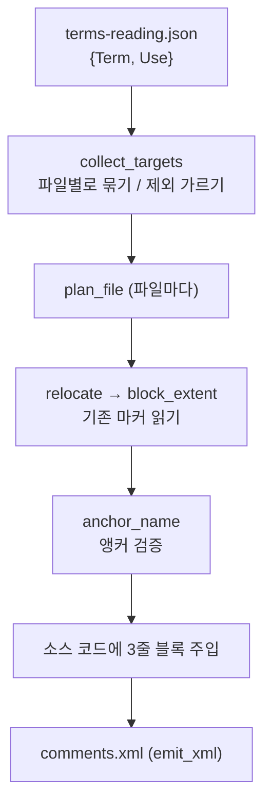

# 기계축 — xmldoc.py 주석 주입

## 이 장이 다루는 문제

이 저장소는 함수 하나마다 "무엇을 뜻하는지" · "무엇을 쓰고 누가 쓰는지"를 적은 레코드를
`machine/terms-reading.json`에 따로 모아 둔다(machine/xmldoc.py:5-8). 그런데 그 뜻풀이를 코드
옆에서도 보고 싶다 — 편집기에서 함수를 열었을 때 주석으로 바로 보이면 좋다.

`machine/xmldoc.py`가 이 문제를 푼다. json에 적힌 레코드를 읽어 두 가지를 만든다.

1. **`machine/comments.xml`** — 모든 레코드를 한 파일에 모은 것 (파생물, 손으로 고치지 않는다)
2. **소스 코드에 박히는 3줄짜리 주석 블록** — 함수 선언 바로 위에 `<include>` 마커·뜻 한 줄·의존
   관계 한 줄을 얹는다

객체지향 프로그래밍을 갓 배운 사람이라면 "주석은 그냥 손으로 쓰는 것 아닌가?"라고 물을 법하다.
이 저장소의 답은 다르다 — **정본은 json이고 코드의 주석은 그 json을 보여주는 창(window)일
뿐이다.** 뜻을 바꾸려면 json을 고치고 `xmldoc.py emit` 다음 `inject`를 다시 돌린다
(machine/xmldoc.py:7-8). 코드의 주석을 손으로 고쳐도 다음 `inject`가 지우고 다시 쓴다.

## 다섯 용어

### `Term`과 `Use` — json 한 항목의 모양을 못박은 타입

`terms-reading.json`은 `{용어 id: 레코드}` 꼴의 큰 딕셔너리다(machine/xmldoc.py:60). 그 레코드
하나하나가 어떤 필드를 가져야 하는지 파이썬의 `TypedDict`로 선언해 둔 것이 `Term`이다
(machine/xmldoc.py:47-56).

```python
class Term(TypedDict):
    kind: str        # "function" | "class" | "file" | ...
    means: str        # 사람이 읽는 한 줄 뜻풀이
    module: str
    source: str
    where: str        # "machine/xmldoc.py:47" 처럼 "파일:줄"
    uses: list[Use]   # 이 용어가 무엇을 쓰는지
    does: NotRequired[str]         # 있어도 되고 없어도 된다
    confidence: NotRequired[str]
```

`TypedDict`는 런타임에는 평범한 딕셔너리와 똑같이 동작한다. 다른 점은 타입 검사기(`pyright`)가
"이 딕셔너리에 `means`라는 열쇠가 있는가?" "그 값이 문자열인가?"를 코드를 실행하지 않고도
미리 검사해 준다는 것뿐이다. `NotRequired`가 붙은 `does`와 `confidence`는 레코드마다 있을 수도
없을 수도 있다는 뜻이다.

`Use`는 `uses[]` 배열 안 원소 하나의 모양이다(machine/xmldoc.py:35-41) — "이 용어가 **무엇을**
(`to`), **어떤 관계로**(`kind`: dependency·composition 등), **어디서**(`where`) 쓰는지"를 담는다.
실제 예시(terms-db.json, `machine.xmldoc.Term`):

```json
"uses": [
  {"kind": "composition", "label": "uses 필드가 Use 목록",
   "to": "machine.xmldoc.Use", "where": "machine/xmldoc.py:54"}
]
```

`Term`이 `Use`를 필드로 담으므로(`uses: list[Use]`), `Term` 쪽 주석 블록의 "쓰는 것" 줄에는
`Use`가 나열된다 — machine/xmldoc.py:32-34의 실제 주입 결과가 그 예시다.



### `anchor_name` — 용어 id에서 소스 코드에 실제로 적힌 이름만 뽑기

용어 id는 `machine.xmldoc.collect_targets`처럼 점(`.`)으로 이어진 긴 이름이다. 하지만 실제
소스 코드의 그 줄에는 `def collect_targets(...)`처럼 짧은 이름만 있다. `anchor_name`
(machine/xmldoc.py:134-136)이 이 변환을 한다.

```python
def anchor_name(term_id: str) -> str:
    return term_id.split(".")[-1].removesuffix("[]")
```

절차는 두 단계뿐이다.

1. id를 `.`으로 쪼개 **마지막 조각**만 취한다 (`machine.xmldoc.collect_targets` → `collect_targets`)
2. 그 끝에 `[]`가 붙어 있으면 떼어낸다 (배열 키를 가리키는 id를 위한 처리)

이 짧은 이름은 `plan_file`이 "블록을 삽입하려는 줄에 정말 그 함수가 있는가?"를 검증하는 데
쓰인다(machine/xmldoc.py:414-416) — `name not in lines[anchor]`이면 앵커가 잘못됐다고 보고
즉시 멈춘다.

### `block_extent` — 코드에 이미 박힌 블록이 몇 줄을 차지하는지 세기

주석 블록은 **용어 하나당 3줄**이 원칙이다(machine/xmldoc.py:80-83, 182-191): include 마커 줄,
뜻 줄, 의존 줄. 그런데 한 줄 코드(예: 여러 상수를 한 줄에 선언)에 용어가 여럿 걸리면 블록이
`3n`줄이 되고, 반대로 "쓰는 것도 쓰이는 곳도 없음"이라 의존 줄이 비는 경우도 있다. `inject`를
다시 돌릴 때 "기존 블록이 정확히 몇 줄인지" 세어야 그 블록을 지우고 새로 쓸 수 있다 — 이 역할을
`block_extent`가 한다(machine/xmldoc.py:294-306).

```python
def block_extent(lines: list[str], i: int) -> tuple[int, int]:
    c = 0
    while i + c < len(lines) and INCLUDE_RE.match(lines[i + c]):
        c += 1
    n = 2 * c
    u = 0
    while u < c and i + n + u < len(lines) and USES_LINE_RE.match(lines[i + n + u]):
        u += 1
    return c, n + u
```

셈하는 순서:

1. `lines[i]`부터 아래로, `INCLUDE_RE`(마커 줄 정규식, machine/xmldoc.py:75)에 계속 매치되는
   줄 수를 `c`(용어 수)로 센다
2. 마커 줄 `c`개와 뜻 줄 `c`개는 의존 줄이 있든 없든 항상 있으므로 `2*c`를 기본으로 잡는다
3. 그다음 자리부터 `USES_LINE_RE`("쓰는 것: "로 시작하는 줄, machine/xmldoc.py:78)에 매치되는
   줄이 몇 개 더 있는지(`u`, 최대 `c`개) 센다
4. `(용어 수 c, 전체 줄 수 2c+u)`를 돌려준다

`3n`으로 못박지 않고 실제로 세는 이유가 주석에 명시돼 있다(machine/xmldoc.py:297-298):
"못 박으면 의존 줄이 없는 블록을 걷어낼 때 코드 줄을 한 줄 삼킨다." 즉 의존 줄이 정말 없는
블록을 상수 `3`으로 계산하면, 블록 바로 아래에 있는 실제 코드 한 줄까지 블록의 일부로 착각해
함께 지워버린다.

`block_extent`는 `relocate`(마커를 읽어 선언 줄을 표로 만드는 함수)와 `strip_blocks`(블록을
전부 걷어내는 함수) 양쪽에서 "이 블록을 지나쳐 다음 자리로 가려면 몇 줄을 건너뛰어야 하는가"를
답하는 데 쓰인다(machine/xmldoc.py:324, 355).

### `collect_targets` — json 전체를 훑어 파일별로 묶고, 코드에 못 박을 것과 못 박을 수 없는 것을 가르기

`terms-reading.json`에는 함수·클래스처럼 소스 코드에 실제 선언 줄이 있는 용어도 있고, 문자열
안에서만 쓰이거나 개념적으로만 존재해 "이 줄 위에 주석을 얹는다"가 성립하지 않는 용어도 있다
(machine/xmldoc.py:86-89, `DECL_KINDS`에 없는 kind — external·key·artifact·concept).
`collect_targets`(machine/xmldoc.py:444-460)가 이 둘을 가른다.

```python
def collect_targets(terms: Terms, all_kinds: bool = False
                    ) -> tuple[dict[str, list[str]], list[tuple[str, str]]]:
    by_file: dict[str, list[str]] = {}
    skipped: list[tuple[str, str]] = []
    for tid, rec in terms.items():
        path, _ = split_where(rec.get("where"))
        if not path:
            skipped.append((tid, "위치 없음"))
            continue
        if not all_kinds and rec.get("kind") not in DECL_KINDS:
            skipped.append((tid, rec.get("kind")))
            continue
        if not os.path.exists(os.path.join(ROOT, path)):
            raise SystemExit(f"파일 없음: {path} ({tid})")
        by_file.setdefault(path, []).append(tid)
    return by_file, skipped
```

각 용어를 훑으며:

1. `where`("파일:줄")에서 파일 경로만 뽑는다(`split_where`, machine/xmldoc.py:121-128) — 경로가
   없으면 `skipped`(XML에만 남을 목록)로 보낸다
2. `all_kinds` 플래그가 없고 `kind`가 `DECL_KINDS`(function·class·struct·enum·interface·
   delegate·record·file)에 없으면 역시 `skipped`로 보낸다
3. 남은 것은 실제 파일이 존재하는지 확인한 뒤 `{파일 경로: [용어 id, ...]}` 딕셔너리에 쌓는다

반환값 `by_file`은 `run_inject`와 `run_check`가 "파일 하나씩 순회하며 그 파일에 속한 용어들의
블록을 처리한다"는 흐름의 출발점이다(machine/xmldoc.py:496, 530). `skipped`는 마지막 보고 줄에
"XML에만 남은 용어 N개"로 집계된다(machine/xmldoc.py:518).

## 전체 흐름 속 이 다섯 용어의 자리



`run_inject`(machine/xmldoc.py:490-518)가 `collect_targets`로 시작해 파일마다 `plan_file`을
부르고, `plan_file` 안에서 `relocate`가 `block_extent`를 써서 기존 블록의 경계를 읽고
`anchor_name`으로 삽입 지점을 검증한다. `run_check`(machine/xmldoc.py:524-550)도 같은
`collect_targets`·`relocate`를 써서 "코드의 마커와 json의 `where`가 같은 자리를 가리키는가"만
확인한다 — 다시 쓰지는 않는다.

## 확인하지 못한 것

- `Term`·`Use`의 `does`·`confidence` 필드가 실제 서비스(예: `report-spec`)에서 어떻게
  소비되는지는 이 장의 범위(xmldoc.py) 밖이다 (Unknown - verify in `machine/terms_db.py`)
- `collect_targets`가 걸러낸 `external`·`key`·`artifact`·`concept` 네 kind가 실제로
  `comments.xml`에서 어떤 모습으로 남는지는 `emit_xml`(machine/xmldoc.py:144-177)을 함께 읽어야
  한다 — 이 장은 언급만 하고 깊이 들어가지 않았다

## 보고

- 줄 수: 약 150줄(본문 마크다운 기준, 코드 인용 블록 제외 시 약 95줄)
- 인용 수: `machine/xmldoc.py:` 형태 로컬 인용 20건 (파일:줄 규격)
- Mermaid 다이어그램: 2개 (classDiagram 1개 — 노드 2개, flowchart 1개 — 노드 6개)
- Unknown으로 남긴 자리: 2건 (위 "확인하지 못한 것" 절)
