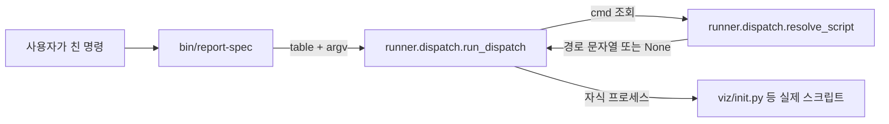

# 명령으로 시작하기

이 저장소는 다른 저장소의 spec/plan 문서, 코드베이스, 용어를 읽어 사람이 판정하기 좋은 산출물(HTML 보고서, 위키, 학습 노트)로
압축하는 도구다. 세 종류의 명령이 있고, 셋 다 껍데기는 얇다 — 명령을 받으면 표에서 스크립트 경로를 찾아 자식 프로세스로
그 스크립트를 실행할 뿐이다. 이 장에서는 그 얇은 껍데기가 정확히 무엇을 하는지, 그리고 그 위에 새 명령을 어떻게 얹는지를 본다.

## 첫 실행이 실제로 하는 일

터미널에서 아래처럼 쳤다고 하자.

```bash
report-spec init my-slug
```

`report-spec` 은 `bin/report-spec` 이라는 짧은 파이썬 스크립트다. 이 스크립트는 스스로 아무 일도 하지 않는다.
`init` · `build` · `check` 세 명령 각각이 어느 파일에 대응하는지 적어 둔 **표(table)** 하나를 만들고, 그 표와
사용자가 입력한 인자(`sys.argv[1:]`, 위 예에서는 `["init", "my-slug"]`)를 `run_dispatch` 라는 함수에 넘긴다
(`bin/report-spec:13`). `run_dispatch` 와 그 안에서 쓰는 `resolve_script` 는 둘 다 `runner/dispatch.py` 에
정의돼 있다.



## `resolve_script` — 명령 이름을 파일 경로로 바꾸는 사전 조회

`resolve_script(table, cmd)` 는 딱 한 가지 일을 한다. `cmd` 문자열이 비어 있으면 `None` 을 돌려주고,
아니면 `table` 딕셔너리에서 `cmd` 를 키로 찾아 있으면 그 값(스크립트 경로 문자열)을, 없으면 `None` 을
돌려준다(`runner/dispatch.py:9`, [terms-db](../codegraph-raw/terms-db.json) `runner.dispatch.resolve_script`).
새 명령을 추가하고 싶을 때 손댈 곳은 이 함수가 아니라, 이 함수에 넘기는 **표** 다. 표는 각 진입점 파일
(`bin/report-spec`, `bin/report-wiki`, `bin/report-term`)마다 따로 있다. 예를 들어 `report-spec` 의 표는
이렇다(`bin/report-spec:16-20`).

```python
table={
    "init": "viz/init.py",
    "build": "viz/build.py",
    "check": "viz/check.py",
}
```

`report-wiki` 는 같은 모양의 표를 갖되 가리키는 파일이 다르다 — `prep` → `runner/wiki/prep.py`,
`build` → `runner/wiki/build.py`, `check` → `runner/wiki/check.py`(`bin/report-wiki:16-20`). 명령 이름이
`build` 로 같아도 두 진입점의 표가 다르므로 실제로 실행되는 스크립트는 다르다 — 표가 진입점마다 독립이라는
뜻이다.

## `run_dispatch` — 표를 찾아 자식 프로세스를 띄우는 몸통

`run_dispatch(root, table, argv, usage)` 가 실제로 명령을 실행하는 부분이다(`runner/dispatch.py:15`,
[terms-db](../codegraph-raw/terms-db.json) `runner.dispatch.run_dispatch`). 순서는 이렇다.

1. `argv` 가 비어 있으면 `usage` 문자열을 표준에러(stderr)로 찍고 종료 코드 1로 끝낸다.
2. `argv` 의 첫 항목을 `cmd` 로 삼고, 나머지를 `rest` 로 삼는다. 위 예에서 `cmd` 는 `"init"`, `rest` 는
   `["my-slug"]` 다.
3. `resolve_script(table, cmd)` 를 불러 스크립트 상대경로를 얻는다. 못 찾으면(`None`) 마찬가지로 `usage` 를
   찍고 종료 코드 1로 끝낸다.
4. 찾은 상대경로를 `root`(저장소 뿌리)와 이어붙여 절대경로 `script_path` 를 만든다.
5. **해석기를 확장자로 고른다.** 스크립트 경로가 `.py` 로 끝나면 `tools.python.pythonPath` 로 파이썬 실행
   파일 경로를 찾고, 아니면 문자열 `"node"` 를 그대로 쓴다(`runner/dispatch.py:32`). `runner/term/*.mjs` 세
   파일이 아직 JavaScript 라서 이 갈림이 남아 있다.
6. 고른 해석기로 `subprocess.run([runner, script_path] + rest)` 를 실행한다 — 즉 진짜 작업은 **별도
   자식 프로세스**에서 일어난다.
7. 그 자식 프로세스의 종료 코드를 그대로 `sys.exit()` 에 넘겨 돌려준다. 스크립트가 실패하면 명령 전체도
   같은 코드로 실패한다.

`resolve_script` 를 부르는 지점은 `run_dispatch` 안 한 줄(`runner/dispatch.py:23`)뿐이고, 해석기를 고르는
`tools.python.pythonPath` 호출도 한 줄(`runner/dispatch.py:32`)뿐이다 — `run_dispatch` 가 이 저장소에서
유일하게 두 함수를 잇는 자리라는 뜻이다.

## 세 진입점이 공유하는 것과 갈리는 것

| 진입점 | 표에 있는 명령 | 공유하는 함수 |
|---|---|---|
| `report-wiki` | `prep` · `build` · `check` | `run_dispatch` |
| `report-term` | `collect` · `grade` · `emit` | `run_dispatch` |
| `report-spec` | `init` · `build` · `check` | `run_dispatch` |

세 진입점 모두 `runner.dispatch.run_dispatch` 를 그대로 가져다 쓴다. 다른 것은 각자 만든 표(어느 명령이
어느 파일을 가리키는가)와 `usage` 문자열뿐이다. 옛 이름 `report` 는 이 표 방식을 쓰지 않는 예외다 —
`run_dispatch` 를 부르지 않고, `subprocess.run` 으로 `report-spec` 자체를 자식 프로세스로 한 번 더 실행해
위임한다(`bin/report:14`, 확인은 `bin/report` 파일 자체에서 함).

## 다음에 볼 곳

`runner/dispatch.py` 를 넘어서는 나머지 파이프라인 — Mode 1(코드베이스 위키), Mode 1.5(용어 이해도 점검),
Mode 2(설계 검토 보고서)가 각 표 뒤에서 실제로 무엇을 계산하는지 — 는 (Unknown - verify in `runner/run_mode1.py`,
`runner/run_mode1_5.py`, `runner/run_mode2.py`) 아직 이 위키에 정리되지 않았다.
