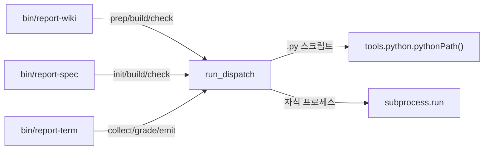

# 러너축 — dispatch.py 명령 갈림길

`runner/dispatch.py` 는 이 저장소의 CLI 진입점 셋(`report-wiki` · `report-spec` · `report-term`)이
공유해서 쓰는 작은 명령 갈림길(command dispatcher)이다. 진입점 스크립트 자신은 "어떤 하위
명령이 어떤 파일로 이어지는가"라는 표(table) 하나만 들고 있고, 표를 해석해서 실제로 자식
프로세스를 띄우는 일은 전부 이 파일이 한다.

## 왜 필요한가 — 진입점 셋이 겪는 같은 문제

`bin/report-wiki` · `bin/report-spec` · `bin/report-term` 세 진입점은 전부 같은 모양의 일을
한다. 사용자가 `report-wiki build ...` 처럼 첫 번째 인자로 하위 명령 이름을 주면:

1. 그 이름이 어떤 스크립트 파일에 대응하는지 찾고
2. 스크립트 확장자를 보고 어떤 인터프리터로 실행할지 정하고
3. 자식 프로세스로 실행한 뒤
4. 그 종료 코드를 그대로 자신의 종료 코드로 돌려준다

이 네 단계를 세 진입점이 각자 따로 구현하면 어긋나기 쉽다. `run_dispatch` 가 이 로직 하나를
갖고, 진입점 각자는 자신의 명령 표(table)와 사용법 문구(usage)만 인자로 넘긴다
(`runner.dispatch.run_dispatch` — runner/dispatch.py:15).

## 두 함수

### `resolve_script(table, cmd)` — 이름을 경로로 바꾸는 사전 조회

```
runner.dispatch.resolve_script — runner/dispatch.py:9
```

`cmd`(사용자가 입력한 하위 명령 이름, 예: `"build"`)를 받아 `table`(명령 이름 → 스크립트
상대경로 딕셔너리)에서 찾는다. `cmd` 가 빈 문자열이거나 표에 없으면 `None` 을 돌려준다.
그 자체로는 아무것도 실행하지 않는, 순수한 조회 함수다.

### `run_dispatch(root, table, argv, usage)` — 실제로 자식 프로세스를 띄운다

```
runner.dispatch.run_dispatch — runner/dispatch.py:15
```

동작 순서(runner/dispatch.py:16-35):

1. `argv` 가 비어 있으면 `usage` 를 표준에러(stderr)로 찍고 종료 코드 1로 끝낸다.
2. `argv[0]` 을 `cmd` 로 삼고, `resolve_script` 로 스크립트 상대경로를 찾는다. 못 찾으면
   마찬가지로 `usage` 를 찍고 종료 코드 1.
3. 찾은 상대경로를 `root` 와 이어붙여 절대경로 `script_path` 를 만든다.
4. **확장자로 인터프리터를 고른다** — `.py` 로 끝나면 `tools.python.pythonPath()` 로 파이썬
   해석기 경로를 얻고, 아니면 무조건 `"node"` 문자열을 쓴다(runner/dispatch.py:32).
5. `subprocess.run([해석기, script_path] + rest)` 로 자식 프로세스를 띄우고, 그 결과의
   종료 코드를 그대로 `sys.exit()` 에 넘긴다.

인자 `rest` 는 `argv[1:]` — 즉 하위 명령 이름 다음에 온 나머지 인자 전부를 그대로 자식
프로세스에 전달한다. 예를 들어 `report-spec build --check` 를 실행하면 `run_dispatch` 는
`["build", "--check"]` 를 받아 `cmd="build"`, `rest=["--check"]` 로 나누고, 최종적으로
`python .../viz/build.py --check` 를 실행한다.

## 왜 확장자로 인터프리터를 고르나

주석에 남은 이유(runner/dispatch.py:30-31)를 그대로 옮기면: `runner/term/*.mjs` 스크립트
셋이 아직 JavaScript 로 남아 있어서 이 갈림이 필요하다. 파이썬 경로는 하드코딩하지 않는다 —
대신 `tools.python.pythonPath()` 가 `$REPORT_PYTHON` 환경변수 → 이 저장소의 `.venv` → 시스템
PATH 순서로 해석기를 찾는다.

**다만 실제로 `runner/term/` 디렉터리를 확인하면 `.mjs` 파일은 하나도 없다** — 있는 것은
`collect.py` · `emit.py` · `quiz.py` 셋뿐이다(`ls runner/term/` 결과 직접 확인, 2026-09-07).
세 진입점의 명령 표(아래) 아홉 항목도 전부 `.py` 로 끝난다. 즉 주석이 가리키는 `.mjs` 셋은
`CLAUDE.md` 가 말하는 "Node.js 에서 Python 으로 포팅"(2026-08-31) 이후 이미 사라졌고,
`"node"` 분기는 지금 이 순간에는 등록된 명령이 하나도 없이 남은 죽지 않은(reachable 하지만
미사용인) 코드 경로다.

## 세 진입점의 명령 표 — `run_dispatch` 를 부르는 쪽



| 진입점 | 명령 | 스크립트 |
|---|---|---|
| `report-wiki` | `prep` | `runner/wiki/prep.py` |
| `report-wiki` | `build` | `runner/wiki/build.py` |
| `report-wiki` | `check` | `runner/wiki/check.py` |
| `report-spec` | `init` | `viz/init.py` |
| `report-spec` | `build` | `viz/build.py` |
| `report-spec` | `check` | `viz/check.py` |
| `report-term` | `collect` | `runner/term/collect.py` |
| `report-term` | `grade` | `runner/term/quiz.py` |
| `report-term` | `emit` | `runner/term/emit.py` |

(표 근거: bin/report-wiki, bin/report-spec, bin/report-term 세 파일을 직접 읽어 확인함, 2026-09-07)

**눈에 띄는 비대칭 한 가지** — `report-term` 의 `grade` 명령은 `grade.py` 가 아니라
`quiz.py` 로 이어진다. 명령 이름과 파일 이름이 다른 유일한 항목이다. 표가 곧 유일한 연결
고리이므로, 이 파일을 찾으려면 코드를 몰라도 이 표만 보면 된다 — 반대로 표를 떠나 파일
이름만 보고 명령을 추측하면 틀린다.

## `report` 만 다른 길을 간다

네 번째 진입점 `bin/report` 는 `run_dispatch` 를 전혀 쓰지 않는다. 대신 `report-spec` 자체를
자식 프로세스로 실행한다(`subprocess.run([sys.executable, ".../bin/report-spec", *sys.argv[1:]])`).
옛 이름을 쓰는 사용자를 위한 위임(delegation) 계층 하나가 `run_dispatch` 바깥에 더 있는
셈이다. 이 사실은 `../runner/CLAUDE.md` 에도 "`report` 만 예외다"로 명시돼 있다.

## 이 파일이 실행 도중 실패할 수 있는 지점

- `table` 에 없는 명령을 입력 → `usage` 출력 후 exit 1 (예외를 던지지 않고 정상적으로 종료
  코드만 다르게 끝난다).
- `.py` 스크립트인데 `.venv` 도 시스템 PATH 에도 파이썬이 없으면 `pythonPath()` 가 마지막
  후보로 `"python3"` 문자열 자체를 돌려주고(tools/python.py:30), 실제 실행은
  `subprocess.run` 이 `FileNotFoundError` 를 던지는 시점에야 드러난다 — `run_dispatch` 스스로는
  이 경우를 미리 검사하지 않는다.

---

**보고**

- 줄 수: 약 96줄(마크다운 소스 기준)
- 인용 수(`(경로:줄)` 또는 `path — path:line` 형식 함수 인용): 8곳
  (resolve_script, run_dispatch 정의 2곳 + 동작 인용 4곳 + 명령 표 출처 2곳)
- Mermaid 다이어그램: 1개(노드 6개)
- Unknown 으로 남긴 자리: 0곳 — `.mjs` 관련 의문은 `ls runner/term/` 로 직접 해소함
