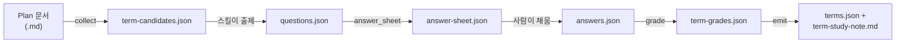

# 러너축 — Mode 1.5 용어 이해도 점검 (run_mode1_5.py)

## 이 장이 답하는 질문

Mode 1.5 는 "이 계획서(Plan)를 읽는 사람이 그 안에 쓰인 코드베이스 용어를 정말 이해하고
있는가"를 객관식 시험으로 재는 절차다. 큰 언어 모형(LLM) 벤치마크를 사람 쪽으로 뒤집은
것이라고 생각하면 된다 — 모형이 아니라 **사람이 시험을 본다.**

이 절차가 특이한 점은 **중간에 실행기가 멈춘다**는 것이다. 문제를 푸는 사람이 있어야 채점을
할 수 있는데, 이 실행기(`run_mode1_5.py`)는 명령줄에서 한 번 실행되고 끝나는 프로그램이라
사람이 답을 적을 때까지 기다릴 수 없다. 그래서 "문제를 낸다 → 답안 파일이 생기길 기다리며
멈춘다 → (사람이 딴 곳에서 답을 채운다) → 실행기를 다시 돌리면 채점부터 이어간다"는 구조를
택했다.

## 파이프라인 한눈에 보기



세 단계(`collect` · `grade` · `emit`)만 기계가 돌린다. `questions.json`(문제와 정답)을
만드는 일과, 사람에게 실제로 한 문항씩 묻고 `answers.json`을 채우는 일은 `term-benchmark`
스킬이 맡는다 — 이 실행기 코드 안에는 그 자리가 없다
(`runner/run_mode1_5.py:120`, `AGENT_STAGES` 가 빈 집합인 것이 그 증거다).

## 세 명령줄 조립 함수 — 무엇을 실행시키는가

`collect_argv` · `grade_argv` · `emit_argv` 셋은 전부 같은 모양이다. **파이썬으로 실제 계산을
하지 않고, "무엇을 어떤 인자로 실행할지"를 나타내는 문자열 목록(리스트)만 만들어 돌려준다.**
그 목록을 실제로 실행하는 것은 별도 함수 `run_machine`이다.

```
[파이썬경로, 스크립트경로, 인자1, 인자2, ...]
```

### `collect_argv(root, plan, terms_db)`

`runner/run_mode1_5.py:403`(`run_mode1_5.runner.run_mode1_5.collect_argv`). 용어 후보를
모으는 `runner/term/collect.py`를 실행시킬 명령줄을 만든다.

- `root` — 저장소 뿌리 경로. 이 값으로 `collect.py`의 절대경로를 계산한다
  (`_term_script`, `runner/run_mode1_5.py:395`).
- `plan` — 점검할 계획서(`.md`) 경로.
- `terms_db` — 코드베이스 용어 사전(`terms-db.json`) 경로. **이 인자가 없으면(`None`
  또는 빈 문자열) 아예 명령줄에서 빼 버린다.** 빈 문자열을 그대로 넘기면
  `collect.py`가 그것을 파일 경로로 알고 열려다 실패하기 때문이다
  (`runner/run_mode1_5.py:406-412`).

즉 나오는 명령줄은 둘 중 하나다.

```
[python, collect.py, <plan>]                 # 용어 사전 없이
[python, collect.py, <plan>, <terms-db.json>] # 용어 사전과 함께
```

### `grade_argv(root, answers, questions)`

`runner/run_mode1_5.py:418`(`run_mode1_5.runner.run_mode1_5.grade_argv`). 답안을 채점하는
`runner/term/quiz.py`를 실행시킬 명령줄을 만든다.

```
[python, quiz.py, <answers.json>, <questions.json>]
```

**두 파일을 반드시 함께 넘긴다.** 사람이 채운 `answers.json`에는 정답이 없고(`answer_sheet`
가 일부러 뺐다 — 아래 참고), 정답은 `questions.json`에만 있다. `quiz.py`는 둘을 대조해야
비로소 몇 개를 맞혔는지 알 수 있다.

### `emit_argv(root, grades)`

`runner/run_mode1_5.py:430`(`run_mode1_5.runner.run_mode1_5.emit_argv`). 채점 결과로 최종
산출물을 만드는 `runner/term/emit.py`를 실행시킬 명령줄을 만든다.

```
[python, emit.py, <term-grades.json>]
```

`emit.py`는 이 명령으로 실행되면 작업 폴더(`cwd`)에 `terms.json`(용어집)과
`term-study-note.md`(학습 노트)를 쓴다(`runner/term/emit.py:10-45`).

### 세 함수가 왜 이런 모양인가

셋 다 **부수효과가 없는 순수 함수**다 — 파일을 읽지도 쓰지도 않고, 그냥 문자열 목록을
계산해서 돌려준다. 실제로 실행하는 일은 `run_machine(argv, label, cwd)`
(`runner/run_mode1_5.py:510`)이 따로 맡는다. 이렇게 나눠 놓으면 "명령줄이 올바르게
조립되는가"를 실제 프로세스를 띄우지 않고도 시험(test)할 수 있다 — 실행 여부와 조립 로직을
분리한 것이다. 파이썬 인터프리터의 경로 자체는 `tools.python.pythonPath`가 찾아 준다
(운영체제·환경변수에 따라 달라지므로 이 함수들은 그 값을 그대로 받아 쓴다).

## `answer_sheet` — 정답을 지우고 기입란만 남긴다

`runner/run_mode1_5.py:286`(`run_mode1_5.runner.run_mode1_5.answer_sheet`). 입력은
`questions.json`을 읽어 만든 딕셔너리(`doc`)이고, 출력은 사람이 풀 `answer-sheet.json`의
내용이다.

동작 순서:

1. `flatten_questions(doc)`(`runner/term/quiz.py:18`)를 불러 중첩된 문항지를 한 줄짜리
   목록으로 편다. 원래 `questions.json`은 "용어 하나 → 문항 3개"로 중첩돼 있는데, 이것을
   `QNum`(1부터 매긴 일련번호)이 붙은 평평한 목록으로 바꾼다.
2. 문항마다 아래 필드만 골라 새 딕셔너리를 만든다.
   - `QNum` — 일련번호.
   - `Term` — 이 문항이 속한 용어 이름.
   - `Question` — 물음 문구(원래 `ask` 필드).
   - `AnsChoices` — 보기 목록을 `{"1": 첫보기, "2": 둘째보기, ...}` 꼴의 딕셔너리로 바꾼
     것. 다섯 번째는 항상 "모르겠다"다.
   - `UserAns` — 빈 문자열. **사람이 채울 자리다.**
3. **`answer` 필드(정답이 몇 번인지)는 옮기지 않는다.** 이것이 이 함수의 핵심이다 —
   정답이 들어 있는 `questions.json`을 사람에게 그대로 보여주면 시험이 성립하지 않으므로,
   정답을 뺀 사본을 따로 만들어 그것만 사람에게 건넨다.

`Term`을 각 문항마다 실어 두는 이유는 **채점 단위가 문항이 아니라 용어**이기 때문이다.
한 용어당 문항 3개를 묶어서 "확실/모름"을 매기므로(아래 `grade_one` 참고), 나중에
채점할 때 이 문항이 어느 용어 소속인지 알아야 한다.

## `pick_terms` — Plan 본문에 실제로 나오는 용어만 고르기

`runner/term/collect.py:16`(`collect.runner.term.collect.pick_terms`). `collect_argv`가
띄우는 `collect.py`의 핵심 로직이다.

입력은 두 가지다.

- `db` — 코드베이스 전체의 용어 사전. 이름(문자열) → 레코드(뜻·위치 등을 담은 딕셔너리).
- `plan_text` — 점검할 계획서 파일의 전체 본문(문자열).

동작: 사전에 있는 이름 하나하나에 대해, **그 이름이 계획서 본문에 단어 경계
(word boundary)를 지키며 실제로 등장하는지** 정규식으로 검사한다. 등장하면 그 이름과
레코드를 결과 딕셔너리에 넣는다. 단어 경계를 넣는 이유는 짧은 이름(예: `A1`)이 다른 긴
단어 속 일부로 우연히 걸리는 것을 막기 위해서다 — 정규식 특수문자는 `escape_re`
(같은 파일, `runner/term/collect.py:10`)로 먼저 이스케이프한다.

결과적으로 이 함수는 **"코드베이스 전체 용어 사전 ∩ 이 계획서가 실제로 쓰는 용어"**의
교집합을 낸다. 계획서와 무관한 용어까지 전부 시험 대상으로 삼으면 시험이 그 계획서를
이해하는 데 필요 없는 것까지 재게 되므로, 교집합으로 범위를 좁힌다.

이 함수는 계획서가 새로 만든 개념(코드베이스 사전에는 아직 없는 것)은 다루지 않는다 —
그것은 같은 파일의 `find_new_concepts`(`runner/term/collect.py:28`)가 별도로 찾고,
정답(뜻)이 아직 없으므로 곧바로 출제되지 못한다(`split_new_concepts`,
`runner/run_mode1_5.py:182`).

## `grade_one` — 문항 3개를 "확실"과 "모름" 둘로 접기

`runner/term/quiz.py:137`(`quiz.runner.term.quiz.grade_one`). 한 용어에 대해 사람이 푼
문항 3개의 집계 결과(`{"correct": 맞힌 수, "dontKnow": "모르겠다"를 고른 수}`)를 받아
`{"rate": 정답률, "mental": "확실" 또는 "모름"}`을 돌려준다.

계산 규칙:

```
rate = round((correct / 3) * 100)

if dontKnow >= 2:
    mental = "모름"
elif correct >= 2:
    mental = "확실"
else:
    mental = "모름"
```

세 갈래로 나뉜 판정 규칙을 표로 정리하면 다음과 같다(문항 3개 기준).

| correct | dontKnow | 나머지(오답) | 판정 |
|---|---|---|---|
| 3 | 0 | 0 | 확실 |
| 2 | 0 또는 1 | — | 확실 |
| 2 | 2\* | — | 이 조합은 발생하지 않는다(문항이 3개뿐이라 correct=2 면 dontKnow≤1) |
| 0~1 | 0~1 | 1~3 | 모름 (correct < 2) |
| 0~1 | 2~3 | — | 모름 (dontKnow ≥ 2 조건이 먼저 걸린다) |

즉 판정은 사실상 **"correct(맞힌 개수)가 2개 이상이면 확실, 아니면 모름"**으로 단순화되고,
`dontKnow >= 2` 조건은 "correct가 2 미만인 경우를 좀 더 이르게 잡아내는" 보조 갈래다
(`correct`가 3문항 중 2개 이상이려면 `dontKnow`는 최대 1일 수밖에 없으므로, 두 조건이
동시에 참이 되는 경우는 없다). "애매"라는 세 번째 등급도 있다는 언급이 이 저장소의 다른
문서(`report-term emit` 안내 문구)에 나오지만, `grade_one`의 실제 코드에는 "확실"과
"모름" 두 갈래만 있다 — `emit.py`가 훗날 세 번째 등급을 추가할 여지를 남겨 둔 것으로
보이나, 코드로 확인되는 것은 이 두 갈래뿐이다.

## 재개(resume) 흐름과의 관계

이 장에서 다룬 여섯 함수는 전부 `main()`(`runner/run_mode1_5.py:524`) 안에서 순서대로
불린다. 큰 그림은 다음과 같다.

1. `plan_stages`가 `term-candidates.json`(collect 산출물)과 `answers.json`(사람 답안)의
   존재 여부만 보고 이번에 돌릴 단계를 정한다.
2. `collect` 단계면 `collect_argv`로 만든 명령줄을 `run_machine`이 실행 → `pick_terms`가
   교집합을 계산해 `term-candidates.json`에 쓴다.
3. (스킬이 `questions.json`을 만들고 나면) `answers.json`이 아직 없을 때 `answer_sheet`가
   `answer-sheet.json`을 깔고 실행기가 멈춘다.
4. 사람이 `answer-sheet.json`을 풀어 `answers.json`으로 저장한 뒤 실행기를 다시 돌리면,
   `grade_argv`가 만든 명령줄로 `quiz.py`가 실행되고, 그 안에서 문항마다 `grade_one`이
   불려 `term-grades.json`을 낸다.
5. `emit_argv`가 만든 명령줄로 `emit.py`가 실행되어 `terms.json`과
   `term-study-note.md`를 낸다.

각 단계 사이의 안전장치(`validate_questions` · `validate_answers` 등)는 이 장의 범위 밖이다
— 필요하면 `runner/run_mode1_5.py`를 직접 읽는다.

## 확인하지 못한 것 (Unknown)

- `emit.py`가 실제로 "애매" 등급을 산출하는 코드 경로가 있는지는 이 장에서 읽은 범위
  (`runner/term/emit.py:1-60`, `runner/term/quiz.py` 전체)에서는 확인되지 않았다.
  (Unknown - verify in `runner/term/emit.py`의 전체 내용과 `term-grades.json` 실제
  산출물)
- `terms-db.json`에 기록된 여섯 함수의 `confidence` 값은 모두 `HIGH`였고, 이 장의 설명은
  그 레코드와 소스 코드가 일치함을 직접 대조해 확인한 것이다.
