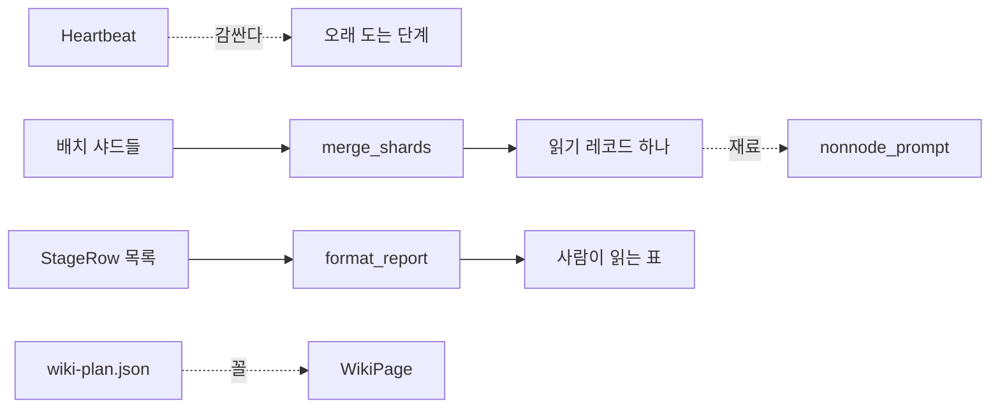

# 러너축 — Mode 1 코드베이스 위키 (run_mode1.py)

`runner/run_mode1.py`(runner/run_mode1.py:1)는 Mode 1(코드베이스 위키) 파이프라인을 한 번에
돌리면서 열 단계 각각에 걸린 시간과 쓴 토큰을 재는 실행기다. **러너축**(runner/)에 속한다 —
계산은 하지 않고 순서를 잡고 남(기계 단계 · LLM 세션)을 부르기만 한다. 계산은
`machine/`(예: `survey_plan.py` · `warmup.py`)이 한다.

객체지향을 갓 배운 독자를 기준으로 설명한다: 이 문서에서 "세션"은 `claude -p` 명령으로 한
번 띄웠다가 답을 받고 끝나는 하나의 LLM 대화를 뜻하고, "배치"는 그 세션 하나가 맡는 심볼
묶음(보통 최대 8개)을 뜻한다.

## 열 단계 안에서 이 여섯이 하는 일



이 장이 다루는 여섯 심볼은 서로 다른 세 가지 역할로 나뉜다.

- **진행 표시**: `Heartbeat`
- **자료형(꼴 정의)**: `StageRow` · `WikiPage`
- **병합과 산문 재료**: `merge_shards` · `nonnode_prompt`
- **보고**: `format_report`

## Heartbeat — claude -p 가 침묵하는 동안 살아있음을 알린다

`Heartbeat`(runner/run_mode1.py:818)는 오래 도는 단계 옆에서 경과 시간을 표준 에러(stderr)로
주기적으로 찍어 주는 작은 클래스다. **파이썬의 `with` 문으로 쓰는 컨텍스트 매니저**다 —
`__enter__`(runner/run_mode1.py:835)에서 내부 스레드를 시작하고, `__exit__`(runner/run_mode1.py:839)에서
그 스레드를 멈춘다.

이것이 필요한 이유는 `claude -p --output-format json` 명령의 특성 때문이다: 이 명령은 세션이
완전히 끝나야 결과를 JSON 한 덩어리로 한 번에 뱉는다. 그 사이 화면에는 아무것도 찍히지
않으므로, 사람이 보기에는 "멈췄나?" 싶은 침묵이 몇 분씩 이어질 수 있다. `Heartbeat`는 그
침묵 동안 30초(기본값, `every` 인자로 조절)마다 "… <라벨> 진행 중 (경과시간)" 한 줄을 stderr로
내보낸다(`_tick`, runner/run_mode1.py:830).

```python
with Heartbeat("survey 층%d" % L["level"]):
    ...  # 이 층의 배치들이 병렬로 도는 동안 30초마다 진행 알림이 찍힌다
```

**하트비트는 배치 하나가 아니라 층 하나를 감싼다.** `run_agent_with`(runner/run_mode1.py:846)의
독스트링은 이 점을 명시적으로 경고한다 — 동시에 도는 배치 여러 개가 각자 하트비트를 찍으면
화면이 뒤섞여 못 읽는다. 그래서 하트비트를 거는 자리는 `run_layer`(runner/run_mode1.py:873)를
부르는 바깥쪽 하나뿐이다. 실제로 이 저장소 안에서 `Heartbeat`가 걸리는 자리는 네 곳이다
(runner/run_mode1.py:960, 1141, 1171, 1198) — 기계 단계 하나(`run_machine`), 전수조사 층마다,
위키 목차 세션, 위키 페이지 층마다.

`every` 기본값은 30초지만 `run_machine`(runner/run_mode1.py:958)처럼 기계 단계를 감쌀 때는
60초로 늘려 쓴다 — 기계 단계는 LLM 세션보다 짧게 끝나는 경우가 많아 너무 자주 찍을 필요가
없기 때문으로 보인다(Unknown - verify in runner/run_mode1.py:960 주변 실측 로그).

## StageRow — 측정 표 한 줄의 꼴

`StageRow`(runner/run_mode1.py:177)는 `TypedDict`로 정의된, 측정 표에서 단계 하나를 나타내는
한 줄의 모양이다. `TypedDict`는 파이썬 실행 시에는 아무것도 검사하지 않지만 `pyright` 같은
정적 타입 검사기가 필드 이름 오타나 빠진 값을 미리 잡아 준다.

| 필드 | 뜻 |
|---|---|
| `stage` | 단계 이름(`STAGES` 목록의 문자열 하나) |
| `seconds` | 이 단계에 걸린 초 |
| `usage` | `Usage` 사전 — 토큰·비용·턴수(아래 `normalize_usage` 참고) |
| `ok` | 성공했는가 |
| `why` | 실패했다면 그 이유 |
| `skipped` | (선택 항목) 건너뛴 단계에만 붙는다 |

독스트링이 명시하는 규약: "**세 실행기가 모두 이 꼴로 쌓고 `format_report`가 읽는다**"
(runner/run_mode1.py:178) — `run_mode1.py`뿐 아니라 `run_mode1_5.py`·`run_mode2.py`도 같은
`StageRow` 꼴로 행을 쌓아서 `format_report`에 넘긴다. `skipped`만 `NotRequired`로 선택 항목인
이유는, 대부분의 행은 실행됐고 건너뛴 소수의 행만 그 사실을 표시하면 되기 때문이다.

## merge_shards — 병렬로 쓴 샤드 파일들을 하나로 합친다

`merge_shards`(runner/run_mode1.py:906)는 전수조사 배치 세션들이 각자 따로 써 둔 샤드 JSON
파일들을 읽어 레코드 사전 하나로 합치는 함수다. 배치 하나는 자기 몫만 보고 전역을 보지
못하므로(`survey_batch_prompt`가 배치마다 "자기 심볼만 읽고 자기 샤드에만 쓴다"고 지시한다,
runner/run_mode1.py:434), **키 충돌을 실제로 해소하는 자리는 이 함수 하나뿐**이다.

### 동작 순서

1. `existing`(있다면)을 얕은 복사로 시작값으로 삼는다(runner/run_mode1.py:922).
2. `shard_dir` 안의 `.json` 파일들을 이름 순으로 하나씩 읽는다.
3. 파싱이 안 되는 파일(반쯤 쓰다 죽은 배치의 샤드 등)은 조용히 건너뛰고 stderr에
   "샤드를 건너뛴다"를 남긴다(runner/run_mode1.py:931-933) — 나머지 정상 샤드는 버리지 않는다.
4. 같은 키가 이미 들어 있는데 값이 다르면(`!=` 비교), **양쪽 다** `_qualified`로 개명해
   살린다(runner/run_mode1.py:935-939).

### 키 충돌 해소 — `_qualified`

`_qualified`(runner/run_mode1.py:948)는 겹친 키 앞에 그 레코드가 속한 파일 이름(확장자 뺀
줄기)을 붙인다. 예를 들어 `app/gui.py`에 있는 `main`과 `app/cli.py`에 있는 `main`이 겹치면
각각 `gui.main`과 `cli.main`으로 개명된다(runner/run_mode1.py:687의 시험이 이 동작을
확인한다). `where` 필드가 비어 있으면 개명할 근거가 없으므로 이름을 그대로 둔다.

### 지켜야 하는 불변식 — `existing`은 누적본이 아니라 원본이다

독스트링에 ⚠로 강조된 규칙이다(runner/run_mode1.py:915-921): `merge_shards`는 층마다 불리고,
그때마다 샤드 디렉터리 전체를 다시 읽는다. `existing`에 **누적된 결과**를 넘기면, 이미
합쳐 넣은 레코드를 "자기 자신과 충돌"로 오판해 불필요하게 개명해 버려 레코드 수가 줄어드는
버그가 생긴다. 그래서 부르는 쪽은 조사를 시작하기 전의 원본만 `baseline`으로 따로 붙들어
두고, 층마다 그 원본을 `existing`으로 넘긴다(runner/run_mode1.py:1114, 1148).

충돌 판정에 `==`/`!=`(값 비교)를 쓰고 `is`/`is not`(정체성 비교)를 쓰지 않는 이유도 같은
맥락이다 — 같은 샤드 파일을 다시 읽으면 파이썬은 매번 새 딕셔너리 객체를 만들어 내므로,
`is not`으로 비교하면 내용이 똑같은데도 "남"으로 오판해 잘못 개명한다. 멱등성 시험
(runner/run_mode1.py:825-834)이 이 성질을 고정한다 — 같은 입력으로 두 번 불러도 결과가
같아야 하고, 이전 병합 결과를 다시 넣어도 잘못 개명되지 않아야 한다.

## nonnode_prompt — 코드가 아닌 용어를 조사하는 마지막 세션의 프롬프트

`nonnode_prompt`(runner/run_mode1.py:513)는 전수조사의 **마지막 층**을 맡을 세션에게 줄
지시문(프롬프트) 문자열을 만드는 함수다. 앞선 층들은 코드 지도(codegraph.json)의 "노드"인
심볼(함수·클래스 등)을 층 순서대로 읽지만, `nonnode_prompt`가 맡기는 다섯 종류는 코드
지도의 노드가 아니라서 위상 층 축이 없다.

| kind | 무엇 | where(위치) 표기 규칙 |
|---|---|---|
| `file` | 소스 파일 하나 | `경로:1` |
| `module` | 디렉터리 하나 | 없어도 된다 |
| `artifact` | 이 저장소가 만들어 내는 산출물 파일 | 그 파일을 **쓰는** 줄 |
| `key` | 설정·JSON의 이름난 칸 | 그 키를 **채우는** 줄 |
| `concept` | 코드에 글자로 있는 낱말 | 그 낱말이 있는 줄 |

이 함수의 독스트링이 명시하는 순서 제약(runner/run_mode1.py:514-517)은 중요하다: "**심볼
층이 하나라도 남아 있으면 이 세션을 띄우면 안 된다**." 이유는 `file` 종류의 레코드가
그 파일 안 심볼들의 이미 완성된 `means`/`does` 서술을 재료로 삼기 때문이다 — 심볼이 아직
안 읽혔으면 재료가 없다. 프롬프트 본문도 "다시 통독하지 않는다"고 명시해 이 세션이 소스를
새로 읽는 대신 이미 만들어진 읽기 레코드(`reading_path`가 정하는 자리,
runner/run_mode1.py:376)를 읽기만 하도록 못박는다.

`concept` 종류에는 별도 제약이 하나 더 있다 — "코드에 글자로 없는 것을 만들지 않는다.
계획서에만 있는 개념은 여기 싣지 않는다"(runner/run_mode1.py:543). 그리고 `file`·`module`·
`artifact`·`key`·`concept` 다섯 종류 모두 "이름이 그 줄에 글자 그대로 있어야 한다"는
공통 규칙을 진다 — 뒤에서 `machine/terms_db.py`(이 저장소 전체 파이프라인의 인용 검사
단계)가 L3 검사("근처에 그 이름")로 이를 기계적으로 대조한다.

이 세션이 쓰는 산출물은 `{repo}/out/codegraph-raw/_shards/NONNODE.json` 파일 하나뿐이다
(runner/run_mode1.py:557) — 다른 배치들의 샤드와 나란히 놓였다가 `merge_shards`가 나머지
심볼 샤드들과 함께 합친다.

## format_report — 측정값을 사람이 읽는 표로 굽는다

`format_report`(runner/run_mode1.py:732)는 `StageRow` 목록을 받아 이 실행기의 **최종 산출물
본체**인 사람이 읽는 표 문자열을 만든다. 열 개(단계·상태·시간·입력·출력·캐시읽기·캐시생성·
합계·턴·비용) 짜리 표를 만들고, 맨 아래에 전체를 더한 "합계" 줄을 붙인다.

### wall_seconds — 병렬로 도는 층의 시간을 바로잡는다

기본 동작은 각 행의 `seconds`를 그냥 더해 합계 줄의 시간을 만든다. 하지만 `survey`·`wiki`
단계처럼 같은 층 안에서 여러 배치가 **동시에** 도는 경우, 행들의 초를 단순히 더하면
실제로 사람이 기다린 벽시계 시간보다 훨씬 큰 값이 나온다(예: 배치 세 개가 각 100초씩
걸려도 동시에 돌았다면 실제로는 100초 근처만 기다렸다). 그래서 `wall_seconds` 인자를
명시적으로 주면 합계 줄의 시간이 그 값으로 대체된다(runner/run_mode1.py:752-753). 이
동작은 시험으로 고정돼 있다(runner/run_mode1.py:788-800) — `wall_seconds`를 안 주면
"3분 20.0초"(100+100을 그대로 더한 옛 방식), 105.0을 주면 "1분 45.0초"가 나온다.

병렬로 도는 것은 `run_mode1.py`뿐이므로, `run_mode1_5.py`와 `run_mode2.py`는 이 인자를
쓰지 않는다(runner/run_mode1.py:737).

### 표시 폭 계산 — 한글은 두 칸이다

`format_report` 안의 내부 함수 `w`(runner/run_mode1.py:762-763)는 파이썬 문자열 `len()` 대신
표시 폭을 따로 센다. 유니코드 코드포인트 값이 `0x2E80`보다 크면(한중일 문자 범위) 2칸으로,
아니면 1칸으로 센다 — 한글 한 글자가 터미널에서 영문자 두 칸만큼의 폭을 차지하기 때문에,
단순히 문자 개수로 표를 정렬하면 한글이 섞인 줄에서 열이 어긋난다.

### 실패·건너뜀 표시

각 행은 `skipped`가 있으면 "건너뜀", 없고 `ok`가 참이면 "성공", 아니면 "실패"로 표시된다
(runner/run_mode1.py:745). 표 아래에는 건너뛴 단계와 실패한 단계마다 그 이유(`why`)를 적은
줄이 따로 덧붙는다(runner/run_mode1.py:771-775) — 시험(runner/run_mode1.py:477-480)이 실패
표시와 이유 문구가 함께 나오는 것을 확인한다.

## WikiPage — 위키 목차 파일 안 장 하나의 꼴

`WikiPage`(runner/run_mode1.py:194)는 `wiki-plan.json`(위키 목차 세션이 내는 산출물,
`wiki_catalogue_prompt`가 요구하는 파일) 안에 담기는 장(페이지) 하나의 모양을 정의하는
`TypedDict`다.

| 필드 | 뜻 |
|---|---|
| `file` | 하위 폴더 없는 평평한 파일 이름(예: `index.md`) |
| `title` | (선택 항목) 장 제목 |
| `symbols` | (선택 항목) 그 장이 본문에서 다룰 용어 키 목록 |

`title`과 `symbols`가 `NotRequired`인 이유는 독스트링이 명시한다(runner/run_mode1.py:195):
"목차 세션이 쓰는 파일이라 제목과 심볼은 빠질 수 있다" — `wiki_catalogue_prompt`가
목차 세션에게 이 두 필드를 채우라고 지시하지만, LLM 세션이 실수로 빠뜨릴 가능성을 타입
수준에서도 열어 둔 것이다.

`WikiPage`가 실제로 쓰이는 곳은 `page_layers`(runner/run_mode1.py:579) 하나뿐이다 —
페이지가 인용하는 심볼들이 속한 층(`symbol_layers`가 만드는 `{심볼: 층}` 표) 중 **가장
깊은 값**을 그 페이지의 집필 순서로 삼는다. 인용 심볼이 하나도 없는 페이지(예:
`index.md` 같은 개괄 장)는 층0으로 매겨져 맨 먼저 쓰인다.

## 이 여섯이 서로 맞물리는 순서

전수조사 단계에서: `Heartbeat`로 감싼 층 하나가 끝나면 각 배치의 결과가 샤드 파일로
쌓이고, `merge_shards`가 그것을 `Records`로 합친다. 심볼 층이 전부 끝나면
`nonnode_prompt`가 마지막 한 세션을 띄워 그 `Records`를 재료로 파일·모듈·산출물 등을
채운다. 이 모든 과정에서 각 단계의 결과가 `StageRow`로 쌓이고, 마지막에 `format_report`가
그것을 사람이 읽는 표로 굽는다. 위키 산문 단계에서는 목차 세션이 낸 `wiki-plan.json`의
각 항목이 `WikiPage` 꼴이고, `page_layers`가 그 층을 매겨 `Heartbeat`로 감싼 층별 세션들이
순서대로 돈다.

## Unknown으로 남긴 것

- `Heartbeat`의 `every` 기본값(30초)과 `run_machine`이 쓰는 60초의 차이가 의도적 설계
  판단인지, 실측 근거가 있는 결정인지는 코드 주석에서 확인하지 못했다
  (Unknown - verify in runner/run_mode1.py:824, 960).
- `merge_shards`가 파일을 "이름 순"으로 읽는 것(`sorted(os.listdir(...))`,
  runner/run_mode1.py:925)이 충돌 해소 순서에 실제로 영향을 주는지는 코드상 `!=` 비교라
  순서 무관해 보이지만, 명시적으로 검증하는 시험을 찾지 못했다
  (Unknown - verify in runner/test_run_mode1.py).

---

**보고**

- 줄 수: 약 165줄(본문, 코드 펜스 제외 표 포함)
- 인용 수: `runner/run_mode1.py`의 file:line 인용 약 40개(같은 줄 반복 인용 포함), 테스트 파일 인용 4개
- Mermaid 다이어그램 수: 1개(노드 7개, 소형)
- Unknown으로 남긴 자리: 2곳(`Heartbeat` every 기본값 차이의 근거, `merge_shards`의 정렬 순서 무관성 검증 시험 유무)
