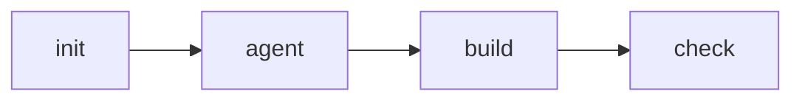
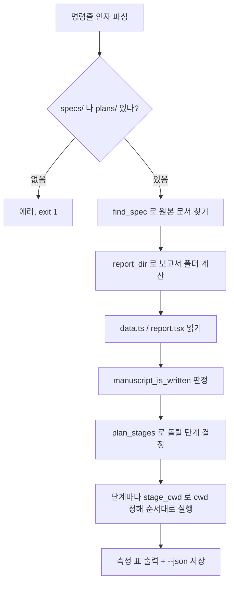

# 러너축 — Mode 2 설계 검토 보고서 (run_mode2.py)

이 문서는 `runner/run_mode2.py` 하나를 다룬다. 이 파일은 "설계 검토 보고서"(Design Review Report)를
만드는 네 단계짜리 파이프라인을 순서대로 돌리면서, 단계마다 걸린 시간과 큰 언어 LLM Model(LLM, Large
Language Model)이 쓴 토큰(token, LLM Model이 글을 셈하는 단위)을 재는 실행기(runner)다.

읽는 사람이 객체지향과 명령줄 도구를 갓 배운 대학 1학년이라고 가정하고, 개념부터 하나씩 쌓는다.

## 1. 이 파일이 푸는 문제 — 왜 네 단계인가

설계 문서(design document, 예: `specs/2026-07-27-something-design.md`) 한 편을 사람이 판정하기
좋은 HTML 계기판(dashboard)으로 바꾸려면 네 가지 서로 다른 성격의 일이 순서대로 필요하다.



| 단계 | 하는 일 | 실제로 부르는 것 | 성격 |
|---|---|---|---|
| `init` | 뼈대 `data.ts`·`report.tsx`를 만든다. 이미 있으면 스스로 건너뛴다 | `viz/init.py` | 기계 |
| `agent` | 설계 문서를 읽어 결정 표·서사·확신도 배지를 **채운다** | `claude -p` 1회 | LLM |
| `build` | esbuild 변환(transpile) → React 정적 렌더 → 한 장짜리 HTML 조립 | `viz/build.py` | 기계 |
| `check` | `<script>` 태그 수·타입 검사(`tsc --noEmit`)·링크 무결성·용어집 대조 | `viz/check.py` | 기계 |

(runner/run_mode2.py:11-21)

**LLM이 관여하는 자리는 `agent` 딱 하나다.** 나머지 셋은 결정론적(deterministic, 같은 입력이면
항상 같은 출력을 내는) 기계 단계다. 이 사실은 `AGENT_STAGES = {"agent"}` 라는 상수로 코드에
그대로 박혀 있고(runner/run_mode2.py:79), `is_agent_stage()` 함수가 그 집합에 속하는지만
확인해 참/거짓을 돌려준다(runner/run_mode2.py:126-131). 토큰을 세는 자리도 이 하나뿐이다 —
기계 단계는 언제나 "토큰 0개짜리 행"으로 기록된다(runner/test_run_mode2.py의
`test_a_machine_stage_row_is_all_zero_tokens`가 이를 확인한다).

**판정(수용/보류/번복)은 이 파이프라인 어디서도 내리지 않는다.** `VerdictFooter`(판정 하단
컴포넌트)는 항상 비운 채로 낸다(runner/run_mode2.py:26-27). 이 도구는 사람이 판정하기 **좋은
재료**를 만들 뿐, 판정 자체를 대신하지 않는다.

## 2. 시간·토큰을 재는 코드는 여기 없다 — `run_mode1`에서 빌려 쓴다

파일 맨 위에서 `run_mode1.py`를 통째로 import해서 별칭을 만든다.

```python
import run_mode1 as M
normalize_usage = M.normalize_usage
sum_usage = M.sum_usage
agent_verdict = M.agent_verdict
claude_argv = M.claude_argv
format_report = M.format_report
hms = M.hms
Heartbeat = M.Heartbeat
```
(runner/run_mode2.py:63-73)

Mode 1(코드베이스 위키)의 실행기가 먼저 "시간을 hms(시:분:초) 형식으로 바꾸기", "LLM Model 응답에서
토큰 사용량 뽑아내기", "여러 단계의 사용량을 합산하기" 같은 재는 로직을 갖고 있고, Mode 2는 그것을
그대로 재사용한다. **이 파일 안에는 그 사본이 없다** — 같은 이름의 숫자가 두 실행기에서 다른 뜻을
갖게 되는 것을 막기 위해서다(runner/run_mode2.py:36-37). 이 항목은 이 저장소가 세 실행기
사이의 "재는 코드 정본은 하나"라는 규약을 지킨다는 근거이며, `run_mode1.py` 자체의 계산
방식은 이 문서의 범위 밖이다(Unknown — verify in `runner/run_mode1.py`).

## 3. 원본 문서가 사는 두 자리 — `specs/`와 `plans/`

이 실행기가 다루는 프로젝트(대상 저장소)에는 원본 문서가 두 종류의 폴더 중 하나에 있을 수 있다.

| 폴더 | 파일명 정규식 | 접미사 필요 여부 |
|---|---|---|
| `specs/` | `^(\d{4}-\d{2}-\d{2})-(.+)-design\.md$` | `-design.md` 필요 |
| `plans/` | `^(\d{4}-\d{2}-\d{2})-(.+)\.md$` | 접미사 없음 |

(runner/run_mode2.py:93-96, `DOC_DIRS` 상수)

정규식은 파일명 앞의 날짜(`YYYY-MM-DD`)와 그 뒤의 slug(문서를 가리키는 짧은 식별자, 예:
`geometry-winding-ownership`)를 각각 그룹으로 잡는다. `specs/`가 접미사를 요구하는 이유는
주석에 적혀 있다 — 같은 폴더에 `-before.svg`·`-design-review.html` 같은 짝 파일이 함께 살아서,
접미사가 오타를 막는 가드 역할을 하기 때문이다(runner/run_mode2.py:87-89).

**⚠ 이 값은 `viz/init.py`의 `DOC_DIRS`와 반드시 같아야 한다.** 언어가 파이썬으로 같더라도
파일이 갈려 있어 한 곳에 모을 수 없다 — 한쪽만 고치면 `init.py`는 문서를 찾는데 이 실행기는
못 찾는 어긋남이 조용히 생긴다(runner/run_mode2.py:91-92, `runner/CLAUDE.md`의 Gotcha 절).

### `find_spec` — 부분 문자열로 맞추지 않는다

```python
def find_spec(filenames, slug, doc_dir="specs"):
    ...
    for name in filenames:
        m = pattern.match(name)
        if m and m.group(2) == slug:
            return {"file": name, "date": m.group(1), "slug": slug, "dir": doc_dir}
    return None
```
(runner/run_mode2.py:182-199)

`m.group(2) == slug`로 **완전 일치**만 받아들인다. 부분 문자열 검사(예: `slug in name`)를 썼다면
`load-reduction`이라는 slug가 `llm-load-reduction`이라는 다른 문서의 파일명 일부와 겹쳐 맞아버릴
수 있다 — 그러면 결정 표 전체가 엉뚱한 설계 문서의 것이 된다(runner/run_mode2.py:189-190). 이
동작은 시험 `test_find_spec_does_not_match_a_partial_slug`로 고정돼 있다(runner/test_run_mode2.py:
검색 결과 참조, 정확한 줄 번호는 Unknown — verify in `runner/test_run_mode2.py`).

`doc_dir` 인자를 생략하면 `"specs"`로 취급한다 — 이 매개변수가 나중에 추가되면서 기존 호출
코드를 깨지 않기 위한 기본값이다(runner/run_mode2.py:186-187).

## 4. `report_dir` — 보고서는 원본 문서 "옆"에 산다

```python
def report_dir(project, slug, doc_dir="specs"):
    return os.path.join(project, doc_dir, slug)
```
(runner/run_mode2.py:103-108)

이 저장소의 아키텍처 규약상 렌더러(이 저장소)와 보고서(대상 프로젝트) 자리는 갈려 있다. 보고서
폴더는 `<프로젝트>/specs/<slug>/` 또는 `<프로젝트>/plans/<slug>/`로, 항상 원본 문서가 있던
자리 바로 밑에 slug 이름의 폴더로 생긴다. 이 폴더 안에 `data.ts`(결정 데이터)와
`report.tsx`(서사·표) 두 파일이 만들어지고, 그 두 파일만 `agent` 단계가 손댄다
(runner/run_mode2.py:254 부근 `agent_prompt`의 "여기의 data.ts 와 report.tsx **둘만**
고친다" 문구).

시험 `test_report_dir_is_specs_slash_slug`가 기본값 동작을, `test_report_dir_sits_next_to_its_source_document`가
`doc_dir`을 명시했을 때의 동작을 각각 고정한다(runner/test_run_mode2.py:61-62, 237 부근).

## 5. `stage_cwd` — 단계마다 작업 디렉토리가 다르다, 틀리면 조용히 실패한다

이 파일의 주석 중 가장 강하게 경고하는 부분이다.

```python
def stage_cwd(stage, project, report_dir):
    if stage not in STAGES:
        raise ValueError(...)
    return project if stage in PROJECT_STAGES else report_dir
```
(runner/run_mode2.py:114-123)

`PROJECT_STAGES = {"init", "agent"}`(runner/run_mode2.py:83)이므로:

| 단계 | 작업 디렉토리 | 왜 |
|---|---|---|
| `init` | 프로젝트 뿌리 | `viz/init.py`가 `cwd` 아래의 `specs/`·`plans/`를 스스로 찾아 뒤진다 |
| `agent` | 프로젝트 뿌리 | LLM Model이 설계 문서와 보고서 폴더를 **둘 다** 봐야 한다 |
| `build` | 보고서 폴더 | `viz/build.py`가 `cwd`에서 바로 `data.ts`·`report.tsx`를 읽는다 |
| `check` | 보고서 폴더 | `viz/check.py`도 마찬가지로 `cwd` 기준이다 |

(runner/run_mode2.py:115-120)

**여기서 틀리면 오류(에러) 없이 엉뚱한 곳에 파일이 생긴다** — 예외를 던지지 않고 그냥 다른
폴더에 쓰기 때문에, 파이프라인이 "성공"으로 끝나고도 산출물이 없는 사고가 날 수 있다는 뜻이다
(runner/run_mode2.py:31-33, `runner/CLAUDE.md`의 "함정" 절). 이 네 가지 대응은
`test_the_agent_also_runs_at_the_project_root`와 `test_build_and_check_run_inside_the_report_folder`
두 시험으로 고정돼 있다(runner/test_run_mode2.py:35-47). 존재하지 않는 단계 이름을 주면
`ValueError`가 나는 것도 `test_stage_cwd_rejects_an_unknown_stage`로 확인된다
(runner/test_run_mode2.py:53-55).

## 6. `manuscript_is_written` — 사람이 다 쓴 원고인지 글자로 가른다

```python
def manuscript_is_written(data_source, report_source):
    if not data_source or not report_source:
        return False
    if re.search(r"decisions:\s*\[\s*\]", data_source):
        return False
    return bool(re.search(r'<Section\s+title="D\d', report_source))
```
(runner/run_mode2.py:166-176)

이 함수는 파일 내용을 **두 조건 모두** 확인해야 "이미 채워진 원고"로 인정한다.

1. `data.ts` 안에 `decisions: []`(빈 배열)라는 패턴이 **없어야** 한다 — 있으면 아직 뼈대 상태다.
2. `report.tsx` 안에 `<Section title="D숫자...">` 꼴의 절 제목이 **있어야** 한다.

두 조건을 다 보는 이유는 반쯤 쓰다 만 원고를 완성으로 착각하지 않기 위해서다
(runner/run_mode2.py:169-171). 예를 들어 `data.ts`에는 결정이 채워졌는데 `report.tsx`에는 아직
해당 절이 없는 경우 — 이는 "결정 절 제목이 매칭되지 않는" 상태라 원고로 치지 않는다. 이 경우는
`test_decisions_without_matching_sections_is_not_a_manuscript`가 확인한다(runner/test_run_mode2.py,
정확한 줄 번호는 Unknown — verify in `runner/test_run_mode2.py`). 두 파일 중 하나라도 없으면
(`None`) 무조건 `False`다 — 파일이 없다는 사실 판단을 순수 함수 자신이 아니라 호출자(`_read`)에게
맡긴다(runner/run_mode2.py:346-352의 `_read` 참고).

이 판정 결과는 `plan_stages`의 입력이 된다(다음 절).

## 7. `plan_stages` — 무엇을 돌릴지 정하는 순수 함수

```python
def plan_stages(has_manuscript, only=None, skip=None):
    for name in list(only or []) + list(skip or []):
        if name not in STAGES:
            raise ValueError(...)
    if only:
        return [s for s in STAGES if s in set(only)]
    out = []
    for s in STAGES:
        if s in set(skip or []):
            continue
        if s == "agent" and has_manuscript:
            continue
        out.append(s)
    return out
```
(runner/run_mode2.py:138-160)

이 함수는 **파일 시스템도, 네트워크도 건드리지 않는 순수 함수**다 — 오직 인자값만으로 답을
정한다(runner/run_mode2.py:140). 규칙은 세 가지다.

- `only`가 있으면 그 목록에 속한 단계만, `STAGES`(`init, agent, build, check`)의 순서를 지켜 돌려준다.
- `only`가 없으면 `skip`에 있는 단계를 뺀 나머지를 돌려준다.
- **`agent`만은 특별하다.** `has_manuscript`가 참이면 `skip`을 안 줘도 자동으로 빠진다 — 사람이
  이미 쓴 글을 LLM Model이 덮어쓰면 되돌릴 수 없기 때문이다(runner/run_mode2.py:145-146).
- **`init`은 절대 빼지 않는다.** 이미 `data.ts`가 있어도 `init` 단계 자체는 계획에 남는다.
  건너뛸지 말지는 `init.py` 자신이 판단해서 멱등(idempotent, 여러 번 실행해도 결과가 같은
  성질) 경로로 조용히 종료 코드 0을 낸다 — 여기서 미리 빼면 그 판단 권한을 `init.py`에게서
  뺏는 셈이다(runner/run_mode2.py:142-144).

시험 네 개가 이 규칙 각각을 고정한다: 빈 보고서면 네 단계 전부
(`test_plan_runs_all_four_stages_on_an_empty_report`), LLM Model을 부르는 자리는 `agent` 하나뿐
(`test_only_one_stage_calls_the_model`), 원고가 이미 있으면 `agent`만 빠짐
(`test_plan_skips_the_agent_when_the_manuscript_is_already_written`), 원고가 있어도 `init`은
맨 앞에 남음(`test_plan_keeps_init_even_when_the_manuscript_exists`)
(runner/test_run_mode2.py:69-97).

## 8. `main` — 네 함수를 엮어 실제로 돌리는 진입점

`main`은 이 파일에서 유일하게 부수효과(side effect: 파일을 읽고 쓰고, 자식 프로세스를 띄우는 등
"순수 함수가 아닌" 동작)를 만들어내는 흐름의 꼭대기다. 순서를 요약하면 다음과 같다.



핵심 흐름은 `runner/run_mode2.py:358-473`에 있다. 몇 가지 세부:

- **두 자리(`specs/`, `plans/`)를 순서대로 뒤진다.** 먼저 원본 문서를 찾고, 못 찾으면 이미
  `data.ts`가 있는 자리를 대신 채택한다 — 문서 이름이 바뀌어도 진행 중이던 보고서 작업을 막지
  않기 위해서다(runner/run_mode2.py:381-390). 원본 문서도 없고 진행 중인 원고도 없으면
  거기서 에러로 끝난다(runner/run_mode2.py:398-401).
- **`terms.json`이 보고서 폴더에 있으면 경로만 넘긴다.** Mode 1.5(용어 이해도 점검)가 낸 산출물을
  기계가 자동으로 병합하지 않는다 — 프롬프트에 "이런 재료가 있다"고 알려주기만 하고, 실제로
  `data.ts`의 `terms` 배열 형태로 옮겨 적는 것은 `agent` 단계의 LLM Model이 손으로 한다
  (runner/run_mode2.py:38-39, 234-245).
- **단계 하나가 실패하면 그 자리에서 멈춘다.** 뒤 단계는 앞 단계의 산출물에 의존하므로, 실패한
  단계 이후는 아예 돌리지 않는다(runner/run_mode2.py:456-458).
- **`claude`(LLM Model을 부르는 CLI)는 막혀도 종료 코드 0을 낼 수 있다.** 그래서 `run_agent`의
  결과는 `agent_verdict(rc, result)`로 판정한다 — 단순히 프로세스 종료 코드만 보지 않고,
  `run_mode1.py`가 정의한 `is_error`·`subtype` 같은 필드까지 함께 본다
  (runner/run_mode2.py:34-35, 437). 이 판정 함수 자체의 내부 로직은 `run_mode1.py`에 있어
  이 문서의 범위 밖이다(Unknown — verify in `runner/run_mode1.py`의 `agent_verdict`).
- **`--dry-run`을 주면 아무것도 실행하지 않고 각 단계의 `cwd`만 출력한다**
  (runner/run_mode2.py:422-425) — 실제로 무엇이 어디서 도는지 미리 확인하는 안전장치다.

### 명령줄 사용법

```bash
.venv/bin/python runner/run_mode2.py <프로젝트> <slug> [--model <LLM Model ID>]
                                        [--only init,build] [--skip agent]
                                        [--json 측정.json] [--dry-run]
```
(runner/run_mode2.py:43-45)

`<프로젝트>`는 저장소 뿌리가 아니라 **`specs/`나 `plans/`가 있는 폴더**다(runner/run_mode2.py:47).
`--model`의 기본값은 `"opus"`다(runner/run_mode2.py:366).

## 컴포넌트 후보

이 문서를 쓰는 과정에서 반복되는 패턴을 하나 봤다 — `main` 안에서 단계 실행 결과를 검사할 때마다
"`ok`가 거짓이면 이유를 출력하고 멈춘다"는 조건 분기가 `agent`와 그 외 단계 두 갈래로 나뉘어
비슷한 모양으로 두 번 나온다(runner/run_mode2.py:433-450). 다만 이는 이 문서(위키)가 판단할
일이 아니라 이 저장소의 `spec-review-dashboard` 파이프라인이나 코드 리뷰에서 다룰 사안이다 —
여기서는 관찰만 기록한다.

## 확인하지 못한 것

- `run_mode1.py`의 `normalize_usage`·`agent_verdict`·`hms`·`Heartbeat`·`format_report`·`sum_usage`
  각각의 내부 구현 (Unknown — verify in `runner/run_mode1.py`)
- `viz/init.py`·`viz/build.py`·`viz/check.py` 각각이 `cwd`를 실제로 어떻게 쓰는지의 세부 구현
  (Unknown — verify in `viz/init.py`, `viz/build.py`, `viz/check.py`)
- `claude_argv`가 만드는 정확한 명령줄 인자 목록 (Unknown — verify in `runner/run_mode1.py`의
  `claude_argv`)

## 더 큰 그림

이 파일이 러너축(`runner/`) 전체에서 차지하는 위치, 그리고 기계축(`machine/`)·시각축(`viz/`)과
어떻게 갈리는지는 모듈 관계도를 참고한다: `out/codegraph-raw/modules.svg`.
