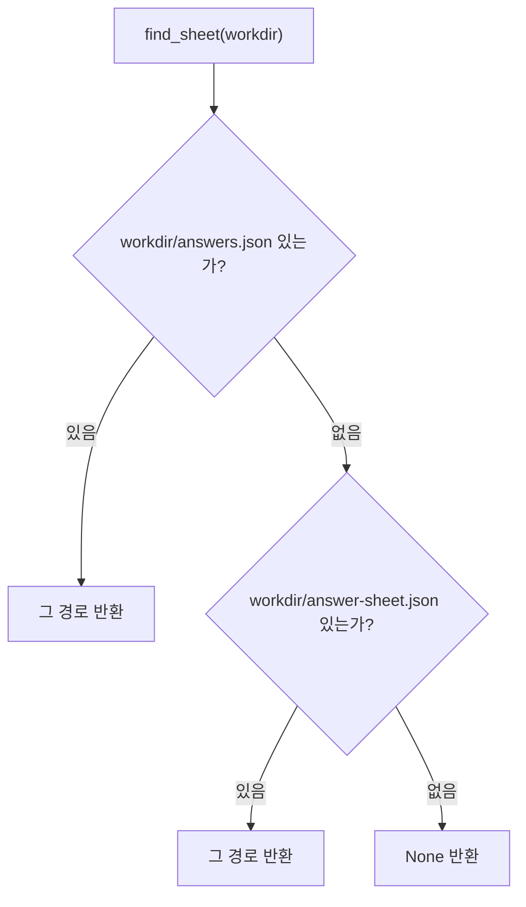
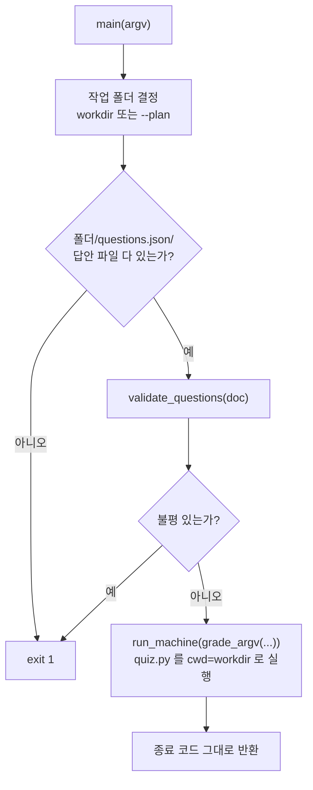

# 러너축 — `run_grade.py` 채점 전용 실행기

## 이 장이 다루는 것

`runner/run_grade.py`는 이미 사람이 답을 채운 작업 폴더 하나를 받아, 그 답을 문항지와
대조해 채점만 하는 명령줄 도구다. 함수는 두 개뿐이다.

- `find_sheet(workdir, names=SHEET_NAMES)` — 작업 폴더에서 "채운 답안" 파일을 찾는다.
- `main(argv=None)` — 명령줄 인자를 해석하고, 채점 가능 여부를 확인한 뒤, 실제 채점을
  다른 모듈에 위임한다.

이 파일은 Mode 1.5(용어 이해도 점검, `runner/run_mode1_5.py`)의 `collect → [사람] → grade
→ emit` 네 단계 중 **`grade` 단계 하나만 떼어 낸 것**이다(`runner/run_grade.py:1`).
전체 파이프라인의 위치는 `runner/CLAUDE.md`의 "Mode 1.5" 행을 본다.

## 배경 지식 — 왜 `run_mode1_5.py`와 따로 존재하는가

Mode 1.5는 원래 한 프로세스 안에서 문항을 만들고(`collect`), 사람에게 묻고, 채점하고
(`grade`), 결과를 정리한다(`emit`). 그런데 사람이 문항에 답하는 중간 단계는 별도 세션이나
스킬(`term-benchmark`)이 맡을 수 있고, 그 세션이 끝난 뒤 채점만 다시 돌리고 싶을 때가 있다.
`run_grade.py`는 그 경우를 위한 것이다 — 이미 문답이 끝난 폴더 경로 하나만 주면 채점부터
다시 시작한다(`runner/run_grade.py:8`).

`run_mode1_5.py`와 다른 점이 세 가지 있다(`runner/run_grade.py:8`-`18`):

1. **계획서(`--plan`)가 아니라 작업 폴더를 직접 받을 수 있다.** 이미 문답이 끝난 폴더를
   곧장 가리키면 된다.
2. **채운 답안 파일을 두 이름 중에서 찾는다.** `answers.json`이 있으면 그것을, 없으면
   `answer-sheet.json`을 쓴다. `run_mode1_5.py`는 `answers.json`만 보므로, 사람이
   실행기가 미리 깔아 둔 `answer-sheet.json`에 그대로 답을 적어 넣는 흔한 경우를
   `run_mode1_5.py`는 "답안이 아직 없다"로 잘못 판단하고 건너뛴다. `run_grade.py`가 이
   틈을 메운다.
3. **채점만 한다.** `collect`(문항 만들기)나 `emit`(학습 노트 내기)은 돌리지 않는다.

채점 규칙 자체(정답 판정 기준, "확실"/"모름" 갈래 등)와 명령줄 옵션의 세부 사양은 여기
복제하지 않는다 — `runner/run_mode1_5.py`의 것을 그대로 빌려 쓴다. `run_grade.py`는
`sys.path`에 자기 디렉토리를 넣고 `run_mode1_5`를 `Q`라는 이름으로 import해서
그 함수들을 호출하는 얇은 껍질이다(`runner/run_grade.py:26`-`29`).

## `runner.run_grade.SHEET_NAMES`

```python
SHEET_NAMES = (Q.ANSWERS, Q.SHEET)
```

찾을 파일 이름과 그 **순서**를 담은 튜플이다(`runner/run_grade.py:37`). `Q.ANSWERS`는
`"answers.json"`, `Q.SHEET`는 `"answer-sheet.json"`이며, 둘 다 `run_mode1_5.py`에 정의돼
있다(`runner/run_mode1_5.py:134`-`136`, 셋째 이름 `Q.QUESTIONS = "questions.json"`도 같은
자리). 튜플의 앞자리가 이긴다 — `answers.json`이 있으면 `answer-sheet.json`이 있어도
무시한다.

## `find_sheet(workdir, names=SHEET_NAMES)`

```python
def find_sheet(workdir: str, names: Sequence[str] = SHEET_NAMES) -> str | None:
    for name in names:
        p = os.path.join(workdir, name)
        if os.path.isfile(p):
            return p
    return None
```

(`runner/run_grade.py:43`-`52`)

`names`를 앞에서부터 순서대로 보며, 작업 폴더(`workdir`) 안에 그 이름의 파일이 **실제로
존재하는지**(`os.path.isfile`)만 확인한다. 처음 발견한 경로를 즉시 반환하고, 끝까지 못
찾으면 `None`을 반환한다. 파일 내용은 전혀 보지 않는다 — 존재 여부만 판단한다.



이 함수의 뜻은 시험(`runner/test_run_grade.py`)이 이름으로 직접 고정해 둔다 —
`test_answers_json_wins_over_answer_sheet`, `test_falls_back_to_answer_sheet`,
`test_returns_none_when_no_sheet` 세 개다. 세 시험 모두 파일 내용은 빈 채로
(`Path.touch()`) 존재 여부만 시험한다.

## `main(argv=None)`

명령줄 진입점이다(`runner/run_grade.py:59`). 순서대로 하는 일:

1. **인자 해석.** `argparse`로 세 인자를 받는다 — 위치 인자 `workdir`(선택),
   `--plan`(계획서 경로), `--answers`(채운 답안 경로를 직접 지정).
2. **작업 폴더 결정.**
   - `workdir`를 직접 주면 그 절대경로를 그대로 쓴다.
   - `workdir` 없이 `--plan`만 주면, 계획서 파일이 실제로 있는지 확인한 뒤
     `Q.default_workdir(ROOT, plan)`을 불러 작업 폴더를 계산한다(`runner/run_grade.py:78`).
     이 계산은 `run_mode1_5.py`가 쓰는 것과 **같은 함수**라서, `report-term collect`가
     만든 폴더와 `run_grade.py --plan`이 찾는 폴더가 항상 일치한다 — 시험
     `test_plan_flag_resolves_the_slug_workdir`가 이 일치를 확인한다
     (`runner/test_run_grade.py:121`-`125`).
   - 둘 다 없으면 `ap.error(...)`로 즉시 실패한다(`SystemExit`을 던진다).
3. **작업 폴더 존재 확인.** 없으면 종료 코드 1.
4. **문항지(`questions.json`) 존재 확인.** 없으면 종료 코드 1.
5. **채운 답안 경로 결정.** `--answers`를 직접 줬으면 그 경로(존재 확인 포함), 아니면
   위의 `find_sheet(workdir)`로 찾는다. 못 찾으면 종료 코드 1.
6. **문항지 형식 검증.** `Q._read_json(questions)`로 JSON을 읽고,
   `Q.validate_questions(doc)`로 채점 가능한 꼴인지 본다(`runner/run_grade.py:106`-`107`).
   여기서 불평(`complaints`)이 하나라도 나오면 **채점기(`quiz.py`)를 아예 부르지 않고**
   종료 코드 1로 멈춘다. 이 순서가 중요한 이유는 아래 "왜 문항지를 먼저 검사하는가"를 본다.
7. **진행 상황 3줄 출력** 후 `Q.run_machine(Q.grade_argv(ROOT, answers, questions),
   "grade", workdir)`을 호출해 실제 채점을 자식 프로세스로 돌린다(`runner/run_grade.py:121`).
   `cwd`를 `workdir`로 주는 이유는 채점기(`quiz.py`)가 산출물(`term-grades.json`)을 항상
   현재 디렉터리에 쓰기 때문이다 — 작업 폴더 밖에 결과가 떨어지는 것을 막는다.



### 왜 문항지를 먼저 검사하는가

`runner/run_grade.py:105` 옆 주석이 그 이유를 적는다 — **`quiz.py`(채점기 본체)는 문항지의 꼴을
검사하지 않는다.** 답안만 세어 채점하므로, 예를 들어 한 용어의 문항이 3개가 아니라 2개뿐이거나
"모르겠다"가 마지막 보기가 아니어도 `quiz.py`는 조용히 채점을 끝내 버린다. 그 조용한 실패를
`main`이 `quiz.py`를 부르기 **전에** `validate_questions`로 잡는다. 이 동작은
`test_broken_questions_are_refused_before_grading`(`runner/test_run_grade.py:109`-`118`)이
고정한다 — 문항이 3개에서 2개로 줄면 `main`은 1을 반환하고, `term-grades.json`은 아예
생성되지 않는다.

`validate_questions` 자체의 세부 규칙(문항 수, 보기 수, "모르겠다"의 위치 등)은
`runner/run_mode1_5.py:204` 이하에 있다 — `run_grade.py`는 그 함수를 호출만 할 뿐 규칙을
다시 적지 않는다.

## 채점 결과의 갈래 — "확실" / "모름"

`run_grade.py`가 직접 계산하지는 않지만, `main`이 호출하는 채점 경로의 결과 형태는 시험으로
관찰할 수 있다. 답안 세 문항이 모두 정답이면 `mental` 필드가 `"확실"`이고 `rate`는
100이다(`runner/test_run_grade.py:66`-`72`). "모르겠다"를 두 번 이상 고르면(또는 답이 갈려
확신할 수 없으면) `mental`은 `"모름"`이 된다(`runner/test_run_grade.py:75`-`79`). 이 갈래를
정하는 정확한 임계값과 계산식은 `run_mode1_5.py`(그리고 그 안에서 부르는 `runner/term/quiz.py`
쪽)에 있다 — `(Unknown - verify in runner/run_mode1_5.py 와 runner/term/quiz.py)`.

## 명령줄 사용 예

```bash
python runner/run_grade.py out/mode1_5/symbol-resolution-survey
python runner/run_grade.py --plan docs/superpowers/plans/2026-08-30-symbol-resolution-survey.md
python runner/run_grade.py <폴더> --answers 내가-푼-것.json
```

(`runner/run_grade.py:20`-`23`)

셋째 예처럼 `--answers`를 직접 주면 `find_sheet`의 탐색 순서(§`SHEET_NAMES`)를 완전히
건너뛰고 그 경로만 본다 — `test_explicit_answers_path_overrides_lookup`이 이를
확인한다(`runner/test_run_grade.py:82`-`88`): 작업 폴더 안 `answer-sheet.json`은 전부
"모르겠다"로 채워져 있어도, `--answers`로 지정한 다른 파일의 정답이 대신 채점된다.

## 관련 모듈

- `runner/run_mode1_5.py` — 채점 규칙(`grade_argv`, `validate_questions`,
  `default_workdir`, `run_machine`, 상수 `QUESTIONS`/`SHEET`/`ANSWERS`)의 원본. 이 장이
  다루는 두 함수는 전부 이 모듈에 의존한다.
- `runner/test_run_grade.py` — 이 장의 행동 서술 대부분의 근거. 13개 시험이 있다.
- 이 저장소 전체의 모듈 관계 큰 그림은 `out/codegraph-raw/modules.svg`를 본다
  (Mermaid로 다시 그리지 않는다 — 노드 수가 커서 위 규정의 소형 제한을 넘는다).

## 확인하지 못한 것

- `runner/term/quiz.py`의 채점 계산식(정답 일치 판정, "확실"/"모름" 경계) —
  `(Unknown - verify in runner/term/quiz.py)`. 이 장의 범위(`run_grade.py`의 함수 두 개)
  밖이라 직접 읽지 않았다.
