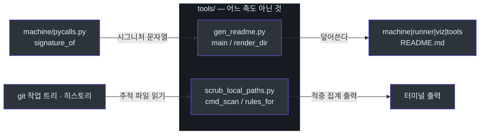
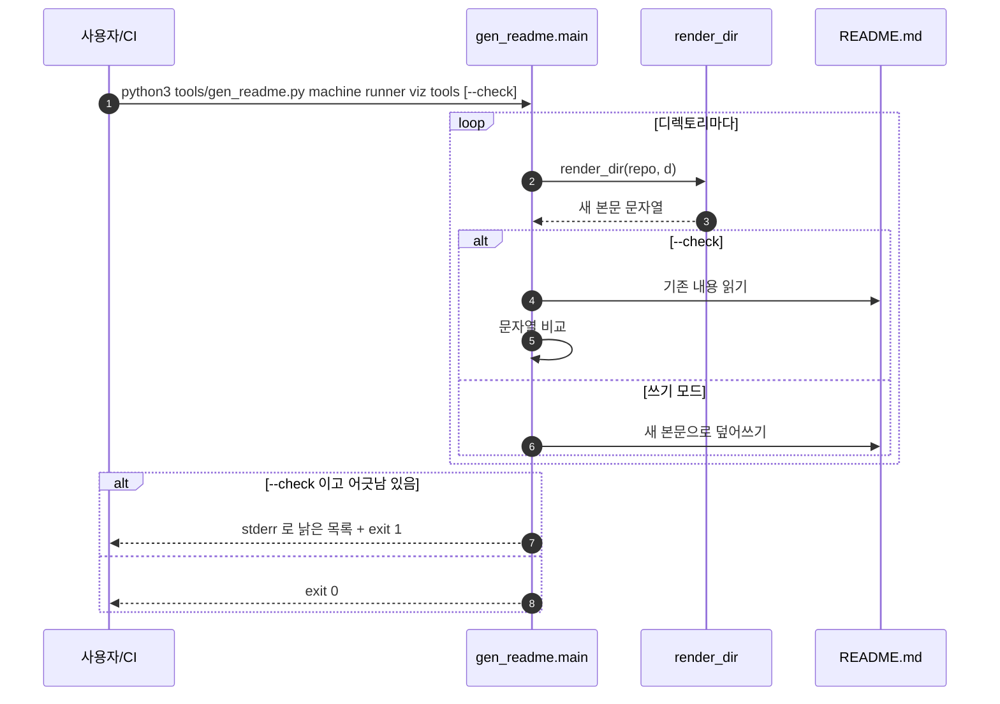
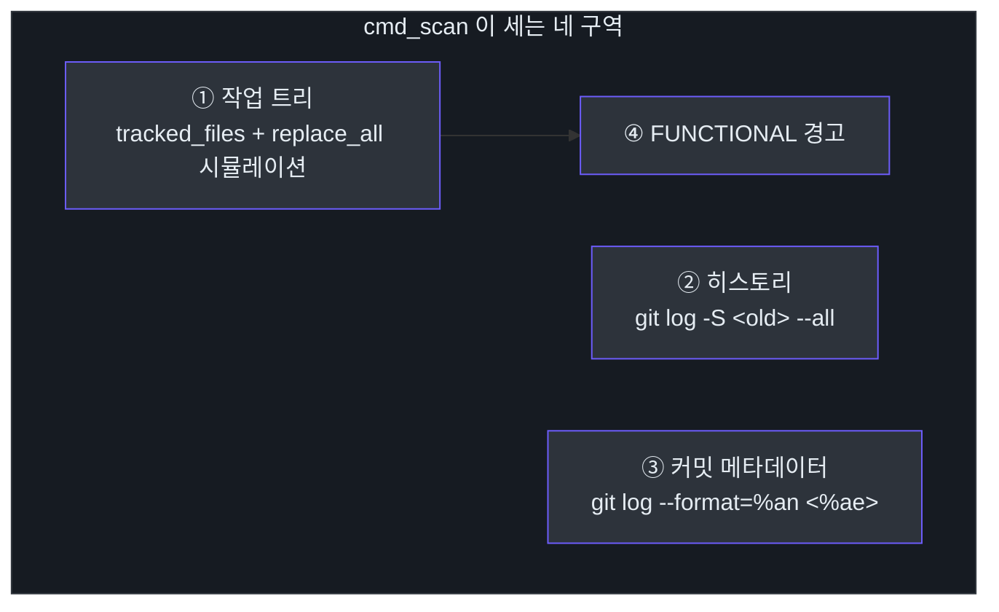

# 어느 축도 아닌 것 — `tools/`

## 한눈에 보기

이 저장소의 파이프라인은 세 축(러너·기계·시각)으로 나뉘어 있다([`runner/CLAUDE.md`](../../runner/CLAUDE.md), [`machine/CLAUDE.md`](../../machine/CLAUDE.md), [`viz/CLAUDE.md`](../../viz/CLAUDE.md)). `tools/` 는 그 세 축 **어디에도 속하지 않는 것**만 모아 두는 자리다 — 코드 지도를 그리지도, HTML 을 굽지도, 실행 순서를 잡지도 않는다([tools/CLAUDE.md:5](https://github.com/DogGuyMan/Agent-Report-Build-Pipeline/blob/main/tools/CLAUDE.md#L5)). 이 장은 그 가운데 소스에서 문서를 만드는 `gen_readme.py` 와, 저장소에서 개인 경로 흔적을 찾아내는 `scrub_local_paths.py` 두 개를 다룬다.

| 구성 요소 | 역할 | 핵심 파일 | 출처 |
|---|---|---|---|
| `gen_readme.main` | 명령줄 진입점. 디렉토리마다 README 를 쓰거나(`--check` 없이) 낡았는지만 검사한다(`--check`) | `tools/gen_readme.py` | [tools/gen_readme.py:117-146](https://github.com/DogGuyMan/Agent-Report-Build-Pipeline/blob/main/tools/gen_readme.py#L117-L146) |
| `gen_readme.render_dir` | 디렉토리 하나의 `.py` 파일을 훑어 README 본문(마크다운 문자열)을 조립한다 | `tools/gen_readme.py` | [tools/gen_readme.py:69-109](https://github.com/DogGuyMan/Agent-Report-Build-Pipeline/blob/main/tools/gen_readme.py#L69-L109) |
| `scrub_local_paths.cmd_scan` | `scan` 모드의 본체. 아무것도 고치지 않고 작업 트리·히스토리·커밋 메타데이터에 남은 개인 경로 흔적을 집계해 화면에 보여준다 | `tools/scrub_local_paths.py` | [tools/scrub_local_paths.py:122-181](https://github.com/DogGuyMan/Agent-Report-Build-Pipeline/blob/main/tools/scrub_local_paths.py#L122-L181) |
| `scrub_local_paths.rules_for` | 적용할 치환 규칙 목록(`RULES` + 선택적 `TILDE_RULES`)을 고른다 | `tools/scrub_local_paths.py` | [tools/scrub_local_paths.py:92-93](https://github.com/DogGuyMan/Agent-Report-Build-Pipeline/blob/main/tools/scrub_local_paths.py#L92-L93) |

## 왜 이 둘이 한 폴더에 있나

`tools/CLAUDE.md` 는 소속 기준을 이렇게 적는다 — 크기가 아니라 "세 축 어디에도 속하지 않는가"([tools/CLAUDE.md:7](https://github.com/DogGuyMan/Agent-Report-Build-Pipeline/blob/main/tools/CLAUDE.md#L7)). `gen_readme.py` 는 코드를 계산하지도 그리지도 않고 그저 **다른 두 도구(`machine/pycalls.py` 의 `signature_of`)가 이미 만든 사실을 마크다운 표로 옮겨 적을 뿐**이다. `scrub_local_paths.py` 는 파이프라인의 일부가 아니라 **사람이 손으로 돌리는 저장소 위생 도구**다 — 어느 축의 명령도 이 스크립트를 자식 프로세스로 부르지 않는다([tools/CLAUDE.md:17](https://github.com/DogGuyMan/Agent-Report-Build-Pipeline/blob/main/tools/CLAUDE.md#L17)).


<!-- Sources: tools/gen_readme.py:69, tools/gen_readme.py:117, tools/scrub_local_paths.py:122, machine/pycalls.py:1 -->

## `gen_readme.py` — 소스가 정본이고 README 는 산출물이다

### 왜 이런 도구가 있나

한 저장소 안에서 코드와 문서가 따로 놀면 반드시 어긋난다. 이 도구는 그 반대를 강제한다 — **README 를 손으로 못 고치게 하고**, 대신 소스의 독스트링과 시그니처에서 매번 새로 뽑아낸다. 파일 맨 위 배너가 이를 그대로 밝힌다: "이 문서는 `tools/gen_readme.py` 가 소스에서 생성한다. 손으로 고치지 마라" ([tools/gen_readme.py:23-25](https://github.com/DogGuyMan/Agent-Report-Build-Pipeline/blob/main/tools/gen_readme.py#L23-L25)).

시그니처 문자열은 이 파일이 직접 만들지 않는다. `machine/pycalls.py` 의 `signature_of` 를 그대로 가져다 쓴다 — 주석은 "두 곳에서 만들면 어긋난다"고 이유를 남긴다([tools/gen_readme.py:11](https://github.com/DogGuyMan/Agent-Report-Build-Pipeline/blob/main/tools/gen_readme.py#L11)). 이 규약은 시험으로 고정돼 있다: `test_signature_comes_from_pycalls_not_a_copy` 가 `render_dir` 의 출력에 `signature_of` 가 만든 시그니처와 독스트링 첫 줄이 그대로 들어있는지 확인한다([tools/test_gen_readme.py:42](https://github.com/DogGuyMan/Agent-Report-Build-Pipeline/blob/main/tools/test_gen_readme.py#L42)).

### `main` — 쓰기 모드와 검사 모드

`main` 은 명령줄 인자로 대상 디렉토리 목록과 `--repo`, `--check` 를 받는다([tools/gen_readme.py:117-122](https://github.com/DogGuyMan/Agent-Report-Build-Pipeline/blob/main/tools/gen_readme.py#L117-L122)). 디렉토리마다 `render_dir` 로 새 본문을 만든 뒤 두 갈래로 갈린다.

- **`--check` 없음(쓰기 모드)**: `README.md` 파일에 새 본문을 그대로 덮어쓴다([tools/gen_readme.py:136-138](https://github.com/DogGuyMan/Agent-Report-Build-Pipeline/blob/main/tools/gen_readme.py#L136-L138)).
- **`--check`(검사 모드)**: 기존 파일 내용과 새로 만든 본문을 문자열로 비교만 한다. 다르면 그 디렉토리를 `stale` 목록에 담고, 끝에 갱신 명령과 함께 stderr 로 찍고 `exit 1` 을 낸다([tools/gen_readme.py:132-144](https://github.com/DogGuyMan/Agent-Report-Build-Pipeline/blob/main/tools/gen_readme.py#L132-L144)).

이 게이트는 루트 `CLAUDE.md` 가 명시한 "README 표류" 게이트다 — `python3 tools/gen_readme.py --check machine runner viz tools` 로 돈다(`CLAUDE.md`, 프로젝트 지시문). `test_readme_is_not_stale` 이 이 명령을 자식 프로세스로 실행해 종료 코드 0 을 assert 하므로, 소스를 고치고 `gen_readme.py` 를 다시 안 돌리면 이 시험이 실패한다([tools/test_gen_readme.py:20-25](https://github.com/DogGuyMan/Agent-Report-Build-Pipeline/blob/main/tools/test_gen_readme.py#L20-L25)).


<!-- Sources: tools/gen_readme.py:117, tools/gen_readme.py:126, tools/gen_readme.py:132, tools/test_gen_readme.py:20 -->

### `render_dir` — README 본문을 어떻게 조립하나

`render_dir(repo, d)` 는 디렉토리 `d` 아래를 `os.walk` 로 훑어 `.py` 파일 경로를 모으고(`__pycache__` 는 제외), 각 파일을 `ast.parse` 로 파싱한다([tools/gen_readme.py:70-81](https://github.com/DogGuyMan/Agent-Report-Build-Pipeline/blob/main/tools/gen_readme.py#L70-L81)). 그다음 두 단계로 마크다운을 조립한다.

1. **파일 목록 표** — 파일마다 한 줄, 설명은 모듈 독스트링 첫 줄(`first_line`)에서 온다([tools/gen_readme.py:83-88](https://github.com/DogGuyMan/Agent-Report-Build-Pipeline/blob/main/tools/gen_readme.py#L83-L88)).
2. **파일별 심볼 표** — 파일마다 최상위 함수·클래스를 훑는다. 함수는 이름·시그니처(`signature_of`)·설명 한 줄을 한 행에 적고, 클래스는 굵은 글씨 행 아래 메서드를 같은 형식으로 이어붙인다([tools/gen_readme.py:90-108](https://github.com/DogGuyMan/Agent-Report-Build-Pipeline/blob/main/tools/gen_readme.py#L90-L108)).

표 칸에 들어가는 모든 문자열은 `cell()` 을 거친다 — 파이프(`|`) 문자를 `\|` 로 이스케이프해 마크다운 표가 깨지지 않게 한다([tools/gen_readme.py:60-61](https://github.com/DogGuyMan/Agent-Report-Build-Pipeline/blob/main/tools/gen_readme.py#L60-L61)). `str | None` 같은 유니온 타입 힌트가 시그니처에 그대로 들어가면 파이프 개수가 표 칸 경계와 뒤섞일 수 있는데, `test_pipe_in_signature_is_escaped` 가 정확히 이 경우를 시험한다([tools/test_gen_readme.py:55-60](https://github.com/DogGuyMan/Agent-Report-Build-Pipeline/blob/main/tools/test_gen_readme.py#L55-L60)).

`first_line()` 은 AST 노드(모듈·함수·클래스)의 독스트링에서 첫 줄만 뽑는다. 모듈 독스트링이 `"파일이름.py — 설명"` 꼴이면 파일 이름 앞머리를 떼고 설명만 남긴다([tools/gen_readme.py:41-52](https://github.com/DogGuyMan/Agent-Report-Build-Pipeline/blob/main/tools/gen_readme.py#L41-L52)) — 이 저장소의 모든 모듈 독스트링이 그 형식을 따르기 때문이다.

## `scrub_local_paths.py` — 세 모드, 다루는 것은 `scan` 뿐

### 왜 필요한가

`CLAUDE.md` 는 "이 저장소는 공개된다"고 명시한다 — 홈 아래 경로와 개인 식별자(사용자 이름·이메일)를 문서·코드·커밋에 그대로 남기지 않고 `$REPO_ROOT` 같은 변수 이름으로 대체하는 것이 규약이다(`CLAUDE.md`, "경로 변수" 절, 프로젝트 지시문). `scrub_local_paths.py` 는 이 규약이 실제로 지켜지고 있는지 점검하고, 필요하면 고치는 도구다.

파일 독스트링이 세 모드를 정의한다([tools/scrub_local_paths.py:5-19](https://github.com/DogGuyMan/Agent-Report-Build-Pipeline/blob/main/tools/scrub_local_paths.py#L5-L19)):

| 모드 | 하는 일 | 되돌릴 수 있나 |
|---|---|---|
| `scan`(기본값) | 아무것도 고치지 않는다. 작업 트리·히스토리에서 규칙별 적중 수와 표본을 낸다 | 항상 (읽기 전용) |
| `worktree` | 추적 중인 파일만 제자리에서 치환한다. 커밋은 하지 않는다 | 그렇다 (`git diff` 로 확인 후 커밋/되돌리기) |
| `history` | `git-filter-repo` 로 모든 커밋을 다시 쓴다. 커밋 SHA 가 전부 바뀌어 force push 가 필요하다 | **아니다** — 실행 전 `git bundle` 백업을 만든다 |

이 장이 다루는 함수는 이 가운데 **읽기 전용인 `cmd_scan`** 과, 세 모드가 공통으로 쓰는 **`rules_for`** 다.

### `rules_for` — 규칙 목록을 고르는 한 줄 함수

`rules_for(include_tilde)` 는 모듈 상수 `RULES` 를 기본으로 돌려주고, `include_tilde` 가 참이면 `TILDE_RULES` 를 뒤에 이어붙인다([tools/scrub_local_paths.py:92-93](https://github.com/DogGuyMan/Agent-Report-Build-Pipeline/blob/main/tools/scrub_local_paths.py#L92-L93)).

`RULES` 는 `(찾을 글자, 바꿔 넣을 글자)` 튜플의 리스트이고 **순서가 중요하다** — 긴 경로 규칙을 짧은 규칙보다 먼저 둬야 한다. 짧은 규칙이 먼저 맞으면 긴 규칙이 영영 못 맞기 때문이다. 예를 들어 `/Users/<이름>` 규칙이 `/Users/<이름>/LLM-Tools/report-builder` 규칙보다 앞에 있으면, 후자는 이미 앞 규칙에 의해 부분 치환된 문자열만 보게 된다([tools/scrub_local_paths.py:33-34](https://github.com/DogGuyMan/Agent-Report-Build-Pipeline/blob/main/tools/scrub_local_paths.py#L33-L34)). 실제 목록은 구체적인 세 협업 저장소 경로(`$GRAPHICS_REPO`·`$CSHARP_REPO`·`$CPP_REPO`)부터 시작해 이 저장소 경로(`$REPO_ROOT`), 상위 폴더들, 마지막으로 이메일과 맨 유저명 순으로 좁아진다([tools/scrub_local_paths.py:35-48](https://github.com/DogGuyMan/Agent-Report-Build-Pipeline/blob/main/tools/scrub_local_paths.py#L35-L48)).

`TILDE_RULES` 는 별도로 관리된다 — `~/…` 꼴은 유저명은 드러내지 않지만 폴더 구조는 드러내므로, 기본은 건드리지 않고 `--include-tilde` 플래그로만 켠다([tools/scrub_local_paths.py:50-58](https://github.com/DogGuyMan/Agent-Report-Build-Pipeline/blob/main/tools/scrub_local_paths.py#L50-L58)).

### `cmd_scan` — 무엇을 세어서 보여주나

`cmd_scan` 은 네 구역을 차례로 출력한다([tools/scrub_local_paths.py:122-181](https://github.com/DogGuyMan/Agent-Report-Build-Pipeline/blob/main/tools/scrub_local_paths.py#L122-L181)).

1. **저장소 헤더** — 원격 URL, HEAD 짧은 해시, 전체 커밋 수.
2. **작업 트리(추적 파일만)** — `tracked_files` 로 `git ls-files` 목록을 얻고, 바이너리 확장자(`.png` `.svg` `.pdf` 등)와 텍스트로 못 읽는 파일을 건너뛴 뒤, 파일마다 `replace_all` 로 치환을 **시뮬레이션**만 해서 적중 수를 집계한다([tools/scrub_local_paths.py:130-153](https://github.com/DogGuyMan/Agent-Report-Build-Pipeline/blob/main/tools/scrub_local_paths.py#L130-L153)). `FUNCTIONAL` 딕셔너리에 등록된 파일(치환하면 동작이 깨지는 자리)은 `⚠ 기능` 표시가 붙는다.
3. **히스토리** — 규칙마다 `git log -S <old> --all` 로 그 문자열을 도입/제거한 커밋 수를 센다. 이는 diff 검색이라 파일 내용 변화만 잡는다([tools/scrub_local_paths.py:161-165](https://github.com/DogGuyMan/Agent-Report-Build-Pipeline/blob/main/tools/scrub_local_paths.py#L161-L165)).
4. **커밋 메타데이터** — author/committer 이름·이메일은 diff 검색으로 안 잡히므로 `git log --format=%an <%ae>...` 로 따로 모아 커밋 수를 센다([tools/scrub_local_paths.py:167-172](https://github.com/DogGuyMan/Agent-Report-Build-Pipeline/blob/main/tools/scrub_local_paths.py#L167-L172)).

작업 트리에 적중이 있으면 마지막으로 `FUNCTIONAL` 에 등록된 자리를 다시 한번 이유와 함께 짚어주고, `worktree`/`history` 로 고치라는 안내로 끝난다([tools/scrub_local_paths.py:174-181](https://github.com/DogGuyMan/Agent-Report-Build-Pipeline/blob/main/tools/scrub_local_paths.py#L174-L181)).


<!-- Sources: tools/scrub_local_paths.py:130, tools/scrub_local_paths.py:161, tools/scrub_local_paths.py:167, tools/scrub_local_paths.py:174 -->

### `FUNCTIONAL` — 치환하면 안 되는 다섯 자리

`scrub_local_paths.py` 는 지우면 동작이 깨지는 자리를 알고 있다. 예를 들어 `docs/superpowers/specs/llm-load-reduction/data.ts` 의 `linkRoots` 는 `viz/link-paths.mjs` 가 실제로 여는 경로라서, `$CSHARP_REPO` 로 치환되면 `link-paths.mjs` 가 `$VAR` 를 펼치도록 먼저 고쳐야 링크가 안 죽는다([tools/scrub_local_paths.py:64-73](https://github.com/DogGuyMan/Agent-Report-Build-Pipeline/blob/main/tools/scrub_local_paths.py#L64-L73)). `machine/probe_*.py` 네 파일과 `codegraph/probe_task3.py` 는 `ROOT` 상수에 실제 경로가 박혀 있는 일회용 탐침이라, 이쪽은 치환보다 `--purge`(히스토리에서 통째로 제거)가 낫다고 주석이 적어 둔다.

## 규모와 실행 방법

| 항목 | 값 | 출처 |
|---|---|---|
| `gen_readme.py` 줄 수 | 151줄 | [tools/gen_readme.py](https://github.com/DogGuyMan/Agent-Report-Build-Pipeline/blob/main/tools/gen_readme.py) |
| `scrub_local_paths.py` 줄 수 | 295줄 | [tools/scrub_local_paths.py](https://github.com/DogGuyMan/Agent-Report-Build-Pipeline/blob/main/tools/scrub_local_paths.py) |
| `gen_readme.py` 시험 | `tools/test_gen_readme.py` 4개(`test_every_directory_has_one` · `test_readme_is_not_stale` · `test_pipe_in_signature_is_escaped` · `test_signature_comes_from_pycalls_not_a_copy`) | [tools/test_gen_readme.py](https://github.com/DogGuyMan/Agent-Report-Build-Pipeline/blob/main/tools/test_gen_readme.py) |
| `scrub_local_paths.py` 시험 | (Unknown – verify in tools/) — 이 저장소에 `test_scrub_local_paths.py` 같은 전용 시험 파일이 없다. `find` 로 확인했다 | — |

실행 명령:

```bash
# gen_readme — 쓰기
.venv/bin/python tools/gen_readme.py machine runner viz tools
# gen_readme — 검사만(게이트)
.venv/bin/python tools/gen_readme.py --check machine runner viz tools

# scrub_local_paths — 읽기 전용 점검
python3 tools/scrub_local_paths.py scan
```

## 관련 문서

- [`tools/CLAUDE.md`](../../tools/CLAUDE.md) — 이 폴더의 소속 기준과 크로스 모듈 의존
- [`tools/README.md`](../../tools/README.md) — `gen_readme.py` 자신이 생성한, 같은 폴더의 파일·심볼 표(이 폴더에 한해 이 문서와 내용이 겹친다 — 저 문서가 기계 생성 정본이다)
- 루트 [`CLAUDE.md`](../../CLAUDE.md) — 일곱 게이트, 경로 변수 규약 전체 표
