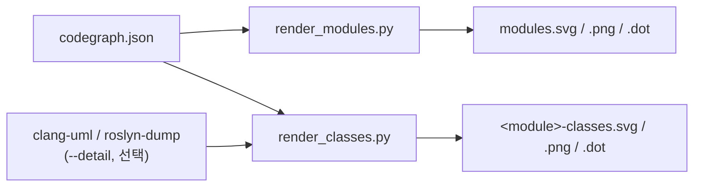

# 시각축 — build.py·check.py 조립 파이프라인

## 이 장이 다루는 범위

`viz/render_classes.py` 와 `viz/render_modules.py` 두 스크립트를 다룬다. 둘 다 `codegraph.json`
(코드 지도 JSON 파일)을 읽어 Graphviz DOT 문법 텍스트를 만들고, `dot` 명령을 자식 프로세스로 불러
SVG·PNG 그림으로 굽는다. 다루는 대상은 네 가지다 — `CodeModule`·`CodeNode`·`Member` 타입 선언
(둘 다 `render_classes.py` 안에 있다) 과 `emit_dot` 함수(`render_modules.py` 안에 있다).

객체지향을 갓 배운 독자를 기준으로 쓴다. Graphviz 나 TypedDict 를 몰라도 읽을 수 있게, 먼저
"무엇을 입력받아 무엇을 출력하는가" 부터 설명한다.

## 큰 그림 — 두 스크립트는 같은 재료를 다른 배율로 본다

이 저장소가 분석하는 대상 코드베이스는 `report-spec` 파이프라인의 정적 수집 단계가 만든
`codegraph.json` 파일 하나로 요약된다. 그 파일 안에는 클래스·함수 같은 코드 조각(**노드**),
그 조각들 사이의 관계(**엣지**: 상속·합성·의존 등), 그리고 노드를 묶는 **모듈**(폴더 단위 묶음)
목록이 들어 있다.

- `render_modules.py` 는 **모듈 단위**로 본다 — "A 모듈이 B 모듈에 의존하는가", "순환 의존이 있는가"
  를 그린다. 산출물이 바로 `out/codegraph-raw/modules.svg` 다.
- `render_classes.py` 는 **클래스 단위**로 본다 — 모듈 하나를 골라 그 안의 클래스들과, 그 클래스들과
  직접 연결된 이웃 클래스만 그린다. UML 클래스 다이어그램처럼 이름·멤버 변수·메서드 3단 상자를 그릴
  수도 있다(`--detail` 옵션을 줬을 때만).

두 스크립트는 서로 import 하지 않는다. 같은 `CodeNode`·`CodeModule`·`CodeGraph` 타입 선언이 두
파일에 **따로** 존재한다(`viz/render_classes.py:35-81`, `viz/render_modules.py:34-80`). 스키마가
바뀌면 두 곳을 함께 고쳐야 한다는 뜻이다 — 코드 안 주석이 이 점을 직접 경고한다
(viz/render_classes.py:33-34).



## `CodeNode` — 노드 하나의 생김새를 정해두는 타입

`CodeNode` 는 실제로 동작하는 클래스가 아니라, "이 딕셔너리(dict, 이름-값 쌍의 자료구조)는 항상
이런 필드를 가진다" 는 것을 타입 검사기에게 미리 알려주는 선언이다(파이썬의 `TypedDict` 문법을
쓴다). `codegraph.json` 의 `nodes` 배열 안 항목 하나가 이 모양이다(viz/render_classes.py:35-46).

| 필드 | 뜻 |
|---|---|
| `id` | 노드를 가리키는 고유 문자열 |
| `name` | 사람이 읽는 이름(클래스명·함수명) |
| `kind` | 노드 종류(클래스인지 함수인지 등) |
| `module` | 속한 모듈 이름. 없을 수도 있다 |
| `file`, `line` | 소스 위치. 없을 수도 있다 |
| `collapsed_from` | 외부(external) 노드에만 붙는다 — 원래 여러 이름이었던 것을 하나로 접었을 때 그 원본 이름 목록 |
| `signature`, `doc` | clang-doc(C++ 문서 추출 도구)이 붙었을 때만 존재 |

이 타입 선언이 왜 필요한지는 코드 주석이 밝힌다 — 선언 없이 JSON 을 그냥 읽으면 파이썬 타입
검사기(pyright)가 "문자열이거나 숫자이거나 리스트이거나" 식으로 뭉뚱그려 버려서, 그 값을 나중에
`n["module"]` 처럼 첨자로 접근하는 모든 곳이 타입 검사 대상에서 빠져 버린다(viz/render_classes.py:30-32).

**같은 이름의 선언이 `render_modules.py` 에도 그대로 있다**(viz/render_modules.py:34-44). 내용은
동일하지만 두 파일이 서로 import 하지 않으므로 독립된 선언이다.

## `CodeModule` — 모듈 하나의 생김새

`codegraph.json` 의 `modules` 배열 항목 하나의 모양이다(viz/render_classes.py:63-67).

```python
class CodeModule(TypedDict):
    id: str
    depends_on: list[str]
```

필드는 단 둘 — 모듈 이름(`id`)과, 그 모듈이 의존하는 다른 모듈 이름 목록(`depends_on`)이다. 이
목록 하나로 두 스크립트 모두 모듈 사이의 의존 방향 그래프를 만든다:

- `render_modules.py` 의 `build` 함수가 `depends_on` 을 순회하며 `networkx`(그래프 알고리즘
  라이브러리) 의 방향 그래프(`DiGraph`)에 간선을 추가한다(viz/render_modules.py:150-155).
- `render_classes.py` 의 `main` 함수도 똑같은 방식으로 별도의 방향 그래프를 만든다
  (viz/render_classes.py:356-359). 이건 클래스 그림에서 "이 클래스 간선이 모듈 순환에 기여하는가"
  를 판정하기 위해서다(아래 "순환 판정" 절 참고).

`CodeModule` 도 두 파일에 독립 선언이 있다(viz/render_modules.py:62-65).

## `Member` — 클래스 멤버 변수 하나의 생김새

`Member` 는 앞의 둘과 성격이 다르다 — `codegraph.json` 이 아니라, `--detail` 옵션으로 별도로
넘기는 **원시 분석 파일**(원문)의 모양을 정의한다(viz/render_classes.py:89-93).

```python
class Member(TypedDict, total=False):
    name: str
    type: str
    access: str
```

`codegraph.json` 자체에는 멤버 변수나 메서드 정보가 없다 — 모듈 구조와 클래스 사이의 관계(엣지)
만 있다. 클래스 내부의 "3분할 상자"(UML 다이어그램에서 이름 / 멤버 / 메서드 세 칸으로 나뉜 상자)를
그리려면 원시 분석 도구의 출력을 따로 읽어야 한다. 이 저장소가 다루는 원시 형식은 둘이다:

- **clang-uml** — C++ 코드를 분석하는 도구가 `-g json` 옵션으로 내는 JSON
- **roslyn-dump** — 이 저장소 자체가 정의한, C# 코드 분석 결과를 담는 JSON 형식

두 형식은 파일 구조가 다르지만(clang-uml 은 `elements[]`, roslyn-dump 는 `types[]`), 멤버 변수를
표현하는 키 이름이 우연히 같다 — 이름(`name`), 타입(`type`), 접근 제한자(`access`) 세 키가 겹친다.
그래서 `Member` 타입 하나로 두 원시 형식 모두를 표현할 수 있다(viz/render_classes.py:85-86 주석).

`total=False` 는 세 필드 모두 "있을 수도 없을 수도 있다" 는 뜻이다 — 원시 형식이 항상 세 필드를
채워 주지는 않기 때문이다.

`load_detail` 함수(viz/render_classes.py:212-251)가 이 두 원시 형식을 읽어 `Member`·`Method` 로
맞춘 공통 모양(`Detail` 타입)으로 변환한다. 어느 형식인지는 파일에 `"elements"` 키가 있는지로
가른다(viz/render_classes.py:224). C# 쪽 roslyn-dump 는 멤버·메서드가 없는 항목(외부 타입)을
건너뛴다(viz/render_classes.py:234-235).

**주의 — C# 은 아직 3분할을 완전히 그릴 수 없다.** roslyn-dump.json 에는 멤버/메서드 정보 자체가
없는 경우가 있다는 점을 스크립트 docstring 이 명시한다(viz/render_classes.py:10-11).

## `emit_dot` — 계산된 그래프를 실제 그림 문법으로 바꾼다

`render_modules.py` 의 핵심 함수다(viz/render_modules.py:187-309). 입력은 이미 다 계산되어 있다
— `build` 함수가 만든 방향 그래프(`G`), 모듈별 클래스 이름 목록(`members`), 외부 패키지 접촉
횟수(`ext_touch`), 순환에 참여하는 모듈 쌍(`cyc_edges`) 등. `emit_dot` 은 이 재료들을 텍스트로
조립할 뿐 새로 계산하지 않는다.

만들어내는 DOT 텍스트의 구조는 다음 순서다:

1. **헤더 주석** — 이 그림이 무엇을 그리는지, 색이 무엇을 뜻하는지 사람이 읽는 설명
   (viz/render_modules.py:197-214)
2. **1차 모듈 밴드** — `codegraph.json` 이 아는 모듈들을 하나의 클러스터(테두리로 묶인 그룹)에
   나열한다. 각 모듈 상자의 내용은 `node_label` 함수가 만든다 — 모듈 이름 + 클래스 개수 + 대표
   클래스 이름 최대 3개(viz/render_modules.py:169-181, 227-233)
3. **`__external__` 섬** — 저장소 바깥 패키지 노드. `--external` 플래그를 줘야 그려진다. 기본은
   꺼져 있다 — 켜면 외부 노드가 세로로 늘어져 1차 밴드를 압도하기 때문이라고 주석이 밝힌다
   (viz/render_modules.py:235-237)
4. **엣지 세 종류**, 색으로 구분:
   - 파랑 실선 = 순환에 참여하지 않는 일반 의존. `constraint=true` — 이 엣지들이 그림의 레이아웃
     뼈대를 잡는다(viz/render_modules.py:258-262)
   - 빨강 굵은 선 = 순환에 참여하는 의존. `constraint=false` — 뼈대의 랭크(위아래 순서)를
     왜곡하지 않도록 레이아웃 계산에서는 빼고 그림만 그린다(viz/render_modules.py:264-274)
   - 회색 점선 = 외부 패키지 접촉. `--external` 을 줬을 때만(viz/render_modules.py:276-281)
5. **범례** — 실제로 그린 엣지 종류만 예시로 보여준다(viz/render_modules.py:284-301)
6. **순환 없음 표시** — 순환이 하나도 없으면 "순환 없음" 이라는 초록 노트를 덧붙인다
   (viz/render_modules.py:304-306)

### 왜 순환 엣지는 `constraint=false` 인가

Graphviz 의 `dot` 레이아웃 엔진은 `constraint=true` 인 엣지만 보고 노드의 위아래 순서(랭크)를
정한다. 순환(A→B→A) 은 애초에 "위아래 한 방향" 으로 배치할 수 없는 관계이므로, 순환 엣지에까지
`constraint=true` 를 걸면 레이아웃 계산 자체가 뒤틀린다. 그래서 순환 엣지는 그림에는 그려지되
레이아웃 계산에서는 빠진다. `render_classes.py` 도 같은 원칙을 구조 엣지(상속·실현·합성·집약)에만
적용하고 의존 계열 엣지는 `constraint=false` 로 둔다(viz/render_classes.py:178-179, 422).

### 순환 판정은 기계가 하지 않는다

빨강으로 칠하는 것은 "여기를 사람이 봐야 한다" 는 표시일 뿐, 이 순환이 허용되는지 위반인지는
기계가 정하지 않는다는 점을 헤더 주석이 명시한다(viz/render_modules.py:209-211). 판정은 사람이
별도 설정 파일(`codegraph-rules.toml`)에 적는다.

### `emit_dot` 이 부르는 두 헬퍼

| 함수 | 역할 |
|---|---|
| `esc` | DOT 문법 문자열 안에서 역슬래시·큰따옴표를 이스케이프한다(viz/render_modules.py:93-95) |
| `node_label` | 모듈 상자 안에 넣을 HTML 표 문자열을 만든다(viz/render_modules.py:166-181) |

`emit_dot` 은 이 둘을 각각 실제로 호출한다 — terms-db.json 이 기록한 이웃 관계와 일치한다
(`viz.render_modules.esc`, `viz.render_modules.node_label` 이 `viz.render_modules.emit_dot` 의
이웃으로 등록돼 있다).

## 두 스크립트가 공유하는 규칙 — 직접 실행 가드

두 파일 모두 맨 끝에 다음 패턴이 있다(viz/render_classes.py:486-487, viz/render_modules.py:355-356):

```python
if __name__ == "__main__":
    sys.exit(main())
```

이 저장소의 규약이다 — 다른 파이썬 코드가 이 스크립트를 **import** 만 했을 때는 `main()` 이 돌지
않게 막는다. 가드가 없으면 시험(테스트) 코드가 단순히 함수를 재사용하려고 import 하는 순간
`main()` 전체가 실행되고, 명령줄 인자 파싱에 실패해 `sys.exit()` 이 호출되어 그 시험을 실행하던
프로세스 전체가 죽는다(`viz/CLAUDE.md` 의 "직접 실행 가드" 절).

## (Unknown - verify in codegraph 스키마 v2 문서 또는 machine/normalize.py)

이 장은 `render_classes.py`·`render_modules.py` 두 파일과 `terms-db.json`·`facts/*.md` 만 근거로
썼다. `codegraph.json` 스키마 v2 자체의 전체 정의(모든 필드의 의미, `schema_version` 값의 변천사)
는 `machine/normalize.py` 의 `_assemble` 반환부가 원본이라고 코드 주석이 가리키지만, 이 장에서
그 파일을 직접 읽어 확인하지는 않았다. 스키마를 더 깊이 알아야 하면 그 파일을 확인해야 한다.
