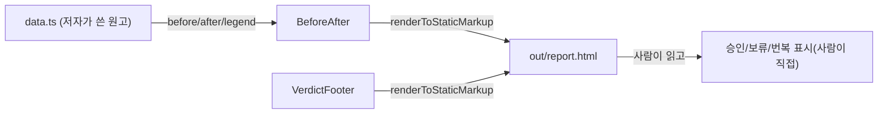

# 시각축 — React 컴포넌트와 용어집

이 장은 `viz/src/components/` 아래의 컴포넌트 17개 중 두 개, `BeforeAfter.tsx` 와
`VerdictFooter.tsx` 만 다룬다. 둘 다 Mode 2(`report-spec`) 보고서가 렌더하는 조각(fragment)
컴포넌트다 — 페이지 전체가 아니라 페이지 안에 끼워 넣는 부품이라는 뜻이다.

## 배경 지식 한 줄

이 저장소는 두 프로그램으로 나뉜다. **빌드 시점**에는 Node.js 위에서 React 가 이 컴포넌트들을
문자열(HTML)로 구워낸다(`renderToStaticMarkup`). **읽는 시점**에는 그 결과물인 순수 HTML+CSS 파일
(`out/report.html`)만 브라우저에 열린다 — React 도, JavaScript 런타임도 대부분 남지 않는다.
그래서 두 컴포넌트 모두 상태(state)나 이벤트 핸들러가 없다. 상호작용(다이어그램 확대·축소)은
전부 CSS 하나로 처리된다(`viz/CLAUDE.md:Graphviz SVG 인라인 규칙` 절, (viz/CLAUDE.md)).

## BeforeAfter — 변경 전/후 다이어그램을 나란히 놓는다

**파일**: (viz/src/components/BeforeAfter.tsx:23)

설계 검토 보고서에서 "무엇이 바뀌었는가"를 보여줄 때 쓰는 컴포넌트다. Graphviz 로 그린 두 장의
SVG(변경 전 · 변경 후)를 좌우 2열 그리드로 배치하고, 아래에 색상 범례를 붙인다.

```tsx
<BeforeAfter
  id="ownership-diagram"
  before={{ title: "변경 전", diagram: beforeSvg }}
  after={{ title: "변경 후", diagram: afterSvg }}
  legend={[{ color: "#e06c75", label: "소유권 이전" }]}
/>
```

props 타입은 다음과 같다(정의: (viz/src/types.ts:80)).

| prop | 타입 | 뜻 |
|---|---|---|
| `id` | `string` | 이 다이어그램 쌍의 고유 id. 확대 토글의 `<input>`/`<label>` 을 연결하는 데 쓰인다 |
| `before` | `DiagramPanel` | 변경 전 패널 — `{ title: string; diagram: InlinedSvg }` |
| `after` | `DiagramPanel` | 변경 후 패널. 모양은 `before` 와 같다 |
| `legend` | `LegendItem[]` | `{ color, label }` 쌍의 배열. 빈 배열이면 범례를 아예 렌더하지 않는다((viz/src/components/BeforeAfter.tsx:35)) |

`InlinedSvg` 는 `{ svg: string; naturalWidthPx: number | null; naturalHeightPx: number | null }` 다
((viz/src/types.ts:75) 부근, `(Unknown - verify in viz/src/types.ts)`: 정확한 시작 줄은 이 세션에서
직접 확인하지 않았다). `svg` 는 Graphviz 가 낸 SVG 원문이 아니라 `viz/svg.mjs` 의
`inlineSvg()` 를 한 번 거친 결과다((viz/svg.mjs:15)) — `<?xml?>` 선언과 `width`/`height` 속성을
제거하고 `viewBox` 만 남기며, `id`/`clipPath`/`marker` 참조 3종에 접두사를 붙여 한 페이지에 SVG 가
여러 장 있어도 서로의 정의를 가리지 않게 한다.

### 왜 `--svg-w` 라는 CSS 변수가 필요한가

`width`/`height` 를 지운 인라인 SVG 는 브라우저 입장에서 "고유 크기"가 없는 이미지다. 아무 조치가
없으면 300×150px 라는 브라우저 기본값으로 쪼그라든다. 이걸 막으려고 `inlineSvg()` 가 지우기 **직전에**
원본 `width` 값(pt 단위)을 읽어 px 로 환산해(`× 4/3`, (viz/svg.mjs:8)) `naturalWidthPx` 로 돌려주고,
`BeforeAfter` 안의 `Panel` 하위 컴포넌트가 이 값을 인라인 스타일의 CSS 커스텀 속성 `--svg-w` 로
`.svg-wrap` 엘리먼트에 심는다((viz/src/components/BeforeAfter.tsx:11)).

```tsx
function Panel({ side, panel }: { side: "before" | "after"; panel: DiagramPanel }) {
  const style = panel.diagram.naturalWidthPx
    ? ({ ["--svg-w"]: `${panel.diagram.naturalWidthPx}px` } as CSSProperties)
    : undefined;
  // ...
}
```

CSS 커스텀 속성은 자식 엘리먼트로 상속되므로, `.svg-wrap` 안의 `<svg>` 가 이 값을 읽어 자기 너비로
쓸 수 있다((viz/src/theme.css:79)의 `width: var(--svg-w, 100%)`). **이 연결고리 — pt→px 환산 →
`--svg-w` 주입 → CSS 가 읽기 — 가 하나라도 끊기면 "실제 크기 보기" 가 조용히 죽는다**는 것이
`viz/src/CLAUDE.md` 가 명시적으로 남긴 경고다.

### 확대 토글은 체크박스 하나다 — JavaScript 0줄

컴포넌트가 렌더하는 것은 숨겨진 체크박스 하나(`<input type="checkbox" className="zoom-toggle">`)와
그것을 가리키는 `<label>` 뿐이다((viz/src/components/BeforeAfter.tsx:29)). 클릭 이벤트를 처리하는
JavaScript 코드는 없다. 대신 `theme.css` 가 CSS 의 **형제 결합자**(sibling combinator, `~`)를 써서
"이 체크박스가 켜져 있으면 그 뒤에 오는 `.diagram-grid` 의 레이아웃을 바꿔라"라고 지시한다
((viz/src/theme.css:77)):

```css
.zoom-toggle:checked ~ .diagram-grid { grid-template-columns: 1fr; }
.zoom-toggle:checked ~ .diagram-grid .svg-wrap { max-height: 78vh; }
.zoom-toggle:checked ~ .diagram-grid .svg-wrap svg { width: var(--svg-w, 100%); height: auto; }
```

체크 안 된 기본 상태는 2열 그리드(`grid-template-columns: 1fr 1fr`)로 두 SVG 를 나란히 작게
보여준다. 체크하면 1열로 펴지고, 위에서 설명한 `--svg-w` 값으로 SVG 가 원본 픽셀 크기까지 커지며,
`.svg-wrap` 이 `overflow: auto` 라 화면보다 크면 가로·세로 스크롤이 생긴다. 이 방식은 이 저장소가
처음부터 설계한 것이 아니라, 원래 예상했던 "pan/zoom 스크립트" 대신 사용자가 육안으로 확인한
뒤 채택한 대안이다(`viz/src/CLAUDE.md`, "B1 — 다이어그램 가독성은 CSS 만으로 고쳐졌다" 절).

### 어디서 쓰이는가

`report-spec init` 이 새 보고서 폴더에 심는 기본 `report.tsx` 템플릿은 `BeforeAfter` 를 쓰지 않는다
— 기본 템플릿이 import 하는 것은 `Page`, `Section`, `DecisionTable`, `VerdictFooter` 뿐이다
((viz/init.py:106)). 즉 `BeforeAfter` 는 저자가 변경 전/후 비교가 필요하다고 판단할 때 **직접
가져다 써야 하는** 선택적 컴포넌트다. 어떤 값을 `before`/`after`/`legend` 에 채우는지는 저장소
자동화가 아니라 `data.ts` 를 쓰는 사람(또는 그 값을 만드는 별도 파이썬 스크립트, 예:
`viz/render_classes.py`)의 몫이다 — 이 세션에서는 그 연결 지점을 실제로 추적하지 않았다
(`Unknown - verify in viz/build.py 와 report.tsx 작성 예시`).

## VerdictFooter — 수용 판정 기입란

**파일**: (viz/src/components/VerdictFooter.tsx:6)

보고서 맨 아래에 놓이는, 사람이 손으로 채우는 빈 칸이다. "승인 / 보류 / 번복" 세 가지 선택지와
사유를 적을 줄, 그리고 안내 문구 하나로 이뤄져 있다.

```tsx
export function VerdictFooter({ note }: { note?: string }) {
  return (
    <div className="verdict-footer">
      <div className="choices">
        <span className="choice"><span className="box" />승인</span>
        <span className="choice"><span className="box" />보류</span>
        <span className="choice"><span className="box" />번복</span>
      </div>
      <div className="reason-line">사유 —</div>
      <div className="owner-note">
        {note ?? "이 칸은 사용자가 직접 채운다. 에이전트가 판정을 대신 기입하지 않는다."}
      </div>
    </div>
  );
}
```

props 는 하나뿐이다.

| prop | 타입 | 뜻 |
|---|---|---|
| `note` | `string?` | 안내 문구를 바꾸고 싶을 때만 넘긴다. 안 넘기면 기본 안내 문구가 나온다 |

**핵심 규칙은 코드 주석에 그대로 적혀 있다**: "이 블록의 값은 AI 가 채우지 않는다. 사용자 기입
전용."((viz/src/components/VerdictFooter.tsx:5)) `승인`/`보류`/`번복` 옆의 네모 칸(`.box`)은 클릭
가능한 체크박스가 아니라 그냥 시각적인 빈 사각형(`<span className="box" />`)이다 — 인쇄하거나
화면에서 손으로(또는 별도 도구로) 표시하는 용도이지, 컴포넌트 자체에 클릭 로직은 없다.

이 설계는 이 저장소 전체의 방향과 맞물려 있다: 보고서는 산문 대신 표·배지·다이어그램으로 정보를
압축해 사람이 "승인할지 말지" 판단하기 쉽게 만드는 것이 목적이고, **그 판단 자체는 언제나 사람의
몫**이다(`mode-2-spec-report` 에이전트 설명, `../../CLAUDE.md` §"사양 원본"). `VerdictFooter` 는
그 원칙을 코드 수준에서 강제하는 컴포넌트다 — 판정 필드에 채워 넣을 기본값이 아예 없다.

### 어디서 쓰이는가

`report-spec init` 의 기본 `report.tsx` 템플릿은 `VerdictFooter` 를 body 맨 끝에 그대로
붙인다((viz/init.py:118)):

```tsx
<VerdictFooter />
```

즉 모든 새 Mode 2 보고서는 시작부터 빈 판정 칸을 가지고 태어난다. 별도의 시험(`does` 필드,
(out/codegraph-raw/facts/entrypoints.md) 계열 어딘가)이 기본 문구 안에 "VerdictFooter" 와 "비워"
두 낱말이 함께 들어있는지를 검사한다고 알려져 있으나, 그 시험 파일 자체는 이 세션에서 직접
열어보지 않았다(`Unknown - verify in test/ 아래 관련 파일`).

## 두 컴포넌트를 나란히 보면

| | `BeforeAfter` | `VerdictFooter` |
|---|---|---|
| 다루는 것 | 비교 대상 두 장의 다이어그램 | 판정 세 갈래 + 사유 한 줄 |
| 상태를 갖는가 | CSS 체크박스 하나(`.zoom-toggle`)로 확대 여부만 | 없음 — 완전한 정적 조각 |
| 채우는 주체 | 저자(사람 또는 자동화)가 `before`/`after`/`legend` 를 데이터로 넘긴다 | 사람이 렌더된 HTML 을 보고 나중에 손으로 표시한다 |
| 기본 템플릿(`report-spec init`)에 포함되는가 | 아니오 — 선택적 | 예 — 항상 body 끝에 있다 |

두 컴포넌트 모두 React 훅을 쓰지 않는다는 점, 그리고 클래스 이름 규칙(`diagram-*`, `verdict-footer`
계열)이 `viz/src/theme.css` 한 파일에 모여 있다는 점은 이 저장소의 컴포넌트 17개 전체에 적용되는
공통 규칙이다(`viz/src/CLAUDE.md`) — 이 장은 그 규칙을 두 컴포넌트로 좁혀 보인 것이다.


