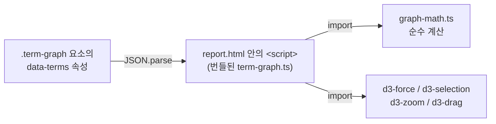

# 시각축 — 용어 그래프 런타임

이 장은 `viz/src/runtime/term-graph.ts`와 `viz/src/runtime/graph-math.ts` 두 파일을 다룬다. 이 둘은
`report-spec build`가 만드는 최종 산출물 `out/report.html`에서 **유일하게 브라우저에서 실행되는
코드**다. 나머지 `viz/src/` 컴포넌트는 전부 빌드 시점(Node.js 위)에서 정적 HTML 문자열로
구워지고 사라진다(`viz/src/runtime/term-graph.ts:1-6`).

## 왜 이 파일들이 특별한가

이 저장소가 만드는 보고서는 "산출물 불변식"이라는 규칙을 지킨다 — 빌드된 `report.html` 안의
`<script>` 태그는 1개를 넘으면 안 된다. 대부분의 보고서는 표와 다이어그램을 CSS 체크박스
토글만으로 확대·축소하므로 `<script>`가 0개다. 하지만 보고서에 **용어집(glossary)**이 있으면
예외가 하나 생긴다 — 용어끼리 어떻게 이어져 있는지 보여주는 그물 그림(관계 그래프)만큼은
정적 이미지로 그릴 수 없다. 사용자가 노드를 드래그하고, 확대·축소하고, 마우스를 올리면 설명이
뜨는 상호작용이 필요하기 때문이다. 그래서 이 하나의 예외를 위해 `<script>` 예산 1칸을 쓴다 —
그 스크립트의 본체가 `term-graph.ts`이고, `data.ts`에 `terms`가 있을 때만 번들에 포함된다.

용어 자체가 무엇인지는 이 저장소를 처음 접하는 사람에게는 생소할 수 있다. 짧게 말하면 —
보고서 본문에 `PageRank`나 `calls[]`처럼 정의 없이 나오면 안 읽히는 낱말들을, `data.ts`의 `terms`
배열 한 곳에 모아 두고, 본문·용어집 표·관계 그래프 세 군데가 전부 그 배열 하나에서 나오게
만든 것이 이 도구의 용어집 체계다. `term-graph.ts`는 그 배열을 받아 노드-간선 그래프로 그리는
쪽을 맡는다.

## 두 파일의 역할 분담

- **`graph-math.ts`** — 브라우저 API(DOM, `window` 등)를 전혀 쓰지 않는 순수 함수 4개만 모은
  파일이다. 그래서 `node --test`로 브라우저 없이 고정할 수 있다는 것이 파일 머리 주석의 취지다
  (`viz/src/runtime/graph-math.ts:4-5`). **다만 이 세션이 확인한 시점에는 이 파일을 직접 겨냥한
  테스트 파일이 저장소에 없었다** — `graph-math`라는 이름을 참조하는 파일은 `term-graph.ts` 자신
  뿐이다. "테스트로 고정 가능"이라는 설계 의도와 "실제로 고정돼 있다"는 사실은 구분해서 읽어야
  한다(Unknown - verify by adding or locating a test importing graph-math.ts).
- **`term-graph.ts`** — DOM을 직접 조작하고 d3 계열 라이브러리 4개(`d3-force`, `d3-selection`,
  `d3-zoom`, `d3-drag`)를 엮어 실제 그래프를 화면에 그리는 쪽이다. `graph-math.ts`의 순수 함수를
  가져다 쓴다(`viz/src/runtime/term-graph.ts:16-17`).

## 왜 물리 시뮬레이션 라이브러리를 쓰는가 — WebGL이 아니라 d3-force인 이유

노드가 서로 겹치지 않고 이어진 것끼리 뭉치도록 배치하는 문제는 "force-directed graph layout"이라는
잘 알려진 기법으로 푼다. 각 노드에 서로 밀어내는 힘(척력)과, 이어진 노드끼리 당기는 힘(인력)을
주고, 매 프레임(tick)마다 힘을 적분해 위치를 갱신하는 물리 시뮬레이션이다. `d3-force`는 이
시뮬레이션 엔진만 제공하는 라이브러리다.

이 저장소는 용어집의 노드 수가 많아야 수십 개 수준이라는 전제 위에서, 조사 문서가 제시한 임계값
("노드 2천 미만이면 d3+SVG로 충분")에 크게 못 미친다고 보고, PixiJS나 WebGL 기반 렌더러를
쓰지 않기로 했다(`viz/src/CLAUDE.md`의 "왜 d3-force + SVG 인가" 절). 이 판단의 근거인 정확한
번들 크기 수치는 이 세션이 직접 재측정하지 않았으므로 그 문서의 서술을 그대로만 옮긴다
(Unknown - verify by re-running esbuild --minify on this branch).

## 계산 4가지 — `graph-math.ts`

| 함수 | 하는 일 | 왜 필요한가 |
|---|---|---|
| `components(ids, edges)` | Union-Find(경로 압축)로 이어진 노드끼리 같은 번호를 매긴다(`viz/src/runtime/graph-math.ts:11-38`) | "덩어리"(연결 성분) 단위로 서로 다른 척력을 주기 위한 사전 준비 |
| `bounds(w, h, scale)` | 캔버스 중심 기준으로 노드가 움직일 수 있는 사각 상자를 계산한다(`viz/src/runtime/graph-math.ts:41-45`) | 노드가 화면 밖 무한히 먼 곳으로 날아가지 않게 가둔다 |
| `clampBox(v, min, max)` | 값 하나를 구간 안으로 자른다(`viz/src/runtime/graph-math.ts:48-50`) | `bounds`가 만든 상자 안에 좌표를 강제로 붙잡아 두는 데 쓴다 |
| `rectOverlap(a, b, pad)` | 두 사각형이 여백을 포함해 겹치는지 보고, 겹치면 더 짧게 밀어낼 축과 방향을 돌려준다(`viz/src/runtime/graph-math.ts:64-70`) | 덩어리 두 개가 서로의 영역을 침범하지 않게 미는 데 쓴다 |

`components`가 계산하는 "덩어리"라는 개념이 이 파일의 핵심이다. 용어들이 서로 뜻으로 이어져
있으면(`links` 배열) 그래프 상에서 한 뭉치로 묶이고, 뭉치 안에서는 서로 가깝게, 뭉치와 뭉치
사이에는 멀찍이 떨어지도록 힘의 세기를 달리 준다. 그 "달리 주는" 실제 로직은 `term-graph.ts`
쪽에 있고(아래), `graph-math.ts`는 어느 노드가 어느 뭉치에 속하는지만 계산해 준다.

## 실제로 힘을 계산하는 곳 — `term-graph.ts`의 두 커스텀 힘

`d3-force`가 기본으로 제공하는 힘(`forceLink`, `forceX`, `forceY`, `forceCollide`)만으로는 "덩어리
단위로 다른 척력"과 "덩어리끼리 사각형이 겹치면 통째로 밀어내기"를 표현할 수 없다. 그래서 이
파일은 d3-force가 정의한 힘의 인터페이스(매 tick마다 `(alpha) => void`로 불리고, 시작할 때
`initialize(nodes)`로 노드 배열을 받는 함수)를 직접 구현한 커스텀 힘 두 개를 추가한다
(`viz/src/runtime/term-graph.ts:65`).

- **`componentRepulsion(comp)`** — 노드 쌍을 전수 비교(O(n²))해서, 같은 덩어리면 `REPEL_IN`,
  다른 덩어리면 `REPEL_OUT` 세기로 밀어낸다. `REPEL_MAX_DIST`보다 먼 쌍은 아예 계산하지 않는다
  (`viz/src/runtime/term-graph.ts:73-104`). 노드 수가 수십 개이므로 O(n²)로도 충분하다는 것이
  주석의 전제다.
- **`componentCollide(comp)`** — 매 tick마다 덩어리별 경계 사각형(AABB)을 다시 재고, `graph-math.ts`의
  `rectOverlap`으로 겹침을 검사해 겹치면 두 덩어리 전체를 반대 방향으로 민다
  (`viz/src/runtime/term-graph.ts:111-153`). 한 tick에 너무 크게 튀지 않도록 이동량을 12px로
  제한한다(`viz/src/runtime/term-graph.ts:137`).

이 두 힘과 표준 힘(`link`, `gx`/`gy`, `collide`)이 모두 `forceSimulation`에 등록되어 함께 동작한다
(`viz/src/runtime/term-graph.ts:333-357`).

## 조정 손잡이(KNOBS) — 숫자가 아니라 사용자가 눈으로 확정한 값

파일 머리의 `KNOBS` 객체는 척력 세기, 중력, 링크 거리, 충돌 반지름 등 10개의 상수를 담는다
(`viz/src/runtime/term-graph.ts:21-32`). 이 값들은 임의로 고른 것이 아니라, `<TermGraph terms tune />`
로 켜지는 임시 슬라이더 패널(`mountTune` 함수, `viz/src/runtime/term-graph.ts:160-227`)로 사람이
직접 조정해 눈으로 판정한 값이라고 주석에 적혀 있다. `KNOBS`가 상수가 아니라 객체인 이유도
명시돼 있다 — 슬라이더가 값을 바꾸면 다음 tick부터 힘이 그 값을 그대로 읽어 가게 하기 위해서다
(`viz/src/runtime/term-graph.ts:20`). 이 슬라이더 패널은 산출물에 남지 않는다 — `data-tune` 속성이
붙은 그래프에서만 생성된다(`viz/src/runtime/term-graph.ts:391-409`).

## 데이터가 들어오는 경로

그래프는 컨테이너 요소의 `data-terms` 속성에 담긴 JSON 문자열을 파싱해서 시작한다
(`viz/src/runtime/term-graph.ts:236-245`). `<script type="application/json">` 같은 별도 스크립트
태그를 쓰지 않는 이유는, 그렇게 하면 산출물의 `<script>` 개수를 세는 검사(`countScripts`)가
2로 세어 위에서 말한 산출물 불변식이 깨지기 때문이다(`viz/src/CLAUDE.md`의 "구현상 급소" 절).
JSON 파싱이 실패하면 조용히 함수를 반환하고 보고서 본문은 그대로 읽힌다
(`viz/src/runtime/term-graph.ts:240-245`).

간선(edge)은 양쪽 끝 노드가 모두 존재하는 용어 id일 때만 만들어지고, 중복 간선은 정렬된
id 쌍 문자열로 걸러진다(`viz/src/runtime/term-graph.ts:249-260`). 덩어리 번호는 간선을
`forceLink`가 소스/타깃 객체로 바꾸기 **전에**, 즉 아직 문자열 id인 상태에서 `graph-math.ts`의
`components`로 미리 계산해 둔다 — 이 순서를 지켜야 하는 이유가 주석에 명시돼 있다
(`viz/src/runtime/term-graph.ts:262-266`).

## 화면 조작 — 드래그, 확대·축소, hover 카드

- **드래그**: 노드를 끄는 동안 시뮬레이션의 `alphaTarget`을 0.3으로 올려 다시 움직이게 하고,
  놓으면 0으로 되돌린다(`viz/src/runtime/term-graph.ts:359-379`).
- **확대·축소(zoom/pan)**: `d3-zoom`을 SVG 전체에 걸되, 이벤트 타깃이 노드(`.term-node`) 위일 때는
  드래그가 우선하도록 필터로 갈라 준다(`viz/src/runtime/term-graph.ts:382-388`).
- **hover 카드**: 노드에 마우스를 올리거나 포커스를 주면 `tip` 요소에 `id — short` 문구를 채우고
  좌표를 계산해 보여준다(`viz/src/runtime/term-graph.ts:302-319`).

같은 파일이 맡는 또 하나의 일이 `mountTermCards()`다(`viz/src/runtime/term-graph.ts:416-451`).
이것은 그래프 자체가 아니라 **본문 안의 용어 인라인 참조**에 마우스를 올렸을 때 뜨는 설명 카드의
*위치*를 화면 기준(`position: fixed`) 좌표로 옮겨 주는 코드다. 카드가 뜨고 숨는 것 자체는 CSS의
`:hover`/`:focus`가 처리하고, 이 함수는 표를 감싼 `.table-wrap`(overflow-x: auto)이나 카드
컨테이너의 `.card`(overflow: hidden)에 카드가 잘리는 문제를 피하려고 위치만 화면 기준으로 계산해
옮긴다(`viz/src/runtime/term-graph.ts:412-415`). 그래프 렌더링과 관계 없는 별개 기능이지만, 같은
번들 예산 안에 담겨 있어(산출물 `<script>`가 1개를 넘을 수 없으므로) 이 파일 하나가 두 가지 일을
겸한다.

## 진입점

`boot()` 함수가 `document.readyState`를 확인해 DOM 준비 여부에 따라 즉시 또는
`DOMContentLoaded` 시점에 `.term-graph` 클래스를 가진 모든 요소에 `build()`를 실행하고,
`mountTermCards()`를 한 번 호출한다(`viz/src/runtime/term-graph.ts:453-461`). 한 보고서 안에
용어 그래프가 여러 개 있어도(이론상) 각각 독립적으로 빌드된다.

## 이 저장소에서 더 볼 곳

- `viz/src/CLAUDE.md`의 "용어집과 관계 그래프" 절 — `defineTerms`, `<Glossary>`, `<TermGraph>`
  세 컴포넌트가 이 런타임과 어떻게 이어지는지, 번들 크기 실측치.
- `viz/CLAUDE.md`의 "렌더 경로" 절 — `data.ts`의 `terms`가 있을 때만 이 파일이 esbuild로
  번들되어 산출물에 포함되는 조건.
