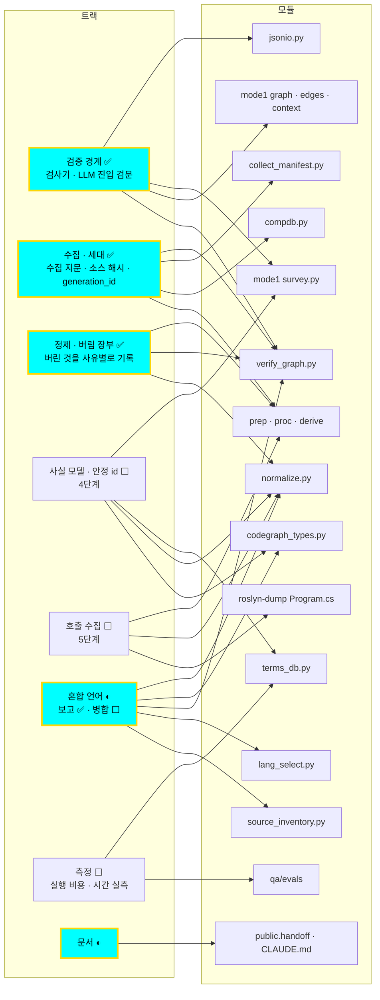
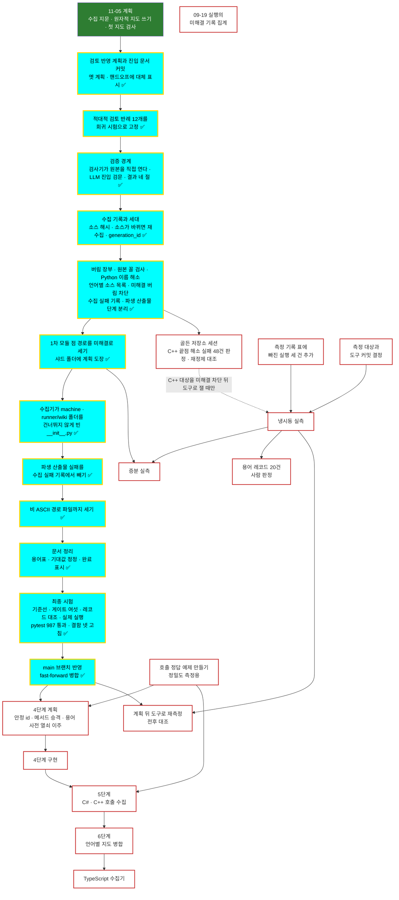

# 코드 지도 트랙 — 작업 분류 · 교집합 · 의존 DAG (2026-11-21)

> 기준: `main` `d02565f` — 구현 브랜치 `codegraph-facts-generation` 을 2026-11-21 에 fast-forward 로 병합했다(`46f0775` 뒤 36커밋, 같은 날 `origin/main` 에 push).
> ✅ = 커밋됨(시험은 "끝에 한 번" 정책 — 2026-11-21 최종 시험에서 처음 돌았고 게이트 여섯이 전부 초록) · 🟡 = 진행 중 · ⬜ = 남음.
> 출처: 반영 계획 `2026-11-13-codegraph-facts-generation-plan.md` · 하위 계획 `2026-11-14-codegraph-pre-final-test-subplan.md` · Root 지침 · 11-05 핸드오프 §2 · `git log` · `git diff --stat 46f0775..d02565f`.

## 1. 트랙 × 모듈

작업을 트랙 여덟으로 나누고, 각 트랙이 고치는 모듈에 선을 그었다. 선이 여럿 모이는 모듈이 교집합이다. **청록 배경 · 노란 테두리**는 2026-11-13 ~ 11-21 구현 세션(반영 계획의 구현과 최종 시험 전 정리)이 작업한 트랙이다 — 혼합 언어와 문서는 그 일부만이다.

## 2. 교집합 · 배타 집합

| 모듈 | 겹치는 트랙 | 뜻 |
|---|---|---|
| `normalize.py` | 정제 · 사실 모델 · 호출 수집 · 혼합 언어 | **남은 4 · 5 · 6단계가 모두 이 파일을 다시 연다** → 셋을 병렬로 못 돌리는 이유 |
| `verify_graph.py` | 검증 경계 · 수집 · 정제 · 혼합 언어 | 검사 결과 네 절(구조 · 최신성 · 수집 범위 · 언어별 능력)이 한 파일에 모였다. 이미 끝난 트랙끼리의 교집합이라 지금은 충돌 없음 |
| `prep` 계열 | 수집 · 정제 · 호출 수집 | 5단계의 C++ 호출 수집이 여기에 단계 하나를 더한다 |
| `codegraph_types.py` | 사실 모델 · 혼합 언어 | 지도의 계약 파일 — 간선 발생 위치 목록(4단계) · 언어 목록(6단계). 바꾸기 전에 diff 를 먼저 보인다 |
| `terms_db.py` | 사실 모델 · 측정 | 4단계가 용어 사전의 열쇠를 이름에서 심볼 id 로 바꾸면 측정의 레코드 검사 기준이 바뀐다 |
| `survey.py` | 검증 경계 · 사실 모델 | LLM 진입 검문(끝남) · 조사 대상 필터(4단계) |

| 배타 집합 (한 트랙만) | 모듈 |
|---|---|
| 검증 경계 | `jsonio.py` |
| 수집 · 세대 | `compdb.py` · `collect_manifest.py` |
| 호출 수집 | `roslyn-dump/Program.cs` · C++ 호출 수집 경로(도구 선택 전) |
| 측정 | `qa/evals/` — 구현 트랙과 **파일 교집합이 없다.** 작업 공간도 따로다 |

**구현 트랙 ∩ 측정 트랙은 둘뿐이다:** ① 용어 레코드 검사(`terms_db.py`) — 최종 시험이 재는 기준선이 곧 측정 쪽의 레코드 선검사다. ② C++ 미해결 차단 — 미해결 버림을 막는 커밋 뒤의 도구로 C++ 대상을 재면, C++ 끝점 해소 실패 48건의 판정 전까지 `verify-graph` 에서 멈춘다.

## 3. 의존 DAG — 위상 정렬

화살표는 "앞이 끝나야 뒤를 시작한다" 는 뜻이다. 위에서 아래가 위상 순서다. 초록 = 커밋됨 · 빨간 테두리 = 남음 · **청록 배경에 노란 테두리 = 2026-11-13 ~ 11-21 구현 세션이 작업한 작업**(안의 ✅ 는 커밋됨).

- **지금 바로 시작할 수 있는 것**(남은 작업 중 앞선 작업이 없는 것): 호출 정답 예제 만들기 · 측정 기록 표 보강 · 09-19 미해결 기록 집계 · 측정 대상과 도구 커밋 결정 · 골든 저장소 세션(골든 저장소가 있는 기계가 필요)
- **임계 경로:** 4단계 계획 → 4단계 구현 → 5단계 → 6단계 — 전부 `normalize.py` 를 지나므로 줄일 수 없다
- **아무 때나 할 수 있는 것**(그림 밖): 설계 문서 결정 로그에 재검토 날짜 · 깨지는 신호 열 추가(보고만) · Windows 지원 여부를 정한 뒤 설치 스크립트 정리 · `render_classes.py` 연결 여부 · 아무도 안 읽는 지도 칸 · 스킬 문서 정정 · 조사 보고서 수치 정정의 결정 · 함께 바뀐 파일 쌍(변경 결합) 수집(파생 산출물 단계는 끝났고, 그 값을 쓸 곳이 생겨야 한다)

## 4. 작업별 Before → After

| 작업 | | Before | After |
|---|---|---|---|
| 11-05 계획 · 검토 반영 계획과 진입 문서 커밋 · 반례 고정 | ✅ | 성공 기록이 지도 sha 하나 · 반례 12건이 재현됨 | 지문 · 원자적 쓰기 · 첫 지도 검사, 반례 12건이 회귀 시험으로 고정 |
| 검증 경계 | ✅ | 깨진 JSON 은 결함 파일 없이 죽음 · 배치 생성 단계만 검문 | 검사기가 원본을 직접 연다 · LLM 진입 넷이 같은 검문 · 결과 네 절 + 용도별 적합 판정 |
| 수집 기록과 세대 | ✅ | 같은 줄 수로 본문만 바뀌면 통과 · `compdb.py` 수정은 지문 밖 | 인용 파일마다 소스 해시 → 소스가 바뀌면 결함 · `generation_id` 가 배치까지 간다 |
| 버림 장부 · Python 이름 해소 · 소스 목록 · 파생 단계 분리 | ✅ | 버림이 화면에만 · C# 모르는 관계 종류면 죽음 · Python 점 경로 이름을 못 풂 · 소수 언어가 말없이 빠짐 | 버림 장부 · 결함 등급 · 원본 꼴 검사 · 점 경로 꼬리와 형 별칭을 따라가는 이름 해소 · 미해결 버림을 검사가 막음 · 언어별 소스 목록 · 검사 뒤에만 파생 산출물(단계 15개) |
| 점 경로 미해결 · 샤드 계획 도장 | ✅ | 1차 모듈 점 경로가 외부 노드로 접힘 · 다른 계획의 샤드를 재사용 | 미해결로 센다 · 샤드 폴더에 계획 도장 |
| 빈 `__init__.py` · 실패 기록 · 비 ASCII | ✅ | griffe 가 두 폴더를 건너뜀(미해결 6) · 파생 단계 실패가 수집 실패로 기록 · 비 ASCII 경로 누락 | 빈 `__init__.py` 둘(미해결 0, 실측) · 기록 안 함 · `git ls-files -z` |
| 문서 정리(용어표 · 기대값) | ✅ | 상태 표 전부 ❌ · 수집 못 한 언어 기대값 `["cs","ts"]` · 용어 제각각 | 용어표 · 기대값 `["cpp","cs","ts"]` · 핸드오프 체크리스트 완료 표시 |
| 최종 시험 | ✅ | 시험 0회 · 기준선 미측정 | 구현 전 커밋 기준선 903 통과 · 20 건너뜀 → 987 통과 · 22 건너뜀 · 2 xfail, 게이트 여섯 전부 초록 · 식별 단위로 새 레코드 실패 0 · 실제 실행 전부 일치. bisect 로 찾아 고친 결함 넷(pyright strict 오류 셋 · 재개 시험 픽스처 하나). 시험에서 드러난 `.venv` 재실행 무한 반복도 고쳤다 — 재실행은 한 번뿐(`d02565f`) |
| main 반영 | ✅ | 브랜치에만 있음 | 2026-11-21 fast-forward 병합(`d02565f`). 병합 뒤 main 에서 게이트 여섯 전부 초록 — pytest 989 통과 · 22 건너뜀 · 2 xfail |
| 4단계 계획 · 구현 | ⬜ | 노드 id 가 실행마다 매기는 번호 · 용어 사전이 이름으로 접음 · C++/C# 메서드 없음 | `언어:한정이름(인자형)` id · 심볼 id 로 결합 · 메서드 전량 + 조사 필터 · 간선 발생 위치 보존 |
| 호출 정답 예제 | ⬜ | 해소율만 있고 정밀도 없음 | 손으로 만든 호출 정답 — 4단계 스키마가 호출을 담을 수 있는지 확인 |
| 5단계 호출 수집 | ⬜ | C# · C++ 호출 간선 0 | 호출 간선과 위치, 정답 대비 정밀도 |
| 6단계 병합 · TypeScript | ⬜ | 지도에 언어 하나 · TS 는 수집기가 없어 막힘 | 언어 목록 · 언어별 병합 · TS 수집기 후보 평가 |
| 골든 저장소 세션 | ⬜ | C++ 끝점 해소 실패 48건이 정책인지 손실인지 모름 | 판정 · 골든 원본 재정제 대조 |
| 측정 기록 표 · 미해결 집계 | ⬜ | 측정 표에 08-30 opus 한 행뿐 | 08-30 sonnet · 09-17 · 09-19 행과 조건 열 · 집계 한 줄 |
| 냉시동 · 증분 · 사람 판정 · 재측정 | ⬜ | 새 구조로 완주한 적 0회 · 증분 절감폭 숫자 없음 | 고정한 도구 커밋에서 냉시동 · 증분 수치, 계획 전후 대조, 레코드 정확도 판정표 |
