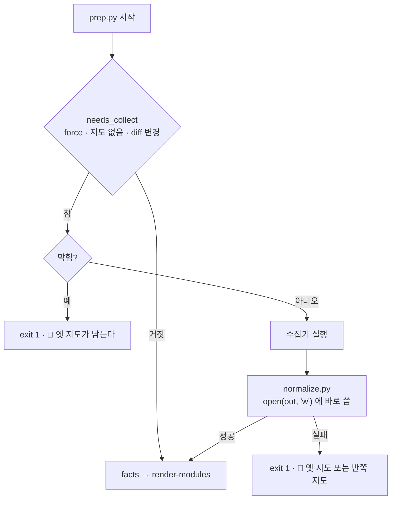
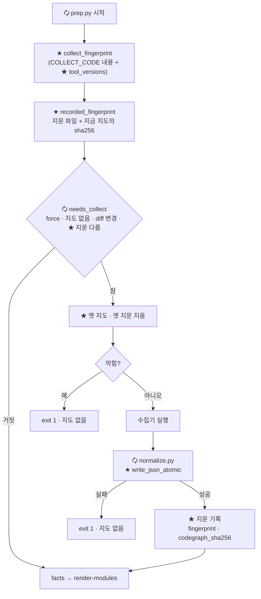
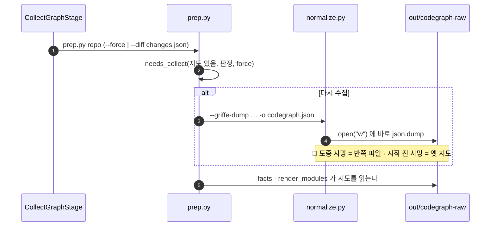
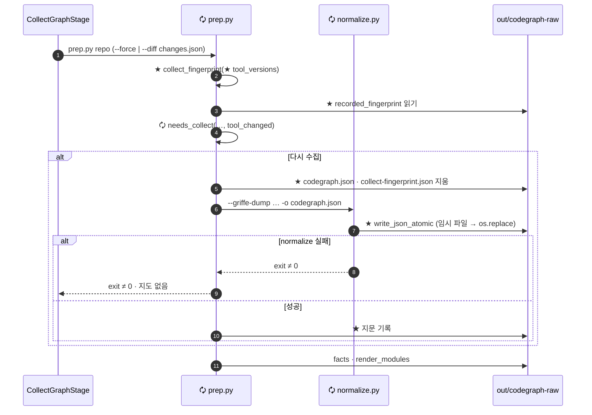
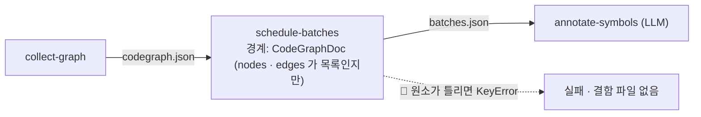
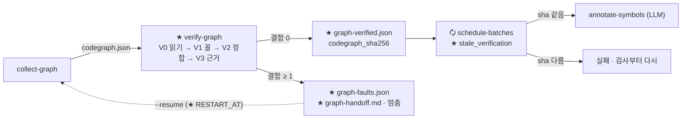
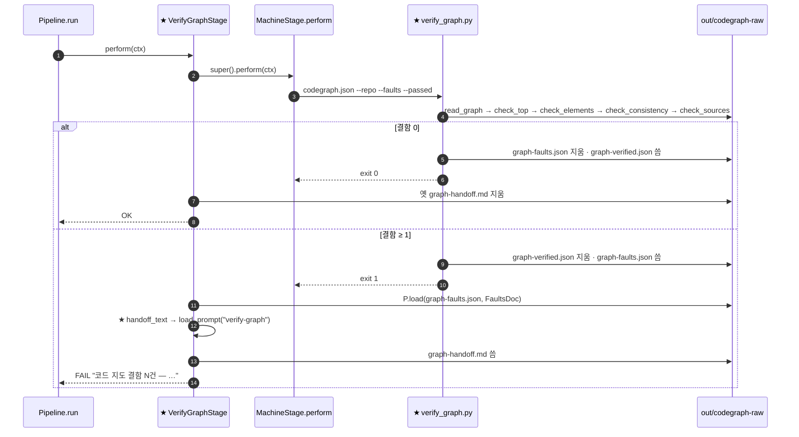
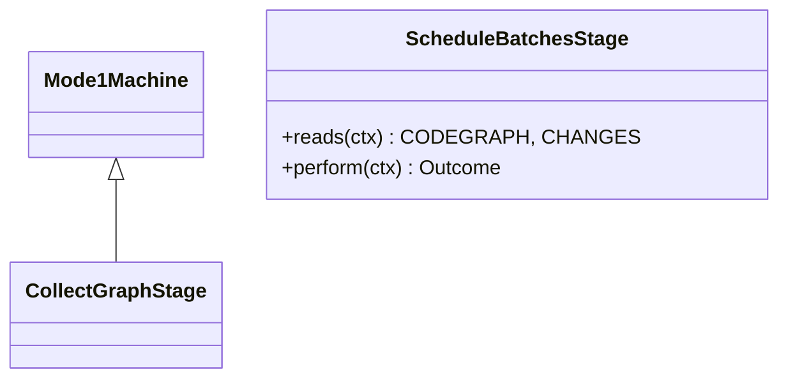
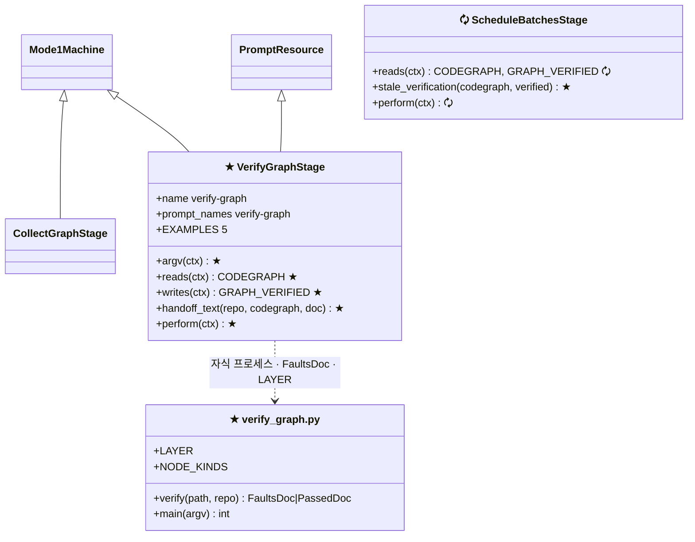

# 🧭 코드 지도 검증 · 언어 통일 — 구현 계획 (1 · 2단계 상세 · 3~6단계 개요)

> 📅 2026-11-05 · 브랜치 `main` · **Before = `86bd239`** (`origin/main` 과 같음, 미커밋 없음 — 이 세션 실측)
> 📄 근거: `public.handoff/2026-11-05-codegraph-verify-unify-resume-handoff.md`(이하 핸드오프) · `public.handoff/언어 불문 코드 그래프 통일.md` · 이 세션에서 읽은 `prep.py` · `normalize.py:470-509,1181-1239` · `resume.py` · `mode1/graph.py:16-32` · `mode1/wiki.py:186-198` · `test_mode1.py:146-158,694-707`
> 🔒 지킬 규칙: 설계 확인 전 구현 금지(핸드오프 §0) · TDD · `normalize.py` 출력 키를 바꾸면 멈추고 보고 · `codegraph_types.py` 변경은 먼저 보여 주고 시작 · 골든 저장소는 읽기만 · 코드 주석은 현 상황만 · 긴 글은 `resource/` · 커밋은 사용자 요청 때만
> 🧪 검증: **Task 마다 구현 → 커밋, 시험은 끝(Task 14)에 한 번, 실패하면 `git bisect` 로 이분 탐색**(👍 사용자 2026-11-05) — 게이트 여섯 + 새 시험 + 이 저장소에 실제 실행
> ✋ 승인: 👍 승인 2026-11-05

> **For agentic workers:** REQUIRED SUB-SKILL: `anthropic-skills:executing-plans` 로 Task 단위로 실행한다. 단계는 체크박스(`- [ ]`)로 추적한다.

**Goal:** 낡거나 깨진 <span style="color:cyan">코드 지도</span>가 LLM 단계로 흘러가지 않게 한다 — 1단계는 수집 쪽(낡은 지도 · 반쪽 지도 · 수집기 변경), 2단계는 검사 쪽(JSON 이 열리는가 · 필수 열쇠와 형 · 서로 맞는가 · 소스 위치). 그 위에 3~6단계(버림 장부 · 안정 id · 호출 · 혼합 언어)를 쌓는다.

**Architecture:** 1단계는 `normalize.py` 에 <span style="color:cyan">원자적 쓰기</span> 함수 하나, `prep.py` 에 <span style="color:cyan">지문</span> 함수 셋과 상수 하나를 더한다. 2단계는 기계 스크립트 ★ `verify_graph.py`(판정만, 네 층 V0~V3)와 runner 단계 ★ `VerifyGraphStage`(`collect-graph` 와 `schedule-batches` 사이, 실패하면 결함 JSON 과 핸드오프를 남기고 멈춤)를 더한다. 검사는 기존 계약 형을 **읽기만** 하므로 `codegraph_types.py` 를 건드리지 않는다. 지문과 성공 기록은 지도 밖의 별도 파일이다(👍 Q1 · 👍 §4.3-1).

**Tech Stack:** Python 3.13 · pytest · pyright strict · msgspec 0.21.1 · Jinja2(핸드오프 템플릿) · 표준 라이브러리 `hashlib` · `tempfile` · `subprocess` (새 의존성 없음)

---

## 📋 한 장 요약

| | |
|---|---|
| 🎯 다루는 것 | 핸드오프 체크리스트 A~H 를 6단계로 구현한다. **1단계(C2 · C4 · F2 · F3)와 2단계(A1~A5 · F1)는 Task 단위로**, 3~6단계는 입구 결정과 산출물만 적는다 |
| 🧩 한 줄 결론 | 수집 쪽은 옛 지도를 먼저 지우고 원자적으로 쓰고 <span style="color:cyan">지문</span>이 다르면 다시 수집한다. 검사 쪽은 V0 읽기 → V1 꼴 → V2 정합 → V3 근거로 결함을 **전부** 모으고, 하나라도 있으면 LLM 단계 앞에서 멈춘다 |
| 🟰 그대로 | `codegraph.json` 의 꼴과 바이트 · `codegraph_types.py` · `CollectGraphStage` · `report-wiki prep` 명령의 인자 |
| 🗘 바뀜 | `prep.py` 의 <span style="color:cyan">재수집 판정</span>과 쓰기 순서 · `normalize.py` 의 지도 쓰기 · 단계 13 → **14**(`verify-graph`) · `schedule-batches` 가 성공 기록을 읽는다 · `--resume` 이 검사 실패를 `collect-graph` 부터 다시 돈다 |
| ⚠️ 함정 | 지문 파일이 없는 기존 저장소는 **첫 prep 에서 한 번 다시 수집한다** · runner 시험은 단계 기계를 갈아 끼워 자식 프로세스를 안 띄운다 → 삭제와 검사는 스크립트를 실제로 띄워 시험한다 · 지금 이 기계의 `out/` 지도는 pull 전 것이라 V3 에서 78건이 걸린다(`[실측]` — 낡은 지도를 잡는 것이 V3 의 일이다) |
| 🚫 범위 밖 | C5 · C6(수집 안에서의 실패 기록 · `facts` 를 검사 뒤로)과 장부 결함 둘(`unknown-kind` · `collect-failed`)은 3단계 · tree-sitter 는 6단계 결정 |

## 🗺️ 6 단계 한눈에

```text
Before (86bd239)                                 After · 제안
collect-graph ─┬─ prep.py                        collect-graph ─┬─ prep.py  🗘 지문 비교 · 옛 지도 삭제 · 지문 기록   (1)
               ├─ normalize.py  open("w")                       ├─ normalize.py 🗘 원자적 쓰기 · ★ 버림 장부        (1)(3)
               └─ facts · render_modules                        └─ (facts · render_modules 는 3단계에서 뒤로)
                                                 ★ verify-graph  V0 읽기 → V1 꼴 → V2 정합 → V3 근거                  (2)
                                                                 결함 → graph-faults.json · graph-handoff.md · 멈춤
                                                                 통과 → graph-verified.json (지도 sha256)
schedule-batches … LLM 단계                      schedule-batches 🗘 graph-verified.json 의 sha256 이 지금 지도와 같을 때만
C++/C#: 클래스만, 호출 없음                       ★ 메서드 노드 · 안정 id(4) → ★ 호출 간선(5) → 혼합 언어(6)
```

| 🧬 단계 | 체크리스트 | 입구 결정(❓) | 산출물 |
|---|---|---|---|
| 1 지문 · 안전한 쓰기 | C2 · C4 · F2 · F3 | 👍 Q1 정함 — 입구 열림 | 지문 파일 · 원자적 지도 쓰기 |
| 2 **지도 검사 `verify-graph`** | A1~A5 · F1 | 👍 §4.3-1~4 정함 — 입구 열림 | `graph-faults.json` · `graph-handoff.md` · `graph-verified.json` |
| 3 버림 장부 · 크래시 제거 · 수집 안 실패 | B1~B4 · C1 · C3 · C5 · C6 · G1~G3 + 결함 코드 `unknown-kind` · `collect-failed` | 없음(§5.4 분류는 제안 그대로 표에 고정) | `normalize-report.json` |
| 4 안정 id · 메서드 승격 | D1 · E2 · E3 | §4.3-5 | `언어:한정이름(인자형)` id |
| 5 호출 수집 | D2~D5 | §4.3-6 | C# · C++ 호출 간선 |
| 6 혼합 언어 | E1 · E4~E6 · H1 | §4.3-7 · Q3 | `languages` · 언어별 병합 |

## 🔎 검사 층 — `verify-graph` 가 하는 일 (2단계 · Task 7~13)

이 계획은 **두 갈래**다 — 1 · 2단계는 Task 단위로 상세하고, 3~6단계는 개요다. 처음 판에서 지도 검사는 3단계 개요의 한 줄(A1~A5)이었는데, 👍 사용자 결정으로 2단계로 당겨 상세화했다. 결함 코드는 핸드오프 §7 의 21종을 층으로 나눈 것이다.

```text
codegraph.json
  │ V0 읽기   파일이 있나 · JSON 으로 열리나(괄호 · 따옴표 · 쉼표)        → unreadable
  │ V1 꼴     최상위 열쇠와 형 · 판 · 비었나                              → top-field · schema-version · language · empty-graph
  │           원소마다 필수 열쇠와 형 (Node · Edge · Module)              → node-shape · edge-shape · module-shape · node-kind
  │ V2 정합   id 겹침 · 끊긴 간선 · 외부 노드 규칙 · 모듈 목록과 의존      → duplicate-node · duplicate-edge · dangling-edge · external-node
  │                                                                       · external-source · external-constraint · first-party-location
  │                                                                       · module-list · module-dep
  │ V3 근거   파일이 저장소 안에 있나 · 실제로 있나 · 줄이 파일 안인가     → file-outside-repo · file-missing · line-out-of-range
  ▼
결함 0 → 성공 기록          결함 ≥ 1 → graph-faults.json + graph-handoff.md, schedule-batches 로 못 넘어간다
```

| 층 | 이미 있는 것 `[코드 확인]` | 빠진 것 🐞 |
|---|---|---|
| V0 읽기 | `pipeline.load` 가 `msgspec.json.decode` 로 연다(`src/core/pipeline.py:90-93`) | 깨진 JSON 이면 예외로 죽고 결함 파일이 안 남는다 |
| V1 꼴 | 계약 형 `Node` · `Edge` · `Module` · `CodeGraph` 가 필수 열쇠와 형을 이미 적어 둠(`codegraph_types.py`, `Edge.kind` 는 8종 `Literal`) | 경계의 `CodeGraphDoc` 이 `nodes` · `edges` 를 `list[dict]` 로만 봐 원소 안을 안 연다 — `{"nodes":[{"x":1}]}` 가 통과한다(A1). msgspec 은 첫 오류에서 멈춘다(A3) |
| V2 정합 | 없음. 이 저장소 지도에 대 보니 아홉 규칙 모두 어긋남 0 — id 겹침 · 끊긴 간선 · 외부발 간선 · 위치 없는 1차 노드 0, 외부로 가는 간선 126개 전부 `constraint: false`, 모듈 목록 = 노드의 모듈 7개(`[실측]` 2026-11-05) — 수집기 · 정제를 고칠 4~6단계를 대비한 그물이다 | 전부 |
| V3 근거 | 없음 | 전부(A4). 이 기계의 `out/` 지도(`720fb3a` 에서 만듦)에 대면 78건 — `split-work/` 파일 없음 70 · `src/core/pipeline.py` 줄 넘침 8(`[실측]`). 그 뒤 `89269d8` 이 `split-work/` 를 지웠다. 다시 수집한 지도에서는 0이어야 한다(Task 13 에서 잰다) |

규칙: 원소마다 따로 `msgspec.convert` 를 불러 결함을 **전부** 모은다(A3). 앞 층에서 꼴이 틀린 원소는 뒤 층에서 다시 불평하지 않는다(연쇄 결함 금지, §7).
`[내 판단]` V1 은 기존 계약 형을 **읽기만** 하므로 `codegraph_types.py` 를 고치지 않아도 된다. 핸드오프 §7 이 그 파일에 더하려던 `NodeKind` 는 허용 kind 목록을 `verify_graph.py` 에 두면 필요 없다.

## 📊 상태

| 항목 | 상태 |
|---|---|
| 조사 · 실측 | ✅ 핸드오프 작성 세션이 끝냄 |
| 이 계획 | ✅ 👍 승인 2026-11-05 |
| 1단계 지문 · 안전한 쓰기 | ❌ |
| 2단계 지도 검사 | ❌ |
| 3~6단계 | ❌ (각 단계는 입구 결정이 나면 따로 상세 계획을 쓴다) |

## ✅ 정한 것 — 다시 열지 않는다

| 무엇 | 👍 고른 것 · 👎 버린 것 | 누가 · 언제 |
|---|---|---|
| 검증 자리 | 👍 `collect-graph` 와 `schedule-batches` 사이에 검증 단계, 선례를 상속 | 사용자 · 핸드오프 §4.1 |
| 실패 처리 | 👍 바로 죽지 않고 오류를 전부 모아 JSON 으로 저장, LLM 단계 전에 끝냄 · 👍 문제 없으면 Success JSON | 사용자 · §4.1 |
| 묶음 | 👍 다섯 문제(조용한 버림 · 수집 중 사망 · C++/C# 호출 부재 · 혼합 언어 · 수정 뒤 `--resume`)를 이 작업에 묶음 | 사용자 · §4.1 |
| 계약 변경 | 👎 첫 구현의 `codegraph_types.py` 수정(전체 롤백 지시) | 사용자 · 2026-11-04 |
| 계획 착수 | 👍 이 핸드오프로 계획을 쓴다 | 사용자 · 2026-11-05 |
| Q1 지문 자리 | 👍 별도 파일 `out/codegraph-raw/collect-fingerprint.json`(지문 + 지도 sha256) · 👎 지도 안 최상위 열쇠(`codegraph_types.py` 변경) | 사용자 · 2026-11-05 |
| Q4 계획 문서 자리 | 👍 `public.handoff/` 에 영어 정본 `.md` + 한국어 번역본 `.ko.md` · 👎 `docs/superpowers/plans/` · 👎 저장소에 두지 않음 | 사용자 · 2026-11-05 |
| 검사 순서 | 👍 검사(V0~V3)를 1단계 다음(2단계)으로 당긴다 · 👎 검사를 맨 앞으로 · 👎 핸드오프 순서(장부 → 검사) | 사용자 · 2026-11-05 |
| §4.3-1 성공 기록 | 👍 별도 파일 `out/codegraph-raw/graph-verified.json`(status · 수 · 언어 · 수집기 · 지도 sha256) · 👎 지도 안 `verification` 칸 | 사용자 · 2026-11-05 |
| §4.3-2~4 | 👍 핸드오프 글은 LLM 없이 템플릿 · 👍 해결 불가 판정은 핸드오프를 받은 에이전트 · 👍 `--only prep` 이 검사까지 | 사용자 · 2026-11-05 |
| Q3 tree-sitter 결정 시점 | 👍 6단계(혼합 언어)에서 정한다 · 👎 지금 정함. 역할 자체(A~D)는 아직 사용자 결정이 없다 — 아래 "🌳 Q3" 표는 권고다 | 사용자 · 2026-11-05 |
| 실행 · 시험 방식 | 👍 Task 순서대로 구현하고 Task 마다 커밋 · 👍 시험은 계획이 끝났을 때 한 번 · 👍 실패하면 커밋을 이분 탐색으로 앞뒤로 옮겨 가며 원인 커밋을 찾는다 · 👎 Task 마다 시험 실행(TDD 의 실패/통과 실행) · 👎 실패 시 한 커밋씩 뒤로 훑기 | 사용자 · 2026-11-05 |

## 🧪 실행 · 시험 지침 (👍 사용자 2026-11-05)

1. **구현은 Task 0 → 13 순서로, Task 하나가 커밋 하나다.** 각 Task 의 "실패를 본다 · 통과를 본다" 실행은 하지 않는다 — 거기 적힌 명령과 예상 출력은 Task 14 에서 결과를 읽을 때의 기대값으로 남는다. 시험 코드는 Task 안에서 **쓴다**(커밋에 함께 들어간다).
2. **커밋마다 그 자체로 온전해야 이분 탐색이 뜻을 갖는다.** 함수 시그니처나 독스트링을 바꾼 Task 는 그 커밋에서 `tools/gen_readme.py` 로 README 를 함께 굽는다(README 표류 게이트가 커밋마다 맞게).
3. 커밋 메시지는 `personal-commit-messages` 형식이다. 커밋마다 작업 브랜치에 푸시해 둔다(클라우드 컨테이너가 회수돼도 남게). `origin main` 푸시는 Task 14 가 통과한 뒤 묻는다.
4. **Task 14 — 끝의 시험**이 게이트 여섯과 실제 실행을 돌린다. 실패하면 아래 이분 탐색으로 원인 커밋을 찾고, 고침은 **새 커밋**으로 더한다(옛 커밋을 고쳐 쓰지 않는다). 고친 뒤 Task 14 를 처음부터 다시 돌린다.

```bash
# 이분 탐색 — 좋은 끝은 Before(86bd239: pytest 875 통과), 나쁜 끝은 지금 HEAD
git bisect start HEAD 86bd239
git bisect run "$SCRATCH/bisect_test.sh" "<실패한 시험 node id 또는 게이트 이름>"
git bisect log            # 원인 커밋과 지나온 길
git bisect reset          # 작업 브랜치로 돌아온다
```

`$SCRATCH/bisect_test.sh` 는 저장소 밖(세션 scratchpad)에 둔다 — 탐색 중 커밋을 옮겨 다녀도 스크립트가 그대로 있어야 한다:

```bash
#!/usr/bin/env bash
# 인자 하나: pytest node id(예: test/codewiki/test_verify_graph.py::test_…) 또는 게이트 이름(readme · pyright · npm-test · typecheck)
cd "$(git rev-parse --show-toplevel)" || exit 125
case "$1" in
  readme)    .venv/bin/python tools/gen_readme.py --check src/codewiki/python/runner src/codewiki/python/machine src/codewiki/python/viz src/term/python/runner src/spec/python/runner src/spec/python/viz src/core src/common tools; exit $? ;;
  pyright)   npm run --silent typecheck:py >/dev/null 2>&1; exit $? ;;
  npm-test)  npm test --silent >/dev/null 2>&1; exit $? ;;
  typecheck) npm run --silent typecheck >/dev/null 2>&1; exit $? ;;
esac
f="${1%%::*}"
[ -f "$f" ] || exit 0                     # 그 커밋에 시험 파일이 아직 없다 — 그 시험은 실패할 수 없다
.venv/bin/python -m pytest -q -x "$1" >/dev/null 2>&1
rc=$?
case $rc in
  0|5) exit 0 ;;                          # 통과, 또는 그 시험 함수가 아직 없다(수집 0)
  1)   exit 1 ;;                          # 실패 — 나쁜 커밋
  *)   exit 125 ;;                        # 판정 불가 — 이 커밋을 건너뛴다
esac
```

⚠️ 탐색은 커밋만 옮긴다. git 밖 `out/`(지도 · 지문 · 성공 기록)은 그대로 남아 시험 `test_이_저장소_지도는_V0_부터_V2_까지_지난다` 같은 실데이터 시험에 영향을 준다 — 그 시험이 원인일 때는 탐색 전에 `report-wiki prep . --force` 로 지도를 새로 만든다.

---

# 1단계 — 도구 지문과 안전한 쓰기 (C2 · C4 · F2 · F3)

## ★ 신규 · 🗘 변경 항목 (모듈 → 파일 → 클래스 → 함수 → 멤버)

범례: **★ 신규 생성 · 🗘 변경/업데이트/갱신 · 표식 없음 = 그대로 재사용 · ✕ 삭제**

| 층 | 구분 | 이름 | 담는 곳 |
|---|---|---|---|
| 모듈 | 해당 없음 | — | — |
| 파일 | 🗘 변경 | `src/codewiki/python/runner/wiki/prep.py` | Mode 1 runner |
| 파일 | 🗘 변경 | `src/codewiki/python/runner/wiki/paths.py` | Mode 1 runner |
| 파일 | 🗘 변경 | `src/codewiki/python/machine/normalize.py` | Mode 1 machine |
| 파일 | ★ 신규 | `test/codewiki/test_prep_fingerprint.py` | 시험 |
| 파일 | 🗘 변경 | `test/codewiki/test_normalize.py` · `test/codewiki/test_mode1.py` | 시험 |
| 파일 | 🗘 갱신 | `src/codewiki/python/runner/README.md` · `src/codewiki/python/machine/README.md`(생성물) · `resource/codewiki/terms-reading.json` · `src/codewiki/CLAUDE.md` · 핸드오프 | 문서 · 레코드 |
| 파일 | ★ 신규(산출물) | `<저장소>/out/codegraph-raw/collect-fingerprint.json` | 대상 저장소 `out/` (git 밖) |
| 클래스 | 해당 없음 | `CollectGraphStage` 는 그대로 | — |
| 함수 | ★ 신규 | `write_json_atomic` | `normalize.py` |
| 함수 | 🗘 변경 | `main`(지도 쓰기 한 줄) | `normalize.py` |
| 함수 | ★ 신규 | `tool_versions` · `collect_fingerprint` · `recorded_fingerprint` | `prep.py` |
| 함수 | 🗘 변경 | `needs_collect`(+`tool_changed`) · `prepPlan`(+`toolChanged`) · `__main__` 블록 | `prep.py` |
| 함수 | 🗘 변경 | `wikiPaths`(+`"fingerprint"`) | `paths.py` |
| 멤버 | ★ 신규 | `COLLECT_CODE`(모듈 상수) | `prep.py` |
| 멤버 | ★ 신규 | `fingerprint` · `codegraph_sha256`(지문 파일의 두 칸) | `collect-fingerprint.json` |

## 🔁 Before / After

| 📍 이전 (안 되던 것 · 지금) | 🛠️ After · 제안 | 🎉 해결되는 것 | 🔭 기대 | 진행 |
|---|---|---|---|---|
| 🐞 normalize 가 죽어도 옛 지도가 남는다(C2, 핸드오프 실측) | 재수집이 정해지면(막혀도) 옛 지도 · 옛 지문을 먼저 지운다 | `--only schedule-batches` 로 낡은 지도가 LLM 에 가지 않는다 | 실패한 prep 뒤 `codegraph.json` 이 없다 | ❌ |
| 🐞 `normalize.py:1239` 가 `open(…,"w")` 에 바로 쓴다(C4) | ★ `write_json_atomic` — 같은 폴더 임시 파일 → `os.replace` | 도중에 끊겨도 반쪽 지도가 없다 | 같은 입력이면 같은 바이트 | ❌ |
| 🐞 소스가 그대로면 수집기를 고쳐도 다시 수집하지 않는다(F2, `prep.py:28-31`) | ★ 지문 비교를 `needs_collect` 에 더한다 | 수집기 수정 뒤 재실행이 새 지도를 만든다 | 지문이 다르면 단계에 `griffe`/`clang-uml`/`normalize` 가 다시 나온다 | ❌ |
| 🐞 커밋 해시로는 커밋 전 수정과 바깥 수집기 판을 놓친다(F3) | 지문 = `COLLECT_CODE` 파일 **내용** sha256 + 수집기 판 | 커밋하지 않은 수정 · griffe/clang-uml 판 변경도 잡는다 | 한 바이트만 바꿔도 지문이 달라진다 | ❌ |

## 🌊 흐름 — `prep.py`

**Before**



**After · 제안**



## 🔀 순서 — `collect-graph` 한 번

**Before**



**After · 제안**



## 🧱 구조 — Before = After

1단계는 클래스를 만들거나 바꾸지 않는다. `CollectGraphStage` 의 `argv` · `reads` · `writes` 는 그대로다(`mode1/graph.py:16-32`). 지문 파일은 단계 기계의 산출물(`ARTIFACTS`)에 넣지 않는다 — 읽는 단계가 `prep.py` 하나다.

## 🔧 고칠 곳

| 파일 · 심볼 | 바뀜 | 이유 | 근거 |
|---|---|---|---|
| `normalize.py` `write_json_atomic` ★ · `main` 🗘 | 지도 쓰기를 임시 파일 → `os.replace` 로 | C4 | `normalize.py:1239` · 선례 `mode1/wiki.py:186-198` |
| `paths.py` `wikiPaths` 🗘 | `"fingerprint"` 열쇠 | 지문 파일 자리를 한 곳에 | `paths.py:5-13` |
| `prep.py` `COLLECT_CODE` ★ · `tool_versions` ★ · `collect_fingerprint` ★ · `recorded_fingerprint` ★ | 지문 계산 · 읽기 | F3 | `normalize.py:15-18` 의 평평한 import 셋 |
| `prep.py` `needs_collect` 🗘 · `prepPlan` 🗘 | 기본값 있는 인자 하나씩 | F2. 기존 위치 인자 호출(`qa/gates/test_wiki.py:43-74`)이 그대로 돈다 | `prep.py:21-53` |
| `prep.py` `__main__` 🗘 | 지문 비교 → 옛 지도 삭제 → 수집 → 지문 기록 | C2 · F2 | `prep.py:115-199` |

## 📖 용어

| 한국어 용어 | 코드 이름 | 뜻 |
|---|---|---|
| <span style="color:cyan">코드 지도</span> | `codegraph.json` | 정제가 낸 노드 · 간선 · 모듈 |
| <span style="color:cyan">수집 단계</span> | `collect-graph` / `CollectGraphStage` | `prep.py` 를 띄우는 runner 단계 |
| <span style="color:cyan">정제</span> | `normalize.py` | 수집기 원본 → 코드 지도 |
| <span style="color:cyan">재수집 판정</span> | `needs_collect` | 수집기를 다시 돌릴지 |
| <span style="color:cyan">지문</span> | `collect_fingerprint` | 수집 코드 내용 + 수집기 판의 sha256 |
| <span style="color:cyan">수집기 판</span> | `tool_versions` | griffe · clang-uml · clang-doc 판, roslyn-dump 산출물 해시 |
| <span style="color:cyan">지문 파일</span> | `collect-fingerprint.json` | 마지막으로 만든 지도의 지문과 그 지도의 sha256 |
| <span style="color:cyan">원자적 쓰기</span> | `write_json_atomic` | 같은 폴더 임시 파일에 쓰고 `os.replace` |

---

## Task 0: 계획 문서를 저장소에 둔다 (👍 Q4)

- [ ] 작업 브랜치에서 시작한다(핸드오프 §9 — `main` 이면 브랜치부터). 이 세션의 작업 브랜치 `claude/eager-pascal-xwevme` 를 `main` 에서 다시 시작해 쓴다. 커밋마다 그 브랜치에 푸시한다(🧪 지침 3)
- [ ] 이 문서를 영어로 옮긴 정본 `public.handoff/2026-11-05-codegraph-verify-unify-plan.md` 와, 그것을 다시 옮긴 한국어 번역본 `public.handoff/2026-11-05-codegraph-verify-unify-plan.ko.md` 를 쓴다. 번역본은 첫 등장 영어만 병기한다(저장소 규약). 기계별 경로와 비밀은 적지 않는다
- [ ] 핸드오프 §3 문서 색인에 두 파일을 한 줄로 더한다
- [ ] ⏭ 문서 인용 게이트(`qa/gates/test_docs_citations.py`)는 Task 14 의 pytest 전량에서 본다 — 지금은 돌리지 않는다
- [ ] Mermaid 그림 아홉은 2026-11-05 에 렌더를 확인했다. 옮기면서 그림을 고쳤으면 `npx mmdc` 로 다시 그려 본다
- [ ] 커밋 — `[docs] : 코드 지도 검증 계획 - 1, 2단계 상세와 3~6단계 개요`

## Task 1: 정제가 지도를 원자적으로 쓴다 (C4)

**Files:**
- Modify: `src/codewiki/python/machine/normalize.py:10` (import), `:1239` (쓰기), 새 함수는 `build_parser` 바로 앞
- Test: `test/codewiki/test_normalize.py` (끝에 추가)

- [ ] **Step 1: 실패하는 시험을 쓴다** — `test/codewiki/test_normalize.py` 끝에:

```python
def test_지도는_끊겨도_옛_파일을_지키고_임시_파일을_남기지_않는다(tmp_path: Path, monkeypatch: pytest.MonkeyPatch) -> None:
    path = str(tmp_path / "codegraph.json")
    N.write_json_atomic(path, {"v": 1})

    def boom(src: str, dst: str) -> None:
        raise KeyboardInterrupt
    monkeypatch.setattr(N.os, "replace", boom)
    with pytest.raises(KeyboardInterrupt):
        N.write_json_atomic(path, {"v": 2})
    assert json.loads((tmp_path / "codegraph.json").read_text(encoding="utf-8")) == {"v": 1}
    assert os.listdir(tmp_path) == ["codegraph.json"]


def test_지도_쓰기는_예전_json_dump_와_같은_바이트다(tmp_path: Path) -> None:
    g = {"이름": "값", "n": [1, 2]}
    path = tmp_path / "codegraph.json"
    N.write_json_atomic(str(path), g)
    assert path.read_text(encoding="utf-8") == json.dumps(g, ensure_ascii=False, indent=2)
```

- [ ] **Step 2: 실패를 본다 — ⏭ 실행은 Task 14 로 미룬다(아래는 기대값)**

Run: `.venv/bin/python -m pytest test/codewiki/test_normalize.py -k "임시_파일 or 같은_바이트" -q`
Expected: FAIL — `AttributeError: module 'normalize' has no attribute 'write_json_atomic'`

- [ ] **Step 3: 최소 구현** — `normalize.py:10` 의 import 줄을 바꾸고, `build_parser` 앞에 함수를 둔다 (**제안 diff**):

```diff
--- a/src/codewiki/python/machine/normalize.py
+++ b/src/codewiki/python/machine/normalize.py
@@
-import argparse, json, os, re, subprocess, sys
+import argparse, json, os, re, subprocess, sys, tempfile
@@
+def write_json_atomic(path: str, obj: object) -> None:
+    """JSON 을 같은 폴더의 임시 파일에 쓰고 `os.replace` 로 바꿔 끼운다. 도중에 끊겨도 옛 파일이 그대로 남는다."""
+    folder = os.path.dirname(os.path.abspath(path))
+    fd, tmp = tempfile.mkstemp(dir=folder, prefix="." + os.path.basename(path) + ".", suffix=".tmp")
+    try:
+        with os.fdopen(fd, "w", encoding="utf-8") as f:
+            json.dump(obj, f, ensure_ascii=False, indent=2)
+        os.replace(tmp, path)
+    except BaseException:
+        if os.path.exists(tmp):
+            os.unlink(tmp)
+        raise
+
+
 def build_parser() -> argparse.ArgumentParser:
@@ def main() -> None:
-    json.dump(g, open(a.out, "w", encoding="utf-8"), ensure_ascii=False, indent=2)
+    write_json_atomic(a.out, g)
```

- [ ] **Step 4: 통과를 본다 — ⏭ 실행은 Task 14 로 미룬다(아래는 기대값)**

Run: `.venv/bin/python -m pytest test/codewiki/test_normalize.py test/codewiki/test_pycalls.py -q`
Expected: 전부 PASS (골든 변수 없으면 일부 건너뜀)

- [ ] **Step 5: README 를 굽고 커밋** — `.venv/bin/python tools/gen_readme.py src/codewiki/python/machine` · `[fix] : codewiki - normalize 가 코드 지도를 임시 파일을 거쳐 바꿔 끼운다`

## Task 2: 재수집 판정이 지문 차이를 받는다 (F2 배선)

**Files:**
- Modify: `src/codewiki/python/runner/wiki/paths.py:5-13` · `src/codewiki/python/runner/wiki/prep.py:21-37`
- Test: `test/codewiki/test_mode1.py:146-158` (기존 시험에 줄 추가) · `qa/gates/test_wiki.py:17-22`

- [ ] **Step 1: 실패하는 시험을 쓴다** — `test_mode1.py` 의 `test_prep_은_diff_에_바뀐_것이_있으면_다시_수집한다` 끝에 두 줄, `qa/gates/test_wiki.py` 의 `test_wiki_paths` 끝에 한 줄:

```python
    assert prep.needs_collect(has_codegraph=True, verdicts=fresh, tool_changed=True) is True
    assert prep.prepPlan("griffe+pycalls", True, False, False, False, toolChanged=True)["steps"][0] == "griffe"
```

```python
    assert p["fingerprint"] == "/tmp/repo/out/codegraph-raw/collect-fingerprint.json"
```

- [ ] **Step 2: 실패를 본다 — ⏭ 실행은 Task 14 로 미룬다(아래는 기대값)**

Run: `.venv/bin/python -m pytest test/codewiki/test_mode1.py qa/gates/test_wiki.py -k "diff_에_바뀐 or wiki_paths" -q`
Expected: FAIL — `TypeError: needs_collect() got an unexpected keyword argument 'tool_changed'` · `KeyError: 'fingerprint'`

- [ ] **Step 3: 최소 구현** (**제안 diff**)

```diff
--- a/src/codewiki/python/runner/wiki/paths.py
+++ b/src/codewiki/python/runner/wiki/paths.py
@@ def wikiPaths(repo: str) -> dict[str, str]:
         "codegraph": os.path.join(raw, "codegraph.json"),
+        "fingerprint": os.path.join(raw, "collect-fingerprint.json"),
     }
--- a/src/codewiki/python/runner/wiki/prep.py
+++ b/src/codewiki/python/runner/wiki/prep.py
@@
 def needs_collect(has_codegraph: bool, verdicts: dict[str, list[str]] | None,
-                  force: bool = False) -> bool:
+                  force: bool = False, tool_changed: bool = False) -> bool:
     """수집기를 다시 돌릴 것인가.
 
-    `force` 면 무조건. diff 가 없으면 지금처럼 지도의 존재만 본다. diff 가 있으면
+    `force` 거나 수집 코드 · 수집기 판이 지도를 만들 때와 다르면(`tool_changed`) 무조건. diff 가 없으면 지도의 존재만 본다. diff 가 있으면
     `재읽기 · 위치만 · 삭제됨` 중 하나라도 있을 때 다시 수집한다 — 지도가 낡은 채 남는 것을 막는다.
     """
-    if force or not has_codegraph:
+    if force or tool_changed or not has_codegraph:
         return True
@@
 def prepPlan(collector: Optional[str], hasCodegraph: bool, hasClangUmlConfig: bool, hasRoslynDump: bool, hasClangDoc: bool,
-             verdicts: dict[str, list[str]] | None = None, force: bool = False) -> dict[str, Any]:
+             verdicts: dict[str, list[str]] | None = None, force: bool = False,
+             toolChanged: bool = False) -> dict[str, Any]:
     tail = ["facts", "render-modules"]
-    if not needs_collect(hasCodegraph, verdicts, force):
+    if not needs_collect(hasCodegraph, verdicts, force, toolChanged):
```

- [ ] **Step 4: 통과를 본다 — ⏭ 실행은 Task 14 로 미룬다(아래는 기대값)** — Step 2 와 같은 명령. Expected: PASS
- [ ] **Step 5: README 를 굽고 커밋** — `.venv/bin/python tools/gen_readme.py src/codewiki/python/runner` · `[feat] : codewiki - 재수집 판정이 수집 지문 차이를 받는다`

## Task 3: 지문을 계산하고 읽는다 (F3)

**Files:**
- Modify: `src/codewiki/python/runner/wiki/prep.py` (import 에 `hashlib`, `needs_collect` 앞에 상수 · 함수 셋)
- Create: `test/codewiki/test_prep_fingerprint.py`

- [ ] **Step 1: 실패하는 시험을 쓴다** — 새 파일 `test/codewiki/test_prep_fingerprint.py`:

```python
"""`prep.py` 의 수집 지문 — 계산 · 읽기 · 재수집 · 실패한 수집 뒤의 정리."""
import ast
import hashlib
import json
import os
import subprocess
import sys
from pathlib import Path

ROOT = os.path.dirname(os.path.dirname(os.path.dirname(os.path.abspath(__file__))))
sys.path.insert(0, os.path.join(ROOT, "src"))
from codewiki.python.runner.wiki import prep  # noqa: E402

PREP = os.path.join(ROOT, "src", "codewiki", "python", "runner", "wiki", "prep.py")
MACHINE = Path(ROOT, "src", "codewiki", "python", "machine")


def test_지문은_normalize_가_import_하는_이_저장소_모듈을_전부_담는다() -> None:
    tree = ast.parse((MACHINE / "normalize.py").read_text(encoding="utf-8"))
    local: set[str] = set()
    for n in ast.walk(tree):
        if isinstance(n, ast.ImportFrom) and n.module and (MACHINE / f"{n.module}.py").exists():
            local.add(n.module)
        elif isinstance(n, ast.Import):
            local |= {a.name for a in n.names if (MACHINE / f"{a.name}.py").exists()}
    want = {f"src/codewiki/python/machine/{m}.py" for m in local | {"normalize"}}
    assert want <= set(prep.COLLECT_CODE)


def test_지문은_같은_입력이면_같고_수집기_판이_바뀌면_바뀐다() -> None:
    a = prep.collect_fingerprint(ROOT, {"griffe": "griffe 2.2.0"})
    assert a == prep.collect_fingerprint(ROOT, {"griffe": "griffe 2.2.0"})
    assert a != prep.collect_fingerprint(ROOT, {"griffe": "griffe 2.3.0"})


def test_지문은_커밋하지_않은_코드_수정도_잡는다(tmp_path: Path) -> None:
    for rel in prep.COLLECT_CODE:
        (tmp_path / rel).parent.mkdir(parents=True, exist_ok=True)
        (tmp_path / rel).write_bytes(Path(ROOT, rel).read_bytes())
    before = prep.collect_fingerprint(str(tmp_path), {})
    p = tmp_path / prep.COLLECT_CODE[0]
    p.write_bytes(p.read_bytes() + b"\n# x\n")
    assert prep.collect_fingerprint(str(tmp_path), {}) != before


def test_수집기_판은_griffe_면_판을_roslyn_이면_산출물_해시를_쓴다(tmp_path: Path) -> None:
    assert prep.tool_versions("griffe+pycalls", sys.executable, str(tmp_path), None)["griffe"].startswith("griffe ")
    assert prep.tool_versions("roslyn-dump", sys.executable, str(tmp_path), None) == {"roslyn-dump.json": "?"}
    (tmp_path / "roslyn-dump.json").write_bytes(b"{}")
    got = prep.tool_versions("roslyn-dump", sys.executable, str(tmp_path), None)
    assert got == {"roslyn-dump.json": hashlib.sha256(b"{}").hexdigest()}
    assert prep.tool_versions("clang-uml", sys.executable, str(tmp_path), None)["clang-uml"]


def test_기록된_지문은_지도가_그때의_지도일_때만_읽힌다(tmp_path: Path) -> None:
    cg, fp = tmp_path / "codegraph.json", tmp_path / "collect-fingerprint.json"
    cg.write_text('{"nodes": []}', encoding="utf-8")
    sha = hashlib.sha256(cg.read_bytes()).hexdigest()
    fp.write_text(json.dumps({"fingerprint": "f1", "codegraph_sha256": sha}), encoding="utf-8")
    assert prep.recorded_fingerprint(str(fp), str(cg)) == "f1"
    cg.write_text('{"nodes": [1]}', encoding="utf-8")
    assert prep.recorded_fingerprint(str(fp), str(cg)) is None
    fp.write_text("{깨짐", encoding="utf-8")
    assert prep.recorded_fingerprint(str(fp), str(cg)) is None
    assert prep.recorded_fingerprint(str(tmp_path / "없음.json"), str(cg)) is None
```

- [ ] **Step 2: 실패를 본다 — ⏭ 실행은 Task 14 로 미룬다(아래는 기대값)**

Run: `.venv/bin/python -m pytest test/codewiki/test_prep_fingerprint.py -q`
Expected: FAIL — `AttributeError: module ... has no attribute 'COLLECT_CODE'` (다섯 개 모두)

- [ ] **Step 3: 최소 구현** — `prep.py` (**제안 diff**). import 줄에 `hashlib` 를 더하고 `needs_collect` 앞에 둔다:

```diff
--- a/src/codewiki/python/runner/wiki/prep.py
+++ b/src/codewiki/python/runner/wiki/prep.py
@@
 import argparse
+import hashlib
 import os
@@
 from typing import Any, Optional, cast
 
+# 수집 결과를 바꾸는 이 저장소의 코드. normalize.py 가 평평하게 import 하는 모듈은 전부 여기 있어야 한다
+# (test_prep_fingerprint.py 가 고정한다).
+COLLECT_CODE = (
+    "src/codewiki/python/machine/normalize.py",
+    "src/codewiki/python/machine/codegraph_types.py",
+    "src/codewiki/python/machine/clang_doc.py",
+    "src/codewiki/python/machine/pycalls.py",
+    "src/codewiki/python/runner/wiki/prep.py",
+)
+
+
+def tool_versions(collector: Optional[str], py: str, raw: str, clang_doc: Optional[str]) -> dict[str, str]:
+    """바깥 수집기의 판. `--version` 첫 줄을 쓰고 못 얻으면 `?` 다. roslyn-dump 는 prep 밖에서 돌므로 산출물의 내용 해시를 쓴다."""
+    def first_line(argv: list[str]) -> str:
+        try:
+            r = subprocess.run(argv, capture_output=True, text=True, timeout=60)
+        except (OSError, subprocess.SubprocessError):
+            return "?"
+        out = (r.stdout or r.stderr).strip().splitlines()
+        return out[0] if r.returncode == 0 and out else "?"
+    got: dict[str, str] = {}
+    if collector == "griffe+pycalls":
+        got["griffe"] = first_line([py, "-m", "griffe", "--version"])
+    elif collector == "clang-uml":
+        got["clang-uml"] = first_line(["clang-uml", "--version"])
+        if clang_doc:
+            got["clang-doc"] = first_line([clang_doc, "--version"])
+    elif collector == "roslyn-dump":
+        dump = os.path.join(raw, "roslyn-dump.json")
+        if os.path.exists(dump):
+            with open(dump, "rb") as f:
+                got["roslyn-dump.json"] = hashlib.sha256(f.read()).hexdigest()
+        else:
+            got["roslyn-dump.json"] = "?"
+    return got
+
+
+def collect_fingerprint(root: str, versions: dict[str, str]) -> str:
+    """수집 코드의 내용과 바깥 수집기 판을 합친 sha256. 커밋 해시가 아니라 내용이라 커밋 전 수정도 잡는다."""
+    h = hashlib.sha256()
+    for rel in COLLECT_CODE:
+        with open(os.path.join(root, rel), "rb") as f:
+            h.update(f"{rel}\0".encode())
+            h.update(hashlib.sha256(f.read()).digest())
+    for name in sorted(versions):
+        h.update(f"{name}={versions[name]}\0".encode())
+    return h.hexdigest()
+
+
+def recorded_fingerprint(path: str, codegraph: str) -> Optional[str]:
+    """기록된 지문. 기록이 없거나 깨졌거나 지금 지도가 기록할 때의 지도가 아니면 `None` 이다 — 셋 다 다시 수집하라는 뜻이다."""
+    try:
+        with open(path, encoding="utf-8") as f:
+            raw = cast(object, json.load(f))
+        with open(codegraph, "rb") as f:
+            now = hashlib.sha256(f.read()).hexdigest()
+    except (OSError, ValueError):
+        return None
+    if not isinstance(raw, dict):
+        return None
+    d = cast(dict[str, object], raw)
+    fp, sha = d.get("fingerprint"), d.get("codegraph_sha256")
+    return fp if isinstance(fp, str) and sha == now else None
+
+
 def needs_collect(has_codegraph: bool, verdicts: dict[str, list[str]] | None,
```

- [ ] **Step 4: 통과를 본다 — ⏭ 실행은 Task 14 로 미룬다(아래는 기대값)** — Step 2 와 같은 명령. Expected: 5 passed
- [ ] **Step 5: README 를 굽고 커밋** — `.venv/bin/python tools/gen_readme.py src/codewiki/python/runner` · `[feat] : codewiki - prep 이 수집 코드 내용과 수집기 판으로 지문을 만든다`

## Task 4: prep 이 지문으로 판정하고, 수집 전에 옛 지도를 지우고, 성공하면 지문을 남긴다 (C2 · F2)

**Files:**
- Modify: `src/codewiki/python/runner/wiki/prep.py:115-199` (`__main__` 블록)
- Test: `test/codewiki/test_prep_fingerprint.py` (끝에 추가 — `prep.py` 를 자식 프로세스로 실제로 띄운다)

- [ ] **Step 1: 실패하는 시험을 쓴다**

```python
def _run(repo: Path, *extra: str) -> "subprocess.CompletedProcess[str]":
    return subprocess.run([sys.executable, PREP, str(repo), *extra], capture_output=True, text=True, timeout=300)


def _cs_repo(tmp_path: Path) -> Path:
    repo = tmp_path / "대상"
    (repo / "out" / "codegraph-raw").mkdir(parents=True)
    (repo / "App.csproj").write_text("<Project/>", encoding="utf-8")
    (repo / "out" / "codegraph-raw" / "codegraph.json").write_text('{"nodes": [], "edges": []}', encoding="utf-8")
    (repo / "out" / "codegraph-raw" / "collect-fingerprint.json").write_text("{}", encoding="utf-8")
    return repo


def test_정제가_실패하면_옛_지도와_옛_지문이_남지_않는다(tmp_path: Path) -> None:
    repo = _cs_repo(tmp_path)
    raw = repo / "out" / "codegraph-raw"
    (raw / "roslyn-dump.json").write_text("{", encoding="utf-8")
    got = _run(repo, "--force")
    assert got.returncode != 0
    assert not (raw / "codegraph.json").exists()
    assert not (raw / "collect-fingerprint.json").exists()


def test_수집이_막혀도_옛_지도가_남지_않는다(tmp_path: Path) -> None:
    repo = _cs_repo(tmp_path)
    got = _run(repo, "--force")
    assert got.returncode == 1 and "막힘" in got.stderr
    assert not (repo / "out" / "codegraph-raw" / "codegraph.json").exists()


def test_수집에_성공하면_지문을_남기고_지문이_다르면_다시_수집한다(tmp_path: Path) -> None:
    repo = tmp_path / "대상"
    (repo / "src" / "pkg").mkdir(parents=True)
    (repo / "requirements.txt").write_text("", encoding="utf-8")
    (repo / "src" / "pkg" / "__init__.py").write_text("", encoding="utf-8")
    (repo / "src" / "pkg" / "a.py").write_text("def f():\n    return g()\n\n\ndef g():\n    return 1\n", encoding="utf-8")
    subprocess.run(["git", "init", "-q"], cwd=repo, check=True)
    subprocess.run(["git", "add", "-A"], cwd=repo, check=True)
    raw = repo / "out" / "codegraph-raw"

    first = _run(repo)
    assert first.returncode == 0, first.stderr
    rec = json.loads((raw / "collect-fingerprint.json").read_text(encoding="utf-8"))
    assert rec["codegraph_sha256"] == hashlib.sha256((raw / "codegraph.json").read_bytes()).hexdigest()

    again = _run(repo)
    assert "단계 facts -> render-modules" in again.stdout

    rec["fingerprint"] = "옛 수집기"
    (raw / "collect-fingerprint.json").write_text(json.dumps(rec), encoding="utf-8")
    third = _run(repo)
    assert "단계 griffe -> pycalls -> normalize" in third.stdout
```

- [ ] **Step 2: 실패를 본다 — ⏭ 실행은 Task 14 로 미룬다(아래는 기대값)**

Run: `.venv/bin/python -m pytest test/codewiki/test_prep_fingerprint.py -q`
Expected: 새 셋이 FAIL — 옛 `codegraph.json` 이 남는다 · `collect-fingerprint.json` 이 없다(`FileNotFoundError`)

- [ ] **Step 3: 최소 구현** — `__main__` 블록 (**제안 diff**)

```diff
--- a/src/codewiki/python/runner/wiki/prep.py
+++ b/src/codewiki/python/runner/wiki/prep.py
@@
     collector = fromSelect if fromSelect else collectorFor(os.listdir(repo))
     CLANG_DOC = clangDocPath() if collector == "clang-uml" else None
-    
+    fingerprint = collect_fingerprint(ROOT, tool_versions(collector, PY, P["raw"], CLANG_DOC))
+    recorded = recorded_fingerprint(P["fingerprint"], P["codegraph"])
+
     plan = prepPlan(
@@
         verdicts=verdicts,
         force=force,
+        toolChanged=recorded != fingerprint,
     )
@@
-    if plan["blocked"]:
+    # 다시 수집하기로 정했으면 막혔든 아니든 옛 지도와 옛 지문부터 지운다. 수집이 실패해도 낡은 지도가 뒤 단계로 가지 않는다.
+    if plan["blocked"] is not None or "normalize" in plan["steps"]:
+        for stale in (P["codegraph"], P["fingerprint"]):
+            if os.path.exists(stale):
+                os.remove(stale)
+
+    if plan["blocked"]:
         print(f"막힘 — {plan['blocked']}", file=sys.stderr)
         sys.exit(1)
@@
             run(PY, [os.path.join(ROOT, "src", "codewiki", "python", "machine", "normalize.py")] + arg + ["--repo", repo, "-o", P["codegraph"]])
+            # 끊겨 깨진 지문 파일은 recorded_fingerprint 가 None 으로 읽어 다음에 다시 수집한다.
+            with open(P["codegraph"], "rb") as g:
+                sha = hashlib.sha256(g.read()).hexdigest()
+            with open(P["fingerprint"], "w", encoding="utf-8") as f:
+                json.dump({"fingerprint": fingerprint, "codegraph_sha256": sha}, f, indent=1)
```

- [ ] **Step 4: 통과를 본다 — ⏭ 실행은 Task 14 로 미룬다(아래는 기대값)** — `.venv/bin/python -m pytest test/codewiki/test_prep_fingerprint.py test/codewiki/test_mode1.py qa/gates/test_wiki.py -q` · Expected: PASS
- [ ] **Step 5: README 를 굽고 커밋** — `.venv/bin/python tools/gen_readme.py src/codewiki/python/runner` · `[fix] : codewiki - prep 이 지문으로 재수집을 정하고 옛 지도와 지문을 먼저 지운다`

## Task 5: 생성물 · 레코드 · 문서를 맞춘다

**Files:**
- Regenerate: `src/codewiki/python/runner/README.md` · `src/codewiki/python/machine/README.md`
- Modify: `resource/codewiki/terms-reading.json` · `src/codewiki/CLAUDE.md` · 핸드오프 §2 체크리스트

- [ ] **Step 1: README 를 다시 굽는다** — `.venv/bin/python tools/gen_readme.py src/codewiki/python/runner src/codewiki/python/machine`
- [ ] **Step 2: 레코드 줄과 새 레코드** — 아래 스크립트를 scratchpad 에 두고 돌린다. 기존 `prep.*` · `normalize.main` · `normalize.build_parser` 레코드의 `where` 를 실제 `def` 줄로 옮기고, 새 함수 넷의 레코드를 더한다(`module` 은 같은 파일의 기존 레코드 값을 그대로 쓴다)

```python
import ast, json, pathlib
R = pathlib.Path("resource/codewiki/terms-reading.json")
recs = json.loads(R.read_text(encoding="utf-8"))
FILES = {"codewiki.python.runner.wiki.prep": "src/codewiki/python/runner/wiki/prep.py",
         "codewiki.python.machine.normalize": "src/codewiki/python/machine/normalize.py"}
NEW = {
  "codewiki.python.runner.wiki.prep.tool_versions": ("바깥 수집기의 판을 모으는 함수.", "collector 에 따라 griffe · clang-uml · clang-doc 의 `--version` 첫 줄을, roslyn-dump 면 roslyn-dump.json 의 sha256 을 담은 dict 를 낸다. 판을 못 얻으면 `?` 다."),
  "codewiki.python.runner.wiki.prep.collect_fingerprint": ("수집 코드와 수집기 판을 한 값으로 줄인 지문을 만드는 함수.", "COLLECT_CODE 의 파일마다 경로와 내용 sha256 을, 이어서 수집기 판을 이름순으로 하나의 sha256 에 넣어 16진 문자열로 낸다."),
  "codewiki.python.runner.wiki.prep.recorded_fingerprint": ("마지막으로 만든 지도의 지문을 읽는 함수.", "collect-fingerprint.json 의 fingerprint 를 내되, 파일이 없거나 깨졌거나 codegraph_sha256 이 지금 codegraph.json 의 sha256 과 다르면 None 을 낸다."),
  "codewiki.python.machine.normalize.write_json_atomic": ("JSON 을 반쪽 파일 없이 쓰는 함수.", "같은 폴더에 mkstemp 로 임시 파일을 만들어 json.dump(ensure_ascii=False, indent=2) 하고 os.replace 로 바꿔 끼운다. 도중 예외면 임시 파일을 지우고 다시 던진다."),
}
for key, (means, does) in NEW.items():
    mod = key.rsplit(".", 1)[0]
    sibling = next(v for k, v in recs.items() if k.startswith(mod + "."))
    recs[key] = {"confidence": "HIGH", "does": does, "kind": "function", "means": means,
                 "module": sibling["module"], "source": "reading", "uses": [], "where": FILES[mod] + ":1"}
for mod, rel in FILES.items():
    defs = {n.name: n.lineno for n in ast.walk(ast.parse(pathlib.Path(rel).read_text(encoding="utf-8")))
            if isinstance(n, ast.FunctionDef)}
    for k, v in recs.items():
        name = k.removeprefix(mod + ".")
        if k.startswith(mod + ".") and name in defs:
            v["where"] = f"{rel}:{defs[name]}"
R.write_text(json.dumps(recs, ensure_ascii=False, indent=1) + "\n", encoding="utf-8")
```

  ⚠️ 실행 전에 `git diff --stat resource/codewiki/terms-reading.json` 로 원래 들여쓰기 · 끝 줄바꿈과 같은지 본다. 다르면 `json.dumps` 인자를 원래 꼴에 맞춘다(diff 가 레코드 몇 줄이어야 한다).

- [ ] **Step 3: 레코드 검사 — ⏭ Task 14 로 미룬다(아래는 기대값)** — `.venv/bin/python src/codewiki/python/machine/terms_db.py out/codegraph-raw/codegraph.json --repo . --reading resource/codewiki/terms-reading.json -o "$(mktemp -d)"` · Expected: `prep.*` · `normalize.*` 레코드에 실패 0, 전체 실패 수가 기준선보다 늘지 않는다
- [ ] **Step 4: `src/codewiki/CLAUDE.md` "비직관적인 것" 에 한 줄**

```markdown
- **Note — `out/codegraph-raw/collect-fingerprint.json` 이 재수집을 정한다.** 수집 코드(`prep.py` 의 `COLLECT_CODE`) 내용과 수집기 판의 지문이 다르거나 지도가 그 지문을 쓸 때의 지도가 아니면, 소스가 그대로여도 `prep` 이 다시 수집한다. 다시 수집하기로 하면 옛 지도와 지문부터 지우고, 지도는 임시 파일을 거쳐 바꿔 끼운다(`normalize.write_json_atomic`).
```

- [ ] **Step 5: 핸드오프 §2** — C2 · C4 · F2 · F3 를 `[x]` 와 커밋 해시로 바꾸고, F1 줄 끝에 `(3단계로 옮김 — verify-graph 가 생긴 뒤에야 시험할 수 있다)` 를 붙인다
- [ ] **Step 6: 커밋** — `[docs] : codewiki - 수집 지문과 원자적 지도 쓰기 설명, 레코드, 핸드오프 1단계 표시`

## Task 6: 1단계의 실제 실행 — ⏭ Task 14 로 옮겼다

1단계의 실제 실행 세 번(지문이 없으면 한 번 다시 수집 → 같으면 `facts -> render-modules` 만 → `pycalls.py` 를 고치면 다시 수집)은 Task 14 Step 3 에 있다. 이 Task 는 커밋이 없다.

---

# 2단계 — 지도 검사 `verify-graph` (A1~A5 · F1)

검사 층은 위 "🔎 검사 층" 표 그대로다 — **V0 읽기 → V1 꼴 → V2 정합 → V3 근거**. 이 절은 그것을 코드 · 단계 · 시험으로 내린다.

## ★ 신규 · 🗘 변경 항목 (모듈 → 파일 → 클래스 → 함수 → 멤버)

| 층 | 구분 | 이름 | 담는 곳 |
|---|---|---|---|
| 모듈 | 해당 없음 | — | — |
| 파일 | ★ 신규 | `src/codewiki/python/machine/verify_graph.py` | Mode 1 machine — 판정만, 산문 없음 |
| 파일 | ★ 신규 | `resource/codewiki/prompts/verify-graph.md` | 핸드오프 템플릿(Jinja2) — 리소스 게이트가 검사한다 |
| 파일 | ★ 신규 | `test/codewiki/test_verify_graph.py` | 시험 |
| 파일 | 🗘 변경 | `src/codewiki/python/runner/mode1/graph.py` · `context.py` · `edges.py` · `src/codewiki/python/runner/run_mode1.py` | Mode 1 runner |
| 파일 | 🗘 변경 | `test/codewiki/test_mode1.py` · `test/codewiki/test_run_mode1.py` | 시험 |
| 파일 | 🗘 갱신 | runner · machine `README.md`(생성물) · `resource/codewiki/terms-reading.json` · `src/codewiki/CLAUDE.md` · `run_mode1.py` 독스트링 · 핸드오프 | 문서 · 레코드 |
| 파일 | ★ 신규(산출물) | `out/codegraph-raw/graph-verified.json` · `graph-faults.json` · `graph-handoff.md` | 대상 저장소 `out/` (git 밖) |
| 클래스 | ★ 신규 | `Fault` · `FaultsDoc` · `PassedDoc`(TypedDict) · `Elements`(dataclass) | `verify_graph.py` |
| 클래스 | ★ 신규 | `VerifyGraphStage(P.PromptResource, Mode1Machine)` | `mode1/graph.py` |
| 클래스 | ★ 신규 | `GraphVerifiedDoc`(TypedDict — 경계가 보는 두 칸) | `mode1/context.py` |
| 클래스 | 🗘 변경 | `ScheduleBatchesStage`(`reads` · `perform`) | `mode1/graph.py` |
| 함수 | ★ 신규 | `fault` · `read_graph` · `check_top` · `check_elements` · `check_consistency` · `check_sources` · `verify` · `main` · `_items` · `_line_count` · `_text` · `_replace` | `verify_graph.py` |
| 함수 | ★ 신규 | `VerifyGraphStage.argv` · `reads` · `writes` · `handoff_text` · `perform` · `ScheduleBatchesStage.stale_verification` | `mode1/graph.py` |
| 함수 | ★ 신규 | `restart_from` | `mode1/edges.py` |
| 함수 | 🗘 변경 | `main`(재개 시작 단계) | `run_mode1.py` |
| 멤버 | ★ 신규 | `LAYER` · `NODE_KINDS` · `LANGUAGES` · `EXTERNAL_MODULE` · `TOP` · `ELEMENTS` | `verify_graph.py` |
| 멤버 | ★ 신규 | `GRAPH_VERIFIED` · `GRAPH_FAULTS` · `GRAPH_HANDOFF` · `RESTART_AT` · `VerifyGraphStage.EXAMPLES` | `context.py` · `edges.py` · `graph.py` |
| 멤버 | 🗘 변경 | `ORDER`(13 → 14) · `STAGES` · `ALIASES["prep"]` · `ARTIFACTS`(+`GRAPH_VERIFIED`) | `edges.py` · `context.py` |

## 🔁 Before / After

| 📍 이전 (안 되던 것 · 지금) | 🛠️ After · 제안 | 🎉 해결되는 것 | 🔭 기대 | 진행 |
|---|---|---|---|---|
| 🐞 깨진 JSON 은 예외로 죽고 결함 파일이 없다 | V0 이 `unreadable` 로 줄 · 칸까지 적는다 | 괄호 · 쉼표가 틀린 자리를 바로 안다 | `{"nodes": [` → `1줄 …칸` | ❌ |
| 🐞 `{"nodes":[{"x":1}]}` 가 경계를 지나 `survey_plan` 에서 `KeyError` (A1) | V1 이 원소마다 `Node` · `Edge` · `Module` 로 바꿔 본다 | 필수 열쇠 · 형이 빠진 원소를 LLM 앞에서 잡는다 | 결함이 원소마다 하나씩, 전부(A3) | ❌ |
| 🐞 판 1 · 빈 지도가 통과한다 (A2) | `schema-version` · `empty-graph` | 심볼 0개 계획이 성공하지 않는다 | 둘 다 결함 | ❌ |
| 🐞 지도 안의 어긋남을 보는 곳이 없다 | V2 아홉 규칙 | 4~6단계에서 정제를 고칠 때 깨짐을 바로 안다 | 이 저장소 지도 0건 | ❌ |
| 🐞 소스 위치를 안 본다 (A4) | V3 — 저장소 안 · 있음 · 줄 범위 | 낡은 지도가 LLM 에 가지 않는다 | 낡은 지도 78건 · 새 지도 0건 | ❌ |
| 🐞 통과 기록을 재사용할 자리가 없다 (A5) | 통과하면 `graph-verified.json`(지도 sha256), `schedule-batches` 가 대조 | 검사 뒤 지도가 바뀌면 배치를 짜지 않는다 | sha 다르면 FAIL | ❌ |
| 🐞 `--resume` 이 실패한 단계를 그대로 다시 돈다 (F1) | `RESTART_AT = {"verify-graph": "collect-graph"}` | 고친 수집기 · 정제가 지도에 들어간 뒤 검사한다 | 재개가 `collect-graph` 부터 | ❌ |

## 🌊 흐름 — Mode 1 의 지도 구간

**Before**



**After · 제안**



## 🔀 순서 — `verify-graph` 한 번

**Before** — 이 단계가 없다(그림 없음).

**After · 제안**



## 🧱 구조

**Before**



**After · 제안**



## 🔧 고칠 곳

| 파일 · 심볼 | 바뀜 | 이유 | 근거 |
|---|---|---|---|
| ★ `verify_graph.py` | 네 층 검사 · 결과 파일 | A1~A4 | 핸드오프 §7 · `codegraph_types.py` 의 `Node` · `Edge` · `Module` · `CodeGraph` |
| ★ `prompts/verify-graph.md` | 핸드오프 글 | 👍 §4.3-2 템플릿 | 게이트 `qa/gates/test_prompt_resources.py:75-76,115-142` — 파일 이름 = 단계 이름 |
| `mode1/context.py` ★ `GraphVerifiedDoc` · `GRAPH_*` · 🗘 `ARTIFACTS` | 산출물 셋 | 산출물 사슬 · `--only` 의 `existing()` | `context.py:294,325` |
| `mode1/graph.py` ★ `VerifyGraphStage` | 기계 단계 + 실패 시 핸드오프 | 선례: 프롬프트를 갖는 비 LLM 단계 `AskStage(P.PromptResource, P.Stage)`(`run_mode1_5.py:682-692`) · `super().perform()` 감싸기(`terms.py:43`) | `pipeline.py:396-420` |
| `mode1/graph.py` 🗘 `ScheduleBatchesStage` | `reads` 에 `GRAPH_VERIFIED` · 시작에서 sha 대조 | A5. 미검사 지도는 산출물 사슬 ⑤ 에서 `GraphError` | `graph.py:43,88-90` · `pipeline.py:310-313` |
| `mode1/edges.py` 🗘 `ORDER` · `STAGES` · `ALIASES` · ★ `RESTART_AT` · `restart_from` | 단계 끼우기 · 재개 지점 | F1. 간선으로 되돌리면 순환이라 `GraphError`(`pipeline.py:257-260`) — 표로 둔다. `resume.py` 에 두면 순환 import | `edges.py:16-41` |
| `run_mode1.py` 🗘 `main` | `start = restart_from(start_stage(…))` | F1. `failed_at` 자체는 바꾸지 않는다(멈춤 알림 · `mark_superseded` 가 실제 실패 단계를 쓴다) | `run_mode1.py:183,222-224` |

## 📖 용어 (2단계)

| 한국어 용어 | 코드 이름 | 뜻 |
|---|---|---|
| <span style="color:cyan">지도 검사</span> | `verify-graph` / `VerifyGraphStage` | `collect-graph` 와 `schedule-batches` 사이의 단계 |
| <span style="color:cyan">검사기</span> | `verify_graph.py` | 네 층을 돌려 결함을 모으는 기계 스크립트 |
| <span style="color:cyan">결함</span> | `Fault` | `{code, at, detail}` — `at` 은 JSON 경로 |
| <span style="color:cyan">결함 파일</span> | `graph-faults.json` / `FaultsDoc` | 결함이 있을 때만 있다 |
| <span style="color:cyan">성공 기록</span> | `graph-verified.json` / `PassedDoc` | 통과한 지도의 sha256 과 수 |
| <span style="color:cyan">검사 핸드오프</span> | `graph-handoff.md` / `handoff_text` | 결함을 이어받을 사람 · 에이전트의 글 |
| <span style="color:cyan">재개 지점</span> | `RESTART_AT` / `restart_from` | 실패한 단계 대신 다시 시작할 단계 |

---

## Task 7: 검사기의 뼈대 — 결함 표와 V0 읽기

**Files:**
- Create: `src/codewiki/python/machine/verify_graph.py`
- Create: `test/codewiki/test_verify_graph.py`

- [ ] **Step 1: 실패하는 시험을 쓴다** — `test/codewiki/test_verify_graph.py`:

```python
"""`verify_graph.py` 의 네 층 — 읽기 · 꼴 · 정합 · 근거 — 와 결과 파일."""
import hashlib
import json
import os
import sys
from pathlib import Path

import pytest

ROOT = os.path.dirname(os.path.dirname(os.path.dirname(os.path.abspath(__file__))))
sys.path[:0] = [os.path.join(ROOT, "src"), os.path.join(ROOT, "src", "codewiki", "python", "machine")]
import verify_graph as V  # noqa: E402

Obj = dict[str, object]
EXT: Obj = {"id": "X:std", "name": "(표준) stdlib", "kind": "external", "module": "__external__",
            "file": None, "line": None}


def _node(nid: str, kind: str = "function", module: str | None = "pkg",
          file: str | None = "a.py", line: int | None = 1) -> Obj:
    return {"id": nid, "name": "pkg.a." + nid, "kind": kind, "module": module, "file": file, "line": line}


def _edge(src: str, dst: str, **extra: object) -> Obj:
    return {"from": src, "to": dst, "kind": "dependency", "label": None, "file": "a.py", "line": 2, **extra}


def _graph(nodes: list[Obj] | None = None, edges: list[Obj] | None = None,
           modules: list[Obj] | None = None, **top: object) -> Obj:
    g: Obj = {"schema_version": 2, "language": "python", "platform": "linux",
              "source_tool": "griffe 2.2.0", "repo_commit": None,
              "nodes": nodes if nodes is not None else [_node("C1"), _node("C2", line=3), EXT],
              "edges": edges if edges is not None else [_edge("C1", "C2"),
                                                        _edge("C2", "X:std", line=3, constraint=False)],
              "modules": modules if modules is not None else [{"id": "pkg", "depends_on": []}]}
    g.update(top)
    return g


def _codes(faults: list[V.Fault]) -> list[str]:
    return [f["code"] for f in faults]


def test_표는_네_층_스물한_코드다() -> None:
    assert len(V.LAYER) == 21
    assert sorted(set(V.LAYER.values())) == ["V0 읽기", "V1 꼴", "V2 정합", "V3 근거"]
    with pytest.raises(KeyError):
        V.fault("없는-코드", "$", "")


def test_V0_없는_파일과_깨진_JSON_을_결함으로_낸다(tmp_path: Path) -> None:
    doc, _, faults = V.read_graph(str(tmp_path / "없음.json"))
    assert doc is None and _codes(faults) == ["unreadable"]
    p = tmp_path / "codegraph.json"
    p.write_text('{"nodes": [', encoding="utf-8")
    doc, sha, faults = V.read_graph(str(p))
    assert doc is None and _codes(faults) == ["unreadable"] and "1줄" in faults[0]["detail"]
    assert sha == hashlib.sha256(p.read_bytes()).hexdigest()
```

- [ ] **Step 2: 실패를 본다 — ⏭ 실행은 Task 14 로 미룬다(아래는 기대값)** — `.venv/bin/python -m pytest test/codewiki/test_verify_graph.py -q` · Expected: `ModuleNotFoundError: No module named 'verify_graph'`
- [ ] **Step 3: 최소 구현** — `verify_graph.py` 머리 (**제안 · 새 파일**):

```python
#!/usr/bin/env python3
"""verify_graph.py — codegraph.json 을 읽기 · 꼴 · 정합 · 근거 네 층으로 검사해 결함을 전부 모은다.

    python3 verify_graph.py <codegraph.json> --faults <graph-faults.json> --passed <graph-verified.json> [--repo <저장소>]

결함이 없으면 `--faults` 를 지우고 `--passed` 를 쓴다(종료 0). 결함이 있으면 `--passed` 를 지우고 `--faults` 를 쓴다(종료 1).
`--repo` 가 없으면 근거 층(V3)을 건너뛴다. 시각을 적지 않아 같은 입력이면 같은 바이트다.
"""
import argparse
import hashlib
import json
import os
import sys
from collections import Counter
from collections.abc import Sequence
from dataclasses import dataclass
from typing import Literal, TypedDict, cast, get_type_hints

import msgspec

from codegraph_types import CodeGraph, Edge, Module, Node

# 결함 코드 -> 층. 표와 코드가 1대1이다(test_verify_graph.py 가 고정한다).
LAYER: dict[str, str] = {
    "unreadable": "V0 읽기",
    "top-field": "V1 꼴", "schema-version": "V1 꼴", "language": "V1 꼴", "empty-graph": "V1 꼴",
    "node-shape": "V1 꼴", "edge-shape": "V1 꼴", "module-shape": "V1 꼴", "node-kind": "V1 꼴",
    "duplicate-node": "V2 정합", "duplicate-edge": "V2 정합", "dangling-edge": "V2 정합",
    "external-node": "V2 정합", "external-source": "V2 정합", "external-constraint": "V2 정합",
    "first-party-location": "V2 정합", "module-list": "V2 정합", "module-dep": "V2 정합",
    "file-outside-repo": "V3 근거", "file-missing": "V3 근거", "line-out-of-range": "V3 근거",
}
# 노드의 kind. runner 의 RecordKind 안에 있어야 한다(test_mode1.py 가 대조한다).
NODE_KINDS = frozenset({"function", "method", "class", "struct", "enum", "interface", "delegate", "record", "external"})
LANGUAGES = frozenset({"cpp", "csharp", "python"})
EXTERNAL_MODULE = "__external__"
TOP = get_type_hints(CodeGraph)
ELEMENTS = ("nodes", "edges", "modules")


class Fault(TypedDict):
    """결함 하나. `at` 은 JSON 경로(`$.nodes[3].kind`)다."""
    code: str
    at: str
    detail: str


class FaultsDoc(TypedDict):
    """`graph-faults.json` — 결함이 있을 때만 있다."""
    status: Literal["failed"]
    language: str | None
    source_tool: str | None
    repo_commit: str | None
    total: int
    counts: dict[str, int]
    faults: list[Fault]


class PassedDoc(TypedDict):
    """`graph-verified.json` — 검사를 지난 지도의 기록. `codegraph_sha256` 이 그 지도 한 벌에만 묶는다."""
    status: Literal["passed"]
    language: str
    source_tool: str
    repo_commit: str | None
    nodes: int
    edges: int
    modules: int
    codegraph_sha256: str


def fault(code: str, at: str, detail: str) -> Fault:
    """결함 하나를 만든다. 표에 없는 코드는 `KeyError` 다."""
    if code not in LAYER:
        raise KeyError(code)
    return {"code": code, "at": at, "detail": detail}


def read_graph(path: str) -> tuple[object, str, list[Fault]]:
    """V0 읽기 — 파일을 열어 JSON 으로 푼다. (문서, 바이트의 sha256, 결함) 을 낸다. 못 열거나 못 풀면 문서는 `None` 이다."""
    try:
        with open(path, "rb") as f:
            raw = f.read()
    except OSError as e:
        return None, "", [fault("unreadable", "$", "파일을 못 연다: %s" % (e.strerror or e))]
    sha = hashlib.sha256(raw).hexdigest()
    try:
        return json.loads(raw.decode("utf-8")), sha, []
    except UnicodeDecodeError as e:
        return None, sha, [fault("unreadable", "$", "UTF-8 이 아니다 — %d바이트째" % e.start)]
    except json.JSONDecodeError as e:
        return None, sha, [fault("unreadable", "$", "JSON 이 아니다 — %d줄 %d칸: %s" % (e.lineno, e.colno, e.msg))]
```

- [ ] **Step 4: 통과를 본다 — ⏭ 실행은 Task 14 로 미룬다(아래는 기대값)** — 같은 명령 · Expected: 2 passed
- [ ] **Step 5: README 를 굽고 커밋** — `.venv/bin/python tools/gen_readme.py src/codewiki/python/machine` · `[feat] : codewiki - 코드 지도 검사기 뼈대와 V0 읽기`

## Task 8: V1 꼴 — 최상위와 원소, 전부 모으기

**Files:** Modify `verify_graph.py` · Test `test_verify_graph.py`

- [ ] **Step 1: 실패하는 시험**

```python
def _check(g: Obj) -> list[V.Fault]:
    """V1 · V2 를 한 번에 — 근거 층 없이."""
    el, faults = V.check_elements(g)
    return V.check_top(g) + faults + V.check_consistency(el)


def test_온전한_지도는_결함이_없다() -> None:
    assert _check(_graph()) == []


def test_V1_최상위의_열쇠_판_언어_빈_지도() -> None:
    g = _graph(nodes=[], schema_version=1, language="rust")
    del g["source_tool"]
    assert sorted(_codes(V.check_top(g))) == ["empty-graph", "language", "schema-version", "top-field"]
    assert _codes(V.check_top([])) == ["top-field"]


def test_V1_원소의_꼴은_첫_오류에서_멈추지_않고_전부_모은다() -> None:
    g = _graph(nodes=[_node("C1"), _node("C2", line=3), EXT, {"name": "id 없음"}, _node("C9", kind="macro")],
               edges=[_edge("C1", "C2"), _edge("C2", "X:std", line=3, constraint=False),
                      _edge("C1", "C2", kind="calls")],
               modules=[{"id": "pkg", "depends_on": []}, {"id": "m"}])
    _, faults = V.check_elements(g)
    assert _codes(faults) == ["node-shape", "node-kind", "edge-shape", "module-shape"]
    assert [f["at"] for f in faults] == ["$.nodes[3]", "$.nodes[4].kind", "$.edges[2]", "$.modules[1]"]
```

- [ ] **Step 2: 실패를 본다 — ⏭ 실행은 Task 14 로 미룬다(아래는 기대값)** — Expected: `AttributeError: … 'check_elements'`
- [ ] **Step 3: 최소 구현** (**제안 diff** — `read_graph` 뒤에 더한다)

```python
@dataclass
class Elements:
    """V1 을 지난 원소(원래 자리 번호와 함께)와, 꼴이 틀려 뒤 층이 빼야 하는 것의 흔적."""
    nodes: list[tuple[int, Node]]
    edges: list[tuple[int, Edge]]
    modules: list[tuple[int, Module]]
    bad_node_ids: set[str]
    bad_node_without_id: bool
    bad_module: bool


def check_top(doc: object) -> list[Fault]:
    """V1 꼴(최상위) — 계약 `CodeGraph` 의 열쇠가 다 있고 형이 맞는가 · 판이 2인가 · 아는 언어인가 · 노드가 있는가.

    `nodes` · `edges` · `modules` 는 목록인지만 본다. 원소는 `check_elements` 가 본다.
    """
    if not isinstance(doc, dict):
        return [fault("top-field", "$", "최상위가 객체가 아니라 %s 다" % type(doc).__name__)]
    d = cast(dict[str, object], doc)
    out: list[Fault] = []
    for key, t in TOP.items():
        if key not in d:
            out.append(fault("top-field", "$.%s" % key, "필수 열쇠가 없다"))
            continue
        try:
            msgspec.convert(d[key], list if key in ELEMENTS else t)
        except msgspec.ValidationError as e:
            out.append(fault("top-field", "$.%s" % key, str(e)))
    version, language, nodes = d.get("schema_version"), d.get("language"), d.get("nodes")
    if isinstance(version, int) and version != 2:
        out.append(fault("schema-version", "$.schema_version", "판이 %d 다 — 2 여야 한다" % version))
    if isinstance(language, str) and language not in LANGUAGES:
        out.append(fault("language", "$.language", "모르는 언어 %r" % language))
    if isinstance(nodes, list) and not nodes:
        out.append(fault("empty-graph", "$.nodes", "노드가 하나도 없다"))
    return out


def _items(d: dict[str, object], key: str) -> list[object]:
    """`d[key]` 가 목록이면 그것을, 아니면 빈 목록을 낸다 — 목록이 아닌 것은 `check_top` 이 이미 셌다."""
    v = d.get(key)
    return cast(list[object], v) if isinstance(v, list) else []


def check_elements(d: dict[str, object]) -> tuple[Elements, list[Fault]]:
    """V1 꼴(원소) — 원소마다 따로 계약 형(`Node` · `Edge` · `Module`)으로 바꿔 본다. 첫 오류에서 멈추지 않고 전부 모은다."""
    out: list[Fault] = []
    el = Elements([], [], [], set(), False, False)
    for i, raw in enumerate(_items(d, "nodes")):
        try:
            n = msgspec.convert(raw, Node)
        except msgspec.ValidationError as e:
            out.append(fault("node-shape", "$.nodes[%d]" % i, str(e)))
            nid = cast(dict[str, object], raw).get("id") if isinstance(raw, dict) else None
            if isinstance(nid, str):
                el.bad_node_ids.add(nid)
            else:
                el.bad_node_without_id = True
            continue
        if n["kind"] not in NODE_KINDS:
            out.append(fault("node-kind", "$.nodes[%d].kind" % i, "모르는 kind %r" % n["kind"]))
        el.nodes.append((i, n))
    for i, raw in enumerate(_items(d, "edges")):
        try:
            el.edges.append((i, msgspec.convert(raw, Edge)))
        except msgspec.ValidationError as e:
            out.append(fault("edge-shape", "$.edges[%d]" % i, str(e)))
    for i, raw in enumerate(_items(d, "modules")):
        try:
            el.modules.append((i, msgspec.convert(raw, Module)))
        except msgspec.ValidationError as e:
            out.append(fault("module-shape", "$.modules[%d]" % i, str(e)))
            el.bad_module = True
    return el, out
```

- [ ] **Step 4: 통과를 본다 — ⏭ 실행은 Task 14 로 미룬다(아래는 기대값)** — `test_온전한_지도는_결함이_없다` 는 Task 9 의 `check_consistency` 를 기다린다. 이 Task 에서는 `-k "V1"` 만 PASS 를 본다: `.venv/bin/python -m pytest test/codewiki/test_verify_graph.py -k V1 -q`
- [ ] **Step 5: README 를 굽고 커밋** — `.venv/bin/python tools/gen_readme.py src/codewiki/python/machine` · `[feat] : codewiki - 검사기 V1 꼴, 최상위와 원소의 결함을 전부 모은다`

## Task 9: V2 정합 — 아홉 규칙과 연쇄 결함 막기

**Files:** Modify `verify_graph.py` · Test `test_verify_graph.py`

- [ ] **Step 1: 실패하는 시험**

```python
def test_V2_아홉_규칙이_저마다_결함을_낸다() -> None:
    g = _graph(nodes=[_node("C1"), _node("C1"), EXT,
                      _node("X:bad", kind="external", module="pkg", file=None, line=None),
                      _node("C3", file=None)],
               edges=[_edge("C1", "C9"), _edge("X:std", "C1"), _edge("C1", "X:std"),
                      _edge("C1", "C3"), _edge("C1", "C3")],
               modules=[{"id": "pkg", "depends_on": ["pkg", "zzz"]}, {"id": "ghost", "depends_on": []}])
    assert sorted(set(_codes(_check(g)))) == sorted([
        "duplicate-node", "external-node", "first-party-location", "dangling-edge", "external-source",
        "external-constraint", "duplicate-edge", "module-list", "module-dep"])


def test_V2_는_꼴이_틀린_노드_때문에_끊김을_만들지_않는다() -> None:
    with_id = _graph(nodes=[_node("C1"), {"id": "C2", "name": 1}, EXT])
    assert _codes(_check(with_id)) == ["node-shape"]
    without_id = _graph(nodes=[_node("C1"), {"name": 1}, EXT],
                        edges=[_edge("C1", "C7"), _edge("C1", "X:std", constraint=False)])
    assert _codes(_check(without_id)) == ["node-shape"]
```

- [ ] **Step 2: 실패를 본다 — ⏭ 실행은 Task 14 로 미룬다(아래는 기대값)** — Expected: `AttributeError: … 'check_consistency'`
- [ ] **Step 3: 최소 구현** (**제안 diff** — `check_elements` 뒤)

```python
def check_consistency(el: Elements) -> list[Fault]:
    """V2 정합 — id 가 겹치지 않고, 간선이 있는 노드를 잇고, 외부 노드 규칙(R4 · R6)과 모듈 목록이 맞는가.

    V1 에서 꼴이 틀린 원소 때문에 생기는 끊김 · 목록 차이는 세지 않는다.
    """
    out: list[Fault] = []
    kind_of: dict[str, str] = {}
    for i, n in el.nodes:
        at = "$.nodes[%d]" % i
        if n["id"] in kind_of:
            out.append(fault("duplicate-node", at + ".id", "id %r 가 앞에도 있다" % n["id"]))
        kind_of[n["id"]] = n["kind"]
        external = n["kind"] == "external"
        if external != (n["module"] == EXTERNAL_MODULE) or (external and (n["file"] is not None or n["line"] is not None)):
            out.append(fault("external-node", at, "외부 노드는 kind external · module %s · 위치 없음이 함께여야 한다"
                             % EXTERNAL_MODULE))
        elif not external and (n["file"] is None or n["line"] is None):
            out.append(fault("first-party-location", at, "1차 노드 %r 에 file 이나 line 이 없다" % n["id"]))
    known = set(kind_of) | el.bad_node_ids
    seen: set[tuple[str, str, str]] = set()
    for i, e in el.edges:
        at = "$.edges[%d]" % i
        ends = [x for x in (e["from"], e["to"]) if x not in known]
        if ends and not el.bad_node_without_id:
            out.append(fault("dangling-edge", at, "없는 노드 %s 를 잇는다" % ", ".join(repr(x) for x in ends)))
        if kind_of.get(e["from"]) == "external":
            out.append(fault("external-source", at, "외부 노드 %r 에서 나가는 간선이다(R4)" % e["from"]))
        if kind_of.get(e["to"]) == "external" and e.get("constraint") is not False:
            out.append(fault("external-constraint", at, "외부로 가는 간선은 constraint false 여야 한다(R6)"))
        key = (e["from"], e["to"], e["kind"])
        if key in seen:
            out.append(fault("duplicate-edge", at, "같은 (from, to, kind) 가 앞에도 있다"))
        seen.add(key)
    if not (el.bad_node_ids or el.bad_node_without_id or el.bad_module):
        listed = [m["id"] for _, m in el.modules]
        used = {n["module"] for _, n in el.nodes if n["kind"] != "external" and n["module"]}
        for m in sorted(used - set(listed)):
            out.append(fault("module-list", "$.modules", "노드의 모듈 %r 이 목록에 없다" % m))
        for m in sorted(set(listed) - used):
            out.append(fault("module-list", "$.modules", "목록의 모듈 %r 을 쓰는 노드가 없다" % m))
        for m in sorted({x for x in listed if listed.count(x) > 1}):
            out.append(fault("module-list", "$.modules", "모듈 %r 이 두 번 있다" % m))
    ids = {m["id"] for _, m in el.modules}
    for i, m in el.modules:
        for dep in m["depends_on"]:
            if dep == m["id"]:
                out.append(fault("module-dep", "$.modules[%d].depends_on" % i, "%r 은 자기 자신이다" % dep))
            elif dep not in ids:
                out.append(fault("module-dep", "$.modules[%d].depends_on" % i, "%r 은 목록에 없는 모듈이다" % dep))
    return out
```

- [ ] **Step 4: 통과를 본다 — ⏭ 실행은 Task 14 로 미룬다(아래는 기대값)** — `.venv/bin/python -m pytest test/codewiki/test_verify_graph.py -q` · Expected: 7 passed
- [ ] **Step 5: README 를 굽고 커밋** — `.venv/bin/python tools/gen_readme.py src/codewiki/python/machine` · `[feat] : codewiki - 검사기 V2 정합 아홉 규칙과 연쇄 결함 막기`

## Task 10: V3 근거 · 결과 파일 · 실제 지도

**Files:** Modify `verify_graph.py` · Test `test_verify_graph.py` · `test/codewiki/test_run_mode1.py`

- [ ] **Step 1: 실패하는 시험** — `test_verify_graph.py` 끝에, 그리고 `test_run_mode1.py` 의 `test_얼갈이_스크립트가_자식_프로세스로_import_까지_간다` 옆에:

```python
def test_V3_저장소_밖_없는_파일_줄_넘침(tmp_path: Path) -> None:
    (tmp_path / "a.py").write_text("x = 1\ny = 2\nz = 3\n", encoding="utf-8")
    g = _graph(nodes=[_node("C1"), _node("C2", line=9), _node("C3", file="없음.py"),
                      _node("C4", file="../밖.py"), _node("C5", file="/etc/passwd")],
               edges=[_edge("C1", "C2", line=0)], modules=[{"id": "pkg", "depends_on": []}])
    el, _ = V.check_elements(g)
    assert _codes(V.check_sources(el, str(tmp_path))) == [
        "line-out-of-range", "file-missing", "file-outside-repo", "file-outside-repo", "line-out-of-range"]


def test_결과_파일은_한쪽만_남고_통과는_같은_바이트다(tmp_path: Path) -> None:
    (tmp_path / "a.py").write_text("def f():\n    return g()\ndef g():\n    return 1\n", encoding="utf-8")
    cg, faults, passed = tmp_path / "codegraph.json", tmp_path / "graph-faults.json", tmp_path / "graph-verified.json"
    cg.write_text(json.dumps(_graph()), encoding="utf-8")
    argv = [str(cg), "--repo", str(tmp_path), "--faults", str(faults), "--passed", str(passed)]
    assert V.main(argv) == 0
    first = passed.read_bytes()
    assert V.main(argv) == 0 and passed.read_bytes() == first and not faults.exists()
    assert json.loads(first)["codegraph_sha256"] == hashlib.sha256(cg.read_bytes()).hexdigest()
    cg.write_text("{", encoding="utf-8")
    assert V.main(argv) == 1 and not passed.exists()
    assert json.loads(faults.read_text(encoding="utf-8"))["counts"] == {"unreadable": 1}


REAL = os.path.join(ROOT, "out", "codegraph-raw", "codegraph.json")


@pytest.mark.skipif(not os.path.exists(REAL), reason="out/codegraph-raw/codegraph.json 이 없다")
def test_이_저장소_지도는_V0_부터_V2_까지_지난다() -> None:
    got = V.verify(REAL, None)
    assert got["status"] == "passed", got
```

```python
def test_검사기_스크립트가_자식_프로세스로_뜬다() -> None:
    import subprocess

    root = os.path.dirname(os.path.dirname(os.path.dirname(os.path.abspath(__file__))))
    p = os.path.join(root, "src", "codewiki", "python", "machine", "verify_graph.py")
    got = subprocess.run([sys.executable, p, "--help"], capture_output=True, text=True, timeout=60)
    assert got.returncode == 0, got.stderr
```

- [ ] **Step 2: 실패를 본다 — ⏭ 실행은 Task 14 로 미룬다(아래는 기대값)** — Expected: `AttributeError: … 'check_sources'` · `--help` 는 `main` 이 없어 실패
- [ ] **Step 3: 최소 구현** (**제안 diff** — `check_consistency` 뒤, 파일 끝)

```python
def _line_count(path: str) -> int | None:
    """파일의 줄 수. 일반 파일이 아니거나 못 열면 `None`."""
    if not os.path.isfile(path):
        return None
    try:
        with open(path, "rb") as f:
            return sum(1 for _ in f)
    except OSError:
        return None


def check_sources(el: Elements, repo: str) -> list[Fault]:
    """V3 근거 — 노드와 간선의 `file` 이 저장소 안의 실제 파일이고 `line` 이 1 이상 그 파일 끝 이하인가."""
    out: list[Fault] = []
    root = os.path.realpath(repo)
    count: dict[str, int | None] = {}
    places = ([("$.nodes[%d]" % i, n["file"], n["line"]) for i, n in el.nodes]
              + [("$.edges[%d]" % i, e["file"], e["line"]) for i, e in el.edges])
    for at, file, line in places:
        if file is None:
            continue
        full = os.path.realpath(os.path.join(root, file))
        if os.path.isabs(file) or os.path.commonpath([root, full]) != root:
            out.append(fault("file-outside-repo", at + ".file", "저장소 밖 경로 %r" % file))
            continue
        if file not in count:
            count[file] = _line_count(full)
        n = count[file]
        if n is None:
            out.append(fault("file-missing", at + ".file", "파일이 없다: %s" % file))
        elif line is not None and not 1 <= line <= n:
            out.append(fault("line-out-of-range", at + ".line", "%d줄 — %s 는 %d줄이다" % (line, file, n)))
    return out


def _text(d: dict[str, object] | None, key: str) -> str | None:
    """`d[key]` 가 문자열이면 그것을, 아니면 `None`."""
    v = d.get(key) if d is not None else None
    return v if isinstance(v, str) else None


def verify(path: str, repo: str | None) -> FaultsDoc | PassedDoc:
    """네 층을 차례로 돌려 결과 문서 하나를 낸다. 앞 층이 열지 못한 것은 뒤 층이 보지 않는다."""
    doc, sha, faults = read_graph(path)
    if not faults:
        faults = check_top(doc)
    d = cast(dict[str, object], doc) if isinstance(doc, dict) else None
    el: Elements | None = None
    if d is not None:
        el, more = check_elements(d)
        faults = faults + more + check_consistency(el)
        if repo is not None:
            faults = faults + check_sources(el, repo)
    if faults or d is None or el is None:
        counts = Counter(f["code"] for f in faults)
        return {"status": "failed", "language": _text(d, "language"), "source_tool": _text(d, "source_tool"),
                "repo_commit": _text(d, "repo_commit"), "total": len(faults),
                "counts": dict(sorted(counts.items())), "faults": faults}
    return {"status": "passed", "language": cast(str, d["language"]), "source_tool": cast(str, d["source_tool"]),
            "repo_commit": _text(d, "repo_commit"), "nodes": len(el.nodes), "edges": len(el.edges),
            "modules": len(el.modules), "codegraph_sha256": sha}


def _replace(keep: str, drop: str, doc: FaultsDoc | PassedDoc) -> None:
    """다른 쪽 결과 파일을 먼저 지우고 이쪽을 쓴다 — 도중에 끊겨도 두 파일이 함께 남지 않는다."""
    if os.path.exists(drop):
        os.remove(drop)
    os.makedirs(os.path.dirname(os.path.abspath(keep)), exist_ok=True)
    with open(keep, "w", encoding="utf-8") as f:
        json.dump(doc, f, ensure_ascii=False, indent=1)
        f.write("\n")


def main(argv: Sequence[str] | None = None) -> int:
    """`verify` 를 돌려 결과 파일 하나를 쓰고 다른 하나를 지운다. 통과면 0, 결함이면 1."""
    ap = argparse.ArgumentParser(description=(__doc__ or "").split("\n")[0])
    ap.add_argument("codegraph", help="검사할 codegraph.json")
    ap.add_argument("--repo", default=None, help="근거 층(V3)의 기준 저장소. 없으면 V3 를 건너뛴다")
    ap.add_argument("--faults", required=True, help="결함이 있으면 쓰는 graph-faults.json")
    ap.add_argument("--passed", required=True, help="통과하면 쓰는 graph-verified.json")
    a = ap.parse_args(argv)
    got = verify(a.codegraph, a.repo)
    if got["status"] == "passed":
        _replace(a.passed, a.faults, got)
        print("%s — 통과 · 노드 %d · 간선 %d · 모듈 %d" % (a.passed, got["nodes"], got["edges"], got["modules"]))
        return 0
    _replace(a.faults, a.passed, got)
    print("%s — 결함 %d건 · %s" % (a.faults, got["total"], " · ".join("%s %d" % kv for kv in got["counts"].items())),
          file=sys.stderr)
    return 1


if __name__ == "__main__":
    sys.exit(main())
```

- [ ] **Step 4: 통과를 본다 — ⏭ 실행은 Task 14 로 미룬다(아래는 기대값)** — `.venv/bin/python -m pytest test/codewiki/test_verify_graph.py test/codewiki/test_run_mode1.py -q` · `npm run typecheck:py` · Expected: PASS · 0 errors
- [ ] **Step 5: README 를 굽고 커밋** — `.venv/bin/python tools/gen_readme.py src/codewiki/python/machine` · `[feat] : codewiki - 검사기 V3 근거와 결과 파일, 명령줄`

## Task 11: `verify-graph` 단계 · 핸드오프 템플릿 · `schedule-batches` 의 대조

**Files:**
- Create: `resource/codewiki/prompts/verify-graph.md`
- Modify: `src/codewiki/python/runner/mode1/context.py` · `src/codewiki/python/runner/mode1/graph.py`
- Test: `test/codewiki/test_mode1.py`

- [ ] **Step 1: 실패하는 시험** — `test_mode1.py` 에 `import verify_graph as V`(머리 import 줄들 옆)와:

```python
def test_검사기의_kind_는_RecordKind_안에_있다() -> None:
    assert V.NODE_KINDS <= set(get_args(X.RecordKind))


def test_지도_검사_단계는_실패하면_핸드오프를_남기고_통과하면_지운다(tmp_path: Path) -> None:
    ctx = X.Mode1Context(root=ROOT, model="m", repo=str(tmp_path))
    raw = Path(X.raw_dir(ctx))
    raw.mkdir(parents=True)
    (raw / "codegraph.json").write_text("{", encoding="utf-8")
    st = G.VerifyGraphStage()
    out = st.perform(ctx)
    handoff = Path(X.GRAPH_HANDOFF.locate(ctx))
    assert out.kind == P.FAIL and "결함 1건" in out.why
    text = handoff.read_text(encoding="utf-8")
    assert "unreadable" in text and "검사를 완화해 통과시키지 말라" in text
    (tmp_path / "a.py").write_text("def f():\n    return 1\n", encoding="utf-8")
    good = {"schema_version": 2, "language": "python", "platform": "linux", "source_tool": "t",
            "repo_commit": None, "edges": [], "modules": [{"id": "a", "depends_on": []}],
            "nodes": [{"id": "C1", "name": "a.f", "kind": "function", "module": "a", "file": "a.py", "line": 1}]}
    (raw / "codegraph.json").write_text(json.dumps(good), encoding="utf-8")
    assert st.perform(ctx).kind == P.OK
    assert not handoff.exists() and not Path(X.GRAPH_FAULTS.locate(ctx)).exists()
    assert Path(X.GRAPH_VERIFIED.locate(ctx)).exists()


def test_핸드오프는_코드별로_많은_순이고_예시는_다섯까지() -> None:
    faults: list[V.Fault] = ([{"code": "dangling-edge", "at": "$.edges[%d]" % i, "detail": "d"} for i in range(7)]
                             + [{"code": "unreadable", "at": "$", "detail": "u"}])
    doc: V.FaultsDoc = {"status": "failed", "language": "python", "source_tool": "t", "repo_commit": None,
                        "total": 8, "counts": {"dangling-edge": 7, "unreadable": 1}, "faults": faults}
    text = G.VerifyGraphStage.handoff_text("/r", "/r/out/codegraph-raw/codegraph.json", doc)
    assert text.index("dangling-edge") < text.index("unreadable")
    assert "$.edges[4]" in text and "$.edges[5]" not in text


def test_성공_기록이_지금_지도의_것이_아니면_배치를_짜지_않는다(tmp_path: Path) -> None:
    cg, ok = tmp_path / "codegraph.json", tmp_path / "graph-verified.json"
    cg.write_bytes(b'{"nodes": []}')
    ok.write_text(json.dumps({"status": "passed", "codegraph_sha256": hashlib.sha256(b'{"nodes": []}').hexdigest()}),
                  encoding="utf-8")
    assert G.ScheduleBatchesStage.stale_verification(str(cg), str(ok)) == ""
    cg.write_bytes(b'{"nodes": [1]}')
    assert "바뀌었다" in G.ScheduleBatchesStage.stale_verification(str(cg), str(ok))
```

- [ ] **Step 2: 실패를 본다 — ⏭ 실행은 Task 14 로 미룬다(아래는 기대값)** — `.venv/bin/python -m pytest test/codewiki/test_mode1.py -k "검사 or 핸드오프 or 성공_기록" -q` · Expected: `AttributeError: … 'VerifyGraphStage'` 등
- [ ] **Step 3: 핸드오프 템플릿** — 새 파일 `resource/codewiki/prompts/verify-graph.md` (절 표식 없음 → 이름 `"verify-graph"` 하나. 줄 끝 공백 · `{#` 없음):

~~~~markdown
# 코드 지도 검사 실패 — 이어받기

- 대상 `{{ repo }}`
- 지도 `{{ codegraph }}`
- 언어 `{{ language }}` · 수집기 `{{ source_tool }}` · 커밋 `{{ repo_commit }}`
- 결함 {{ total }}건. 전부는 같은 폴더의 `graph-faults.json` 에 있다.

**검사를 완화해 통과시키지 말라.** 결함은 지도를 만든 쪽(수집기 · 정제)을 고쳐서 없앤다. `verify_graph.py` 의 규칙은 그 규칙이 틀렸다는 근거가 있을 때만 바꾸고, 그 근거를 끝의 "해결 불가" 양식으로 남긴다.

## 결함 — 많은 순


### `{{ g.code }}` · {{ g.layer }} · {{ g.count }}건

- `{{ f.at }}` — {{ f.detail }}



## 층마다 볼 곳

- **V0 읽기** — 지도 파일이 없거나 JSON 이 아니다. `collect-graph` 가 끝까지 돌았는지, 정제가 도중에 죽지 않았는지 본다.
- **V1 꼴** — 정제가 계약(`src/codewiki/python/machine/codegraph_types.py`)의 필수 열쇠나 형을 빠뜨렸다. 그 언어의 `normalize_*` 와 `_assemble` 을 본다.
- **V2 정합** — 지도 안에서 서로 어긋난다(겹친 id · 끊긴 간선 · 외부 노드 규칙 · 모듈 목록). 정제의 접기 규칙 R1~R7 을 본다.
- **V3 근거** — 노드 · 간선의 `file:line` 이 지금 저장소와 맞지 않는다. 지도가 낡았으면 다시 수집하면 사라진다.

## 보강 후보

1. 수집 보강 — 수집기가 그 정보를 내게 한다
2. 정제 보강 — 수집기 원본에는 있는데 정제가 버리거나 틀리게 옮긴다
3. 슈퍼셋 스키마 — 언어마다 다른 칸을 공통 계약에 선택 칸으로 더한다(계약 변경이라 사용자 승인이 먼저다)
4. 언어별 외래키 — 언어 전용 정보를 별도 파일에 두고 지도에서는 id 로만 가리킨다

## 다시 재기

```bash
.venv/bin/python src/codewiki/python/runner/run_mode1.py {{ repo }} --resume
```

`--resume` 은 `collect-graph` 부터 다시 돈다 — 고친 수집기 · 정제가 지도에 들어간 뒤 검사한다.

## 해결 불가

고쳐서 없앨 수 없는지는 기계가 아니라 이 글을 받은 에이전트가 판정한다. 그렇다면 아래를 채운 새 핸드오프를 남긴다.

- 결함 코드와 예시
- 수집 · 정제로 고칠 수 없는 까닭(근거 `file:line`)
- 대안 — 검사 규칙을 바꿀 근거, 또는 이 언어의 지도를 읽는 파이프라인을 따로 구체화하는 안
~~~~

- [ ] **Step 4: 산출물 셋** — `context.py` (**제안 diff** — `CodeGraphDoc` 뒤에 형, `CODEGRAPH` 뒤에 산출물, `ARTIFACTS` 끝에 하나)

```diff
+class GraphVerifiedDoc(TypedDict):
+    """`graph-verified.json` 의 두 칸 — 단계 경계는 이것만 본다. 전체 꼴은 `verify_graph.PassedDoc` 다."""
+    status: Literal["passed"]
+    codegraph_sha256: str
@@
+GRAPH_VERIFIED = P.Artifact[Mode1Context](
+    "graph-verified.json", lambda c: os.path.join(raw_dir(c), "graph-verified.json"), GraphVerifiedDoc)
+GRAPH_FAULTS = P.Artifact[Mode1Context](
+    "graph-faults.json", lambda c: os.path.join(raw_dir(c), "graph-faults.json"))
+GRAPH_HANDOFF = P.Artifact[Mode1Context](
+    "graph-handoff.md", lambda c: os.path.join(raw_dir(c), "graph-handoff.md"))
@@
-ARTIFACTS = [LANG_SELECT, CODEGRAPH, SNAPSHOT, CHANGES, BATCHES, FILE_PRIORITY, UNRESOLVED, DROPPED,
+ARTIFACTS = [LANG_SELECT, CODEGRAPH, GRAPH_VERIFIED, SNAPSHOT, CHANGES, BATCHES, FILE_PRIORITY, UNRESOLVED, DROPPED,
```

  (`ARTIFACTS` 의 나머지 원소는 그대로다. 개수를 못박은 시험이 있으면 17 로 고친다.)

- [ ] **Step 5: 단계** — `graph.py` (**제안 diff**). import 에 `hashlib` · `import verify_graph` 를 더하고, `CollectGraphStage` 뒤에 클래스를, `ScheduleBatchesStage` 에 두 곳을 고친다:

```python
class VerifyGraphStage(P.PromptResource, Mode1Machine):
    """코드 지도를 LLM 단계 앞에서 검사한다. 결함이 있으면 결함 JSON 옆에 핸드오프를 남기고 멈춘다."""
    name = "verify-graph"
    prompt_dir = X.PROMPT_DIR
    prompt_names = ("verify-graph",)
    EXAMPLES = 5

    def argv(self, ctx: Mode1Context) -> list[str]:
        return [sys.executable, os.path.join(ctx.root, "src", "codewiki", "python", "machine", "verify_graph.py"),
                X.CODEGRAPH.locate(ctx), "--repo", ctx.repo,
                "--faults", X.GRAPH_FAULTS.locate(ctx), "--passed", X.GRAPH_VERIFIED.locate(ctx)]

    def reads(self, ctx: Mode1Context) -> list[P.Artifact[Mode1Context]]:
        return [X.CODEGRAPH]

    def writes(self, ctx: Mode1Context) -> list[P.Artifact[Mode1Context]]:
        return [X.GRAPH_VERIFIED]

    @classmethod
    def handoff_text(cls, repo: str, codegraph: str, doc: verify_graph.FaultsDoc) -> str:
        """결함 문서를 이어받을 핸드오프 글로. 코드별로 묶어 많은 순, 예시는 `EXAMPLES` 개까지."""
        groups: list[dict[str, object]] = []
        for code, n in sorted(doc["counts"].items(), key=lambda kv: (-kv[1], kv[0])):
            groups.append({"code": code, "layer": verify_graph.LAYER[code], "count": n,
                           "examples": [f for f in doc["faults"] if f["code"] == code][:cls.EXAMPLES]})
        return cls.load_prompt("verify-graph", repo=repo, codegraph=codegraph,
                               language=doc["language"] or "?", source_tool=doc["source_tool"] or "?",
                               repo_commit=doc["repo_commit"] or "?", total=doc["total"], groups=groups)

    def perform(self, ctx: Mode1Context) -> P.Outcome:
        out = super().perform(ctx)
        handoff = X.GRAPH_HANDOFF.locate(ctx)
        if out.kind == P.OK:
            if os.path.exists(handoff):
                os.remove(handoff)
            return out
        faults = X.GRAPH_FAULTS.locate(ctx)
        if not os.path.exists(faults):
            return out                         # 검사기 자체가 죽었다 — 종료 코드가 이유다
        doc = P.load(faults, verify_graph.FaultsDoc)
        with open(handoff, "w", encoding="utf-8") as f:
            f.write(self.handoff_text(ctx.repo, X.CODEGRAPH.locate(ctx), doc))
        why = "코드 지도 결함 %d건 — %s" % (doc["total"], handoff)
        for row in out.rows:
            row["why"] = why
        return P.Outcome(P.FAIL, why, out.rows)
```

```diff
 class ScheduleBatchesStage(Measured, P.Stage[Mode1Context]):
@@
     def reads(self, ctx: Mode1Context) -> list[P.Artifact[Mode1Context]]:
-        return [X.CODEGRAPH] + ([] if ctx.cold else [X.CHANGES])
+        return [X.CODEGRAPH, X.GRAPH_VERIFIED] + ([] if ctx.cold else [X.CHANGES])
@@
+    @staticmethod
+    def stale_verification(codegraph: str, verified: str) -> str:
+        """성공 기록이 지금 지도의 것이 아니면 그 이유를, 맞으면 빈 문자열을 낸다."""
+        doc = P.load(verified, X.GraphVerifiedDoc)
+        with open(codegraph, "rb") as f:
+            now = hashlib.sha256(f.read()).hexdigest()
+        return "" if doc["codegraph_sha256"] == now else "검사 뒤에 코드 지도가 바뀌었다 — verify-graph 부터 다시 돌린다"
+
     def perform(self, ctx: Mode1Context) -> P.Outcome:
         t0 = time.monotonic()
+        why = self.stale_verification(X.CODEGRAPH.locate(ctx), X.GRAPH_VERIFIED.locate(ctx))
+        if why:
+            return P.Outcome(P.FAIL, why, [self.row(t0, False, why)])
         # 기계축 선언(`CodeGraph`)이 실물과 어긋나 최상위만 검증하고 넘길 때 `cast` 한다.
```

- [ ] **Step 6: 통과를 본다 — ⏭ 실행은 Task 14 로 미룬다(아래는 기대값)** — Step 2 명령 + `.venv/bin/python -m pytest qa/gates/test_prompt_resources.py -q` · Expected: PASS(게이트가 `verify-graph.md` ↔ `prompt_names` 를 1대1로 본다)
- [ ] **Step 7: README 를 굽고 커밋** — `.venv/bin/python tools/gen_readme.py src/codewiki/python/runner` · `[feat] : codewiki - verify-graph 단계와 통과한 지도만 받는 schedule-batches`

## Task 12: 단계 순서 · 별명 · 재개 지점 (F1)

**Files:** Modify `src/codewiki/python/runner/mode1/edges.py` · `src/codewiki/python/runner/run_mode1.py:183,224` · Test `test/codewiki/test_mode1.py:879-900`

- [ ] **Step 1: 실패하는 시험** — 기존 시험을 고치고 셋을 더한다

```diff
-def test_증분은_열셋_전량은_열둘():
-    assert len(E.ORDER) == 13
+def test_증분은_열넷_전량은_열셋():
+    assert len(E.ORDER) == 14
@@ def test_순서의_불변식_셋():
-    assert i("detect-changes") < i("collect-graph") < i("schedule-batches") < i("annotate-symbols")
+    assert i("detect-changes") < i("collect-graph") < i("schedule-batches") < i("annotate-symbols")
+    assert i("collect-graph") + 1 == i("verify-graph") == i("schedule-batches") - 1   # 검사는 지도 바로 뒤, 배치 바로 앞
@@ def test_별명은_쪼갠_단계로_펴진다():
+    assert E.expand(["prep"]) == ["collect-graph", "verify-graph"]
```

```python
def test_검사가_실패한_실행은_지도를_다시_만드는_단계부터_재개한다() -> None:
    assert E.restart_from("verify-graph") == "collect-graph"
    assert E.restart_from("schedule-batches") == "schedule-batches"
    assert E.restart_from(None) is None


def test_검사를_건너뛰면_새_저장소에서_흐름이_서지_않는다(tmp_path: Path) -> None:
    E.build_mode1_graph(_ctx(tmp_path), only=None, skip=None, start_at=None)
    with pytest.raises(P.GraphError):
        E.build_mode1_graph(_ctx(tmp_path), only=None, skip=["verify-graph"], start_at=None)
```

- [ ] **Step 2: 실패를 본다 — ⏭ 실행은 Task 14 로 미룬다(아래는 기대값)** — `.venv/bin/python -m pytest test/codewiki/test_mode1.py -k "열넷 or 불변식 or 별명 or 재개한다 or 건너뛰면" -q` · Expected: FAIL 다섯
- [ ] **Step 3: 최소 구현** (**제안 diff**)

```diff
--- a/src/codewiki/python/runner/mode1/edges.py
+++ b/src/codewiki/python/runner/mode1/edges.py
-from mode1.graph import CollectGraphStage, ScheduleBatchesStage
+from mode1.graph import CollectGraphStage, ScheduleBatchesStage, VerifyGraphStage
@@
-ORDER = ["lang-hint", "lang-decide", "detect-changes", "collect-graph", "schedule-batches",
+ORDER = ["lang-hint", "lang-decide", "detect-changes", "collect-graph", "verify-graph", "schedule-batches",
@@
-    "prep": ["collect-graph"], "survey-plan": ["schedule-batches"],
+    "prep": ["collect-graph", "verify-graph"], "survey-plan": ["schedule-batches"],
@@
-    "detect-changes": DetectChangesStage(), "collect-graph": CollectGraphStage(),
+    "detect-changes": DetectChangesStage(), "collect-graph": CollectGraphStage(), "verify-graph": VerifyGraphStage(),
@@
+# 재개할 때 실패한 단계 대신 시작하는 단계. 검사가 실패했으면 고친 수집기 · 정제가 지도에 들어가야 다시 검사할 뜻이 있다.
+# 전이표의 간선으로 되돌리면 순환이라 GraphError 다 — 그래서 흐름이 아니라 재개의 표다.
+RESTART_AT = {"verify-graph": "collect-graph"}
+
+
+def restart_from(failed_at: str | None) -> str | None:
+    """재개 문서의 실패 단계에서 실제로 다시 시작할 단계."""
+    return RESTART_AT.get(failed_at, failed_at) if failed_at else failed_at
--- a/src/codewiki/python/runner/run_mode1.py
+++ b/src/codewiki/python/runner/run_mode1.py
-from mode1.edges import ORDER as STAGES, build_mode1_graph, graph_name  # noqa: E402
+from mode1.edges import ORDER as STAGES, build_mode1_graph, graph_name, restart_from  # noqa: E402
@@
-        start = resume.start_stage(prev, graph_name(ctx))
+        start = restart_from(resume.start_stage(prev, graph_name(ctx)))
```

- [ ] **Step 4: 통과를 본다 — ⏭ 실행은 Task 14 로 미룬다(아래는 기대값)** — Step 2 명령 · Expected: PASS
- [ ] **Step 5: README 를 굽고 커밋** — `.venv/bin/python tools/gen_readme.py src/codewiki/python/runner` · `[feat] : codewiki - 단계 순서에 verify-graph, 검사 실패 재개는 collect-graph 부터`

## Task 13: 생성물 · 레코드 · 문서 · 2단계 검증

- [ ] **Step 1: README** — `.venv/bin/python tools/gen_readme.py src/codewiki/python/runner src/codewiki/python/machine`
- [ ] **Step 2: 레코드** — Task 5 Step 2 의 스크립트를 넓혀 쓴다: `FILES` 에 `codewiki.python.machine.verify_graph` → `src/codewiki/python/machine/verify_graph.py`, `codewiki.python.runner.mode1.graph` · `…mode1.edges` · `…mode1.context` 를 더하고, `NEW` 에는 새 함수 · 클래스마다 `means`(독스트링 첫 줄을 쉬운 말로) · `does`(독스트링 나머지와 본문을 한두 문장으로)를 손으로 적는다. 클래스는 `"kind": "class"`, 메서드는 `"kind": "method"` 이고 열쇠는 `<모듈>.<클래스>.<메서드>` 다. `terms_db.py` 검사(Task 5 Step 3 의 명령)는 Task 14 에서 돌린다
- [ ] **Step 3: 문서** — 아래 셋을 고친다. 고칠 줄은 `grep -n -E "열세|13|collect-graph ─▶ schedule-batches|collect-graph→schedule-batches" src/codewiki/CLAUDE.md src/codewiki/python/runner/run_mode1.py resource/CLAUDE.md` 로 찾는다
  - `src/codewiki/CLAUDE.md` — 단계 목록을 "열네 단계 `…→collect-graph→verify-graph→schedule-batches→…`" 로, 흐름 그림에 `verify-graph`(아래 `verify_graph.py`)를 끼우고, "비직관적인 것" 에 한 줄: `- **Note — schedule-batches 는 graph-verified.json 의 codegraph_sha256 이 지금 지도와 같을 때만 돈다.** 검사가 실패하면 out/codegraph-raw/graph-faults.json 과 graph-handoff.md 가 남고, --resume 은 collect-graph 부터 다시 돈다(mode1.edges.RESTART_AT).`
  - `run_mode1.py` 독스트링의 단계 목록 — 같은 고침
  - `resource/CLAUDE.md` — 프롬프트 목록에 `verify-graph.md`(LLM 을 부르지 않는 단계의 핸드오프 템플릿)
- [ ] **Step 4: 핸드오프 §2** — A1~A5 · F1 을 `[x]` 와 커밋으로, §4.3 의 1~4 를 "👍 2026-11-05 결정" 으로 표시
- [ ] **Step 5: 커밋** — `[docs] : codewiki - 14단계와 지도 검사 설명, 레코드, 핸드오프 2단계 표시`

## Task 14: 끝의 시험 — 게이트 여섯 · 실제 실행 · 실패하면 이분 탐색

이 Task 만 시험을 돌린다(👍 실행 · 시험 지침). 앞 Task 들의 "⏭ 기대값" 이 결과를 읽는 잣대다.

- [ ] **Step 1: 게이트 여섯**
  - `.venv/bin/python -m pytest -q` — Expected: 실패 0. 통과 수는 기준선 875 에 새 시험을 더한 값
  - `npm test` — 8 통과
  - `npm run typecheck` — 통과
  - `npm run typecheck:py` — 0 errors
  - `.venv/bin/python tools/gen_readme.py --check src/codewiki/python/runner src/codewiki/python/machine src/codewiki/python/viz src/term/python/runner src/spec/python/runner src/spec/python/viz src/core src/common tools` — 9개 일치
  - `npm run doctor` — 필수 전부 있다
  - 레코드 — `.venv/bin/python src/codewiki/python/machine/terms_db.py out/codegraph-raw/codegraph.json --repo . --reading resource/codewiki/terms-reading.json -o "$(mktemp -d)"` → 새 함수 · 클래스 레코드에 실패 0, 전체 실패 수가 기준선보다 늘지 않는다. 기준선은 Before `86bd239` 를 `git worktree add "$(mktemp -d)" 86bd239` 로 떠서 같은 명령으로 잰다(게이트 여섯 밖이라 이분 탐색 대상은 아니다)
- [ ] **Step 2: 실패가 있으면 이분 탐색** — 실패한 시험(또는 게이트) 하나마다 위 "🧪 실행 · 시험 지침" 의 `git bisect run` 으로 원인 커밋을 찾는다. 원인 커밋의 Task 를 보고 고침을 새 커밋으로 더한 뒤 Step 1 부터 다시 돈다. 미리 아는 후보 하나:
  - 가짜 기계 단계로 진짜 `Pipeline.run` 을 돌리는 시험이 `schedule-batches` 의 `graph-verified.json` 없음으로 실패하면(원인 커밋은 Task 11), 그 가짜가 `verify-graph` 를 대신할 때 성공 기록을 남기게 고친다 — 검사를 건너뛰는 것이 아니라 검사 결과를 흉내 낸다:

```python
def _fake_verified(ctx: X.Mode1Context) -> None:
    """가짜 기계 단계가 verify-graph 를 대신할 때 남기는 성공 기록."""
    with open(X.CODEGRAPH.locate(ctx), "rb") as f:
        sha = hashlib.sha256(f.read()).hexdigest()
    with open(X.GRAPH_VERIFIED.locate(ctx), "w", encoding="utf-8") as f:
        json.dump({"status": "passed", "codegraph_sha256": sha}, f)
```

- [ ] **Step 3: 1단계 실제 실행** — 이 저장소에서 `bin/report-wiki prep .` 를 세 번:
  1. 첫 번째: 지문 파일이 없어 한 번 다시 수집한다(⚠️ 함정 행) → `collect-fingerprint.json` 이 생긴다
  2. 두 번째: `단계 facts -> render-modules` 만 돈다
  3. `pycalls.py` 끝에 빈 줄을 하나 더하고 세 번째: `griffe -> pycalls -> normalize` 가 돈다 → 빈 줄을 되돌린다
- [ ] **Step 4: 2단계 실제 실행** — 이 저장소에서:
  1. `.venv/bin/python src/codewiki/python/runner/run_mode1.py . --dry-run` → 단계 열넷, `collect-graph` 다음이 `verify-graph`
  2. Step 3 으로 새로 만든 지도에 `.venv/bin/python src/codewiki/python/machine/verify_graph.py out/codegraph-raw/codegraph.json --repo . --faults "$(mktemp -d)/f.json" --passed "$(mktemp -d)/p.json"` → **통과 · 결함 0**(pull 전 낡은 지도는 78건이었다 — 위 🔎 표)
  3. 지도 사본의 `{` 하나를 지워 같은 명령을 돌리면 → `unreadable` 1건 · 종료 1
- [ ] **Step 5: 끝** — 모두 통과하면 상태 표의 1 · 2단계를 ✅ 로 바꾸고, `origin main` 에 푸시할지 사용자에게 묻는다. 남은 실패는 고치지 못한 채로 그 증상과 이분 탐색 결과를 보고한다

---

# 3~6단계 — 개요 (각 단계는 입구 결정이 나면 상세 계획을 따로 쓴다)

| 단계 | 할 일 (핸드오프 항목) | 고칠 자리 (이 세션에서 줄 확인) | 끝났다는 증거 |
|---|---|---|---|
| 3 버림 장부 · 크래시 제거 · 수집 안 실패 | B1 사유별 수 · 표본을 `normalize-report.json` 에 · B2 모르는 C++ 관계를 `unknown-kind` 로 · B3 `policy` / `unresolved` 표 고정(§5.4) · B4 끝점 해소 실패 48건 판정 · C1 `CS_KIND[...]` 를 `.get` 으로 · C3 원본 꼴 검사 · C5 `prep.py:75` 의 `run` 실패를 결함으로 · C6 `facts` · `render_modules` 를 `verify-graph` 뒤 새 단계로 · G1~G3 · `verify_graph.py` 에 장부 결함 둘(`unknown-kind` · `collect-failed`) | `normalize.py:433` · `:736` · `stats` 지점들 · `main`(`:1201`) · `prep.py:36,75` · `survey_plan.py:40` | 모르는 kind 를 넣어도 죽지 않고 장부에 남고, 검사가 그것을 결함으로 막는다. 지도 바이트는 그대로 |
| 4 안정 id · 메서드 승격 | D1 · E2 `"C%d"` 다섯 곳 교체 · E3 C# 인자 형 | `normalize.py:334` · `:373` · `:698` · `:1040` · `:1156` · `roslyn-dump/Program.cs:502` | C++ 메서드 열쇠 겹침 0(§5.6 실측 기준) |
| 5 호출 수집 | D2 C# `InvocationExpressionSyntax` 루프 · D3 C++ 경로 · D4 손 정답 대조 · D5 자유 함수 | `Program.cs:366` 뒤 · `CS_KIND` | 해소율과 손 정답 정밀도를 둘 다 기록 |
| 6 혼합 언어 | E1 수집 못 한 언어 명시 · E4 `languages` · E5 언어별 병합 · E6 범위 밖 기록 · H1 TS | `lang_select.py:34-37` · `prep.py:115` · `normalize.py:1188` | 이 저장소 지도에 ts 13 · cs 1 이 "수집 안 됨" 으로 보인다 |

## ❓ 열린 결정

| # | 질문 | 근거 | 권고 `[내 판단]` | 막는 단계 |
|---|---|---|---|---|
| Q2 | 성공 기록에 언어별 수집기 · 해소 수준을 담나 | tree-sitter 논의(이 세션) — 한 지도에 정밀도가 다른 간선이 섞이면 필요 · 지금 지도는 언어가 하나라 `language` · `source_tool` 만 담는다 | 6단계(혼합 언어)에서 `graph-verified.json` 에 언어별 칸을 더한다 | 6 |
| §4.3-5 | 메서드 승격 범위 | §4.2 — 전량은 C++ 약 5.7배 · C# 약 3.5배 | 결정 대기 | 4 |
| §4.3-6 | C++ 호출 경로 — clang 분석기 / clangd | §5.5 | 결정 대기 | 5 |
| §4.3-7 · Q3 | 혼합 언어 — 보고만 / 병합 · tree-sitter 역할 | §5.6 · 이 세션 권고 C(컴파일러 수집기가 없는 언어의 보조 수집기) | 결정 대기 | 6 |

### 🌳 Q3 tree-sitter 의 역할 — 권고와 근거 `[내 판단]` (사용자 결정 아님)

| 안 | 얻는 것 | 잃는 것 · 근거 | 권고 |
|---|---|---|---|
| A. C++ · C# · Python 수집기를 tree-sitter 로 교체 | 형식 하나 · 빌드 환경 불필요 · TS 공짜 | ① 호출 지점에서 어느 오버로드인지 고르려면 인자 식의 형이 필요하다 — 컴파일러의 일이다. C++ 메서드 열쇠는 클래스+이름 76곳 겹침 → 인자 형 4 → `const` 까지 0(핸드오프 §5.6) ② 우리는 이미 컴파일러로 호출을 뽑았다 — C# Roslyn 1,288/1,295 · C++ clang 575쌍(§5.5) ③ 인용한 code-graph-rag 도 C# Roslyn 모드에서 "호출마다 컴파일러의 오버로드 해석" 을 쓴다(조사 보고서 67줄) ④ tree-sitter 위 이름 해소는 이름 · import 표 조회라 `pycalls` 와 같은 층이다 — 이 층은 틀려도 조용히 간선을 잃는다(이 세션 실측: 모듈을 넘는 호출 61 → 고친 뒤 171). 정밀 해소 층이던 `github/stack-graphs` 는 보관 처리됐다(보고서 61줄) ⑤ C/C++ 전처리기를 돌리지 않는다 🟡 | 권하지 않음 |
| B. code-graph-rag 식 — 전 언어 tree-sitter 뼈대 + 언어별 컴파일러 보강 | 빌드가 안 돼도 지도가 나온다 | 언어마다 두 경로를 유지하고 두 경로의 id 를 맞춰야 한다. 세 언어의 정밀 층은 이미 있다 | 지금은 권하지 않음. **D4(손 정답 대조)에서 tree-sitter 이름 해소가 컴파일러와 거의 같게 나오면 되살린다** |
| C. 컴파일러 수집기가 없는 언어에만 보조 수집기로 | TS(`lang_select.py:37` 이 `none` 이라 prep 이 막힌다) · 혼합 저장소의 소수 언어(이 저장소 ts 13 · cs 1, 핸드오프 §5.6)를 싸게 메운다 | 새 네이티브 의존성 · 한 지도에 정밀도가 다른 간선이 섞인다(→ Q2: 성공 기록에 언어별 해소 수준) | **권고 — 6단계에서**, `scip-typescript` 와 견준 뒤 |
| D. 쓰지 않는다 | 비용 0 | TS · 소수 언어가 계속 빠진다 | — |

"증분식" 파싱의 이득은 작다고 봤다 — tree-sitter 의 증분은 편집 중 파일 하나를 다시 파싱하는 능력이고(🟡 확인하지 않은 기억), 우리 증분 단위는 파일이다(warmup 판정).

## ⚠️ 알려진 한계

- `clang-uml --version` · `clang-doc --version` 의 출력 꼴은 이 기계에 두 도구가 없어 확인하지 못했다 `[미검증]`. 못 얻으면 `?` 라 수집을 막지는 않지만, 그 경우 판 변경을 놓친다.
- `mkstemp` 는 0600 권한으로 만든다 — `os.replace` 뒤 지도도 0600 이 된다. `wiki-state.json`(`wiki.py:190`)과 같은 동작이다.
- 시험 Task 4 의 성공 경로는 griffe · facts · Graphviz 를 실제로 돌려 몇 초 걸린다. 함수 둘짜리 저장소에서 `facts.py` · `render_modules.py` 가 끝까지 도는지는 아직 돌려 보지 않았다 `[미검증]` — Task 4 Step 4 에서 드러난다.
- 이 문서의 Mermaid 그림 아홉(1단계 넷 · 2단계 다섯)은 `npx mmdc` 로 렌더해 아홉 다 오류 없이 그려졌다 `[실측]`(2026-11-05). 그림이 뜻하는 바가 맞는지는 별개다.
- `msgspec.convert` 가 함수 꼴 `TypedDict`(`Edge` — `"from"` 열쇠)를 원소 단위로 검사하는 것은 이 세션에서 돌려 보지 않았다 `[미검증]` — Task 8 Step 4 에서 드러난다. 안 되면 `Edge` 를 바꾸지 않고 `verify_graph.py` 안에서 `msgspec.json.decode(msgspec.json.encode(raw), type=Edge)` 로 우회한다.
- V2 의 `external-constraint` 는 아무도 안 읽는 칸(G6)을 검사한다. G6 에서 칸을 지우기로 하면 이 규칙도 함께 지운다.
- `ctx.verified` 에 `codegraph` 를 더하지 않는다 — `seal-artifacts` 가 그 집합으로 무엇을 봉인할지 정하므로, 봉인 대상을 늘리는 것은 별개 결정이다.
