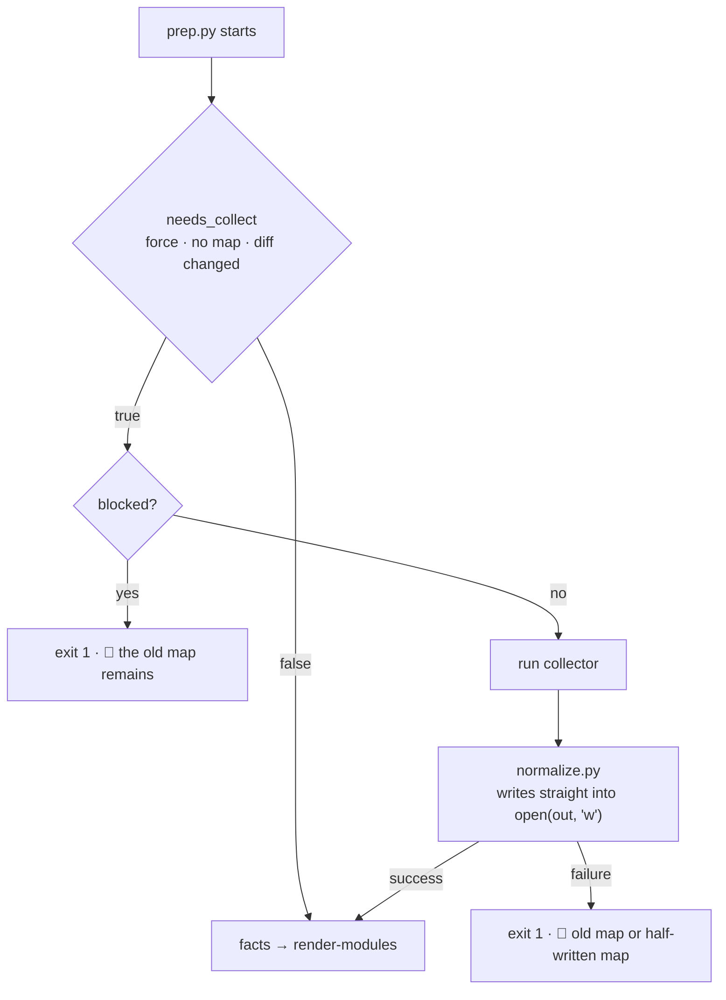
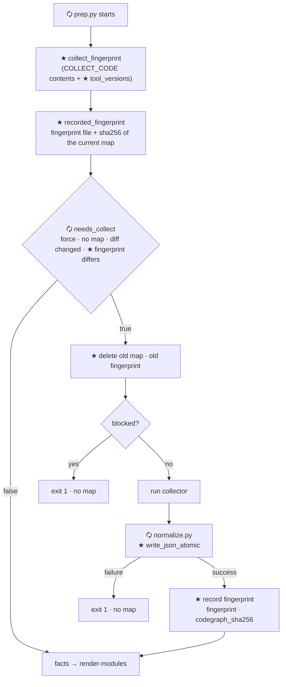
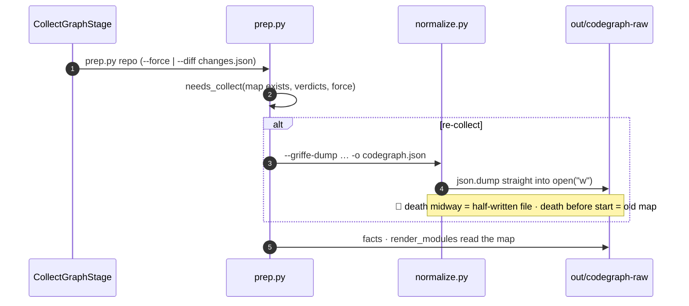
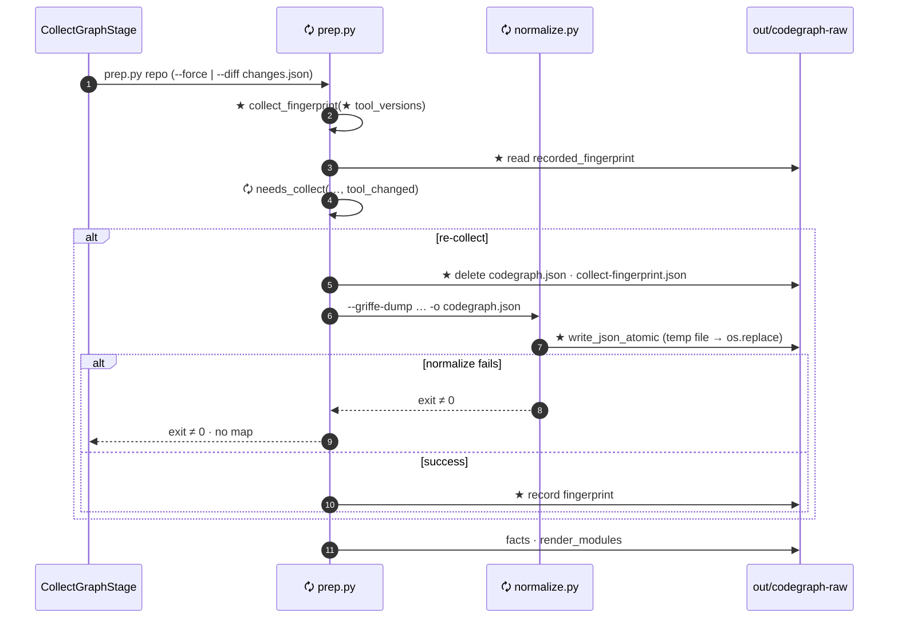
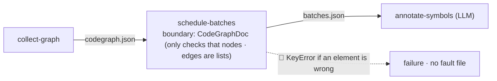
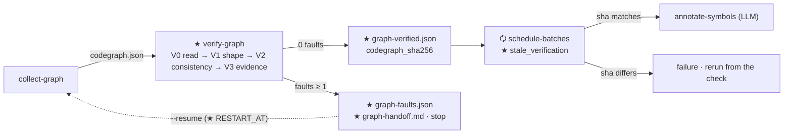
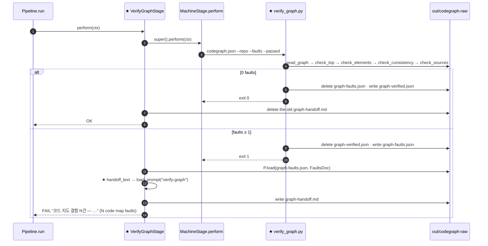
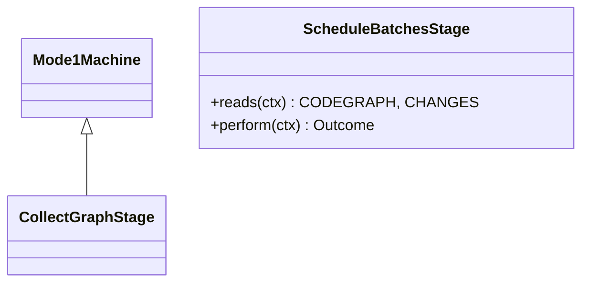
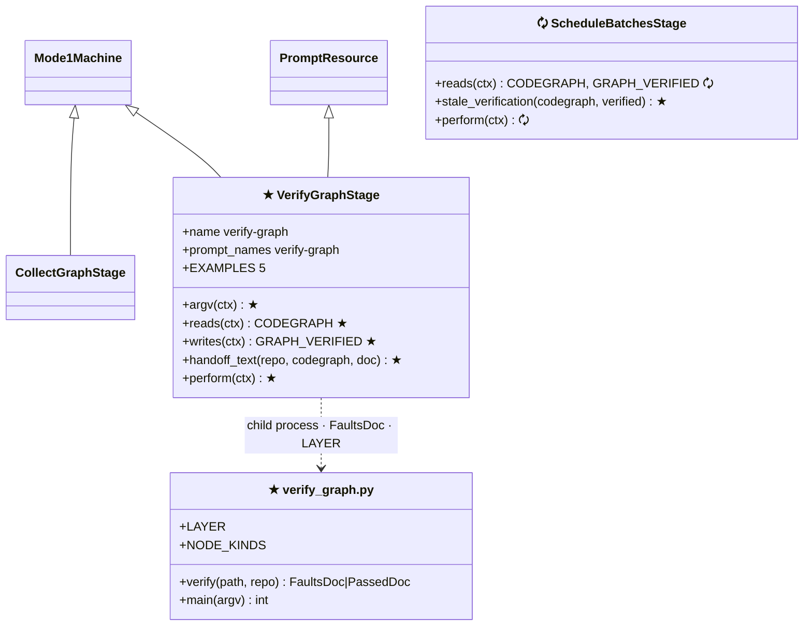

# 🧭 Code map verification · language unification — implementation plan (stages 1 · 2 in detail · stages 3~6 in outline)

> 📅 2026-11-05 · branch `main` · **Before = `86bd239`** (same as `origin/main`, nothing uncommitted — measured in this session)
> 📄 Sources: `public.handoff/2026-11-05-codegraph-verify-unify-resume-handoff.md` (hereafter "the handoff") · `public.handoff/언어 불문 코드 그래프 통일.md` · read in this session: `prep.py` · `normalize.py:470-509,1181-1239` · `resume.py` · `mode1/graph.py:16-32` · `mode1/wiki.py:186-198` · `test_mode1.py:146-158,694-707`
> 🔒 Rules to keep: no implementation before the design is confirmed (handoff §0) · TDD · if a `normalize.py` output key would change, stop and report · show any `codegraph_types.py` change first, then start · golden repositories are read-only · code comments describe only the current state · long text goes in `resource/` · commit only when the user asks
> 🧪 Verification: **implement → commit per Task, run the tests once at the end (Task 14), and on failure bisect with `git bisect`** (👍 user 2026-11-05) — the six gates + the new tests + a real run on this repository
> ✋ Approval: 👍 approved 2026-11-05

> **For agentic workers:** REQUIRED SUB-SKILL: execute Task by Task with `anthropic-skills:executing-plans`. Steps are tracked with checkboxes (`- [ ]`).

**Goal:** Keep a stale or broken <span style="color:cyan">code map</span> from flowing into the LLM stages — stage 1 covers the collection side (stale map · half-written map · collector changes), stage 2 the checking side (does the JSON open · required keys and types · is it internally consistent · source locations). Stages 3~6 (drop ledger · stable ids · calls · mixed languages) build on top of that.

**Architecture:** Stage 1 adds one <span style="color:cyan">atomic write</span> function to `normalize.py`, and three <span style="color:cyan">fingerprint</span> functions plus one constant to `prep.py`. Stage 2 adds the machine script ★ `verify_graph.py` (judgment only, four layers V0~V3) and the runner stage ★ `VerifyGraphStage` (between `collect-graph` and `schedule-batches`; on failure it leaves a fault JSON and a handoff, then stops). The check only **reads** the existing contract types, so it does not touch `codegraph_types.py`. The fingerprint and the success record are separate files outside the map (👍 Q1 · 👍 §4.3-1).

**Tech Stack:** Python 3.13 · pytest · pyright strict · msgspec 0.21.1 · Jinja2 (handoff template) · standard library `hashlib` · `tempfile` · `subprocess` (no new dependencies)

---

## 📋 One-page summary

| | |
|---|---|
| 🎯 Scope | Implements handoff checklist A~H in 6 stages. **Stage 1 (C2 · C4 · F2 · F3) and stage 2 (A1~A5 · F1) are written Task by Task**; stages 3~6 record only their entry decisions and outputs |
| 🧩 One-line conclusion | On the collection side: delete the old map first, write atomically, and re-collect when the <span style="color:cyan">fingerprint</span> differs. On the checking side: collect **all** faults through V0 read → V1 shape → V2 consistency → V3 evidence, and stop before the LLM stages if there is even one |
| 🟰 Unchanged | The shape and bytes of `codegraph.json` · `codegraph_types.py` · `CollectGraphStage` · the arguments of the `report-wiki prep` command |
| 🗘 Changed | The <span style="color:cyan">re-collect decision</span> and the write order in `prep.py` · the map write in `normalize.py` · stages 13 → **14** (`verify-graph`) · `schedule-batches` reads the success record · `--resume` reruns a check failure from `collect-graph` |
| ⚠️ Pitfalls | An existing repository with no fingerprint file **re-collects once on its first prep** · runner tests swap out the stage machine and do not spawn child processes → deletion and checking are tested by actually spawning the scripts · the `out/` map on this machine right now predates the pull, so V3 flags 78 faults (`[measured]` — catching a stale map is V3's job) |
| 🚫 Out of scope | C5 · C6 (recording failures inside collection · moving `facts` after the check) and the two ledger faults (`unknown-kind` · `collect-failed`) are stage 3 · tree-sitter is a stage 6 decision |

## 🗺️ The 6 stages at a glance

```text
Before (86bd239)                                 After · 제안
collect-graph ─┬─ prep.py                        collect-graph ─┬─ prep.py  🗘 지문 비교 · 옛 지도 삭제 · 지문 기록   (1)
               ├─ normalize.py  open("w")                       ├─ normalize.py 🗘 원자적 쓰기 · ★ 버림 장부        (1)(3)
               └─ facts · render_modules                        └─ (facts · render_modules 는 3단계에서 뒤로)
                                                 ★ verify-graph  V0 읽기 → V1 꼴 → V2 정합 → V3 근거                  (2)
                                                                 결함 → graph-faults.json · graph-handoff.md · 멈춤
                                                                 통과 → graph-verified.json (지도 sha256)
schedule-batches … LLM 단계                      schedule-batches 🗘 graph-verified.json 의 sha256 이 지금 지도와 같을 때만
C++/C#: 클래스만, 호출 없음                       ★ 메서드 노드 · 안정 id(4) → ★ 호출 간선(5) → 혼합 언어(6)
```

| 🧬 Stage | Checklist | Entry decision (❓) | Outputs |
|---|---|---|---|
| 1 Fingerprint · safe write | C2 · C4 · F2 · F3 | 👍 Q1 decided — entry open | fingerprint file · atomic map write |
| 2 **Map verification `verify-graph`** | A1~A5 · F1 | 👍 §4.3-1~4 decided — entry open | `graph-faults.json` · `graph-handoff.md` · `graph-verified.json` |
| 3 Drop ledger · crash removal · failures inside collection | B1~B4 · C1 · C3 · C5 · C6 · G1~G3 + fault codes `unknown-kind` · `collect-failed` | None (the §5.4 classification is fixed in the table as proposed) | `normalize-report.json` |
| 4 Stable ids · method promotion | D1 · E2 · E3 | §4.3-5 | `언어:한정이름(인자형)` (language:qualified-name(argument-types)) id |
| 5 Call collection | D2~D5 | §4.3-6 | C# · C++ call edges |
| 6 Mixed languages | E1 · E4~E6 · H1 | §4.3-7 · Q3 | `languages` · per-language merge |

## 🔎 Check layers — what `verify-graph` does (stage 2 · Tasks 7~13)

This plan has **two tiers** — stages 1 · 2 are detailed Task by Task, and stages 3~6 are an outline. In the first draft, map verification was a single line (A1~A5) in the stage 3 outline; by 👍 user decision it was pulled forward to stage 2 and detailed. The fault codes are the 21 kinds from handoff §7, divided into layers.

```text
codegraph.json
  │ V0 읽기   파일이 있나 · JSON 으로 열리나(괄호 · 따옴표 · 쉼표)        → unreadable
  │ V1 꼴     최상위 열쇠와 형 · 판 · 비었나                              → top-field · schema-version · language · empty-graph
  │           원소마다 필수 열쇠와 형 (Node · Edge · Module)              → node-shape · edge-shape · module-shape · node-kind
  │ V2 정합   id 겹침 · 끊긴 간선 · 외부 노드 규칙 · 모듈 목록과 의존      → duplicate-node · duplicate-edge · dangling-edge · external-node
  │                                                                       · external-source · external-constraint · first-party-location
  │                                                                       · module-list · module-dep
  │ V3 근거   파일이 저장소 안에 있나 · 실제로 있나 · 줄이 파일 안인가     → file-outside-repo · file-missing · line-out-of-range
  ▼
결함 0 → 성공 기록          결함 ≥ 1 → graph-faults.json + graph-handoff.md, schedule-batches 로 못 넘어간다
```

| Layer | Already exists `[code-checked]` | Missing 🐞 |
|---|---|---|
| V0 read | `pipeline.load` opens it with `msgspec.json.decode` (`src/core/pipeline.py:90-93`) | Broken JSON dies with an exception and leaves no fault file |
| V1 shape | The contract types `Node` · `Edge` · `Module` · `CodeGraph` already declare the required keys and types (`codegraph_types.py`; `Edge.kind` is an 8-value `Literal`) | The boundary's `CodeGraphDoc` sees `nodes` · `edges` only as `list[dict]` and does not open the elements — `{"nodes":[{"x":1}]}` passes (A1). msgspec stops at the first error (A3) |
| V2 consistency | None. Checked against this repository's map, all nine rules show 0 mismatches — 0 duplicate ids · dangling edges · edges leaving external nodes · first-party nodes without a location; all 126 edges going to external nodes are `constraint: false`; module list = the 7 modules used by nodes (`[measured]` 2026-11-05) — it is a safety net for stages 4~6, which will change the collectors · normalization | All of it |
| V3 evidence | None | All of it (A4). Against the `out/` map on this machine (built at `720fb3a`): 78 faults — 70 missing `split-work/` files (stale map: `89269d8` deleted `split-work/` afterwards) · 8 edges with line 0 (`[measured]`). ⚠️ Correction (2026-11-05, Task 14): the 8 are not line drift. griffe 2.2.0 gives the `__init__` it synthesizes for a dataclass `lineno` 0, and normalization copied it into the signature edges (`__init__(rows)` …) — 5 in `src/core/pipeline.py`, 3 in `src/codewiki/python/runner/mode1/context.py`. They stayed on a freshly collected map; fixed in `b85127b` (the field's line, else the class line). After that the fresh map passes with 0 faults |

Rule: call `msgspec.convert` separately for each element to collect **all** faults (A3). An element whose shape was wrong in an earlier layer is not complained about again in a later layer (no cascading faults, §7).
`[my judgment]` V1 only **reads** the existing contract types, so `codegraph_types.py` does not need to change. The `NodeKind` that handoff §7 wanted to add to that file is unnecessary if the list of allowed kinds lives in `verify_graph.py`.

## 📊 Status

| Item | Status |
|---|---|
| Investigation · measurement | ✅ completed by the session that wrote the handoff |
| This plan | ✅ 👍 approved 2026-11-05 |
| Stage 1 fingerprint · safe write | ✅ `5d9b10d` … `88d26fa` |
| Stage 2 map verification | ✅ `6e13465` … `fc91e73` · `3f1a663` (pyright fix found by bisect) · `b85127b` (line-0 fix) |
| Stages 3~6 | ❌ (each stage gets its own detailed plan once its entry decision is made) |

## ✅ Decided — not to be reopened

| What | 👍 chosen · 👎 rejected | Who · when |
|---|---|---|
| Verification placement | 👍 a verification stage between `collect-graph` and `schedule-batches`, inheriting from precedent | user · handoff §4.1 |
| Failure handling | 👍 do not die immediately; collect all errors, save them as JSON, and end before the LLM stages · 👍 a Success JSON if there is no problem | user · §4.1 |
| Bundling | 👍 bundle five problems (silent drops · death during collection · missing C++/C# calls · mixed languages · `--resume` after a fix) into this work | user · §4.1 |
| Contract change | 👎 the first implementation's `codegraph_types.py` edit (full rollback ordered) | user · 2026-11-04 |
| Starting the plan | 👍 write the plan from this handoff | user · 2026-11-05 |
| Q1 fingerprint location | 👍 a separate file `out/codegraph-raw/collect-fingerprint.json` (fingerprint + map sha256) · 👎 a top-level key inside the map (`codegraph_types.py` change) | user · 2026-11-05 |
| Q4 plan document location | 👍 English canonical `.md` + Korean translation `.ko.md` in `public.handoff/` · 👎 `docs/superpowers/plans/` · 👎 not keeping it in the repository | user · 2026-11-05 |
| Check order | 👍 pull the check (V0~V3) forward to right after stage 1 (stage 2) · 👎 check first of all · 👎 the handoff order (ledger → check) | user · 2026-11-05 |
| §4.3-1 success record | 👍 a separate file `out/codegraph-raw/graph-verified.json` (status · counts · language · collector · map sha256) · 👎 a `verification` field inside the map | user · 2026-11-05 |
| §4.3-2~4 | 👍 the handoff text is a template, no LLM · 👍 the agent that receives the handoff judges what cannot be fixed · 👍 `--only prep` runs through the check | user · 2026-11-05 |
| Q3 when to decide tree-sitter | 👍 decide in stage 6 (mixed languages) · 👎 decide now. The role itself (A~D) has no user decision yet — the "🌳 Q3" table below is a recommendation | user · 2026-11-05 |
| Execution · testing approach | 👍 implement in Task order and commit per Task · 👍 run the tests once when the plan is finished · 👍 on failure, find the culprit commit by bisecting, moving back and forth across commits · 👎 running tests per Task (TDD's fail/pass runs) · 👎 on failure, scanning back one commit at a time | user · 2026-11-05 |

## 🧪 Execution · testing guidelines (👍 user 2026-11-05)

1. **Implement in order Task 0 → 13; one Task is one commit.** Do not perform each Task's "see it fail · see it pass" runs — the commands and expected output written there remain as the expected values for reading the results in Task 14. Test code is **written** inside the Task (it goes into the same commit).
2. **Bisection is only meaningful if every commit is whole on its own.** A Task that changes a function signature or a docstring regenerates the README with `tools/gen_readme.py` in that same commit (so the README drift gate holds at every commit).
3. Commit messages follow the `personal-commit-messages` format. Push each commit to the working branch (so it survives if the cloud container is reclaimed). Ask about pushing to `origin main` after Task 14 passes.
4. **Task 14 — the final test** runs the six gates and the real runs. On failure, find the culprit commit with the bisection below and add the fix as a **new commit** (do not rewrite old commits). After fixing, rerun Task 14 from the start.

```bash
# 이분 탐색 — 좋은 끝은 Before(86bd239: pytest 875 통과), 나쁜 끝은 지금 HEAD
git bisect start HEAD 86bd239
git bisect run "$SCRATCH/bisect_test.sh" "<실패한 시험 node id 또는 게이트 이름>"
git bisect log            # 원인 커밋과 지나온 길
git bisect reset          # 작업 브랜치로 돌아온다
```

`$SCRATCH/bisect_test.sh` lives outside the repository (in the session scratchpad) — the script must stay in place while the search moves between commits:

```bash
#!/usr/bin/env bash
# 인자 하나: pytest node id(예: test/codewiki/test_verify_graph.py::test_…) 또는 게이트 이름(readme · pyright · npm-test · typecheck)
cd "$(git rev-parse --show-toplevel)" || exit 125
case "$1" in
  readme)    .venv/bin/python tools/gen_readme.py --check src/codewiki/python/runner src/codewiki/python/machine src/codewiki/python/viz src/term/python/runner src/spec/python/runner src/spec/python/viz src/core src/common tools; exit $? ;;
  pyright)   npm run --silent typecheck:py >/dev/null 2>&1; exit $? ;;
  npm-test)  npm test --silent >/dev/null 2>&1; exit $? ;;
  typecheck) npm run --silent typecheck >/dev/null 2>&1; exit $? ;;
esac
f="${1%%::*}"
[ -f "$f" ] || exit 0                     # 그 커밋에 시험 파일이 아직 없다 — 그 시험은 실패할 수 없다
.venv/bin/python -m pytest -q -x "$1" >/dev/null 2>&1
rc=$?
case $rc in
  0|5) exit 0 ;;                          # 통과, 또는 그 시험 함수가 아직 없다(수집 0)
  1)   exit 1 ;;                          # 실패 — 나쁜 커밋
  *)   exit 125 ;;                        # 판정 불가 — 이 커밋을 건너뛴다
esac
```

⚠️ The search moves only commits. The `out/` directory outside git (map · fingerprint · success record) stays as it is and affects real-data tests such as `test_이_저장소_지도는_V0_부터_V2_까지_지난다` — when that test is the culprit, rebuild the map with `report-wiki prep . --force` before the search.

---

# Stage 1 — tool fingerprint and safe write (C2 · C4 · F2 · F3)

## ★ New · 🗘 changed items (module → file → class → function → member)

Legend: **★ newly created · 🗘 changed/updated/refreshed · no marker = reused as is · ✕ deleted**

| Level | Kind | Name | Where it lives |
|---|---|---|---|
| Module | Not applicable | — | — |
| File | 🗘 changed | `src/codewiki/python/runner/wiki/prep.py` | Mode 1 runner |
| File | 🗘 changed | `src/codewiki/python/runner/wiki/paths.py` | Mode 1 runner |
| File | 🗘 changed | `src/codewiki/python/machine/normalize.py` | Mode 1 machine |
| File | ★ new | `test/codewiki/test_prep_fingerprint.py` | Tests |
| File | 🗘 changed | `test/codewiki/test_normalize.py` · `test/codewiki/test_mode1.py` | Tests |
| File | 🗘 refreshed | `src/codewiki/python/runner/README.md` · `src/codewiki/python/machine/README.md` (generated) · `resource/codewiki/terms-reading.json` · `src/codewiki/CLAUDE.md` · the handoff | Docs · records |
| File | ★ new (output) | `<저장소>/out/codegraph-raw/collect-fingerprint.json` | target repository `out/` (outside git) |
| Class | Not applicable | `CollectGraphStage` stays as is | — |
| Function | ★ new | `write_json_atomic` | `normalize.py` |
| Function | 🗘 changed | `main` (one map-write line) | `normalize.py` |
| Function | ★ new | `tool_versions` · `collect_fingerprint` · `recorded_fingerprint` | `prep.py` |
| Function | 🗘 changed | `needs_collect` (+`tool_changed`) · `prepPlan` (+`toolChanged`) · `__main__` block | `prep.py` |
| Function | 🗘 changed | `wikiPaths` (+`"fingerprint"`) | `paths.py` |
| Member | ★ new | `COLLECT_CODE` (module constant) | `prep.py` |
| Member | ★ new | `fingerprint` · `codegraph_sha256` (the two fields of the fingerprint file) | `collect-fingerprint.json` |

## 🔁 Before / After

| 📍 Before (what did not work · now) | 🛠️ After · proposal | 🎉 What it solves | 🔭 Expected | Progress |
|---|---|---|---|---|
| 🐞 Even when normalize dies, the old map remains (C2, measured in the handoff) | Once re-collection is decided (even if blocked), delete the old map · old fingerprint first | A stale map no longer reaches the LLM via `--only schedule-batches` | After a failed prep there is no `codegraph.json` | ✅ |
| 🐞 `normalize.py:1239` writes straight into `open(…,"w")` (C4) | ★ `write_json_atomic` — temp file in the same folder → `os.replace` | No half-written map even if interrupted midway | Same input, same bytes | ✅ |
| 🐞 If the sources are unchanged, fixing a collector does not trigger re-collection (F2, `prep.py:28-31`) | ★ add a fingerprint comparison to `needs_collect` | Rerunning after a collector fix produces a new map | When the fingerprint differs, `griffe`/`clang-uml`/`normalize` appear in the steps again | ✅ |
| 🐞 A commit hash misses uncommitted edits and external collector versions (F3) | fingerprint = sha256 of the **contents** of the `COLLECT_CODE` files + collector versions | Also catches uncommitted edits · griffe/clang-uml version changes | Changing a single byte changes the fingerprint | ✅ |

## 🌊 Flow — `prep.py`

**Before**



**After · proposal**



## 🔀 Sequence — one `collect-graph` run

**Before**



**After · proposal**



## 🧱 Structure — Before = After

Stage 1 creates or changes no classes. The `argv` · `reads` · `writes` of `CollectGraphStage` stay as they are (`mode1/graph.py:16-32`). The fingerprint file is not added to the stage machine's artifacts (`ARTIFACTS`) — the only stage that reads it is `prep.py`.

## 🔧 Where to change

| File · symbol | Change | Reason | Evidence |
|---|---|---|---|
| `normalize.py` `write_json_atomic` ★ · `main` 🗘 | The map write goes through a temp file → `os.replace` | C4 | `normalize.py:1239` · precedent `mode1/wiki.py:186-198` |
| `paths.py` `wikiPaths` 🗘 | `"fingerprint"` key | Keep the fingerprint file location in one place | `paths.py:5-13` |
| `prep.py` `COLLECT_CODE` ★ · `tool_versions` ★ · `collect_fingerprint` ★ · `recorded_fingerprint` ★ | Compute · read the fingerprint | F3 | the three flat imports at `normalize.py:15-18` |
| `prep.py` `needs_collect` 🗘 · `prepPlan` 🗘 | One argument with a default value each | F2. Existing positional-argument calls (`qa/gates/test_wiki.py:43-74`) keep working | `prep.py:21-53` |
| `prep.py` `__main__` 🗘 | Compare fingerprint → delete old map → collect → record fingerprint | C2 · F2 | `prep.py:115-199` |

## 📖 Terms

| Term | Code name | Meaning |
|---|---|---|
| <span style="color:cyan">code map</span> | `codegraph.json` | The nodes · edges · modules produced by normalization |
| <span style="color:cyan">collect stage</span> | `collect-graph` / `CollectGraphStage` | The runner stage that launches `prep.py` |
| <span style="color:cyan">normalization</span> | `normalize.py` | raw collector output → code map |
| <span style="color:cyan">re-collect decision</span> | `needs_collect` | Whether to run the collectors again |
| <span style="color:cyan">fingerprint</span> | `collect_fingerprint` | sha256 of the collection code's contents + the collector versions |
| <span style="color:cyan">collector versions</span> | `tool_versions` | griffe · clang-uml · clang-doc versions, the roslyn-dump output hash |
| <span style="color:cyan">fingerprint file</span> | `collect-fingerprint.json` | The fingerprint of the most recently built map and that map's sha256 |
| <span style="color:cyan">atomic write</span> | `write_json_atomic` | Write to a temp file in the same folder, then `os.replace` |

---

## Task 0: Put the plan document in the repository (👍 Q4)

- [ ] Start on a working branch (handoff §9 — if on `main`, branch first). Restart this session's working branch `claude/eager-pascal-xwevme` from `main` and use it. Push to that branch after every commit (🧪 guideline 3)
- [ ] Write the canonical version `public.handoff/2026-11-05-codegraph-verify-unify-plan.md`, an English translation of this document, and the Korean translation `public.handoff/2026-11-05-codegraph-verify-unify-plan.ko.md`, translated back from it. The translation gives the English term alongside only at its first occurrence (repository convention). Do not write machine-specific paths or secrets
- [ ] Add the two files as one line to the document index in handoff §3
- [ ] ⏭ The document citation gate (`qa/gates/test_docs_citations.py`) is checked in Task 14's full pytest run — do not run it now
- [ ] The nine Mermaid diagrams were confirmed to render on 2026-11-05. If a diagram was changed during translation, re-render it with `npx mmdc`
- [ ] Commit — `[docs] : 코드 지도 검증 계획 - 1, 2단계 상세와 3~6단계 개요`

## Task 1: Normalization writes the map atomically (C4)

**Files:**
- Modify: `src/codewiki/python/machine/normalize.py:10` (import), `:1239` (write), the new function goes right before `build_parser`
- Test: `test/codewiki/test_normalize.py` (append at the end)

- [ ] **Step 1: Write the failing test** — at the end of `test/codewiki/test_normalize.py`:

```python
def test_지도는_끊겨도_옛_파일을_지키고_임시_파일을_남기지_않는다(tmp_path: Path, monkeypatch: pytest.MonkeyPatch) -> None:
    path = str(tmp_path / "codegraph.json")
    N.write_json_atomic(path, {"v": 1})

    def boom(src: str, dst: str) -> None:
        raise KeyboardInterrupt
    monkeypatch.setattr(N.os, "replace", boom)
    with pytest.raises(KeyboardInterrupt):
        N.write_json_atomic(path, {"v": 2})
    assert json.loads((tmp_path / "codegraph.json").read_text(encoding="utf-8")) == {"v": 1}
    assert os.listdir(tmp_path) == ["codegraph.json"]


def test_지도_쓰기는_예전_json_dump_와_같은_바이트다(tmp_path: Path) -> None:
    g = {"이름": "값", "n": [1, 2]}
    path = tmp_path / "codegraph.json"
    N.write_json_atomic(str(path), g)
    assert path.read_text(encoding="utf-8") == json.dumps(g, ensure_ascii=False, indent=2)
```

- [ ] **Step 2: See it fail — ⏭ the run is deferred to Task 14 (below is the expected value)**

Run: `.venv/bin/python -m pytest test/codewiki/test_normalize.py -k "임시_파일 or 같은_바이트" -q`
Expected: FAIL — `AttributeError: module 'normalize' has no attribute 'write_json_atomic'`

- [ ] **Step 3: Minimal implementation** — change the import line at `normalize.py:10` and put the function before `build_parser` (**proposed diff**):

```diff
--- a/src/codewiki/python/machine/normalize.py
+++ b/src/codewiki/python/machine/normalize.py
@@
-import argparse, json, os, re, subprocess, sys
+import argparse, json, os, re, subprocess, sys, tempfile
@@
+def write_json_atomic(path: str, obj: object) -> None:
+    """JSON 을 같은 폴더의 임시 파일에 쓰고 `os.replace` 로 바꿔 끼운다. 도중에 끊겨도 옛 파일이 그대로 남는다."""
+    folder = os.path.dirname(os.path.abspath(path))
+    fd, tmp = tempfile.mkstemp(dir=folder, prefix="." + os.path.basename(path) + ".", suffix=".tmp")
+    try:
+        with os.fdopen(fd, "w", encoding="utf-8") as f:
+            json.dump(obj, f, ensure_ascii=False, indent=2)
+        os.replace(tmp, path)
+    except BaseException:
+        if os.path.exists(tmp):
+            os.unlink(tmp)
+        raise
+
+
 def build_parser() -> argparse.ArgumentParser:
@@ def main() -> None:
-    json.dump(g, open(a.out, "w", encoding="utf-8"), ensure_ascii=False, indent=2)
+    write_json_atomic(a.out, g)
```

- [ ] **Step 4: See it pass — ⏭ the run is deferred to Task 14 (below is the expected value)**

Run: `.venv/bin/python -m pytest test/codewiki/test_normalize.py test/codewiki/test_pycalls.py -q`
Expected: all PASS (some skipped if the golden variables are unset)

- [ ] **Step 5: Regenerate the README and commit** — `.venv/bin/python tools/gen_readme.py src/codewiki/python/machine` · `[fix] : codewiki - normalize 가 코드 지도를 임시 파일을 거쳐 바꿔 끼운다`

## Task 2: The re-collect decision takes a fingerprint difference (F2 wiring)

**Files:**
- Modify: `src/codewiki/python/runner/wiki/paths.py:5-13` · `src/codewiki/python/runner/wiki/prep.py:21-37`
- Test: `test/codewiki/test_mode1.py:146-158` (add lines to the existing test) · `qa/gates/test_wiki.py:17-22`

- [ ] **Step 1: Write the failing test** — two lines at the end of `test_prep_은_diff_에_바뀐_것이_있으면_다시_수집한다` in `test_mode1.py`, and one line at the end of `test_wiki_paths` in `qa/gates/test_wiki.py`:

```python
    assert prep.needs_collect(has_codegraph=True, verdicts=fresh, tool_changed=True) is True
    assert prep.prepPlan("griffe+pycalls", True, False, False, False, toolChanged=True)["steps"][0] == "griffe"
```

```python
    assert p["fingerprint"] == "/tmp/repo/out/codegraph-raw/collect-fingerprint.json"
```

- [ ] **Step 2: See it fail — ⏭ the run is deferred to Task 14 (below is the expected value)**

Run: `.venv/bin/python -m pytest test/codewiki/test_mode1.py qa/gates/test_wiki.py -k "diff_에_바뀐 or wiki_paths" -q`
Expected: FAIL — `TypeError: needs_collect() got an unexpected keyword argument 'tool_changed'` · `KeyError: 'fingerprint'`

- [ ] **Step 3: Minimal implementation** (**proposed diff**)

```diff
--- a/src/codewiki/python/runner/wiki/paths.py
+++ b/src/codewiki/python/runner/wiki/paths.py
@@ def wikiPaths(repo: str) -> dict[str, str]:
         "codegraph": os.path.join(raw, "codegraph.json"),
+        "fingerprint": os.path.join(raw, "collect-fingerprint.json"),
     }
--- a/src/codewiki/python/runner/wiki/prep.py
+++ b/src/codewiki/python/runner/wiki/prep.py
@@
 def needs_collect(has_codegraph: bool, verdicts: dict[str, list[str]] | None,
-                  force: bool = False) -> bool:
+                  force: bool = False, tool_changed: bool = False) -> bool:
     """수집기를 다시 돌릴 것인가.
 
-    `force` 면 무조건. diff 가 없으면 지금처럼 지도의 존재만 본다. diff 가 있으면
+    `force` 거나 수집 코드 · 수집기 판이 지도를 만들 때와 다르면(`tool_changed`) 무조건. diff 가 없으면 지도의 존재만 본다. diff 가 있으면
     `재읽기 · 위치만 · 삭제됨` 중 하나라도 있을 때 다시 수집한다 — 지도가 낡은 채 남는 것을 막는다.
     """
-    if force or not has_codegraph:
+    if force or tool_changed or not has_codegraph:
         return True
@@
 def prepPlan(collector: Optional[str], hasCodegraph: bool, hasClangUmlConfig: bool, hasRoslynDump: bool, hasClangDoc: bool,
-             verdicts: dict[str, list[str]] | None = None, force: bool = False) -> dict[str, Any]:
+             verdicts: dict[str, list[str]] | None = None, force: bool = False,
+             toolChanged: bool = False) -> dict[str, Any]:
     tail = ["facts", "render-modules"]
-    if not needs_collect(hasCodegraph, verdicts, force):
+    if not needs_collect(hasCodegraph, verdicts, force, toolChanged):
```

- [ ] **Step 4: See it pass — ⏭ the run is deferred to Task 14 (below is the expected value)** — the same command as Step 2. Expected: PASS
- [ ] **Step 5: Regenerate the README and commit** — `.venv/bin/python tools/gen_readme.py src/codewiki/python/runner` · `[feat] : codewiki - 재수집 판정이 수집 지문 차이를 받는다`

## Task 3: Compute and read the fingerprint (F3)

**Files:**
- Modify: `src/codewiki/python/runner/wiki/prep.py` (`hashlib` in the imports; a constant · three functions before `needs_collect`)
- Create: `test/codewiki/test_prep_fingerprint.py`

- [ ] **Step 1: Write the failing test** — new file `test/codewiki/test_prep_fingerprint.py`:

```python
"""`prep.py` 의 수집 지문 — 계산 · 읽기 · 재수집 · 실패한 수집 뒤의 정리."""
import ast
import hashlib
import json
import os
import subprocess
import sys
from pathlib import Path

ROOT = os.path.dirname(os.path.dirname(os.path.dirname(os.path.abspath(__file__))))
sys.path.insert(0, os.path.join(ROOT, "src"))
from codewiki.python.runner.wiki import prep  # noqa: E402

PREP = os.path.join(ROOT, "src", "codewiki", "python", "runner", "wiki", "prep.py")
MACHINE = Path(ROOT, "src", "codewiki", "python", "machine")


def test_지문은_normalize_가_import_하는_이_저장소_모듈을_전부_담는다() -> None:
    tree = ast.parse((MACHINE / "normalize.py").read_text(encoding="utf-8"))
    local: set[str] = set()
    for n in ast.walk(tree):
        if isinstance(n, ast.ImportFrom) and n.module and (MACHINE / f"{n.module}.py").exists():
            local.add(n.module)
        elif isinstance(n, ast.Import):
            local |= {a.name for a in n.names if (MACHINE / f"{a.name}.py").exists()}
    want = {f"src/codewiki/python/machine/{m}.py" for m in local | {"normalize"}}
    assert want <= set(prep.COLLECT_CODE)


def test_지문은_같은_입력이면_같고_수집기_판이_바뀌면_바뀐다() -> None:
    a = prep.collect_fingerprint(ROOT, {"griffe": "griffe 2.2.0"})
    assert a == prep.collect_fingerprint(ROOT, {"griffe": "griffe 2.2.0"})
    assert a != prep.collect_fingerprint(ROOT, {"griffe": "griffe 2.3.0"})


def test_지문은_커밋하지_않은_코드_수정도_잡는다(tmp_path: Path) -> None:
    for rel in prep.COLLECT_CODE:
        (tmp_path / rel).parent.mkdir(parents=True, exist_ok=True)
        (tmp_path / rel).write_bytes(Path(ROOT, rel).read_bytes())
    before = prep.collect_fingerprint(str(tmp_path), {})
    p = tmp_path / prep.COLLECT_CODE[0]
    p.write_bytes(p.read_bytes() + b"\n# x\n")
    assert prep.collect_fingerprint(str(tmp_path), {}) != before


def test_수집기_판은_griffe_면_판을_roslyn_이면_산출물_해시를_쓴다(tmp_path: Path) -> None:
    assert prep.tool_versions("griffe+pycalls", sys.executable, str(tmp_path), None)["griffe"].startswith("griffe ")
    assert prep.tool_versions("roslyn-dump", sys.executable, str(tmp_path), None) == {"roslyn-dump.json": "?"}
    (tmp_path / "roslyn-dump.json").write_bytes(b"{}")
    got = prep.tool_versions("roslyn-dump", sys.executable, str(tmp_path), None)
    assert got == {"roslyn-dump.json": hashlib.sha256(b"{}").hexdigest()}
    assert prep.tool_versions("clang-uml", sys.executable, str(tmp_path), None)["clang-uml"]


def test_기록된_지문은_지도가_그때의_지도일_때만_읽힌다(tmp_path: Path) -> None:
    cg, fp = tmp_path / "codegraph.json", tmp_path / "collect-fingerprint.json"
    cg.write_text('{"nodes": []}', encoding="utf-8")
    sha = hashlib.sha256(cg.read_bytes()).hexdigest()
    fp.write_text(json.dumps({"fingerprint": "f1", "codegraph_sha256": sha}), encoding="utf-8")
    assert prep.recorded_fingerprint(str(fp), str(cg)) == "f1"
    cg.write_text('{"nodes": [1]}', encoding="utf-8")
    assert prep.recorded_fingerprint(str(fp), str(cg)) is None
    fp.write_text("{깨짐", encoding="utf-8")
    assert prep.recorded_fingerprint(str(fp), str(cg)) is None
    assert prep.recorded_fingerprint(str(tmp_path / "없음.json"), str(cg)) is None
```

- [ ] **Step 2: See it fail — ⏭ the run is deferred to Task 14 (below is the expected value)**

Run: `.venv/bin/python -m pytest test/codewiki/test_prep_fingerprint.py -q`
Expected: FAIL — `AttributeError: module ... has no attribute 'COLLECT_CODE'` (all five)

- [ ] **Step 3: Minimal implementation** — `prep.py` (**proposed diff**). Add `hashlib` to the import lines and put the following before `needs_collect`:

```diff
--- a/src/codewiki/python/runner/wiki/prep.py
+++ b/src/codewiki/python/runner/wiki/prep.py
@@
 import argparse
+import hashlib
 import os
@@
 from typing import Any, Optional, cast
 
+# 수집 결과를 바꾸는 이 저장소의 코드. normalize.py 가 평평하게 import 하는 모듈은 전부 여기 있어야 한다
+# (test_prep_fingerprint.py 가 고정한다).
+COLLECT_CODE = (
+    "src/codewiki/python/machine/normalize.py",
+    "src/codewiki/python/machine/codegraph_types.py",
+    "src/codewiki/python/machine/clang_doc.py",
+    "src/codewiki/python/machine/pycalls.py",
+    "src/codewiki/python/runner/wiki/prep.py",
+)
+
+
+def tool_versions(collector: Optional[str], py: str, raw: str, clang_doc: Optional[str]) -> dict[str, str]:
+    """바깥 수집기의 판. `--version` 첫 줄을 쓰고 못 얻으면 `?` 다. roslyn-dump 는 prep 밖에서 돌므로 산출물의 내용 해시를 쓴다."""
+    def first_line(argv: list[str]) -> str:
+        try:
+            r = subprocess.run(argv, capture_output=True, text=True, timeout=60)
+        except (OSError, subprocess.SubprocessError):
+            return "?"
+        out = (r.stdout or r.stderr).strip().splitlines()
+        return out[0] if r.returncode == 0 and out else "?"
+    got: dict[str, str] = {}
+    if collector == "griffe+pycalls":
+        got["griffe"] = first_line([py, "-m", "griffe", "--version"])
+    elif collector == "clang-uml":
+        got["clang-uml"] = first_line(["clang-uml", "--version"])
+        if clang_doc:
+            got["clang-doc"] = first_line([clang_doc, "--version"])
+    elif collector == "roslyn-dump":
+        dump = os.path.join(raw, "roslyn-dump.json")
+        if os.path.exists(dump):
+            with open(dump, "rb") as f:
+                got["roslyn-dump.json"] = hashlib.sha256(f.read()).hexdigest()
+        else:
+            got["roslyn-dump.json"] = "?"
+    return got
+
+
+def collect_fingerprint(root: str, versions: dict[str, str]) -> str:
+    """수집 코드의 내용과 바깥 수집기 판을 합친 sha256. 커밋 해시가 아니라 내용이라 커밋 전 수정도 잡는다."""
+    h = hashlib.sha256()
+    for rel in COLLECT_CODE:
+        with open(os.path.join(root, rel), "rb") as f:
+            h.update(f"{rel}\0".encode())
+            h.update(hashlib.sha256(f.read()).digest())
+    for name in sorted(versions):
+        h.update(f"{name}={versions[name]}\0".encode())
+    return h.hexdigest()
+
+
+def recorded_fingerprint(path: str, codegraph: str) -> Optional[str]:
+    """기록된 지문. 기록이 없거나 깨졌거나 지금 지도가 기록할 때의 지도가 아니면 `None` 이다 — 셋 다 다시 수집하라는 뜻이다."""
+    try:
+        with open(path, encoding="utf-8") as f:
+            raw = cast(object, json.load(f))
+        with open(codegraph, "rb") as f:
+            now = hashlib.sha256(f.read()).hexdigest()
+    except (OSError, ValueError):
+        return None
+    if not isinstance(raw, dict):
+        return None
+    d = cast(dict[str, object], raw)
+    fp, sha = d.get("fingerprint"), d.get("codegraph_sha256")
+    return fp if isinstance(fp, str) and sha == now else None
+
+
 def needs_collect(has_codegraph: bool, verdicts: dict[str, list[str]] | None,
```

- [ ] **Step 4: See it pass — ⏭ the run is deferred to Task 14 (below is the expected value)** — the same command as Step 2. Expected: 5 passed
- [ ] **Step 5: Regenerate the README and commit** — `.venv/bin/python tools/gen_readme.py src/codewiki/python/runner` · `[feat] : codewiki - prep 이 수집 코드 내용과 수집기 판으로 지문을 만든다`

## Task 4: prep decides by fingerprint, deletes the old map before collecting, and records the fingerprint on success (C2 · F2)

**Files:**
- Modify: `src/codewiki/python/runner/wiki/prep.py:115-199` (the `__main__` block)
- Test: `test/codewiki/test_prep_fingerprint.py` (append at the end — actually spawns `prep.py` as a child process)

- [ ] **Step 1: Write the failing test**

```python
def _run(repo: Path, *extra: str) -> "subprocess.CompletedProcess[str]":
    return subprocess.run([sys.executable, PREP, str(repo), *extra], capture_output=True, text=True, timeout=300)


def _cs_repo(tmp_path: Path) -> Path:
    repo = tmp_path / "대상"
    (repo / "out" / "codegraph-raw").mkdir(parents=True)
    (repo / "App.csproj").write_text("<Project/>", encoding="utf-8")
    (repo / "out" / "codegraph-raw" / "codegraph.json").write_text('{"nodes": [], "edges": []}', encoding="utf-8")
    (repo / "out" / "codegraph-raw" / "collect-fingerprint.json").write_text("{}", encoding="utf-8")
    return repo


def test_정제가_실패하면_옛_지도와_옛_지문이_남지_않는다(tmp_path: Path) -> None:
    repo = _cs_repo(tmp_path)
    raw = repo / "out" / "codegraph-raw"
    (raw / "roslyn-dump.json").write_text("{", encoding="utf-8")
    got = _run(repo, "--force")
    assert got.returncode != 0
    assert not (raw / "codegraph.json").exists()
    assert not (raw / "collect-fingerprint.json").exists()


def test_수집이_막혀도_옛_지도가_남지_않는다(tmp_path: Path) -> None:
    repo = _cs_repo(tmp_path)
    got = _run(repo, "--force")
    assert got.returncode == 1 and "막힘" in got.stderr
    assert not (repo / "out" / "codegraph-raw" / "codegraph.json").exists()


def test_수집에_성공하면_지문을_남기고_지문이_다르면_다시_수집한다(tmp_path: Path) -> None:
    repo = tmp_path / "대상"
    (repo / "src" / "pkg").mkdir(parents=True)
    (repo / "requirements.txt").write_text("", encoding="utf-8")
    (repo / "src" / "pkg" / "__init__.py").write_text("", encoding="utf-8")
    (repo / "src" / "pkg" / "a.py").write_text("def f():\n    return g()\n\n\ndef g():\n    return 1\n", encoding="utf-8")
    subprocess.run(["git", "init", "-q"], cwd=repo, check=True)
    subprocess.run(["git", "add", "-A"], cwd=repo, check=True)
    raw = repo / "out" / "codegraph-raw"

    first = _run(repo)
    assert first.returncode == 0, first.stderr
    rec = json.loads((raw / "collect-fingerprint.json").read_text(encoding="utf-8"))
    assert rec["codegraph_sha256"] == hashlib.sha256((raw / "codegraph.json").read_bytes()).hexdigest()

    again = _run(repo)
    assert "단계 facts -> render-modules" in again.stdout

    rec["fingerprint"] = "옛 수집기"
    (raw / "collect-fingerprint.json").write_text(json.dumps(rec), encoding="utf-8")
    third = _run(repo)
    assert "단계 griffe -> pycalls -> normalize" in third.stdout
```

- [ ] **Step 2: See it fail — ⏭ the run is deferred to Task 14 (below is the expected value)**

Run: `.venv/bin/python -m pytest test/codewiki/test_prep_fingerprint.py -q`
Expected: the three new ones FAIL — the old `codegraph.json` remains · there is no `collect-fingerprint.json` (`FileNotFoundError`)

- [ ] **Step 3: Minimal implementation** — the `__main__` block (**proposed diff**)

```diff
--- a/src/codewiki/python/runner/wiki/prep.py
+++ b/src/codewiki/python/runner/wiki/prep.py
@@
     collector = fromSelect if fromSelect else collectorFor(os.listdir(repo))
     CLANG_DOC = clangDocPath() if collector == "clang-uml" else None
-    
+    fingerprint = collect_fingerprint(ROOT, tool_versions(collector, PY, P["raw"], CLANG_DOC))
+    recorded = recorded_fingerprint(P["fingerprint"], P["codegraph"])
+
     plan = prepPlan(
@@
         verdicts=verdicts,
         force=force,
+        toolChanged=recorded != fingerprint,
     )
@@
-    if plan["blocked"]:
+    # 다시 수집하기로 정했으면 막혔든 아니든 옛 지도와 옛 지문부터 지운다. 수집이 실패해도 낡은 지도가 뒤 단계로 가지 않는다.
+    if plan["blocked"] is not None or "normalize" in plan["steps"]:
+        for stale in (P["codegraph"], P["fingerprint"]):
+            if os.path.exists(stale):
+                os.remove(stale)
+
+    if plan["blocked"]:
         print(f"막힘 — {plan['blocked']}", file=sys.stderr)
         sys.exit(1)
@@
             run(PY, [os.path.join(ROOT, "src", "codewiki", "python", "machine", "normalize.py")] + arg + ["--repo", repo, "-o", P["codegraph"]])
+            # 끊겨 깨진 지문 파일은 recorded_fingerprint 가 None 으로 읽어 다음에 다시 수집한다.
+            with open(P["codegraph"], "rb") as g:
+                sha = hashlib.sha256(g.read()).hexdigest()
+            with open(P["fingerprint"], "w", encoding="utf-8") as f:
+                json.dump({"fingerprint": fingerprint, "codegraph_sha256": sha}, f, indent=1)
```

- [ ] **Step 4: See it pass — ⏭ the run is deferred to Task 14 (below is the expected value)** — `.venv/bin/python -m pytest test/codewiki/test_prep_fingerprint.py test/codewiki/test_mode1.py qa/gates/test_wiki.py -q` · Expected: PASS
- [ ] **Step 5: Regenerate the README and commit** — `.venv/bin/python tools/gen_readme.py src/codewiki/python/runner` · `[fix] : codewiki - prep 이 지문으로 재수집을 정하고 옛 지도와 지문을 먼저 지운다`

## Task 5: Bring the generated files · records · docs in line

**Files:**
- Regenerate: `src/codewiki/python/runner/README.md` · `src/codewiki/python/machine/README.md`
- Modify: `resource/codewiki/terms-reading.json` · `src/codewiki/CLAUDE.md` · the handoff §2 checklist

- [ ] **Step 1: Regenerate the READMEs** — `.venv/bin/python tools/gen_readme.py src/codewiki/python/runner src/codewiki/python/machine`
- [ ] **Step 2: Record lines and new records** — put the script below in the scratchpad and run it. It moves the `where` of the existing `prep.*` · `normalize.main` · `normalize.build_parser` records to the actual `def` lines, and adds records for the four new functions (`module` reuses the value of an existing record from the same file)

```python
import ast, json, pathlib
R = pathlib.Path("resource/codewiki/terms-reading.json")
recs = json.loads(R.read_text(encoding="utf-8"))
FILES = {"codewiki.python.runner.wiki.prep": "src/codewiki/python/runner/wiki/prep.py",
         "codewiki.python.machine.normalize": "src/codewiki/python/machine/normalize.py"}
NEW = {
  "codewiki.python.runner.wiki.prep.tool_versions": ("바깥 수집기의 판을 모으는 함수.", "collector 에 따라 griffe · clang-uml · clang-doc 의 `--version` 첫 줄을, roslyn-dump 면 roslyn-dump.json 의 sha256 을 담은 dict 를 낸다. 판을 못 얻으면 `?` 다."),
  "codewiki.python.runner.wiki.prep.collect_fingerprint": ("수집 코드와 수집기 판을 한 값으로 줄인 지문을 만드는 함수.", "COLLECT_CODE 의 파일마다 경로와 내용 sha256 을, 이어서 수집기 판을 이름순으로 하나의 sha256 에 넣어 16진 문자열로 낸다."),
  "codewiki.python.runner.wiki.prep.recorded_fingerprint": ("마지막으로 만든 지도의 지문을 읽는 함수.", "collect-fingerprint.json 의 fingerprint 를 내되, 파일이 없거나 깨졌거나 codegraph_sha256 이 지금 codegraph.json 의 sha256 과 다르면 None 을 낸다."),
  "codewiki.python.machine.normalize.write_json_atomic": ("JSON 을 반쪽 파일 없이 쓰는 함수.", "같은 폴더에 mkstemp 로 임시 파일을 만들어 json.dump(ensure_ascii=False, indent=2) 하고 os.replace 로 바꿔 끼운다. 도중 예외면 임시 파일을 지우고 다시 던진다."),
}
for key, (means, does) in NEW.items():
    mod = key.rsplit(".", 1)[0]
    sibling = next(v for k, v in recs.items() if k.startswith(mod + "."))
    recs[key] = {"confidence": "HIGH", "does": does, "kind": "function", "means": means,
                 "module": sibling["module"], "source": "reading", "uses": [], "where": FILES[mod] + ":1"}
for mod, rel in FILES.items():
    defs = {n.name: n.lineno for n in ast.walk(ast.parse(pathlib.Path(rel).read_text(encoding="utf-8")))
            if isinstance(n, ast.FunctionDef)}
    for k, v in recs.items():
        name = k.removeprefix(mod + ".")
        if k.startswith(mod + ".") and name in defs:
            v["where"] = f"{rel}:{defs[name]}"
R.write_text(json.dumps(recs, ensure_ascii=False, indent=1) + "\n", encoding="utf-8")
```

  ⚠️ Before running, check with `git diff --stat resource/codewiki/terms-reading.json` that it matches the original indentation · trailing newline. If it differs, adjust the `json.dumps` arguments to the original shape (the diff should be a few record lines).

- [ ] **Step 3: Record check — ⏭ deferred to Task 14 (below is the expected value)** — `.venv/bin/python src/codewiki/python/machine/terms_db.py out/codegraph-raw/codegraph.json --repo . --reading resource/codewiki/terms-reading.json -o "$(mktemp -d)"` · Expected: 0 failures in the `prep.*` · `normalize.*` records, and the total failure count does not rise above the baseline
- [ ] **Step 4: One line in "비직관적인 것" (Gotchas) of `src/codewiki/CLAUDE.md`**

```markdown
- **Note — `out/codegraph-raw/collect-fingerprint.json` 이 재수집을 정한다.** 수집 코드(`prep.py` 의 `COLLECT_CODE`) 내용과 수집기 판의 지문이 다르거나 지도가 그 지문을 쓸 때의 지도가 아니면, 소스가 그대로여도 `prep` 이 다시 수집한다. 다시 수집하기로 하면 옛 지도와 지문부터 지우고, 지도는 임시 파일을 거쳐 바꿔 끼운다(`normalize.write_json_atomic`).
```

- [ ] **Step 5: Handoff §2** — change C2 · C4 · F2 · F3 to `[x]` with the commit hash, and append `(3단계로 옮김 — verify-graph 가 생긴 뒤에야 시험할 수 있다)` (moved to stage 3 — it can only be tested once verify-graph exists) to the end of the F1 line
- [ ] **Step 6: Commit** — `[docs] : codewiki - 수집 지문과 원자적 지도 쓰기 설명, 레코드, 핸드오프 1단계 표시`

## Task 6: Stage 1 real run — ⏭ moved to Task 14

The three real runs of stage 1 (re-collect once when there is no fingerprint → only `facts -> render-modules` when it matches → re-collect after editing `pycalls.py`) are in Task 14 Step 3. This Task has no commit.

---

# Stage 2 — map verification `verify-graph` (A1~A5 · F1)

The check layers are exactly as in the "🔎 Check layers" table above — **V0 read → V1 shape → V2 consistency → V3 evidence**. This section turns them into code · stages · tests.

## ★ New · 🗘 changed items (module → file → class → function → member)

| Level | Kind | Name | Where it lives |
|---|---|---|---|
| Module | Not applicable | — | — |
| File | ★ new | `src/codewiki/python/machine/verify_graph.py` | Mode 1 machine — judgment only, no prose |
| File | ★ new | `resource/codewiki/prompts/verify-graph.md` | Handoff template (Jinja2) — checked by the resource gate |
| File | ★ new | `test/codewiki/test_verify_graph.py` | Tests |
| File | 🗘 changed | `src/codewiki/python/runner/mode1/graph.py` · `context.py` · `edges.py` · `src/codewiki/python/runner/run_mode1.py` | Mode 1 runner |
| File | 🗘 changed | `test/codewiki/test_mode1.py` · `test/codewiki/test_run_mode1.py` | Tests |
| File | 🗘 refreshed | runner · machine `README.md` (generated) · `resource/codewiki/terms-reading.json` · `src/codewiki/CLAUDE.md` · the `run_mode1.py` docstring · the handoff | Docs · records |
| File | ★ new (output) | `out/codegraph-raw/graph-verified.json` · `graph-faults.json` · `graph-handoff.md` | target repository `out/` (outside git) |
| Class | ★ new | `Fault` · `FaultsDoc` · `PassedDoc` (TypedDict) · `Elements` (dataclass) | `verify_graph.py` |
| Class | ★ new | `VerifyGraphStage(P.PromptResource, Mode1Machine)` | `mode1/graph.py` |
| Class | ★ new | `GraphVerifiedDoc` (TypedDict — the two fields the boundary looks at) | `mode1/context.py` |
| Class | 🗘 changed | `ScheduleBatchesStage` (`reads` · `perform`) | `mode1/graph.py` |
| Function | ★ new | `fault` · `read_graph` · `check_top` · `check_elements` · `check_consistency` · `check_sources` · `verify` · `main` · `_items` · `_line_count` · `_text` · `_replace` | `verify_graph.py` |
| Function | ★ new | `VerifyGraphStage.argv` · `reads` · `writes` · `handoff_text` · `perform` · `ScheduleBatchesStage.stale_verification` | `mode1/graph.py` |
| Function | ★ new | `restart_from` | `mode1/edges.py` |
| Function | 🗘 changed | `main` (the resume start stage) | `run_mode1.py` |
| Member | ★ new | `LAYER` · `NODE_KINDS` · `LANGUAGES` · `EXTERNAL_MODULE` · `TOP` · `ELEMENTS` | `verify_graph.py` |
| Member | ★ new | `GRAPH_VERIFIED` · `GRAPH_FAULTS` · `GRAPH_HANDOFF` · `RESTART_AT` · `VerifyGraphStage.EXAMPLES` | `context.py` · `edges.py` · `graph.py` |
| Member | 🗘 changed | `ORDER` (13 → 14) · `STAGES` · `ALIASES["prep"]` · `ARTIFACTS` (+`GRAPH_VERIFIED`) | `edges.py` · `context.py` |

## 🔁 Before / After

| 📍 Before (what did not work · now) | 🛠️ After · proposal | 🎉 What it solves | 🔭 Expected | Progress |
|---|---|---|---|---|
| 🐞 Broken JSON dies with an exception and there is no fault file | V0 records `unreadable` down to the line · column | You know immediately where a bracket · comma is wrong | `{"nodes": [` → `1줄 …칸` (line 1 … column) | ✅ |
| 🐞 `{"nodes":[{"x":1}]}` passes the boundary and hits a `KeyError` in `survey_plan` (A1) | V1 tries converting each element to `Node` · `Edge` · `Module` | Elements missing required keys · types are caught before the LLM | One fault per element, all of them (A3) | ✅ |
| 🐞 Version 1 · an empty map pass (A2) | `schema-version` · `empty-graph` | A plan with 0 symbols does not succeed | Both are faults | ✅ |
| 🐞 Nothing looks at inconsistencies inside the map | V2's nine rules | Breakage is noticed immediately when normalization is changed in stages 4~6 | 0 faults on this repository's map | ✅ |
| 🐞 Source locations are not checked (A4) | V3 — inside the repository · exists · line range | A stale map does not reach the LLM | Stale map 78 faults · fresh map 0 after `b85127b` | ✅ |
| 🐞 There is no place to reuse a pass record (A5) | On a pass, `graph-verified.json` (map sha256), which `schedule-batches` compares | If the map changes after the check, no batches are scheduled | FAIL if the sha differs | ✅ |
| 🐞 `--resume` simply reruns the failed stage (F1) | `RESTART_AT = {"verify-graph": "collect-graph"}` | The check runs after the fixed collector · normalization has gone into the map | Resume starts from `collect-graph` | ✅ |

## 🌊 Flow — the map segment of Mode 1

**Before**



**After · proposal**



## 🔀 Sequence — one `verify-graph` run

**Before** — this stage does not exist (no diagram).

**After · proposal**



## 🧱 Structure

**Before**



**After · proposal**



## 🔧 Where to change

| File · symbol | Change | Reason | Evidence |
|---|---|---|---|
| ★ `verify_graph.py` | Four-layer check · result files | A1~A4 | handoff §7 · `Node` · `Edge` · `Module` · `CodeGraph` in `codegraph_types.py` |
| ★ `prompts/verify-graph.md` | Handoff text | 👍 §4.3-2 template | gate `qa/gates/test_prompt_resources.py:75-76,115-142` — file name = stage name |
| `mode1/context.py` ★ `GraphVerifiedDoc` · `GRAPH_*` · 🗘 `ARTIFACTS` | Three artifacts | The artifact chain · `existing()` for `--only` | `context.py:294,325` |
| `mode1/graph.py` ★ `VerifyGraphStage` | Machine stage + handoff on failure | Precedents: a non-LLM stage that has a prompt, `AskStage(P.PromptResource, P.Stage)` (`run_mode1_5.py:682-692`) · wrapping `super().perform()` (`terms.py:43`) | `pipeline.py:396-420` |
| `mode1/graph.py` 🗘 `ScheduleBatchesStage` | `GRAPH_VERIFIED` in `reads` · sha comparison at the start | A5. An unchecked map raises `GraphError` at artifact chain ⑤ | `graph.py:43,88-90` · `pipeline.py:310-313` |
| `mode1/edges.py` 🗘 `ORDER` · `STAGES` · `ALIASES` · ★ `RESTART_AT` · `restart_from` | Insert the stage · restart point | F1. Going back via an edge would be a cycle, hence `GraphError` (`pipeline.py:257-260`) — so it is kept as a table. Putting it in `resume.py` would be a circular import | `edges.py:16-41` |
| `run_mode1.py` 🗘 `main` | `start = restart_from(start_stage(…))` | F1. `failed_at` itself is not changed (the stop notice · `mark_superseded` use the actual failed stage) | `run_mode1.py:183,222-224` |

## 📖 Terms (stage 2)

| Term | Code name | Meaning |
|---|---|---|
| <span style="color:cyan">map verification</span> | `verify-graph` / `VerifyGraphStage` | The stage between `collect-graph` and `schedule-batches` |
| <span style="color:cyan">verifier</span> | `verify_graph.py` | The machine script that runs the four layers and collects the faults |
| <span style="color:cyan">fault</span> | `Fault` | `{code, at, detail}` — `at` is a JSON path |
| <span style="color:cyan">fault file</span> | `graph-faults.json` / `FaultsDoc` | Exists only when there are faults |
| <span style="color:cyan">success record</span> | `graph-verified.json` / `PassedDoc` | The sha256 and counts of a map that passed |
| <span style="color:cyan">verification handoff</span> | `graph-handoff.md` / `handoff_text` | Text for the person · agent who takes over the faults |
| <span style="color:cyan">restart point</span> | `RESTART_AT` / `restart_from` | The stage to restart from instead of the failed stage |

---

## Task 7: Verifier skeleton — the fault table and V0 read

**Files:**
- Create: `src/codewiki/python/machine/verify_graph.py`
- Create: `test/codewiki/test_verify_graph.py`

- [ ] **Step 1: Write the failing test** — `test/codewiki/test_verify_graph.py`:

```python
"""`verify_graph.py` 의 네 층 — 읽기 · 꼴 · 정합 · 근거 — 와 결과 파일."""
import hashlib
import json
import os
import sys
from pathlib import Path

import pytest

ROOT = os.path.dirname(os.path.dirname(os.path.dirname(os.path.abspath(__file__))))
sys.path[:0] = [os.path.join(ROOT, "src"), os.path.join(ROOT, "src", "codewiki", "python", "machine")]
import verify_graph as V  # noqa: E402

Obj = dict[str, object]
EXT: Obj = {"id": "X:std", "name": "(표준) stdlib", "kind": "external", "module": "__external__",
            "file": None, "line": None}


def _node(nid: str, kind: str = "function", module: str | None = "pkg",
          file: str | None = "a.py", line: int | None = 1) -> Obj:
    return {"id": nid, "name": "pkg.a." + nid, "kind": kind, "module": module, "file": file, "line": line}


def _edge(src: str, dst: str, **extra: object) -> Obj:
    return {"from": src, "to": dst, "kind": "dependency", "label": None, "file": "a.py", "line": 2, **extra}


def _graph(nodes: list[Obj] | None = None, edges: list[Obj] | None = None,
           modules: list[Obj] | None = None, **top: object) -> Obj:
    g: Obj = {"schema_version": 2, "language": "python", "platform": "linux",
              "source_tool": "griffe 2.2.0", "repo_commit": None,
              "nodes": nodes if nodes is not None else [_node("C1"), _node("C2", line=3), EXT],
              "edges": edges if edges is not None else [_edge("C1", "C2"),
                                                        _edge("C2", "X:std", line=3, constraint=False)],
              "modules": modules if modules is not None else [{"id": "pkg", "depends_on": []}]}
    g.update(top)
    return g


def _codes(faults: list[V.Fault]) -> list[str]:
    return [f["code"] for f in faults]


def test_표는_네_층_스물한_코드다() -> None:
    assert len(V.LAYER) == 21
    assert sorted(set(V.LAYER.values())) == ["V0 읽기", "V1 꼴", "V2 정합", "V3 근거"]
    with pytest.raises(KeyError):
        V.fault("없는-코드", "$", "")


def test_V0_없는_파일과_깨진_JSON_을_결함으로_낸다(tmp_path: Path) -> None:
    doc, _, faults = V.read_graph(str(tmp_path / "없음.json"))
    assert doc is None and _codes(faults) == ["unreadable"]
    p = tmp_path / "codegraph.json"
    p.write_text('{"nodes": [', encoding="utf-8")
    doc, sha, faults = V.read_graph(str(p))
    assert doc is None and _codes(faults) == ["unreadable"] and "1줄" in faults[0]["detail"]
    assert sha == hashlib.sha256(p.read_bytes()).hexdigest()
```

- [ ] **Step 2: See it fail — ⏭ the run is deferred to Task 14 (below is the expected value)** — `.venv/bin/python -m pytest test/codewiki/test_verify_graph.py -q` · Expected: `ModuleNotFoundError: No module named 'verify_graph'`
- [ ] **Step 3: Minimal implementation** — the head of `verify_graph.py` (**proposal · new file**):

```python
#!/usr/bin/env python3
"""verify_graph.py — codegraph.json 을 읽기 · 꼴 · 정합 · 근거 네 층으로 검사해 결함을 전부 모은다.

    python3 verify_graph.py <codegraph.json> --faults <graph-faults.json> --passed <graph-verified.json> [--repo <저장소>]

결함이 없으면 `--faults` 를 지우고 `--passed` 를 쓴다(종료 0). 결함이 있으면 `--passed` 를 지우고 `--faults` 를 쓴다(종료 1).
`--repo` 가 없으면 근거 층(V3)을 건너뛴다. 시각을 적지 않아 같은 입력이면 같은 바이트다.
"""
import argparse
import hashlib
import json
import os
import sys
from collections import Counter
from collections.abc import Sequence
from dataclasses import dataclass
from typing import Literal, TypedDict, cast, get_type_hints

import msgspec

from codegraph_types import CodeGraph, Edge, Module, Node

# 결함 코드 -> 층. 표와 코드가 1대1이다(test_verify_graph.py 가 고정한다).
LAYER: dict[str, str] = {
    "unreadable": "V0 읽기",
    "top-field": "V1 꼴", "schema-version": "V1 꼴", "language": "V1 꼴", "empty-graph": "V1 꼴",
    "node-shape": "V1 꼴", "edge-shape": "V1 꼴", "module-shape": "V1 꼴", "node-kind": "V1 꼴",
    "duplicate-node": "V2 정합", "duplicate-edge": "V2 정합", "dangling-edge": "V2 정합",
    "external-node": "V2 정합", "external-source": "V2 정합", "external-constraint": "V2 정합",
    "first-party-location": "V2 정합", "module-list": "V2 정합", "module-dep": "V2 정합",
    "file-outside-repo": "V3 근거", "file-missing": "V3 근거", "line-out-of-range": "V3 근거",
}
# 노드의 kind. runner 의 RecordKind 안에 있어야 한다(test_mode1.py 가 대조한다).
NODE_KINDS = frozenset({"function", "method", "class", "struct", "enum", "interface", "delegate", "record", "external"})
LANGUAGES = frozenset({"cpp", "csharp", "python"})
EXTERNAL_MODULE = "__external__"
TOP = get_type_hints(CodeGraph)
ELEMENTS = ("nodes", "edges", "modules")


class Fault(TypedDict):
    """결함 하나. `at` 은 JSON 경로(`$.nodes[3].kind`)다."""
    code: str
    at: str
    detail: str


class FaultsDoc(TypedDict):
    """`graph-faults.json` — 결함이 있을 때만 있다."""
    status: Literal["failed"]
    language: str | None
    source_tool: str | None
    repo_commit: str | None
    total: int
    counts: dict[str, int]
    faults: list[Fault]


class PassedDoc(TypedDict):
    """`graph-verified.json` — 검사를 지난 지도의 기록. `codegraph_sha256` 이 그 지도 한 벌에만 묶는다."""
    status: Literal["passed"]
    language: str
    source_tool: str
    repo_commit: str | None
    nodes: int
    edges: int
    modules: int
    codegraph_sha256: str


def fault(code: str, at: str, detail: str) -> Fault:
    """결함 하나를 만든다. 표에 없는 코드는 `KeyError` 다."""
    if code not in LAYER:
        raise KeyError(code)
    return {"code": code, "at": at, "detail": detail}


def read_graph(path: str) -> tuple[object, str, list[Fault]]:
    """V0 읽기 — 파일을 열어 JSON 으로 푼다. (문서, 바이트의 sha256, 결함) 을 낸다. 못 열거나 못 풀면 문서는 `None` 이다."""
    try:
        with open(path, "rb") as f:
            raw = f.read()
    except OSError as e:
        return None, "", [fault("unreadable", "$", "파일을 못 연다: %s" % (e.strerror or e))]
    sha = hashlib.sha256(raw).hexdigest()
    try:
        return json.loads(raw.decode("utf-8")), sha, []
    except UnicodeDecodeError as e:
        return None, sha, [fault("unreadable", "$", "UTF-8 이 아니다 — %d바이트째" % e.start)]
    except json.JSONDecodeError as e:
        return None, sha, [fault("unreadable", "$", "JSON 이 아니다 — %d줄 %d칸: %s" % (e.lineno, e.colno, e.msg))]
```

- [ ] **Step 4: See it pass — ⏭ the run is deferred to Task 14 (below is the expected value)** — the same command · Expected: 2 passed
- [ ] **Step 5: Regenerate the README and commit** — `.venv/bin/python tools/gen_readme.py src/codewiki/python/machine` · `[feat] : codewiki - 코드 지도 검사기 뼈대와 V0 읽기`

## Task 8: V1 shape — top level and elements, collect them all

**Files:** Modify `verify_graph.py` · Test `test_verify_graph.py`

- [ ] **Step 1: The failing test**

```python
def _check(g: Obj) -> list[V.Fault]:
    """V1 · V2 를 한 번에 — 근거 층 없이."""
    el, faults = V.check_elements(g)
    return V.check_top(g) + faults + V.check_consistency(el)


def test_온전한_지도는_결함이_없다() -> None:
    assert _check(_graph()) == []


def test_V1_최상위의_열쇠_판_언어_빈_지도() -> None:
    g = _graph(nodes=[], schema_version=1, language="rust")
    del g["source_tool"]
    assert sorted(_codes(V.check_top(g))) == ["empty-graph", "language", "schema-version", "top-field"]
    assert _codes(V.check_top([])) == ["top-field"]


def test_V1_원소의_꼴은_첫_오류에서_멈추지_않고_전부_모은다() -> None:
    g = _graph(nodes=[_node("C1"), _node("C2", line=3), EXT, {"name": "id 없음"}, _node("C9", kind="macro")],
               edges=[_edge("C1", "C2"), _edge("C2", "X:std", line=3, constraint=False),
                      _edge("C1", "C2", kind="calls")],
               modules=[{"id": "pkg", "depends_on": []}, {"id": "m"}])
    _, faults = V.check_elements(g)
    assert _codes(faults) == ["node-shape", "node-kind", "edge-shape", "module-shape"]
    assert [f["at"] for f in faults] == ["$.nodes[3]", "$.nodes[4].kind", "$.edges[2]", "$.modules[1]"]
```

- [ ] **Step 2: See it fail — ⏭ the run is deferred to Task 14 (below is the expected value)** — Expected: `AttributeError: … 'check_elements'`
- [ ] **Step 3: Minimal implementation** (**proposed diff** — add after `read_graph`)

```python
@dataclass
class Elements:
    """V1 을 지난 원소(원래 자리 번호와 함께)와, 꼴이 틀려 뒤 층이 빼야 하는 것의 흔적."""
    nodes: list[tuple[int, Node]]
    edges: list[tuple[int, Edge]]
    modules: list[tuple[int, Module]]
    bad_node_ids: set[str]
    bad_node_without_id: bool
    bad_module: bool


def check_top(doc: object) -> list[Fault]:
    """V1 꼴(최상위) — 계약 `CodeGraph` 의 열쇠가 다 있고 형이 맞는가 · 판이 2인가 · 아는 언어인가 · 노드가 있는가.

    `nodes` · `edges` · `modules` 는 목록인지만 본다. 원소는 `check_elements` 가 본다.
    """
    if not isinstance(doc, dict):
        return [fault("top-field", "$", "최상위가 객체가 아니라 %s 다" % type(doc).__name__)]
    d = cast(dict[str, object], doc)
    out: list[Fault] = []
    for key, t in TOP.items():
        if key not in d:
            out.append(fault("top-field", "$.%s" % key, "필수 열쇠가 없다"))
            continue
        try:
            msgspec.convert(d[key], list if key in ELEMENTS else t)
        except msgspec.ValidationError as e:
            out.append(fault("top-field", "$.%s" % key, str(e)))
    version, language, nodes = d.get("schema_version"), d.get("language"), d.get("nodes")
    if isinstance(version, int) and version != 2:
        out.append(fault("schema-version", "$.schema_version", "판이 %d 다 — 2 여야 한다" % version))
    if isinstance(language, str) and language not in LANGUAGES:
        out.append(fault("language", "$.language", "모르는 언어 %r" % language))
    if isinstance(nodes, list) and not nodes:
        out.append(fault("empty-graph", "$.nodes", "노드가 하나도 없다"))
    return out


def _items(d: dict[str, object], key: str) -> list[object]:
    """`d[key]` 가 목록이면 그것을, 아니면 빈 목록을 낸다 — 목록이 아닌 것은 `check_top` 이 이미 셌다."""
    v = d.get(key)
    return cast(list[object], v) if isinstance(v, list) else []


def check_elements(d: dict[str, object]) -> tuple[Elements, list[Fault]]:
    """V1 꼴(원소) — 원소마다 따로 계약 형(`Node` · `Edge` · `Module`)으로 바꿔 본다. 첫 오류에서 멈추지 않고 전부 모은다."""
    out: list[Fault] = []
    el = Elements([], [], [], set(), False, False)
    for i, raw in enumerate(_items(d, "nodes")):
        try:
            n = msgspec.convert(raw, Node)
        except msgspec.ValidationError as e:
            out.append(fault("node-shape", "$.nodes[%d]" % i, str(e)))
            nid = cast(dict[str, object], raw).get("id") if isinstance(raw, dict) else None
            if isinstance(nid, str):
                el.bad_node_ids.add(nid)
            else:
                el.bad_node_without_id = True
            continue
        if n["kind"] not in NODE_KINDS:
            out.append(fault("node-kind", "$.nodes[%d].kind" % i, "모르는 kind %r" % n["kind"]))
        el.nodes.append((i, n))
    for i, raw in enumerate(_items(d, "edges")):
        try:
            el.edges.append((i, msgspec.convert(raw, Edge)))
        except msgspec.ValidationError as e:
            out.append(fault("edge-shape", "$.edges[%d]" % i, str(e)))
    for i, raw in enumerate(_items(d, "modules")):
        try:
            el.modules.append((i, msgspec.convert(raw, Module)))
        except msgspec.ValidationError as e:
            out.append(fault("module-shape", "$.modules[%d]" % i, str(e)))
            el.bad_module = True
    return el, out
```

- [ ] **Step 4: See it pass — ⏭ the run is deferred to Task 14 (below is the expected value)** — `test_온전한_지도는_결함이_없다` waits for Task 9's `check_consistency`. In this Task, only `-k "V1"` is expected to PASS: `.venv/bin/python -m pytest test/codewiki/test_verify_graph.py -k V1 -q`
- [ ] **Step 5: Regenerate the README and commit** — `.venv/bin/python tools/gen_readme.py src/codewiki/python/machine` · `[feat] : codewiki - 검사기 V1 꼴, 최상위와 원소의 결함을 전부 모은다`

## Task 9: V2 consistency — nine rules and preventing cascading faults

**Files:** Modify `verify_graph.py` · Test `test_verify_graph.py`

- [ ] **Step 1: The failing test**

```python
def test_V2_아홉_규칙이_저마다_결함을_낸다() -> None:
    g = _graph(nodes=[_node("C1"), _node("C1"), EXT,
                      _node("X:bad", kind="external", module="pkg", file=None, line=None),
                      _node("C3", file=None)],
               edges=[_edge("C1", "C9"), _edge("X:std", "C1"), _edge("C1", "X:std"),
                      _edge("C1", "C3"), _edge("C1", "C3")],
               modules=[{"id": "pkg", "depends_on": ["pkg", "zzz"]}, {"id": "ghost", "depends_on": []}])
    assert sorted(set(_codes(_check(g)))) == sorted([
        "duplicate-node", "external-node", "first-party-location", "dangling-edge", "external-source",
        "external-constraint", "duplicate-edge", "module-list", "module-dep"])


def test_V2_는_꼴이_틀린_노드_때문에_끊김을_만들지_않는다() -> None:
    with_id = _graph(nodes=[_node("C1"), {"id": "C2", "name": 1}, EXT])
    assert _codes(_check(with_id)) == ["node-shape"]
    without_id = _graph(nodes=[_node("C1"), {"name": 1}, EXT],
                        edges=[_edge("C1", "C7"), _edge("C1", "X:std", constraint=False)])
    assert _codes(_check(without_id)) == ["node-shape"]
```

- [ ] **Step 2: See it fail — ⏭ the run is deferred to Task 14 (below is the expected value)** — Expected: `AttributeError: … 'check_consistency'`
- [ ] **Step 3: Minimal implementation** (**proposed diff** — after `check_elements`)

```python
def check_consistency(el: Elements) -> list[Fault]:
    """V2 정합 — id 가 겹치지 않고, 간선이 있는 노드를 잇고, 외부 노드 규칙(R4 · R6)과 모듈 목록이 맞는가.

    V1 에서 꼴이 틀린 원소 때문에 생기는 끊김 · 목록 차이는 세지 않는다.
    """
    out: list[Fault] = []
    kind_of: dict[str, str] = {}
    for i, n in el.nodes:
        at = "$.nodes[%d]" % i
        if n["id"] in kind_of:
            out.append(fault("duplicate-node", at + ".id", "id %r 가 앞에도 있다" % n["id"]))
        kind_of[n["id"]] = n["kind"]
        external = n["kind"] == "external"
        if external != (n["module"] == EXTERNAL_MODULE) or (external and (n["file"] is not None or n["line"] is not None)):
            out.append(fault("external-node", at, "외부 노드는 kind external · module %s · 위치 없음이 함께여야 한다"
                             % EXTERNAL_MODULE))
        elif not external and (n["file"] is None or n["line"] is None):
            out.append(fault("first-party-location", at, "1차 노드 %r 에 file 이나 line 이 없다" % n["id"]))
    known = set(kind_of) | el.bad_node_ids
    seen: set[tuple[str, str, str]] = set()
    for i, e in el.edges:
        at = "$.edges[%d]" % i
        ends = [x for x in (e["from"], e["to"]) if x not in known]
        if ends and not el.bad_node_without_id:
            out.append(fault("dangling-edge", at, "없는 노드 %s 를 잇는다" % ", ".join(repr(x) for x in ends)))
        if kind_of.get(e["from"]) == "external":
            out.append(fault("external-source", at, "외부 노드 %r 에서 나가는 간선이다(R4)" % e["from"]))
        if kind_of.get(e["to"]) == "external" and e.get("constraint") is not False:
            out.append(fault("external-constraint", at, "외부로 가는 간선은 constraint false 여야 한다(R6)"))
        key = (e["from"], e["to"], e["kind"])
        if key in seen:
            out.append(fault("duplicate-edge", at, "같은 (from, to, kind) 가 앞에도 있다"))
        seen.add(key)
    if not (el.bad_node_ids or el.bad_node_without_id or el.bad_module):
        listed = [m["id"] for _, m in el.modules]
        used = {n["module"] for _, n in el.nodes if n["kind"] != "external" and n["module"]}
        for m in sorted(used - set(listed)):
            out.append(fault("module-list", "$.modules", "노드의 모듈 %r 이 목록에 없다" % m))
        for m in sorted(set(listed) - used):
            out.append(fault("module-list", "$.modules", "목록의 모듈 %r 을 쓰는 노드가 없다" % m))
        for m in sorted({x for x in listed if listed.count(x) > 1}):
            out.append(fault("module-list", "$.modules", "모듈 %r 이 두 번 있다" % m))
    ids = {m["id"] for _, m in el.modules}
    for i, m in el.modules:
        for dep in m["depends_on"]:
            if dep == m["id"]:
                out.append(fault("module-dep", "$.modules[%d].depends_on" % i, "%r 은 자기 자신이다" % dep))
            elif dep not in ids:
                out.append(fault("module-dep", "$.modules[%d].depends_on" % i, "%r 은 목록에 없는 모듈이다" % dep))
    return out
```

- [ ] **Step 4: See it pass — ⏭ the run is deferred to Task 14 (below is the expected value)** — `.venv/bin/python -m pytest test/codewiki/test_verify_graph.py -q` · Expected: 7 passed
- [ ] **Step 5: Regenerate the README and commit** — `.venv/bin/python tools/gen_readme.py src/codewiki/python/machine` · `[feat] : codewiki - 검사기 V2 정합 아홉 규칙과 연쇄 결함 막기`

## Task 10: V3 evidence · result files · the real map

**Files:** Modify `verify_graph.py` · Test `test_verify_graph.py` · `test/codewiki/test_run_mode1.py`

- [ ] **Step 1: The failing test** — at the end of `test_verify_graph.py`, and next to `test_얼갈이_스크립트가_자식_프로세스로_import_까지_간다` in `test_run_mode1.py`:

```python
def test_V3_저장소_밖_없는_파일_줄_넘침(tmp_path: Path) -> None:
    (tmp_path / "a.py").write_text("x = 1\ny = 2\nz = 3\n", encoding="utf-8")
    g = _graph(nodes=[_node("C1"), _node("C2", line=9), _node("C3", file="없음.py"),
                      _node("C4", file="../밖.py"), _node("C5", file="/etc/passwd")],
               edges=[_edge("C1", "C2", line=0)], modules=[{"id": "pkg", "depends_on": []}])
    el, _ = V.check_elements(g)
    assert _codes(V.check_sources(el, str(tmp_path))) == [
        "line-out-of-range", "file-missing", "file-outside-repo", "file-outside-repo", "line-out-of-range"]


def test_결과_파일은_한쪽만_남고_통과는_같은_바이트다(tmp_path: Path) -> None:
    (tmp_path / "a.py").write_text("def f():\n    return g()\ndef g():\n    return 1\n", encoding="utf-8")
    cg, faults, passed = tmp_path / "codegraph.json", tmp_path / "graph-faults.json", tmp_path / "graph-verified.json"
    cg.write_text(json.dumps(_graph()), encoding="utf-8")
    argv = [str(cg), "--repo", str(tmp_path), "--faults", str(faults), "--passed", str(passed)]
    assert V.main(argv) == 0
    first = passed.read_bytes()
    assert V.main(argv) == 0 and passed.read_bytes() == first and not faults.exists()
    assert json.loads(first)["codegraph_sha256"] == hashlib.sha256(cg.read_bytes()).hexdigest()
    cg.write_text("{", encoding="utf-8")
    assert V.main(argv) == 1 and not passed.exists()
    assert json.loads(faults.read_text(encoding="utf-8"))["counts"] == {"unreadable": 1}


REAL = os.path.join(ROOT, "out", "codegraph-raw", "codegraph.json")


@pytest.mark.skipif(not os.path.exists(REAL), reason="out/codegraph-raw/codegraph.json 이 없다")
def test_이_저장소_지도는_V0_부터_V2_까지_지난다() -> None:
    got = V.verify(REAL, None)
    assert got["status"] == "passed", got
```

```python
def test_검사기_스크립트가_자식_프로세스로_뜬다() -> None:
    import subprocess

    root = os.path.dirname(os.path.dirname(os.path.dirname(os.path.abspath(__file__))))
    p = os.path.join(root, "src", "codewiki", "python", "machine", "verify_graph.py")
    got = subprocess.run([sys.executable, p, "--help"], capture_output=True, text=True, timeout=60)
    assert got.returncode == 0, got.stderr
```

- [ ] **Step 2: See it fail — ⏭ the run is deferred to Task 14 (below is the expected value)** — Expected: `AttributeError: … 'check_sources'` · `--help` fails because there is no `main`
- [ ] **Step 3: Minimal implementation** (**proposed diff** — after `check_consistency`, at the end of the file)

```python
def _line_count(path: str) -> int | None:
    """파일의 줄 수. 일반 파일이 아니거나 못 열면 `None`."""
    if not os.path.isfile(path):
        return None
    try:
        with open(path, "rb") as f:
            return sum(1 for _ in f)
    except OSError:
        return None


def check_sources(el: Elements, repo: str) -> list[Fault]:
    """V3 근거 — 노드와 간선의 `file` 이 저장소 안의 실제 파일이고 `line` 이 1 이상 그 파일 끝 이하인가."""
    out: list[Fault] = []
    root = os.path.realpath(repo)
    count: dict[str, int | None] = {}
    places = ([("$.nodes[%d]" % i, n["file"], n["line"]) for i, n in el.nodes]
              + [("$.edges[%d]" % i, e["file"], e["line"]) for i, e in el.edges])
    for at, file, line in places:
        if file is None:
            continue
        full = os.path.realpath(os.path.join(root, file))
        if os.path.isabs(file) or os.path.commonpath([root, full]) != root:
            out.append(fault("file-outside-repo", at + ".file", "저장소 밖 경로 %r" % file))
            continue
        if file not in count:
            count[file] = _line_count(full)
        n = count[file]
        if n is None:
            out.append(fault("file-missing", at + ".file", "파일이 없다: %s" % file))
        elif line is not None and not 1 <= line <= n:
            out.append(fault("line-out-of-range", at + ".line", "%d줄 — %s 는 %d줄이다" % (line, file, n)))
    return out


def _text(d: dict[str, object] | None, key: str) -> str | None:
    """`d[key]` 가 문자열이면 그것을, 아니면 `None`."""
    v = d.get(key) if d is not None else None
    return v if isinstance(v, str) else None


def verify(path: str, repo: str | None) -> FaultsDoc | PassedDoc:
    """네 층을 차례로 돌려 결과 문서 하나를 낸다. 앞 층이 열지 못한 것은 뒤 층이 보지 않는다."""
    doc, sha, faults = read_graph(path)
    if not faults:
        faults = check_top(doc)
    d = cast(dict[str, object], doc) if isinstance(doc, dict) else None
    el: Elements | None = None
    if d is not None:
        el, more = check_elements(d)
        faults = faults + more + check_consistency(el)
        if repo is not None:
            faults = faults + check_sources(el, repo)
    if faults or d is None or el is None:
        counts = Counter(f["code"] for f in faults)
        return {"status": "failed", "language": _text(d, "language"), "source_tool": _text(d, "source_tool"),
                "repo_commit": _text(d, "repo_commit"), "total": len(faults),
                "counts": dict(sorted(counts.items())), "faults": faults}
    return {"status": "passed", "language": cast(str, d["language"]), "source_tool": cast(str, d["source_tool"]),
            "repo_commit": _text(d, "repo_commit"), "nodes": len(el.nodes), "edges": len(el.edges),
            "modules": len(el.modules), "codegraph_sha256": sha}


def _replace(keep: str, drop: str, doc: FaultsDoc | PassedDoc) -> None:
    """다른 쪽 결과 파일을 먼저 지우고 이쪽을 쓴다 — 도중에 끊겨도 두 파일이 함께 남지 않는다."""
    if os.path.exists(drop):
        os.remove(drop)
    os.makedirs(os.path.dirname(os.path.abspath(keep)), exist_ok=True)
    with open(keep, "w", encoding="utf-8") as f:
        json.dump(doc, f, ensure_ascii=False, indent=1)
        f.write("\n")


def main(argv: Sequence[str] | None = None) -> int:
    """`verify` 를 돌려 결과 파일 하나를 쓰고 다른 하나를 지운다. 통과면 0, 결함이면 1."""
    ap = argparse.ArgumentParser(description=(__doc__ or "").split("\n")[0])
    ap.add_argument("codegraph", help="검사할 codegraph.json")
    ap.add_argument("--repo", default=None, help="근거 층(V3)의 기준 저장소. 없으면 V3 를 건너뛴다")
    ap.add_argument("--faults", required=True, help="결함이 있으면 쓰는 graph-faults.json")
    ap.add_argument("--passed", required=True, help="통과하면 쓰는 graph-verified.json")
    a = ap.parse_args(argv)
    got = verify(a.codegraph, a.repo)
    if got["status"] == "passed":
        _replace(a.passed, a.faults, got)
        print("%s — 통과 · 노드 %d · 간선 %d · 모듈 %d" % (a.passed, got["nodes"], got["edges"], got["modules"]))
        return 0
    _replace(a.faults, a.passed, got)
    print("%s — 결함 %d건 · %s" % (a.faults, got["total"], " · ".join("%s %d" % kv for kv in got["counts"].items())),
          file=sys.stderr)
    return 1


if __name__ == "__main__":
    sys.exit(main())
```

- [ ] **Step 4: See it pass — ⏭ the run is deferred to Task 14 (below is the expected value)** — `.venv/bin/python -m pytest test/codewiki/test_verify_graph.py test/codewiki/test_run_mode1.py -q` · `npm run typecheck:py` · Expected: PASS · 0 errors
- [ ] **Step 5: Regenerate the README and commit** — `.venv/bin/python tools/gen_readme.py src/codewiki/python/machine` · `[feat] : codewiki - 검사기 V3 근거와 결과 파일, 명령줄`

## Task 11: The `verify-graph` stage · the handoff template · the `schedule-batches` comparison

**Files:**
- Create: `resource/codewiki/prompts/verify-graph.md`
- Modify: `src/codewiki/python/runner/mode1/context.py` · `src/codewiki/python/runner/mode1/graph.py`
- Test: `test/codewiki/test_mode1.py`

- [ ] **Step 1: The failing test** — in `test_mode1.py`, `import verify_graph as V` (next to the import lines at the top) and:

```python
def test_검사기의_kind_는_RecordKind_안에_있다() -> None:
    assert V.NODE_KINDS <= set(get_args(X.RecordKind))


def test_지도_검사_단계는_실패하면_핸드오프를_남기고_통과하면_지운다(tmp_path: Path) -> None:
    ctx = X.Mode1Context(root=ROOT, model="m", repo=str(tmp_path))
    raw = Path(X.raw_dir(ctx))
    raw.mkdir(parents=True)
    (raw / "codegraph.json").write_text("{", encoding="utf-8")
    st = G.VerifyGraphStage()
    out = st.perform(ctx)
    handoff = Path(X.GRAPH_HANDOFF.locate(ctx))
    assert out.kind == P.FAIL and "결함 1건" in out.why
    text = handoff.read_text(encoding="utf-8")
    assert "unreadable" in text and "검사를 완화해 통과시키지 말라" in text
    (tmp_path / "a.py").write_text("def f():\n    return 1\n", encoding="utf-8")
    good = {"schema_version": 2, "language": "python", "platform": "linux", "source_tool": "t",
            "repo_commit": None, "edges": [], "modules": [{"id": "a", "depends_on": []}],
            "nodes": [{"id": "C1", "name": "a.f", "kind": "function", "module": "a", "file": "a.py", "line": 1}]}
    (raw / "codegraph.json").write_text(json.dumps(good), encoding="utf-8")
    assert st.perform(ctx).kind == P.OK
    assert not handoff.exists() and not Path(X.GRAPH_FAULTS.locate(ctx)).exists()
    assert Path(X.GRAPH_VERIFIED.locate(ctx)).exists()


def test_핸드오프는_코드별로_많은_순이고_예시는_다섯까지() -> None:
    faults: list[V.Fault] = ([{"code": "dangling-edge", "at": "$.edges[%d]" % i, "detail": "d"} for i in range(7)]
                             + [{"code": "unreadable", "at": "$", "detail": "u"}])
    doc: V.FaultsDoc = {"status": "failed", "language": "python", "source_tool": "t", "repo_commit": None,
                        "total": 8, "counts": {"dangling-edge": 7, "unreadable": 1}, "faults": faults}
    text = G.VerifyGraphStage.handoff_text("/r", "/r/out/codegraph-raw/codegraph.json", doc)
    assert text.index("dangling-edge") < text.index("unreadable")
    assert "$.edges[4]" in text and "$.edges[5]" not in text


def test_성공_기록이_지금_지도의_것이_아니면_배치를_짜지_않는다(tmp_path: Path) -> None:
    cg, ok = tmp_path / "codegraph.json", tmp_path / "graph-verified.json"
    cg.write_bytes(b'{"nodes": []}')
    ok.write_text(json.dumps({"status": "passed", "codegraph_sha256": hashlib.sha256(b'{"nodes": []}').hexdigest()}),
                  encoding="utf-8")
    assert G.ScheduleBatchesStage.stale_verification(str(cg), str(ok)) == ""
    cg.write_bytes(b'{"nodes": [1]}')
    assert "바뀌었다" in G.ScheduleBatchesStage.stale_verification(str(cg), str(ok))
```

- [ ] **Step 2: See it fail — ⏭ the run is deferred to Task 14 (below is the expected value)** — `.venv/bin/python -m pytest test/codewiki/test_mode1.py -k "검사 or 핸드오프 or 성공_기록" -q` · Expected: `AttributeError: … 'VerifyGraphStage'` and similar
- [ ] **Step 3: Handoff template** — new file `resource/codewiki/prompts/verify-graph.md` (no section markers → a single name `"verify-graph"`. No trailing whitespace · no `{#`):

~~~~markdown
# 코드 지도 검사 실패 — 이어받기

- 대상 `{{ repo }}`
- 지도 `{{ codegraph }}`
- 언어 `{{ language }}` · 수집기 `{{ source_tool }}` · 커밋 `{{ repo_commit }}`
- 결함 {{ total }}건. 전부는 같은 폴더의 `graph-faults.json` 에 있다.

**검사를 완화해 통과시키지 말라.** 결함은 지도를 만든 쪽(수집기 · 정제)을 고쳐서 없앤다. `verify_graph.py` 의 규칙은 그 규칙이 틀렸다는 근거가 있을 때만 바꾸고, 그 근거를 끝의 "해결 불가" 양식으로 남긴다.

## 결함 — 많은 순


### `{{ g.code }}` · {{ g.layer }} · {{ g.count }}건

- `{{ f.at }}` — {{ f.detail }}



## 층마다 볼 곳

- **V0 읽기** — 지도 파일이 없거나 JSON 이 아니다. `collect-graph` 가 끝까지 돌았는지, 정제가 도중에 죽지 않았는지 본다.
- **V1 꼴** — 정제가 계약(`src/codewiki/python/machine/codegraph_types.py`)의 필수 열쇠나 형을 빠뜨렸다. 그 언어의 `normalize_*` 와 `_assemble` 을 본다.
- **V2 정합** — 지도 안에서 서로 어긋난다(겹친 id · 끊긴 간선 · 외부 노드 규칙 · 모듈 목록). 정제의 접기 규칙 R1~R7 을 본다.
- **V3 근거** — 노드 · 간선의 `file:line` 이 지금 저장소와 맞지 않는다. 지도가 낡았으면 다시 수집하면 사라진다.

## 보강 후보

1. 수집 보강 — 수집기가 그 정보를 내게 한다
2. 정제 보강 — 수집기 원본에는 있는데 정제가 버리거나 틀리게 옮긴다
3. 슈퍼셋 스키마 — 언어마다 다른 칸을 공통 계약에 선택 칸으로 더한다(계약 변경이라 사용자 승인이 먼저다)
4. 언어별 외래키 — 언어 전용 정보를 별도 파일에 두고 지도에서는 id 로만 가리킨다

## 다시 재기

```bash
.venv/bin/python src/codewiki/python/runner/run_mode1.py {{ repo }} --resume
```

`--resume` 은 `collect-graph` 부터 다시 돈다 — 고친 수집기 · 정제가 지도에 들어간 뒤 검사한다.

## 해결 불가

고쳐서 없앨 수 없는지는 기계가 아니라 이 글을 받은 에이전트가 판정한다. 그렇다면 아래를 채운 새 핸드오프를 남긴다.

- 결함 코드와 예시
- 수집 · 정제로 고칠 수 없는 까닭(근거 `file:line`)
- 대안 — 검사 규칙을 바꿀 근거, 또는 이 언어의 지도를 읽는 파이프라인을 따로 구체화하는 안
~~~~

- [ ] **Step 4: Three artifacts** — `context.py` (**proposed diff** — the type after `CodeGraphDoc`, the artifacts after `CODEGRAPH`, and one more at the end of `ARTIFACTS`)

```diff
+class GraphVerifiedDoc(TypedDict):
+    """`graph-verified.json` 의 두 칸 — 단계 경계는 이것만 본다. 전체 꼴은 `verify_graph.PassedDoc` 다."""
+    status: Literal["passed"]
+    codegraph_sha256: str
@@
+GRAPH_VERIFIED = P.Artifact[Mode1Context](
+    "graph-verified.json", lambda c: os.path.join(raw_dir(c), "graph-verified.json"), GraphVerifiedDoc)
+GRAPH_FAULTS = P.Artifact[Mode1Context](
+    "graph-faults.json", lambda c: os.path.join(raw_dir(c), "graph-faults.json"))
+GRAPH_HANDOFF = P.Artifact[Mode1Context](
+    "graph-handoff.md", lambda c: os.path.join(raw_dir(c), "graph-handoff.md"))
@@
-ARTIFACTS = [LANG_SELECT, CODEGRAPH, SNAPSHOT, CHANGES, BATCHES, FILE_PRIORITY, UNRESOLVED, DROPPED,
+ARTIFACTS = [LANG_SELECT, CODEGRAPH, GRAPH_VERIFIED, SNAPSHOT, CHANGES, BATCHES, FILE_PRIORITY, UNRESOLVED, DROPPED,
```

  (The remaining elements of `ARTIFACTS` stay as they are. If a test pins the count, change it to 17.)

- [ ] **Step 5: The stage** — `graph.py` (**proposed diff**). Add `hashlib` · `import verify_graph` to the imports, put the class after `CollectGraphStage`, and change two places in `ScheduleBatchesStage`:

```python
class VerifyGraphStage(P.PromptResource, Mode1Machine):
    """코드 지도를 LLM 단계 앞에서 검사한다. 결함이 있으면 결함 JSON 옆에 핸드오프를 남기고 멈춘다."""
    name = "verify-graph"
    prompt_dir = X.PROMPT_DIR
    prompt_names = ("verify-graph",)
    EXAMPLES = 5

    def argv(self, ctx: Mode1Context) -> list[str]:
        return [sys.executable, os.path.join(ctx.root, "src", "codewiki", "python", "machine", "verify_graph.py"),
                X.CODEGRAPH.locate(ctx), "--repo", ctx.repo,
                "--faults", X.GRAPH_FAULTS.locate(ctx), "--passed", X.GRAPH_VERIFIED.locate(ctx)]

    def reads(self, ctx: Mode1Context) -> list[P.Artifact[Mode1Context]]:
        return [X.CODEGRAPH]

    def writes(self, ctx: Mode1Context) -> list[P.Artifact[Mode1Context]]:
        return [X.GRAPH_VERIFIED]

    @classmethod
    def handoff_text(cls, repo: str, codegraph: str, doc: verify_graph.FaultsDoc) -> str:
        """결함 문서를 이어받을 핸드오프 글로. 코드별로 묶어 많은 순, 예시는 `EXAMPLES` 개까지."""
        groups: list[dict[str, object]] = []
        for code, n in sorted(doc["counts"].items(), key=lambda kv: (-kv[1], kv[0])):
            groups.append({"code": code, "layer": verify_graph.LAYER[code], "count": n,
                           "examples": [f for f in doc["faults"] if f["code"] == code][:cls.EXAMPLES]})
        return cls.load_prompt("verify-graph", repo=repo, codegraph=codegraph,
                               language=doc["language"] or "?", source_tool=doc["source_tool"] or "?",
                               repo_commit=doc["repo_commit"] or "?", total=doc["total"], groups=groups)

    def perform(self, ctx: Mode1Context) -> P.Outcome:
        out = super().perform(ctx)
        handoff = X.GRAPH_HANDOFF.locate(ctx)
        if out.kind == P.OK:
            if os.path.exists(handoff):
                os.remove(handoff)
            return out
        faults = X.GRAPH_FAULTS.locate(ctx)
        if not os.path.exists(faults):
            return out                         # 검사기 자체가 죽었다 — 종료 코드가 이유다
        doc = P.load(faults, verify_graph.FaultsDoc)
        with open(handoff, "w", encoding="utf-8") as f:
            f.write(self.handoff_text(ctx.repo, X.CODEGRAPH.locate(ctx), doc))
        why = "코드 지도 결함 %d건 — %s" % (doc["total"], handoff)
        for row in out.rows:
            row["why"] = why
        return P.Outcome(P.FAIL, why, out.rows)
```

```diff
 class ScheduleBatchesStage(Measured, P.Stage[Mode1Context]):
@@
     def reads(self, ctx: Mode1Context) -> list[P.Artifact[Mode1Context]]:
-        return [X.CODEGRAPH] + ([] if ctx.cold else [X.CHANGES])
+        return [X.CODEGRAPH, X.GRAPH_VERIFIED] + ([] if ctx.cold else [X.CHANGES])
@@
+    @staticmethod
+    def stale_verification(codegraph: str, verified: str) -> str:
+        """성공 기록이 지금 지도의 것이 아니면 그 이유를, 맞으면 빈 문자열을 낸다."""
+        doc = P.load(verified, X.GraphVerifiedDoc)
+        with open(codegraph, "rb") as f:
+            now = hashlib.sha256(f.read()).hexdigest()
+        return "" if doc["codegraph_sha256"] == now else "검사 뒤에 코드 지도가 바뀌었다 — verify-graph 부터 다시 돌린다"
+
     def perform(self, ctx: Mode1Context) -> P.Outcome:
         t0 = time.monotonic()
+        why = self.stale_verification(X.CODEGRAPH.locate(ctx), X.GRAPH_VERIFIED.locate(ctx))
+        if why:
+            return P.Outcome(P.FAIL, why, [self.row(t0, False, why)])
         # 기계축 선언(`CodeGraph`)이 실물과 어긋나 최상위만 검증하고 넘길 때 `cast` 한다.
```

- [ ] **Step 6: See it pass — ⏭ the run is deferred to Task 14 (below is the expected value)** — the Step 2 command + `.venv/bin/python -m pytest qa/gates/test_prompt_resources.py -q` · Expected: PASS (the gate checks `verify-graph.md` ↔ `prompt_names` one to one)
- [ ] **Step 7: Regenerate the README and commit** — `.venv/bin/python tools/gen_readme.py src/codewiki/python/runner` · `[feat] : codewiki - verify-graph 단계와 통과한 지도만 받는 schedule-batches`

## Task 12: Stage order · aliases · restart point (F1)

**Files:** Modify `src/codewiki/python/runner/mode1/edges.py` · `src/codewiki/python/runner/run_mode1.py:183,224` · Test `test/codewiki/test_mode1.py:879-900`

- [ ] **Step 1: The failing test** — change the existing tests and add three

```diff
-def test_증분은_열셋_전량은_열둘():
-    assert len(E.ORDER) == 13
+def test_증분은_열넷_전량은_열셋():
+    assert len(E.ORDER) == 14
@@ def test_순서의_불변식_셋():
-    assert i("detect-changes") < i("collect-graph") < i("schedule-batches") < i("annotate-symbols")
+    assert i("detect-changes") < i("collect-graph") < i("schedule-batches") < i("annotate-symbols")
+    assert i("collect-graph") + 1 == i("verify-graph") == i("schedule-batches") - 1   # 검사는 지도 바로 뒤, 배치 바로 앞
@@ def test_별명은_쪼갠_단계로_펴진다():
+    assert E.expand(["prep"]) == ["collect-graph", "verify-graph"]
```

```python
def test_검사가_실패한_실행은_지도를_다시_만드는_단계부터_재개한다() -> None:
    assert E.restart_from("verify-graph") == "collect-graph"
    assert E.restart_from("schedule-batches") == "schedule-batches"
    assert E.restart_from(None) is None


def test_검사를_건너뛰면_새_저장소에서_흐름이_서지_않는다(tmp_path: Path) -> None:
    E.build_mode1_graph(_ctx(tmp_path), only=None, skip=None, start_at=None)
    with pytest.raises(P.GraphError):
        E.build_mode1_graph(_ctx(tmp_path), only=None, skip=["verify-graph"], start_at=None)
```

- [ ] **Step 2: See it fail — ⏭ the run is deferred to Task 14 (below is the expected value)** — `.venv/bin/python -m pytest test/codewiki/test_mode1.py -k "열넷 or 불변식 or 별명 or 재개한다 or 건너뛰면" -q` · Expected: five FAIL
- [ ] **Step 3: Minimal implementation** (**proposed diff**)

```diff
--- a/src/codewiki/python/runner/mode1/edges.py
+++ b/src/codewiki/python/runner/mode1/edges.py
-from mode1.graph import CollectGraphStage, ScheduleBatchesStage
+from mode1.graph import CollectGraphStage, ScheduleBatchesStage, VerifyGraphStage
@@
-ORDER = ["lang-hint", "lang-decide", "detect-changes", "collect-graph", "schedule-batches",
+ORDER = ["lang-hint", "lang-decide", "detect-changes", "collect-graph", "verify-graph", "schedule-batches",
@@
-    "prep": ["collect-graph"], "survey-plan": ["schedule-batches"],
+    "prep": ["collect-graph", "verify-graph"], "survey-plan": ["schedule-batches"],
@@
-    "detect-changes": DetectChangesStage(), "collect-graph": CollectGraphStage(),
+    "detect-changes": DetectChangesStage(), "collect-graph": CollectGraphStage(), "verify-graph": VerifyGraphStage(),
@@
+# 재개할 때 실패한 단계 대신 시작하는 단계. 검사가 실패했으면 고친 수집기 · 정제가 지도에 들어가야 다시 검사할 뜻이 있다.
+# 전이표의 간선으로 되돌리면 순환이라 GraphError 다 — 그래서 흐름이 아니라 재개의 표다.
+RESTART_AT = {"verify-graph": "collect-graph"}
+
+
+def restart_from(failed_at: str | None) -> str | None:
+    """재개 문서의 실패 단계에서 실제로 다시 시작할 단계."""
+    return RESTART_AT.get(failed_at, failed_at) if failed_at else failed_at
--- a/src/codewiki/python/runner/run_mode1.py
+++ b/src/codewiki/python/runner/run_mode1.py
-from mode1.edges import ORDER as STAGES, build_mode1_graph, graph_name  # noqa: E402
+from mode1.edges import ORDER as STAGES, build_mode1_graph, graph_name, restart_from  # noqa: E402
@@
-        start = resume.start_stage(prev, graph_name(ctx))
+        start = restart_from(resume.start_stage(prev, graph_name(ctx)))
```

- [ ] **Step 4: See it pass — ⏭ the run is deferred to Task 14 (below is the expected value)** — the Step 2 command · Expected: PASS
- [ ] **Step 5: Regenerate the README and commit** — `.venv/bin/python tools/gen_readme.py src/codewiki/python/runner` · `[feat] : codewiki - 단계 순서에 verify-graph, 검사 실패 재개는 collect-graph 부터`

## Task 13: Generated files · records · docs · stage 2 verification

- [ ] **Step 1: README** — `.venv/bin/python tools/gen_readme.py src/codewiki/python/runner src/codewiki/python/machine`
- [ ] **Step 2: Records** — extend the script from Task 5 Step 2: add `codewiki.python.machine.verify_graph` → `src/codewiki/python/machine/verify_graph.py`, and `codewiki.python.runner.mode1.graph` · `…mode1.edges` · `…mode1.context`, to `FILES`, and in `NEW` write by hand, for each new function · class, `means` (the docstring's first line in plain words) · `does` (the rest of the docstring and the body in one or two sentences). Classes are `"kind": "class"`, methods are `"kind": "method"`, and the key is `<모듈>.<클래스>.<메서드>` (`<module>.<class>.<method>`). The `terms_db.py` check (the command in Task 5 Step 3) runs in Task 14
- [ ] **Step 3: Docs** — change the three below. Find the lines to change with `grep -n -E "열세|13|collect-graph ─▶ schedule-batches|collect-graph→schedule-batches" src/codewiki/CLAUDE.md src/codewiki/python/runner/run_mode1.py resource/CLAUDE.md`
  - `src/codewiki/CLAUDE.md` — change the stage list to "열네 단계 `…→collect-graph→verify-graph→schedule-batches→…`" (fourteen stages …), insert `verify-graph` (with `verify_graph.py` beneath it) into the flow diagram, and add one line to "비직관적인 것" (Gotchas): `- **Note — schedule-batches 는 graph-verified.json 의 codegraph_sha256 이 지금 지도와 같을 때만 돈다.** 검사가 실패하면 out/codegraph-raw/graph-faults.json 과 graph-handoff.md 가 남고, --resume 은 collect-graph 부터 다시 돈다(mode1.edges.RESTART_AT).`
  - The stage list in the `run_mode1.py` docstring — the same change
  - `resource/CLAUDE.md` — add `verify-graph.md` (the handoff template of a stage that does not call an LLM) to the prompt list
- [ ] **Step 4: Handoff §2** — mark A1~A5 · F1 as `[x]` with their commits, and mark items 1~4 of §4.3 as "👍 2026-11-05 결정" (decided 2026-11-05)
- [ ] **Step 5: Commit** — `[docs] : codewiki - 14단계와 지도 검사 설명, 레코드, 핸드오프 2단계 표시`

## Task 14: The final test — six gates · real runs · bisect on failure

Only this Task runs the tests (👍 execution · testing guidelines). The "⏭ expected values" of the earlier Tasks are the yardstick for reading the results.

- [ ] **Step 1: The six gates**
  - `.venv/bin/python -m pytest -q` — Expected: 0 failures. The pass count is the baseline 875 plus the new tests
  - `npm test` — 8 pass
  - `npm run typecheck` — passes
  - `npm run typecheck:py` — 0 errors
  - `.venv/bin/python tools/gen_readme.py --check src/codewiki/python/runner src/codewiki/python/machine src/codewiki/python/viz src/term/python/runner src/spec/python/runner src/spec/python/viz src/core src/common tools` — 9 match
  - `npm run doctor` — all required tools are present
  - Records — `.venv/bin/python src/codewiki/python/machine/terms_db.py out/codegraph-raw/codegraph.json --repo . --reading resource/codewiki/terms-reading.json -o "$(mktemp -d)"` → 0 failures in the new function · class records, and the total failure count does not rise above the baseline. The baseline is measured with the same command on Before `86bd239`, checked out with `git worktree add "$(mktemp -d)" 86bd239` (it is outside the six gates, so it is not a bisection target)
- [ ] **Step 2: Bisect if anything fails** — for each failed test (or gate), find the culprit commit with the `git bisect run` from "🧪 Execution · testing guidelines" above. Look at the culprit commit's Task, add the fix as a new commit, then rerun from Step 1. One candidate known in advance:
  - If a test that runs the real `Pipeline.run` with fake machine stages fails because `schedule-batches` finds no `graph-verified.json` (the culprit commit is Task 11), change the fake so that it leaves a success record when it stands in for `verify-graph` — this does not skip the check; it imitates the check's result:

```python
def _fake_verified(ctx: X.Mode1Context) -> None:
    """가짜 기계 단계가 verify-graph 를 대신할 때 남기는 성공 기록."""
    with open(X.CODEGRAPH.locate(ctx), "rb") as f:
        sha = hashlib.sha256(f.read()).hexdigest()
    with open(X.GRAPH_VERIFIED.locate(ctx), "w", encoding="utf-8") as f:
        json.dump({"status": "passed", "codegraph_sha256": sha}, f)
```

- [ ] **Step 3: Stage 1 real run** — run `bin/report-wiki prep .` three times in this repository:
  1. First: there is no fingerprint file, so it re-collects once (⚠️ pitfalls row) → `collect-fingerprint.json` appears
  2. Second: only `단계 facts -> render-modules` (steps: facts -> render-modules) runs
  3. Add one blank line at the end of `pycalls.py`, then third: `griffe -> pycalls -> normalize` runs → revert the blank line
- [ ] **Step 4: Stage 2 real run** — in this repository:
  1. `.venv/bin/python src/codewiki/python/runner/run_mode1.py . --dry-run` → fourteen stages, with `verify-graph` right after `collect-graph`
  2. On the map freshly built in Step 3, `.venv/bin/python src/codewiki/python/machine/verify_graph.py out/codegraph-raw/codegraph.json --repo . --faults "$(mktemp -d)/f.json" --passed "$(mktemp -d)/p.json"` → **pass · 0 faults** (the stale pre-pull map had 78 — the 🔎 table above)
  3. Delete one `{` from a copy of the map and run the same command → 1 `unreadable` · exit 1
- [ ] **Step 5: Finish** — if everything passes, change stages 1 · 2 in the status table to ✅ and ask the user whether to push to `origin main`. Any remaining failure is reported as unfixed, with its symptoms and the bisection result

---

# Stages 3~6 — outline (each stage gets its own detailed plan once its entry decision is made)

| Stage | Work (handoff items) | Where to change (lines confirmed in this session) | Evidence of completion |
|---|---|---|---|
| 3 Drop ledger · crash removal · failures inside collection | B1 counts · samples per reason into `normalize-report.json` · B2 unknown C++ relations as `unknown-kind` · B3 fix the `policy` / `unresolved` table (§5.4) · B4 rule on the 48 endpoint-resolution failures · C1 `CS_KIND[...]` to `.get` · C3 raw-input shape check · C5 the `run` failure at `prep.py:75` as a fault · C6 move `facts` · `render_modules` to a new stage after `verify-graph` · G1~G3 · two ledger faults in `verify_graph.py` (`unknown-kind` · `collect-failed`) | `normalize.py:433` · `:736` · the `stats` sites · `main` (`:1201`) · `prep.py:36,75` · `survey_plan.py:40` | An unknown kind no longer crashes; it is recorded in the ledger, and the check blocks it as a fault. The map bytes stay the same |
| 4 Stable ids · method promotion | D1 · E2 replace `"C%d"` in five places · E3 C# argument types | `normalize.py:334` · `:373` · `:698` · `:1040` · `:1156` · `roslyn-dump/Program.cs:502` | 0 C++ method key collisions (by the §5.6 measurement) |
| 5 Call collection | D2 C# `InvocationExpressionSyntax` loop · D3 C++ path · D4 comparison against a hand-made answer key · D5 free functions | after `Program.cs:366` · `CS_KIND` | Record both the resolution rate and the precision against the hand-made answer key |
| 6 Mixed languages | E1 state explicitly which languages were not collected · E4 `languages` · E5 per-language merge · E6 record what is out of scope · H1 TS | `lang_select.py:34-37` · `prep.py:115` · `normalize.py:1188` | This repository's map shows ts 13 · cs 1 as "not collected" |

## ❓ Open decisions

| # | Question | Evidence | Recommendation `[my judgment]` | Stage it blocks |
|---|---|---|---|---|
| Q2 | Should the success record hold per-language collectors · resolution levels? | tree-sitter discussion (this session) — needed if edges of different precision mix in one map · today's map has one language, so it holds only `language` · `source_tool` | In stage 6 (mixed languages), add per-language fields to `graph-verified.json` | 6 |
| §4.3-5 | Scope of method promotion | §4.2 — promoting everything is about 5.7× for C++ · about 3.5× for C# | Awaiting decision | 4 |
| §4.3-6 | C++ call path — clang analyzer / clangd | §5.5 | Awaiting decision | 5 |
| §4.3-7 · Q3 | Mixed languages — report only / merge · the role of tree-sitter | §5.6 · this session's recommendation C (an auxiliary collector for languages without a compiler collector) | Awaiting decision | 6 |

### 🌳 Q3 the role of tree-sitter — recommendation and evidence `[my judgment]` (not a user decision)

| Option | Gains | Losses · evidence | Recommendation |
|---|---|---|---|
| A. Replace the C++ · C# · Python collectors with tree-sitter | One format · no build environment needed · TS for free | ① Choosing which overload a call site refers to requires the types of the argument expressions — that is the compiler's job. C++ method keys: class+name collides in 76 places → with argument types, 4 → including `const`, 0 (handoff §5.6) ② We have already extracted calls with compilers — C# Roslyn 1,288/1,295 · C++ clang 575 pairs (§5.5) ③ The cited code-graph-rag also uses "the compiler's overload resolution for every call" in its C# Roslyn mode (research report line 67) ④ Name resolution on top of tree-sitter is a lookup in name · import tables, the same layer as `pycalls` — when this layer is wrong, it silently loses edges (measured in this session: cross-module calls 61 → 171 after the fix). `github/stack-graphs`, which was the precise-resolution layer, has been archived (report line 61) ⑤ It does not run the C/C++ preprocessor 🟡 | Not recommended |
| B. code-graph-rag style — a tree-sitter skeleton for all languages + per-language compiler enrichment | A map comes out even when the build fails | Two paths must be maintained per language, and the ids of the two paths must agree. The precise layer already exists for the three languages | Not recommended for now. **Revive it if, in D4 (comparison against the hand-made answer key), tree-sitter name resolution comes out nearly the same as the compiler** |
| C. As an auxiliary collector only for languages without a compiler collector | Cheaply fills in TS (`lang_select.py:37` returns `none`, so prep is blocked) · minority languages in mixed repositories (this repository: ts 13 · cs 1, handoff §5.6) | A new native dependency · edges of different precision mix in one map (→ Q2: per-language resolution level in the success record) | **Recommended — in stage 6**, after comparing it with `scip-typescript` |
| D. Do not use it | Zero cost | TS · minority languages keep being left out | — |

The benefit of "incremental" parsing was judged to be small — tree-sitter's incrementality is the ability to reparse a single file while it is being edited (🟡 an unverified recollection), whereas our incremental unit is the file (the warmup verdict).

## ⚠️ Known limitations

- The output format of `clang-uml --version` · `clang-doc --version` could not be confirmed because neither tool is on this machine `[unverified]`. If a version cannot be obtained, the value is `?`, which does not block collection, but in that case a version change is missed.
- `mkstemp` creates files with 0600 permissions — after `os.replace`, the map is 0600 too. This is the same behavior as `wiki-state.json` (`wiki.py:190`).
- The success path of the Task 4 test actually runs griffe · facts · Graphviz and takes a few seconds. Whether `facts.py` · `render_modules.py` run to completion on a two-function repository has not been tried yet `[unverified]` — it will show in Task 4 Step 4.
- This document's nine Mermaid diagrams (four in stage 1 · five in stage 2) were rendered with `npx mmdc`, and all nine drew without errors `[measured]` (2026-11-05). Whether the diagrams mean the right thing is a separate question.
- Whether `msgspec.convert` checks a functional-syntax `TypedDict` (`Edge` — the `"from"` key) element by element has not been run in this session `[unverified]` — it will show in Task 8 Step 4. If it does not work, work around it inside `verify_graph.py` with `msgspec.json.decode(msgspec.json.encode(raw), type=Edge)`, without changing `Edge`.
- V2's `external-constraint` checks a field that nobody reads (G6). If G6 decides to delete the field, delete this rule along with it.
- `codegraph` is not added to `ctx.verified` — `seal-artifacts` uses that set to decide what to seal, so enlarging the set of sealed items is a separate decision.
