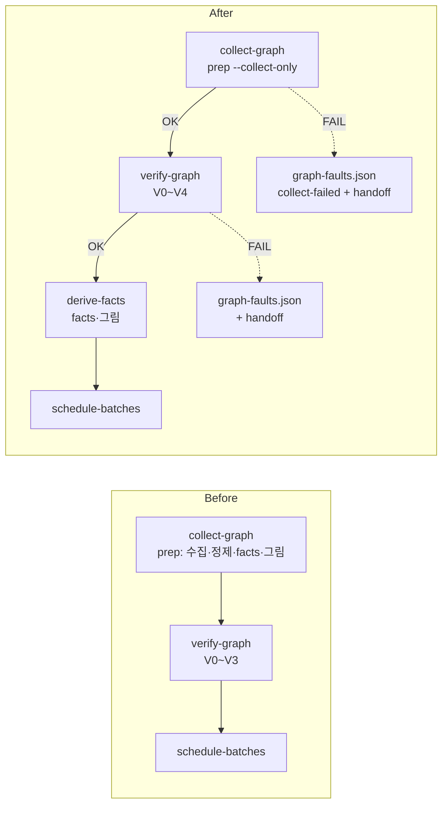

# 🧭 코드 지도 3단계 — 버림 장부 · 크래시 제거 · 수집 실패 기록 · 파생 단계 분리 (설계 사양)

> 📅 2026-11-08 · 브랜치 `claude/eager-pascal-xwevme` = `main` = **Before `bef937a`**(미커밋 없음 — 이 세션 실측)
> 📄 근거: `public.handoff/2026-11-05-codegraph-verify-unify-resume-handoff.md`(이하 핸드오프) §2 B · C · G · §5.4 · §6 · §7, `public.handoff/2026-11-05-codegraph-verify-unify-plan.md`(1 · 2단계 계획). 이 세션에서 읽은 코드: `normalize.py:350-470,519-562,640-760,828-1062,1186-1262` · `prep.py:1-60,142-147,282-292` · `mode1/graph.py:18-151` · `edges.py:16-55` · `verify_graph.py:24-301` · `survey_plan.py:36-50` · `codegraph_types.py:1-20` · `qa/gates/test_prompt_resources.py:120-141`
> 🔒 지킬 규칙: 검사를 완화해 통과시키지 않는다 · `codegraph.json` 의 **열쇠 꼴**은 그대로(내용은 바뀐다 — 아래 🗘) · `codegraph_types.py` 는 **문구만** 바뀌고 아래 diff 를 먼저 보였다 · 코드 주석은 현 상황만 · 긴 글은 `resource/` · 커밋 · 푸시는 사용자 요청 때만
> 🧪 검증: 1 · 2단계와 같은 규칙 — **Task 마다 구현 → 커밋, 시험은 끝에 한 번, 실패하면 `git bisect run` 으로 이분 탐색**(👍 2026-11-05)
> ✋ 승인: **승인 전** — 사용자 요청으로 검토용으로 먼저 올렸다(2026-11-09). 영어 정본은 `public.handoff/2026-11-08-codegraph-stage3-design.md`, 이 파일은 번역본이다. 승인되면 `writing-plans` 로 Task 단위 계획을 쓴다

---

## 📋 한 장 요약

| | |
|---|---|
| 🎯 다루는 것 | 핸드오프 B1~B3 · C1 · C3 · C5 · C6 · G1 · G2, 그리고 이번 조사에서 찾은 **B5**(1차 점 이름이 외부 섬으로 접힘). 결함 코드 넷(`collect-failed` · `report-stale` · `unknown-kind` · `unresolved-drop`)을 더한다 |
| 🧩 한 줄 결론 | 정제가 버린 것을 사유마다 <span style="color:cyan">정책 · 미해결 · 결함</span>으로 갈라 <span style="color:cyan">버림 장부</span> `normalize-report.json` 에 적고, `verify-graph` 가 미해결과 결함을 **막는다**. 그 전에 이 저장소의 미해결 32건과 숨은 손실 45간선을 정제에서 푼다. 수집이 죽으면 그 사실도 같은 결함 파일 · 핸드오프로 남는다 |
| 🟰 그대로 | `codegraph.json` 의 열쇠 꼴 · `codegraph_types.py` 의 형 · `report-wiki prep` 의 동작(끝에 facts · 그림까지 돈다) · `graph-verified.json` 의 꼴(Q2 는 6단계) |
| 🗘 바뀜 | 이 저장소 지도의 **노드 · 간선 수**(별칭 · 점 이름이 풀려 외부 섬 다섯이 사라지고 간선이 제자리로 간다) · 단계 14 → **15**(`derive-facts`) · `collect-graph` 는 꼬리(facts · 그림)를 빼고 돈다 · `verify-graph` 에 층 둘(수집 · V4 장부) |
| ⚠️ 함정 | 미해결을 막기로 했으므로(👍) **C++ 골든 저장소는 B4 판정 전까지 `끝점 해소 실패` 48건으로 막힌다** · 장부가 없는 옛 `out/` 는 첫 실행에서 `unreadable`(장부)로 막힌다 → 다시 수집하면 풀린다(1단계 지문이 정제 코드 변경을 잡아 어차피 다시 수집한다) |
| 🚫 범위 밖 | B4 · G3 · G4(골든 원본 필요 — Mac 세션, 👍) · G5~G8 · Q2(성공 기록의 언어별 칸) · 4~6단계 |

## ✅ 정한 것 — 다시 열지 않는다 (👍 이번 사양 세션)

| # | 질문 | 결정 |
|---|---|---|
| S1 | 미해결 버림을 `verify-graph` 가 어떻게 다루나 | **결함으로 막는다** |
| S2 | B4 · G3(골든 수집 원본 필요) | **Mac 세션으로 미룬다** — 절차를 핸드오프에 적는다 |
| S3 | 이 저장소 미해결 32건 | **사유를 쪼개고 별칭을 푼다** — 타입 변수 · 빌트인은 정책, 형 별칭은 값 식을 따라가고, 함수 꼴 TypedDict 는 클래스 노드. **이 저장소 미해결 0 이 완료 조건** |
| S4 | G1 · G2 계약 정리 | **A** — `survey_plan` 축소 형을 `str \| None` 으로 맞추고 `cast` 를 뗀다. 계약 파일은 문구만 |
| S5 | 1차 점 이름 25개(간선 45)가 외부 섬으로 접힘 | **3단계에서 꼬리로 푼다** — `pycalls.import_table` 과 같은 규칙, 겹치면 미해결 |
| S6 | C6 새 단계 자리 | **`verify-graph` 바로 뒤** — `derive-facts` |

## 🗺️ 한눈에

```text
Before (bef937a)                                   After · 제안
collect-graph ── prep.py                           collect-graph ── prep.py --collect-only
   griffe · pycalls · normalize                       griffe · pycalls · normalize ★ 원본 꼴 검사(C3)
   facts · render-modules  ← 검사 전에 지도를 읽음        → codegraph.json + ★ normalize-report.json (장부)
   실패: 화면에만, 결함 파일 없음                         실패: ★ collect-failure.json → 단계가 graph-faults.json(collect-failed)
                                                                                + graph-handoff.md(collect-graph.md)
verify-graph  V0 → V1 → V2 → V3                    verify-graph  V0 → V1 → V2 → V3 → ★ V4 장부
                                                                 report-stale · unknown-kind · unresolved-drop
                                                   ★ derive-facts  derive.py — facts/*.md · ranking.json · modules.svg  (C6)
schedule-batches …                                 schedule-batches …
```



## 📒 버림 장부 — `out/codegraph-raw/normalize-report.json` (B1 · B3)

정제가 지도 바로 뒤에 같은 방식(`write_json_atomic`)으로 쓴다. 지도의 sha256 을 담아 그 지도 한 벌에만 묶인다.

```json
{
  "codegraph_sha256": "<방금 쓴 codegraph.json 바이트의 sha256>",
  "language": "python",
  "source_tool": "griffe 2.2.0 + pycalls(…)",
  "reasons": [
    {"reason": "이름 해소 실패", "class": "unresolved", "count": 0, "samples": []},
    {"reason": "R7 원시 타입 버림", "class": "policy", "count": 575, "samples": ["str @ core.pipeline", "…최대 5개"]}
  ]
}
```

- `reasons` 는 수가 0 이 아닌 사유만, `class` 순(fault → unresolved → policy → count) · 수 내림차순 · 사유 이름순. 시각을 적지 않아 같은 입력은 같은 바이트다.
- **분류 네 갈래** — `count`(버림이 아닌 집계: 1차 노드 · 모듈 · 호출 간선 …) · `policy`(규칙대로 버린 것) · `unresolved`(풀어야 했는데 못 푼 것 — 정보 손실) · `fault`(수집기가 모르는 값을 냈다).
- **표는 `normalize.py` 의 상수 하나** `DROP_CLASS: dict[str, DropClass]`(정책은 이 파일이 쥔다 — `normalize.py:7-8`). 표에 없는 사유를 적으면 `KeyError` 이고, 소스의 사유 글자 전부가 표에 있는지 시험이 고정한다.

| 사유 (지금 글자 그대로, 바뀌는 것만 🗘) | 분류 | 언어 |
|---|---|---|
| R7 원시 타입 제외 · R7 원시 타입 버림 · R7 원시·암묵 기반 버림 · R5 투과 래퍼 · R5 투과 래퍼 경유 · R5 투과 컨테이너 경유 · 중복 간선 접음 · 자기참조 버림 · R4 외부발 간선 버림 · R1 로 제거된 외부 노드 · containment 버림(자리 없음) · clang-doc 1차 아님(버림) · enum 멤버 버림(플래그) · 소스 제네릭 인스턴스 접음 · git 추적 밖 모듈 · 호출이 기존 간선에 접힘 | policy | 공통 |
| 🗘 `dst {kind} 버림` → **dst TypeParameter 버림** | policy | C# |
| 🗘 `dst {kind} 버림` → **dst Error 버림** | unresolved | C# |
| ★ **타입 변수** · ★ **빌트인** | policy | Python |
| 끝점 해소 실패 | unresolved (B4 전까지) | C++ |
| 호출 양끝 해소 실패 · 식 깊이 초과 · 이름이 아닌 식 버림 · 🗘 `해소 실패(빌트인·타입변수)` → **이름 해소 실패** · ★ **1차 이름 꼬리 겹침** | unresolved | Python |
| 🗘 `알 수 없는 type: {t}` → **모르는 관계 종류**(표본에 `t`) · C# `CS_KIND` 에 없는 값도 같은 사유 | fault | C++ · C# |
| 1차 노드 · 외부 원본 타입 · 모듈 · 모듈 간 의존 · 중첩 클래스 · 호출 간선 · asm->pkg 사전 · clang-doc 로 위치 갱신 · pycalls 로 시그니처 보강 · 🗘 `clang-doc 신규 노드 {kind}` · `pycalls 신규 노드 {kind}` → 고정 이름 + 표본에 kind · ★ 형 별칭 펼침 · ★ 1차 이름 꼬리 맞춤 · ★ 함수 꼴 TypedDict 노드 | count | 공통 |

- **집계 형** ★ `Ledger(Counter[str])` — 지금의 `stats[k] += 1` 자리는 그대로 동작하고(시험이 `st["R7 원시 타입 버림"]` 을 읽는다), 표본을 남길 자리만 `stats.note(사유, 표본)` 로 바꾼다. `report() -> list[ReasonRow]` 가 위 `reasons` 를 만든다. 구현자 하나 · 소비자 하나라 인터페이스는 두지 않는다.
- C++ `끝점 해소 실패` 표본은 `source -> destination (type)` — B4 판정(Mac)이 이 표본을 읽는다.

## 🐍 Python 정제 — 미해결 32 · 숨은 손실 45 를 푼다 (S3 · S5)

`[실측]` 이 저장소 `out/codegraph-raw/griffe.json` · `pycalls.json` 에 `normalize_python` 을 파일 쓰기 없이 돌린 값.

| 묶음 | 지금 | 원인 | 고친 뒤 |
|---|---|---|---|
| 타입 변수 `C`(14) | 해소 실패 | `core.pipeline.C = TypeVar(...)` 는 클래스가 아니다 | **policy 타입 변수** |
| `Exception` · `ValueError`(2) | 해소 실패 | 빌트인 | **policy 빌트인** — 노드를 만들지 않는다 |
| 형 별칭 `Records` · `Pages` · `FaultKind` · `Confidence` · `RecordKind` · `UseKind` · `Usage`(14) | 해소 실패 | 모듈 속성이라 griffe 가 클래스로 안 준다. 값은 식 트리로 온다(`Pages` = `ExprSubscript list[WikiPage]`) | **값 식을 따라간다** → `Pages` 는 `WikiPage` 로, `Literal[...]` 별칭은 지금 `Literal` 직접 주석과 같은 결과 |
| 함수 꼴 TypedDict `CodeEdge`(2) | 해소 실패 | `TypedDict("CodeEdge", {...})` | **클래스 노드** + 값 사전의 형으로 association 간선(라벨 = 열쇠) |
| 외부 섬 `mode1`(19) · `warmup`(2) · `survey_plan`(2) · `verify_graph`(1) · `manifest`(1) — 이름 25 · 간선 45 | **어느 사유에도 안 세짐** | `py_resolve`(`normalize.py:906`)가 import 의 `mode1.context.Mode1Context` 를 그대로 열쇠로 쓴다. 실제 노드는 `codewiki.python.runner.mode1.context.Mode1Context` | **점 이름 꼬리 맞춤** — 19개는 1차 클래스 하나에 정확히 맞고, 6개(`FaultKind` · `Record` · `Records` · `ShardRecords` · `Manifest` · `Verdicts`)는 별칭 · 함수 꼴로 풀린다 |

**규칙** (`normalize_python` · `py_resolve` · `py_walk_expr`)

1. 0패스에서 모듈 속성(`kind == "attribute"` · `labels` 에 `module-attribute` · `value` 있음)을 모은다. griffe 의 `type alias`(PEP 695) 도 같은 자리.
   - 값이 `TypeVar` · `ParamSpec` · `TypeVarTuple` 호출 → `typevars`
   - 값이 `TypedDict` · `NamedTuple` 함수 꼴 호출(첫 인자 문자열) → 클래스 노드(`line` = 속성 줄)
   - 그 밖의 호출 → 무시(상수다). 이름 · 첨자 · `|` 식 → `aliases[완전이름] = (값 식, 정의 모듈)`
2. `py_resolve` — import 표 → 같은 모듈 → ★ **점이 있는데 1차가 아니면 꼬리 맞춤**: 1차 이름(클래스 · 별칭 · 타입 변수 · 함수 꼴)의 점 꼬리(두 조각 이상)와 통째로 맞춘다. 하나면 그것, 둘 이상이면 `1차 이름 꼬리 겹침`(unresolved), 없으면 지금처럼 외부(R2).
3. `py_walk_expr` — 이름을 편 뒤: 별칭이면 **정의 모듈의 import 표로** 값 식을 걷는다(`형 별칭 펼침` · 순환은 기존 깊이 한계 → `식 깊이 초과`) · 타입 변수면 `타입 변수` · 점 없는 빌트인(`builtins` 모듈의 이름, R7 다음)이면 `빌트인` · 남은 점 없는 이름은 `이름 해소 실패`.
4. **완료 조건** — 이 저장소에서 unresolved 합 0 · fault 0 · 외부 섬 `mode1` · `warmup` · `survey_plan` · `verify_graph` · `manifest` 없음. 0 이 안 되면 **멈추고 보고한다**(표를 고쳐 통과시키지 않는다).

## 🧱 C# · C++ · 원본 경계 (B2 · C1 · C3)

| 항목 | Before | After |
|---|---|---|
| B2 C++ 모르는 `type` | `normalize.py:433` 이 `알 수 없는 type: {t}` 로 세고 exit 0 | 사유 `모르는 관계 종류`(fault, 표본 `t`) — 장부에 남고 `verify-graph` 가 `unknown-kind` 로 막는다 |
| C1 C# 모르는 `kind` | `normalize.py:736` `CS_KIND[r["kind"]]` → `KeyError: 'calls'` exit 1 | `CS_KIND.get` · 같은 사유로 세고 그 관계만 건너뛴다 |
| C3 원본 꼴 | `{"types": []}` → `KeyError: 'compilation'` | `main` 이 원본을 읽은 자리에서 `msgspec.convert` 로 `RoslynDump` · `list[UmlElement]` · `list[UmlRelationship]` · `GriffeDump` · `PyCallsDump` 로 검사. 틀리면 stderr 에 `원본 꼴이 틀렸다 — <파일>: <msgspec 경로와 이유>` 를 내고 **exit 2** → 아래 C5 가 결함으로 남긴다 |

C# F5 게이트(`normalize.py:649-654`, exit 2)도 C5 경로로 결함이 된다. `msgspec` 은 이미 `requirements.txt` 에 있다(`verify_graph.py` 가 쓴다).

## 🧯 수집 실패 기록 (C5) — `prep.py` → `collect-graph`

```text
prep.py run(step, argv)                         CollectGraphStage.perform
  Popen(stderr=PIPE) — 줄마다 그대로 화면에        super().perform() → FAIL 이면
  꼬리 40줄을 deque 에 남긴다                       collect-failure.json 을 읽어(없으면 종료 코드만으로)
  실패 → ★ collect-failure.json                    FaultsDoc{faults:[collect-failed]} 를 만든다
     {"step","argv","returncode","stderr_tail"}     → graph-faults.json · graph-verified.json 지움
  막힘(blocked) → step "plan" 으로 같은 파일          → graph-handoff.md (★ prompts/collect-graph.md)
  시작할 때 옛 collect-failure.json 을 지운다
```

- ★ 믹스인 `GraphFaultReport(P.PromptResource)` — 결함 파일 쓰기 · 성공 기록 지우기 · `self.name` 템플릿으로 핸드오프 렌더. `CollectGraphStage` · `VerifyGraphStage` 둘이 쓴다(둘이 쓰면 믹스인 — `src/codewiki/CLAUDE.md`). 지금 `VerifyGraphStage.handoff_text`(`graph.py:56`)와 `perform` 의 쓰기 부분이 여기로 옮긴다.
- **템플릿이 둘인 이유** — 프롬프트 게이트가 단계는 자기 이름의 프롬프트만 선언하게 한다(`qa/gates/test_prompt_resources.py:140-141`). ★ `resource/codewiki/prompts/collect-graph.md` 는 실패한 단계 · 종료 코드 · stderr 꼬리 · 다시 재는 명령(`report-wiki prep <저장소>`) · 해결 불가 양식을 담는다.
- 결함 코드 `collect-failed` 는 `verify_graph.LAYER` 의 새 층 **"수집"** 에 둔다(표와 코드 1대1 시험이 그대로 지킨다). `--resume` 은 실패 단계 `collect-graph` 부터 — `RESTART_AT` 변경 없음.

## 🔎 V4 장부 — `verify_graph.py --report <normalize-report.json>`

| 코드 | 층 | 언제 |
|---|---|---|
| `unreadable` (기존, `at` = 장부 경로) | V0 읽기 | 장부가 없거나 JSON 으로 안 열린다 |
| ★ `report-stale` | V4 장부 | 장부의 `codegraph_sha256` 이 지금 지도와 다르거나 `language` 가 다르다 |
| ★ `unknown-kind` | V4 장부 | `class == "fault"` 사유가 있다 — 사유마다 결함 하나, `detail` 에 수와 표본 |
| ★ `unresolved-drop` | V4 장부 | `class == "unresolved"` 사유가 있다 — 사유마다 결함 하나(S1) |

- `--report` 를 안 주면 V4 를 건너뛴다(`--repo` 없을 때 V3 를 건너뛰는 것과 같은 꼴). 단계는 늘 준다 — 결함 코드 21 → **25**.
- 장부 꼴은 생산자 쪽 ★ `normalize.ReportDoc` 한 곳에 두고 `verify_graph.py` 가 import 해 `msgspec.convert` 로 검사한다. 꼴이 틀리면 `report-stale` 이 아니라 `unreadable`.
- 정제의 장부 자리는 `normalize.py --report <경로>`(없으면 `-o` 와 같은 폴더의 `normalize-report.json`), prep 은 `wikiPaths` 의 `report` 를 넘긴다.
- 핸드오프 템플릿 `verify-graph.md` 의 "층마다 볼 곳" 에 V4 한 줄: `normalize.py` 의 `DROP_CLASS` 와 사유 표본을 보고 **정제를 고친다 — 표의 분류를 바꿔 통과시키지 않는다.**

## 🧪 `derive-facts` (C6) — 검사를 지난 지도만 파생물로

| | Before | After |
|---|---|---|
| `report-wiki prep` | 수집 · 정제 · facts · 그림 | **같다** — 꼬리를 ★ `src/codewiki/python/runner/wiki/derive.py` 의 함수로 부른다 |
| `collect-graph` | `prep.py <repo> --force\|--diff` | `prep.py <repo> --collect-only …` — `prepPlan` 이 꼬리를 뺀다 |
| ★ `derive-facts` | — | `derive.py <repo>` — `facts.py` · `render_modules.py`. 돌기 전에 `graph-verified.json` 의 sha 가 지금 지도와 같은지 본다(`schedule-batches` 와 같은 대조) |

- ★ `DeriveFactsStage(VerifiedGraph, Mode1Machine)` — `reads` = `CODEGRAPH` · `GRAPH_VERIFIED`, `writes` = ★ `RANKING`(`ranking.json`). sha 대조는 지금 `ScheduleBatchesStage.stale_verification`(`graph.py:138`) 하나뿐인데 둘이 쓰게 되므로 ★ 믹스인 `VerifiedGraph` 로 옮긴다.
- `edges.py` — `ORDER` 에 `verify-graph` 다음 자리, `STAGES` · `ALIASES["prep"] = ["collect-graph", "verify-graph", "derive-facts"]`. 단계 14 → **15**.
- `outline-wiki.reads` 에 `RANKING` 을 더한다 — 프롬프트가 읽는 재료를 단계 기계가 알게 해 `--skip derive-facts` 를 시뮬레이터가 잡는다. 시뮬레이터의 ⑤ 사슬이 기존 시험을 깨면 그 시험의 판을 고치지 말고 멈춰 보고한다.

## 🧾 G1 · G2 — 계약 문구 (S4 · A)

```diff
 # src/codewiki/python/machine/survey_plan.py
 GraphNode = TypedDict("GraphNode", {
     "id": str,
     "name": NotRequired[str],
     "kind": NotRequired[str],
-    "file": NotRequired[str],
-    "line": NotRequired[int],
+    "file": NotRequired[str | None],
+    "line": NotRequired[int | None],
     "abstraction": NotRequired[str],
 })
```

```diff
 # src/codewiki/python/runner/mode1/graph.py (schedule-batches)
-        # 기계축 선언(`CodeGraph`)이 실물과 어긋나 최상위만 검증하고 넘길 때 `cast` 한다.
-        cg = cast(survey_plan.CodeGraph, P.load(X.CODEGRAPH.locate(ctx), X.CodeGraphDoc))
+        cg = P.load(X.CODEGRAPH.locate(ctx), survey_plan.CodeGraph)
```

```diff
 # src/codewiki/python/machine/codegraph_types.py — 형은 그대로, 머리 문구만
-# 쓰는 것: 없음 · 쓰이는 곳: normalize, facts, survey_plan, verify_citations, render_modules, render_classes
+# 쓰는 것: 없음 · 쓰이는 곳(import): normalize, terms_db, warmup, verify_graph
 """codegraph_types.py — `codegraph.json`(schema_version 2) 의 계약을 적어 둔 한 곳.

-생산자(`normalize.py::_assemble`)와 소비자 전부가 여기 하나를 본다.
+생산자(`normalize.py::_assemble`)와 검사기(`verify_graph.py`)가 이 형을 쓴다. survey_plan · facts ·
+render_modules · render_classes · verify_citations 는 읽는 칸만 적은 축소 형을 따로 둔다.
```

- 시험 ★ 얼린 실제 지도 `test/codewiki/fixtures/codegraph-self.json` 을 `msgspec.convert(…, survey_plan.CodeGraph)` 로 엄격하게 읽는다.
- `src/codewiki/CLAUDE.md` — `codegraph_types.py` 행의 "소비자가 전부 여기를 본다" 와 Gotcha "기계축 선언이 실물과 어긋난다" 의 `survey_plan` 부분을 고친다(`warmup.Manifest` 부분은 남는다).

## ★ 신규 · 🗘 변경 항목 (모듈 → 파일 → 클래스 → 함수 → 멤버)

| 표 | 자리 | 무엇 |
|---|---|---|
| 🗘 | `src/codewiki/python/machine/normalize.py` | ★ `DropClass` · `DROP_CLASS` · `ReasonRow` · `ReportDoc` 꼴 · `Ledger(Counter[str])`(`note` · `report`) · ★ `validate_raw`(C3) · ★ `write_report` · 🗘 `normalize_cpp`(B2 · 표본) · 🗘 `normalize_csharp`(C1 · `dst` 쪼갬) · 🗘 `normalize_python`(별칭 · 타입 변수 · 함수 꼴) · 🗘 `py_resolve`(꼬리 맞춤) · 🗘 `py_walk_expr`(사유 분리) · 🗘 `main`(장부 쓰기 · `-r/--report` 인자) |
| 🗘 | `src/codewiki/python/machine/verify_graph.py` | `LAYER` 에 코드 넷 · ★ `check_report` · 🗘 `verify(path, repo, report)` · 🗘 `main`(`--report`) |
| 🗘 | `src/codewiki/python/machine/survey_plan.py` | `GraphNode.file` · `.line` |
| 🗘 | `src/codewiki/python/machine/codegraph_types.py` | 머리 문구만 |
| 🗘 | `src/codewiki/python/runner/wiki/prep.py` | 🗘 `run`(stderr 꼬리 · `collect-failure.json`) · 🗘 `prepPlan(…, collectOnly)` · `--collect-only` · 옛 장부 · 실패 기록 지우기 · 꼬리는 `derive` 를 부른다 |
| ★ | `src/codewiki/python/runner/wiki/derive.py` | `derive_steps(repo, paths, py)` · `main` — facts · render-modules |
| 🗘 | `src/codewiki/python/runner/wiki/paths.py` | `wikiPaths` 에 `report` · `failure` |
| 🗘 | `src/codewiki/python/runner/mode1/graph.py` | ★ `GraphFaultReport` · ★ `VerifiedGraph` · 🗘 `CollectGraphStage`(믹스인 · `--collect-only` · writes 에 장부) · 🗘 `VerifyGraphStage`(`--report` · reads 에 장부) · ★ `DeriveFactsStage` · 🗘 `ScheduleBatchesStage`(`cast` 제거) |
| 🗘 | `src/codewiki/python/runner/mode1/context.py` | ★ `NORMALIZE_REPORT` · `COLLECT_FAILURE` · `RANKING` · `ARTIFACTS` |
| 🗘 | `src/codewiki/python/runner/mode1/edges.py` | `ORDER` 15 · `STAGES` · `ALIASES["prep"]` |
| 🗘 | `src/codewiki/python/runner/mode1/wiki.py` | `outline-wiki.reads` 에 `RANKING` |
| ★ · 🗘 | `resource/codewiki/prompts/collect-graph.md` · `verify-graph.md` | 수집 실패 핸드오프 · V4 안내 |
| 🗘 | 문서 | `src/codewiki/CLAUDE.md`(열다섯 단계 · 장부 · 계약 문구 · Gotcha) · `resource/CLAUDE.md` · `ARCHITECTURE.md` · `run_mode1.py` 독스트링 · README 셋(생성) · `resource/codewiki/terms-reading.json` 레코드 · 핸드오프 §2 표시와 **B5 항목 추가** |
| 🗘 | 시험 | `test_normalize.py`(사유 이름 바뀐 자리 · 장부 · 별칭 · 꼬리 · C1 · C3) · `test_verify_graph.py`(V4 · 코드 25) · `test_prep_fingerprint.py`(실패 기록 · `--collect-only`) · `test_mode1.py`(단계 15 · 별칭 · `collect-failed` · `derive-facts`) · `test_survey_plan.py`(스냅샷 엄격 읽기) · `test_pycalls.py:175`(바뀌지 않음 확인) |

## 🔀 Task 개요 (상세 TDD 단계는 `writing-plans` 에서)

| # | Task | 체크리스트 |
|---|---|---|
| 1 | `Ledger` · `DROP_CLASS` · 소스 사유 글자 전수 시험 | B1 · B3 |
| 2 | C++ 표본 · `모르는 관계 종류` | B2 |
| 3 | C# `CS_KIND.get` · `dst` 쪼갬 | C1 |
| 4 | 원본 경계 검사 `validate_raw` | C3 |
| 5 | `main` 이 장부를 쓴다 · prep 이 옛 장부를 지운다 | B1 |
| 6 | Python 0패스 — 별칭 · 타입 변수 · 함수 꼴 TypedDict | S3 |
| 7 | Python 해소 — 꼬리 맞춤 · 빌트인 · 사유 분리 | S3 · S5 |
| 8 | `verify_graph` V4 · 수집 층 · `--report` | B2 · S1 |
| 9 | prep `run` 실패 기록 · `--collect-only` · `derive.py` | C5 · C6 |
| 10 | `GraphFaultReport` · `collect-graph.md` · `CollectGraphStage` 실패 보고 | C5 |
| 11 | `VerifiedGraph` · `DeriveFactsStage` · 산출물 · 단계 순서 · 별칭 | C6 |
| 12 | G1 · G2 | G1 · G2 |
| 13 | 생성물 · 레코드 · 문서 · 핸드오프(B4 · G3 · G4 의 Mac 절차 포함) | — |
| 14 | 끝의 시험 — 게이트 여섯 · 실제 실행 · 실패하면 이분 탐색 | — |

## ✔️ 끝났다는 증거 (Task 14)

```bash
.venv/bin/python -m pytest -q
```
```bash
npm test && npm run typecheck && npm run typecheck:py && npm run doctor
```
```bash
.venv/bin/python tools/gen_readme.py --check src/codewiki/python/runner src/codewiki/python/machine src/codewiki/python/viz src/term/python/runner src/spec/python/runner src/spec/python/viz src/core src/common tools
```
```bash
.venv/bin/python src/codewiki/python/runner/run_mode1.py . --only prep --cold
```

| 증거 | 기대 |
|---|---|
| 게이트 여섯 | 전부 초록. 건너뜀 수는 바뀌지 않는다(새 시험은 골든이 없어도 돈다) |
| `--only prep --cold` | `collect-graph → verify-graph → derive-facts` 성공 · `graph-verified.json` 이 새 지도 sha · `facts/` · `ranking.json` 은 검사 뒤에 생긴다 |
| `normalize-report.json` | unresolved 0 · fault 0 · `타입 변수` 14 · `빌트인` 2 · `형 별칭 펼침` ≥ 14 · `1차 이름 꼬리 맞춤` ≥ 19 |
| 지도 | 외부 섬 `mode1` · `warmup` · `survey_plan` · `verify_graph` · `manifest` 없음. 노드 · 간선 수 전후 대조를 기록(기대값을 미리 박지 않는다) |
| 주입 시험 | C++ 모르는 type · C# `calls` → 정제 exit 0, `verify-graph` 가 `unknown-kind` · `{"types": []}` → 정제 exit 2, `collect-graph` 가 `collect-failed` 와 `graph-handoff.md` |
| `terms_db.py` 인용 검사 | 실패 0 |

## ⚠️ 알려진 한계 · 미검증

- griffe 덤프에서 `TypeVar(...)` 호출 식의 정확한 꼴(`ExprCall` 의 `function` 칸)은 탐침 출력 한 줄로만 봤다 `[미검증]` — Task 6 의 첫 시험이 실제 덤프 조각으로 고정한다.
- 별칭 펼침 뒤 `Literal[...]` 별칭은 지금 `Literal` 직접 주석처럼 `(표준) stdlib` 간선 하나가 된다. 그것이 바람직한지는 이 사양의 범위 밖이다(지금 동작과 같게 둔다).
- `outline-wiki.reads` 에 `RANKING` 을 더하면 시뮬레이터 ⑤ 사슬이 기존 시험을 깨는지 아직 안 돌렸다 `[미검증]`.
- C++ 골든 · C# 골든은 이 컨테이너에 없다 — 사유 표의 C++ · C# 갈래는 합성 입력으로만 시험한다. B4 · G3 · G4 를 Mac 에서 돌릴 때 실제 원본으로 다시 본다.
- 장부의 표본 문자열 꼴(`이름 @ 모듈`)은 B4 판정에 충분한지 모른다 — Mac 세션에서 부족하면 그때 늘린다.
