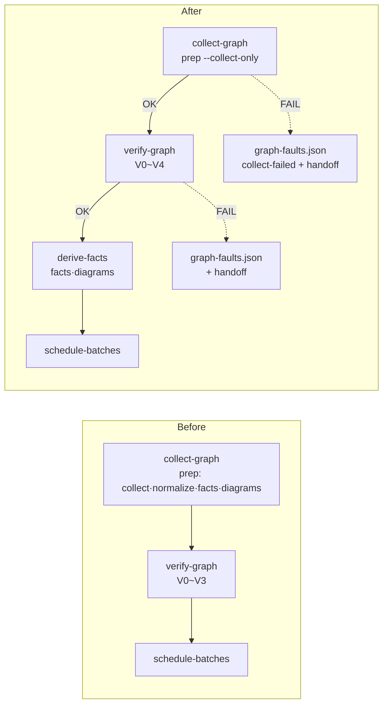

# 🧭 Code map stage 3 — drop ledger · crash removal · collection failure record · derived-stage split (design spec)

> 📅 2026-11-08 · branch `claude/eager-pascal-xwevme` = `main` = **Before `bef937a`** (nothing uncommitted — measured in this session)
> 📄 Sources: `public.handoff/2026-11-05-codegraph-verify-unify-resume-handoff.md` (hereafter "the handoff") §2 B · C · G · §5.4 · §6 · §7, `public.handoff/2026-11-05-codegraph-verify-unify-plan.md` (the stage 1 · 2 plan). Code read in this session: `normalize.py:350-470,519-562,640-760,828-1062,1186-1262` · `prep.py:1-60,142-147,282-292` · `mode1/graph.py:18-151` · `edges.py:16-55` · `verify_graph.py:24-301` · `survey_plan.py:36-50` · `codegraph_types.py:1-20` · `qa/gates/test_prompt_resources.py:120-141`
> 🔒 Rules to keep: never loosen a check to make it pass · the **key shape** of `codegraph.json` stays (its content changes — see 🗘 below) · `codegraph_types.py` changes **wording only**, and the diff below was shown first · code comments describe only the current state · long text goes in `resource/` · commit and push only when the user asks
> 🧪 Verification: same rule as stages 1 · 2 — **implement → commit per Task, run the tests once at the end, and on failure bisect with `git bisect run`** (👍 2026-11-05)
> ✋ Approval: **not yet approved** — pushed first for review at the user's request (2026-11-09). This is the canonical version; the Korean translation is `public.handoff/2026-11-08-codegraph-stage3-design.ko.md`. Once approved, the Task-level plan is written with `writing-plans`

---

## 📋 One-page summary

| | |
|---|---|
| 🎯 Covers | Handoff B1~B3 · C1 · C3 · C5 · C6 · G1 · G2, plus **B5** found in this investigation (first-party dotted names folded into external islands). Adds four fault codes (`collect-failed` · `report-stale` · `unknown-kind` · `unresolved-drop`) |
| 🧩 One-line conclusion | Split everything normalization drops into <span style="color:cyan">policy · unresolved · fault</span> per reason, write it to the <span style="color:cyan">drop ledger</span> `normalize-report.json`, and have `verify-graph` **block** on unresolved and fault. Before that, resolve this repository's 32 unresolved drops and 45 hidden lost edges in normalization. When collection dies, that too is left in the same fault file · handoff |
| 🟰 Unchanged | The key shape of `codegraph.json` · the types in `codegraph_types.py` · the behavior of `report-wiki prep` (still runs facts · diagrams at the end) · the shape of `graph-verified.json` (Q2 is stage 6) |
| 🗘 Changed | **Node · edge counts** of this repository's map (aliases · dotted names resolve, five external islands disappear, edges go to their real targets) · stages 14 → **15** (`derive-facts`) · `collect-graph` runs without the tail (facts · diagrams) · `verify-graph` gains two layers (collection · V4 ledger) |
| ⚠️ Pitfalls | Since unresolved drops now block (👍), **the C++ golden repository stays blocked on 48 `끝점 해소 실패` (endpoint resolution failures) until B4 is decided** · an old `out/` without a ledger is blocked on the first run by `unreadable` (ledger) → re-collecting clears it (the stage 1 fingerprint catches the normalization code change and re-collects anyway) |
| 🚫 Out of scope | B4 · G3 · G4 (need golden raw data — Mac session, 👍) · G5~G8 · Q2 (per-language fields in the success record) · stages 4~6 |

## ✅ Decided — not to be reopened (👍 this spec session)

| # | Question | Decision |
|---|---|---|
| S1 | How `verify-graph` treats unresolved drops | **Block them as faults** |
| S2 | B4 · G3 (need golden collector raw data) | **Defer to a Mac session** — the procedure goes into the handoff |
| S3 | This repository's 32 unresolved drops | **Split the reasons and resolve aliases** — type variables · builtins become policy, type aliases follow their value expression, functional TypedDicts become class nodes. **Zero unresolved in this repository is the completion condition** |
| S4 | G1 · G2 contract cleanup | **A** — align the `survey_plan` partial type to `str \| None` and drop the `cast`. The contract file changes wording only |
| S5 | 25 first-party dotted names (45 edges) folded into external islands | **Resolve by suffix in stage 3** — same rule as `pycalls.import_table`; an ambiguous match is unresolved |
| S6 | Where the C6 stage goes | **Right after `verify-graph`** — `derive-facts` |

## 🗺️ At a glance

```text
Before (bef937a)                                   After · proposed
collect-graph ── prep.py                           collect-graph ── prep.py --collect-only
   griffe · pycalls · normalize                       griffe · pycalls · normalize ★ raw shape check (C3)
   facts · render-modules  ← reads the map unchecked     → codegraph.json + ★ normalize-report.json (ledger)
   failure: screen only, no fault file                 failure: ★ collect-failure.json → stage writes graph-faults.json (collect-failed)
                                                                                + graph-handoff.md (collect-graph.md)
verify-graph  V0 → V1 → V2 → V3                    verify-graph  V0 → V1 → V2 → V3 → ★ V4 ledger
                                                                 report-stale · unknown-kind · unresolved-drop
                                                   ★ derive-facts  derive.py — facts/*.md · ranking.json · modules.svg  (C6)
schedule-batches …                                 schedule-batches …
```



## 📒 Drop ledger — `out/codegraph-raw/normalize-report.json` (B1 · B3)

Normalization writes it right after the map, the same way (`write_json_atomic`). It carries the map's sha256, so it is bound to that one copy of the map.

```json
{
  "codegraph_sha256": "<sha256 of the codegraph.json bytes just written>",
  "language": "python",
  "source_tool": "griffe 2.2.0 + pycalls(…)",
  "reasons": [
    {"reason": "이름 해소 실패", "class": "unresolved", "count": 0, "samples": []},
    {"reason": "R7 원시 타입 버림", "class": "policy", "count": 575, "samples": ["str @ core.pipeline", "…up to 5"]}
  ]
}
```

- `reasons` holds only reasons with a nonzero count, ordered by `class` (fault → unresolved → policy → count) · count descending · reason name. No timestamp, so the same input gives the same bytes.
- **Four classes** — `count` (tallies that are not drops: first-party nodes · modules · call edges …) · `policy` (dropped by rule) · `unresolved` (should have resolved but did not — information loss) · `fault` (the collector emitted a value we do not know).
- **The table is one constant in `normalize.py`**, `DROP_CLASS: dict[str, DropClass]` (this file owns policy — `normalize.py:7-8`). Recording a reason not in the table is a `KeyError`, and a test pins that every reason string in the source is in the table.

Reason strings stay in Korean because they are the exact keys in the code; only the ones marked 🗘 change.

| Reason (current string verbatim, 🗘 only where it changes) | Class | Language |
|---|---|---|
| R7 원시 타입 제외 · R7 원시 타입 버림 · R7 원시·암묵 기반 버림 · R5 투과 래퍼 · R5 투과 래퍼 경유 · R5 투과 컨테이너 경유 · 중복 간선 접음 · 자기참조 버림 · R4 외부발 간선 버림 · R1 로 제거된 외부 노드 · containment 버림(자리 없음) · clang-doc 1차 아님(버림) · enum 멤버 버림(플래그) · 소스 제네릭 인스턴스 접음 · git 추적 밖 모듈 · 호출이 기존 간선에 접힘 | policy | all |
| 🗘 `dst {kind} 버림` → **dst TypeParameter 버림** | policy | C# |
| 🗘 `dst {kind} 버림` → **dst Error 버림** | unresolved | C# |
| ★ **타입 변수** (type variable) · ★ **빌트인** (builtin) | policy | Python |
| 끝점 해소 실패 (endpoint resolution failure) | unresolved (until B4) | C++ |
| 호출 양끝 해소 실패 · 식 깊이 초과 · 이름이 아닌 식 버림 · 🗘 `해소 실패(빌트인·타입변수)` → **이름 해소 실패** (name resolution failure) · ★ **1차 이름 꼬리 겹침** (ambiguous first-party suffix) | unresolved | Python |
| 🗘 `알 수 없는 type: {t}` → **모르는 관계 종류** (unknown relation kind; `t` in the sample) · a C# value missing from `CS_KIND` is the same reason | fault | C++ · C# |
| 1차 노드 · 외부 원본 타입 · 모듈 · 모듈 간 의존 · 중첩 클래스 · 호출 간선 · asm->pkg 사전 · clang-doc 로 위치 갱신 · pycalls 로 시그니처 보강 · 🗘 `clang-doc 신규 노드 {kind}` · `pycalls 신규 노드 {kind}` → fixed name + kind in the sample · ★ 형 별칭 펼침 (type alias expanded) · ★ 1차 이름 꼬리 맞춤 (first-party suffix matched) · ★ 함수 꼴 TypedDict 노드 (functional TypedDict node) | count | all |

- **Tally type** ★ `Ledger(Counter[str])` — the existing `stats[k] += 1` sites keep working (tests read `st["R7 원시 타입 버림"]`), and only the sites that should keep samples change to `stats.note(reason, sample)`. `report() -> list[ReasonRow]` builds the `reasons` above. One implementer · one consumer, so no interface.
- The C++ `끝점 해소 실패` sample is `source -> destination (type)` — the B4 decision (Mac) reads these samples.

## 🐍 Python normalization — resolve 32 unresolved · 45 hidden losses (S3 · S5)

`[measured]` values from running `normalize_python` without writing files on this repository's `out/codegraph-raw/griffe.json` · `pycalls.json`.

| Group | Now | Cause | After |
|---|---|---|---|
| Type variable `C` (14) | resolution failure | `core.pipeline.C = TypeVar(...)` is not a class | **policy 타입 변수** |
| `Exception` · `ValueError` (2) | resolution failure | builtins | **policy 빌트인** — no node is created |
| Type aliases `Records` · `Pages` · `FaultKind` · `Confidence` · `RecordKind` · `UseKind` · `Usage` (14) | resolution failure | module attributes, so griffe does not report them as classes. The value comes as an expression tree (`Pages` = `ExprSubscript list[WikiPage]`) | **follow the value expression** → `Pages` goes to `WikiPage`; a `Literal[...]` alias gives the same result as a direct `Literal` annotation does today |
| Functional TypedDict `CodeEdge` (2) | resolution failure | `TypedDict("CodeEdge", {...})` | **class node** + association edges from the value dict's types (label = key) |
| External islands `mode1` (19) · `warmup` (2) · `survey_plan` (2) · `verify_graph` (1) · `manifest` (1) — 25 names · 45 edges | **counted under no reason** | `py_resolve` (`normalize.py:906`) uses the import's `mode1.context.Mode1Context` as the key as-is. The real node is `codewiki.python.runner.mode1.context.Mode1Context` | **dotted-name suffix match** — 19 match exactly one first-party class; 6 (`FaultKind` · `Record` · `Records` · `ShardRecords` · `Manifest` · `Verdicts`) resolve through aliases · functional forms |

**Rules** (`normalize_python` · `py_resolve` · `py_walk_expr`)

1. Pass 0 collects module attributes (`kind == "attribute"` · `module-attribute` in `labels` · has `value`). griffe's `type alias` (PEP 695) goes in the same place.
   - Value is a `TypeVar` · `ParamSpec` · `TypeVarTuple` call → `typevars`
   - Value is a functional `TypedDict` · `NamedTuple` call (first argument a string) → class node (`line` = the attribute's line)
   - Any other call → ignored (a constant). Name · subscript · `|` expression → `aliases[full name] = (value expression, defining module)`
2. `py_resolve` — import table → same module → ★ **if dotted and not first-party, suffix match**: match the whole name against the dotted suffixes (two or more parts) of first-party names (classes · aliases · type variables · functional forms). One match → that one; two or more → `1차 이름 꼬리 겹침` (unresolved); none → external as today (R2).
3. `py_walk_expr` — after expanding the name: an alias walks its value expression **with the defining module's import table** (`형 별칭 펼침` · cycles hit the existing depth limit → `식 깊이 초과`) · a type variable is `타입 변수` · an undotted builtin (a name in the `builtins` module, after R7) is `빌트인` · any undotted name left is `이름 해소 실패`.
4. **Completion condition** — in this repository the unresolved total is 0 · fault 0 · no external islands `mode1` · `warmup` · `survey_plan` · `verify_graph` · `manifest`. If it does not reach 0, **stop and report** (do not edit the table to pass).

## 🧱 C# · C++ · raw-input boundary (B2 · C1 · C3)

| Item | Before | After |
|---|---|---|
| B2 unknown C++ `type` | `normalize.py:433` counts it as `알 수 없는 type: {t}` and exits 0 | reason `모르는 관계 종류` (fault, sample `t`) — stays in the ledger and `verify-graph` blocks it as `unknown-kind` |
| C1 unknown C# `kind` | `normalize.py:736` `CS_KIND[r["kind"]]` → `KeyError: 'calls'`, exit 1 | `CS_KIND.get` · counted under the same reason and only that relation is skipped |
| C3 raw shape | `{"types": []}` → `KeyError: 'compilation'` | `main` checks the raw input where it reads it, with `msgspec.convert` into `RoslynDump` · `list[UmlElement]` · `list[UmlRelationship]` · `GriffeDump` · `PyCallsDump`. On mismatch it prints `원본 꼴이 틀렸다 — <file>: <msgspec path and reason>` to stderr and **exits 2** → C5 below records it as a fault |

The C# F5 gate (`normalize.py:649-654`, exit 2) also becomes a fault through the C5 path. `msgspec` is already in `requirements.txt` (`verify_graph.py` uses it).

## 🧯 Collection failure record (C5) — `prep.py` → `collect-graph`

```text
prep.py run(step, argv)                         CollectGraphStage.perform
  Popen(stderr=PIPE) — each line to the screen    super().perform() → on FAIL
  keeps the last 40 lines in a deque                reads collect-failure.json (exit code only if absent)
  failure → ★ collect-failure.json                  builds FaultsDoc{faults:[collect-failed]}
     {"step","argv","returncode","stderr_tail"}     → graph-faults.json · deletes graph-verified.json
  blocked → same file with step "plan"              → graph-handoff.md (★ prompts/collect-graph.md)
  deletes an old collect-failure.json at start
```

- ★ Mixin `GraphFaultReport(P.PromptResource)` — writes the fault file · deletes the success record · renders the handoff from the `self.name` template. Used by both `CollectGraphStage` and `VerifyGraphStage` (two users → a mixin — `src/codewiki/CLAUDE.md`). Today's `VerifyGraphStage.handoff_text` (`graph.py:56`) and the writing part of its `perform` move here.
- **Why two templates** — the prompt gate lets a stage declare only the prompt named after itself (`qa/gates/test_prompt_resources.py:140-141`). ★ `resource/codewiki/prompts/collect-graph.md` holds the failed step · exit code · stderr tail · the re-measure command (`report-wiki prep <repo>`) · the unresolvable-problem form.
- The fault code `collect-failed` goes in a new layer **"수집" (collection)** in `verify_graph.LAYER` (the existing one-to-one table/code test keeps covering it). `--resume` starts from the failed stage `collect-graph` — no `RESTART_AT` change.

## 🔎 V4 ledger — `verify_graph.py --report <normalize-report.json>`

| Code | Layer | When |
|---|---|---|
| `unreadable` (existing, `at` = ledger path) | V0 read | the ledger is missing or does not open as JSON |
| ★ `report-stale` | V4 ledger | the ledger's `codegraph_sha256` differs from the current map, or its `language` differs |
| ★ `unknown-kind` | V4 ledger | a `class == "fault"` reason exists — one fault per reason, count and samples in `detail` |
| ★ `unresolved-drop` | V4 ledger | a `class == "unresolved"` reason exists — one fault per reason (S1) |

- Without `--report`, V4 is skipped (same shape as skipping V3 without `--repo`). The stage always passes it — fault codes go from 21 → **25**.
- The ledger shape lives in one place on the producer side, ★ `normalize.ReportDoc`, and `verify_graph.py` imports it and checks it with `msgspec.convert`. A wrong shape is `unreadable`, not `report-stale`.
- Normalization's ledger location is `normalize.py --report <path>` (default: `normalize-report.json` in the same folder as `-o`); prep passes the `report` entry of `wikiPaths`.
- The handoff template `verify-graph.md` gets one V4 line under "층마다 볼 곳" (where to look per layer): look at `DROP_CLASS` in `normalize.py` and the reason samples and **fix normalization — do not change a class in the table to pass.**

## 🧪 `derive-facts` (C6) — only a checked map becomes derived output

| | Before | After |
|---|---|---|
| `report-wiki prep` | collect · normalize · facts · diagrams | **same** — the tail is called as functions in ★ `src/codewiki/python/runner/wiki/derive.py` |
| `collect-graph` | `prep.py <repo> --force\|--diff` | `prep.py <repo> --collect-only …` — `prepPlan` drops the tail |
| ★ `derive-facts` | — | `derive.py <repo>` — `facts.py` · `render_modules.py`. Before running it checks that the sha in `graph-verified.json` matches the current map (same check as `schedule-batches`) |

- ★ `DeriveFactsStage(VerifiedGraph, Mode1Machine)` — `reads` = `CODEGRAPH` · `GRAPH_VERIFIED`, `writes` = ★ `RANKING` (`ranking.json`). The sha check is today only `ScheduleBatchesStage.stale_verification` (`graph.py:138`); with two users it moves into ★ mixin `VerifiedGraph`.
- `edges.py` — a slot after `verify-graph` in `ORDER`, `STAGES` · `ALIASES["prep"] = ["collect-graph", "verify-graph", "derive-facts"]`. Stages 14 → **15**.
- Add `RANKING` to `outline-wiki.reads` — so the stage machine knows the material the prompt reads, and the simulator catches `--skip derive-facts`. If the simulator's ⑤ chain check breaks an existing test, do not change that test's expectations; stop and report.

## 🧾 G1 · G2 — contract wording (S4 · A)

```diff
 # src/codewiki/python/machine/survey_plan.py
 GraphNode = TypedDict("GraphNode", {
     "id": str,
     "name": NotRequired[str],
     "kind": NotRequired[str],
-    "file": NotRequired[str],
-    "line": NotRequired[int],
+    "file": NotRequired[str | None],
+    "line": NotRequired[int | None],
     "abstraction": NotRequired[str],
 })
```

```diff
 # src/codewiki/python/runner/mode1/graph.py (schedule-batches)
-        # 기계축 선언(`CodeGraph`)이 실물과 어긋나 최상위만 검증하고 넘길 때 `cast` 한다.
-        cg = cast(survey_plan.CodeGraph, P.load(X.CODEGRAPH.locate(ctx), X.CodeGraphDoc))
+        cg = P.load(X.CODEGRAPH.locate(ctx), survey_plan.CodeGraph)
```

```diff
 # src/codewiki/python/machine/codegraph_types.py — types unchanged, header wording only
-# 쓰는 것: 없음 · 쓰이는 곳: normalize, facts, survey_plan, verify_citations, render_modules, render_classes
+# 쓰는 것: 없음 · 쓰이는 곳(import): normalize, terms_db, warmup, verify_graph
 """codegraph_types.py — `codegraph.json`(schema_version 2) 의 계약을 적어 둔 한 곳.

-생산자(`normalize.py::_assemble`)와 소비자 전부가 여기 하나를 본다.
+생산자(`normalize.py::_assemble`)와 검사기(`verify_graph.py`)가 이 형을 쓴다. survey_plan · facts ·
+render_modules · render_classes · verify_citations 는 읽는 칸만 적은 축소 형을 따로 둔다.
```

- Test ★ reads the frozen real map `test/codewiki/fixtures/codegraph-self.json` strictly with `msgspec.convert(…, survey_plan.CodeGraph)`.
- `src/codewiki/CLAUDE.md` — fix "consumers all look here" in the `codegraph_types.py` row and the `survey_plan` part of the Gotcha "machine-axis declarations disagree with reality" (the `warmup.Manifest` part stays).

## ★ New · 🗘 changed items (module → file → class → function → member)

| Mark | Location | What |
|---|---|---|
| 🗘 | `src/codewiki/python/machine/normalize.py` | ★ `DropClass` · `DROP_CLASS` · `ReasonRow` · `ReportDoc` shape · `Ledger(Counter[str])` (`note` · `report`) · ★ `validate_raw` (C3) · ★ `write_report` · 🗘 `normalize_cpp` (B2 · samples) · 🗘 `normalize_csharp` (C1 · `dst` split) · 🗘 `normalize_python` (aliases · type variables · functional forms) · 🗘 `py_resolve` (suffix match) · 🗘 `py_walk_expr` (reason split) · 🗘 `main` (writes the ledger · `-r/--report` argument) |
| 🗘 | `src/codewiki/python/machine/verify_graph.py` | four codes in `LAYER` · ★ `check_report` · 🗘 `verify(path, repo, report)` · 🗘 `main` (`--report`) |
| 🗘 | `src/codewiki/python/machine/survey_plan.py` | `GraphNode.file` · `.line` |
| 🗘 | `src/codewiki/python/machine/codegraph_types.py` | header wording only |
| 🗘 | `src/codewiki/python/runner/wiki/prep.py` | 🗘 `run` (stderr tail · `collect-failure.json`) · 🗘 `prepPlan(…, collectOnly)` · `--collect-only` · deletes an old ledger · failure record · the tail calls `derive` |
| ★ | `src/codewiki/python/runner/wiki/derive.py` | `derive_steps(repo, paths, py)` · `main` — facts · render-modules |
| 🗘 | `src/codewiki/python/runner/wiki/paths.py` | `report` · `failure` in `wikiPaths` |
| 🗘 | `src/codewiki/python/runner/mode1/graph.py` | ★ `GraphFaultReport` · ★ `VerifiedGraph` · 🗘 `CollectGraphStage` (mixin · `--collect-only` · ledger in writes) · 🗘 `VerifyGraphStage` (`--report` · ledger in reads) · ★ `DeriveFactsStage` · 🗘 `ScheduleBatchesStage` (`cast` removed) |
| 🗘 | `src/codewiki/python/runner/mode1/context.py` | ★ `NORMALIZE_REPORT` · `COLLECT_FAILURE` · `RANKING` · `ARTIFACTS` |
| 🗘 | `src/codewiki/python/runner/mode1/edges.py` | `ORDER` 15 · `STAGES` · `ALIASES["prep"]` |
| 🗘 | `src/codewiki/python/runner/mode1/wiki.py` | `RANKING` in `outline-wiki.reads` |
| ★ · 🗘 | `resource/codewiki/prompts/collect-graph.md` · `verify-graph.md` | collection failure handoff · V4 guidance |
| 🗘 | Docs | `src/codewiki/CLAUDE.md` (fifteen stages · ledger · contract wording · Gotcha) · `resource/CLAUDE.md` · `ARCHITECTURE.md` · `run_mode1.py` docstring · three READMEs (generated) · records in `resource/codewiki/terms-reading.json` · handoff §2 marks and **a new B5 item** |
| 🗘 | Tests | `test_normalize.py` (renamed reasons · ledger · aliases · suffix · C1 · C3) · `test_verify_graph.py` (V4 · 25 codes) · `test_prep_fingerprint.py` (failure record · `--collect-only`) · `test_mode1.py` (15 stages · alias · `collect-failed` · `derive-facts`) · `test_survey_plan.py` (strict read of the snapshot) · `test_pycalls.py:175` (confirm unchanged) |

## 🔀 Task outline (detailed TDD steps come in `writing-plans`)

| # | Task | Checklist |
|---|---|---|
| 1 | `Ledger` · `DROP_CLASS` · test over every reason string in the source | B1 · B3 |
| 2 | C++ samples · `모르는 관계 종류` | B2 |
| 3 | C# `CS_KIND.get` · `dst` split | C1 |
| 4 | Raw-input boundary check `validate_raw` | C3 |
| 5 | `main` writes the ledger · prep deletes the old ledger | B1 |
| 6 | Python pass 0 — aliases · type variables · functional TypedDict | S3 |
| 7 | Python resolution — suffix match · builtins · reason split | S3 · S5 |
| 8 | `verify_graph` V4 · collection layer · `--report` | B2 · S1 |
| 9 | prep `run` failure record · `--collect-only` · `derive.py` | C5 · C6 |
| 10 | `GraphFaultReport` · `collect-graph.md` · `CollectGraphStage` failure report | C5 |
| 11 | `VerifiedGraph` · `DeriveFactsStage` · artifacts · stage order · alias | C6 |
| 12 | G1 · G2 | G1 · G2 |
| 13 | Generated files · records · docs · handoff (including the Mac procedure for B4 · G3 · G4) | — |
| 14 | Tests at the end — six gates · real run · bisect on failure | — |

## ✔️ Evidence of done (Task 14)

```bash
.venv/bin/python -m pytest -q
```
```bash
npm test && npm run typecheck && npm run typecheck:py && npm run doctor
```
```bash
.venv/bin/python tools/gen_readme.py --check src/codewiki/python/runner src/codewiki/python/machine src/codewiki/python/viz src/term/python/runner src/spec/python/runner src/spec/python/viz src/core src/common tools
```
```bash
.venv/bin/python src/codewiki/python/runner/run_mode1.py . --only prep --cold
```

| Evidence | Expected |
|---|---|
| Six gates | all green. The skip count does not change (the new tests run without golden repositories) |
| `--only prep --cold` | `collect-graph → verify-graph → derive-facts` succeed · `graph-verified.json` has the new map's sha · `facts/` · `ranking.json` appear after the check |
| `normalize-report.json` | unresolved 0 · fault 0 · `타입 변수` 14 · `빌트인` 2 · `형 별칭 펼침` ≥ 14 · `1차 이름 꼬리 맞춤` ≥ 19 |
| Map | no external islands `mode1` · `warmup` · `survey_plan` · `verify_graph` · `manifest`. Record the before/after node · edge counts (no expected values fixed in advance) |
| Injection tests | unknown C++ type · C# `calls` → normalization exits 0, `verify-graph` reports `unknown-kind` · `{"types": []}` → normalization exits 2, `collect-graph` reports `collect-failed` and writes `graph-handoff.md` |
| `terms_db.py` citation check | 0 failures |

## ⚠️ Known limits · unverified

- The exact shape of a `TypeVar(...)` call expression in the griffe dump (the `function` field of `ExprCall`) was seen in only one line of probe output `[unverified]` — Task 6's first test pins it with a real dump fragment.
- After alias expansion, a `Literal[...]` alias becomes one `(표준) stdlib` edge, like a direct `Literal` annotation does today. Whether that is desirable is outside this spec (kept the same as today).
- Whether adding `RANKING` to `outline-wiki.reads` makes the simulator's ⑤ chain check break existing tests has not been run yet `[unverified]`.
- The C++ and C# golden repositories are not in this container — the C++ · C# branches of the reason table are tested only with synthetic input. Re-check them with real raw data when B4 · G3 · G4 run on the Mac.
- Whether the ledger's sample string shape (`name @ module`) is enough for the B4 decision is unknown — extend it in the Mac session if it falls short.
