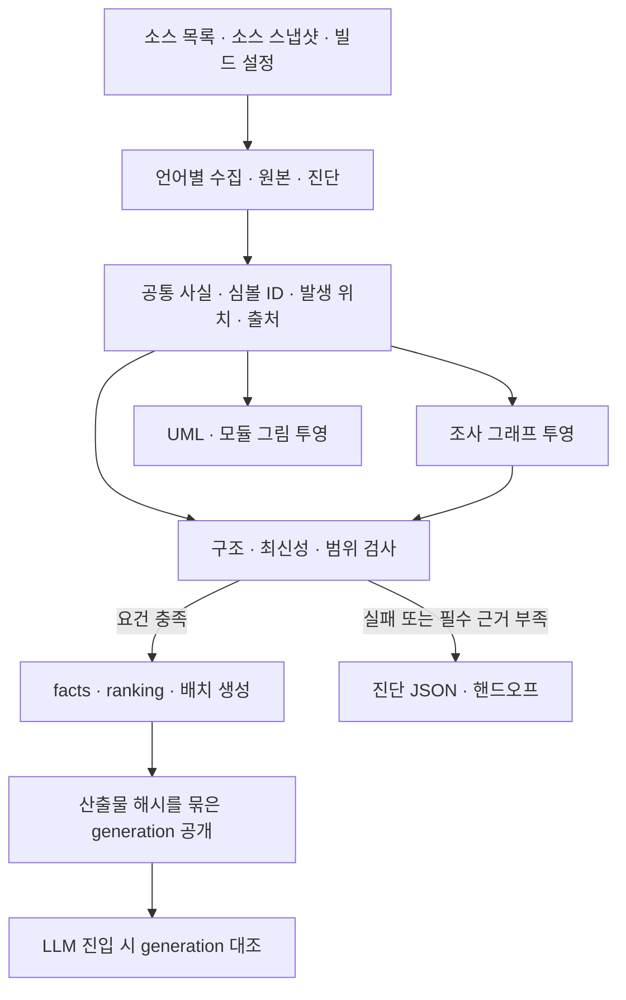

# 코드 그래프 검증·통일 계획의 적대적 검토

2026-11-09 · 검토 기준 `main` / `bef937a` · 원래 계획과 핸드오프, 현재 구현을 대조했다.

**판정: 3~6단계를 그대로 확장하기 전에, 검증의 의미와 사실 저장 모델을 보완해야 한다.** 현재 설계는 JSON 정합성을 높였지만, 전수조사·설계 검토에 필요한 최신성·수집 범위·근거 보존을 보장하지 않는다. 테스트 통과와 이 보장은 별개다.

사용자 확인: 기존 승인 사항도 근거가 있으면 재검토한다. 우선순위는 **전수조사·설계 검토의 근거 정확성**이다. 이 문서는 변경 제안이며 구현 승인을 대신하지 않는다. 제품 코드는 변경하지 않았다.

## 1. 검토 근거와 재현

- 대상: [구현 계획](2026-11-05-codegraph-verify-unify-plan.md), [재개 핸드오프](2026-11-05-codegraph-verify-unify-resume-handoff.md).
- 기존 관련 시험: `test_verify_graph.py`, `test_prep_fingerprint.py`, `test_mode1.py` — **187 passed, 7.84s**. 전체 여섯 게이트를 실행한 결과는 아니다.
- [독립 재현 스크립트](2026-11-09-codegraph-adversarial-review/repro.py), [측정 결과](2026-11-09-codegraph-adversarial-review/results.json). 저장소 루트에서 아래 명령으로 실행한다. 표본 파일은 임시 디렉터리에만 쓰며, LLM이나 외부 수집기를 실행하지 않는다.

```bash
.venv/bin/python public.handoff/2026-11-09-codegraph-adversarial-review/repro.py
```

| 반례 | 실제 결과 |
|---|---|
| 깨진 JSON으로 실제 `Pipeline.run → verify-graph` | 실패하지만 결함 JSON·핸드오프 모두 없음 |
| 파일의 줄 수를 유지한 채 함수 이름·본문 변경 | V3 재검사도 통과, 기존 성공 기록도 수락 |
| 없는 소스 파일 + `--repo` 생략 | 통과 기록 생성, 스케줄러의 해시 검사도 수락 |
| 기존 배치만 남기고 지도 파손·성공 기록 삭제 | `--only annotate-symbols` 그래프 구성 및 입력 경계 통과 |
| 고유 ID 두 개 + 같은 이름 | 검증 통과 후 용어 사전의 심볼 두 개가 하나로 덮어써짐 |
| 모듈 간 간선은 있으나 `depends_on` 누락, 음수 `occurrences` | 검증 통과 |
| 외부 노드만 있는 지도 | 검증 통과 |
| `compdb.py` 내용 변경 | 수집 지문 동일 |
| C# 강제 수집 계획 | `normalize → facts → render-modules`; Roslyn 재실행 없음 |
| 같은 C++ 파일의 다른 컴파일 명령 두 개 | 한 개만 남음 |
| Python 자기 재귀 호출 | 간선 0, `호출 양끝 해소 실패`로 집계 |
| 기존 타입 의존과 같은 양끝의 호출 추가 | 개수만 2가 되고 호출 종류·호출 위치 소실 |

LLM 우회 반례는 **단계 구성과 입력 경계까지** 확인했다. 유료 세션을 실제로 실행했다는 뜻이 아니다. C# 강제 수집 반례 역시 계획 함수를 검사했으며, 외부 골든 저장소에서 수집기를 다시 실행하지 않았다.

## 2. 우선 수정해야 할 결함

### F1. 성공 기록은 최신성도 검사 범위도 증명하지 않는다 — P1

근거: `verify_graph.py:59–68,233–253,280–282`, `mode1/graph.py:138–151`.

성공 기록에는 지도 해시만 있고, 소스 내용 해시·검사기 버전·검사 정책·실행한 검사 목록이 없다. V3는 파일 존재와 줄 범위만 확인한다. 따라서 같은 파일의 같은 줄에 전혀 다른 코드가 있어도 통과한다. `repo_commit`도 비교하지 않고 복사할 뿐이다. 커밋 비교를 더해도 미커밋 변경은 해결되지 않는다.

더 직접적으로, V3를 생략해 만든 기록과 V3까지 수행한 기록을 소비자가 구별할 수 없다. 검사기 결함을 수정해도 기존 기록을 무효화할 근거가 없다. 계획의 “V3가 오래된 지도를 차단한다”는 문구는 파일 삭제·범위 이탈을 탐지한다는 수준으로 낮춰야 한다.

**수정:** 성공 기록에 `source_snapshot`, `collection_key`, `validator_key`, `policy_key`, `checks_run`, `coverage`, 산출물 해시를 결합한다. `--repo` 없는 검사는 구조 검사 결과로만 취급하고 전수조사 진입 요건을 충족시키지 못하게 한다. 검증 당시 소스가 수집 당시 소스와 같은지도 대조해야 한다. 단순히 오래된 지도에 현재 소스 해시를 새로 붙이면 거짓 최신성을 만드는 셈이다.

### F2. 검증기가 깨진 입력을 보기도 전에 경계가 막는다 — P1

근거: `mode1/context.py:300–301`, `mode1/graph.py:33–34,49–50`, `core/pipeline.py:137–159,355–378`.

`CODEGRAPH`에 `CodeGraphDoc` 스키마가 붙어 있다. 생산자의 출력 검사와 검증 단계의 입력 검사가 먼저 실행된다. 잘못된 JSON이나 잘못된 최상위 형은 `verify_graph.py`의 V0/V1에 도달하지 않는다. 독립 CLI 시험만으로는 이 문제를 못 잡는다. 계획의 시퀀스 그림도 이 사전 검문을 생략했다.

**수정:** 수집 결과를 `CollectionAttempt`로 모델링하고, 그 안의 원본 지도 경로는 검증기가 직접 열게 한다. JSON 내용 검사는 검증기의 책임으로 둔다. 파일 자체가 없거나 수집 프로세스가 실패한 경우도 실행 결과를 받는 진단 경로로 이어져야 한다. 단순히 `schema=None`으로 바꾸면 깨진 JSON은 해결되지만, 파일 부재까지 해결되지는 않는다.

`collect-failed`, `verification-incomplete`를 포함하는 진단 문서를 공통 형으로 쓰고, 핸드오프는 그 문서에서 생성한다. 상속 믹스인 도입 자체보다 실패를 데이터로 전달하는 계약이 먼저다.

### F3. 스케줄러 하나를 막아서는 모든 LLM 진입점을 보호하지 못한다 — P1

근거: `mode1/survey.py:34–35`, `mode1/survey_files.py:36–38`, `mode1/edges.py:97–108`, `core/pipeline.py:332–337`.

`annotate-symbols`는 기존 `batches.json`만으로 실행할 수 있다. 배치에 어느 검증 결과·소스 세대에서 만들어졌는지 기록하지 않으므로, 지도 검증이 실패한 뒤에도 과거 배치를 재사용할 수 있다. 뒤 단계에서 재개하는 경우도 `verify-graph`를 반드시 거친다는 보장이 없다.

**수정:** 배치·facts·ranking·모듈 그림에 공통 `generation_id`와 입력 해시를 연결한다. LLM 실행 직전에 공통 검문 함수가 해당 작업의 소스 스냅샷과 파생물 계보를 검사한다. 현재 성공 기록을 요구하는 것만으로는 오래된 배치를 새 지도와 함께 쓰는 경우를 막지 못한다.

또한 `stale_verification()`이 해시를 읽은 뒤 `perform()`이 지도를 다시 여는 구조에는 교체 경쟁이 있다. 동일 바이트를 한 번 읽어 검증하고 파싱하거나, 불변 세대의 파일을 열어야 한다.

### F4. 수집 지문이 실제 입력 의존성을 빠뜨렸고, C#은 재수집하지 않는다 — P1

근거: `wiki/prep.py:24–30,49–55,87–119,184–195`, `wiki/compdb.py`, `src/codewiki/csharp/roslyn-dump/Program.cs`.

`COLLECT_CODE`에는 `compdb.py`, runner의 `clang_doc.py`, 수집기 선택 코드, Roslyn 소스·프로젝트가 없다. 테스트도 normalize의 직접 import만 확인한다. `.clang-uml`, 컴파일 DB, 프로젝트 참조·defines 등 결과를 바꾸는 설정도 지문의 일부가 아니다.

직접 `report-wiki prep`을 부를 때 `--diff`가 없으면 소스 변경 자체를 확인하지 않는다. C#은 `--force`여도 기존 `roslyn-dump.json`을 재정제할 뿐이다. 원본 파일의 해시는 그 원본이 현재 소스에서 만들어졌음을 증명하지 않는다. 현재 정제기는 오래된 덤프에 현재 `git_commit(repo)`를 기록할 수 있어 출처가 더 그럴듯하게 보이는 문제가 있다(`normalize.py:505`).

**수정:** 단일 지문을 다음 두 캐시 키로 나눈다.

```text
raw_key   = H(소스 스냅샷, 선택한 빌드 설정, 수집기 코드·판·인자, 의존 입력)
graph_key = H(raw 산출물 해시, 정제기 코드, 정제 정책, 스키마)
```

정제기만 고쳤으면 원본을 재사용한다. 수집기·소스·빌드 설정이 바뀌었으면 원본부터 갱신한다. 외부에서 공급하는 Roslyn 덤프에는 수집 manifest를 요구하고, 이를 확인할 수 없으면 최신성은 `unknown`이다. 외부 도구 버전을 `?`로 읽은 경우도 정상 캐시 적중으로 단정하면 안 된다.

### F5. 안정 ID만 바꾸면 오버로드가 후단에서 사라진다 — P1

근거: `terms_db.py:129–160`, `mode1/survey.py:48–52,197–205`. 실제 재현: ID는 다른데 `name`이 같은 심볼 2개 → 검증 통과 → 용어 레코드 1개.

계획의 “소비자는 ID를 불투명 키로만 쓴다”는 관찰만으로 이주 안전성을 결론내릴 수 없다. 소비자는 ID를 이름으로 바꾸고 그 이름을 다시 유일 키로 쓴다. 메서드 승격 후 ID 충돌이 0이어도 레코드 손실은 발생한다. 이름에 시그니처를 붙이는 임시 해법도 언어·프로젝트·로컬 심볼과 비심볼 용어의 키 영역을 정의해야 한다.

**수정:** `symbol_id`를 배치·샤드·용어 사전·관계 참조의 결합 키로 끝까지 유지한다. `display_name`, `qualified_name`, `signature`는 표시용이다. 비심볼 개념에는 별도 `term_id` 영역을 둔다. 기존 이름 키는 호환 별칭으로 처리하고, 일대다이면 임의 선택하지 않는다. 공용 계약 변경은 이 이주 계획과 함께 제시한다.

ID 요구사항도 구체화해야 한다. 반복 실행과 무관한 파일 추가에 안정적이라는 것, 함수 이름 변경에도 동일하다는 것은 서로 다르다. 저장소·패키지·언어 범위와 컴파일러의 심볼 식별자를 바탕으로 만들고, 익명·로컬 심볼의 한계를 명시한다. 한 골든의 `이름 + 인자형 + const` 충돌 0건은 일반적인 충돌 방지 증명이 아니다. SCIP도 패키지 범위와 메서드 구별자를 구분한다. [SCIP 스키마](https://github.com/scip-code/scip/blob/main/scip.proto)

### F6. 그림용 축약을 사실의 정본으로 쓰면 근거를 복구할 수 없다 — P1

근거: `normalize.py:445–460,744–758,1172–1183`, `codegraph_types.py:42–56`.

현재 간선은 `(from, to, kind)`로 접히며 위치는 하나만 남는다. 호출과 타입 의존을 모두 `dependency`로 매핑하면 어떤 호출 지점이 근거인지 사라질 수 있다. 자기참조 제외는 재귀를 없애고, Python에서는 이를 끝점 해소 실패로 집계하기까지 한다.

따라서 “정책 버림”으로 분류했다는 이유만으로 안전하지 않다. 자기참조·중복·컨테이너 투과는 **어떤 뷰를 위한 정책인지**가 필요하다. 소유 간선도 언어별 증거가 다르면 공통 저장 형식 안에 언어 전용 근거로 보존할 수 있다. 세 언어에 동일한 추론을 강요할 필요는 없다.

**수정:** 원본 사실 저장소와 파생 그래프를 분리한다. 사실에는 `calls`, `type_reference`, `inherits`, `contains` 같은 의미와 각 발생 위치를 보존한다. 시각화에서 이를 UML 어휘로 투영하고 접는다. 재귀·복수 위치·언어별 속성은 사실 저장소에 남는다. 그래프 DB 도입 없이 JSON/JSONL과 현재 파이프라인으로 시작할 수 있다.

### F7. C++ 빌드 설정을 하나로 뭉개면 호출 정확도 논의가 무너진다 — P1

근거: `wiki/compdb.py:39–52`. 같은 파일의 `-DMODE=1`, `-DMODE=2` 두 명령을 입력했을 때 하나만 남았다. 상대경로 `file`도 현재 `startswith(repo)` 검사로 제외될 수 있다.

공식 컴파일 DB 규약은 같은 파일에 여러 설정의 명령이 존재하는 것을 허용하고, `file`의 상대경로는 `directory` 기준으로 해석한다. 따라서 파일명만으로 중복 제거하는 것은 일반적인 입력 계약을 만족하지 못한다. [Clang compilation database 규약](https://clang.llvm.org/docs/JSONCompilationDatabase.html)

**수정:** 먼저 경로를 규약대로 해석하고, 번역 단위의 관측은 `(file, build_context)`로 관리한다. 하나의 지정된 설정만 지원한다면 그 범위를 선언한다. 여러 설정을 모으면 각 사실에 설정을 붙이고, 서로 양립하지 않는 호출들을 한 실행의 호출망처럼 보여주지 않는다. 이는 5단계 도구 선정 전에 결정할 데이터 모델 문제다.

### F8. “결함 0”은 완전성·의미 정확성·조사 가능성을 뜻하지 않는다 — P1

근거: `verify_graph.py:127–128,189–218,233–253`. 외부 노드만 있는 지도, 노드 사이 간선과 맞지 않는 `modules.depends_on`, 음수 `occurrences`도 통과한다. 코드 파일이 존재하더라도 노드 이름과 그 선언이 대응하는지는 보지 않는다.

버림 장부 역시 수집기가 아예 방문하지 않은 파일·심볼을 발견하지 못한다. 원본에서 사라진 것만 세어서는 전수조사를 주장할 수 없다. C# 해소율의 분모는 모든 호출이 아니라 실험 루프가 방문한 `InvocationExpressionSyntax`이다.

**수정:** 검증 결과를 `integrity`, `freshness`, `coverage`, `capabilities`로 나누고, 특정 사용 목적이 요구하는 조건을 판정한다. 구조 결함과 출처 불일치는 차단한다. 미지원·동적 호출은 `unknown/ambiguous`로 남기고 영향받는 범위를 드러낸다. 엄격한 전수조사를 표방하려면 범위 내 파일·빌드 단위의 미수집을 숨겨서는 안 된다. 정적 분석으로 런타임 호출 전부를 증명한다는 약속은 하지 않는다.

최소 규칙: 1차 심볼 존재(선언된 범위가 비어 있으면 별도 상태), 양의 발생 수, 파생 모듈 의존의 재계산 대조, 선언·정의·생성 근거의 구분. `--repo` 없는 결과나 수집 범위 미확인은 완전한 성공과 구별한다.

### F9. 수집 실패와 재개의 단위를 파일 존재로 표현한다 — P2

근거: `wiki/prep.py:204–208,275–288`, `verify_graph.py:285–292`, `mode1/edges.py:55`, `mode1/resume.py:43–54`.

옛 지도를 먼저 지우면 평범한 실패에서 낡은 지도 재사용은 막지만, 성공한 과거 결과와 실패한 새 시도의 생명주기를 분리하지 못한다. 원자적 지도 쓰기도 지도·지문·검증 결과·파생물 전체를 하나로 묶지는 못한다. 검증 결과는 직접 덮어쓰므로 중단 시 잘릴 수 있다. 실패 뒤 과거 성공 기록이 남거나 과거 결함을 현재 실패로 오인하는 문제도 시도 ID가 없으면 구분하기 어렵다.

`verify-graph → collect-graph`라는 고정 재개표는 재수집을 보장하지 않는다. `needs_collect`가 false면 수집은 생략된다. 다시 시작할 위치보다 **어떤 입력 변경이 어느 산출물을 무효화했는지**가 중요하다. `changes.json`이 오래되었는지도 재평가해야 한다.

**수정:** 불변 generation 디렉터리에 후보를 만들고, 전부 준비되면 작은 manifest 포인터를 원자적으로 갱신한다. 과거 성공 결과는 보존하되, 요청한 입력의 generation과 일치할 때만 소비한다. 최신 수집 시도가 실패했는데 이전 generation을 자동으로 현재 결과처럼 사용하는 폴백은 허용하지 않는다. 처음에는 저장소당 writer 한 개를 잠그는 것으로 충분하다.

재개는 유효한 단계별 입력·출력 해시를 확인하고 가장 먼저 무효한 단계를 실행한다. 검증 정책만 바뀌었으면 재검사, 정제기만 바뀌었으면 재정제, 소스·수집기가 바뀌었으면 재수집한다.

### F10. 현재 문서의 정본과 상태가 충돌한다 — P2

핸드오프 첫머리는 “구현 0”, §2는 “전부 미착수”, §7은 지도 내부 `verification`을 정본으로 서술한다. 같은 파일의 체크리스트와 구현 계획은 1·2단계 완료 및 외부 성공 기록을 말한다. 핸드오프는 충돌하면 자신이 우선한다고까지 쓴다. 이 상태로 다음 세션에 넘기면 롤백·중복 구현의 근거가 생긴다.

**수정:** 상태·결정 표는 한 문서에만 유지하고 기존 설계는 superseded 표시로 보존한다. 영어·한국어 전체 구현 코드 사본을 함께 관리하기보다 정본 설계 + 요약 번역 + 실제 코드 링크로 줄인다. 먼저 최신 구현이 보장하는 것과 아직 보장하지 못하는 것을 정확히 적는다.

### F11. 측정값의 의미와 시험 전략도 수정해야 한다 — P2

C# PoC는 `CandidateSymbols[0]`을 선택하는 경로가 있다(`roslyn_call_poc.py:24`). 실제 저장된 측정은 **후보만 0건**이므로 기존 1,288건에 후보 선택이 섞였다고 주장할 근거는 없다. 다만 이 코드를 제품에 그대로 가져오면 모호한 후보를 확정 대상으로 승격할 수 있다. 후보와 확정 해소는 별개 결과로 남겨야 한다.

기존 해소율은 정밀도도 재현율도 아니다. 반례 집합을 먼저 고정하고 호출 지점 단위의 정답과 비교해야 한다. C++은 오버로드·cv/ref·템플릿·가상 호출·함수 포인터·생성자·매크로·여러 TU, C#은 오버로드·제네릭·확장 메서드·동적 호출·로컬 함수·접근자, Python은 별칭·재정의·동적 속성·재귀 등을 포함한다. 각 후보가 지원하는 범위 안에서 정밀도/재현율을 따로 보고한다.

계획의 마지막 한 번 시험·bisect 방식은 과거 승인된 실행 정책이지만, 현재 재검토 범위에서는 권하지 않는다. 시험이 존재하지 않는 커밋을 성공으로 처리하면 도입 시점과 결함 도입 시점을 구분하지 못한다. git 밖의 `out/`은 커밋을 바꿔도 그대로다. 경계별 작은 회귀 시험을 변경과 함께 실행하고, bisect는 버전 간 동일한 입력과 판정식을 유지할 수 있는 회귀에 쓴다. 이번 187개 통과는 현재 시험 집합의 통과이며, 위 반례에 대한 안전성을 뜻하지 않는다.

## 3. 권고하는 대안 구조

핵심은 **증거를 보존하는 공통 모델과 용도별 투영**이다. 언어별 수집기는 달라도, 소비자는 동일한 식별자·출처·수집 범위 계약을 읽는다.



위 그림의 투영물은 같은 generation에 속한다. LLM이 읽는 그림도 공개 전에 생성하고 manifest에 포함한다. 개별 파일 쓰기 성공이 publication을 의미하지 않는다.

### 최소 계약

| 대상 | 필요한 정보 |
|---|---|
| Collection manifest | 소스 목록·내용 해시, 빌드 설정, 수집 도구·인자·판, raw 해시, 성공/실패한 수집 단위 |
| Symbol | `symbol_id`, 언어, 종류, 이름·시그니처, 부모 심볼, 선언/정의 위치들, origin |
| Relation fact | source/target 또는 미해소 대상, 의미, 발생 위치, 수집기·빌드 문맥, 해소 상태 |
| Projection | 입력 사실 해시, 투영 정책, schema version, 파생 그래프 |
| Verification receipt | 대상 해시들, 소스 스냅샷, 검사기·정책 키, 실행/생략한 검사, 범위 결과, 목적별 적합성 |
| Consumer manifest | generation, 입력·출력 해시, 배치/facts/그림/레코드의 계보 |

`exact`라는 표지가 필요하다면 무엇이 exact인지 정의한다. 예를 들어 컴파일러가 정한 **정적 호출 대상**이 확정됐다는 것과 실행 시 가상 디스패치 대상이 확정됐다는 것은 다르다. 해소 수준을 언어별 성공 기록 하나에만 두면 한 언어 안에 섞인 직접 호출·후보·휴리스틱을 구별할 수 없다. 관계별 출처가 필요하다.

검사 통과 도장은 “해당 입력·정책으로 지정된 검사를 수행했다”는 증거다. 코드의 모든 의미가 참이라는 보증으로 이름 붙이지 않는다.

### 버림 장부를 수집 범위 장부로 확장

파일 목록은 수집 결과와 독립적으로 먼저 만든다. 파일·빌드 단위마다 `collected / excluded(policy) / unsupported / failed` 중 하나를 남긴다. 정규화 원본 항목도 산출 사실로의 매핑, 정책 제외, 미해소를 추적한다. 하나의 원본이 여러 사실을 내거나 여러 원본이 하나로 합쳐질 수 있으므로 단순히 노드·간선 개수를 더해 보존식을 만들지는 않는다.

JSON에는 구조화된 사유와 전체 항목 참조를 보존하고, Markdown에만 상위 사유·예시를 요약한다. 원본 순서를 섞거나 같은 입력을 재실행해도 내용이 같도록 정렬·직렬화 규칙을 정한다. 생략한 검사는 `skipped_due_to`로 기록한다. 현재처럼 ID 없는 잘못된 노드 하나 때문에 모든 dangling-edge 진단을 숨기는 방식은 독립 결함까지 가릴 수 있다.

### 메서드는 수집 범위와 LLM 조사 범위를 분리

정확성 우선이면 **선언된 대상 범위의 메서드·함수 사실은 전량 보존**하는 것을 권한다. 공개 표면이나 호출 도달성은 조사·표시 필터로 둔다. 특히 불완전한 호출망의 도달성으로 수집 대상을 정하면, 놓친 호출이 다시 메서드 누락을 만드는 순환이 생긴다.

노드 5.7배가 곧 LLM 비용 5.7배는 아니다. 수집 규모·직렬화 크기·파일별 조사 배치·토큰 수를 분리 측정한다. 이미 읽은 파일의 여러 메서드를 묶어 조사하고, 사실 저장소는 비용과 무관하게 보존한다. 배치의 순환 관계는 SCC를 통해 다루되 표시 축약으로 사실을 없애지 않는다.

### C++ 호출 수집은 두 후보 중 선택하는 문제로 좁히지 않는다

| 후보 | 이 검토의 판단 |
|---|---|
| `debug.DumpCallGraph` | 기존 실험의 가능성 확인 자료. 이름 결합·위치 부재라는 측정된 한계 때문에 근거 정본의 우선 후보로 두기 어렵다 |
| clangd call hierarchy | 기존 서버 재사용 후보. 전체 심볼 발견, 인덱스 상태, 질의 비용, 위치·ID 연결을 실제 저장소에서 평가해야 한다 |
| libclang 또는 LibTooling 기반 추출 | 선언·호출·위치를 같은 의미 분석 경로에서 수집하는 후보로 추가한다. 유지보수·빌드 부담까지 비교한다 |

Clang 공식 문서는 libclang을 안정적인 C API로, LibTooling을 전체 AST 제어가 가능한 C++ 인터페이스로 설명하며 후자의 API 안정성 제약도 명시한다. ASTMatchers는 AST 속성과 소스 위치 추출을 지원한다. 따라서 **의미·위치·ID를 같이 얻는 경로를 평가해야 한다는 판단**은 강하지만, 실측 없이 LibTooling이 가장 빠르거나 가장 싸다고 결론내리지 않는다. [인터페이스 선택](https://clang.llvm.org/docs/Tooling.html), [ASTMatchers](https://clang.llvm.org/docs/LibASTMatchers.html)

C++ USR 같은 컴파일러 식별자를 활용하되, 저장소 범위·익명 심볼·도구 버전 변경의 안정성을 별도로 시험한다. 공식 API는 USR과 선언 참조를 제공한다. [libclang cross-reference API](https://clang.llvm.org/doxygen/group__CINDEX__CURSOR__XREF.html)

### 혼합 언어는 범위 표시부터 앞당긴다

6단계까지 “수집 못 한 언어” 표시를 기다릴 이유가 없다. 소스 inventory에서 언어별 파일 수와 제외 사유를 먼저 낸다. 실제 병합은 안정 ID와 관계 출처가 마련된 뒤 진행한다. 각 언어의 수집 능력은 별도로 유지하고 언어 간 연결은 증거가 있는 경우에만 만든다.

tree-sitter는 구문 범위를 채울 후보이며, 그 결과에 컴파일러 의미 해석과 같은 신뢰 표지를 붙이지 않는다. 도구 도입 여부보다 결과가 주장할 수 있는 범위를 계약에 적는 일이 선행한다. TS 도구 선정은 실제 대상과 정답 집합의 비교로 결정한다.

## 4. 수정된 실행 순서와 완료 기준

| 순서 | 작업 | 완료 기준 |
|---|---|---|
| 0 | 문서 상태 통일·보장 정의·반례 고정 | 현재/제안 구분, 이 문서의 반례가 회귀 명세가 됨 |
| 1 | 실제 검증 경계·모든 LLM 진입 경계 보강 | 깨진/없는 입력도 구조화된 진단, 오래된 배치·V3 생략 기록 차단 |
| 2 | 소스·설정·수집 manifest와 generation | 소스/설정/도구 변경별 올바른 무효화, 실패 중단 후 세대 혼합 없음 |
| 3 | 독립 inventory·범위 장부·raw 검문 | 모든 대상 파일/수집 단위의 결과와 모든 정규화 제외 사유 추적 |
| 4 | 사실 모델·안정 ID·후단 키 이주 | 동명 심볼·오버로드 무손실, 이름을 통한 임의 재결합 없음 |
| 5 | 메서드·호출의 언어별 수집 보강 | 발생 지점별 정답 대조, 재귀·복수 호출 위치·미해소 보존 |
| 6 | 언어별 병합·용도별 투영 | 같은 세대·호환 계약만 병합, 혼합 정밀도와 미지원 범위 표시 |

2와 3은 작은 단위로 엮어서 구현할 수 있다. 4의 스키마를 정하기 전에 5의 정답 예제를 설계해 표현력을 확인한다. 3~6단계의 단순 재배열만으로 F1~F3가 해결되지는 않는다.

최소 회귀 조건은 이번 반례 외에 다음을 포함한다: 수집 후 소스 변경, 설정만 변경, 정제기만 변경, 검사기만 변경, 수집/검증/공개 도중 중단, 두 writer 경쟁, 같은 호출의 여러 위치, 실제 재귀, 동일한 이름의 다른 프로젝트 심볼, 원본 순서 변경 시 결정성. 수집 원본부터 소비자까지 이어지는 시험을 포함하고 저장된 지도만 읽는 시험으로 대체하지 않는다.

## 5. 확신과 남겨 둔 판단

- **95% 이상:** F1~F8의 핵심 구조적 결함. 직접 재현과 코드 대조가 있다. 모든 저장소에서 반드시 발생한다는 주장은 아니다.
- **약 90%:** 정확성 우선 목표에서 사실/투영 분리, 소스·설정과 결합한 성공 기록, 후단까지 유지하는 ID가 현재 설계보다 적합하다는 판단. 사용자 목표 확인에 기반한 설계 판단이며 실험으로 산출한 확률은 아니다.
- **최종 선택 보류:** C++ 수집기 중 속도·정확도·유지비 최적 조합, 실프로젝트의 노드·토큰 증가량. 질문만으로 확인할 수 있는 사실이 아니므로 정답 집합과 대상 저장소에서 비교한 뒤 결정한다. 이번 제안은 특정 도구의 미측정 우월성을 전제로 하지 않는다.

이 검토에서 유지할 것은 검증 단계를 분리한 점, 수집 오류를 구조화하려는 방향, 템플릿 핸드오프, 파일 내용 기반 지문, 재현 가능한 시험이다. 바꿀 것은 이 장치들이 보장하는 범위와 서로 연결되는 계약이다.
