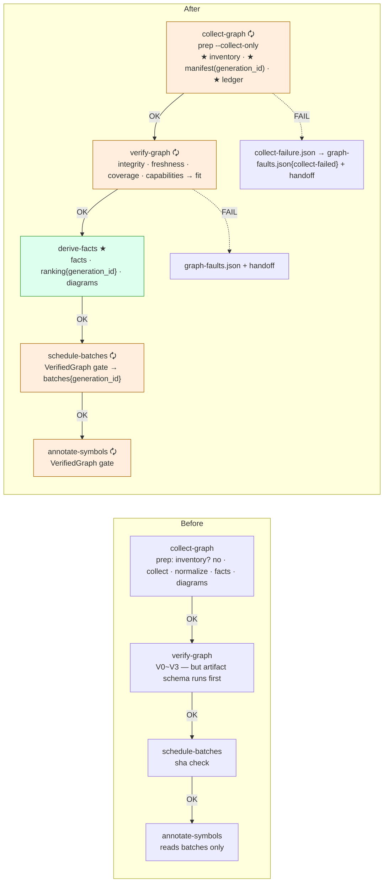
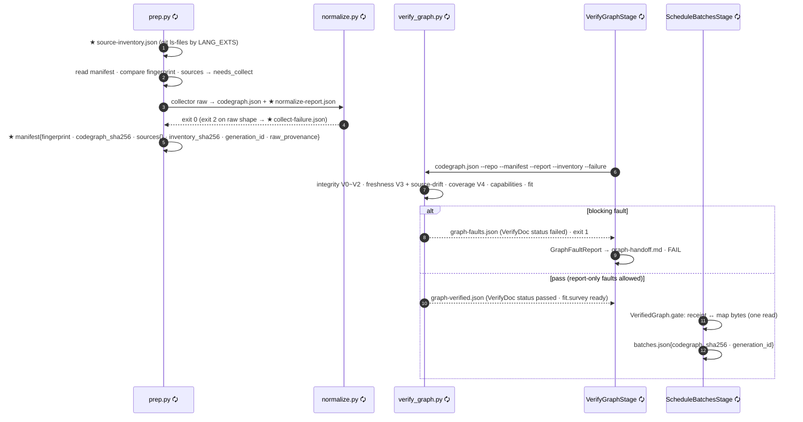
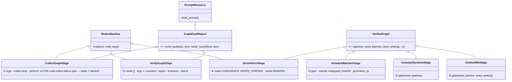

# 🧭 Code map — evidence boundaries · generation · coverage — implementation plan (stages 0~3 in detail · stages 4~6 in outline)

> 📅 2026-11-13 · branch `main` · **Before = `a21dd4d`** (= `origin/main` + 2). Working tree at writing time: untracked `public.handoff/2026-11-09-codegraph-adversarial-review.md` + folder and `public.handoff/2026-11-13-h4-adversarial-review-handoff.md`; uncommitted header edits by a parallel session to the 11-05 resume handoff · the stage-3 spec (`.md` · `.ko.md`) · the H4 handoff — Task 0 commits them together (measured in this session)
> 📄 Sources: `public.handoff/2026-11-09-codegraph-adversarial-review.md` (hereafter "the review") and its `repro.py` · `results.json` (re-run in this session, byte-identical) · `public.handoff/2026-11-08-codegraph-stage3-design.md` (hereafter "the stage-3 spec", **absorbed** 👍 2026-11-13) · `public.handoff/2026-11-05-codegraph-verify-unify-plan.md` (stages 1 · 2, done) · `public.handoff/2026-11-05-codegraph-verify-unify-resume-handoff.md` (checklist A~H) · `public.handoff/2026-11-13-h4-review-recommendations-handoff.md` (R1 is a separate track 👍). Code read in this session: `verify_graph.py` (all) · `mode1/graph.py` (all) · `mode1/context.py:223-338` · `core/pipeline.py:74-160,230-378` · `mode1/survey.py:25-60,190-210,504-529` · `mode1/survey_files.py:30-45` · `mode1/wiki.py:70-90,255-270,330-360` · `mode1/edges.py` (all) · `mode1/resume.py` (all) · `wiki/prep.py:1-300` · `wiki/compdb.py` (all) · `wiki/paths.py:5-26` · `normalize.py:10-18,425-465,486-510,728-760,1168-1262` · `survey_plan.py:47-108,154-160,226-228` · `terms_db.py:120-170` · `facts.py:96-112,214-270` · `codegraph_types.py` (all) · `lang_select.py:25-45` · `warmup.py:57-72` · `test_verify_graph.py` · `test_prep_fingerprint.py:18-29` · `test_mode1.py:886-896,2047` · `resource/codewiki/prompts/verify-graph.md`
> 🔒 Rules to keep: **never loosen a check to make it pass** · `codegraph_types.py` changes only where this plan shows the diff first (`Edge.sites`, stage 4) · if a `normalize.py` output **key** would change, stop and report (`terms_db.py` depends on `from`/`to` · `id`/`depends_on`) · the key of the sealed `terms-db.json` is a cross-mode contract (`src/common/contract_types.py:53`; Mode 1.5 reads it as a name, `src/term/python/runner/term/collect.py:35-37`) — stage 4 shows that diff first too · golden repositories are read-only · code comments describe only the current state · long text goes in `resource/` · commit only when the user asks, `personal-commit-messages` format · English canonical `.md` + Korean `.ko.md`
> 🧪 Verification: **implement → commit per Task → run the tests once at the end (Task 25) → on failure bisect with `git bisect run`** (👍 kept 2026-11-13). Regression specs that cannot pass yet are committed as `xfail(strict=True)` so every commit stays green on its own (see "🧪 Execution · testing guidelines")
> ✋ Approval: 👍 **approved for implementation 2026-11-14** — Task 0 (documents) is committed on `main`; Tasks 1~24 run in a separate git worktree on branch `codegraph-facts-generation`, one commit per Task, no push; merging into `main` is asked after Task 25. Decided the same day: no baseline run before Task 1 (Task 25 measures the Before values in a worktree of the Before commit) · the 14 corrections of `public.handoff/2026-11-13-all-in-one-root-guide.md` §7 are applied to this file in place (line numbers unchanged) · stale-shard reuse gets one extra Task after Task 10, its design shown to the user first

> **For agentic workers:** REQUIRED SUB-SKILL: execute Task by Task with `anthropic-skills:executing-plans`. Steps are tracked with checkboxes (`- [ ]`). Decisions in "✅ Decided" are not reopened.

**Goal:** Make `verify-graph`'s pass mean what the LLM stages need it to mean — the map is readable, internally consistent, built from the sources as they are now, and explicit about what it did not collect — and make every LLM entry point check that, not just `schedule-batches`.

**Architecture:** The verifier owns the raw file (no schema at the artifact boundary), reports in four sections (<span style="color:cyan">integrity</span> · <span style="color:cyan">freshness</span> · <span style="color:cyan">coverage</span> · <span style="color:cyan">capabilities</span>) plus a purpose fit, and binds its receipt to a <span style="color:cyan">generation id</span> computed at collection time from the collector fingerprint, the map bytes and the bytes of every cited source file. The receipt's id is stamped into `batches.json` and `ranking.json`, and one mixin (`VerifiedGraph`) checks it at every LLM entry. Normalization writes a <span style="color:cyan">drop ledger</span>; prep writes a <span style="color:cyan">source inventory</span> and a <span style="color:cyan">collection failure record</span>; `facts` · diagrams move behind the check into `derive-facts`. Everything stays in the flat `out/codegraph-raw/` folder (👍 no generation directories).

**Tech Stack:** Python 3.13 · pytest · pyright strict · msgspec 0.21.1 · Jinja2 · standard library `hashlib` · `tempfile` · `subprocess` (no new dependencies)

---

## 📋 One-page summary

| | |
|---|---|
| 🎯 Scope | The review's execution order 0~6 (`review §4`) replaces the 11-05 plan's stage 3~6 outline. **Stages 0~3 are written Task by Task (Tasks 0~25)**; stages 4~6 record their decisions, outputs and remaining entry questions. Handoff items covered in detail: A (wording) · B1~B3 · B5 · C1 · C3 · C5 · C6 · E1 · F1~F11 of the review · G1 · G2 · G3 (conditional) |
| 🧩 One-line conclusion | A pass today proves "JSON opens · keys present · ids consistent · cited files exist with enough lines". After stage 3 it proves that **and** "collector code · config · every cited source byte are the ones the map was built from · nothing the normalizer dropped is information loss · every file of the collected language is accounted for · uncollected languages are named" — and the proof travels with the derived files to each LLM entry |
| 🟰 Unchanged | The key shape of `codegraph.json` until stage 4 · the four UML-vocabulary edge kinds and R1~R7 · `report-wiki prep` still runs facts · diagrams at the end · `graph-verified.json` stays a separate file · the flat `out/codegraph-raw/` folder · the test policy (one run at the end + bisect) |
| 🗘 Changed | `CODEGRAPH` artifact loses its schema (the verifier reads the raw file) · result document grows four sections + `checks_run` + `fit` · `collect-fingerprint.json` becomes the collection manifest (`sources` · `generation_id` · `raw_provenance`) · `batches.json` · `ranking.json` carry `generation_id` · stages 14 → **15** (`derive-facts`) · `annotate-symbols` · `outline-wiki` · `write-wiki` read `GRAPH_VERIFIED` · fault codes 21 → **34** |
| ⚠️ Pitfalls | A repository with an old `out/` re-collects once on the first prep (manifest shape changed) · runner tests swap in fake stages — fakes standing in for `verify-graph` must leave a receipt and fakes for `schedule-batches` must stamp `codegraph_sha256` · `generation_id` (Task 25 Step 2 lists the fix) · the C# raw dump is produced outside prep, so its freshness is `unknown` until stage 5 adds a collector manifest — it does **not** block, it is reported · the C++ golden repository stays blocked on 48 `끝점 해소 실패` until B4 (Mac session) — and once Task 19 lands, **any** C++ target with a `끝점 해소 실패` drop stops at `verify-graph` the same way, not only the golden: measure a C++ target with a tool commit from before Task 19 or after B4 |
| 🚫 Out of scope | B4 · G3 · G4 (golden raw data — Mac session, 👍 S2) · G5~G8 · H4 recommendations R1~R7 (separate track; R2 after Task 22 and only once it has a consumer; measurement runs in its own workspace with the tool commit pinned and the start state recorded — `public.handoff/2026-11-13-all-in-one-root-guide.md` §4) · the fact store + projection architecture (👎, `Edge.sites` instead) · generation directories · writer locks (👎) · multi-configuration C++ collection (👎, single configuration declared) |

## 🗺️ The 7 stages at a glance

```text
Before (a21dd4d)                                      After · proposed
collect-graph  prep.py ─ griffe·pycalls·normalize      collect-graph  prep.py --collect-only
               facts · render-modules (unchecked)         ★ source-inventory.json  ★ collect-fingerprint = manifest(sources · generation_id)
               failure: screen only                       normalize ★ raw shape check → codegraph.json + ★ normalize-report.json
                                                          failure: ★ collect-failure.json → graph-faults.json + graph-handoff.md
   artifact schema CodeGraphDoc blocks broken JSON      artifact schema none — the verifier opens the raw file                  (1)
verify-graph   V0 → V1 → V2 → V3   (21 codes)          verify-graph   integrity V0~V2 (+3) · freshness V3 (+3) · coverage V4 (+7) (1)(2)(3)
               graph-verified.json {sha}                  → VerifyDoc {generation_id · checks_run · 4 sections · fit}           (1)(2)
                                                       ★ derive-facts   derive.py — facts/*.md · ranking.json{generation_id} · modules.svg (3)
schedule-batches  checks sha                           schedule-batches  VerifiedGraph gate → batches.json{codegraph_sha256 · generation_id} (1)(2)
annotate-symbols  reads batches only                   annotate · outline · write   VerifiedGraph gate (receipt ↔ map ↔ batches ↔ ranking) (1)(3)
C++/C#: classes only · (from,to,kind) folded           ★ methods · stable ids · Edge.sites (4) → ★ call edges (5) → languages · merge (6)
```

| 🧬 Stage | Review items | Handoff items | Entry decision | Outputs |
|---|---|---|---|---|
| 0 Documents · guarantees · counterexamples fixed | F10 · F1 wording · regression spec | — | 👍 this session | superseded marks · handoff header · `test_graph_adversarial.py` (xfail) |
| 1 Verification boundary · every LLM entry | F2 · F3 · F8 (rules) · F9 (atomic) · F1 (`checks_run`) | G1 · G2 | 👍 this session | `VerifyDoc` · `VerifiedGraph` mixin · `jsonio.write_json_atomic` |
| 2 Collection manifest · generation | F4 · F1 (source hash) · F9 (invalidation) | F2 · F3 of the handoff (extend) | 👍 flat folder + `generation_id` | manifest with `sources` · `generation_id` · `source-drift` fault |
| 3 Inventory · drop ledger · raw check · derived split | F6 (label) · F7 (path rule) · F8 (coverage) | B1~B3 · B5 · C1 · C3 · C5 · C6 · E1 · G3 (cond.) | 👍 S1~S6 absorbed | `normalize-report.json` · `source-inventory.json` · `collect-failure.json` · `derive-facts` |
| 4 Fact model · stable ids · downstream key migration | F5 · F6 (`sites`) | D1 · E2 · E3 | 👍 all methods kept + survey filter · 👍 `Edge.sites` | `언어:한정이름(인자형)` ids · `symbol_id` keys in `terms_db` · `survey` |
| 5 Per-language method · call collection | F7 (declared) · F11 | D2~D5 | §4.3-6 after D4 measurement | C# · C++ call edges with sites · answer-key precision |
| 6 Per-language merge · projections | — | E4~E6 · H1 · Q2 · Q3 | §4.3-7 (report first, merge later) | `languages` · per-language capabilities in the receipt |

## ✅ Decided — not to be reopened

| What | 👍 chosen · 👎 rejected | Who · when |
|---|---|---|
| How to absorb the review | 👍 rewrite stages 3~6 in the review's order 0~6 · 👎 a short reinforcement stage before stage 3 · 👎 fold items into the existing stages | user · 2026-11-10 |
| Test policy | 👍 keep "implement → commit per Task → test once at the end → bisect" · 👎 per-change regression runs · 👎 mixed. The bisect script's "no test file = pass" limit is written down (guidelines below) | user · 2026-11-10 |
| F6 where facts are kept | 👍 `Edge.sites: NotRequired[list[Site]]` in `codegraph_types.py` (stage 4, diff shown first) · 👎 separate fact file · 👎 fact store + projection · 👎 defer | user · 2026-11-10 |
| §4.3-5 method promotion scope | 👍 keep **all** declared methods as facts; batch · wiki scope is a filter · 👎 public surface only · 👎 call-reachable only | user · 2026-11-10 |
| Generation mechanism | 👍 flat `out/codegraph-raw/` + `generation_id` stamped on receipt · batches · ranking + atomic writes everywhere · 👎 immutable generation directories + manifest pointer + writer lock | user · 2026-11-10 |
| F7 C++ build configurations | 👍 declare one configuration per translation unit (first entry) and resolve relative `file` against `directory` as the clang format requires; dropped duplicates go to the inventory as `excluded(policy: duplicate-config)` · 👎 multi-configuration collection · 👎 decide after measuring | user · 2026-11-10 |
| F8 result shape | 👍 four sections `integrity` · `freshness` · `coverage` · `capabilities` + purpose `fit` · 👎 keep layers only | user · 2026-11-10 |
| Document location | 👍 this new plan + superseded marks on the 11-05 plan's stage 3~6 outline · 👎 replace §3~6 in the old file · 👎 merge into the handoff | user · 2026-11-10 |
| Stage-3 spec (S1~S6) | 👍 absorbed as-is — S1 block unresolved drops · S2 B4 · G3 on a Mac · S3 zero unresolved in this repository is the completion condition · S4 G1 · G2 approach A · S5 dotted-suffix resolution · S6 `derive-facts` right after `verify-graph`. Its header gets an "absorbed" note; it stays as the rationale for the Python resolution rules · 👎 reference only · 👎 reopen S1 | user · 2026-11-13 |
| H4 R1 measurement | 👍 separate track — this plan does not wait for it; R2 comes after Task 22 (`derive-facts`) · 👎 baseline in stage 0 · 👎 after stage 3 | user · 2026-11-13 |
| Korean translation of this plan | 👍 **summary translation** (`.ko.md` carries the first screen, the tables and the Task list; Task bodies stay in this file) — a one-document exception while the cross-check's Q6' (the full-translation rule) is open · 👎 full translation now · 👎 defer | user · 2026-11-13 |
| Earlier decisions still binding | 👍 verification between `collect-graph` and `schedule-batches` · collect all faults, JSON + template handoff, no LLM · the receiving agent judges unresolvable · `--only prep` runs through the check · separate receipt file · Q1 fingerprint file (handoff §4.1 · §4.3-1~4, 11-05 plan "Decided") | user · 2026-11-05 |

## 📊 Status

| Item | Status |
|---|---|
| Stages 1 · 2 of the 11-05 plan (fingerprint · atomic map write · `verify-graph` V0~V3) | ✅ `9066c57` … `bef937a` |
| Adversarial review · 12 counterexamples reproduced | ✅ 2026-11-09 · re-run 2026-11-10 (byte-identical) |
| Stage-3 spec decisions S1~S6 | ✅ 👍 absorbed here |
| This plan | ✅ approved for implementation 2026-11-14 (see ✋ Approval) |
| Stages 0~3 (Tasks 0~25) | ❌ |
| Stages 4~6 | ❌ (each gets its own Task-level plan when its remaining entry question is answered) |

## 🔎 What a pass guarantees — before and after (the "보장 정의" of review step 0)

| Claim | Before `a21dd4d` | After stage 1 | After stage 2 | After stage 3 |
|---|---|---|---|---|
| The file opens as JSON and has the contract keys · types | ✅ but the artifact boundary dies first with a one-line `why` and **no fault file · no handoff** (review F2, reproduced) | ✅ the verifier owns the read; broken or missing file → `unreadable` + handoff | — | — |
| Ids unique · edges resolve · external rules · module list | ✅ nine V2 rules | ✅ + `external-only` · `occurrences-range` · `module-dep-mismatch` | — | — |
| Cited files exist inside the repository with enough lines | ✅ V3 (`--repo` always passed by the stage, `graph.py:46`) | ✅ + the receipt says which checks ran (`checks_run`) and whether it fits the survey (`fit.survey`) | ✅ + **the cited files' bytes are the ones at collection time** (`source-drift`) and the collector code · config are the recorded ones (`generation-mismatch` · `freshness-unknown`) | — |
| The receipt belongs to this map and the LLM stages honor it | ❌ only `schedule-batches` checks the sha; `--only annotate-symbols` runs on any `batches.json` (review F3, reproduced) | ✅ `VerifiedGraph` gate at `schedule-batches` · `annotate-symbols` · `outline-wiki` · `write-wiki`; `batches.json` carries `codegraph_sha256` | ✅ `generation_id` on receipt · batches | ✅ `ranking.json` too; `facts` · diagrams are made only from a checked map. ⚠ Shards (`_shards/*.json`) and the reading records are **outside** this chain — `annotate-symbols` skips any batch whose shard file exists and merges every shard in the folder (`survey.py:381 · :575-576`); closed by the extra Task after Task 10 (👍 2026-11-14, design first) |
| Nothing dropped by normalization is information loss | ❌ `stats` are screen-only | — | — | ✅ ledger `normalize-report.json`; `unresolved-drop` · `unknown-kind` block (👍 S1) |
| Every file of the collected language is accounted for; other languages are named | ❌ | — | — | ✅ `source-inventory.json`; `coverage-gap` · `language-not-collected` **reported, not blocking** |
| Collection failures leave a structured record | ❌ screen only (review C5) | — | — | ✅ `collect-failure.json` → `collect-failed` fault + handoff from `collect-graph` itself |
| Not claimed at any stage | semantic correctness of names · call completeness · runtime dispatch targets. The receipt is evidence that **the named checks ran on these inputs with this policy**, never that the code's meaning is true (review §3) | | | |

## 🧪 Execution · testing guidelines (👍 2026-11-05, kept 2026-11-10)

1. **Implement in order Task 0 → 24; one Task is one commit.** Test code is written inside the Task and goes into the same commit; the "⏭ expected" lines are read at Task 25. A Task that changes a function signature or docstring regenerates the README (`tools/gen_readme.py`) in the same commit so the README drift gate holds at every commit.
2. **Regression specs that a later Task makes pass are committed as `@pytest.mark.xfail(strict=True, reason="Task N")`** in Task 1 and the marker is removed in Task N. `strict=True` turns an unexpected pass into a failure, so forgetting the removal is caught. Every commit is green on its own — bisection stays meaningful.
3. **Known limits of the bisect script** (review F11): a commit without the test file counts as good, so the culprit it names is the first commit where the test exists **and** fails — read the Task that commit belongs to, do not assume the test-introducing commit is innocent. `out/` is outside git and does not move with commits — a check that reads the real map (`test_이_저장소_지도는_…` · the adversarial pipeline tests · the records check) must rebuild it **at every bisect step**: run the script with `PREP=1` so `bin/report-wiki prep . --force` runs before the check on each commit (a commit where `prep` itself fails is skipped with 125 and inspected by hand). Rebuilding once before the bisection is not enough — different commits would be judged on one map. Unit tests do not need it.
4. **Task 25 — the final test** runs the six gates, the adversarial file and the real runs. On failure find the culprit with `git bisect run` (script below), add the fix as a **new commit**, rerun Task 25 from the start.

```bash
# good end = Before (a21dd4d), bad end = HEAD
git bisect start HEAD a21dd4d
git bisect run "$SCRATCH/bisect_test.sh" "<failing pytest node id or gate name>"
git bisect log; git bisect reset
```

```bash
#!/usr/bin/env bash
# one argument: pytest node id, or a gate name (readme · pyright · npm-test · typecheck · records). PREP=1 rebuilds the map first — guideline 3
cd "$(git rev-parse --show-toplevel)" || exit 125; [ -z "$PREP" ] || bin/report-wiki prep . --force >/dev/null 2>&1 || exit 125
case "$1" in
  readme)    .venv/bin/python tools/gen_readme.py --check src/codewiki/python/runner src/codewiki/python/machine src/codewiki/python/viz src/term/python/runner src/spec/python/runner src/spec/python/viz src/core src/common tools; exit $? ;;
  pyright)   npm run --silent typecheck:py >/dev/null 2>&1; exit $? ;;
  npm-test)  npm test --silent >/dev/null 2>&1; exit $? ;;  typecheck) npm run --silent typecheck >/dev/null 2>&1; exit $? ;;
  records)   .venv/bin/python src/codewiki/python/machine/terms_db.py out/codegraph-raw/codegraph.json --repo . --reading resource/codewiki/terms-reading.json -o "$(mktemp -d)" | grep -E '^  (실패|근거 없음)  ' | LC_ALL=C sort > "$SCRATCH/records.now"; [ -z "$(LC_ALL=C comm -13 "$SCRATCH/records.base" "$SCRATCH/records.now" | grep '^  실패')" ]; exit $? ;;
esac
f="${1%%::*}"
[ -f "$f" ] || exit 0                     # test file not yet in this commit — see guideline 3
.venv/bin/python -m pytest -q -x "$1" >/dev/null 2>&1
rc=$?
case $rc in 0|5) exit 0 ;; 1) exit 1 ;; *) exit 125 ;; esac
```

## 🔁 Before / After — one row per review finding

| 📍 Before (what fails · now) | 🛠️ After · proposed | 🎉 Resolved | 🔭 Expected | Progress |
|---|---|---|---|---|
| 🐞 F2 `CODEGRAPH` has schema `CodeGraphDoc` (`context.py:300-301`); `missing_reads` (`pipeline.py:137-147`) fails before `verify_graph.py` runs — broken JSON leaves no fault file | Artifact schema `None`; `VerifyGraphStage.reads = []` — the verifier owns absence and unreadability | V0 · V1-top are live in the pipeline, not only in the CLI | `{` → `graph-faults.json` {`unreadable` 1} + `graph-handoff.md`, stage FAIL | ❌ |
| 🐞 F3 `annotate-symbols` reads only `BATCHES` (`survey.py:34-35`); any `batches.json` runs; `stale_verification` reads the map twice (`graph.py:140-151`) | ★ `VerifiedGraph` mixin: one read of the map bytes, receipt `status` · `fit` · sha, `batches.codegraph_sha256` · `generation_id`; `reads` += `GRAPH_VERIFIED` at the four LLM-adjacent stages | A stale batch set cannot start sessions | `--only annotate-symbols` without a receipt → `missing_reads` ≠ [] | ❌ |
| 🐞 F8 external-only map · negative `occurrences` · `depends_on` disagreeing with edges pass (`verify_graph.py:127-128,212-218`) | 3 integrity codes; result split into 4 sections + `fit` | "0 faults" says what was checked | three synthetic maps → 1 fault each | ❌ |
| 🐞 F9 `_replace` writes with `open(…, "w")` (`verify_graph.py:285-292`); fingerprint · batches · resume likewise | ★ `jsonio.write_json_atomic` (moved from `normalize.py:1187`) used by every writer | No half-written receipt · plan · manifest | interrupt test: old file intact | ❌ |
| 🐞 F1 receipt = map sha only (`verify_graph.py:59-68`); same-line body change passes; plan text overstated V3 | `checks_run` · `fit` (stage 1) · collection-time `sources_sha256` per cited file → `source-drift` (stage 2); wording fixed (stage 0) | The receipt binds map **and** source bytes **and** collector | `def completely_different()` on the same line → `source-drift` 1 | ❌ |
| 🐞 F4 `COLLECT_CODE` (`prep.py:24-30`) misses `compdb.py` · runner `clang_doc.py` · `paths.py`; test checks only `normalize` imports; direct `report-wiki prep` without `--diff` never checks sources; C# `--force` re-normalizes an old dump | widen the fingerprint (code + `.clang-uml` + `compile_commands.json` bytes); `needs_collect` gains `source_changed` from the manifest's `sources`; C# `raw_provenance: "unknown"` reported | A collector fix anywhere in `wiki/` re-collects; a source edit re-collects even without `--diff` | `compdb.py` byte change → fingerprint differs | ❌ |
| 🐞 B1~B3 · C1 · C3 · C5 · C6 (stage-3 spec) | `Ledger` · `DROP_CLASS` · `normalize-report.json` · `CS_KIND.get` · `validate_raw` · `collect-failure.json` · `GraphFaultReport` · `derive-facts` | Drops are classified; crashes become faults; derived files come from a checked map | this repository: unresolved 0 · fault 0 (👍 S3) | ❌ |
| 🐞 E1 · F8-coverage minority languages vanish silently (this repository: py 125 · ts 13 · cs 1 tracked) | ★ `source-inventory.json` per language · per file status; coverage section + `language-not-collected` · `coverage-gap` (reported) | What was not collected is on the receipt and in the handoff | this repository → `languages_not_collected: ["cs", "ts"]` | ❌ |
| 🐞 F7 `mergeEntries` keeps one command per file name and drops relative `file` (`compdb.py:39-52`) | resolve `file` against `directory`; keep the first configuration; ledger the rest | Matches the clang format; the dropped choice is visible | 2 commands → 1 entry + 1 `excluded(policy: duplicate-config)` | ❌ |
| 🐞 F6 a call folded into a type edge loses its site; recursion is counted as `호출 양끝 해소 실패` (`normalize.py:1174`) | stage 3: reason `자기참조 버림(policy)`; stage 4: `Edge.sites` keeps every occurrence | Facts survive the view policy | stage 4 | ❌ |
| 🐞 F5 `terms_db` keys records by `name` (`terms_db.py:134`); two ids with one name → one record | stage 4: `symbol_id` as the join key end to end; names are display | Method promotion does not lose overloads | stage 4 | ❌ |
| 🐞 F10 handoff header says "구현 0"; §7 describes an in-map `verification` field; 11-05 plan §3~6 outline now superseded | Task 0 fixes headers, adds superseded · absorbed marks | One canonical status table (this document) | — | ❌ |

## ★ New · 🗘 changed items (module → file → class → function → member) — stages 0~3

| Mark | Location | What |
|---|---|---|
| 🗘 module `codewiki.python.machine` | ★ `jsonio.py` | ★ `write_json_atomic(path, obj, indent=2)` (moved from `normalize.py`) |
| | 🗘 `verify_graph.py` | ★ `SECTION` · `REPORT_ONLY` · `SectionDoc` · `FreshnessDoc` · `CoverageDoc` · `Capabilities` · `Fit` · `VerifyDoc` · ★ `check_manifest` · ★ `check_coverage` · ★ `capabilities_of` · ★ `fit_of` · 🗘 `check_elements` (`external-only` · `occurrences-range`) · 🗘 `check_consistency` (`module-dep-mismatch`) · 🗘 `check_sources` (also hashes files) · 🗘 `verify(path, repo, manifest, report, inventory, failure)` · 🗘 `main` (`--manifest` · `--report` · `--inventory` · `--failure`) · 🗘 `LAYER` (+13 codes) · ✕ `FaultsDoc` · ✕ `PassedDoc` |
| | 🗘 `normalize.py` | ★ `DropClass` · `DROP_CLASS` · `ReasonRow` · `ReportDoc` · `Ledger(Counter[str])` (`note` · `report`) · ★ `validate_raw` · ★ `write_report` · 🗘 `normalize_cpp` · `normalize_csharp` · `normalize_python` · `py_resolve` · `py_walk_expr` · `merge_py_calls` (reason split) · 🗘 `main` (`--report`) · ✕ `write_json_atomic` (moved) |
| | ★ `source_inventory.py` | ★ `InventoryDoc` · `FileStatus` · `build_inventory(repo, language, roots, excluded)` · `main` |
| | 🗘 `survey_plan.py` | 🗘 `GraphNode.file` · `.line` → `str \| None` · `int \| None` · 🗘 `SurveyPlan` + `codegraph_sha256` · `generation_id` (NotRequired) |
| | 🗘 `codegraph_types.py` | header wording only (S4) |
| 🗘 module `codewiki.python.runner.wiki` | 🗘 `prep.py` | 🗘 `COLLECT_CODE` (+4) · ★ `config_inputs` · ★ `hash_cited` · ★ `read_manifest` (replaces `recorded_fingerprint`) · ★ `write_manifest` · 🗘 `needs_collect(…, source_changed)` · 🗘 `prepPlan(…, collectOnly)` · 🗘 `run` (stderr tail · failure record) · 🗘 `main` (`--collect-only` · inventory · manifest) |
| | ★ `derive.py` | ★ `derive_steps(repo, paths, py, generation_id)` · `main` |
| | 🗘 `compdb.py` | 🗘 `mergeEntries` (resolve relative `file` · return dropped) |
| | 🗘 `paths.py` | 🗘 `wikiPaths` + `report` · `failure` · `inventory` |
| 🗘 module `mode1` | 🗘 `graph.py` | ★ `VerifiedGraph` (mixin) · ★ `GraphFaultReport(P.PromptResource)` (mixin) · ★ `DeriveFactsStage` · 🗘 `CollectGraphStage` (mixin · `--collect-only` · writes) · 🗘 `VerifyGraphStage` (reads `[]` · argv · mixin) · 🗘 `ScheduleBatchesStage` (mixin · stamps · strict load) · ✕ `ScheduleBatchesStage.stale_verification` (moved into the mixin) |
| | 🗘 `context.py` | 🗘 `CODEGRAPH` (no schema) · 🗘 `GraphVerifiedDoc` (+ `generation_id` · `checks_run` · `fit`) · ★ `COLLECT_FINGERPRINT` · `NORMALIZE_REPORT` · `COLLECT_FAILURE` · `SOURCE_INVENTORY` · `RANKING` · 🗘 `ARTIFACTS` |
| | 🗘 `survey.py` · `survey_files.py` · `wiki.py` | 🗘 `reads` (+ `GRAPH_VERIFIED` · `CODEGRAPH`; `outline-wiki` + `RANKING`) · 🗘 `perform` (gate first) |
| | 🗘 `edges.py` | 🗘 `ORDER` 15 · `STAGES` · `ALIASES["prep"]` |
| | 🗘 `resume.py` | 🗘 `write_resume` (atomic) |
| 🗘 resources | 🗘 `resource/codewiki/prompts/verify-graph.md` · ★ `collect-graph.md` | sections per result section · collection failure handoff |
| 🗘 tests | ★ `test/codewiki/test_graph_adversarial.py` · 🗘 `test_verify_graph.py` · `test_prep_fingerprint.py` · `test_mode1.py` · `test_normalize.py` · `test_survey_plan.py` | see each Task |
| 🗘 docs | `src/codewiki/CLAUDE.md` · `resource/CLAUDE.md` · `run_mode1.py` docstring · three READMEs (generated) · `resource/codewiki/terms-reading.json` records · the two handoffs · the 11-05 plan (marks) · the stage-3 spec (mark) | see Task 0 · 8 · 13 · 24 |

Members: `VerifyDoc.checks_run` · `.fit` · `.integrity` · `.freshness` · `.coverage` · `.capabilities` (★) · `SurveyPlan.codegraph_sha256` · `.generation_id` (★) · `Ranking.generation_id` (★) · manifest keys `sources` · `sources_sha256` · `generation_id` · `raw_provenance` · `config_inputs` · `inventory_sha256` (★).

## 🌊 Flow — the map segment of Mode 1



## 🔀 Sequence — one `prep → verify-graph → schedule-batches` run after stage 3



## 🧱 Structure — stage classes and the two mixins (After)



## 📖 Terms

| Term | Code name | Meaning |
|---|---|---|
| <span style="color:cyan">code map</span> | `codegraph.json` · `codegraph_types.CodeGraph` | the normalized graph the LLM stages read |
| <span style="color:cyan">receipt</span> | `graph-verified.json` · `verify_graph.VerifyDoc` (status passed) | evidence that the named checks ran on this map with this policy |
| <span style="color:cyan">fault document</span> | `graph-faults.json` · `VerifyDoc` (status failed) | the same shape with blocking faults |
| <span style="color:cyan">collection manifest</span> | `collect-fingerprint.json` (file name kept) · `prep.read_manifest` | fingerprint · tool versions · `sources` · `generation_id` · `raw_provenance`. Not the **seal manifest** of `docs/codegraph/` (`manifest.py` · `manifest.json` · `ArtifactManifest`) — always written with its qualifier |
| <span style="color:cyan">generation id</span> | `generation_id` | `sha256(fingerprint ‖ codegraph_sha256 ‖ sources_sha256 ‖ inventory_sha256)` — one collection |
| <span style="color:cyan">drop ledger</span> | `normalize-report.json` · `normalize.ReportDoc` · `Ledger` | every reason normalization dropped or folded something, classified |
| <span style="color:cyan">source inventory</span> | `source-inventory.json` · `source_inventory.InventoryDoc` | every tracked source file by language with its collection status |
| <span style="color:cyan">collection failure record</span> | `collect-failure.json` | failed step · argv · return code · stderr tail |
| <span style="color:cyan">gate</span> | `VerifiedGraph.gate` | the one function every LLM-adjacent stage calls first |
| <span style="color:cyan">report-only fault</span> | `verify_graph.REPORT_ONLY` | a fault that goes on the receipt without blocking (`language-not-collected` · `coverage-gap`) |

---
# Stage 0 — documents · guarantees · counterexamples fixed (review step 0 · F10 · F1 wording)

## Task 0: Land the document changes (F10 · superseded · absorbed marks)

**Files:**
- Modify: `public.handoff/2026-11-05-codegraph-verify-unify-resume-handoff.md` (§0 · §1 · §7 · §3 table)
- Modify: `public.handoff/2026-11-05-codegraph-verify-unify-plan.md` and `.ko.md` (stage 3~6 outline header · V3 wording in the 🔎 table and the stage-2 Before/After row)
- Modify: `public.handoff/2026-11-08-codegraph-stage3-design.md` and `.ko.md` (header)
- Modify: `src/codewiki/CLAUDE.md` (the `verify-graph` Gotcha line)
- Add to git: `public.handoff/2026-11-09-codegraph-adversarial-review.md` · `public.handoff/2026-11-09-codegraph-adversarial-review/` (currently untracked — they are this plan's source)
- Create: this plan `public.handoff/2026-11-13-codegraph-facts-generation-plan.md` · `.ko.md` (already written when Task 0 runs; the Task commits them)

- [ ] **Step 1: Handoff header** — the parallel session already added the "⚠ 2026-11-13 정정 — 구현은 0 은 작성 시점 값" line (uncommitted). Keep it and add one more line after it, then replace the two §0 bullets (제안 diff):

```diff
 > ⚠ **2026-11-13 정정** — 위 "구현은 0" 과 §0 · §1 의 "코드 변경 없음" 은 작성 시점 값이다. …
+> ⚠ **2026-11-13 — 상태 표의 정본은 `2026-11-13-codegraph-facts-generation-plan.md` 다.** 아래 §0 · §1 · §7 은 2026-11-05 작성 시점 글이고, 체크리스트 §2 만 계속 갱신한다. §7 의 "지도 안 `verification` 칸" 설계는 👍 2026-11-05 결정(별도 파일 `graph-verified.json`)으로 대체됐다.
-- **어디까지 왔나.** 코드 변경 없음. `verify-graph` 첫 구현은 시험까지 썼다가 사용자 지시로 전부 되돌렸다. 그 뒤 조사 · 실측을 끝냈다.
+- **어디까지 왔나.** 1 · 2단계(지문 · 원자적 쓰기 · `verify-graph` V0~V3) 끝 — `9066c57` … `bef937a`. 적대적 검토(2026-11-09)가 경계 밖 구멍 11건을 재현했고, 그 반영 계획이 `2026-11-13-codegraph-facts-generation-plan.md` 다.
-- **다음 행동.** 구현 전에 사용자에게 §4.3 의 결정을 받는다. 그다음 1단계(도구 지문과 안전한 쓰기)를 TDD 로 시작한다. **설계 확인 없이 구현부터 들어가지 마라** — 지난번에 그렇게 해서 되돌렸다.
+- **다음 행동.** `2026-11-13-codegraph-facts-generation-plan.md` 의 Task 1 부터. 결정은 그 문서의 "✅ Decided" 표에 있다 — 다시 열지 않는다.
```

- [ ] **Step 2: Handoff §1 and §3** — in §1 replace the four `HEAD … 게이트 …` lines with `HEAD a21dd4d · 브랜치 main = origin/main + 2 · 미커밋은 문서뿐 · 게이트 수치 기록은 없다(2026-11-13 수집 923개 — 통과 수는 Task 25 가 Before 커밋에서 잰다)`, one item per line so the line count stays. In §3 the parallel session already added rows for the 11-09 review ("**미커밋**") and the 11-13 점검; change the 11-09 row's git column to `추적` (this Task adds it) and its tail `처분은 11-13 점검 Q2'` to `처분 👍 2026-11-10 · 11-13 — 반례는 회귀 명세(계획 Task 1), 구조는 계획의 Decided 표`; add one row: `| 적대적 검토 반영 계획 | public.handoff/2026-11-13-codegraph-facts-generation-plan.md(영어 정본) · .ko.md | 추적 | 0~6단계. 3단계 설계 사양을 흡수했다. 상태 표의 정본 |`. In §7 add as the first line: `> ⚠ superseded — 이 절의 "지도 안 verification 칸" 과 "산출물 사슬" 은 구현되지 않았다. 실물은 2026-11-05 계획 2단계와 2026-11-13 계획 1단계다.`
- [ ] **Step 3: 11-05 plan marks** — in both `.md` and `.ko.md`:
  - before the heading `# Stages 3~6 — outline …` (Korean: `# 3~6단계 — 개요 …`) insert `> ⚠ **superseded 2026-11-13** — replaced by `2026-11-13-codegraph-facts-generation-plan.md` (the review's order 0~6). Kept for the history of the entry decisions only.`
  - 🔎 table row "V3 evidence", column "Missing": replace the sentence `A stale map does not reach the LLM` with `A map citing deleted files or overflowing lines does not reach the LLM (content changes on the same lines are not seen — stage 2 of the 2026-11-13 plan adds source-drift)`. Same replacement in the stage-2 Before/After row `🐞 Source locations are not checked (A4)`, column "🎉 Resolved".
- [ ] **Step 4: Stage-3 spec mark** — in both files the parallel session appended to the ✋ Approval line: `**2026-11-13:** the untracked adversarial review … Q2' · Q3'` (uncommitted). Replace that appended sentence with: `**2026-11-13:** absorbed into `2026-11-13-codegraph-facts-generation-plan.md` (stage 3, Tasks 13~24) — Q2' · Q3' of the 11-13 cross-check were answered by that plan's Decided table (review order adopted · S1~S6 kept). Decisions S1~S6 are binding there. This document stays as the rationale for the Python resolution rules (S3 · S5) and the drop-class table.`
- [ ] **Step 4b: 11-13 cross-check handoff** — `public.handoff/2026-11-13-h4-adversarial-review-handoff.md` §9: next to Q2' · Q3' · Q4' write `👍 답함 2026-11-10 · 11-13 → 2026-11-13-codegraph-facts-generation-plan.md Decided 표` (Q2' = (a) with the structure decided per item; Q3' = approve as part of that plan, not gated on R1'; Q4' = stage 3). Leave Q1' · Q5' · Q6' · Q7' as they are — they belong to the R0 · R1' track.
- [ ] **Step 5: `src/codewiki/CLAUDE.md`** — replace the Gotcha line that starts `- **Note — schedule-batches 는 graph-verified.json 의 codegraph_sha256 이 지금 지도와 같을 때만 돈다.**` with:

```markdown
- **Note — `verify-graph` 가 보장하는 것은 "열리고 · 열쇠가 맞고 · 안에서 어긋나지 않고 · 인용한 파일이 저장소 안에 그 줄 수 이상으로 있다" 까지다.** 같은 줄의 내용이 바뀐 것은 보지 않는다(2026-11-13 계획 2단계 `source-drift` 가 더한다). `schedule-batches` 는 `graph-verified.json` 의 `codegraph_sha256` 이 지금 지도와 같을 때만 돈다. 검사가 실패하면 `out/codegraph-raw/graph-faults.json` 과 `graph-handoff.md` 가 남고, `--resume` 은 `collect-graph` 부터 다시 돈다(`mode1.edges.RESTART_AT`).
```

- [ ] **Step 6: Gates that read documents** — `.venv/bin/python -m pytest -q qa/gates/test_docs_citations.py` ⏭ expected: pass (the handoff folder is not in `contextDocs()`, `src/codewiki/CLAUDE.md` is — the new line cites no `file:line`).
- [ ] **Step 7: Commit** — `git add public.handoff/2026-11-09-codegraph-adversarial-review.md public.handoff/2026-11-09-codegraph-adversarial-review public.handoff/2026-11-13-h4-adversarial-review-handoff.md public.handoff/2026-11-13-codegraph-facts-generation-plan.md public.handoff/2026-11-13-codegraph-facts-generation-plan.ko.md` plus every modified file under `public.handoff/` and `src/codewiki/CLAUDE.md` as `git status --short` lists them at that moment (seven on 2026-11-14, the parallel session's header edits included) and the root guide `public.handoff/2026-11-13-all-in-one-root-guide.md` — nothing outside those paths: another session's edits to `CLAUDE.md` · `.claude/` · `resource/` stay unstaged · `[docs] : 코드 지도 - 적대적 검토 반영 계획과 Root 지침, 핸드오프와 옛 계획에 대체 표시`

## Task 1: The review's counterexamples become regression tests (xfail until their Task)

**Files:**
- Create: `test/codewiki/test_graph_adversarial.py`

Each test is the review's `repro.py` case turned into an assertion of the **fixed** behavior, marked `xfail(strict=True, reason="Task N")`. The Task named in the reason deletes the marker. Names that do not exist yet (`prep.build_manifest` · `G.VerifiedGraph` · `sites`) are reached through attribute access inside the test body, so collection never fails.

- [ ] **Step 1: Write the file**

```python
"""적대적 검토(2026-11-09)의 반례 12개 — 고쳐진 뒤의 동작을 못박는다. 아직 못 고친 것은 xfail(strict) 로 두고 그 Task 가 표식을 뗀다."""
import contextlib
import hashlib
import io
import json
import sys
from collections import Counter
from pathlib import Path

import pytest

ROOT = Path(__file__).resolve().parents[2]
for p in ("src", "src/codewiki/python/runner", "src/codewiki/python/machine"):
    s = str(ROOT / p)
    if s not in sys.path:
        sys.path.insert(0, s)

import normalize  # noqa: E402
import survey_plan  # noqa: E402
import terms_db  # noqa: E402
import verify_graph as V  # noqa: E402
from codewiki.python.runner.wiki import compdb, prep  # noqa: E402
from core import pipeline as P  # noqa: E402
from mode1 import context as X, edges as E, graph as G  # noqa: E402


def node(id: str, name: str = "pkg.f", module: str = "pkg", file: str = "a.py") -> dict[str, object]:
    return {"id": id, "name": name, "kind": "function", "module": module, "file": file, "line": 1}


def graph() -> dict[str, object]:
    return {"schema_version": 2, "language": "python", "platform": "linux", "source_tool": "probe",
            "repo_commit": None, "nodes": [node("C1")], "edges": [], "modules": [{"id": "pkg", "depends_on": []}]}


@pytest.fixture
def repo(tmp_path: Path) -> Path:
    (tmp_path / "out" / "codegraph-raw").mkdir(parents=True)
    (tmp_path / "a.py").write_text("def f(): return 1\n", encoding="utf-8")
    return tmp_path


def raw(repo: Path, name: str) -> Path:
    return repo / "out" / "codegraph-raw" / name


def ctx_for(repo: Path) -> X.Mode1Context:
    return X.Mode1Context(root=str(ROOT), model="never-called", repo=str(repo), cold=True)


def sha(path: Path) -> str:
    return hashlib.sha256(path.read_bytes()).hexdigest()


@pytest.mark.xfail(strict=True, reason="Task 2")
def test_깨진_JSON_은_파이프라인에서도_결함_파일과_핸드오프를_남긴다(repo: Path) -> None:
    raw(repo, "codegraph.json").write_text("{", encoding="utf-8")
    ctx = ctx_for(repo)
    pipeline = E.build_mode1_graph(ctx, only=["verify-graph"], skip=None)
    with contextlib.redirect_stdout(io.StringIO()), contextlib.redirect_stderr(io.StringIO()):
        rows = P.Pipeline().run(pipeline, ctx)
    assert rows[0]["ok"] is False
    doc = json.loads(raw(repo, "graph-faults.json").read_text(encoding="utf-8"))
    assert doc["total"] == 1 and doc["faults"][0]["code"] == "unreadable"   # Task 2 와 Task 4 의 꼴 양쪽에서 참
    assert raw(repo, "graph-handoff.md").exists()


@pytest.mark.xfail(strict=True, reason="Task 10")
def test_줄_수_같은_소스_교체는_source_drift_다(repo: Path) -> None:
    cg = raw(repo, "codegraph.json")
    cg.write_text(json.dumps(graph()), encoding="utf-8")
    manifest = raw(repo, "collect-fingerprint.json")
    manifest.write_text(json.dumps(prep.build_manifest("fp", {}, str(cg), str(repo), "griffe+pycalls")), encoding="utf-8")
    assert V.verify(str(cg), str(repo), manifest=str(manifest))["status"] == "passed"
    (repo / "a.py").write_text("def completely_different(): return 2\n", encoding="utf-8")
    doc = V.verify(str(cg), str(repo), manifest=str(manifest))
    assert doc["status"] == "failed" and doc["freshness"]["counts"] == {"source-drift": 1}


@pytest.mark.xfail(strict=True, reason="Task 5")
def test_V3_를_건너뛴_기록은_전수조사에_맞지_않는다(repo: Path) -> None:
    cg = raw(repo, "codegraph.json")
    cg.write_text(json.dumps(graph()), encoding="utf-8")
    (repo / "a.py").unlink()
    doc = V.verify(str(cg), None)
    assert doc["status"] == "passed"                       # 구조만 봤다 — 통과는 맞다
    assert "V3" not in doc["checks_run"] and doc["fit"]["survey"] == "blocked"
    raw(repo, "graph-verified.json").write_text(json.dumps(doc), encoding="utf-8")
    assert G.VerifiedGraph.gate(ctx_for(repo), need_batches=False)[0] != ""


@pytest.mark.xfail(strict=True, reason="Task 5")
def test_annotate_only_는_성공_기록_없이_돌지_않는다(repo: Path) -> None:
    raw(repo, "batches.json").write_text(json.dumps(survey_plan.plan(graph(), 8)), encoding="utf-8")
    raw(repo, "codegraph.json").write_text("{", encoding="utf-8")
    ctx = ctx_for(repo)
    # annotate-symbols 가 graph-verified.json 을 읽는다고 선언하면 시뮬레이터의 산출물 사슬 검사가 시작 전에 막는다
    with pytest.raises(P.GraphError, match="graph-verified.json"):
        E.build_mode1_graph(ctx, only=["annotate-symbols"], skip=None)


@pytest.mark.xfail(strict=True, reason="stage 4 — Task-level plan to come")
def test_고유_id_둘_같은_이름_은_용어_둘이다() -> None:
    g = graph()
    g["nodes"] = [node("cs:pkg.f(int)"), node("cs:pkg.f(float)")]
    terms = terms_db.build_terms(g, {}, [])
    assert len([r for r in terms.values() if r["kind"] != "module"]) == 2


@pytest.mark.xfail(strict=True, reason="Task 4")
def test_모듈_의존_누락과_음수_occurrences_는_결함이다(repo: Path) -> None:
    g = graph()
    g["nodes"].append(node("C2", "pkg2.g", "pkg2"))
    g["edges"] = [{"from": "C1", "to": "C2", "kind": "dependency", "label": "call", "file": "a.py", "line": 1,
                   "occurrences": -5}]
    g["modules"].append({"id": "pkg2", "depends_on": []})
    cg = raw(repo, "codegraph.json")
    cg.write_text(json.dumps(g), encoding="utf-8")
    doc = V.verify(str(cg), str(repo))
    assert doc["integrity"]["counts"] == {"module-dep-mismatch": 1, "occurrences-range": 1}


@pytest.mark.xfail(strict=True, reason="Task 4")
def test_외부_노드만_있는_지도는_결함이다(repo: Path) -> None:
    g = graph()
    g["nodes"] = [{"id": "X:std", "name": "std", "kind": "external", "module": "__external__", "file": None, "line": None}]
    g["modules"] = []
    cg = raw(repo, "codegraph.json")
    cg.write_text(json.dumps(g), encoding="utf-8")
    assert V.verify(str(cg), str(repo))["integrity"]["counts"] == {"external-only": 1}


@pytest.mark.xfail(strict=True, reason="Task 8")
def test_compdb_변경은_지문을_바꾼다(tmp_path: Path) -> None:
    for rel in prep.COLLECT_CODE:
        dst = tmp_path / rel
        dst.parent.mkdir(parents=True, exist_ok=True)
        dst.write_bytes((ROOT / rel).read_bytes())
    helper = tmp_path / "src/codewiki/python/runner/wiki/compdb.py"
    helper.write_text("before\n", encoding="utf-8")
    before = prep.collect_fingerprint(str(tmp_path), {})
    helper.write_text("changed behavior\n", encoding="utf-8")
    assert before != prep.collect_fingerprint(str(tmp_path), {})


@pytest.mark.xfail(strict=True, reason="Task 9")
def test_C샵_강제_수집은_원본_출처를_unknown_으로_적는다(repo: Path) -> None:
    cg = raw(repo, "codegraph.json")
    cg.write_text(json.dumps(graph()), encoding="utf-8")
    assert prep.prepPlan("roslyn-dump", True, False, True, False, force=True)["steps"][0] == "normalize"
    doc = prep.build_manifest("fp", {"roslyn-dump.json": "abc"}, str(cg), str(repo), "roslyn-dump")
    assert doc["raw_provenance"] == "unknown"
    assert prep.build_manifest("fp", {}, str(cg), str(repo), "griffe+pycalls")["raw_provenance"] == "prep"


@pytest.mark.xfail(strict=True, reason="Task 18")
def test_같은_파일의_두_컴파일_명령은_하나만_남고_장부에_남는다(tmp_path: Path) -> None:
    d = str(tmp_path)
    entries = [{"file": d + "/a.cpp", "directory": d, "command": "clang++ -DMODE=1 a.cpp"},
               {"file": "a.cpp", "directory": d, "command": "clang++ -DMODE=2 a.cpp"}]   # 두 번째는 상대경로다
    dropped: list[dict[str, object]] = []
    kept = compdb.mergeEntries([entries], d, dropped)
    assert len(kept) == 1 and kept[0]["command"].endswith("-DMODE=1 a.cpp")
    assert len(dropped) == 1 and dropped[0]["reason"] == "duplicate-config"


@pytest.mark.xfail(strict=True, reason="Task 13")
def test_자기_재귀_호출은_해소_실패가_아니다() -> None:
    nodes = {"C1": node("C1")}
    ids = {"pkg.f": "C1"}
    edges: dict[tuple[str, str, str], dict[str, object]] = {}
    stats = normalize.Ledger()
    normalize.merge_py_calls(nodes, ids, edges, {"symbols": [], "calls": [
        {"caller": "pkg.f", "callee": "pkg.f", "file": "a.py", "line": 1}]}, stats)
    assert edges == {} and stats["자기참조 버림"] == 1 and stats["호출 양끝 해소 실패"] == 0


@pytest.mark.xfail(strict=True, reason="stage 4 — Task-level plan to come")
def test_호출이_타입_간선에_접혀도_호출_위치가_남는다() -> None:
    nodes = {"C1": node("C1"), "C2": node("C2", "pkg.g")}
    ids = {"pkg.f": "C1", "pkg.g": "C2"}
    edges = {("C1", "C2", "dependency"): {"from": "C1", "to": "C2", "kind": "dependency",
                                           "label": "type annotation", "file": "a.py", "line": 1}}
    normalize.merge_py_calls(nodes, ids, edges, {"symbols": [], "calls": [
        {"caller": "pkg.f", "callee": "pkg.g", "file": "a.py", "line": 9}]}, normalize.Ledger())
    e = edges[("C1", "C2", "dependency")]
    assert e["occurrences"] == 2 and {"file": "a.py", "line": 9, "label": "호출"} in e["sites"]
```

- [ ] **Step 2: Collect only** — `.venv/bin/python -m pytest -q test/codewiki/test_graph_adversarial.py` ⏭ expected: `12 xfailed` (no error, no unexpected pass). If one passes already, the marker is wrong — stop and report which.
- [ ] **Step 3: Commit** — `[test] : codewiki - 적대적 검토의 반례 12개를 회귀 시험으로 고정, 고칠 Task 까지 xfail`

---
# Stage 1 — the verification boundary and every LLM entry (review step 1 · F2 · F3 · F8 · F9 · F1 · G1 · G2)

## Task 2: The verifier owns the raw file (F2)

**Files:**
- Modify: `src/codewiki/python/runner/mode1/context.py:300-301` (`CODEGRAPH`)
- Modify: `src/codewiki/python/runner/mode1/graph.py:49-50` (`VerifyGraphStage.reads`)
- Modify: `test/codewiki/test_mode1.py` (any assertion on `CODEGRAPH.schema` or `VerifyGraphStage().reads`)
- Modify: `test/codewiki/test_graph_adversarial.py` (remove the `Task 2` marker)

- [ ] **Step 1: Artifact without schema** (제안 diff)

```diff
 # src/codewiki/python/runner/mode1/context.py
 CODEGRAPH = P.Artifact[Mode1Context](
-    "codegraph.json", lambda c: os.path.join(raw_dir(c), "codegraph.json"), CodeGraphDoc)
+    "codegraph.json", lambda c: os.path.join(raw_dir(c), "codegraph.json"))
+# 꼴은 verify-graph 가 본다 — 경계가 먼저 막으면 깨진 JSON 이 결함 파일 없이 죽는다.
```

- [ ] **Step 2: The stage reads nothing** — the verifier reports a missing or unreadable file itself (`read_graph`, `verify_graph.py:78-91`), so the stage must not declare it:

```diff
 # src/codewiki/python/runner/mode1/graph.py — VerifyGraphStage
     def reads(self, ctx: Mode1Context) -> list[P.Artifact[Mode1Context]]:
-        return [X.CODEGRAPH]
+        return []          # 없는 지도도 이 단계가 unreadable 로 보고한다
```

- [ ] **Step 3: Existing tests** — `grep -n "CODEGRAPH.schema\|VerifyGraphStage().reads\|CodeGraphDoc" test/codewiki/test_mode1.py`. Change an assertion `== [X.CODEGRAPH]` to `== []`; an assertion that `CODEGRAPH.schema is X.CodeGraphDoc` to `is None`. Leave `survey_files.py:38` (it loads `CodeGraphDoc` itself).
- [ ] **Step 4: Un-xfail** — delete the `@pytest.mark.xfail(strict=True, reason="Task 2")` line above `test_깨진_JSON_은_파이프라인에서도_결함_파일과_핸드오프를_남긴다`.
- [ ] **Step 5: ⏭ expected at Task 25** — that test passes; `run_mode1.py . --dry-run` shows `verify-graph` with no reads; `--only verify-graph` on an empty `out/` yields `graph-faults.json` {`unreadable` 1} and `graph-handoff.md`.
- [ ] **Step 6: Commit** — `[fix] : codewiki - 코드 지도 산출물의 꼴 검사를 경계에서 떼어 verify-graph 가 깨진 파일도 결함으로 남긴다`

## Task 3: One atomic JSON writer for every result file (F9)

**Files:**
- Create: `src/codewiki/python/machine/jsonio.py`
- Modify: `src/codewiki/python/machine/normalize.py:10,1187-1199,1259` (import · delete the function · call)
- Modify: `src/codewiki/python/machine/verify_graph.py:285-292` (`_replace`)
- Modify: `src/codewiki/python/runner/wiki/prep.py:24-30,278-281` (`COLLECT_CODE` · fingerprint write)
- Modify: `src/codewiki/python/runner/mode1/graph.py:160-163` (batches write)
- Modify: `src/codewiki/python/runner/mode1/resume.py:32-34` (resume write)
- Create: `test/codewiki/test_jsonio.py`

- [ ] **Step 1: The module**

```python
"""jsonio.py — JSON 파일을 같은 폴더의 임시 파일에 쓰고 `os.replace` 로 바꿔 끼운다. 도중에 끊겨도 옛 파일이 그대로 남는다."""
import json
import os
import tempfile


def write_json_atomic(path: str, obj: object, indent: int = 2, trailing_newline: bool = False) -> None:
    """`path` 를 `obj` 의 JSON 으로 바꿔 끼운다. 같은 입력이면 같은 바이트다."""
    folder = os.path.dirname(os.path.abspath(path))
    os.makedirs(folder, exist_ok=True)
    fd, tmp = tempfile.mkstemp(dir=folder, prefix="." + os.path.basename(path) + ".", suffix=".tmp")
    try:
        with os.fdopen(fd, "w", encoding="utf-8") as f:
            json.dump(obj, f, ensure_ascii=False, indent=indent)
            if trailing_newline:
                f.write("\n")
        os.replace(tmp, path)
    except BaseException:
        if os.path.exists(tmp):
            os.unlink(tmp)
        raise
```

- [ ] **Step 2: Callers** — `normalize.py`: `from jsonio import write_json_atomic` next to `from pycalls import PyCallsDump`; delete lines 1187-1199; the call at 1259 stays `write_json_atomic(a.out, g)` (indent 2, no newline — same bytes as today). `verify_graph.py`: `from jsonio import write_json_atomic`; `_replace` body becomes `if os.path.exists(drop): os.remove(drop)` then `write_json_atomic(keep, doc, indent=1, trailing_newline=True)`. `prep.py`: `from codewiki.python.machine.jsonio import write_json_atomic` and lines 280-281 become `write_json_atomic(P["fingerprint"], {"fingerprint": fingerprint, "codegraph_sha256": sha}, indent=1)`. `graph.py` lines 161-163: `jsonio.write_json_atomic(out_path, ctx.plan, indent=1)` (`import jsonio` next to `import survey_plan`). `resume.py` lines 32-34: `write_json_atomic(path, doc, indent=1)` (`from jsonio import write_json_atomic`; the runner puts `python/machine/` on `sys.path`).
- [ ] **Step 3: Fingerprint covers the new module** — add `"src/codewiki/python/machine/jsonio.py",` to `COLLECT_CODE` (`test_지문은_normalize_가_import_하는_이_저장소_모듈을_전부_담는다` demands it).
- [ ] **Step 4: Test**

```python
"""jsonio — 원자적 JSON 쓰기."""
import os
import sys
from pathlib import Path

import pytest

ROOT = Path(__file__).resolve().parents[2]
sys.path.insert(0, str(ROOT / "src/codewiki/python/machine"))
import jsonio  # noqa: E402


def test_같은_입력은_같은_바이트고_임시_파일이_남지_않는다(tmp_path: Path) -> None:
    p = tmp_path / "a.json"
    jsonio.write_json_atomic(str(p), {"b": 1, "a": [1, 2]}, indent=1, trailing_newline=True)
    first = p.read_bytes()
    jsonio.write_json_atomic(str(p), {"b": 1, "a": [1, 2]}, indent=1, trailing_newline=True)
    assert p.read_bytes() == first and first.endswith(b"\n")
    assert os.listdir(tmp_path) == ["a.json"]


def test_바꿔_끼우기가_실패하면_옛_파일이_그대로_남는다(tmp_path: Path, monkeypatch: pytest.MonkeyPatch) -> None:
    p = tmp_path / "a.json"
    p.write_text("old", encoding="utf-8")

    def boom(src: str, dst: str) -> None:
        raise OSError("disk")
    monkeypatch.setattr(jsonio.os, "replace", boom)
    with pytest.raises(OSError):
        jsonio.write_json_atomic(str(p), {"new": True})
    assert p.read_text(encoding="utf-8") == "old" and os.listdir(tmp_path) == ["a.json"]
```

- [ ] **Step 5: README** — `.venv/bin/python tools/gen_readme.py src/codewiki/python/machine src/codewiki/python/runner`
- [ ] **Step 6: Commit** — `[refactor] : codewiki - 원자적 JSON 쓰기를 jsonio 로 모아 검사 결과, 지문, 배치, 재개 파일이 함께 쓴다`

## Task 4: The result document — four sections · `checks_run` · `fit` · three integrity rules (F8 · F1)

**Files:**
- Modify: `src/codewiki/python/machine/verify_graph.py` (types · `LAYER` · `check_elements` · `check_consistency` · `verify` · `main`)
- Modify: `src/codewiki/python/runner/mode1/context.py:268-271` (`GraphVerifiedDoc`)
- Modify: `src/codewiki/python/runner/mode1/graph.py:55-82` (`handoff_text` · `perform`)
- Modify: `resource/codewiki/prompts/verify-graph.md`
- Modify: `test/codewiki/test_verify_graph.py` · `test/codewiki/test_graph_adversarial.py` (three `Task 4` markers)

- [ ] **Step 1: Types and tables** — replace `FaultsDoc` · `PassedDoc` (`verify_graph.py:48-68`) with:

```python
SECTION_OF_LAYER: dict[str, str] = {"V0 읽기": "integrity", "V1 꼴": "integrity", "V2 정합": "integrity",
                                    "V3 근거": "freshness"}
# 기록에만 남고 통과를 막지 않는 코드. 3단계가 채운다.
REPORT_ONLY: frozenset[str] = frozenset()


class SectionDoc(TypedDict):
    """한 절의 결함 수와 코드별 수."""
    faults: int
    counts: dict[str, int]


class FreshnessDoc(SectionDoc):
    """최신성 절. `manifest` 는 수집 manifest 와의 대조 결과, `raw_provenance` 는 수집 원본이 prep 안에서 났는가."""
    manifest: Literal["ok", "missing", "mismatch"]
    sources_sha256: str | None
    raw_provenance: Literal["prep", "unknown"]


class CoverageDoc(SectionDoc):
    """범위 절. 소스 inventory 가 있을 때만 수가 채워진다."""
    inventory: Literal["ok", "missing"]
    files_total: int
    collected: int
    excluded: int
    unsupported: int
    failed: int
    no_symbols: int
    languages_not_collected: list[str]


class Capabilities(TypedDict):
    """이 수집기가 낼 수 있다고 주장하는 것."""
    methods: bool
    calls: bool
    resolution: Literal["compiler", "heuristic", "none"]


class Fit(TypedDict):
    """목적별 적합성. 지금 목적은 전수조사(annotate-symbols) 하나다."""
    survey: Literal["ready", "blocked"]
    blocked_by: list[str]


class VerifyDoc(TypedDict):
    """`graph-verified.json`(status passed) 과 `graph-faults.json`(status failed) 의 공통 꼴."""
    status: Literal["passed", "failed"]
    generation_id: str | None
    codegraph_sha256: str | None
    language: str | None
    source_tool: str | None
    repo_commit: str | None
    nodes: int
    edges: int
    modules: int
    checks_run: list[str]
    integrity: SectionDoc
    freshness: FreshnessDoc
    coverage: CoverageDoc
    capabilities: Capabilities
    fit: Fit
    total: int
    faults: list[Fault]
```

Add to `LAYER`: `"external-only": "V1 꼴", "occurrences-range": "V1 꼴", "module-dep-mismatch": "V2 정합"` (24 codes).

- [ ] **Step 2: Rules** — in `check_elements`, after the edge `convert` succeeds: `occ = e.get("occurrences"); if occ is not None and occ < 1: out.append(fault("occurrences-range", "$.edges[%d].occurrences" % i, "%d — 1 이상이어야 한다" % occ))`. After the node loop: `if el.nodes and all(n["kind"] == "external" for _, n in el.nodes): out.append(fault("external-only", "$.nodes", "1차 노드가 하나도 없다 — 외부 노드 %d개뿐이다" % len(el.nodes)))`. In `check_consistency`, inside the `if not (el.bad_node_ids or …)` block, after the module-list rules, mirror `normalize.py:489-498`:

```python
        module_of = {n["id"]: n["module"] for _, n in el.nodes}
        expected: dict[str, set[str]] = {m: set() for m in listed}
        for _, e in el.edges:
            a, b = module_of.get(e["from"]), module_of.get(e["to"])
            if kind_of.get(e["to"]) == "external" or not a or not b or a == b:
                continue
            expected.setdefault(a, set()).add(b)
        for i, m in el.modules:
            want, got = expected.get(m["id"], set()), set(m["depends_on"])
            if want != got:
                out.append(fault("module-dep-mismatch", "$.modules[%d].depends_on" % i,
                                 "간선으로 센 것과 다르다 — 빠짐 %s · 남음 %s"
                                 % (sorted(want - got) or "없음", sorted(got - want) or "없음")))
```

- [ ] **Step 3: `verify` builds the document**

```python
def capabilities_of(language: str | None) -> Capabilities:
    """언어(수집기)별로 지도가 주장할 수 있는 것. 6단계가 언어별 기록으로 넓힌다."""
    if language == "python":
        return {"methods": True, "calls": True, "resolution": "heuristic"}
    if language in ("cpp", "csharp"):
        return {"methods": False, "calls": False, "resolution": "compiler"}
    return {"methods": False, "calls": False, "resolution": "none"}


def section(faults: list[Fault], name: str) -> SectionDoc:
    mine = [f for f in faults if SECTION_OF_LAYER[LAYER[f["code"]]] == name]
    return {"faults": len(mine), "counts": dict(sorted(Counter(f["code"] for f in mine).items()))}


def fit_of(status: str, checks_run: list[str], freshness: FreshnessDoc, blocking: list[Fault]) -> Fit:
    """전수조사에 들어갈 수 있는가. 구조만 본 기록(V3 없음)은 맞지 않는다."""
    why: list[str] = sorted({f["code"] for f in blocking})
    if "V3" not in checks_run:
        why.append("V3 를 돌리지 않았다 (--repo 없음)")
    return {"survey": "ready" if status == "passed" and not why else "blocked", "blocked_by": why}


def verify(path: str, repo: str | None) -> VerifyDoc:
    """층을 차례로 돌려 결과 문서 하나를 낸다. 앞 층이 열지 못한 것은 뒤 층이 보지 않는다."""
    doc, sha, faults = read_graph(path)
    checks = ["V0"]
    d = cast(dict[str, object], doc) if isinstance(doc, dict) else None
    el: Elements | None = None
    if not faults:
        faults = check_top(doc)
        checks.append("V1")
    if d is not None:
        el, more = check_elements(d)
        faults = faults + more + check_consistency(el)
        checks.append("V2")
        if repo is not None:
            faults = faults + check_sources(el, repo)
            checks.append("V3")
    blocking = [f for f in faults if f["code"] not in REPORT_ONLY]
    status: Literal["passed", "failed"] = "failed" if blocking or d is None or el is None else "passed"
    freshness: FreshnessDoc = {**section(faults, "freshness"), "manifest": "missing", "sources_sha256": None,
                               "raw_provenance": "unknown"}
    coverage: CoverageDoc = {**section(faults, "coverage"), "inventory": "missing", "files_total": 0, "collected": 0,
                             "excluded": 0, "unsupported": 0, "failed": 0, "no_symbols": 0,
                             "languages_not_collected": []}
    language = _text(d, "language")
    return {"status": status, "generation_id": None, "codegraph_sha256": sha or None,
            "language": language, "source_tool": _text(d, "source_tool"), "repo_commit": _text(d, "repo_commit"),
            "nodes": len(el.nodes) if el else 0, "edges": len(el.edges) if el else 0,
            "modules": len(el.modules) if el else 0, "checks_run": checks,
            "integrity": section(faults, "integrity"), "freshness": freshness, "coverage": coverage,
            "capabilities": capabilities_of(language), "fit": fit_of(status, checks, freshness, blocking),
            "total": len(faults), "faults": faults}
```

`SECTION_OF_LAYER` has no `coverage` layer yet, so `section(faults, "coverage")` is `{faults: 0, counts: {}}` until Task 19. `main` keeps writing `--passed` on `passed` and `--faults` otherwise; its summary line reads `got["integrity"]["counts"]` etc. — print `" · ".join("%s %d" % kv for kv in Counter(f["code"] for f in got["faults"]).items())`.

- [ ] **Step 4: Boundary type and handoff** — `context.py` `GraphVerifiedDoc`: add `generation_id: str | None`, `checks_run: list[str]`, `fit: dict[str, object]` (msgspec ignores the other keys, as today's two-key type already proves). `graph.py:55-64 handoff_text(cls, repo, codegraph, doc: verify_graph.VerifyDoc)`: `counts = Counter(f["code"] for f in doc["faults"])`; groups carry `"section": verify_graph.SECTION_OF_LAYER[verify_graph.LAYER[code]]`; pass `checks_run=" · ".join(doc["checks_run"])` and `fit=doc["fit"]["survey"]` to `load_prompt`. `perform` loads `verify_graph.VerifyDoc`. Template `resource/codewiki/prompts/verify-graph.md`: after the `결함 {{ total }}건` line add `- 수행한 검사 {{ checks_run }} · 전수조사 적합 {{ fit }}`; the group heading becomes `### `{{ g.code }}` · {{ g.section }} / {{ g.layer }} · {{ g.count }}건`; under "층마다 볼 곳" add `- **V1 external-only** — 1차 노드가 없다: 수집기가 대상 폴더를 못 봤거나 R1 이 전부를 외부로 접었다.` and `- **V2 module-dep-mismatch** — `_assemble` 의 모듈 의존 유도(normalize.py)와 지도의 `depends_on` 이 다르다.`
- [ ] **Step 5: Tests** — in `test_verify_graph.py`: `test_표는_네_층_스물한_코드다` → `test_표는_네_층_스물넷_코드고_층마다_절이_있다` asserting `len(V.LAYER) == 24` and `set(V.LAYER.values()) <= set(V.SECTION_OF_LAYER)`; `test_결과_파일은_한쪽만_남고_통과는_같은_바이트다` reads `doc["status"]` · `doc["integrity"]["faults"] == 0` instead of the old keys; add:

```python
def test_결과_문서는_네_절과_수행_검사와_적합을_갖는다(tmp_path: Path) -> None:
    p = tmp_path / "g.json"
    p.write_text(json.dumps(GOOD), encoding="utf-8")          # GOOD 은 이 파일 맨 위의 온전한 지도 상수다
    doc = V.verify(str(p), None)
    assert doc["checks_run"] == ["V0", "V1", "V2"] and doc["fit"]["survey"] == "blocked"
    assert set(doc) >= {"integrity", "freshness", "coverage", "capabilities", "fit", "generation_id"}
    assert doc["capabilities"] == {"methods": True, "calls": True, "resolution": "heuristic"}
```

Remove the two `Task 4` markers in `test_graph_adversarial.py` (`test_모듈_의존_누락과_음수_occurrences_는_결함이다` · `test_외부_노드만_있는_지도는_결함이다`).

- [ ] **Step 6: Commit** — `[feat] : codewiki - 검사 결과를 integrity, freshness, coverage, capabilities 넷과 적합 판정으로 내고 외부만, 음수 발생 수, 모듈 의존 불일치를 잡는다`

## Task 5: One gate at every LLM entry (F3) — `VerifiedGraph`

**Files:**
- Modify: `src/codewiki/python/runner/mode1/graph.py` (★ mixin · `ScheduleBatchesStage`)
- Modify: `src/codewiki/python/machine/survey_plan.py:96-99` (`SurveyPlan`)
- Modify: `src/codewiki/python/runner/mode1/survey.py:34-35,504-508` · `survey_files.py:30-38` · `wiki.py` (`OutlineWikiStage` · `WriteWikiStage` `reads` and `perform`)
- Modify: `test/codewiki/test_mode1.py` (the `stale_verification` test · fake stages) · `test/codewiki/test_graph_adversarial.py` (`Task 5` marker)

- [ ] **Step 1: Plan carries the map hash** — `survey_plan.SurveyPlan` gains `codegraph_sha256: NotRequired[str]` and `generation_id: NotRequired[str]` (the second is filled in Task 11).
- [ ] **Step 2: The mixin** (replaces `ScheduleBatchesStage.stale_verification`, `graph.py:137-143`):

```python
class VerifiedGraph:
    """검사를 지난 지도만 읽는 단계의 믹스인. 지도 바이트를 한 번 읽어 성공 기록과 파생물에 대조하고 그 바이트를 돌려준다."""

    @staticmethod
    def gate(ctx: Mode1Context, need_batches: bool, need_ranking: bool = False) -> tuple[str, bytes]:
        """막힐 이유(빈 문자열이면 통과)와 지금 지도의 바이트. 해시를 낸 바이트를 그대로 파싱해야 바꿔 끼우기 경쟁이 없다."""
        verified = X.GRAPH_VERIFIED.locate(ctx)
        if not os.path.exists(verified):
            return "성공 기록이 없다 — verify-graph 부터 돌린다", b""
        doc = P.load(verified, X.GraphVerifiedDoc)
        if doc["fit"]["survey"] != "ready":
            return "성공 기록이 전수조사에 맞지 않는다 — %s" % ", ".join(str(x) for x in doc["fit"]["blocked_by"]), b""
        with open(X.CODEGRAPH.locate(ctx), "rb") as f:
            raw = f.read()
        now = hashlib.sha256(raw).hexdigest()
        if doc["codegraph_sha256"] != now:
            return "검사 뒤에 코드 지도가 바뀌었다 — verify-graph 부터 다시 돌린다", raw
        if need_batches:
            plan = P.load(X.BATCHES.locate(ctx), survey_plan.SurveyPlan)
            if plan.get("codegraph_sha256") != now:
                return "배치가 지금 지도의 것이 아니다 — schedule-batches 부터 다시 돌린다", raw
        return "", raw
```

`need_ranking` is wired in Task 22 (until then it is accepted and ignored — the parameter exists so callers do not change twice). `Fit.blocked_by` in `GraphVerifiedDoc` is `dict[str, object]`; the `str(x)` keeps pyright strict quiet.

- [ ] **Step 3: `ScheduleBatchesStage(VerifiedGraph, Measured, P.Stage[Mode1Context])`** — `perform` starts `why, raw = self.gate(ctx, need_batches=False)`; on `why` return the FAIL row as today; then `cg = cast(survey_plan.CodeGraph, msgspec.json.decode(raw, type=X.CodeGraphDoc))` (Task 6 drops the cast); after `ctx.plan` is built: `ctx.plan["codegraph_sha256"] = hashlib.sha256(raw).hexdigest()`; write with `jsonio.write_json_atomic(out_path, ctx.plan, indent=1)`.
- [ ] **Step 4: The four LLM-adjacent stages** — `AnnotateSymbolsStage(VerifiedGraph, …)` and `AnnotateFilesStage(VerifiedGraph, …)`: `reads` → `[X.CODEGRAPH, X.GRAPH_VERIFIED, X.BATCHES] + ([] if ctx.cold else [X.CHANGES])`; first lines of `perform`: `why, _ = self.gate(ctx, need_batches=True)` → `if why: return P.Outcome(P.FAIL, why, [self.row(t0, False, why)])` (`AnnotateFilesStage` builds its row the same way its existing failures do). `OutlineWikiStage(VerifiedGraph, …)` · `WriteWikiStage(VerifiedGraph, …)`: `reads` += `[X.CODEGRAPH, X.GRAPH_VERIFIED]`; same two lines at the top of `perform` with `need_batches=True`.
- [ ] **Step 5: Tests** — replace the `stale_verification` test in `test_mode1.py` with one that writes a receipt whose `codegraph_sha256` is wrong and asserts `G.VerifiedGraph.gate(ctx, need_batches=False)[0].startswith("검사 뒤에")`, one where the receipt matches but `batches.json` lacks `codegraph_sha256` → `startswith("배치가")`, one where everything matches → `("", raw)`. Fakes in `test_mode1.py` that replace `verify-graph` must now write a receipt with `fit: {"survey": "ready", "blocked_by": []}` · `checks_run` · `generation_id: None`; fakes replacing `schedule-batches` must stamp `codegraph_sha256` — Task 25 Step 2 shows the helper. Remove the two `Task 5` markers in `test_graph_adversarial.py` (`test_V3_를_건너뛴_기록은_전수조사에_맞지_않는다` needs the gate, so it lands here, not in Task 4 · `test_annotate_only_는_성공_기록_없이_돌지_않는다`).
- [ ] **Step 6: `--dry-run`** — `.venv/bin/python src/codewiki/python/runner/run_mode1.py . --dry-run` ⏭ expected: the simulator accepts the graph (`verify-graph` writes `graph-verified.json` on OK, so every later reader is guaranteed).
- [ ] **Step 7: Commit** — `[feat] : codewiki - 성공 기록 대조를 VerifiedGraph 믹스인으로 모아 배치, 전수조사, 목차, 위키 단계가 같은 검문을 지난다`

## Task 6: Contract wording and the strict plan type (G1 · G2 — 👍 S4 approach A)

**Files:**
- Modify: `src/codewiki/python/machine/survey_plan.py` (`GraphNode`)
- Modify: `src/codewiki/python/runner/mode1/graph.py` (`ScheduleBatchesStage.perform` — drop the `cast`)
- Modify: `src/codewiki/python/machine/codegraph_types.py:1-6` (header wording)
- Modify: `src/codewiki/CLAUDE.md` (the `codegraph_types.py` row · the "기계축 선언이 실물과 어긋난다" Gotcha)
- Modify: `test/codewiki/test_survey_plan.py`

- [ ] **Step 1: Partial type matches reality** (제안 diff, from the stage-3 spec)

```diff
 # src/codewiki/python/machine/survey_plan.py
-    "file": NotRequired[str],
-    "line": NotRequired[int],
+    "file": NotRequired[str | None],
+    "line": NotRequired[int | None],
```

- [ ] **Step 2: Strict load** — in `ScheduleBatchesStage.perform`: `cg = msgspec.json.decode(raw, type=survey_plan.CodeGraph)`; delete the `cast` import if unused and the comment above it (`graph.py:150`).
- [ ] **Step 3: Header wording** (`codegraph_types.py`)

```diff
-# 쓰는 것: 없음 · 쓰이는 곳: normalize, facts, survey_plan, verify_citations, render_modules, render_classes
+# 쓰는 것: 없음 · 쓰이는 곳(import): normalize, terms_db, warmup, verify_graph
 …
-생산자(`normalize.py::_assemble`)와 소비자 전부가 여기 하나를 본다.
+생산자(`normalize.py::_assemble`)와 검사기(`verify_graph.py`)가 이 형을 쓴다. survey_plan · facts ·
+render_modules · render_classes · verify_citations 는 읽는 칸만 적은 축소 형을 따로 둔다.
```

- [ ] **Step 4: Test** — in `test_survey_plan.py`: `msgspec.convert(json.load(open("test/codewiki/fixtures/codegraph-self.json")), survey_plan.CodeGraph)` does not raise.
- [ ] **Step 5: Docs** — `src/codewiki/CLAUDE.md`: in the `codegraph_types.py` row replace "생산자와 소비자가 전부 여기를 본다" with "생산자와 검사기가 쓴다. 다른 소비자는 축소 형"; in the Gotcha "기계축 선언이 실물과 어긋난다" delete the `survey_plan.CodeGraph` half (keep the `warmup.Manifest` half).
- [ ] **Step 6: Commit** — `[fix] : codewiki - survey_plan 의 노드 형을 실물에 맞춰 schedule-batches 가 cast 없이 읽고 계약 머리말을 바로잡는다`

## Task 7: Stage 1 — generated files · records · docs

- [ ] **Step 1: README** — `.venv/bin/python tools/gen_readme.py src/codewiki/python/runner src/codewiki/python/machine`
- [ ] **Step 2: Records** — add to `resource/codewiki/terms-reading.json` one record each for `codewiki.python.machine.jsonio.write_json_atomic`, `verify_graph.SectionDoc` · `FreshnessDoc` · `CoverageDoc` · `Capabilities` · `Fit` · `VerifyDoc` (kind `class`) · `capabilities_of` · `section` · `fit_of` (kind `function`), `codewiki.python.runner.mode1.graph.VerifiedGraph` (class) · `VerifiedGraph.gate` (method), with `where` = the real `file:line`, `means` = the docstring's first line in plain words, `does` = the rest in one or two sentences, `uses: []`, `confidence: "HIGH"`, `source: "reading"`. Delete the records of `verify_graph.FaultsDoc` · `PassedDoc` · `graph.ScheduleBatchesStage.stale_verification`.
- [ ] **Step 3: Docs** — `src/codewiki/CLAUDE.md`: the `verify-graph` Note from Task 0 gains one sentence: `결과 문서는 integrity · freshness · coverage · capabilities 네 절과 checks_run · fit 을 갖고, schedule-batches · annotate-symbols · outline-wiki · write-wiki 는 VerifiedGraph.gate 로 같은 기록을 대조한다.` Handoff §2: append a section `### I. 적대적 검토 (2026-11-09)` with rows `I-F2` · `I-F3` · `I-F8(규칙 셋)` · `I-F9` · `I-F1(checks_run · fit)` marked `[x]` with their commits, and `I-F1(source-drift)` · `I-F4` · `I-F6` · `I-F7` · `I-F5` as `[ ]` pointing at their Task numbers.
- [ ] **Step 4: Commit** — `[docs] : codewiki - 검사 결과 넷 절과 공통 검문 설명, 레코드, 핸드오프 1단계 표시`

---
# Stage 2 — collection manifest and generation (review step 2 · F4 · F1 source hash · F9 invalidation)

## Task 8: The fingerprint covers everything that changes collection (F4)

**Files:**
- Modify: `src/codewiki/python/runner/wiki/prep.py:24-30` (`COLLECT_CODE`) · `:58-66` (`collect_fingerprint`) · ★ `config_inputs`
- Modify: `test/codewiki/test_prep_fingerprint.py:18-27` · `test/codewiki/test_graph_adversarial.py` (`Task 8` marker)

- [ ] **Step 1: Code list** — `COLLECT_CODE` becomes (one line each): the five of today, plus `src/codewiki/python/machine/jsonio.py` (Task 3), `src/codewiki/python/runner/wiki/compdb.py`, `src/codewiki/python/runner/wiki/clang_doc.py`, `src/codewiki/python/runner/wiki/paths.py`. Comment above it: `# 수집 결과를 바꾸는 이 저장소의 코드 — prep.py 와 normalize.py 가 import 하는 이 저장소 모듈은 전부 여기 있어야 한다 (test_prep_fingerprint.py 가 고정한다).`
- [ ] **Step 2: Configuration inputs** — new function next to `tool_versions`:

```python
def config_inputs(repo: str, collector: Optional[str]) -> dict[str, str]:
    """수집 결과를 바꾸는 대상 저장소의 설정 파일 — 상대 경로 -> 내용 sha256. clang-uml 만 갖는다."""
    if collector != "clang-uml":
        return {}
    out: dict[str, str] = {}
    for path in [os.path.join(repo, ".clang-uml")] + findCompdbs(repo):
        try:
            with open(path, "rb") as f:
                out[os.path.relpath(path, repo)] = hashlib.sha256(f.read()).hexdigest()
        except OSError:
            continue
    return out


def collect_fingerprint(root: str, versions: dict[str, str], inputs: Optional[dict[str, str]] = None) -> str:
    """수집 코드의 내용 · 바깥 수집기 판 · 설정 입력을 합친 sha256. 커밋 해시가 아니라 내용이라 커밋 전 수정도 잡는다."""
    h = hashlib.sha256()
    for rel in COLLECT_CODE:
        with open(os.path.join(root, rel), "rb") as f:
            h.update(f"{rel}\0".encode())
            h.update(hashlib.sha256(f.read()).digest())
    for name in sorted(versions):
        h.update(f"{name}={versions[name]}\0".encode())
    for name in sorted(inputs or {}):
        h.update(f"input:{name}={(inputs or {})[name]}\0".encode())
    return h.hexdigest()
```

`main` (`prep.py:184`): `fingerprint = collect_fingerprint(ROOT, tool_versions(...), config_inputs(repo, collector))`.

- [ ] **Step 3: Widen the test** — replace `test_지문은_normalize_가_import_하는_이_저장소_모듈을_전부_담는다` with one that walks **both** `normalize.py` (flat imports → `src/codewiki/python/machine/<m>.py`) and `prep.py` (`from codewiki.python.runner.wiki.X import …` → `src/codewiki/python/runner/wiki/X.py`; `from codewiki.python.machine.X import …` → `src/codewiki/python/machine/X.py`):

```python
def _local_imports(path: Path) -> set[str]:
    """파일이 import 하는 이 저장소 모듈의 상대 경로."""
    tree = ast.parse(path.read_text(encoding="utf-8"))
    out: set[str] = set()
    for n in ast.walk(tree):
        names = ([n.module] if isinstance(n, ast.ImportFrom) and n.module else
                 [a.name for a in n.names] if isinstance(n, ast.Import) else [])
        for name in names:
            if name.startswith("codewiki.python."):
                out.add("src/" + name.replace(".", "/") + ".py")
            elif (MACHINE / f"{name}.py").exists():
                out.add(f"src/codewiki/python/machine/{name}.py")
    return {p for p in out if (ROOT / p).exists()}


def test_지문은_prep_와_normalize_가_import_하는_이_저장소_모듈을_전부_담는다() -> None:
    want = _local_imports(MACHINE / "normalize.py") | _local_imports(ROOT / "src/codewiki/python/runner/wiki/prep.py")
    want |= {"src/codewiki/python/machine/normalize.py", "src/codewiki/python/runner/wiki/prep.py"}
    assert want <= set(prep.COLLECT_CODE), sorted(want - set(prep.COLLECT_CODE))


def test_설정_입력이_바뀌면_지문이_바뀐다(tmp_path: Path) -> None:
    (tmp_path / ".clang-uml").write_text("add_compile_flags: [-std=c++20]\n", encoding="utf-8")
    a = prep.config_inputs(str(tmp_path), "clang-uml")
    (tmp_path / ".clang-uml").write_text("add_compile_flags: [-std=c++23]\n", encoding="utf-8")
    b = prep.config_inputs(str(tmp_path), "clang-uml")
    assert set(a) == {".clang-uml"} and a != b
    assert prep.config_inputs(str(tmp_path), "griffe+pycalls") == {}
```

`common.python` is excluded on purpose (the interpreter choice does not change the map); if the test's `want` ever includes it, add it rather than special-casing. Remove the `Task 8` marker in `test_graph_adversarial.py`.

- [ ] **Step 4: README** — `.venv/bin/python tools/gen_readme.py src/codewiki/python/runner`
- [ ] **Step 5: Commit** — `[fix] : codewiki - 수집 지문이 prep 이 import 하는 모듈과 .clang-uml, compile_commands 내용까지 덮는다`

## Task 9: The collection manifest — source hashes at collection time · `generation_id` · re-collect on source change (F1 · F4)

**Files:**
- Create: `src/codewiki/python/machine/collect_manifest.py`
- Modify: `src/codewiki/python/runner/wiki/prep.py` (`recorded_fingerprint` → `read_manifest` · `needs_collect` · `main` · the delete list · the write after normalize) · `COLLECT_CODE` (+ `collect_manifest.py`)
- Modify: `test/codewiki/test_prep_fingerprint.py` · `test/codewiki/test_graph_adversarial.py` (`Task 9` marker)

- [ ] **Step 1: One module for producer and verifier**

```python
"""collect_manifest.py — 수집 manifest(`collect-fingerprint.json`)의 꼴과 계산. prep 이 쓰고 verify_graph 가 읽는다."""
import hashlib
import json
import os
from typing import Literal, TypedDict, cast


class CollectManifest(TypedDict):
    """한 번의 수집. `generation_id` 가 이 수집의 지도 · 소스 · 수집기 셋을 한 이름으로 묶는다."""
    fingerprint: str
    tool_versions: dict[str, str]
    config_inputs: dict[str, str]
    codegraph_sha256: str
    sources: dict[str, str]
    sources_sha256: str
    raw_provenance: Literal["prep", "unknown"]
    generation_id: str


def file_sha256(path: str) -> str | None:
    """바이트 그대로의 sha256. 없거나 못 열면 None."""
    try:
        with open(path, "rb") as f:
            return hashlib.sha256(f.read()).hexdigest()
    except OSError:
        return None


def cited_files(codegraph: str) -> list[str]:
    """지도의 노드 · 간선이 인용한 파일(상대 경로)을 이름순으로."""
    with open(codegraph, encoding="utf-8") as f:
        g = cast(dict[str, object], json.load(f))
    out: set[str] = set()
    for key in ("nodes", "edges"):
        for x in cast(list[dict[str, object]], g.get(key) or []):
            if isinstance(x.get("file"), str):
                out.add(cast(str, x["file"]))
    return sorted(out)


def hash_sources(repo: str, files: list[str]) -> dict[str, str]:
    """파일마다 지금 내용의 sha256. 없는 파일은 "missing"."""
    return {rel: file_sha256(os.path.join(repo, rel)) or "missing" for rel in files}


def sources_digest(sources: dict[str, str]) -> str:
    h = hashlib.sha256()
    for rel in sorted(sources):
        h.update(f"{rel}={sources[rel]}\n".encode())
    return h.hexdigest()


def generation_id(fingerprint: str, codegraph_sha256: str, sources_sha256: str) -> str:
    """수집기 지문 · 지도 바이트 · 소스 바이트를 한 이름으로. 셋 중 하나만 달라도 다른 세대다."""
    return hashlib.sha256(f"{fingerprint}\n{codegraph_sha256}\n{sources_sha256}\n".encode()).hexdigest()


def build_manifest(fingerprint: str, versions: dict[str, str], codegraph: str, repo: str, collector: str,
                   inputs: dict[str, str] | None = None) -> CollectManifest:
    """정제 직후에 부른다 — 소스 해시는 수집 시점의 것이어야 뒤에 붙인 거짓 최신성이 되지 않는다."""
    sha = file_sha256(codegraph) or ""
    sources = hash_sources(repo, cited_files(codegraph))
    digest = sources_digest(sources)
    return {"fingerprint": fingerprint, "tool_versions": versions, "config_inputs": inputs or {},
            "codegraph_sha256": sha, "sources": sources, "sources_sha256": digest,
            "raw_provenance": "unknown" if collector == "roslyn-dump" else "prep",
            "generation_id": generation_id(fingerprint, sha, digest)}


def read_manifest(path: str, codegraph: str) -> CollectManifest | None:
    """기록된 manifest. 없거나 깨졌거나 지금 지도가 그때의 지도가 아니면 None — 셋 다 다시 수집하라는 뜻이다."""
    try:
        with open(path, encoding="utf-8") as f:
            raw = cast(object, json.load(f))
    except (OSError, ValueError):
        return None
    if not isinstance(raw, dict):
        return None
    d = cast(dict[str, object], raw)
    need = ("fingerprint", "codegraph_sha256", "sources", "sources_sha256", "generation_id", "raw_provenance")
    if any(k not in d for k in need) or d["codegraph_sha256"] != file_sha256(codegraph):
        return None
    return cast(CollectManifest, d)


def changed_sources(manifest: CollectManifest, repo: str) -> list[str]:
    """manifest 에 적힌 파일 중 지금 내용이 다른 것(없어진 것 포함)."""
    now = hash_sources(repo, sorted(manifest["sources"]))
    return [rel for rel in sorted(now) if now[rel] != manifest["sources"][rel]]
```

The C# dump is produced outside prep, so `raw_provenance` is `unknown` for `roslyn-dump` — reported on the receipt (Task 10), not blocking; stage 5 adds a collector manifest to `Program.cs` and flips it.

- [ ] **Step 2: prep uses it** — `from codewiki.python.machine.collect_manifest import build_manifest, changed_sources, read_manifest` (keep the names importable as `prep.build_manifest` — the adversarial test calls it that way). Delete `recorded_fingerprint` (`prep.py:69-83`). `needs_collect(has_codegraph, verdicts, force=False, tool_changed=False, source_changed=False)`: first line `if force or tool_changed or source_changed or not has_codegraph: return True`; docstring adds `소스 내용이 manifest 와 다르면(source_changed) --diff 없이도 다시 수집한다`. `prepPlan(…, toolChanged=False, sourceChanged=False)` passes it through. In `main`:

```python
    recorded = read_manifest(P["fingerprint"], P["codegraph"])
    plan = prepPlan(..., toolChanged=recorded is None or recorded["fingerprint"] != fingerprint,
                    sourceChanged=bool(recorded and changed_sources(recorded, repo)))
```

The delete list (`prep.py:205-208`) grows to `(P["codegraph"], P["fingerprint"], os.path.join(P["raw"], "graph-verified.json"), os.path.join(P["raw"], "graph-faults.json"))` — a receipt never outlives the map it describes. After `normalize` (replacing `prep.py:278-281`): `write_json_atomic(P["fingerprint"], build_manifest(fingerprint, versions, P["codegraph"], repo, collector, inputs), indent=1)` where `versions` and `inputs` are the values computed for the fingerprint. Add `src/codewiki/python/machine/collect_manifest.py` to `COLLECT_CODE`.

- [ ] **Step 3: Tests** — in `test_prep_fingerprint.py`: `test_기록된_지문은_지도가_그때의_지도일_때만_읽힌다` → uses `prep.read_manifest` on a manifest written by `prep.build_manifest`; `test_수집에_성공하면_지문을_남기고_지문이_다르면_다시_수집한다` → also asserts the written file has `sources` · `generation_id`; add:

```python
def test_소스_내용이_바뀌면_diff_없이도_다시_수집한다(tmp_path: Path) -> None:
    """직접 report-wiki prep 을 부르는 경로 — --diff 가 없어도 manifest 의 소스 해시가 재수집을 정한다."""
    repo = tmp_path / "r"
    (repo / "pkg").mkdir(parents=True)
    (repo / "pkg" / "a.py").write_text("def f():\n    return 1\n", encoding="utf-8")
    subprocess.run(["git", "init", "-q"], cwd=repo, check=True)
    subprocess.run(["git", "add", "-A"], cwd=repo, check=True)
    env = {**os.environ, "GIT_AUTHOR_NAME": "t", "GIT_AUTHOR_EMAIL": "t@t", "GIT_COMMITTER_NAME": "t", "GIT_COMMITTER_EMAIL": "t@t"}
    subprocess.run(["git", "commit", "-qm", "init"], cwd=repo, check=True, env=env)
    argv = [sys.executable, str(ROOT / "src/codewiki/python/runner/wiki/prep.py"), str(repo)]
    first = subprocess.run(argv, capture_output=True, text=True)
    assert first.returncode == 0, first.stderr
    second = subprocess.run(argv, capture_output=True, text=True)
    assert "normalize" not in second.stdout.split("단계")[1].splitlines()[0]
    (repo / "pkg" / "a.py").write_text("def f():\n    return 2\n", encoding="utf-8")   # 같은 줄 수, 다른 내용
    third = subprocess.run(argv, capture_output=True, text=True)
    assert "normalize" in third.stdout.split("단계")[1].splitlines()[0]
    doc = json.loads((repo / "out/codegraph-raw/collect-fingerprint.json").read_text(encoding="utf-8"))
    assert doc["sources"]["pkg/a.py"] == hashlib.sha256((repo / "pkg" / "a.py").read_bytes()).hexdigest()
    assert doc["raw_provenance"] == "prep" and len(doc["generation_id"]) == 64
```

This test spawns griffe · pycalls · normalize · facts · Graphviz three times (a few seconds each) — the same cost class as the existing `test_수집에_성공하면_…`. Remove the `Task 9` marker in `test_graph_adversarial.py`.

- [ ] **Step 4: README** — `.venv/bin/python tools/gen_readme.py src/codewiki/python/runner src/codewiki/python/machine`
- [ ] **Step 5: Commit** — `[feat] : codewiki - 수집 지문 파일이 인용 파일의 소스 해시와 generation_id 를 갖는 manifest 가 되고 소스가 바뀌면 다시 수집한다`

## Task 10: Freshness against the manifest — `source-drift` · `generation-mismatch` · `freshness-unknown` (F1)

**Files:**
- Modify: `src/codewiki/python/machine/verify_graph.py` (`LAYER` · `check_sources` · ★ `check_manifest` · `verify` · `fit_of` · `main`)
- Modify: `src/codewiki/python/runner/mode1/context.py` (★ `COLLECT_FINGERPRINT`) · `graph.py` (`VerifyGraphStage.argv` · `CollectGraphStage.writes`)
- Modify: `test/codewiki/test_verify_graph.py` · `test/codewiki/test_graph_adversarial.py` (`Task 10` marker) · `resource/codewiki/prompts/verify-graph.md`

- [ ] **Step 1: Codes** — `LAYER` += `"freshness-unknown": "V3 근거", "generation-mismatch": "V3 근거", "source-drift": "V3 근거"` (27).
- [ ] **Step 2: V3 also hashes** — `_line_count` becomes `_file_facts(path) -> tuple[int, str] | None` returning `(line count, sha256)` from one read; `check_sources(el, repo)` returns `tuple[list[Fault], dict[str, str]]` — the second value is `{rel: sha}` for every cited file it opened (missing files are absent). Callers adjust.
- [ ] **Step 3: Manifest check**

```python
def check_manifest(manifest_path: str | None, sha: str, now: dict[str, str]
                   ) -> tuple[list[Fault], Literal["ok", "missing", "mismatch"], CollectManifest | None]:
    """최신성 — 수집 manifest 가 이 지도의 것이고, 인용 파일의 지금 바이트가 수집 시점과 같은가."""
    if manifest_path is None or not os.path.exists(manifest_path):
        return [fault("freshness-unknown", "$", "수집 manifest 가 없다 — prep 이 지도를 만들었는지 알 수 없다")], "missing", None
    try:
        with open(manifest_path, "rb") as f:
            m = msgspec.json.decode(f.read(), type=CollectManifest)
    except (OSError, msgspec.DecodeError) as e:
        return [fault("freshness-unknown", "$", "수집 manifest 를 읽을 수 없다: %s" % e)], "missing", None
    if m["codegraph_sha256"] != sha:
        return [fault("generation-mismatch", "$", "manifest 는 다른 지도(%s…)의 것이다" % m["codegraph_sha256"][:12])], "mismatch", m
    out: list[Fault] = []
    for rel in sorted(set(now) | set(m["sources"])):
        then, cur = m["sources"].get(rel), now.get(rel, "missing")
        if then is None:
            out.append(fault("source-drift", "$.sources[%r]" % rel, "manifest 에 없는 파일을 인용한다"))
        elif then != cur:
            out.append(fault("source-drift", "$.sources[%r]" % rel, "수집 때 %s… 지금 %s…" % (then[:12], cur[:12])))
    return out, "ok", m
```

`from collect_manifest import CollectManifest, sources_digest` at the top. In `verify(path, repo, manifest=None)`: after V3, `drift, state, m = check_manifest(manifest, sha, now)` (only when `repo is not None`; without `--repo` the manifest is not checked and `state` is `"missing"`), `faults += drift`, `checks.append("manifest")` when the file existed. Freshness document: `"manifest": state`, `"sources_sha256": sources_digest(now) if now else None`, `"raw_provenance": m["raw_provenance"] if m else "unknown"`; top-level `generation_id = m["generation_id"] if m and state == "ok" else None`. `fit_of` gains `if freshness["manifest"] != "ok": why.append("수집 manifest 와 맞지 않는다 (%s)" % freshness["manifest"])`. `main`: `ap.add_argument("--manifest", default=None, help="prep 이 쓴 collect-fingerprint.json. 없으면 freshness-unknown")`.

- [ ] **Step 4: Stage wiring** — `context.py`: `COLLECT_FINGERPRINT = P.Artifact[Mode1Context]("collect-fingerprint.json", lambda c: os.path.join(raw_dir(c), "collect-fingerprint.json"))`, appended to `ARTIFACTS`. `CollectGraphStage.writes` → `[X.CODEGRAPH, X.COLLECT_FINGERPRINT]` (a prep run that did not leave a manifest fails the stage). `VerifyGraphStage.argv` += `"--manifest", X.COLLECT_FINGERPRINT.locate(ctx)`. Template `verify-graph.md`, under "층마다 볼 곳": `- **최신성 source-drift / generation-mismatch / freshness-unknown** — 지도를 만든 뒤 소스가 바뀌었거나, manifest 가 다른 지도의 것이거나, prep 밖에서 만든 지도다. 다시 수집하면 사라진다 — 검사를 완화하지 않는다.`
- [ ] **Step 5: Tests** — `test_verify_graph.py`: the table test → 27; add `test_manifest_없음은_freshness_unknown_이고_적합하지_않다`, `test_다른_지도의_manifest_는_generation_mismatch`, `test_같은_줄_수의_다른_내용은_source_drift` (write a map + `collect_manifest.build_manifest`, edit the file, verify → `freshness.counts == {"source-drift": 1}` and `generation_id` equals the manifest's). `test_이_저장소_지도는_V0_부터_V2_까지_지난다` is unchanged (no `--repo`). Remove the `Task 10` marker in `test_graph_adversarial.py`.
- [ ] **Step 6: Commit** — `[feat] : codewiki - verify-graph 가 수집 manifest 와 대조해 소스 변화, 다른 지도의 manifest, 출처 불명을 최신성 결함으로 낸다`

## Task 11: `generation_id` travels to the batches; the gate compares it

**Files:**
- Modify: `src/codewiki/python/runner/mode1/graph.py` (`ScheduleBatchesStage.perform` · `VerifiedGraph.gate`)
- Modify: `test/codewiki/test_mode1.py`

- [ ] **Step 1: Stamp** — in `ScheduleBatchesStage.perform` after `ctx.plan["codegraph_sha256"] = …`: `ctx.plan["generation_id"] = P.load(X.GRAPH_VERIFIED.locate(ctx), X.GraphVerifiedDoc)["generation_id"] or ""` (the receipt is only ever written by `verify-graph`, so a second read of it is not a race).
- [ ] **Step 2: Compare** — in `VerifiedGraph.gate`, inside `if need_batches:` after the sha comparison: `if plan.get("generation_id") != doc["generation_id"]: return "배치의 generation 이 성공 기록과 다르다 — schedule-batches 부터 다시 돌린다", raw`.
- [ ] **Step 3: Tests** — in the gate tests of Task 5 add one: receipt with `generation_id: "g1"`, batches with `codegraph_sha256` right but `generation_id: "g0"` → `startswith("배치의 generation")`. Fakes standing in for `schedule-batches` now stamp both keys (Task 25 Step 2 helper).
- [ ] **Step 4: Commit** — `[feat] : codewiki - 배치가 generation_id 를 갖고 공통 검문이 성공 기록과 대조한다`

## Task 12: Stage 2 — generated files · records · docs

- [ ] **Step 1: README** — `.venv/bin/python tools/gen_readme.py src/codewiki/python/runner src/codewiki/python/machine`
- [ ] **Step 2: Records** — add records for `codewiki.python.machine.collect_manifest.CollectManifest` (class) · `file_sha256` · `cited_files` · `hash_sources` · `sources_digest` · `generation_id` · `build_manifest` · `read_manifest` · `changed_sources` (functions) · `codewiki.python.runner.wiki.prep.config_inputs` · `codewiki.python.machine.verify_graph.check_manifest`; delete `prep.recorded_fingerprint`. Same field convention as Task 7.
- [ ] **Step 3: Docs** — `src/codewiki/CLAUDE.md`: the Note `out/codegraph-raw/collect-fingerprint.json 이 재수집을 정한다` becomes: `**Note — `collect-fingerprint.json` 은 수집 manifest 다** — 수집 코드 · 수집기 판 · `.clang-uml` · `compile_commands.json` 의 지문, 지도 sha, 인용한 파일마다의 소스 sha, 그 셋을 묶은 `generation_id`, 원본 출처(`prep` · roslyn 은 `unknown`). 지문이나 인용 파일의 내용이 다르면 `--diff` 없이도 `prep` 이 다시 수집한다. `verify-graph` 는 이 manifest 와 대조해 `source-drift` · `generation-mismatch` · `freshness-unknown` 을 낸다. 재수집하기로 하면 옛 지도 · manifest · 성공 기록 · 결함 파일부터 지운다.` `ARCHITECTURE.md`: if it names `collect-fingerprint.json`, use the same sentence. Handoff §2 section I: `I-F1(source-drift)` · `I-F4` → `[x]` with commits.
- [ ] **Step 4: Commit** — `[docs] : codewiki - 수집 manifest 와 generation_id 설명, 레코드, 핸드오프 2단계 표시`

---
# Stage 3 — inventory · drop ledger · raw check · derived split (review step 3 · stage-3 spec absorbed · B1~B3 · B5 · C1 · C3 · C5 · C6 · E1 · G3)

Tier B: Tasks state files, contracts, rules, tests and expected values; code is shown where it is the contract (types · tables · new functions) and as **요점만·의사코드** where it rewrites a function this session did not read line by line (`normalize_python` · `py_resolve` · `py_walk_expr`). The Python resolution rules are the stage-3 spec's §"🐍" verbatim — that document stays the rationale.

## Task 13: `Ledger` · `DROP_CLASS` · a test over every reason string (B1 · B3 · S1)

**Files:**
- Modify: `src/codewiki/python/machine/normalize.py` (★ types · table · class; every `stats = Counter()` → `Ledger()`; `merge_py_calls:1172-1176`)
- Modify: `test/codewiki/test_normalize.py` · `test/codewiki/test_graph_adversarial.py` (`Task 13` marker)

- [ ] **Step 1: Types and the class** — after the imports:

```python
DropClass = Literal["count", "policy", "unresolved", "fault"]
# 사유 -> 등급. 이 파일이 정책의 집이다(머리말). 표에 없는 사유를 적으면 KeyError — test_normalize 가 소스의 사유 전부를 대조한다.
DROP_CLASS: dict[str, DropClass] = {
    # policy — 규칙으로 버린 것
    "R7 원시 타입 제외": "policy", "R7 원시 타입 버림": "policy", "R7 원시·암묵 기반 버림": "policy",
    "R5 투과 래퍼": "policy", "R5 투과 래퍼 경유": "policy", "R5 투과 컨테이너 경유": "policy",
    "중복 간선 접음": "policy", "자기참조 버림": "policy", "R4 외부발 간선 버림": "policy",
    "R1 로 제거된 외부 노드": "policy", "containment 버림(자리 없음)": "policy", "clang-doc 1차 아님(버림)": "policy",
    "enum 멤버 버림(플래그)": "policy", "소스 제네릭 인스턴스 접음": "policy", "git 추적 밖 모듈": "policy",
    "호출이 기존 간선에 접힘": "policy", "dst TypeParameter 버림": "policy", "타입 변수": "policy", "빌트인": "policy",
    # unresolved — 풀려야 했는데 못 푼 것(정보 손실). verify-graph 가 막는다(👍 S1)
    "dst Error 버림": "unresolved", "끝점 해소 실패": "unresolved", "호출 양끝 해소 실패": "unresolved",
    "식 깊이 초과": "unresolved", "이름이 아닌 식 버림": "unresolved", "이름 해소 실패": "unresolved",
    "1차 이름 꼬리 겹침": "unresolved",
    # fault — 수집기가 모르는 값을 냈다
    "모르는 관계 종류": "fault",
    # count — 버림이 아닌 셈
    "1차 노드": "count", "외부 원본 타입": "count", "모듈": "count", "모듈 간 의존": "count", "중첩 클래스": "count",
    "호출 간선": "count", "asm->pkg 사전": "count", "clang-doc 로 위치 갱신": "count", "pycalls 로 시그니처 보강": "count",
    "clang-doc 신규 노드": "count", "pycalls 신규 노드": "count", "형 별칭 펼침": "count", "1차 이름 꼬리 맞춤": "count",
    "함수 꼴 TypedDict 노드": "count",
}
ReasonRow = TypedDict("ReasonRow", {"reason": str, "class": DropClass, "count": int, "samples": list[str]})


class ReportDoc(TypedDict):
    """`normalize-report.json` — 이 지도 한 벌의 버림 장부. 시각이 없어 같은 입력이면 같은 바이트다."""
    codegraph_sha256: str
    language: str
    source_tool: str
    reasons: list[ReasonRow]


class Ledger(Counter[str]):
    """사유별 수와 표본(최대 5개). `stats[k] += 1` 은 그대로 되고, 표본을 남길 자리만 `note` 를 부른다."""
    SAMPLES = 5

    def __init__(self) -> None:
        super().__init__()
        self.samples: dict[str, list[str]] = {}

    def note(self, reason: str, sample: str) -> None:
        self[reason] += 1
        bucket = self.samples.setdefault(reason, [])
        if len(bucket) < self.SAMPLES:
            bucket.append(sample)

    def report(self) -> list[ReasonRow]:
        """수가 0 이 아닌 사유만, fault → unresolved → policy → count · 수 내림차순 · 이름순."""
        rank = {"fault": 0, "unresolved": 1, "policy": 2, "count": 3}
        rows: list[ReasonRow] = [{"reason": r, "class": DROP_CLASS[r], "count": n, "samples": self.samples.get(r, [])}
                                 for r, n in self.items() if n]
        return sorted(rows, key=lambda x: (rank[x["class"]], -x["count"], x["reason"]))
```

- [ ] **Step 2: Reason strings become fixed keys** — `grep -n 'stats\[f"\|stats\[.*+ ' src/codewiki/python/machine/normalize.py` lists the dynamic ones: `f"알 수 없는 type: {t}"` → Task 14; `"clang-doc 신규 노드 " + kind` → `stats.note("clang-doc 신규 노드", kind)`; `"pycalls 신규 노드 " + sym["kind"]` → `stats.note("pycalls 신규 노드", sym["kind"])`; `f"dst {kind} 버림"` → Task 14. Every `Counter()` that becomes a `stats` value → `Ledger()`; every signature typed `Counter[str]` → `Ledger`. Recursion (`normalize.py:1172-1176`) splits:

```python
    for c in calls["calls"]:
        s, d = node_id.get(c["caller"]), node_id.get(c["callee"])
        if s is None or d is None:
            stats.note("호출 양끝 해소 실패", "%s -> %s" % (c["caller"], c["callee"]))
            continue
        if s == d:
            stats["자기참조 버림"] += 1          # 재귀는 해소 실패가 아니다 — 정책이다 (stage 4 decides whether to keep it as a self edge)
            continue
```

Samples elsewhere: C++ `끝점 해소 실패` → `stats.note("끝점 해소 실패", "%s -> %s (%s)" % (r["source"], r["destination"], t))` (B4 reads these); Python `이름 해소 실패` family → the unresolved name.

- [ ] **Step 3: Tests** — in `test_normalize.py`: `test_소스의_사유_문자열은_전부_표에_있다` (AST walk: every `stats[<Constant>]` subscript and `stats.note(<Constant>, …)` call in `normalize.py` → the constant must be a `DROP_CLASS` key; dynamic subscripts → fail with the line number) · `test_장부는_등급_수_이름_순이고_표본은_다섯까지다` · the adversarial `Task 13` marker removed. Existing tests indexing `st["R7 원시 타입 버림"]` keep working.
- [ ] **Step 4: Commit** — `[feat] : codewiki - 정제의 버림 사유를 등급표와 표본이 있는 장부로 세고 재귀는 해소 실패가 아니라 정책으로 센다`

## Task 14: Unknown relation kinds are faults, not crashes or silence (B2 · C1)

**Files:**
- Modify: `src/codewiki/python/machine/normalize.py:431-434` (C++) · `:736` (C#) · the `f"dst {kind} 버림"` site (grep `dst {`)
- Modify: `test/codewiki/test_normalize.py`

- [ ] **Step 1: C++** — `kind = CLANG_UML_KIND.get(t); if kind is None: stats.note("모르는 관계 종류", t); continue` (the counter line `stats[f"알 수 없는 type: {t}"]` goes away).
- [ ] **Step 2: C#** — `kind = CS_KIND.get(r["kind"]); if kind is None: stats.note("모르는 관계 종류", r["kind"]); continue` — only that relation is skipped; exit stays 0. The `f"dst {kind} 버림"` site splits into `"dst TypeParameter 버림"` (policy) · `"dst Error 버림"` (unresolved, sample = the `dst` id) · any other kind → `"dst Error 버림"` as well with the kind in the sample.
- [ ] **Step 3: Tests** — inject `{"type": "wormhole"}` into a C++ relationship list and `{"kind": "calls"}` into a C# relations list: both normalize to a map (exit 0 path) and the ledger has `모르는 관계 종류` count 1 with the sample `wormhole` · `calls`. The old `KeyError: 'calls'` test (if any) flips.
- [ ] **Step 4: Commit** — `[fix] : codewiki - 모르는 C++ 관계 종류와 C# kind 를 죽거나 조용히 버리지 않고 결함 등급으로 장부에 적는다`

## Task 15: Raw-input shape check · the ledger file · old ledger deleted (C3 · B1)

**Files:**
- Modify: `src/codewiki/python/machine/normalize.py` (★ `validate_raw` · ★ `write_report` · `build_parser` `--report` · `main`)
- Modify: `src/codewiki/python/runner/wiki/paths.py:5-15` (`report` · `failure` · `inventory` keys) · `prep.py` (delete list · `--report` argument to normalize)
- Modify: `test/codewiki/test_normalize.py` · `test/codewiki/test_prep_fingerprint.py`

- [ ] **Step 1: Shape check at the file boundary** — the input TypedDicts are `total=False`, so `msgspec.convert` would accept anything dict-shaped; the check is on the keys the loaders index first:

```python
def validate_raw(kind: Literal["clang-uml", "roslyn-dump", "griffe", "pycalls"], obj: object) -> str | None:
    """수집 원본의 최상위 꼴. 틀리면 이유 한 줄, 맞으면 None. 각 로더가 첫 줄에서 첨자하는 열쇠만 본다."""
    want: dict[str, dict[str, type]] = {
        "clang-uml": {"elements": list, "relationships": list},
        "roslyn-dump": {"compilation": dict, "types": list, "relations": list},
        "pycalls": {"symbols": list, "calls": list},
    }
    if kind == "griffe":
        if not isinstance(obj, dict) or not all(isinstance(v, dict) for v in cast(dict[str, object], obj).values()):
            return "griffe dump 는 {모듈 이름: 객체} 사전이어야 한다"
        return None
    if not isinstance(obj, dict):
        return "최상위가 객체가 아니다"
    d = cast(dict[str, object], obj)
    for key, t in want[kind].items():
        if key not in d:
            return "필수 열쇠 %r 이 없다" % key
        if not isinstance(d[key], t):
            return "%r 은 %s 여야 한다" % (key, t.__name__)
    return None
```

In `main`, right after each `json.load`: `bad = validate_raw("roslyn-dump", dump)` → `if bad: print("원본 꼴이 틀렸다 — %s: %s" % (a.roslyn_dump, bad), file=sys.stderr); sys.exit(2)`. Same for the other three inputs. Exit 2 is the same code the existing C# F5 gate uses; Task 20 turns it into `collect-failed`.

- [ ] **Step 2: The ledger file** — `build_parser`: `ap.add_argument("-r", "--report", default=None, help="버림 장부 normalize-report.json. 기본은 -o 옆")`. After `write_json_atomic(a.out, g)`:

```python
def write_report(path: str, codegraph: str, g: CodeGraph, stats: Ledger) -> None:
    """지도 바로 뒤에 장부를 쓴다. 지도 sha 로 그 한 벌에 묶는다."""
    with open(codegraph, "rb") as f:
        sha = hashlib.sha256(f.read()).hexdigest()
    doc: ReportDoc = {"codegraph_sha256": sha, "language": g["language"], "source_tool": g["source_tool"],
                      "reasons": stats.report()}
    write_json_atomic(path, doc, indent=1)
```

`write_report(a.report or os.path.join(os.path.dirname(os.path.abspath(a.out)), "normalize-report.json"), a.out, g, stats)`. `import hashlib` joins the imports.

- [ ] **Step 3: prep** — `wikiPaths` gains `"report": os.path.join(raw, "normalize-report.json")`, `"failure": os.path.join(raw, "collect-failure.json")`, `"inventory": os.path.join(raw, "source-inventory.json")`. The delete list grows by `P["report"]`; the `normalize` step appends `["--report", P["report"]]`.
- [ ] **Step 4: Tests** — `test_normalize.py`: `{"types": []}` → `validate_raw("roslyn-dump", …)` returns the `compilation` message; `main` with that file exits 2 (run as a subprocess); a normal run leaves `normalize-report.json` whose `codegraph_sha256` equals the map's and whose `reasons` are ordered fault → unresolved → policy → count. `test_prep_fingerprint.py`: the re-collect test also sees the old ledger gone before normalize runs.
- [ ] **Step 5: Commit** — `[feat] : codewiki - 정제가 원본 꼴을 먼저 검사하고 지도 옆에 버림 장부를 쓴다`

## Task 16: Python pass 0 — aliases · type variables · functional TypedDict (👍 S3)

**Files:**
- Modify: `src/codewiki/python/machine/normalize.py` (`normalize_python`, around `:828-1062` — ★ pass 0 · 🗘 node creation)
- Modify: `test/codewiki/test_normalize.py`

Rules (stage-3 spec §"🐍", rule 1) — **요점만·의사코드**:

```text
pass 0 over the griffe dump — every object with kind == "attribute", "module-attribute" in labels, and a value:
  value is a call to TypeVar · ParamSpec · TypeVarTuple        → typevars.add(full name)
  value is a call to TypedDict · NamedTuple with a str first arg → class node (line = the attribute's line); its value dict's
                                                                  types give association edges, label = key  ("함수 꼴 TypedDict 노드")
  value is any other call                                       → ignored (a constant)
  value is a name · subscript · "|" expression                  → aliases[full name] = (value expression, defining module)
PEP 695 `type alias` objects go to aliases the same way.
```

- [ ] **Step 1: Test first with a real dump fragment** — write `test_패스0은_TypeVar_별칭_함수꼴_TypedDict_를_가른다` using a four-object griffe fragment: `C = TypeVar("C", bound=…)` · `Pages = list[WikiPage]` · `CodeEdge = TypedDict("CodeEdge", {"from": str})` · `LIMIT = 8`. The exact call-expression shape (`ExprCall.function`) is pinned by this test from a real `griffe dump` of a two-line module run in the test (`python -m griffe dump` is in `requirements.txt`) — the spec marked it `[unverified]`.
- [ ] **Step 2: Implement** `py_module_attributes(dump) -> tuple[set[str], dict[str, tuple[GriffeExpr, str]], dict[str, GriffeObject]]` and call it before the class pass in `normalize_python`; functional TypedDicts become class nodes through the same node-creation path as classes (same `"C%d"` id for now — stage 4 replaces ids).
- [ ] **Step 3: Commit** — `[feat] : codewiki - 파이썬 정제가 모듈 속성에서 타입 변수, 형 별칭, 함수 꼴 TypedDict 를 미리 모은다`

## Task 17: Python resolution — dotted-suffix match · builtins · reason split · zero unresolved here (👍 S3 · S5)

**Files:**
- Modify: `src/codewiki/python/machine/normalize.py` (`py_resolve` ~`:906` · `py_walk_expr`)
- Modify: `test/codewiki/test_normalize.py`

Rules (spec rules 2~4) — **요점만·의사코드**:

```text
py_resolve(name):  import table → same module → if dotted and not first-party: suffix match against the dotted suffixes
                   (≥ 2 parts) of first-party names (classes · aliases · type variables · functional forms)
                   exactly one → that one ("1차 이름 꼬리 맞춤")   two or more → "1차 이름 꼬리 겹침" (unresolved)
                   none → external as today (R2)
py_walk_expr(expr): alias → walk its value with the defining module's import table ("형 별칭 펼침"; cycles hit the depth limit → "식 깊이 초과")
                    type variable → "타입 변수" (policy)      undotted builtins name (after R7) → "빌트인" (policy)
                    any other undotted name → "이름 해소 실패" (unresolved)
```

- [ ] **Step 1: Tests** — `test_점_경로_꼬리가_하나면_맞추고_둘이면_겹침이다` (first-party `codewiki.python.runner.mode1.context.Mode1Context` vs import `mode1.context.Mode1Context` → matched; two first-party classes ending `.context.Mode1Context` → `1차 이름 꼬리 겹침` 1) · `test_타입_변수와_빌트인은_정책이고_나머지는_해소_실패다` · `test_이_저장소의_미해결은_0_이고_외부_섬이_없다` — skipped when `out/codegraph-raw/griffe.json` or `pycalls.json` is absent (like the other real-data tests); otherwise runs `normalize_python` in memory and asserts: no reason with class `unresolved` or `fault` has a nonzero count, and no external node named `mode1` · `warmup` · `survey_plan` · `verify_graph` · `manifest`.
- [ ] **Step 2: Implement** — the three functions per the rules. **Completion condition (👍 S3): unresolved 0 · fault 0 on this repository.** If it does not reach 0, stop and report the remaining reasons with samples — do not edit `DROP_CLASS` to pass.
- [ ] **Step 3: ⏭ expected at Task 25** — ledger on this repository: `타입 변수` 14 · `빌트인` 2 · `형 별칭 펼침` ≥ 14 · `1차 이름 꼬리 맞춤` ≥ 19 (spec §🐍 `[measured]`); node · edge counts change — record before/after, no expected value fixed in advance.
- [ ] **Step 4: Commit** — `[fix] : codewiki - 파이썬 이름 해소가 점 경로 꼬리와 형 별칭을 따라가 이 저장소의 미해결 버림을 0 으로 만든다`

## Task 18: Source inventory · compilation-database path rule (E1 · F7 · F8-coverage)

**Files:**
- Create: `src/codewiki/python/machine/source_inventory.py`
- Modify: `src/codewiki/python/runner/wiki/compdb.py:39-57` (`mergeEntries` · `relativeFiles`)
- Modify: `src/codewiki/python/runner/wiki/prep.py` (`main` — inventory before collection · status update after normalize · dropped compdb entries) · `COLLECT_CODE` (+ `source_inventory.py`)
- Modify: `src/codewiki/python/machine/collect_manifest.py` (`inventory_sha256` in `CollectManifest` · `generation_id` · `build_manifest`)
- Create: `test/codewiki/test_source_inventory.py` · Modify: `test/codewiki/test_graph_adversarial.py` (`Task 18` marker)

- [ ] **Step 1: The inventory**

```python
"""source_inventory.py — git 이 추적하는 소스 파일을 언어별로 세고 파일마다 수집 상태를 적는다. prep 이 수집 전에 쓴다."""
import os
import subprocess
import sys
from typing import Literal, NotRequired, TypedDict

sys.path.insert(0, os.path.dirname(os.path.abspath(__file__)))
from lang_select import COLLECTOR, LANG_EXTS  # noqa: E402

Status = Literal["collected", "excluded", "unsupported", "failed", "no-symbols"]


class FileEntry(TypedDict):
    language: str
    status: Status
    reason: NotRequired[str]


class LanguageRow(TypedDict):
    files: int
    collector: str
    collected: bool


class InventoryDoc(TypedDict):
    """`source-inventory.json`. `selected` 는 수집기가 고른 언어, `languages` 는 전부."""
    selected: str | None
    languages: dict[str, LanguageRow]
    files: dict[str, FileEntry]


def tracked_files(repo: str) -> list[str]:
    """`git ls-files -z`. git 저장소가 아니면 빈 목록 — 봉인(manifest.py)과 같은 기준이다."""
    try:
        out = subprocess.run(["git", "ls-files", "-z"], cwd=repo, capture_output=True, check=True).stdout
    except (OSError, subprocess.CalledProcessError):
        return []
    return sorted(p.decode("utf-8", "surrogateescape") for p in out.split(b"\0") if p)


def language_of(path: str) -> str | None:
    ext = os.path.splitext(path)[1]
    return next((lang for lang, exts in LANG_EXTS.items() if ext in exts), None)


def build_inventory(repo: str, selected: str | None, excluded: dict[str, str]) -> InventoryDoc:
    """수집 전의 장부. 고른 언어의 파일은 `collected`(잠정), `excluded` 에 든 파일은 그 사유, 다른 언어는 `unsupported`."""
    files: dict[str, FileEntry] = {}
    counts: dict[str, int] = {}
    for rel in tracked_files(repo):
        lang = language_of(rel)
        if lang is None:
            continue
        counts[lang] = counts.get(lang, 0) + 1
        if rel in excluded:
            files[rel] = {"language": lang, "status": "excluded", "reason": excluded[rel]}
        elif lang == selected:
            files[rel] = {"language": lang, "status": "collected"}
        else:
            files[rel] = {"language": lang, "status": "unsupported", "reason": "collector %s" % COLLECTOR[lang]}  # pyright: ignore[reportArgumentType]
    languages = {lang: {"files": n, "collector": COLLECTOR[lang], "collected": lang == selected}  # pyright: ignore[reportArgumentType]
                 for lang, n in sorted(counts.items())}
    return {"selected": selected, "languages": languages, "files": files}


def mark_no_symbols(doc: InventoryDoc, cited: set[str]) -> None:
    """정제 뒤 — 고른 언어인데 지도가 한 번도 인용하지 않은 파일은 `no-symbols` 다."""
    for rel, entry in doc["files"].items():
        if entry["status"] == "collected" and rel not in cited:
            entry["status"] = "no-symbols"
```

(`COLLECTOR[lang]` is typed on the `Lang` literal; if pyright complains, cast `lang` to `Lang` once instead of the ignore comments.)

- [ ] **Step 2: Compilation-database rule (👍 single configuration · spec-correct paths)**

```python
def mergeEntries(lists: list[list[dict[str, Any]]], repo: str,
                 dropped: list[dict[str, Any]] | None = None) -> list[dict[str, Any]]:
    """번역 단위당 명령 하나 — 첫 항목이 남는다. `file` 은 `directory` 기준으로 푼다(clang JSON compilation database 규약).
    버린 항목은 `dropped` 에 `reason` 을 붙여 넣는다: duplicate-config · outside-repo · external."""
    seen: set[str] = set()
    out: list[dict[str, Any]] = []
    for lst in lists:
        for e in lst:
            f, d = e.get("file"), e.get("directory")
            if not isinstance(f, str):
                continue
            full = os.path.normpath(f if os.path.isabs(f) else os.path.join(str(d or repo), f))
            reason = ("outside-repo" if not full.startswith(repo) else
                      "external" if any(m in full for m in EXTERNAL_MARKERS) else
                      "duplicate-config" if full in seen else None)
            if reason:
                if dropped is not None:
                    dropped.append({**e, "file": full, "reason": reason})
                continue
            seen.add(full)
            out.append({**e, "file": full})
    return out
```

`relativeFiles` is unchanged (it strips `repo` from the now-absolute `file`).

- [ ] **Step 3: prep** — before the collection steps: `excluded = {}`; for `griffe+pycalls`, every tracked `.py` outside `pyRoots(repo)` gets `"prep.pyRoots skip"`; for `clang-uml`, `dropped = []` is passed to `mergeEntries` and each dropped entry's relative path gets `"compdb: " + reason`, and every tracked C++ file not in `relativeFiles(entries, repo)` gets `"not-in-compdb"`. `inv = build_inventory(repo, language, excluded)` is written to `P["inventory"]` with `write_json_atomic(..., indent=1)` **before** collection (so a crash still leaves it). After `normalize`: `mark_no_symbols(inv, set(cited_files(P["codegraph"])))`, rewrite, and `build_manifest(..., inventory_sha256=file_sha256(P["inventory"]))`. `CollectManifest` gains `inventory_sha256: str`; `generation_id(fingerprint, codegraph_sha256, sources_sha256, inventory_sha256)` hashes four lines; `build_manifest` takes `inventory_sha256: str = ""`. Add `source_inventory.py` to `COLLECT_CODE`.
- [ ] **Step 4: Tests** — `test_source_inventory.py`: a synthetic git repo with `a.py` · `b.ts` · `c.cs` · `d.txt`, selected `py`, excluded `{}` → `languages == {"cs": …, "py": …, "ts": …}` with only `py.collected` True, `files["b.ts"]["status"] == "unsupported"`; `mark_no_symbols` flips an uncited `.py` to `no-symbols`; this repository (real data, run from `ROOT`) → `languages` keys `{"cs", "py", "ts"}` with counts `1 · 125 · 13` (🔵 `git ls-files` in this session — re-measure; if the counts moved, update the expected values with the measured ones). `test_prep_fingerprint.py`: after the re-collect run, `source-inventory.json` exists and the manifest's `inventory_sha256` equals its hash. Remove the `Task 18` marker in `test_graph_adversarial.py`.
- [ ] **Step 5: README** — `.venv/bin/python tools/gen_readme.py src/codewiki/python/machine src/codewiki/python/runner`
- [ ] **Step 6: Commit** — `[feat] : codewiki - prep 이 언어별 소스 inventory 를 쓰고 compile_commands 의 상대경로와 중복 설정을 규약대로 다룬다`

---
## Task 19: The coverage section — ledger · inventory · failure record on the receipt (👍 S1 · F8)

**Files:**
- Modify: `src/codewiki/python/machine/verify_graph.py` (`LAYER` · `SECTION_OF_LAYER` · `REPORT_ONLY` · ★ `check_coverage` · ★ `failure_doc` · `verify` · `main`)
- Modify: `src/codewiki/python/runner/mode1/context.py` (★ `NORMALIZE_REPORT` · `SOURCE_INVENTORY` · `COLLECT_FAILURE` · `ARTIFACTS`) · `graph.py` (`VerifyGraphStage.argv` · `CollectGraphStage.writes`)
- Modify: `resource/codewiki/prompts/verify-graph.md` · `test/codewiki/test_verify_graph.py`

- [ ] **Step 1: Codes** — `LAYER` += `"collect-failed": "수집", "report-stale": "V4 장부", "unknown-kind": "V4 장부", "unresolved-drop": "V4 장부", "inventory-stale": "범위", "language-not-collected": "범위", "coverage-gap": "범위"` (34). `SECTION_OF_LAYER` += `"수집": "coverage", "V4 장부": "coverage", "범위": "coverage"`. `REPORT_ONLY = frozenset({"language-not-collected", "coverage-gap"})` — these go on the receipt and into the handoff but do not block (a mixed repository must be able to pass before stage 6).
  Deviation from the stage-3 spec: a missing or unreadable ledger is `report-stale` with detail `장부가 없거나 읽을 수 없다` (coverage section), not `unreadable` (integrity) — the section must say where to look.

- [ ] **Step 2: The check** — `from normalize import ReportDoc` and `from source_inventory import InventoryDoc` (both flat, both in `python/machine/`):

```python
class FailureDoc(TypedDict):
    """`collect-failure.json` — prep 의 한 단계가 죽었다."""
    status: Literal["failed"]
    step: str
    argv: list[str]
    returncode: int
    stderr_tail: list[str]


def _load(path: str | None, t: type[T]) -> T | str | None:
    """없으면 None, 못 읽으면 이유 문자열, 읽히면 문서."""
    if path is None or not os.path.exists(path):
        return None
    try:
        with open(path, "rb") as f:
            return msgspec.json.decode(f.read(), type=t)
    except (OSError, msgspec.DecodeError) as e:
        return str(e)


def check_coverage(sha: str, language: str | None, manifest: CollectManifest | None, report: str | None,
                   inventory: str | None, failure: str | None) -> tuple[list[Fault], CoverageDoc, list[str]]:
    """범위 — 수집이 죽지 않았고, 장부가 이 지도의 것이며 정보 손실 · 결함 사유가 없고, inventory 가 수집 범위를 말하는가."""
    out: list[Fault] = []
    ran: list[str] = []
    f = _load(failure, FailureDoc)
    if isinstance(f, dict):
        out.append(fault("collect-failed", "$", "%s 가 종료 코드 %d 로 죽었다: %s"
                         % (f["step"], f["returncode"], (f["stderr_tail"] or ["(stderr 없음)"])[-1])))
    r = _load(report, ReportDoc)
    if report is not None:
        ran.append("V4")
        if r is None or isinstance(r, str):
            out.append(fault("report-stale", "$", "장부가 없거나 읽을 수 없다: %s" % (r or report)))
        elif r["codegraph_sha256"] != sha or r["language"] != language:
            out.append(fault("report-stale", "$", "장부는 다른 지도(%s…)의 것이다" % r["codegraph_sha256"][:12]))
        else:
            for row in r["reasons"]:
                if row["class"] == "fault":
                    out.append(fault("unknown-kind", "$.reasons[%r]" % row["reason"], "%d건 — 표본 %s" % (row["count"], row["samples"])))
                elif row["class"] == "unresolved":
                    out.append(fault("unresolved-drop", "$.reasons[%r]" % row["reason"], "%d건 — 표본 %s" % (row["count"], row["samples"])))
    doc: CoverageDoc = {"faults": 0, "counts": {}, "inventory": "missing", "files_total": 0, "collected": 0, "excluded": 0,
                        "unsupported": 0, "failed": 0, "no_symbols": 0, "languages_not_collected": []}
    inv = _load(inventory, InventoryDoc)
    if inventory is not None:
        ran.append("coverage")
        if inv is None or isinstance(inv, str):
            out.append(fault("inventory-stale", "$", "inventory 가 없거나 읽을 수 없다: %s" % (inv or inventory)))
        elif manifest is not None and manifest.get("inventory_sha256") != file_sha256(inventory):
            out.append(fault("inventory-stale", "$", "inventory 가 manifest 의 것이 아니다"))
        else:
            doc["inventory"] = "ok"
            by: Counter[str] = Counter(e["status"] for e in inv["files"].values())
            doc.update(files_total=len(inv["files"]), collected=by["collected"], excluded=by["excluded"],
                       unsupported=by["unsupported"], failed=by["failed"], no_symbols=by["no-symbols"])
            doc["languages_not_collected"] = sorted(l for l, row in inv["languages"].items() if not row["collected"])
            for l in doc["languages_not_collected"]:
                out.append(fault("language-not-collected", "$.languages[%r]" % l, "%d개 파일 — 수집기 %s"
                                 % (inv["languages"][l]["files"], inv["languages"][l]["collector"])))
            for rel, e in sorted(inv["files"].items()):
                if e["status"] == "no-symbols":
                    out.append(fault("coverage-gap", "$.files[%r]" % rel, "고른 언어의 파일인데 지도가 인용하지 않는다"))
    sec = section(out, "coverage")
    doc["faults"], doc["counts"] = sec["faults"], sec["counts"]
    return out, doc, ran


def failure_doc(failure: FailureDoc) -> VerifyDoc:
    """수집이 죽어 지도가 없을 때 collect-graph 가 쓰는 결함 문서 — 꼴은 검사기와 같다."""
    f = fault("collect-failed", "$", "%s 가 종료 코드 %d 로 죽었다" % (failure["step"], failure["returncode"]))
    return verify_empty([f])        # 아래
```

`verify_empty(faults)` is the tail of `verify` factored out: it builds a `VerifyDoc` with `status: "failed"`, `checks_run: []`, empty sections except the ones the given faults fall into, `fit: {"survey": "blocked", "blocked_by": [codes]}`. `T = TypeVar("T")` joins the imports. `file_sha256` comes from `collect_manifest`. In `verify(path, repo, manifest=None, report=None, inventory=None, failure=None)`: after freshness, `cov, coverage, ran = check_coverage(sha, language, m, report, inventory, failure)`; `faults += cov`; `checks += ran`. `main` gains `--report` · `--inventory` · `--failure`.

- [ ] **Step 3: Wiring** — `context.py`: `NORMALIZE_REPORT` (`normalize-report.json`) · `SOURCE_INVENTORY` (`source-inventory.json`) · `COLLECT_FAILURE` (`collect-failure.json`), no schemas, appended to `ARTIFACTS`. `CollectGraphStage.writes` → `[X.CODEGRAPH, X.COLLECT_FINGERPRINT, X.NORMALIZE_REPORT, X.SOURCE_INVENTORY]`. `VerifyGraphStage.argv` += `--report` · `--inventory` · `--failure` with their `locate`. Template `verify-graph.md`, "층마다 볼 곳": `- **V4 장부 unknown-kind / unresolved-drop / report-stale** — normalize.py 의 DROP_CLASS 와 표본을 본다. 정제를 고쳐 사유를 없앤다 — 표의 등급을 바꿔 통과시키지 않는다.` · `- **범위 language-not-collected / coverage-gap** — 막지 않는다. 지도가 말하지 않는 파일 · 언어다. 전수조사 결과에 그 범위를 적는다.` · `- **수집 collect-failed** — collect-failure.json 의 단계 · stderr 꼬리를 본다.`
- [ ] **Step 4: Tests** — `test_verify_graph.py`: table → 34 and `REPORT_ONLY <= set(LAYER)`; one test per new code (synthetic ledger with a `fault` row → `unknown-kind` blocks; an `unresolved` row → `unresolved-drop`; ledger sha mismatch → `report-stale`; inventory with a `ts` language → `language-not-collected` **and** `status == "passed"` with `fit.survey == "ready"`; a `no-symbols` file → `coverage-gap`, still passed; failure file → `collect-failed`); `failure_doc` yields `status failed` · `fit blocked`.
- [ ] **Step 5: Commit** — `[feat] : codewiki - verify-graph 가 장부, inventory, 수집 실패 기록을 범위 절로 읽고 미해결 버림과 모르는 종류를 막는다`

## Task 20: Collection failure record · `--collect-only` · `derive.py` (C5 · C6)

**Files:**
- Create: `src/codewiki/python/runner/wiki/proc.py` · `src/codewiki/python/runner/wiki/derive.py`
- Modify: `src/codewiki/python/runner/wiki/prep.py` (`run` → `proc.run` · `prepPlan(…, collectOnly)` · `--collect-only` · failure record · tail via `derive`) · `COLLECT_CODE` (+ `proc.py`)
- Modify: `src/codewiki/python/machine/facts.py:214-265` (`--generation` · `Ranking.generation_id`)
- Modify: `test/codewiki/test_prep_fingerprint.py`

- [ ] **Step 1: `proc.run`** (shared by `prep` and `derive`; a circular import would result if `derive` imported `prep`)

```python
"""proc.py — 자식 프로세스 하나를 돌리고, 죽으면 실패 기록을 남긴다. prep 과 derive 가 함께 쓴다."""
import subprocess
import sys
from collections import deque
from typing import Optional

from codewiki.python.machine.jsonio import write_json_atomic

TAIL = 40


def run(step: str, cmd: str, args: list[str], cwd: Optional[str] = None, failure_path: Optional[str] = None) -> None:
    """stderr 를 화면에 흘리면서 끝 40줄을 쥔다. 종료 코드가 0 이 아니면 `collect-failure.json` 을 쓰고 그 코드로 끝낸다."""
    proc = subprocess.Popen([cmd] + args, cwd=cwd, stderr=subprocess.PIPE, text=True)
    tail: deque[str] = deque(maxlen=TAIL)
    assert proc.stderr is not None
    for line in proc.stderr:
        sys.stderr.write(line)
        tail.append(line.rstrip("\n"))
    rc = proc.wait()
    if rc != 0:
        print(f"실패 — {step}: {cmd} {' '.join(args)}", file=sys.stderr)
        if failure_path:
            write_json_atomic(failure_path, {"status": "failed", "step": step, "argv": [cmd] + args,
                                             "returncode": rc, "stderr_tail": list(tail)}, indent=1)
        sys.exit(rc if rc else 1)
```

- [ ] **Step 2: `derive.py`** — the tail of today's `prep.py` (`:283-289`) as functions:

```python
"""derive.py — 검사를 지난 지도에서 파생물을 만든다: facts/*.md · ranking.json · 모듈 그림. derive-facts 단계와 report-wiki prep 의 꼬리가 부른다."""
import argparse, json, os, sys
ROOT = …  # prep.py 와 같은 여섯 단계 dirname
sys.path.insert(0, os.path.join(ROOT, "src"))
from codewiki.python.runner.wiki.paths import wikiPaths
from codewiki.python.runner.wiki.proc import run
from common.python import pythonPath


def derive_steps(repo: str, paths: dict[str, str], py: str, generation_id: str) -> None:
    """facts → render-modules. ranking.json 에 generation_id 를 찍는다."""
    detail = os.path.join(paths["raw"], "roslyn-dump.json")
    extra = ["--detail", detail] if os.path.exists(detail) else []
    run("facts", py, [os.path.join(ROOT, "src", "codewiki", "python", "machine", "facts.py"), paths["codegraph"], "--repo", repo,
                      "--generation", generation_id] + extra + ["-o", paths["raw"]], failure_path=paths["failure"])
    run("render-modules", py, [os.path.join(ROOT, "src", "codewiki", "python", "viz", "render_modules.py"), paths["codegraph"],
                               "-o", os.path.join(paths["raw"], "modules")], failure_path=paths["failure"])


def main() -> int:
    ap = argparse.ArgumentParser(description="검사를 지난 지도에서 facts · ranking · 모듈 그림을 만든다")
    ap.add_argument("repo")
    a = ap.parse_args()
    repo = os.path.abspath(a.repo)
    paths = wikiPaths(repo)
    with open(paths["fingerprint"], encoding="utf-8") as f:
        generation_id = str(json.load(f)["generation_id"])
    derive_steps(repo, paths, pythonPath(ROOT, sys.platform, dict(os.environ)), generation_id)
    return 0


if __name__ == "__main__":
    sys.exit(main())
```

`facts.py`: `ap.add_argument("--generation", default="", help="수집 generation_id — ranking.json 에 찍는다")`; `Ranking` gains `generation_id: NotRequired[str]`; `ranking["generation_id"] = a.generation` when given; the `json.dump(ranking, open(…))` at `:265` becomes `write_json_atomic(rpath, ranking, indent=1)` (`from jsonio import write_json_atomic`).

- [ ] **Step 3: prep** — delete `run` (`prep.py:142-146`), `from codewiki.python.runner.wiki.proc import run`, `from codewiki.python.runner.wiki.derive import derive_steps`; every `run(cmd, args, repo)` call becomes `run("<step>", cmd, args, repo, failure_path=P["failure"])` with the step names `clang-uml` · `clang-doc` · `griffe` · `pycalls` · `normalize`. At the start of `main`, delete an old `P["failure"]`. A blocked plan writes the same shape (`step: "plan"`, `returncode: 1`, `stderr_tail: [blocked message]`) before `sys.exit(1)`. `prepPlan(…, collectOnly: bool = False)`: `tail = [] if collectOnly else ["facts", "render-modules"]`. `ap.add_argument("--collect-only", action="store_true", help="수집 · 정제만. 파생물은 derive-facts 단계가 검사 뒤에 만든다")`. The `facts` · `render-modules` branches of the step loop become one call `derive_steps(repo, P, PY, manifest["generation_id"])` when either step is in the plan (the `report-wiki prep` command keeps today's behavior). Add `proc.py` to `COLLECT_CODE`.
- [ ] **Step 4: Tests** — `test_prep_fingerprint.py`: `test_정제가_실패하면_옛_지도와_옛_지문이_남지_않는다` also asserts `collect-failure.json` exists with `step == "normalize"` and a non-empty `stderr_tail`; `test_수집이_막혀도_옛_지도가_남지_않는다` asserts `step == "plan"`; a new `test_collect_only_는_꼬리를_빼고_prep_은_넣는다` on `prepPlan`; the re-collect test asserts `ranking.json` has `generation_id` equal to the manifest's after a plain `prep` run.
- [ ] **Step 5: README** — `.venv/bin/python tools/gen_readme.py src/codewiki/python/runner src/codewiki/python/machine`
- [ ] **Step 6: Commit** — `[feat] : codewiki - prep 이 실패한 단계와 stderr 꼬리를 기록으로 남기고 파생물 생성을 derive 로 뗀다`

## Task 21: `GraphFaultReport` — one mixin writes faults and handoffs for `collect-graph` and `verify-graph` (C5)

**Files:**
- Modify: `src/codewiki/python/runner/mode1/graph.py` (★ mixin · 🗘 `CollectGraphStage` · 🗘 `VerifyGraphStage`)
- Create: `resource/codewiki/prompts/collect-graph.md`
- Modify: `test/codewiki/test_mode1.py` · `qa/gates/test_prompt_resources.py` (only if its stage→template list is explicit)

- [ ] **Step 1: The mixin** (absorbs `VerifyGraphStage.handoff_text` and the writing half of its `perform`)

```python
class GraphFaultReport(P.PromptResource):
    """결함 문서를 쓰고 핸드오프를 렌더하는 믹스인. collect-graph · verify-graph 가 쓴다. 템플릿 이름 = 단계 이름(프롬프트 게이트 규약)."""
    prompt_dir = X.PROMPT_DIR
    EXAMPLES = 5
    name: str

    def write_faults(self, ctx: Mode1Context, doc: verify_graph.VerifyDoc) -> str:
        """결함 문서를 쓰고 성공 기록을 지운다 — 두 파일이 함께 남지 않는다."""
        verified = X.GRAPH_VERIFIED.locate(ctx)
        if os.path.exists(verified):
            os.remove(verified)
        path = X.GRAPH_FAULTS.locate(ctx)
        jsonio.write_json_atomic(path, doc, indent=1, trailing_newline=True)
        return path

    def write_handoff(self, ctx: Mode1Context, doc: verify_graph.VerifyDoc, **extra: object) -> str:
        """코드별로 묶어 많은 순, 예시는 EXAMPLES 개까지. 절 이름도 함께 — 어디를 볼지 말한다."""
        counts = Counter(f["code"] for f in doc["faults"])
        groups = [{"code": code, "layer": verify_graph.LAYER[code],
                   "section": verify_graph.SECTION_OF_LAYER[verify_graph.LAYER[code]], "count": n,
                   "examples": [f for f in doc["faults"] if f["code"] == code][:self.EXAMPLES]}
                  for code, n in sorted(counts.items(), key=lambda kv: (-kv[1], kv[0]))]
        text = self.load_prompt(self.name, repo=ctx.repo, codegraph=X.CODEGRAPH.locate(ctx),
                                language=doc["language"] or "?", source_tool=doc["source_tool"] or "?",
                                repo_commit=doc["repo_commit"] or "?", total=doc["total"], groups=groups,
                                checks_run=" · ".join(doc["checks_run"]) or "없음", fit=doc["fit"]["survey"], **extra)
        path = X.GRAPH_HANDOFF.locate(ctx)
        with open(path, "w", encoding="utf-8") as f:
            f.write(text)
        return path
```

- [ ] **Step 2: `CollectGraphStage(GraphFaultReport, Mode1Machine)`** — `prompt_names = ("collect-graph",)`; `argv` += `"--collect-only"`; `perform`: `out = super().perform(ctx)`; if `out.kind != P.OK` and `X.COLLECT_FAILURE.locate(ctx)` exists: `failure = P.load(path, verify_graph.FailureDoc)`; `doc = verify_graph.failure_doc(failure)`; `self.write_faults(ctx, doc)`; `handoff = self.write_handoff(ctx, doc, step=failure["step"], returncode=failure["returncode"], stderr_tail=failure["stderr_tail"])`; `why = "수집 실패 — %s (종료 %d) — %s" % (failure["step"], failure["returncode"], handoff)`; rows get `why`; return `P.Outcome(P.FAIL, why, out.rows)`. On OK, delete an old `graph-handoff.md`.
- [ ] **Step 3: `VerifyGraphStage(GraphFaultReport, Mode1Machine)`** — delete `handoff_text` and the file-writing lines of `perform`; on FAIL with a faults file: `doc = P.load(faults, verify_graph.VerifyDoc)`; `handoff = self.write_handoff(ctx, doc)`; same `why` as today.
- [ ] **Step 4: Template** `resource/codewiki/prompts/collect-graph.md` (Jinja2; no trailing spaces; no `{#`):

```markdown
# 코드 지도 수집 실패 — 이어받기

- 대상 `{{ repo }}`
- 죽은 단계 `{{ step }}` · 종료 코드 {{ returncode }}
- 결함 {{ total }}건 · 수행한 검사 {{ checks_run }} · 전수조사 적합 {{ fit }}

규칙은 `verify-graph.md` 의 첫 절과 같다 — **검사를 완화해 통과시키지 말라.** 수집기 · 정제를 고쳐서 없앤다.

## stderr 끝 {{ stderr_tail | length }}줄

    {{ line }}


## 결함

- `{{ g.code }}` · {{ g.section }} / {{ g.layer }} · {{ g.count }}건


## 다시 재기

```bash
bin/report-wiki prep {{ repo }}
```

`원본 꼴이 틀렸다` 로 죽었으면 수집기 산출물(`out/codegraph-raw/` 의 `griffe.json` · `pycalls.json` · `full_class.json` · `roslyn-dump.json`)을 먼저 본다. `--resume` 은 `collect-graph` 부터 다시 돈다.

## 해결 불가

고쳐서 없앨 수 없는지는 이 글을 받은 에이전트가 판정한다. 그렇다면 `verify-graph.md` 끝의 양식으로 새 핸드오프를 남긴다.
```

- [ ] **Step 5: Tests** — `test_mode1.py`: a fake prep that writes `collect-failure.json` and exits 1 → `collect-graph` FAIL row's `why` starts with `수집 실패`, `graph-faults.json` has one `collect-failed`, `graph-handoff.md` contains the step name and a stderr line, `graph-verified.json` is gone. The prompt-resource gate (`qa/gates/test_prompt_resources.py`) compiles the new template.
- [ ] **Step 6: Commit** — `[feat] : codewiki - 수집 실패도 결함 문서와 핸드오프로 남긴다, 결함 보고 믹스인을 collect-graph 와 verify-graph 가 함께 쓴다`

## Task 22: `derive-facts` — derived files only from a checked map, with its `generation_id` (👍 S6 · C6)

**Files:**
- Modify: `src/codewiki/python/runner/mode1/graph.py` (★ `DeriveFactsStage` · `VerifiedGraph.gate` `need_ranking`)
- Modify: `src/codewiki/python/runner/mode1/context.py` (★ `RankingDoc` · `RANKING` · `ARTIFACTS`) · `edges.py` (`ORDER` · `STAGES` · `ALIASES`) · `wiki.py` (`OutlineWikiStage` · `WriteWikiStage` `reads` + gate args)
- Modify: `test/codewiki/test_mode1.py:891-895` and the stage-order tests

- [ ] **Step 1: Artifact** — `class RankingDoc(TypedDict): generation_id: str` (the rest of `ranking.json` is `facts.Ranking`; the boundary sees one key). `RANKING = P.Artifact[Mode1Context]("ranking.json", lambda c: os.path.join(raw_dir(c), "ranking.json"), RankingDoc)`, in `ARTIFACTS`.
- [ ] **Step 2: Stage**

```python
class DeriveFactsStage(VerifiedGraph, Mode1Machine):
    """검사를 지난 지도에서 facts/*.md · ranking.json · 모듈 그림을 만든다. 지도가 성공 기록과 다르면 돌지 않는다."""
    name = "derive-facts"

    def argv(self, ctx: Mode1Context) -> list[str]:
        return self.wiki_argv(sys.executable, ctx.root, "derive.py", ctx.repo)

    def reads(self, ctx: Mode1Context) -> list[P.Artifact[Mode1Context]]:
        return [X.CODEGRAPH, X.GRAPH_VERIFIED]

    def writes(self, ctx: Mode1Context) -> list[P.Artifact[Mode1Context]]:
        return [X.RANKING]

    def perform(self, ctx: Mode1Context) -> P.Outcome:
        why, _ = self.gate(ctx, need_batches=False)
        if why:
            return P.Outcome(P.FAIL, why, [self.row(time.monotonic(), False, why)])
        return super().perform(ctx)
```

(`self.row` exists on `Measured`; if `Mode1Machine` does not mix it in, build the row the way `VerifyGraphStage.perform` does today.) `VerifiedGraph.gate`: `if need_ranking: r = P.load(X.RANKING.locate(ctx), X.RankingDoc); if r["generation_id"] != (doc["generation_id"] or ""): return "ranking.json 의 generation 이 성공 기록과 다르다 — derive-facts 부터 다시 돌린다", raw`.

- [ ] **Step 3: Order** — `edges.py`: `ORDER` inserts `"derive-facts"` after `"verify-graph"` (15); `STAGES["derive-facts"] = DeriveFactsStage()`; `ALIASES["prep"] = ["collect-graph", "verify-graph", "derive-facts"]`. `wiki.py`: `OutlineWikiStage.reads` and `WriteWikiStage.reads` += `[X.RANKING]`; their gate calls become `self.gate(ctx, need_batches=True, need_ranking=True)`.
- [ ] **Step 4: Tests** — `test_증분은_열넷_전량은_열셋` → `열다섯 · 열넷` (`len(E.ORDER) == 15`); `derive-facts` sits right after `verify-graph`; `--only prep` expands to the three; a fake `derive-facts` must write `ranking.json` with the receipt's `generation_id` (Task 25 Step 2 helper); gate test: ranking with another `generation_id` → `startswith("ranking.json")`. `.venv/bin/python src/codewiki/python/runner/run_mode1.py . --dry-run` ⏭ fifteen stages, simulator accepts (`verify-graph` → `derive-facts` → `schedule-batches`; `outline-wiki` · `write-wiki` reads are guaranteed by `derive-facts.writes`).
- [ ] **Step 5: Commit** — `[feat] : codewiki - 단계 순서에 derive-facts, 파생물은 검사를 지난 지도에서만 그 generation_id 로 만든다`

## Task 23: Golden re-normalization and B4 — conditional on the golden repositories (👍 S2 · G3 · G4 · B4)

**Files:**
- Modify: `test/codewiki/test_normalize.py` (★ one conditional test)
- Modify: `public.handoff/2026-11-05-codegraph-verify-unify-resume-handoff.md` §2 B4 · G3 · G4 (the Mac procedure)

- [ ] **Step 1: Test** — `test_골든_원본을_다시_정제하면_저장본과_같다`: skipped unless `$GRAPHICS_REPO` (and separately `$CSHARP_REPO`) is set and `<repo>/out/codegraph-raw/<raw>` exists; re-normalizes the raw collector output into a temp folder and compares node · edge counts with the stored map; a difference **fails** with both numbers (G4 says 191 · 417 vs 195 · 419 — the expected value is decided by the Mac session, not here).
- [ ] **Step 2: Procedure in the handoff** — under B4: `Mac: GRAPHICS_REPO=… .venv/bin/python src/codewiki/python/machine/normalize.py --clang-uml "$GRAPHICS_REPO/out/codegraph-raw/full_class_all.json" --repo "$GRAPHICS_REPO" -o <임시>/g.json --report <임시>/r.json` → read the `끝점 해소 실패` samples in `r.json` → decide per sample whether the target type is a policy drop (then the reason moves to `policy` in `DROP_CLASS`) or a loss (then normalization is fixed). The golden stays blocked by `unresolved-drop` until then — that is the intended behavior, not a regression.
- [ ] **Step 3: Commit** — `[test] : codewiki - 골든 원본 재정제 대조 시험과 B4 판정 절차`

## Task 24: Stage 3 — generated files · records · docs · handoff marks

- [ ] **Step 1: README** — `.venv/bin/python tools/gen_readme.py src/codewiki/python/runner src/codewiki/python/machine src/codewiki/python/viz`
- [ ] **Step 2: Records** — one record each for `normalize.DropClass` · `DROP_CLASS` · `ReasonRow` · `ReportDoc` · `Ledger` (+ `Ledger.note` · `Ledger.report`) · `validate_raw` · `write_report` · `py_module_attributes`; `source_inventory.*` (five functions · three classes); `collect_manifest` changes; `verify_graph.FailureDoc` · `check_coverage` · `failure_doc` · `verify_empty`; `proc.run` · `derive.derive_steps` · `derive.main`; `graph.GraphFaultReport` (+ two methods) · `DeriveFactsStage`; `context.RankingDoc`. Delete the records of `prep.run` · `graph.VerifyGraphStage.handoff_text`.
- [ ] **Step 3: Docs** — `src/codewiki/CLAUDE.md`: the stage list becomes fifteen `…→collect-graph→verify-graph→derive-facts→schedule-batches→…` (also the flow diagram and `run_mode1.py`'s docstring); the `normalize.py` row mentions the ledger; a Gotcha: `**Note — collect-graph 는 수집 · 정제만 하고(--collect-only) facts · 모듈 그림은 derive-facts 가 검사 뒤에 만든다.** `report-wiki prep` 명령은 그대로 둘 다 한다. 정제는 `normalize-report.json` 에 버림 사유를 policy · unresolved · fault 로 적고, `verify-graph` 는 unresolved · fault 를 막는다. prep 은 수집 전에 `source-inventory.json` 을 쓰고 실패하면 `collect-failure.json` 을 남긴다 — `collect-graph` 가 그것으로 결함 파일과 핸드오프를 쓴다.` `resource/CLAUDE.md`: `collect-graph.md` in the prompt list. `ARCHITECTURE.md`: the Mode 1 stage count and the new artifacts. Handoff §2: `[x]` with commits for B1 · B2 · B3 · B5 (new row: "1차 점 경로가 외부 섬으로 접힘 — S5") · C1 · C3 · C5 · C6 · E1 · G1 · G2; B4 · G3 · G4 → `Mac 세션 (Task 23 절차)`; section I: `I-F6(label)` · `I-F7` · `I-F8(coverage)` `[x]`. Memory file (outside the repository): entry point = this plan's status table.
- [ ] **Step 4: Commit** — `[docs] : codewiki - 15단계와 장부, inventory, 수집 실패 기록, derive-facts 설명, 레코드, 핸드오프 3단계 표시`

---
# Task 25: The final test — six gates · adversarial file · real runs · bisect on failure

Only this Task runs the gates and the real runs (👍 execution · testing guidelines); the two single-file checks written into Task 0 Step 6 and Task 1 Step 2 are the only exceptions. The "⏭ expected" lines of Tasks 2~24 are the yardstick.

- [ ] **Step 1: The gates**
  - `.venv/bin/python -m pytest -q` — ⏭ 0 failures. Pass count = the Before count + the new tests, where the Before count is **measured** in a worktree of the Before commit when this Task runs (875 was the value before stages 1 · 2; 923 tests were collected on 2026-11-13 and the pass/skip split was never measured); skip count unchanged (the new tests run without golden repositories; Task 23's test adds one skip per unset golden variable). `test/codewiki/test_graph_adversarial.py` alone: ⏭ `10 passed, 2 xfailed` (the two stage-4 markers).
  - `npm test` — 8 pass · `npm run typecheck` — passes · `npm run typecheck:py` — 0 errors
  - `.venv/bin/python tools/gen_readme.py --check src/codewiki/python/runner src/codewiki/python/machine src/codewiki/python/viz src/term/python/runner src/spec/python/runner src/spec/python/viz src/core src/common tools` — 9 match
  - `npm run doctor` — required tools present
  - Records — **run after Step 3.1's `prep`**, so the map is the one this code built: `.venv/bin/python src/codewiki/python/machine/terms_db.py out/codegraph-raw/codegraph.json --repo . --reading resource/codewiki/terms-reading.json -o "$(mktemp -d)"`, stdout kept. Compare with the same command's stdout on Before `a21dd4d` (`git worktree add "$(mktemp -d)" a21dd4d`, after its own `prep`) **by identity, not by total**: sort the `실패` / `근거 없음` lines of both runs and classify each as new · kept · resolved (`comm`) → ⏭ no **new** `실패` line; `근거 없음` is reported separately. The Before run is not clean (provisional, 2026-11-14, stale local map: 571 `실패` · 1,175 `근거 없음`), so equal totals prove nothing. This check does **not** show that Tasks 7 · 12 · 24 added records — it passes with an empty reading file. **`-o` is mandatory** — without it the projection overwrites `out/` (`src/codewiki/CLAUDE.md` Gotcha).
- [ ] **Step 2: Bisect if anything fails** — per failing test or gate, `git bisect run` with the script in the guidelines (`PREP=1` for anything that reads the real map; `records` for the records check, with `$SCRATCH/records.base` = the Before run's sorted lines); read the culprit's Task; fix as a **new commit**; rerun Step 1. Known candidates in advance — `test_mode1.py` fakes that stand in for machine stages must now imitate the new contracts (they imitate results, they do not skip checks):

```python
def _fake_verified(ctx: X.Mode1Context) -> None:
    """가짜 verify-graph 가 남기는 성공 기록 — generation_id 는 manifest 가 있으면 그것, 없으면 빈 문자열."""
    with open(X.CODEGRAPH.locate(ctx), "rb") as f:
        sha = hashlib.sha256(f.read()).hexdigest()
    gen = ""
    m = X.COLLECT_FINGERPRINT.locate(ctx)
    if os.path.exists(m):
        with open(m, encoding="utf-8") as f:
            gen = str(json.load(f)["generation_id"])
    with open(X.GRAPH_VERIFIED.locate(ctx), "w", encoding="utf-8") as f:
        json.dump({"status": "passed", "codegraph_sha256": sha, "generation_id": gen,
                   "checks_run": ["V0", "V1", "V2", "V3", "manifest", "V4", "coverage"],
                   "fit": {"survey": "ready", "blocked_by": []}}, f)


def _fake_stamp(ctx: X.Mode1Context, plan: dict[str, object]) -> None:
    """가짜 schedule-batches 가 배치에 찍는 두 칸."""
    doc = json.load(open(X.GRAPH_VERIFIED.locate(ctx), encoding="utf-8"))
    plan["codegraph_sha256"], plan["generation_id"] = doc["codegraph_sha256"], doc["generation_id"]


def _fake_ranking(ctx: X.Mode1Context) -> None:
    """가짜 derive-facts 가 남기는 ranking.json."""
    doc = json.load(open(X.GRAPH_VERIFIED.locate(ctx), encoding="utf-8"))
    with open(X.RANKING.locate(ctx), "w", encoding="utf-8") as f:
        json.dump({"generation_id": doc["generation_id"]}, f)
```

- [ ] **Step 3: Stage 2 · 3 real run — `bin/report-wiki prep .` three times**
  1. First: the local `out/` predates the manifest shape (no `collect-fingerprint.json` · no receipt — 🔵 the 11-13 cross-check measured this) → re-collects → ⏭ `collect-fingerprint.json` with `sources` · `generation_id` · `inventory_sha256` · `raw_provenance: "prep"`; `normalize-report.json` with **unresolved 0 · fault 0** (👍 S3 — if not, stop and report the reasons); `source-inventory.json` → `languages` `cs` 1 · `py` 125 · `ts` 13 (re-measure; update expected values with measured ones); `ranking.json.generation_id` = the manifest's; node · edge counts recorded before/after (no fixed expectation).
  2. Second: ⏭ only `facts -> render-modules`.
  3. Change the body of one function in `src/codewiki/python/machine/pycalls.py` keeping its line count, run: ⏭ `griffe -> pycalls -> normalize -> facts -> render-modules` (source change caught without `--diff`) → revert.
- [ ] **Step 4: Stage 1 · 2 · 3 real run — the runner, no LLM**
  1. `.venv/bin/python src/codewiki/python/runner/run_mode1.py . --dry-run` → ⏭ fifteen stages (the incremental flow; `--cold` shows fourteen — `detect-changes` is incremental-only); `verify-graph` reads nothing; `derive-facts` right after it.
  2. `.venv/bin/python src/codewiki/python/runner/run_mode1.py . --only prep --cold` → ⏭ `collect-graph` → `verify-graph` → `derive-facts` all OK; `graph-verified.json`: `status passed` · `fit.survey ready` · `checks_run` includes `V3` · `manifest` · `V4` · `coverage` · `coverage.languages_not_collected == ["cs", "ts"]` · `freshness.manifest == "ok"` · `generation_id` equals the manifest's and `ranking.json`'s.
  3. `… --only schedule-batches` → ⏭ `batches.json` carries both stamps; `… --only annotate-symbols` is **not** run (LLM) — its gate is covered by the tests.
  4. Copy the map, delete one `{`, run `verify_graph.py <copy> --repo . --faults "$(mktemp -d)/f.json" --passed "$(mktemp -d)/p.json"` → ⏭ 1 `unreadable` · exit 1 · the document has the four sections.
  5. Empty a temp `out/` and run `… <tmp repo> --only verify-graph --cold` → ⏭ FAIL with `graph-faults.json` {`unreadable`} and `graph-handoff.md`.
- [ ] **Step 5: Finish** — all green: set stages 0~3 to ✅ in the Status table with the commit range, update the handoff §2 marks, ask the user whether to push `origin main`. Any remaining failure is reported as unfixed with symptoms and the bisection result.

---

# Stages 4~6 — outline (each gets its own Task-level plan; entry decisions marked)

| Stage | Work (handoff · review items) | Decided | Still open (❓) | Where | Evidence of done |
|---|---|---|---|---|---|
| 4 Fact model · stable ids · downstream keys | D1 promote **all** declared methods · E2 stable id `언어:한정이름(인자형)` (C++ adds `const`; collision measured 0 in §5.6) · E3 C# parameter types in `MethodRec` · F5 `symbol_id` as the join key in `terms_db` (`db[name]` → `db[symbol_id]`, `name` kept as display · `check_coverage` by id · `name_of` → `display_of`) with a compatibility alias that never picks arbitrarily on one-to-many · F6 `Edge.sites: NotRequired[list[Site]]` (`Site = {file, line, label}`) in `codegraph_types.py` — **diff shown to the user before the Task runs** · `merge_py_calls` appends a site when folding · un-xfail adversarial tests 5 · 12 | 👍 all methods + survey filter · 👍 `Edge.sites` · 👍 S4 wording | ❓ the survey filter's default (public surface via `survey_plan.is_public`? weight?) · ❓ keep recursion as a self edge (`constraint: false`) or ledger only — it affects `layer_of`'s `in_cycle` · ❓ id stability test set (a new file must not change ids; a rename must) · ❓ **sealed contract** — `db[name]` → `db[symbol_id]` changes the key meaning of the sealed `terms-db.json` (`TermsDb`, `src/common/contract_types.py:53`; contract JSON from `tools/gen_contract.py`), and Mode 1.5 matches Plan text against those keys as names (`src/term/python/runner/term/collect.py:35-37`): contract version and the Mode 1.5 lookup move in the same change, diff shown first | `normalize.py:334,373,698,1040,1162` (`"C%d"`), `roslyn-dump/Program.cs:502` (`MethodRec`), `terms_db.py:134`, `survey.py:48-52,197-205`, `codegraph_types.py:40-56` | 0 C++ method-key collisions on the golden (§5.6) · two ids with one name → two term records · a folded call keeps its site · `terms-db.json` round-trips the map (`project_codegraph`) |
| 5 Per-language method · call collection | D2 C# `InvocationExpressionSyntax` loop with **resolved and candidate kept apart** (F11 — `CandidateSymbols[0]` is not a resolution) · D3 C++ path chosen **after** D4 · D4 hand-made answer key per language, call-site granularity, with the review's case list (C++ overloads · cv/ref · templates · virtual · function pointers · constructors · macros · multi-TU; C# overloads · generics · extension methods · dynamic · local functions · accessors; Python aliases · overrides · dynamic attributes · recursion) — precision **and** recall reported per supported scope · D5 free functions from the call collector · F7 declared single configuration surfaces in `capabilities` · C# collector manifest (`Program.cs` writes source list · hashes → `raw_provenance: "collector"`) | 👍 single configuration · 👍 candidates ≠ resolved | ❓ §4.3-6 C++ tool — `debug.DumpCallGraph` (fast, no sites) · clangd call hierarchy (sites, per-symbol queries, `clangd_refs.py` precedent) · libclang / LibTooling (sites + ids on one semantic path; maintenance cost) — decided on the D4 answer key, not on recollection | `Program.cs:366` (comment leaves the slot), `CS_KIND`, `compdb.py`, `prep.py` (new step), `verify_graph.capabilities_of` | precision · recall per language on the answer key · call edges carry sites · `capabilities.calls` true only where measured |
| 6 Per-language merge · projections | E1 is **done in stage 3** (reported) · E4 `language` → `languages` + per-node language (contract change — diff first; `facts` · `render_modules` · `terms_db` · `scan` · `lang_select` · `warmup --lang` follow) · E5 per-language normalization then merge, **same generation only** · E6 cross-language calls documented as out of scope · H1 TypeScript collector — `scip-typescript` vs tree-sitter compared on an answer set (Q3 recommendation C: auxiliary collector only for languages without a compiler collector) · Q2 per-language `capabilities` on the receipt | 👍 report first (stage 3), merge later · 👍 Q3 decided in stage 6 | ❓ §4.3-7 merge mechanics · ❓ H1 tool · ❓ Q2 shape | `lang_select.py:34-37`, `prep.py` collector selection, `normalize.py:1188` exclusive group, `verify_graph.capabilities_of` | this repository's receipt lists `ts` · `cs` as collected or explicitly unsupported with a reason; a merged map passes `verify-graph` with per-language capabilities |

## ❓ Open decisions — this plan's own

| # | Question | Evidence | Recommendation `[my judgment]` | Blocks |
|---|---|---|---|---|
| S4-filter | What is the default survey filter once all methods are nodes? | 5.7× / 3.5× node growth (handoff §4.2); `is_public` exists (`survey_plan.py:226`) | public surface (`is_public`) by default, `--all-symbols` to widen; measure batch counts both ways on the golden before fixing | stage 4 |
| S4-self | Keep recursion as a self edge? | `layer_of` treats a self loop as a cycle; `facts` PageRank unaffected; UML view noise | ledger only (today's policy) **until** D4 shows recursion matters for the answer key | stage 4 |
| §4.3-6 | C++ call tool | review §3 table; `clangd_refs.py` precedent; LibTooling API stability caveat (clang docs) | run the D4 answer key through `DumpCallGraph` and clangd first (both already probed); add libclang only if either misses sites or ids | stage 5 |
| H1 · Q3 · Q2 | TS collector · tree-sitter role · per-language receipt fields | handoff §5.6 · 11-05 plan 🌳 Q3 table | unchanged from the 11-05 plan (C · stage 6) | stage 6 |
| — | Q1' · Q5' · Q6' · Q7' of the 11-13 cross-check | that document §9 | **not this plan's** — they belong to the R0 · R1' track. Q7' (fake `claude` home) does not block here: no Task in this plan starts an LLM session | — |

## 🔀 Conflict matrix — the other documents on this track

| Document | Status after this plan | Relation |
|---|---|---|
| `2026-11-05-codegraph-verify-unify-plan.md` · `.ko.md` | stages 1 · 2 history (done); stage 3~6 outline **superseded** (Task 0 marks it) | its "Decided" rows remain binding and are copied into this plan's table |
| `2026-11-05-…-resume-handoff.md` | checklist §2 stays the item ledger (Tasks 7 · 12 · 24 mark it); header points here (Task 0) | §7's in-map `verification` design: superseded note (Task 0) |
| `2026-11-08-codegraph-stage3-design.md` · `.ko.md` | **absorbed** — S1~S6 binding; its Task outline → Tasks 13~24 | three deliberate deviations: missing ledger → `report-stale` (coverage) not `unreadable`; `VerifiedGraph` also checks `fit` · batches · ranking lineage (its version checked the sha only); `collect-failure.json` is read by `collect-graph` **and** by `verify-graph` (`collect-failed` appears in both paths) |
| `2026-11-09-codegraph-adversarial-review.md` + folder | **source** of this plan; committed by Task 0; its 12 counterexamples are `test_graph_adversarial.py` | adopted: F1~F4 · F6 (as `sites`) · F7 (declared) · F8 (four sections) · F9 (atomic) · F10 · F11 (candidates apart). Rejected (👍): fact store + projection · generation directories · writer lock · multi-config collection · six-contract model as a whole · re-opening the test policy |
| `2026-11-13-h4-review-recommendations-handoff.md` | untouched; its §3 is superseded by the 11-13 cross-check §8 (that session's banner, committed by Task 0) | R2 (`collect_hotspot` cochange) must come **after Task 22** and only once it has a consumer (cross-check §8 — both conditions) (`facts.py` moves behind `derive-facts`; Task 20 adds `--generation` to `facts.main` — a later R2 edit touches `collect_hotspot`, no overlap). R3~R7: no file overlap with this plan. Measurement (R1') runs in a separate workspace with the tool commit pinned and the start state recorded (root guide §4); it never shares this working tree or its `out/` |
| `2026-11-13-h4-adversarial-review-handoff.md` | committed by Task 0; its Q2' · Q3' · Q4' are **answered** by this plan's Decided table (Task 0 Step 4b writes that next to them) | its 💭 recommendation to approve stage 3 only after R1' was **overridden** by 👍 2026-11-13 "R1 is a separate track" — recorded here so it can be reopened deliberately, not by accident. R0 · R1' · R4' · R7' proceed independently; R0 ③ (records pre-check with `terms_db.py --reading … -o <tmp>`) is the same command as Task 25 Step 1's records check at a different time — R0 ③ is the **Before** run and Task 25 the After run: two runs, compared by identity (Task 25 Step 1) |
| Parallel working-tree edits (uncommitted at writing time) | ride along in Task 0's commit after `git status --short` is shown to the user | header corrections only; no code |

## ⚠️ Known limits · unverified

- Nothing in Tasks 2~24 was run in this session — every "⏭ expected" is a prediction from read code; the two measured facts are the 12 reproduced counterexamples (🔵 byte-identical re-run) and the inventory counts `cs 1 · py 125 · ts 13` (🔵 `git ls-files`).
- The three Mermaid diagrams (flow · sequence · structure) were rendered with `npx mmdc` in this session and all three drew without errors `[measured]` 2026-11-13. Whether they say the right thing is a separate question.
- `msgspec` decoding of a `TypedDict` that **inherits** another (`FreshnessDoc(SectionDoc)`) `[unverified]` — if it rejects the subclass, flatten the fields (`faults` · `counts` repeated) without changing the JSON.
- `COLLECTOR[lang]` is keyed on the `Lang` literal; the `# pyright: ignore` comments in `source_inventory.build_inventory` are a fallback — prefer one `cast(Lang, lang)`.
- Adding `GRAPH_VERIFIED` · `CODEGRAPH` · `RANKING` to the `reads` of four stages changes what the simulator's ⑤ chain check demands of `--only` runs (`--only annotate-symbols` now needs a receipt on disk). This is the intended F3 behavior; if an existing `test_mode1.py` test asserted the old permissiveness, update **that test's expectation** — it was asserting the hole.
- `module-dep-mismatch` mirrors `normalize._assemble` (`normalize.py:489-498`) as read this session; the real-map test (`test_이_저장소_지도는_…`, 0 faults) is the arbiter — if it disagrees, the rule is wrong, not the map.
- The C# raw dump stays `raw_provenance: "unknown"` until stage 5 — reported, never blocking. A reader of the receipt must not read `unknown` as `fresh`.
- Stage 4's `Edge.sites` and stage 6's `languages` change `codegraph_types.py`; both get their diff shown before their Task starts (👍 rule from 2026-11-04).
- The local `out/` on this machine is from 2026-09-19 (🔵 11-13 cross-check); Task 25's first `prep` re-collects — expected, not a regression. The 11-13 cross-check's warning "do not `--resume` from the local `resume.json`" applies to Task 25 too: use `--cold` · `--only`.
- Korean translation: `2026-11-13-codegraph-facts-generation-plan.ko.md` is a **summary** (👍 2026-11-13 — a one-document exception to `CLAUDE.md` "새 계획 · 사양 문서는 영어 정본 + 한국어 번역본" while the cross-check's Q6' is open). It carries the first screen, every table and the Task list with one line each; Task bodies (code · steps · expected values) exist only here. If Q6' keeps the full-translation rule, the `.ko.md` is expanded then.
