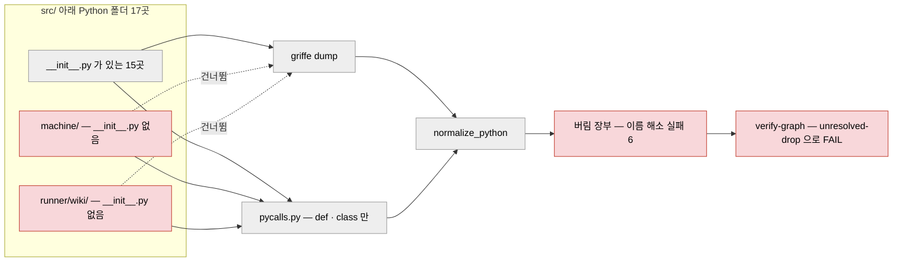
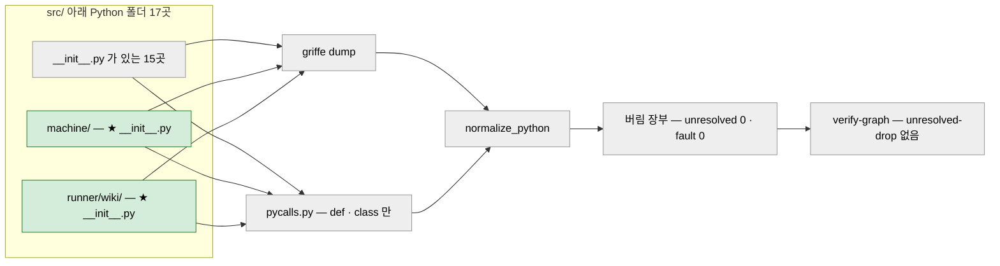
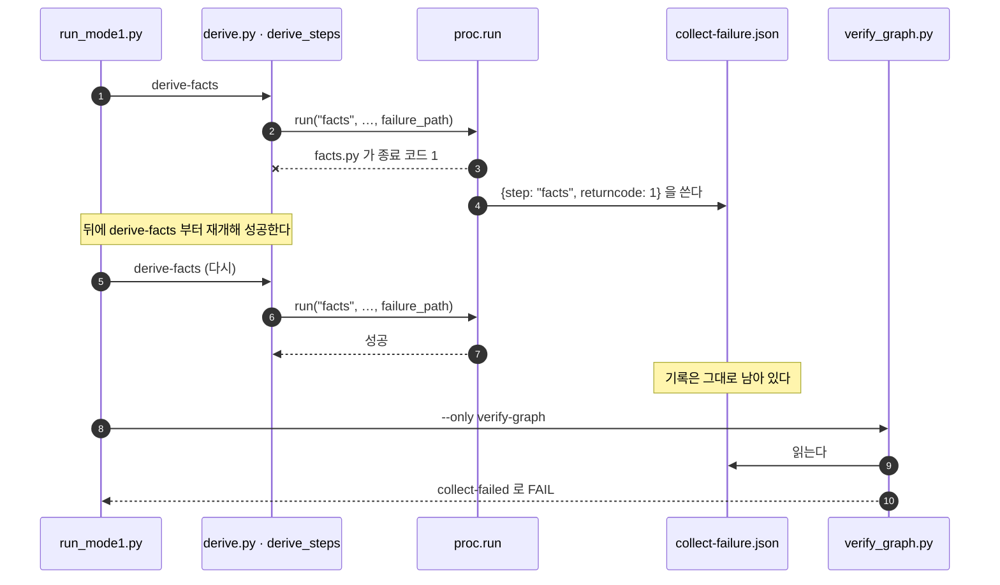
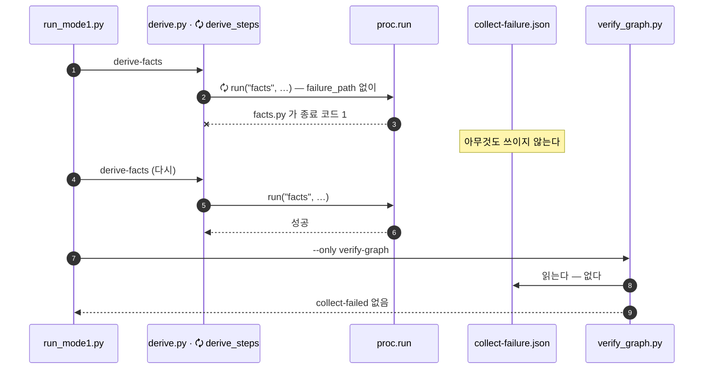

# 🧭 코드 지도 — 최종 시험 전 하위 계획 (수집기 범위 · 파생 산출물 실패 · 용어) 구현 계획 — 한국어 번역본

> **이 문서는 번역본이다.** 영어 정본은 `public.handoff/2026-11-14-codegraph-pre-final-test-subplan.md` 이고, 어긋나면 정본이 이긴다. 코드 · 명령 · 그림의 구조는 정본과 같다.
> 📅 2026-11-14 · 브랜치 `codegraph-facts-generation`(별도 git worktree) · **Before = `ae3bbc2`** (`46f0775` 뒤로 커밋 26개. `main` 은 `46f0775` 그대로)
> 📄 근거: 부모 계획 `public.handoff/2026-11-13-codegraph-facts-generation-plan.md`(Task 1~24 커밋됨) · 진입점 `public.handoff/2026-11-13-all-in-one-root-guide.md` · 이 세션에서 읽은 코드 — `derive.py` · `proc.py` · `prep.py` 의 실패 기록 자리 · `mode1/graph.py` 의 `DeriveFactsStage` · `verify_graph.py` 의 `failure_doc` · `mode1/survey.py` · `survey_plan.py` · 두 시험 파일의 머리 · 이 세션의 측정(아래 🔎)
> 🔒 지킬 규칙: 검사를 완화해 통과시키지 않는다 · `DROP_CLASS` 는 정책이라 통과시키려고 고치지 않는다 · 새 `xfail` / `skip` 없음 · Task 하나가 커밋 하나, 제목 그대로, 본문과 트레일러 없음, `git add` 는 경로를 집어서, push 없음 · 주석과 독스트링은 지금의 코드만 적는다 · main 작업 트리는 건드리지 않는다(다른 세션이 고치는 중)
> 🧪 검증: 시험은 각 Task 안에서 **쓰고** Task D 에서 **한 번** 돌린다(👍 부모 계획의 사용자 결정 — writing-plans 서식의 "시험을 돌린다" 단계보다 앞선다). Task D 전에 허용되는 것은 `py_compile`, `--check` 없는 `tools/gen_readme.py`, Task A 의 임시 폴더 측정뿐이다
> ✋ 승인: 👍 승인 2026-11-21 — D1 (a) · D2 (a) · D3 (b) · D4 (a). Task A → B → B2 → C → D 순서로 간다

> **에이전트 작업자에게:** 필수 하위 스킬 — superpowers:subagent-driven-development(권장) 또는 superpowers:executing-plans 로 Task 단위로 구현한다. 단계는 체크박스(`- [ ]`)로 추적한다.

**목표:** 구현 브랜치와 부모 계획의 최종 시험(Task 25) 사이에 남은 것을 닫는다 — <span style="color:cyan">수집기</span>가 폴더 둘을 건너뛰어 이 저장소가 자기 검사기에 막히는 것, <span style="color:cyan">파생 산출물</span> 단계가 실패하면 낡은 <span style="color:cyan">수집 실패 기록</span>이 남는 것, 언어 힌트가 비 ASCII 경로의 파일을 빠뜨리는 것, 업계에 표준 용어가 있는데 문서가 프로젝트에서 지은 말을 쓰는 것.

**구조:** 기존 브랜치에 작은 커밋 넷을 더한 뒤, 기대값을 바로잡은 부모 계획의 최종 시험을 돈다. 이 계획은 단계 · 산출물 · 클래스 · 인터페이스를 새로 만들지 않는다 — 이미 있는 것은 그대로 두고, 네 문제를 전부 기존 구조 안에서 고친다. 어떤 수정이 새 구조 없이는 안 되면 덧붙이지 말고 멈추고 보고한다. <span style="color:cyan">수집기</span> 쪽 수정은 빈 패키지 파일 둘이고, <span style="color:cyan">수집 실패 기록</span> 수정은 인자 하나를 빼는 것이며, 언어 힌트의 파일 수 수정은 `git ls-files` 호출 하나에 `-z` 를 붙이는 것이고, 용어는 모듈 문서의 표 하나와 부모 계획의 값 정정이다.

**기술 스택:** Python 3.14(`.venv`) · pytest · pyright strict · griffe 2.2.0 · msgspec · git worktree. 새 의존성 없음.

---

## 📋 한 장 요약

| | |
|---|---|
| 🎯 다루는 것 | 구현 브랜치와 부모 계획의 최종 시험 사이에 남은 넷(Task A · B · B2 · C)과 최종 시험 자체(Task D) |
| 🧩 한 줄 결론 | 빈 `__init__.py` 둘이면 이 저장소의 미해결 6건이 0이 되고 `[실측]`, 인자 하나를 빼면 <span style="color:cyan">수집 실패 기록</span>이 "수집이 실패했다" 만 뜻하게 되며, 그 뒤에 최종 시험을 한 번 돈다 |
| 🟰 그대로 | 단계 15개 · 결함 코드 34개 · `DROP_CLASS` · 지도의 열쇠 꼴 · 프롬프트 · 시험 정책 · 이미 있는 식별자와 날짜 붙은 핸드오프의 말 |
| 🗘 바뀜 | 폴더 둘이 패키지가 된다 → <span style="color:cyan">수집기</span>가 싣는 모듈이 늘고 지도의 간선이 759 → 946 `[실측]` · `derive_steps` 가 넘기는 인자 · `count_sources` 가 비 ASCII 경로도 센다 · 문서의 용어와 부모 계획의 기대값 |
| ⚠️ 함정 | 간선이 늘면 층 · 배치 수 · 예상 비용 줄이 달라진다 `[미검증]` · `19eac4b` 의 규칙은 다른 Python 대상에서 재수출 · `NewType` 이름을 미해결로 잡는다 `[실측 — 패키지 일곱]` · 최종 시험은 게이트를 Before 와 After 에서 한 번씩 돌려 오래 걸린다 · main 체크아웃에 있는 이 계획의 미추적 사본은 병합 전에 치워야 한다 |
| 🚫 범위 밖 | D4(기록만) · 루트 `CLAUDE.md` · 식별자 개명 · 부모 계획 4~6단계 · 측정 트랙 |

## 🗺️ 다섯 Task 한눈에

```text
Before (ae3bbc2)                                          After · 제안
수집기   griffe 가 machine/ · runner/wiki/ 를 건너뛴다          ★ __init__.py 둘 → Python 폴더 17곳이 전부 실린다          (A)
         이 저장소: 미해결 6 → verify-graph 에서 멈춘다           미해결 0 · 결함 0  [실측 — 임시 클론]
파생     derive_steps 가 collect-failure.json 을 쓴다           🗘 기록 자리를 넘기지 않는다 → 기록 = 수집 실패만            (B)
집계     count_sources 가 비 ASCII 경로의 파일을 빠뜨린다         🗘 git ls-files -z 로 센다                                  (B2)
문서     "외부 섬" · "파생물" · 기대값 ["cs", "ts"] · py 125     🗘 용어 표 · 기대값 ["cpp", "cs", "ts"] · py 는 -z 로 센다   (C)
시험     돌린 적 없다 (허용된 한 파일 검사 둘만)                   게이트 여섯 · 실제 실행 · 레코드 식별 대조                   (D)
```

| 🧬 Task | 다루는 것 | 진입 결정 | 산출물 | 맡는 쪽 |
|---|---|---|---|---|
| A <span style="color:cyan">수집기</span> 범위 | <span style="color:cyan">수집기</span>가 건너뛰는 폴더 둘 | 👍 D1 = (a) | ★ 빈 `__init__.py` 둘 · ★ 시험 하나 · 커밋 하나 | 서브에이전트(기본 Model) |
| B <span style="color:cyan">파생 산출물</span> 실패 | 낡게 남는 <span style="color:cyan">수집 실패 기록</span> | 👍 D2 = (a) | 🗘 `derive_steps` · ★ 시험 하나 · 커밋 하나 | 서브에이전트(기본 Model) |
| B2 파일 집계 | `count_sources` 가 빠뜨리는 비 ASCII 경로 | 👍 D3 = (b) | 🗘 `count_sources` · ★ 시험 하나 · 커밋 하나 | 서브에이전트(기본 Model) |
| C 문서 | 용어 표 · 추가된 Task 기록 · 기대값 | 👍 용어를 실측해 통일한다 | 🗘 문서 여섯 · 커밋 하나 | 오케스트레이터 |
| D 최종 시험 | 부모 계획의 Task 25 | 👍 끝에 한 번 + bisect | 게이트 여섯의 결과 · 레코드 대조 · 실제 실행 | 서브에이전트(높은 추론 강도) |

## ✅ 정한 것 — 다시 열지 않는다

| 무엇 | 👍 고른 것 · 👎 버린 것 | 누가 · 언제 |
|---|---|---|
| 구현 자리 | 👍 문서 커밋은 `main`, 코드는 별도 worktree 의 새 브랜치, push 없음, 끝난 뒤 `main` 반영을 묻는다 · 👎 전부 worktree · 👎 지금 작업 트리의 새 브랜치 · 👎 지금 작업 트리의 `main` | 사용자 · 2026-11-14 |
| 기준선 | 👍 지금 재지 않고 최종 시험에서 Before 커밋의 작업 트리로 잰다 · 👎 코드를 고치기 전에 잰다 | 사용자 · 2026-11-14 |
| 부모 계획 정정 14건 | 👍 계획 문서에 반영한다 · 👎 서브에이전트 지시문에만 · 👎 원문대로 진행 | 사용자 · 2026-11-14 |
| 샤드 재사용 | 👍 이번 구현에 넣는다, 설계 먼저 · 👍 설계 A — 샤드 폴더에 <span style="color:cyan">계획 도장</span> · 👎 설계 B — 계획마다 하위 폴더 | 사용자 · 2026-11-14 |
| 1차 모듈 이름을 단 <span style="color:cyan">외부 노드</span> | 👍 정제기에서 미해결로 센다 · 👎 하나를 받아들이고 시험을 좁힌다. <span style="color:cyan">수집기</span> 쪽 수정은 그 질문에서 고르지 않았다 — D1 로 다시 묻는다 | 사용자 · 2026-11-14 |
| 구현 방식 | 👍 서브에이전트에 맡긴다. 기본은 Sonnet 5.5, 높은 추론이 필요한 곳만 소수의 Fable 5.2 High. 질의는 구현에 대해서만 | 사용자 · 2026-11-14 |
| 하위 계획의 꼴 | 👍 용어를 먼저 실측해 통일하고 writing-plans 로 쓴다 · 👍 이 시각 형식으로 낸다 | 사용자 · 2026-11-14 |
| 시험 정책 | 👍 구현 → Task 마다 커밋 → 끝에 한 번 시험 → bisect · 👎 변경마다 회귀 시험 | 사용자 · 부모 계획의 Decided 표 |
| D1 <span style="color:cyan">수집기</span>가 건너뛰는 폴더 | 👍 (a) 빈 `__init__.py` 둘 · 👎 (b) 호출 <span style="color:cyan">수집기</span>를 고친다 · 👎 (c) 지금은 안 한다 | 사용자 · 2026-11-21 |
| D2 낡은 <span style="color:cyan">수집 실패 기록</span> | 👍 (a) <span style="color:cyan">파생 산출물</span> 단계는 기록을 쓰지 않는다 · 👎 (b) 고치지 않고 기록만 | 사용자 · 2026-11-21 |
| D3 비 ASCII 경로의 파일 집계 | 👍 (b) 지금 고친다 · 👎 (a) 이 계획 밖, 기록만 | 사용자 · 2026-11-21 |
| D4 재수출 이름의 미해결 | 👍 (a) 두고 기록만 · 👎 (b) 재수출 해소 규칙을 지금 더한다 | 사용자 · 2026-11-21 |

## 📊 상태

| 항목 | 상태 |
|---|---|
| 부모 계획 Task 1~24 | ✅ `8e77474` … `4cc1fc2` (커밋 24개) |
| 추가 — 1차 모듈 아래의 점 이름을 <span style="color:cyan">외부 노드</span>로 접지 않고 미해결로 센다 | ✅ `19eac4b` |
| 추가 — 전수조사가 샤드 폴더의 <span style="color:cyan">계획 도장</span>을 대조한다 | ✅ `ae3bbc2` |
| 용어 실측 | ✅ 이 문서의 📖 |
| Task A | ✅ `1861862` |
| Task B | ✅ `26284ea` |
| Task B2 | ✅ `35ef600` |
| Task C | ✅ 이 문서를 브랜치에 넣은 `[docs]` 커밋 |
| Task D 최종 시험 | ✅ `5e66a4b` — 고친 커밋 넷 `45fdedf` · `412a770` · `56dbd31` · `5e66a4b` |
| 시험 · 게이트 | ✅ 2026-11-21 `5e66a4b` 에서 실측 — 🧪 최종 시험 결과 참조 |

## ❓ 미결 — 없음 (D1~D4 는 2026-11-21 에 결정됐다)

| # | 질문 | 근거 | 👍 결정 | 영향 |
|---|---|---|---|---|
| D1 | `warmup.py` 의 형 별칭 둘을 어느 <span style="color:cyan">수집기</span>도 싣지 않는다. <span style="color:cyan">수집기</span> 쪽을 어떻게 고치나 — (a) 폴더 둘에 빈 `__init__.py` · (b) 호출 <span style="color:cyan">수집기</span>가 모듈 수준 형 별칭을 적는다 · (c) 지금은 안 한다 | `[실측]` 지금 브랜치는 미해결 6, 패키지 파일을 넣은 임시 클론은 0. `src/` 아래 다른 Python 폴더 15곳은 이미 그 파일이 있다 `[코드 확인]` | 👍 (a) — 권고와 같다 | Task A. (c) 면 Task A 를 빼고 Task D 는 이 저장소가 `unresolved-drop` 으로 멈추는 것을 기대값으로 삼으며, 부모 계획의 3단계 완료 조건은 미충족으로 적는다 |
| D2 | <span style="color:cyan">파생 산출물</span> 단계가 죽으면 `collect-failure.json` 이 쓰이고 뒤에 성공해도 남는다. 고칠까 — (a) 그 단계는 기록을 쓰지 않는다 · (b) 기록만 하고 둔다 | `[코드 확인]` `derive_steps` 가 `failure_path=paths["failure"]` 를 넘긴다. 지우는 곳은 `prep` 의 시작뿐이다. `[미검증]` 끝까지 돌려 보지는 않았다 | 👍 (a) — 권고와 같다 | Task B |
| D3 | `lang_select.count_sources` 가 비 ASCII 경로의 추적 파일을 빠뜨린다 — (a) 이 계획 밖, 기록만 · (b) 지금 고친다 | `[실측]` `-z` 없는 `git ls-files` 는 그런 경로를 따옴표로 낸다. 부모 계획 이전부터 있던 것 | 👍 (b) 지금 고친다 — 권고는 (a) 였다 | Task B2. 새 <span style="color:cyan">소스 inventory</span> 는 이미 `-z` 로 센다 |
| D4 | `19eac4b` 의 규칙이 다른 Python 대상에서 재수출 · `NewType` 이름을 미해결로 잡는다 — (a) 두고 기록한다 · (b) 재수출을 따라가는 해소 규칙을 지금 더한다 | `[실측 — 서브에이전트]` `_pytest` 3 → 30 · networkx 1 → 14 · packaging 0 → 4 · pygments 0 → 1 · jinja2 · griffe · pluggy 는 그대로 | 👍 (a) — 권고와 같다. (b) 는 따로 설계가 필요하고 근거가 패키지 일곱뿐이다 | 그런 대상은 `verify-graph` 에서 멈춘다 |

## 🔎 이 계획이 딛고 선 실측 (2026-11-14)

이 저장소의 <span style="color:cyan">수집기</span> 출력을 `prep.py` 가 하는 방식으로 임시 폴더에 모으고 `normalize_python` 을 메모리에서 돌렸다. "뒤" 는 `ae3bbc2` 의 임시 클론에 `__init__.py` 둘을 더해 스테이징한 것이다.

| | 브랜치 `ae3bbc2` | 패키지 파일 둘을 넣은 임시 클론 |
|---|---|---|
| 노드 · 간선 · 모듈 | 756 · 759 · 6 | 763 · 946 · 6 |
| <span style="color:cyan">외부 노드</span> | `(표준) stdlib` · `jinja2` | `(표준) stdlib` · `jinja2` |
| 등급이 `unresolved` 나 `fault` 인 행 | 1 — `이름 해소 실패` 6 (`warmup.Manifest` · `warmup.Verdicts`) | 0 |

함께 잰 것: 없는 지도 경로를 준 `facts.py` 는 종료 코드 1 로 끝나고 아무것도 쓰지 않는다. 이 저장소의 `pyRoots` 는 `src/codewiki` · `src/common` · `src/core` · `src/spec` · `src/term` · `tools`. `a21dd4d` 에서 수집되는 시험은 923개(통과 수는 재지 않았다).

## 🔁 Before / After

| 📍 이전 (안 되던 것 · 지금) | 🛠️ After · 제안 | 🎉 해결되는 것 | 🔭 기대 | 진행 |
|---|---|---|---|---|
| 🐞 griffe 가 `__init__.py` 없는 `machine/` · `runner/wiki/` 를 싣지 않는다. 그 폴더의 형 별칭이 빠져 이 저장소가 미해결 6건으로 `verify-graph` 에서 멈춘다 | ★ 빈 `__init__.py` 둘 · ★ 폴더가 전부 패키지인지 보는 시험 | <span style="color:cyan">수집기</span>가 Python 폴더를 전부 싣는다 | 미해결 0 · 결함 0 · 간선 946 `[실측 — 임시 클론]` | ✅ `1861862` |
| 🐞 <span style="color:cyan">파생 산출물</span> 단계가 죽으면 `collect-failure.json` 이 쓰이고, 재개가 성공해도 남아 `--only verify-graph` 가 `collect-failed` 를 낸다 | 🗘 `derive_steps` 가 기록 자리를 넘기지 않는다 · ★ 시험 하나 | <span style="color:cyan">수집 실패 기록</span>이 정확히 "수집이 실패했다" 를 뜻한다 | 새 시험 통과 `[미검증 — Task D]` | ✅ `26284ea` |
| 🐞 문서가 "외부 섬" · "파생물" · "실패 기록" 을 쓴다. 부모 계획의 기대값이 `["cs", "ts"]` · `py 125` 다 | 🗘 `src/codewiki/CLAUDE.md` 의 용어 표 · 부모 계획의 값 넷과 끝 절 하나 | 문서가 업계 용어와 이어지고 최종 시험이 실측 기대값으로 돈다 | 문서 게이트 통과 `[미검증 — Task C]` | ✅ |
| 🐞 `count_sources` 가 `-z` 없는 `git ls-files` 를 써서 비 ASCII 경로의 추적 파일을 세지 못한다 | 🗘 `git ls-files -z` 의 출력을 NUL 로 끊어 센다 · ★ 시험 하나 | 언어 힌트의 파일 수가 <span style="color:cyan">소스 inventory</span> 와 같은 기준으로 나온다 | 새 시험 통과 `[미검증 — Task D]` | ✅ `35ef600` |
| ⚠️ 시험과 게이트를 돌린 적이 없다. 기대값은 전부 읽은 코드에서 낸 예측이다 | Task D — Before 값 · 게이트 여섯 · 레코드 식별 대조 · 실제 실행 · bisect | 예측이 실측으로 바뀐다 | 새 `실패` 줄 0 · 적대적 시험 `10 passed, 2 xfailed` `[미검증]` | ✅ `5e66a4b` |
| 1차 모듈 아래의 점 이름이 <span style="color:cyan">외부 노드</span>로 접혔다 | 미해결(`이름 해소 실패`)로 센다 | 1차 모듈 이름을 단 <span style="color:cyan">외부 노드</span>가 생기지 않는다 | <span style="color:cyan">외부 노드</span>는 `(표준) stdlib` · `jinja2` 뿐 `[실측]` | ✅ `19eac4b` |
| 같은 이름의 샤드가 남아 있으면 배치를 건너뛰었다 | 샤드 폴더의 <span style="color:cyan">계획 도장</span>을 대조하고 다른 계획의 것은 `_stale/` 로 옮긴다 | 다른 계획의 샤드를 재사용하지 않는다 | 새 시험 여덟 `[미검증 — Task D]` | ✅ `ae3bbc2` |

## ★ 신규 · 🗘 변경 항목 (모듈 → 파일 → 클래스 → 함수 → 멤버)

범례: **★ 신규 생성 · 🗘 변경/업데이트/갱신 · 표식 없음 = 그대로 재사용 · ✕ 삭제.** 기준은 Before `ae3bbc2` 다. 표식은 바뀌는 종류이고 구현 · 검증 상태가 아니다.

| 층 | 표식 | 항목 | 구분 | 담긴 곳 |
|---|---|---|---|---|
| 모듈 | 🗘 | `codewiki.python.machine` | 변경 — `__init__.py` 없는 폴더에서 패키지로 | `src/codewiki/python/` |
| 모듈 | 🗘 | `codewiki.python.runner.wiki` | 변경 — 같은 것 | `src/codewiki/python/runner/` |
| 파일 | ★ | `src/codewiki/python/machine/__init__.py` | 신규(빈 파일) | 모듈 `codewiki.python.machine` |
| 파일 | ★ | `src/codewiki/python/runner/wiki/__init__.py` | 신규(빈 파일) | 모듈 `codewiki.python.runner.wiki` |
| 파일 | ★ | `public.handoff/2026-11-14-codegraph-pre-final-test-subplan.md` · `.ko.md` | 신규(브랜치 기준) | `public.handoff/` |
| 파일 | 🗘 | `derive.py` · `proc.py` | 변경 | 모듈 `codewiki.python.runner.wiki` |
| 파일 | 🗘 | `lang_select.py` | 변경 | 모듈 `codewiki.python.machine` |
| 파일 | 🗘 | `test_source_inventory.py` · `test_prep_fingerprint.py` · `test_lang_select.py` | 변경 — 시험 하나씩 추가 | `test/codewiki/` |
| 파일 | 🗘 | `src/codewiki/CLAUDE.md` · 생성물 README 둘 · `resource/codewiki/terms-reading.json` · 부모 계획 `.md` · `.ko.md` · 11-05 재개 핸드오프 · Root 지침 | 변경 | 문서와 레코드 |
| 클래스 | — | 해당 없음 | — | — |
| 함수 | 🗘 | `derive.derive_steps` | 변경 — `failure_path` 를 넘기지 않는다 | `derive.py` |
| 함수 | 🗘 | `proc.run` | 변경 — 독스트링만 | `proc.py` |
| 함수 | 🗘 | `lang_select.count_sources` | 변경 — `git ls-files -z` 로 센다 | `lang_select.py` |
| 함수 | ★ | `test_counts_tracked_files_with_non_ascii_paths` | 신규 | `test_lang_select.py` |
| 함수 | ★ | `test_src_아래_파이썬_폴더는_전부_패키지다` | 신규 | `test_source_inventory.py` |
| 함수 | ★ | `test_파생_산출물_단계가_죽어도_수집_실패_기록을_쓰지_않는다` | 신규 | `test_prep_fingerprint.py` |
| 멤버 | — | 해당 없음 | — | — |

## 🌊 흐름 — 수집기가 무엇을 싣는가 (Task A)

범례: 회색 = 그대로 · 초록 = 신규 · 호박색 = 변경 · 빨강 = 막는 문제.

**Before** `[코드 확인 · 실측]`



**After · 제안** `[실측 — 임시 클론의 장부까지. verify-graph 통과는 미검증]`



## 🔀 순서 — 파생 산출물 단계가 죽었을 때 (Task B)

**Before** `[코드 확인 · 끝까지 돌려 보지는 않았다]`



**After · 제안**



## 🧱 구조 — Before = After

클래스가 생기지도 바뀌지도 않는다. Task A 는 파일 둘, Task B 는 함수 하나의 인자다. Task C 는 문서뿐이라 그림이 없다 — 바꿀 글은 Task C 의 Step 에 있다.

## 🔧 고칠 곳

| 파일 · 심볼 | 바꿀 것 | 이유 | 근거 |
|---|---|---|---|
| ★ `src/codewiki/python/machine/__init__.py` · ★ `src/codewiki/python/runner/wiki/__init__.py` | 빈 파일을 만든다 | griffe 가 `__init__.py` 없는 폴더의 모듈을 싣지 않는다 | `[실측]` 패키지 파일을 넣자 간선 759 → 946, 미해결 6 → 0 |
| 🗘 `test/codewiki/test_source_inventory.py` — ★ `test_src_아래_파이썬_폴더는_전부_패키지다` | 추적되는 `.py` 가 있는 `src/` 아래 폴더가 전부 `__init__.py` 를 갖는지 본다 | 같은 구멍이 다시 생기면 시험이 깨진다 | `[코드 확인]` 그 파일에 `os` · `subprocess` · `ROOT` 가 있다 |
| 🗘 `derive.py` — 🗘 `derive_steps` | 두 `run(...)` 에서 `failure_path=paths["failure"]` 를 뺀다 | <span style="color:cyan">파생 산출물</span> 단계의 실패가 <span style="color:cyan">수집 실패 기록</span>으로 남는다 | `[코드 확인]` `derive.py` · `proc.py` · `verify_graph.py` 의 `failure_doc` |
| 🗘 `proc.py` — 🗘 `run` | 독스트링 둘 | 기록은 자리를 받았을 때만 쓴다 | `[코드 확인]` |
| 🗘 `test/codewiki/test_prep_fingerprint.py` — ★ `test_파생_산출물_단계가_죽어도_수집_실패_기록을_쓰지_않는다` | 지도 없는 저장소에서 `derive_steps` 를 불러 기록이 없는지 본다 | 위 동작을 못박는다 | `[실측]` 없는 지도를 준 `facts.py` 는 종료 코드 1 |
| 🗘 `lang_select.py` — 🗘 `count_sources` · 🗘 `test/codewiki/test_lang_select.py` — ★ `test_counts_tracked_files_with_non_ascii_paths` | `git ls-files -z` 로 받아 NUL 로 끊는다 · 한글 폴더의 `.py` 가 세어지는지 본다 | `-z` 가 없으면 git 이 비 ASCII 경로를 따옴표로 감싸 확장자 대조에서 빠진다 | `[실측]` 임시 저장소에서 `한글/b.py` 가 따옴표와 8진수 이스케이프로 나왔다 |
| 🗘 `src/codewiki/CLAUDE.md` | Note 하나 · `proc` 행 · 문장 하나 · 용어 표 | 현 상황 문서를 코드와 통일 표기에 맞춘다 | `[코드 확인]` 고칠 문자열이 각각 한 번씩 있다 |
| 🗘 부모 계획 `.md` · `.ko.md` | 기대값 넷을 줄 안에서 고치고 끝에 절 하나를 붙인다 | `["cs", "ts"]` · `py 125` 가 틀렸다 | `[실측]` 추적되는 C++ 파일이 하나 있고, `-z` 없는 `git ls-files` 는 비 ASCII 경로를 빠뜨린다 |
| 🗘 11-05 재개 핸드오프 · Root 지침 | B5 를 닫고 J 절을 더한다 · N5 에 "구현됨" | 항목 장부와 진입점을 맞춘다 | `[코드 확인]` |

**제안 diff** — Task B 의 핵심. Before 줄은 `ae3bbc2` 의 소스에서 옮겼다. 나머지 글은 각 Task 의 Step 에 있다.

```diff
--- a/src/codewiki/python/runner/wiki/derive.py
+++ b/src/codewiki/python/runner/wiki/derive.py
 def derive_steps(repo: str, paths: dict[str, str], py: str, generation_id: str) -> None:
-    """facts → render-modules. ranking.json 에 generation_id 를 찍는다."""
+    """facts → render-modules. ranking.json 에 generation_id 를 찍는다. 이 단계의 실패는 수집 실패 기록에 적지 않는다."""
     detail = os.path.join(paths["raw"], "roslyn-dump.json")
     extra = ["--detail", detail] if os.path.exists(detail) else []
     run("facts", py, [os.path.join(ROOT, "src", "codewiki", "python", "machine", "facts.py"), paths["codegraph"], "--repo", repo,
-                      "--generation", generation_id] + extra + ["-o", paths["raw"]], failure_path=paths["failure"])
+                      "--generation", generation_id] + extra + ["-o", paths["raw"]])
     run("render-modules", py, [os.path.join(ROOT, "src", "codewiki", "python", "viz", "render_modules.py"), paths["codegraph"],
-                               "-o", os.path.join(paths["raw"], "modules")], failure_path=paths["failure"])
+                               "-o", os.path.join(paths["raw"], "modules")])
```

## 📖 용어 — 먼저 확인하고 통일했다

두 가지로 확인했다. 이 저장소에서 각 말이 몇 번 나오는지(`git grep`, 추적 파일), 그리고 업계가 같은 것을 무엇이라 부르는지(웹 검색, 결과 요약만 봤고 원문 페이지는 열지 않았다).

| 지금까지 쓴 말 | 이 저장소에서 `[실측]` | 업계의 말 | 통일 표기 |
|---|---|---|---|
| <span style="color:cyan">수집기</span> | 문서 45줄 · 핸드오프 104줄 · 파이썬 47줄. 코드 이름 `COLLECTOR` · `collectorFor` · `collect-graph` | **extractor** — CodeQL: "입력 파일마다 관계형 데이터와 소스 참조를 만드는 도구" · **indexer** — SCIP: 색인을 만드는 쪽 | **<span style="color:cyan">수집기</span>(collector)** 를 그대로 쓴다. 코드와 단계 이름에 박혀 있다. 문서에서 처음 나올 때 "업계의 extractor · indexer 에 해당" 을 붙인다 |
| 외부 섬 | 문서 1줄 · 핸드오프 8줄 · 파이썬 6줄(시험 이름과 독스트링). 3단계 설계 사양에서 지은 말 | 그런 용어는 찾지 못했다. Ruff · isort 는 import 를 **first-party** 와 **third-party** 로 가른다. 이 결함은 그 오분류다 | **외부로 오분류된 1차 모듈**(first-party module misclassified as external). 그래프의 대상은 그대로 <span style="color:cyan">외부 노드</span>(external node) |
| 파생물 | 5 · 12 · 9. 코드 이름 `derive-facts` · `derive.py` | Bazel: artifact 는 source file 이거나 **generated file** 이고 "derived file 이라고도 부른다" | **<span style="color:cyan">파생 산출물</span>**(derived artifact) — "산출물" 은 이 저장소가 artifact 를 부르는 말이다(`ARTIFACTS`) |
| 실패 기록 | 7 · 17 · 7. 파일 `collect-failure.json` | SARIF 는 도구 실행 한 번을 **invocation** 으로 적는다(`executionSuccessful` · `exitCode` · `toolExecutionNotifications`) | 항상 **<span style="color:cyan">수집 실패 기록</span>**(collection failure record). 앞의 "수집" 을 떼지 않는다 |
| 임시 사본 | 0 — 대화에서만 쓴 말 | Git 용어집은 **working tree** 를 정의한다. "scratch copy" 는 거기 없다 | `git clone` 으로 만들면 **임시 클론**(throwaway clone), `git worktree` 면 **작업 트리**(working tree), 그냥 폴더면 **임시 폴더** |

규칙: 이미 있는 식별자와 날짜 붙은 핸드오프는 그대로 둔다. 현 상황을 적는 문서와 새로 쓰는 글에서 통일 표기를 쓴다.

출처: [CodeQL glossary](https://codeql.github.com/docs/codeql-overview/codeql-glossary) · [Sourcegraph — writing an indexer](https://sourcegraph.com/docs/code-navigation/writing-an-indexer) · [Bazel glossary](https://bazel.build/reference/glossary) · [Bazel 2.2.0 concepts](https://docs.bazel.build/versions/2.2.0/build-ref.html) · [Ruff FAQ](https://docs.astral.sh/ruff/faq) · [Qodana SARIF output](https://jetbrains.com/help/qodana/qodana-sarif-output.html) · [SARIF 사양을 인용한 GitLab analyzers MR](https://gitlab.com/gitlab-org/security-products/analyzers/report/-/merge_requests/52) · [gitglossary](https://man.archlinux.org/man/gitglossary.7.en)

**용어집** — 코드 이름이 있는 말은 본문에서 청록으로 적는다.

| 한국어 용어 | 코드 이름 | 뜻 |
|---|---|---|
| <span style="color:cyan">수집기</span> | `COLLECTOR` · `collectorFor` · `collect-graph` | 소스에서 지도의 원본을 뽑는 도구 — griffe · `pycalls.py` · clang-uml · roslyn-dump |
| <span style="color:cyan">수집 실패 기록</span> | `collect-failure.json` | 죽은 수집 단계 · 명령줄 · 종료 코드 · stderr 끝줄 |
| <span style="color:cyan">파생 산출물</span> | `derive-facts` · `derive.py` | 검사를 지난 지도에서 만드는 것 — `facts/*.md` · `ranking.json` · 모듈 그림 |
| <span style="color:cyan">외부 노드</span> | 노드의 `kind: "external"` | 저장소 밖의 것을 가리키는 노드 |
| <span style="color:cyan">버림 장부</span> | `normalize-report.json` · `Ledger` | 정제가 버리거나 접은 것의 사유별 수와 표본 |
| <span style="color:cyan">성공 기록</span> | `graph-verified.json` | 지정한 검사가 이 지도에서 돌았다는 증거 |
| <span style="color:cyan">수집 manifest</span> | `collect-fingerprint.json` | 수집 지문 · 소스 해시 · `generation_id` |
| <span style="color:cyan">계획 도장</span> | `_shards/.plan` · `claim_shard_dir` | 샤드 폴더가 어느 `batches.json` 의 것인지 적은 해시 |
| <span style="color:cyan">소스 inventory</span> | `source-inventory.json` | 추적 파일의 언어별 수와 파일마다의 수집 상태 |
| 외부로 오분류된 1차 모듈 | — | 1차 모듈 이름을 단 <span style="color:cyan">외부 노드</span>가 생긴 상태. 코드 이름은 없다 |
| 작업 트리 · 임시 클론 | — | Git 의 working tree · 임시 폴더에 뜬 클론 |

모든 작업은 구현 worktree 에서 한다. 아래의 `$REPO_ROOT` 는 main 체크아웃이다.

---

### Task A: 수집기가 Python 폴더를 전부 싣는다 (D1 = a)

**파일:**
- 만든다: `src/codewiki/python/machine/__init__.py`, `src/codewiki/python/runner/wiki/__init__.py`
- 고친다: `test/codewiki/test_source_inventory.py`, `src/codewiki/CLAUDE.md`
- 다시 생성: `src/codewiki/python/machine/README.md`, `src/codewiki/python/runner/README.md`

- [ ] **Step 1: 시험을 쓴다** — `test/codewiki/test_source_inventory.py` 끝에 붙인다(`os` · `subprocess` · `ROOT` 는 이미 그 파일에 있다):

```python
def test_src_아래_파이썬_폴더는_전부_패키지다() -> None:
    """griffe 는 `__init__.py` 가 없는 폴더의 모듈을 싣지 않는다. 추적되는 `.py` 가 있는 `src/` 아래 폴더는 전부 그 파일을 갖는다."""
    out = subprocess.run(["git", "ls-files", "-z", "--", "src"], cwd=ROOT, capture_output=True, text=True, check=True).stdout
    folders = {os.path.dirname(p) for p in out.split("\0") if p.endswith(".py")}
    missing = sorted(d for d in folders if not os.path.isfile(os.path.join(ROOT, d, "__init__.py")))
    assert not missing, missing
```

⏭ Task D 에서의 기대: 통과. `ae3bbc2` 에서는 `['src/codewiki/python/machine', 'src/codewiki/python/runner/wiki']` 로 실패한다.

- [ ] **Step 2: 빈 파일 둘을 만든다**

```bash
: > src/codewiki/python/machine/__init__.py
: > src/codewiki/python/runner/wiki/__init__.py
```

- [ ] **Step 3: README 를 다시 생성한다**

```bash
.venv/bin/python tools/gen_readme.py src/codewiki/python/machine src/codewiki/python/runner
```

기대: 다른 패키지 폴더처럼 README 마다 새 `__init__.py` 행이 생긴다. README 가 안 바뀌면 바뀐 것만 커밋한다.

- [ ] **Step 4: `src/codewiki/CLAUDE.md` 의 Note** — `## 비직관적인 것 (Gotchas)` 절의 마지막 줄로 붙인다:

```markdown
- **Note — griffe 는 `__init__.py` 가 없는 폴더의 모듈을 싣지 않는다.** `src/` 아래에서 추적되는 `.py` 가 있는 폴더는 전부 패키지다. 빠지면 그 폴더의 형 별칭과 주석 간선이 지도에 실리지 않는다 — `test/codewiki/test_source_inventory.py` 의 `test_src_아래_파이썬_폴더는_전부_패키지다` 가 지킨다.
```

- [ ] **Step 5: 임시 폴더에서 잰다(시험 실행이 아니다)** — 정제기는 git 이 추적하는 모듈만 남기므로 두 파일을 먼저 스테이징한다. 스크립트는 worktree 밖 `$SCRATCH/measure.py` 로 둔다:

```python
"""수집기 출력으로 normalize_python 을 메모리에서 돌려 미해결 · 결함 장부와 외부 노드를 찍는다. 인자: <저장소> <덤프 폴더>."""
import json, os, sys
repo, t = os.path.abspath(sys.argv[1]), sys.argv[2]
sys.path[:0] = [os.path.join(repo, "src"), os.path.join(repo, "src", "codewiki", "python", "machine")]
import normalize as N
dump = json.load(open(os.path.join(t, "griffe.json"), encoding="utf-8"))
calls = json.load(open(os.path.join(t, "pycalls.json"), encoding="utf-8"))
g, st = N.normalize_python(dump, repo, "griffe measure", calls=calls)
print("nodes", len(g["nodes"]), "edges", len(g["edges"]), "modules", len(g["modules"]))
print("external", sorted(n["name"] for n in g["nodes"] if n["kind"] == "external"))
bad = [r for r in st.report() if r["class"] in ("unresolved", "fault")]
print("unresolved+fault rows", len(bad))
for r in bad:
    print(" ", r["class"], r["reason"], r["count"], r["samples"])
```

```bash
git add src/codewiki/python/machine/__init__.py src/codewiki/python/runner/wiki/__init__.py
T="$(mktemp -d)"
.venv/bin/python -m griffe dump codewiki common core spec term tools -o "$T/griffe.json" -s . -s src
.venv/bin/python src/codewiki/python/machine/pycalls.py src/codewiki src/common src/core src/spec src/term tools --repo . -o "$T/pycalls.json"
PYTHONDONTWRITEBYTECODE=1 .venv/bin/python "$SCRATCH/measure.py" . "$T"
```

기대(`ae3bbc2` 의 클론에서 잰 값):

```text
nodes 763 edges 946 modules 6
external ['(표준) stdlib', 'jinja2']
unresolved+fault rows 0
```

`unresolved` 나 `fault` 행이 하나라도 찍히면 멈춘다. 커밋하지 않고 행마다 표본과 함께 보고한다. 등급을 바꾸지 않고 이름을 특별 취급하지 않는다.

- [ ] **Step 6: 커밋**

```bash
git add src/codewiki/python/machine/__init__.py src/codewiki/python/runner/wiki/__init__.py \
        src/codewiki/python/machine/README.md src/codewiki/python/runner/README.md \
        src/codewiki/CLAUDE.md test/codewiki/test_source_inventory.py
git commit -m "[fix] : codewiki - machine, runner/wiki 폴더를 패키지로 만들어 griffe 가 건너뛰지 않게 한다"
```

### Task B: 파생 산출물 단계가 죽어도 수집 실패 기록을 쓰지 않는다 (D2 = a)

**파일:**
- 고친다: `src/codewiki/python/runner/wiki/derive.py`(`derive_steps`), `src/codewiki/python/runner/wiki/proc.py`(독스트링 둘)
- 시험: `test/codewiki/test_prep_fingerprint.py`
- 고친다: `src/codewiki/CLAUDE.md`, `resource/codewiki/terms-reading.json`
- 다시 생성: `src/codewiki/python/runner/README.md`

- [ ] **Step 1: 시험을 쓴다** — `test/codewiki/test_prep_fingerprint.py` 의 import 에 `import pytest` 를 더하고, 패키지 import 줄을 `from codewiki.python.runner.wiki import compdb, derive, prep  # noqa: E402` 로 바꾼 뒤 끝에 붙인다:

```python
def test_파생_산출물_단계가_죽어도_수집_실패_기록을_쓰지_않는다(tmp_path: Path) -> None:
    paths = prep.wikiPaths(str(tmp_path))
    os.makedirs(paths["raw"])
    with pytest.raises(SystemExit) as stop:
        derive.derive_steps(str(tmp_path), paths, sys.executable, "g1")
    assert stop.value.code == 1
    assert not os.path.exists(paths["failure"])
```

`tmp_path` 의 저장소에는 지도가 없어서 `facts.py` 가 종료 코드 1 로 끝난다(실측). ⏭ Task D 에서의 기대: 통과. `ae3bbc2` 에서는 마지막 단언이 실패한다 — 기록이 쓰인다.

- [ ] **Step 2: `derive_steps` 가 기록 자리를 넘기지 않는다** — `src/codewiki/python/runner/wiki/derive.py` 의 함수를 이것으로 바꾼다:

```python
def derive_steps(repo: str, paths: dict[str, str], py: str, generation_id: str) -> None:
    """facts → render-modules. ranking.json 에 generation_id 를 찍는다. 이 단계의 실패는 수집 실패 기록에 적지 않는다."""
    detail = os.path.join(paths["raw"], "roslyn-dump.json")
    extra = ["--detail", detail] if os.path.exists(detail) else []
    run("facts", py, [os.path.join(ROOT, "src", "codewiki", "python", "machine", "facts.py"), paths["codegraph"], "--repo", repo,
                      "--generation", generation_id] + extra + ["-o", paths["raw"]])
    run("render-modules", py, [os.path.join(ROOT, "src", "codewiki", "python", "viz", "render_modules.py"), paths["codegraph"],
                               "-o", os.path.join(paths["raw"], "modules")])
```

- [ ] **Step 3: `src/codewiki/python/runner/wiki/proc.py` 의 독스트링** — 모듈 독스트링을 이렇게 바꾼다

```python
"""proc.py — 자식 프로세스 하나를 돌린다. 죽으면 그 종료 코드로 끝내고, 실패 기록 자리를 받았으면 그 전에 기록을 남긴다. prep 과 derive 가 함께 쓴다."""
```

`run` 의 독스트링은 이렇게 바꾼다

```python
    """stderr 를 화면에 흘리면서 끝 40줄을 쥔다. 종료 코드가 0 이 아니면 그 코드로 끝내고, `failure_path` 가 있으면 그 전에 수집 실패 기록을 쓴다."""
```

- [ ] **Step 4: README 를 다시 생성한다** — `.venv/bin/python tools/gen_readme.py src/codewiki/python/runner`

- [ ] **Step 5: `src/codewiki/CLAUDE.md`** — 줄 안에서 두 곳을 고친다. `python/runner/wiki/` 행의 `` `proc`(자식 프로세스 하나를 돌리고 죽으면 실패 기록을 남긴다) `` 를 `` `proc`(자식 프로세스 하나를 돌리고, 실패 기록 자리를 받았으면 죽을 때 기록을 남긴다) `` 로 바꾼다. `**Note — collect-graph 는 수집 · 정제만 하고(--collect-only)` 로 시작하는 Note 에서 `핸드오프를 쓴다.` 뒤에 이 문장을 붙인다:

```markdown
파생 산출물 단계(`facts` · `render-modules`)의 실패는 이 기록에 적지 않는다.
```

- [ ] **Step 6: 레코드** — `resource/codewiki/terms-reading.json` 의 열쇠 `codewiki.python.runner.wiki.derive.derive_steps`: `does` 의 마지막 문장(`어느 쪽이든 죽으면 proc.run 이 실패 기록을 남긴다.`)을 `두 단계 모두 실패 기록 자리를 넘기지 않아, 죽어도 수집 실패 기록을 쓰지 않는다.` 로 바꾼다. 정의 줄이 밀렸을 때만 `where` 의 줄 번호를 고친다. 파일의 꼴은 그대로 두고 열리는지 확인한다: `.venv/bin/python -c "import json; json.load(open('resource/codewiki/terms-reading.json', encoding='utf-8'))"`.

- [ ] **Step 7: 문법 확인과 커밋**

```bash
.venv/bin/python -m py_compile src/codewiki/python/runner/wiki/derive.py src/codewiki/python/runner/wiki/proc.py test/codewiki/test_prep_fingerprint.py
git add src/codewiki/python/runner/wiki/derive.py src/codewiki/python/runner/wiki/proc.py \
        test/codewiki/test_prep_fingerprint.py src/codewiki/python/runner/README.md \
        src/codewiki/CLAUDE.md resource/codewiki/terms-reading.json
git commit -m "[fix] : codewiki - 파생 산출물 단계의 실패는 수집 실패 기록에 적지 않는다"
```

### Task B2: `count_sources` 가 비 ASCII 경로의 추적 파일도 센다 (D3 = b)

**Files:**
- Modify: `src/codewiki/python/machine/lang_select.py` (`count_sources`)
- Test: `test/codewiki/test_lang_select.py`
- Modify: `resource/codewiki/terms-reading.json`

- [ ] **Step 1: 시험을 쓴다** — `test/codewiki/test_lang_select.py` 끝에 붙인다:

```python
def test_counts_tracked_files_with_non_ascii_paths(tmp_path: Path) -> None:
    """`-z` 없는 `git ls-files` 는 비 ASCII 경로를 따옴표로 감싸서, 확장자 대조에서 빠진다."""
    r = _repo(tmp_path, {"a.py": "", "한글/b.py": ""})
    assert L.count_sources(r)["py"] == 2
```

⏭ Task D 에서의 기대: 통과. `ae3bbc2` 에서는 `1 == 2` 로 실패한다 — 임시 저장소에서 쟀다. `git ls-files` 가 둘째 경로를 따옴표와 8진수 이스케이프로 감싸 낸다.

- [ ] **Step 2: 목록을 NUL 로 끊어 읽는다** — `count_sources` 의 두 줄

```python
    r = subprocess.run(["git", "ls-files"], cwd=repo, capture_output=True, text=True)
    files = r.stdout.split("\n") if r.returncode == 0 else []
```

을 다음 두 줄로 바꾼다. 두 줄을 두 줄로 바꿔 아래 줄 번호가 밀리지 않게 한다(레코드가 56줄을 인용한다).

```python
    r = subprocess.run(["git", "ls-files", "-z"], cwd=repo, capture_output=True)
    files = [p.decode("utf-8", "surrogateescape") for p in r.stdout.split(b"\0")] if r.returncode == 0 else []
```

빈 조각을 걸러내지 않는다 — 추적 파일이 하나도 없는 git 저장소에서 `os.walk` 대체 경로로 빠지지 않는 지금 동작이 그대로 남는다. `source_inventory.tracked_files` 를 가져다 쓰지 않는다 — `source_inventory` 가 `lang_select` 를 import 하므로 순환 import 가 된다. 독스트링은 그대로라 생성물 README 는 바뀌지 않는다.

- [ ] **Step 3: 레코드** — `resource/codewiki/terms-reading.json` 의 열쇠 `codewiki.python.machine.lang_select.count_sources`: `does` 맨 앞의 `git ls-files 로` 를 `git ls-files -z 로` 로 바꾼다. 파일의 서식을 유지하고 읽히는지 확인한다: `.venv/bin/python -c "import json; json.load(open('resource/codewiki/terms-reading.json', encoding='utf-8'))"`.

- [ ] **Step 4: 문법 확인과 커밋**

```bash
.venv/bin/python -m py_compile src/codewiki/python/machine/lang_select.py test/codewiki/test_lang_select.py
git add src/codewiki/python/machine/lang_select.py test/codewiki/test_lang_select.py resource/codewiki/terms-reading.json
git commit -m "[fix] : codewiki - 언어별 파일 수를 git ls-files -z 로 세어 비 ASCII 경로를 빠뜨리지 않는다"
```

### Task C: 문서 — 통일한 용어, 추가된 Task, 바로잡은 기대값

**파일:**
- 브랜치에 만든다: `public.handoff/2026-11-14-codegraph-pre-final-test-subplan.md`, `.ko.md`(`$REPO_ROOT/public.handoff/` 에서 복사)
- 고친다: `src/codewiki/CLAUDE.md`, `public.handoff/2026-11-13-codegraph-facts-generation-plan.md`, `.ko.md`, `public.handoff/2026-11-05-codegraph-verify-unify-resume-handoff.md`, `public.handoff/2026-11-13-all-in-one-root-guide.md`

- [ ] **Step 1: 이 계획을 브랜치로 복사한다**

```bash
cp "$REPO_ROOT/public.handoff/2026-11-14-codegraph-pre-final-test-subplan.md" "$REPO_ROOT/public.handoff/2026-11-14-codegraph-pre-final-test-subplan.ko.md" public.handoff/
```

- [ ] **Step 2: `src/codewiki/CLAUDE.md` 의 용어 표** — `## 경로 변수 — 문서와 테스트가 쓰는 이름` 줄 앞에 넣는다:

```markdown
## 용어 — 이 문서의 말과 업계의 말

| 이 저장소의 말 | 코드 이름 | 업계에서 같은 것을 부르는 말 |
|---|---|---|
| 수집기 | `COLLECTOR` · `collectorFor` · `collect-graph` | extractor(CodeQL) · indexer(SCIP) |
| 수집 실패 기록 | `collect-failure.json` | 도구 실행 한 번의 기록 — SARIF 의 invocation |
| 파생 산출물 | `derive-facts` · `derive.py` | derived file · generated file(Bazel) |
| 외부로 오분류된 1차 모듈 | 1차 모듈 이름을 단 외부 노드(`kind: "external"`) | first-party 를 third-party 로 잘못 가른 것(Ruff · isort 의 import 분류) |
| 작업 트리 | — | working tree(Git) |

새로 쓸 때는 "외부 섬" 대신 "외부로 오분류된 1차 모듈", "파생물" 대신 "파생 산출물", "실패 기록" 대신 "수집 실패 기록" 을 쓴다. 이미 있는 식별자는 그대로 둔다.

```

- [ ] **Step 3: 부모 계획 — 기대값을 줄 안에서 바로잡는다**(줄 수가 바뀌면 안 된다. 다른 문서가 이 파일들을 줄 번호로 인용한다). `public.handoff/2026-11-13-codegraph-facts-generation-plan.md` 에서:
  - 모든 `["cs", "ts"]`(2곳) → `["cpp", "cs", "ts"]`
  - `` `cs` 1 · `py` 125 · `ts` 13 `` → `` `cpp` 1 · `cs` 1 · `py` (count with `git ls-files -z`) · `ts` 13 ``
  - `py 125 · ts 13 · cs 1 tracked` → `cpp 1 · cs 1 · ts 13 tracked, py counted with git ls-files -z`
  - `` `cs 1 · py 125 · ts 13` (🔵 `git ls-files`) `` → `` `cs 1 · py 125 · ts 13` (`git ls-files` without `-z`, which misses non-ASCII paths — superseded by the section at the end of this file) ``

  `.ko.md` 에서: `["cs", "ts"]`(1곳) → `["cpp", "cs", "ts"]`; `py 125 · ts 13 · cs 1 추적` → `cpp 1 · cs 1 · ts 13 추적, py 는 git ls-files -z 로 센다`; `` `cs 1 · py 125 · ts 13`(🔵 `git ls-files`) `` → `` `cs 1 · py 125 · ts 13`(`-z` 없는 `git ls-files` 라 비 ASCII 경로가 빠진 값 — 정본 끝 절이 대체) ``. 다음 단계 전에 `wc -l` 이 1879 와 175 인지 확인한다.

- [ ] **Step 4: 부모 계획 — `.md` 맨 끝에 붙인다**(마지막 줄 뒤라 인용된 줄이 움직이지 않는다):

```markdown

## ➕ Added after approval (2026-11-14 ~ 2026-11-21)

| Commit | What | Why |
|---|---|---|
| `19eac4b` | A dotted name under a first-party module is counted as `이름 해소 실패` instead of folding into an external node | user decision — a first-party module must not appear as an external node |
| `ae3bbc2` | The survey compares a plan stamp (`_shards/.plan`, sha256 of `batches.json`) and moves other plans' shards to `_shards/_stale/` | user decision, design A — shards and reading records were outside the receipt ↔ batches chain |
| Task A · B · B2 · C of `2026-11-14-codegraph-pre-final-test-subplan.md` | collector coverage · derived-artifact failures · file counting · documents | see that plan |

Task 25 runs with the expected values of that sub-plan's Task D. Two facts the stage-3 text did not know: commits `49bcb7b` … `6f7fdde` are not green on their own (one reason string was outside `DROP_CLASS` until `14ddbbe`), and this repository tracks one C++ file under `public.handoff/`, so its uncollected languages are cpp · cs · ts.
```

  같은 절을 한국어로 `.ko.md` 끝에 붙인다.

- [ ] **Step 5: 핸드오프 §2** `public.handoff/2026-11-05-codegraph-verify-unify-resume-handoff.md` — B5 행을 `[x]` 로 하고 `14ddbbe` · `19eac4b` · Task A 의 커밋을 적는다. "사용자 결정 대기" 메모는 이것으로 바꾼다: `외부로 오분류된 1차 모듈 다섯이 전부 사라졌다 — 넷은 이름 해소로, 마지막 warmup 은 두 폴더를 패키지로 만들어서.` `### I.` 절 뒤에 붙인다:

```markdown
### J. 구현 중에 더한 것 (2026-11-14 ~ 2026-11-21)

- [x] **J1 1차 모듈 이름을 단 점 경로를 외부로 접지 않고 미해결로 센다.** `19eac4b`
- [x] **J2 샤드 폴더의 계획 도장 — 다른 계획의 샤드는 `_stale/` 로 옮기고 건너뛰지 않는다.** `ae3bbc2`
- [x] **J3 `machine/` · `runner/wiki/` 를 패키지로 — griffe 가 건너뛰지 않는다.** <Task A 의 커밋>
- [x] **J4 파생 산출물 단계의 실패는 수집 실패 기록에 적지 않는다.** <Task B 의 커밋>
- [x] **J5 `lang_select.count_sources` 가 `git ls-files -z` 로 세어 비 ASCII 경로를 빠뜨리지 않는다.** <Task B2 의 커밋>
- [ ] **J6 재수출 · `NewType` 이름이 다른 Python 대상에서 미해결로 잡힌다.** 측정: `_pytest` 3 → 30 · networkx 1 → 14 · packaging 0 → 4 · pygments 0 → 1. 해소 규칙은 따로 설계한다
```

  꺾쇠 메모 셋 자리에 Task A · B · B2 의 실제 커밋 해시를 적는다.

- [ ] **Step 6: Root 지침** `public.handoff/2026-11-13-all-in-one-root-guide.md` — `| N5 |` 행 끝의 마지막 ` |` 앞에 `. 구현됨 — ae3bbc2` 를 붙인다. 끝의 변경 기록 표에 한 행을 더한다: `| 2026-11-21 | 구현 브랜치에 Task 1~24 와 추가 커밋 다섯. 남은 일과 용어 통일은 2026-11-14-codegraph-pre-final-test-subplan.md |`.

- [ ] **Step 7: 문서 게이트(한 파일, 허용됨)와 커밋**

```bash
.venv/bin/python -m pytest -q qa/gates/test_docs_citations.py
git add public.handoff/2026-11-14-codegraph-pre-final-test-subplan.md public.handoff/2026-11-14-codegraph-pre-final-test-subplan.ko.md \
        src/codewiki/CLAUDE.md public.handoff/2026-11-13-codegraph-facts-generation-plan.md \
        public.handoff/2026-11-13-codegraph-facts-generation-plan.ko.md \
        public.handoff/2026-11-05-codegraph-verify-unify-resume-handoff.md public.handoff/2026-11-13-all-in-one-root-guide.md
git commit -m "[docs] : 코드 지도 - 추가 Task 기록과 용어 통일, 최종 시험 기대값 정정"
```

게이트의 기대: 전부 통과(핸드오프 폴더는 게이트 밖이고, `src/codewiki/CLAUDE.md` 의 새 표는 `파일:줄` 을 인용하지 않는다).

### Task D: 최종 시험 — 부모 계획의 Task 25 를 이 기대값으로

높은 추론 강도의 에이전트 하나가 돈다. 부모 글은 `public.handoff/2026-11-13-codegraph-facts-generation-plan.md` 의 1783~1834줄이고, 이 Task 와 다른 곳은 이 Task 가 이긴다. `$SCRATCH` 는 두 체크아웃 밖의 폴더다.

- [ ] **Step 1: Before 값 — Before 커밋의 작업 트리에서**

```bash
B="$(mktemp -d)/before"; git -C "$REPO_ROOT" worktree add "$B" a21dd4d
ln -s "$REPO_ROOT/.venv" "$B/.venv"; ln -s "$REPO_ROOT/node_modules" "$B/node_modules"
cd "$B" && bin/report-wiki prep .
.venv/bin/python -m pytest -q | tail -1                       # record passed · skipped
.venv/bin/python src/codewiki/python/machine/terms_db.py out/codegraph-raw/codegraph.json --repo . \
  --reading resource/codewiki/terms-reading.json -o "$(mktemp -d)" \
  | grep -E '^  (실패|근거 없음)  ' | LC_ALL=C sort > "$SCRATCH/records.base"
```

통과 수와 건너뜀 수를 적는다. 낡은 "875 · 20" 을 대신한다.

- [ ] **Step 2: 브랜치의 지도, 그다음 게이트 여섯** — 구현 worktree 에서:

```bash
bin/report-wiki prep .
.venv/bin/python -m pytest -q
.venv/bin/python -m pytest -q test/codewiki/test_graph_adversarial.py
npm test && npm run typecheck && npm run typecheck:py
.venv/bin/python tools/gen_readme.py --check src/codewiki/python/runner src/codewiki/python/machine src/codewiki/python/viz src/term/python/runner src/spec/python/runner src/spec/python/viz src/core src/common tools
npm run doctor
```

기대: pytest 실패 0, 통과 = Before 통과 + 새 시험, 건너뜀은 Before 와 같다(Task 23 의 시험은 잡히지 않은 골든 변수마다 하나씩 건너뛴다). 적대적 파일만 돌리면 `10 passed, 2 xfailed`. `npm test` 8 통과, 타입 검사 둘 다 깨끗, README 검사 9개 일치, doctor 는 필수 도구 전부 있음. `prep` 은 `unresolved` 도 `fault` 도 없는 `normalize-report.json` 과, 언어가 cpp 1 · cs 1 · ts 13 이고 py 가 `git ls-files -z -- '*.py' | tr '\0' '\n' | wc -l` 과 같은 `source-inventory.json` 을 남긴다. `lang_select.count_sources(".")["py"]` 도 같은 수를 낸다.

- [ ] **Step 3: 레코드 — 총수가 아니라 식별로 대조한다**

```bash
.venv/bin/python src/codewiki/python/machine/terms_db.py out/codegraph-raw/codegraph.json --repo . \
  --reading resource/codewiki/terms-reading.json -o "$(mktemp -d)" \
  | grep -E '^  (실패|근거 없음)  ' | LC_ALL=C sort > "$SCRATCH/records.now"
LC_ALL=C comm -13 "$SCRATCH/records.base" "$SCRATCH/records.now" | grep -c '^  실패'      # new failures
LC_ALL=C comm -23 "$SCRATCH/records.base" "$SCRATCH/records.now" | grep -c '^  실패'      # resolved
```

기대: 새 `실패` 줄 0. 새로 생김 · 유지 · 해결됨의 수를 보고하고 `근거 없음` 은 따로 적는다. 이 검사는 빈 레코드 파일로도 통과하므로, 레코드가 더해졌는지는 말해 주지 않는다.

- [ ] **Step 4: 실제 실행** — 부모의 Step 3(두 번째 `prep` 은 `facts -> render-modules` 만 돈다. `src/codewiki/python/machine/pycalls.py` 의 함수 본문 하나를 줄 수를 유지한 채 바꾸면 `prep` 이 다시 수집한다. 되돌린다)과, 이 값으로 도는 부모의 Step 4: 증분 흐름은 열다섯 단계, `--cold` 는 열넷. `run_mode1.py . --only prep --cold` 뒤의 <span style="color:cyan">성공 기록</span>은 `status passed` · `fit.survey ready` · `coverage.languages_not_collected == ["cpp", "cs", "ts"]` · `freshness.manifest == "ok"` 이고, <span style="color:cyan">성공 기록</span> · <span style="color:cyan">수집 manifest</span> · `ranking.json` 이 같은 `generation_id` 를 갖는다. `--only schedule-batches` 뒤의 `batches.json` 은 `codegraph_sha256` 과 `generation_id` 를 갖는다. `{` 하나를 지운 지도 사본은 `unreadable` 1건과 종료 코드 1. 빈 임시 저장소에서 `--only verify-graph --cold` 는 `graph-faults.json` 과 `graph-handoff.md` 를 남기고 실패한다. `--resume` 은 쓰지 않는다. LLM 을 부르는 단계는 띄우지 않는다.

- [ ] **Step 5: 실패가 나오면** — 부모 계획의 bisect 스크립트로 처음 나쁜 커밋을 찾고(실제 지도를 읽는 검사는 `PREP=1`), **새** 커밋으로 고친 뒤 Step 2 부터 다시 돈다. 미리 알려진 것 — 고치는 중인 것의 회귀가 아니다:

| 볼 것 | 자리 |
|---|---|
| 부모 계획에서 옮긴 적대적 시험 파일의 pyright strict — `dict[str, object]` 의 `.append`, `in e["sites"]`, `CodeGraph` 자리에 넘긴 `dict[str, object]` | `test/codewiki/test_graph_adversarial.py` |
| 다른 `TypedDict` 를 상속한 `TypedDict`, `ReportDoc`(열쇠가 `class` 인 함수 꼴 `ReasonRow`), `InventoryDoc` 의 msgspec 디코딩 | `verify_graph.py` · `normalize.py` · `source_inventory.py` |
| 도우미 `_verified` · `_gated` · `_stamp` 를 쓰는 시험 마흔 개쯤이 한 번도 돌지 않았다 | `test/codewiki/test_mode1.py` |
| 새 시험 하나가 griffe 가 `pkg/a.py` 를 인용한다고 가정한다 | `test_소스_내용이_바뀌면_diff_없이도_다시_수집한다` |
| 커밋 `49bcb7b` … `6f7fdde` 는 `test_소스의_사유_문자열은_전부_표에_있다` 와 Python 입력의 `normalize` 에서 빨갛다 — 만들어진 대로이고 `14ddbbe` 에서 고쳐졌다 | bisect 가 거기 멈출 수 있다. 범인이 아니다 |
| `gate` 가 `ranking.json` 의 디코드 오류를 잡지 않는다. `RESTART_AT` 은 그대로다 | `mode1/graph.py` · `mode1/edges.py` |

- [ ] **Step 6: 마무리** — 이 계획의 상태 행과 부모 계획의 상태 표를 커밋 범위와 함께 ✅ 로 하고, 잰 통과 수와 건너뜀 수를 핸드오프에 적고, 남은 실패는 증상과 bisect 결과와 함께 보고하고, 브랜치를 `main` 에 합칠지 사용자에게 묻는다(그 병합 전에 main 체크아웃에 있는 이 계획의 미추적 사본을 치워야 한다).

---

## 🧪 최종 시험 결과 (2026-11-21, `5e66a4b`)

`[실측]` — Task D 서브에이전트가 돌렸고, pytest · 적대적 시험 파일 · pyright · README 검사는 오케스트레이터가 다시 돌렸다.

| 검사 | Before `a21dd4d` | After `5e66a4b` |
|---|---|---|
| `pytest -q` | 903 통과 · 20 건너뜀 | 987 통과 · 22 건너뜀 · 2 xfail |
| 적대적 시험 파일만 | — | 10 passed, 2 xfailed |
| `npm test` · `tsc` · pyright strict · README 검사 · doctor | 8 통과 · — · 0 errors · — · — | 8 통과 · 깨끗 · 0 errors · 9개 일치 · 필수 도구 전부 있음 |
| 지도 | 노드 700 · 간선 664 · 외부 노드 일곱(그중 다섯이 1차 모듈 이름) | 노드 763 · 간선 946 · 외부 노드 `(표준) stdlib` · `jinja2` |
| 버림 장부 | `해소 실패(빌트인·타입변수)` 32, 화면에만 | 16행, `unresolved` 0 · `fault` 0 |
| 추적 소스 | — | cpp 1 · cs 1 · py 143 · ts 13, inventory 와 `count_sources` 가 같다 |
| 레코드 — 식별 단위의 `실패` | 591 | 586 — 새로 생김 0 · 해결됨 5(다섯 중 넷은 `근거 없음` 으로 옮겨 갔다) |

실제 실행은 전부 맞았다. 두 번째 `prep` 은 파생만 한다. 인용된 소스를 바꾸면 다시 수집한다. 흐름은 15단계, `--cold` 는 14단계다. `--only prep --cold` 의 성공 기록은 `passed` · `fit.survey ready` · `languages_not_collected == ["cpp", "cs", "ts"]` 이고 `generation_id` 하나를 성공 기록 · manifest · `ranking.json` 이 함께 쓴다. `batches.json` 은 `codegraph_sha256` 과 `generation_id` 를 갖는다. `{` 하나를 뺀 지도는 `unreadable` 1건과 종료 코드 1 을 낸다. 빈 저장소는 `graph-faults.json` 과 `graph-handoff.md` 를 남기고 실패한다. LLM 을 부르는 단계는 시작하지 않았다.

시험 중에 고친 것, 각각 커밋 하나:

| 커밋 | 무엇이 틀렸나 | 첫 실패 커밋 |
|---|---|---|
| `45fdedf` | `verify_graph.py` 의 pyright strict 오류 — 문서 형을 좁힌 뒤에 꼴 검사를 불렀다. 한 줄을 옮겼고 동작은 같다 | `bf21a0e` |
| `412a770` | 적대적 시험 파일의 pyright strict 오류 14개. 계약 형으로 적었고 단언은 바꾸지 않았다 | `8e77474` |
| `56dbd31` | `test_mode1.py` 장부 dict 의 pyright strict 오류 1개 | `c9031ca` |
| `5e66a4b` | 재개 시험이 `derive-facts` 가 남기는 `ranking.json` 없이 `schedule-batches` 부터 시작했다 | `f5ae5de` |

이 계획의 글이 틀렸던 곳:

- `.venv` 가 심볼릭 링크면 `pytest` 와 `run_mode1.py` 가 자기를 끝없이 다시 실행한다. `_bootstrap_venv` 가 `sys.prefix` 를 `<저장소>/.venv` 와 비교하기 때문이다. 이 브랜치의 결함이 아니다 — `a21dd4d` 에서도 같다. Task D 서브에이전트가 링크를 main 체크아웃의 패키지를 가리키는 실제 venv 로 바꿨다.
- Step 1 은 새 작업 트리에서 `pytest` 전에 `npm test` 가 필요하다. 없으면 `test/spec/test_components.py` 의 시험 둘이 실패한다.
- Step 3 의 `comm` 은 "새 `실패`" 를 15줄로 낸다. 줄마다 인용된 파일의 길이가 들어 있어서다. 그 꼬리를 떼면 0 이다.
- Step 4 의 `--only schedule-batches` 는 `--cold` 가 필요하다. 없으면 증분 흐름이 `changes.json` 이 없다며 멈춘다.
- `pycalls.py` 를 고치는 것으로는 "소스가 바뀌면 다시 수집한다" 를 가려내지 못한다. `pycalls.py` 는 수집기 코드다. 같은 수정을 `src/common/template.py` 에도 해 봤다.

보기만 하고 바꾸지 않은 것: `fit.blocked_by` 는 V3 가 돌지 않으면 언제나 `V3 를 돌리지 않았다 (--repo 없음)` 이라고 적는다. `--repo` 를 줬고 지도를 못 읽은 경우에도 그렇다.

## 🚫 이 계획에 없는 것

- D4 (a): 핸드오프의 J6 으로 기록만 하고 아무것도 바꾸지 않는다.
- 루트 `CLAUDE.md` 의 낡은 "875 통과 · 20 건너뜀": 다른 세션이 그 파일을 고치는 중이다. 병합 뒤 `main` 에서 고친다.
- 이미 있는 식별자와 날짜 붙은 핸드오프를 통일 표기로 바꾸는 일.
- 부모 계획의 4~6단계와 측정 트랙.
- 용어 근거를 출처 고정으로 재는 도구(`ko-dev-terms`): 이 계획의 용어 표는 다섯 낱말을 손으로 한 번 조회한 기록이다(`git grep` 과 웹 검색 요약, 2026-11-14). 고정한 출처에서 결정적으로 재는 일은 Mode 1 · 코드 지도와 다른 층(문서 어휘)이라 넣지 않는다. 조사 자료는 git 밖 `docs/research/` 의 "언어 불문 설계 용어 출처" 에 있고, 그 도구가 생기면 Task C 의 용어 표가 첫 입력이 된다.

## ▶️ 실행

사용자가 이미 골랐다: 서브에이전트 방식. Task A · B · B2 는 구현 서브에이전트 하나씩에(기본 Model), 차례로, 다음을 시작하기 전에 확인한다. Task C 는 오케스트레이터가 한다. Task D 는 높은 추론 강도의 서브에이전트 하나가 돈다.
