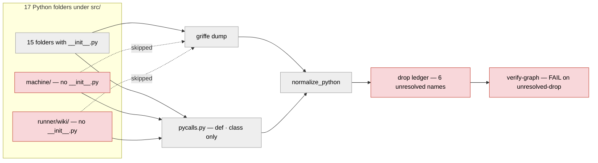
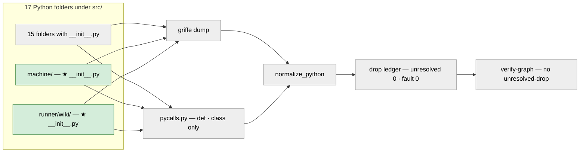
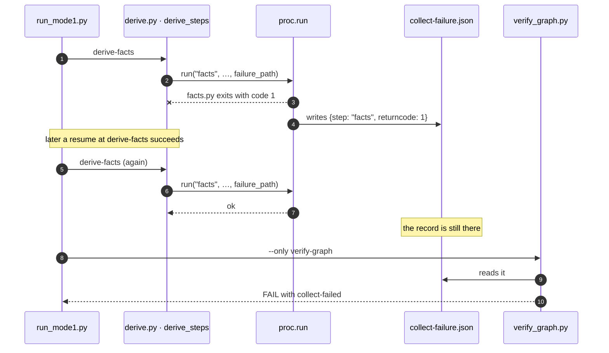
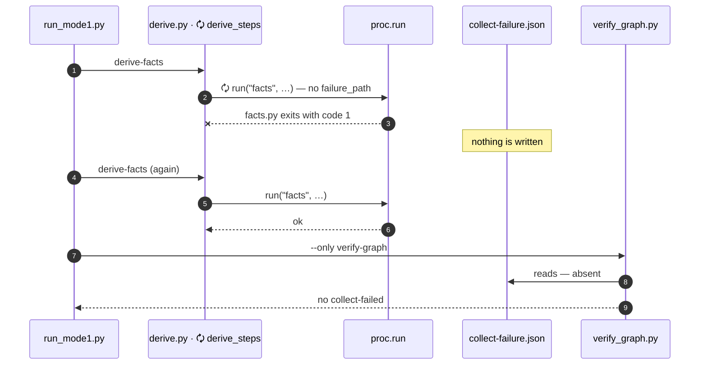

# 🧭 Code map — pre-final-test sub-plan (collector coverage · derived-artifact failures · terminology) Implementation Plan

> 📅 2026-11-14 · branch `codegraph-facts-generation` (a separate git worktree) · **Before = `ae3bbc2`** (26 commits after `46f0775`; `main` stays at `46f0775`)
> 📄 Evidence: parent plan `public.handoff/2026-11-13-codegraph-facts-generation-plan.md` (its Tasks 1~24 are committed) · entry point `public.handoff/2026-11-13-all-in-one-root-guide.md` · code read in this session — `derive.py` · `proc.py` · the failure-record sites of `prep.py` · `DeriveFactsStage` in `mode1/graph.py` · `failure_doc` in `verify_graph.py` · `mode1/survey.py` · `survey_plan.py` · the heads of the two test files · the measurements of this session (🔎 below)
> 🔒 Rules to keep: never loosen a check · `DROP_CLASS` is policy, not edited to pass · no new `xfail` / `skip` · one Task = one commit with the exact title, no body, no trailers, explicit `git add` paths, no push · comments and docstrings say only what the code is now · never touch the main working tree (another session edits it)
> 🧪 Verification: tests are **written** inside each Task and **run once** in Task D (👍 a user decision of the parent plan — it overrides the "run the test" steps of the writing-plans template). Allowed before Task D: `py_compile`, `tools/gen_readme.py` without `--check`, and the temp-folder measurement of Task A
> ✋ Approval: 👍 approved 2026-11-21 — D1 (a) · D2 (a) · D3 (b) · D4 (a). The order is Task A → B → B2 → C → D

> **For agentic workers:** REQUIRED SUB-SKILL: Use superpowers:subagent-driven-development (recommended) or superpowers:executing-plans to implement this plan task-by-task. Steps use checkbox (`- [ ]`) syntax for tracking.

**Goal:** Close what stands between the implementation branch and the parent plan's final test (Task 25): the <span style="color:cyan">collector</span> skips two folders so this repository is blocked by its own verifier, a failed <span style="color:cyan">derived-artifact</span> step leaves a stale <span style="color:cyan">collection failure record</span>, and the documents use project-coined words where the field has standard terms.

**Architecture:** Four small commits on the existing branch, then the parent plan's final test with corrected expected values. This plan adds no stage, artifact, class or interface — the existing ones stay as they are, and all four problems are fixed inside the current structure. If a fix turns out to need new structure, do not add it; stop and report. The <span style="color:cyan">collector</span>-side fix is two empty package files; the failure-record fix removes one argument; the file-count fix adds `-z` to one `git ls-files` call; the terminology is one table in the module document plus corrected values in the parent plan.

**Tech Stack:** Python 3.14 (`.venv`) · pytest · pyright strict · griffe 2.2.0 · msgspec · git worktrees. No new dependencies.

---

## 📋 One-page summary

| | |
|---|---|
| 🎯 Scope | The four things left between the implementation branch and the parent plan's final test (Tasks A · B · B2 · C) and the final test itself (Task D) |
| 🧩 One-line conclusion | Two empty `__init__.py` files take this repository's 6 unresolved references to 0 `[measured]`, removing one argument makes the <span style="color:cyan">collection failure record</span> mean only "collection failed", and then the final test runs once |
| 🟰 Unchanged | The 15 stages · the 34 fault codes · `DROP_CLASS` · the key shape of the map · the prompts · the test policy · existing identifiers and the wording of dated handoffs |
| 🗘 Changed | Two folders become packages → the <span style="color:cyan">collector</span> loads more modules and the map's edges go 759 → 946 `[measured]` · the arguments `derive_steps` passes · `count_sources` also counts non-ASCII paths · the wording of documents and the expected values of the parent plan |
| ⚠️ Pitfalls | More edges change the layers, the batch count and the cost estimate line `[unverified]` · the rule of `19eac4b` counts re-exported and `NewType` names as unresolved on other Python targets `[measured — seven packages]` · the final test runs the gates once on Before and once on After, so it is slow · the untracked copies of this plan in the main checkout must be removed before the merge |
| 🚫 Out of scope | D4 (recorded only) · the root `CLAUDE.md` · renaming identifiers · stages 4~6 of the parent plan · the measurement track |

## 🗺️ The five Tasks at a glance

```text
Before (ae3bbc2)                                            After · proposed
collector  griffe skips machine/ · runner/wiki/                ★ two __init__.py → all 17 Python folders are loaded          (A)
           this repository: 6 unresolved → verify-graph stops   unresolved 0 · fault 0  [measured — throwaway clone]
derived    derive_steps writes collect-failure.json             🗘 no record path passed → the record = collection failures   (B)
counting  count_sources misses tracked files with non-ASCII paths  🗘 counts with git ls-files -z                                 (B2)
documents  "외부 섬" · "파생물" · expected ["cs", "ts"] · py 125   🗘 terms table · expected ["cpp", "cs", "ts"] · py with -z     (C)
tests      never run (only the two allowed single-file checks)  six gates · real runs · records compared by identity         (D)
```

| 🧬 Task | Covers | Entry decision | Outputs | Run by |
|---|---|---|---|---|
| A <span style="color:cyan">collector</span> coverage | the two folders the <span style="color:cyan">collector</span> skips | 👍 D1 = (a) | ★ two empty `__init__.py` · ★ one test · one commit | subagent (default model) |
| B <span style="color:cyan">derived-artifact</span> failures | the <span style="color:cyan">collection failure record</span> that goes stale | 👍 D2 = (a) | 🗘 `derive_steps` · ★ one test · one commit | subagent (default model) |
| B2 file counting | the non-ASCII paths `count_sources` misses | 👍 D3 = (b) | 🗘 `count_sources` · ★ one test · one commit | subagent (default model) |
| C documents | terms table · record of added Tasks · expected values | 👍 check the terms, then unify | 🗘 six documents · one commit | orchestrator |
| D final test | the parent plan's Task 25 | 👍 once at the end + bisect | results of the six gates · records comparison · real runs | subagent (high reasoning effort) |

## ✅ Decided — not to be reopened

| What | 👍 chosen · 👎 rejected | Who · when |
|---|---|---|
| Where to implement | 👍 document commit on `main`, code on a new branch in a separate worktree, no push, ask about `main` at the end · 👎 everything in the worktree · 👎 a new branch in the current working tree · 👎 `main` in the current working tree | user · 2026-11-14 |
| Baseline | 👍 not measured now; the final test measures it on a working tree of the Before commit · 👎 measure before touching code | user · 2026-11-14 |
| The 14 corrections of the parent plan | 👍 apply them to the plan documents · 👎 only in the subagent briefs · 👎 proceed with the original text | user · 2026-11-14 |
| Shard reuse | 👍 in this implementation, design first · 👍 design A — a <span style="color:cyan">plan stamp</span> on the shard folder · 👎 design B — a subfolder per plan | user · 2026-11-14 |
| <span style="color:cyan">External nodes</span> named after a first-party module | 👍 the normalizer counts them as unresolved · 👎 accept one and narrow the test. A <span style="color:cyan">collector</span>-side fix was not chosen in that question — it is asked again as D1 | user · 2026-11-14 |
| How to implement | 👍 subagents. Sonnet 5.5 by default, a few Fable 5.2 High only where high reasoning is needed. Questions about implementation only | user · 2026-11-14 |
| Shape of this sub-plan | 👍 check the terms first, unify them, write with writing-plans · 👍 deliver in this visual format | user · 2026-11-14 |
| Test policy | 👍 implement → commit per Task → test once at the end → bisect · 👎 a regression run per change | user · the parent plan's Decided table |
| D1 folders the <span style="color:cyan">collector</span> skips | 👍 (a) two empty `__init__.py` · 👎 (b) change the call <span style="color:cyan">collector</span> · 👎 (c) not now | user · 2026-11-21 |
| D2 stale <span style="color:cyan">collection failure record</span> | 👍 (a) the <span style="color:cyan">derived-artifact</span> step writes no record · 👎 (b) leave it and record | user · 2026-11-21 |
| D3 counting files with non-ASCII paths | 👍 (b) fix now · 👎 (a) out of this plan, recorded | user · 2026-11-21 |
| D4 unresolved re-exported names | 👍 (a) keep and record · 👎 (b) add a resolution rule for re-exports now | user · 2026-11-21 |

## 📊 Status

| Item | State |
|---|---|
| Parent plan Tasks 1~24 | ✅ `8e77474` … `4cc1fc2` (24 commits) |
| Added — a dotted name under a first-party module is counted as unresolved instead of folding into an <span style="color:cyan">external node</span> | ✅ `19eac4b` |
| Added — the survey compares a <span style="color:cyan">plan stamp</span> on the shard folder | ✅ `ae3bbc2` |
| Terms checked | ✅ 📖 of this document |
| Task A | ✅ `1861862` |
| Task B | ✅ `26284ea` |
| Task B2 | ✅ `35ef600` |
| Task C | ✅ the `[docs]` commit that adds this document to the branch |
| Task D final test | ✅ at `5e66a4b` — four fix commits `45fdedf` · `412a770` · `56dbd31` · `5e66a4b` |
| Tests and gates | ✅ measured 2026-11-21 at `5e66a4b` — see 🧪 Final test result |

## ❓ Open — none (D1~D4 were decided on 2026-11-21)

| # | Question | Evidence | 👍 Decision | Impact |
|---|---|---|---|---|
| D1 | Neither <span style="color:cyan">collector</span> describes the two type aliases in `warmup.py`. Which <span style="color:cyan">collector</span>-side fix — (a) an empty `__init__.py` in the two folders · (b) the call <span style="color:cyan">collector</span> records module-level type aliases · (c) none now | `[measured]` the branch has 6 unresolved, the throwaway clone with the package files has 0. The other 15 Python folders under `src/` already have the file `[code read]` | 👍 (a) — as recommended | Task A. With (c) Task A is dropped, Task D expects this repository to stop with `unresolved-drop`, and the parent plan's stage-3 completion condition is recorded as not met |
| D2 | A failed <span style="color:cyan">derived-artifact</span> step writes `collect-failure.json`, and it stays after a later success. Fix it — (a) that step writes no record · (b) record it and leave it | `[code read]` `derive_steps` passes `failure_path=paths["failure"]`; only the start of `prep` deletes the file. `[unverified]` not run end to end | 👍 (a) — as recommended | Task B |
| D3 | `lang_select.count_sources` misses tracked files with non-ASCII paths — (a) out of this plan, recorded · (b) fix now | `[measured]` `git ls-files` without `-z` quotes such paths. It predates the parent plan | 👍 (b) fix now — the recommendation was (a) | Task B2. The new <span style="color:cyan">source inventory</span> already counts with `-z` |
| D4 | The rule of `19eac4b` counts re-exported and `NewType` names as unresolved on other Python targets — (a) keep and record · (b) add a resolution rule for re-exports now | `[measured — by a subagent]` `_pytest` 3 → 30 · networkx 1 → 14 · packaging 0 → 4 · pygments 0 → 1 · jinja2 · griffe · pluggy unchanged | 👍 (a) — as recommended. (b) needs its own design, and seven packages are the whole evidence | such targets stop at `verify-graph` |

## 🔎 Measured facts this plan stands on (2026-11-14)

`normalize_python` run in memory on this repository's <span style="color:cyan">collector</span> output, collected into a temp folder the way `prep.py` does. "After" is a throwaway clone of `ae3bbc2` with the two `__init__.py` files added and staged.

| | Branch at `ae3bbc2` | Throwaway clone with the two package files |
|---|---|---|
| Nodes · edges · modules | 756 · 759 · 6 | 763 · 946 · 6 |
| <span style="color:cyan">External nodes</span> | `(표준) stdlib` · `jinja2` | `(표준) stdlib` · `jinja2` |
| Rows of class `unresolved` or `fault` | 1 — `이름 해소 실패` 6 (`warmup.Manifest` · `warmup.Verdicts`) | 0 |

Also measured: `facts.py` given a map path that does not exist exits with code 1 and writes nothing; `pyRoots` of this repository is `src/codewiki` · `src/common` · `src/core` · `src/spec` · `src/term` · `tools`; 923 tests were collected at `a21dd4d` (the pass count was not measured).

## 🔁 Before / After

| 📍 Before (what did not work · now) | 🛠️ After · proposed | 🎉 What it resolves | 🔭 Expected | Done |
|---|---|---|---|---|
| 🐞 griffe does not load `machine/` · `runner/wiki/`, which have no `__init__.py`. Their type aliases are missing, so this repository stops at `verify-graph` with 6 unresolved references | ★ two empty `__init__.py` · ★ a test that every folder is a package | the <span style="color:cyan">collector</span> loads every Python folder | unresolved 0 · fault 0 · 946 edges `[measured — throwaway clone]` | ✅ `1861862` |
| 🐞 A failed <span style="color:cyan">derived-artifact</span> step writes `collect-failure.json`; it stays after a successful resume and `--only verify-graph` reports `collect-failed` | 🗘 `derive_steps` passes no record path · ★ one test | the <span style="color:cyan">collection failure record</span> means exactly "collection failed" | the new test passes `[unverified — Task D]` | ✅ `26284ea` |
| 🐞 Documents say "외부 섬" · "파생물" · "실패 기록". The parent plan expects `["cs", "ts"]` · `py 125` | 🗘 a terms table in `src/codewiki/CLAUDE.md` · four values and one closing section in the parent plan | the documents connect to the field's terms and the final test runs on measured expectations | the document gate passes `[unverified — Task C]` | ✅ |
| 🐞 `count_sources` uses `git ls-files` without `-z` and does not count tracked files with non-ASCII paths | 🗘 splits the output of `git ls-files -z` on NUL · ★ one test | the file counts of the language hint use the same basis as the <span style="color:cyan">source inventory</span> | the new test passes `[unverified — Task D]` | ✅ `35ef600` |
| ⚠️ Tests and gates were never run. Every expected value is a prediction from read code | Task D — Before values · six gates · records compared by identity · real runs · bisect | predictions become measurements | 0 new `실패` lines · adversarial file `10 passed, 2 xfailed` `[unverified]` | ✅ `5e66a4b` |
| A dotted name under a first-party module folded into an <span style="color:cyan">external node</span> | counted as unresolved (`이름 해소 실패`) | no <span style="color:cyan">external node</span> is named after a first-party module | the <span style="color:cyan">external nodes</span> are `(표준) stdlib` · `jinja2` only `[measured]` | ✅ `19eac4b` |
| A batch was skipped whenever a same-named shard was present | the <span style="color:cyan">plan stamp</span> on the shard folder is compared; another plan's shards move to `_stale/` | shards of another plan are not reused | eight new tests `[unverified — Task D]` | ✅ `ae3bbc2` |

## ★ New · 🗘 changed items (module → file → class → function → member)

Legend: **★ newly created · 🗘 changed / updated / refreshed · no mark = reused as is · ✕ removed.** The baseline is Before `ae3bbc2`. The marks describe the kind of change, not implementation or verification status.

| Level | Mark | Item | Kind | Lives in |
|---|---|---|---|---|
| module | 🗘 | `codewiki.python.machine` | changed — from a folder without `__init__.py` to a package | `src/codewiki/python/` |
| module | 🗘 | `codewiki.python.runner.wiki` | changed — the same | `src/codewiki/python/runner/` |
| file | ★ | `src/codewiki/python/machine/__init__.py` | new (empty) | module `codewiki.python.machine` |
| file | ★ | `src/codewiki/python/runner/wiki/__init__.py` | new (empty) | module `codewiki.python.runner.wiki` |
| file | ★ | `public.handoff/2026-11-14-codegraph-pre-final-test-subplan.md` · `.ko.md` | new (on the branch) | `public.handoff/` |
| file | 🗘 | `derive.py` · `proc.py` | changed | module `codewiki.python.runner.wiki` |
| file | 🗘 | `lang_select.py` | changed | module `codewiki.python.machine` |
| file | 🗘 | `test_source_inventory.py` · `test_prep_fingerprint.py` · `test_lang_select.py` | changed — one test added to each | `test/codewiki/` |
| file | 🗘 | `src/codewiki/CLAUDE.md` · two generated READMEs · `resource/codewiki/terms-reading.json` · the parent plan `.md` · `.ko.md` · the 11-05 resume handoff · the root guide | changed | documents and records |
| class | — | none | — | — |
| function | 🗘 | `derive.derive_steps` | changed — passes no `failure_path` | `derive.py` |
| function | 🗘 | `proc.run` | changed — docstring only | `proc.py` |
| function | 🗘 | `lang_select.count_sources` | changed — counts with `git ls-files -z` | `lang_select.py` |
| function | ★ | `test_counts_tracked_files_with_non_ascii_paths` | new | `test_lang_select.py` |
| function | ★ | `test_src_아래_파이썬_폴더는_전부_패키지다` | new | `test_source_inventory.py` |
| function | ★ | `test_파생_산출물_단계가_죽어도_수집_실패_기록을_쓰지_않는다` | new | `test_prep_fingerprint.py` |
| member | — | none | — | — |

## 🌊 Flow — what the collector loads (Task A)

Legend: gray = unchanged · green = new · amber = updated · red = blocking problem.

**Before** `[code read · measured]`



**After · proposed** `[measured up to the ledger on a throwaway clone; the verify-graph pass is unverified]`



## 🔀 Sequence — when a derived-artifact step fails (Task B)

**Before** `[code read · not run end to end]`



**After · proposed**



## 🧱 Structure — Before = After

No class is created or changed. Task A is two files; Task B is the arguments of one function. Task C is documents only, so it has no drawing — the text to change is in the steps of Task C.

## 🔧 Where to change

| File · symbol | Change | Why | Evidence |
|---|---|---|---|
| ★ `src/codewiki/python/machine/__init__.py` · ★ `src/codewiki/python/runner/wiki/__init__.py` | create the empty files | griffe does not load the modules of a folder without `__init__.py` | `[measured]` with the package files the edges go 759 → 946 and the unresolved references 6 → 0 |
| 🗘 `test/codewiki/test_source_inventory.py` — ★ `test_src_아래_파이썬_폴더는_전부_패키지다` | check that every folder under `src/` with a tracked `.py` has `__init__.py` | the test breaks if the same hole reappears | `[code read]` the file already has `os` · `subprocess` · `ROOT` |
| 🗘 `derive.py` — 🗘 `derive_steps` | drop `failure_path=paths["failure"]` from the two `run(...)` calls | a failed <span style="color:cyan">derived-artifact</span> step is recorded as a collection failure | `[code read]` `derive.py` · `proc.py` · `failure_doc` in `verify_graph.py` |
| 🗘 `proc.py` — 🗘 `run` | two docstrings | the record is written only when a path is given | `[code read]` |
| 🗘 `test/codewiki/test_prep_fingerprint.py` — ★ `test_파생_산출물_단계가_죽어도_수집_실패_기록을_쓰지_않는다` | call `derive_steps` on a repository without a map and check that no record exists | pins the behavior above | `[measured]` `facts.py` on a missing map exits with code 1 |
| 🗘 `lang_select.py` — 🗘 `count_sources` · 🗘 `test/codewiki/test_lang_select.py` — ★ `test_counts_tracked_files_with_non_ascii_paths` | read `git ls-files -z` and split on NUL · check that a `.py` under a Korean-named folder is counted | without `-z` git quotes a non-ASCII path, so it drops out of the extension match | `[measured]` in a scratch repository `한글/b.py` came out quoted with octal escapes |
| 🗘 `src/codewiki/CLAUDE.md` | one Note · the `proc` row · one sentence · the terms table | the current-state document follows the code and the unified wording | `[code read]` each string to replace occurs once |
| 🗘 parent plan `.md` · `.ko.md` | four expected values in place, one section at the end | `["cs", "ts"]` · `py 125` are wrong | `[measured]` one C++ file is tracked, and `git ls-files` without `-z` misses non-ASCII paths |
| 🗘 the 11-05 resume handoff · the root guide | close B5 and add section J · "implemented" on N5 | the item ledger and the entry point agree with the branch | `[code read]` |

**Proposed diff** — the core of Task B. The Before lines are copied from the source at `ae3bbc2`. The remaining text is in the steps of each Task.

```diff
--- a/src/codewiki/python/runner/wiki/derive.py
+++ b/src/codewiki/python/runner/wiki/derive.py
 def derive_steps(repo: str, paths: dict[str, str], py: str, generation_id: str) -> None:
-    """facts → render-modules. ranking.json 에 generation_id 를 찍는다."""
+    """facts → render-modules. ranking.json 에 generation_id 를 찍는다. 이 단계의 실패는 수집 실패 기록에 적지 않는다."""
     detail = os.path.join(paths["raw"], "roslyn-dump.json")
     extra = ["--detail", detail] if os.path.exists(detail) else []
     run("facts", py, [os.path.join(ROOT, "src", "codewiki", "python", "machine", "facts.py"), paths["codegraph"], "--repo", repo,
-                      "--generation", generation_id] + extra + ["-o", paths["raw"]], failure_path=paths["failure"])
+                      "--generation", generation_id] + extra + ["-o", paths["raw"]])
     run("render-modules", py, [os.path.join(ROOT, "src", "codewiki", "python", "viz", "render_modules.py"), paths["codegraph"],
-                               "-o", os.path.join(paths["raw"], "modules")], failure_path=paths["failure"])
+                               "-o", os.path.join(paths["raw"], "modules")])
```

## 📖 Terms — checked first, then unified

Checked two ways: how often each word appears in this repository (`git grep`, tracked files) and what the field calls the same thing (web search, result snippets only — the pages were not opened).

| Word used so far | In this repository `[measured]` | What the field calls it | Unified wording |
|---|---|---|---|
| 수집기 (<span style="color:cyan">collector</span>) | 45 lines in documents · 104 in handoffs · 47 in Python; code names `COLLECTOR` · `collectorFor` · `collect-graph` | **extractor** — CodeQL: "a tool that produces the relational data and source reference for each input file" · **indexer** — SCIP: indexers are the producers of the index | Keep **수집기 (<span style="color:cyan">collector</span>)**: it is in code and stage names. The first mention in a document adds "the field calls this an extractor or indexer" |
| 외부 섬 (external island) | 1 line in documents · 8 in handoffs · 6 in Python (a test name and docstrings); coined in the stage-3 spec | No such term found. Ruff · isort classify an import as **first-party** or **third-party**; the defect is a misclassification | **외부로 오분류된 1차 모듈** (a first-party module misclassified as external). The graph object stays 외부 노드 (<span style="color:cyan">external node</span>) |
| 파생물 | 5 · 12 · 9; code names `derive-facts` · `derive.py` | Bazel: an artifact is a source file or a **generated file**, "sometimes called derived files" | **파생 산출물** (<span style="color:cyan">derived artifact</span>) — "산출물" is already this repository's word for an artifact (`ARTIFACTS`) |
| 실패 기록 | 7 · 17 · 7; file `collect-failure.json` | SARIF records a tool run as an **invocation** (`executionSuccessful` · `exitCode` · `toolExecutionNotifications`) | Always **수집 실패 기록** (<span style="color:cyan">collection failure record</span>) — the leading "수집" is never dropped |
| 임시 사본 | 0 — chat wording only | The Git glossary defines **working tree**; "scratch copy" is not in it | **임시 클론** (throwaway clone) when made with `git clone`; **작업 트리** (working tree) for `git worktree`; a plain folder is **임시 폴더** |

Rule: existing identifiers and dated handoffs keep their words. Current-state documents and new writing use the unified wording.

Sources: [CodeQL glossary](https://codeql.github.com/docs/codeql-overview/codeql-glossary) · [Sourcegraph — writing an indexer](https://sourcegraph.com/docs/code-navigation/writing-an-indexer) · [Bazel glossary](https://bazel.build/reference/glossary) · [Bazel 2.2.0 concepts](https://docs.bazel.build/versions/2.2.0/build-ref.html) · [Ruff FAQ](https://docs.astral.sh/ruff/faq) · [Qodana SARIF output](https://jetbrains.com/help/qodana/qodana-sarif-output.html) · [GitLab analyzers MR quoting the SARIF spec](https://gitlab.com/gitlab-org/security-products/analyzers/report/-/merge_requests/52) · [gitglossary](https://man.archlinux.org/man/gitglossary.7.en)

**Glossary** — a term that has a code name is written in cyan.

| Term | Code name | Meaning |
|---|---|---|
| <span style="color:cyan">collector</span> (수집기) | `COLLECTOR` · `collectorFor` · `collect-graph` | the tool that extracts the raw material of the map from source — griffe · `pycalls.py` · clang-uml · roslyn-dump |
| <span style="color:cyan">collection failure record</span> (수집 실패 기록) | `collect-failure.json` | the failed collection step · argv · return code · stderr tail |
| <span style="color:cyan">derived artifact</span> (파생 산출물) | `derive-facts` · `derive.py` | what is made from a checked map — `facts/*.md` · `ranking.json` · the module diagram |
| <span style="color:cyan">external node</span> (외부 노드) | a node's `kind: "external"` | a node that stands for something outside the repository |
| <span style="color:cyan">drop ledger</span> (버림 장부) | `normalize-report.json` · `Ledger` | counts and samples per reason for what normalization dropped or folded |
| <span style="color:cyan">receipt</span> (성공 기록) | `graph-verified.json` | evidence that the named checks ran on this map |
| <span style="color:cyan">collection manifest</span> (수집 manifest) | `collect-fingerprint.json` | collection fingerprint · source hashes · `generation_id` |
| <span style="color:cyan">plan stamp</span> (계획 도장) | `_shards/.plan` · `claim_shard_dir` | the hash that says which `batches.json` a shard folder belongs to |
| <span style="color:cyan">source inventory</span> (소스 inventory) | `source-inventory.json` | tracked files per language and the collection status of each file |
| first-party module misclassified as external (외부로 오분류된 1차 모듈) | — | the state where an <span style="color:cyan">external node</span> is named after a first-party module; it has no code name |
| working tree · throwaway clone (작업 트리 · 임시 클론) | — | Git's working tree · a clone made in a temp folder |

All work happens in the implementation worktree. `$REPO_ROOT` below is the main checkout.

---

### Task A: The collector loads every Python folder (D1 = a)

**Files:**
- Create: `src/codewiki/python/machine/__init__.py`, `src/codewiki/python/runner/wiki/__init__.py`
- Modify: `test/codewiki/test_source_inventory.py`, `src/codewiki/CLAUDE.md`
- Regenerate: `src/codewiki/python/machine/README.md`, `src/codewiki/python/runner/README.md`

- [ ] **Step 1: Write the test** — append to `test/codewiki/test_source_inventory.py` (`os`, `subprocess` and `ROOT` are already defined there):

```python
def test_src_아래_파이썬_폴더는_전부_패키지다() -> None:
    """griffe 는 `__init__.py` 가 없는 폴더의 모듈을 싣지 않는다. 추적되는 `.py` 가 있는 `src/` 아래 폴더는 전부 그 파일을 갖는다."""
    out = subprocess.run(["git", "ls-files", "-z", "--", "src"], cwd=ROOT, capture_output=True, text=True, check=True).stdout
    folders = {os.path.dirname(p) for p in out.split("\0") if p.endswith(".py")}
    missing = sorted(d for d in folders if not os.path.isfile(os.path.join(ROOT, d, "__init__.py")))
    assert not missing, missing
```

⏭ expected at Task D: PASS. At `ae3bbc2` it would fail with `['src/codewiki/python/machine', 'src/codewiki/python/runner/wiki']`.

- [ ] **Step 2: Create the two empty files**

```bash
: > src/codewiki/python/machine/__init__.py
: > src/codewiki/python/runner/wiki/__init__.py
```

- [ ] **Step 3: Regenerate the READMEs**

```bash
.venv/bin/python tools/gen_readme.py src/codewiki/python/machine src/codewiki/python/runner
```

Expected: each README gains a row for its new `__init__.py`, as the other package folders have. If a README does not change, commit what changed.

- [ ] **Step 4: Note in `src/codewiki/CLAUDE.md`** — append as the last line of the section `## 비직관적인 것 (Gotchas)`:

```markdown
- **Note — griffe 는 `__init__.py` 가 없는 폴더의 모듈을 싣지 않는다.** `src/` 아래에서 추적되는 `.py` 가 있는 폴더는 전부 패키지다. 빠지면 그 폴더의 형 별칭과 주석 간선이 지도에 실리지 않는다 — `test/codewiki/test_source_inventory.py` 의 `test_src_아래_파이썬_폴더는_전부_패키지다` 가 지킨다.
```

- [ ] **Step 5: Measure in a temp folder (not a test run)** — the normalizer keeps only git-tracked modules, so stage the two files first. Save the script outside the worktree as `$SCRATCH/measure.py`:

```python
"""수집기 출력으로 normalize_python 을 메모리에서 돌려 미해결 · 결함 장부와 외부 노드를 찍는다. 인자: <저장소> <덤프 폴더>."""
import json, os, sys
repo, t = os.path.abspath(sys.argv[1]), sys.argv[2]
sys.path[:0] = [os.path.join(repo, "src"), os.path.join(repo, "src", "codewiki", "python", "machine")]
import normalize as N
dump = json.load(open(os.path.join(t, "griffe.json"), encoding="utf-8"))
calls = json.load(open(os.path.join(t, "pycalls.json"), encoding="utf-8"))
g, st = N.normalize_python(dump, repo, "griffe measure", calls=calls)
print("nodes", len(g["nodes"]), "edges", len(g["edges"]), "modules", len(g["modules"]))
print("external", sorted(n["name"] for n in g["nodes"] if n["kind"] == "external"))
bad = [r for r in st.report() if r["class"] in ("unresolved", "fault")]
print("unresolved+fault rows", len(bad))
for r in bad:
    print(" ", r["class"], r["reason"], r["count"], r["samples"])
```

```bash
git add src/codewiki/python/machine/__init__.py src/codewiki/python/runner/wiki/__init__.py
T="$(mktemp -d)"
.venv/bin/python -m griffe dump codewiki common core spec term tools -o "$T/griffe.json" -s . -s src
.venv/bin/python src/codewiki/python/machine/pycalls.py src/codewiki src/common src/core src/spec src/term tools --repo . -o "$T/pycalls.json"
PYTHONDONTWRITEBYTECODE=1 .venv/bin/python "$SCRATCH/measure.py" . "$T"
```

Expected (measured on a clone of `ae3bbc2`):

```text
nodes 763 edges 946 modules 6
external ['(표준) stdlib', 'jinja2']
unresolved+fault rows 0
```

If any `unresolved` or `fault` row is printed: stop, do not commit, report each row with its samples. Do not reclassify and do not special-case a name.

- [ ] **Step 6: Commit**

```bash
git add src/codewiki/python/machine/__init__.py src/codewiki/python/runner/wiki/__init__.py \
        src/codewiki/python/machine/README.md src/codewiki/python/runner/README.md \
        src/codewiki/CLAUDE.md test/codewiki/test_source_inventory.py
git commit -m "[fix] : codewiki - machine, runner/wiki 폴더를 패키지로 만들어 griffe 가 건너뛰지 않게 한다"
```

### Task B: A failed derived-artifact step does not write the collection failure record (D2 = a)

**Files:**
- Modify: `src/codewiki/python/runner/wiki/derive.py` (`derive_steps`), `src/codewiki/python/runner/wiki/proc.py` (two docstrings)
- Test: `test/codewiki/test_prep_fingerprint.py`
- Modify: `src/codewiki/CLAUDE.md`, `resource/codewiki/terms-reading.json`
- Regenerate: `src/codewiki/python/runner/README.md`

- [ ] **Step 1: Write the test** — in `test/codewiki/test_prep_fingerprint.py` add `import pytest` to the imports, change the package import line to `from codewiki.python.runner.wiki import compdb, derive, prep  # noqa: E402`, and append:

```python
def test_파생_산출물_단계가_죽어도_수집_실패_기록을_쓰지_않는다(tmp_path: Path) -> None:
    paths = prep.wikiPaths(str(tmp_path))
    os.makedirs(paths["raw"])
    with pytest.raises(SystemExit) as stop:
        derive.derive_steps(str(tmp_path), paths, sys.executable, "g1")
    assert stop.value.code == 1
    assert not os.path.exists(paths["failure"])
```

The repository in `tmp_path` has no map, so `facts.py` exits with code 1 (measured). ⏭ expected at Task D: PASS. At `ae3bbc2` the last assertion would fail — the record is written.

- [ ] **Step 2: `derive_steps` stops passing the record path** — replace the function in `src/codewiki/python/runner/wiki/derive.py` with:

```python
def derive_steps(repo: str, paths: dict[str, str], py: str, generation_id: str) -> None:
    """facts → render-modules. ranking.json 에 generation_id 를 찍는다. 이 단계의 실패는 수집 실패 기록에 적지 않는다."""
    detail = os.path.join(paths["raw"], "roslyn-dump.json")
    extra = ["--detail", detail] if os.path.exists(detail) else []
    run("facts", py, [os.path.join(ROOT, "src", "codewiki", "python", "machine", "facts.py"), paths["codegraph"], "--repo", repo,
                      "--generation", generation_id] + extra + ["-o", paths["raw"]])
    run("render-modules", py, [os.path.join(ROOT, "src", "codewiki", "python", "viz", "render_modules.py"), paths["codegraph"],
                               "-o", os.path.join(paths["raw"], "modules")])
```

- [ ] **Step 3: Docstrings in `src/codewiki/python/runner/wiki/proc.py`** — the module docstring becomes

```python
"""proc.py — 자식 프로세스 하나를 돌린다. 죽으면 그 종료 코드로 끝내고, 실패 기록 자리를 받았으면 그 전에 기록을 남긴다. prep 과 derive 가 함께 쓴다."""
```

and the docstring of `run` becomes

```python
    """stderr 를 화면에 흘리면서 끝 40줄을 쥔다. 종료 코드가 0 이 아니면 그 코드로 끝내고, `failure_path` 가 있으면 그 전에 수집 실패 기록을 쓴다."""
```

- [ ] **Step 4: Regenerate the README** — `.venv/bin/python tools/gen_readme.py src/codewiki/python/runner`

- [ ] **Step 5: `src/codewiki/CLAUDE.md`** — two in-line edits. In the `python/runner/wiki/` row replace `` `proc`(자식 프로세스 하나를 돌리고 죽으면 실패 기록을 남긴다) `` with `` `proc`(자식 프로세스 하나를 돌리고, 실패 기록 자리를 받았으면 죽을 때 기록을 남긴다) ``. In the Note that starts `**Note — collect-graph 는 수집 · 정제만 하고(--collect-only)` append this sentence after `핸드오프를 쓴다.`:

```markdown
파생 산출물 단계(`facts` · `render-modules`)의 실패는 이 기록에 적지 않는다.
```

- [ ] **Step 6: Record** — in `resource/codewiki/terms-reading.json`, key `codewiki.python.runner.wiki.derive.derive_steps`: replace the last sentence of `does` (`어느 쪽이든 죽으면 proc.run 이 실패 기록을 남긴다.`) with `두 단계 모두 실패 기록 자리를 넘기지 않아, 죽어도 수집 실패 기록을 쓰지 않는다.` Fix the line number in `where` only if the definition line moved. Keep the file's formatting; confirm it loads: `.venv/bin/python -c "import json; json.load(open('resource/codewiki/terms-reading.json', encoding='utf-8'))"`.

- [ ] **Step 7: Syntax check and commit**

```bash
.venv/bin/python -m py_compile src/codewiki/python/runner/wiki/derive.py src/codewiki/python/runner/wiki/proc.py test/codewiki/test_prep_fingerprint.py
git add src/codewiki/python/runner/wiki/derive.py src/codewiki/python/runner/wiki/proc.py \
        test/codewiki/test_prep_fingerprint.py src/codewiki/python/runner/README.md \
        src/codewiki/CLAUDE.md resource/codewiki/terms-reading.json
git commit -m "[fix] : codewiki - 파생 산출물 단계의 실패는 수집 실패 기록에 적지 않는다"
```

### Task B2: `count_sources` counts tracked files with non-ASCII paths (D3 = b)

**Files:**
- Modify: `src/codewiki/python/machine/lang_select.py` (`count_sources`)
- Test: `test/codewiki/test_lang_select.py`
- Modify: `resource/codewiki/terms-reading.json`

- [ ] **Step 1: Write the test** — append to `test/codewiki/test_lang_select.py`:

```python
def test_counts_tracked_files_with_non_ascii_paths(tmp_path: Path) -> None:
    """`-z` 없는 `git ls-files` 는 비 ASCII 경로를 따옴표로 감싸서, 확장자 대조에서 빠진다."""
    r = _repo(tmp_path, {"a.py": "", "한글/b.py": ""})
    assert L.count_sources(r)["py"] == 2
```

⏭ expected at Task D: PASS. At `ae3bbc2` it fails with `1 == 2` — measured in a scratch repository: `git ls-files` prints the second path quoted, with octal escapes.

- [ ] **Step 2: Read the listing NUL-separated** — in `count_sources` replace the two lines

```python
    r = subprocess.run(["git", "ls-files"], cwd=repo, capture_output=True, text=True)
    files = r.stdout.split("\n") if r.returncode == 0 else []
```

with these two. Two lines for two lines, so the line numbers below do not move (a reading record cites line 56).

```python
    r = subprocess.run(["git", "ls-files", "-z"], cwd=repo, capture_output=True)
    files = [p.decode("utf-8", "surrogateescape") for p in r.stdout.split(b"\0")] if r.returncode == 0 else []
```

Do not filter out the empty piece — a git repository with no tracked file must keep not falling into the `os.walk` fallback, as it does now. Do not reuse `source_inventory.tracked_files`: `source_inventory` imports `lang_select`, so that would be a circular import. The docstring is unchanged, so the generated README does not change.

- [ ] **Step 3: Record** — in `resource/codewiki/terms-reading.json`, key `codewiki.python.machine.lang_select.count_sources`: change the leading `git ls-files 로` of `does` to `git ls-files -z 로`. Keep the file's formatting; confirm it loads: `.venv/bin/python -c "import json; json.load(open('resource/codewiki/terms-reading.json', encoding='utf-8'))"`.

- [ ] **Step 4: Syntax check and commit**

```bash
.venv/bin/python -m py_compile src/codewiki/python/machine/lang_select.py test/codewiki/test_lang_select.py
git add src/codewiki/python/machine/lang_select.py test/codewiki/test_lang_select.py resource/codewiki/terms-reading.json
git commit -m "[fix] : codewiki - 언어별 파일 수를 git ls-files -z 로 세어 비 ASCII 경로를 빠뜨리지 않는다"
```

### Task C: Documents — unified terms, added Tasks, corrected expected values

**Files:**
- Create in the branch: `public.handoff/2026-11-14-codegraph-pre-final-test-subplan.md`, `.ko.md` (copied from `$REPO_ROOT/public.handoff/`)
- Modify: `src/codewiki/CLAUDE.md`, `public.handoff/2026-11-13-codegraph-facts-generation-plan.md`, `.ko.md`, `public.handoff/2026-11-05-codegraph-verify-unify-resume-handoff.md`, `public.handoff/2026-11-13-all-in-one-root-guide.md`

- [ ] **Step 1: Copy this plan into the branch**

```bash
cp "$REPO_ROOT/public.handoff/2026-11-14-codegraph-pre-final-test-subplan.md" "$REPO_ROOT/public.handoff/2026-11-14-codegraph-pre-final-test-subplan.ko.md" public.handoff/
```

- [ ] **Step 2: Terms table in `src/codewiki/CLAUDE.md`** — insert before the line `## 경로 변수 — 문서와 테스트가 쓰는 이름`:

```markdown
## 용어 — 이 문서의 말과 업계의 말

| 이 저장소의 말 | 코드 이름 | 업계에서 같은 것을 부르는 말 |
|---|---|---|
| 수집기 | `COLLECTOR` · `collectorFor` · `collect-graph` | extractor(CodeQL) · indexer(SCIP) |
| 수집 실패 기록 | `collect-failure.json` | 도구 실행 한 번의 기록 — SARIF 의 invocation |
| 파생 산출물 | `derive-facts` · `derive.py` | derived file · generated file(Bazel) |
| 외부로 오분류된 1차 모듈 | 1차 모듈 이름을 단 외부 노드(`kind: "external"`) | first-party 를 third-party 로 잘못 가른 것(Ruff · isort 의 import 분류) |
| 작업 트리 | — | working tree(Git) |

새로 쓸 때는 "외부 섬" 대신 "외부로 오분류된 1차 모듈", "파생물" 대신 "파생 산출물", "실패 기록" 대신 "수집 실패 기록" 을 쓴다. 이미 있는 식별자는 그대로 둔다.

```

- [ ] **Step 3: Parent plan — corrected expected values, in place** (line counts must not change; another document cites these files by line). In `public.handoff/2026-11-13-codegraph-facts-generation-plan.md`:
  - every `["cs", "ts"]` (2 places) → `["cpp", "cs", "ts"]`
  - `` `cs` 1 · `py` 125 · `ts` 13 `` → `` `cpp` 1 · `cs` 1 · `py` (count with `git ls-files -z`) · `ts` 13 ``
  - `py 125 · ts 13 · cs 1 tracked` → `cpp 1 · cs 1 · ts 13 tracked, py counted with git ls-files -z`
  - `` `cs 1 · py 125 · ts 13` (🔵 `git ls-files`) `` → `` `cs 1 · py 125 · ts 13` (`git ls-files` without `-z`, which misses non-ASCII paths — superseded by the section at the end of this file) ``

  In `.ko.md`: `["cs", "ts"]` (1 place) → `["cpp", "cs", "ts"]`; `py 125 · ts 13 · cs 1 추적` → `cpp 1 · cs 1 · ts 13 추적, py 는 git ls-files -z 로 센다`; `` `cs 1 · py 125 · ts 13`(🔵 `git ls-files`) `` → `` `cs 1 · py 125 · ts 13`(`-z` 없는 `git ls-files` 라 비 ASCII 경로가 빠진 값 — 정본 끝 절이 대체) ``. Then confirm: `wc -l` gives 1879 and 175 before the next step.

- [ ] **Step 4: Parent plan — append at the very end of the `.md`** (after the last line, so no cited line moves):

```markdown

## ➕ Added after approval (2026-11-14 ~ 2026-11-21)

| Commit | What | Why |
|---|---|---|
| `19eac4b` | A dotted name under a first-party module is counted as `이름 해소 실패` instead of folding into an external node | user decision — a first-party module must not appear as an external node |
| `ae3bbc2` | The survey compares a plan stamp (`_shards/.plan`, sha256 of `batches.json`) and moves other plans' shards to `_shards/_stale/` | user decision, design A — shards and reading records were outside the receipt ↔ batches chain |
| Task A · B · B2 · C of `2026-11-14-codegraph-pre-final-test-subplan.md` | collector coverage · derived-artifact failures · file counting · documents | see that plan |

Task 25 runs with the expected values of that sub-plan's Task D. Two facts the stage-3 text did not know: commits `49bcb7b` … `6f7fdde` are not green on their own (one reason string was outside `DROP_CLASS` until `14ddbbe`), and this repository tracks one C++ file under `public.handoff/`, so its uncollected languages are cpp · cs · ts.
```

  Append the same section in Korean at the end of the `.ko.md`.

- [ ] **Step 5: Handoff §2** in `public.handoff/2026-11-05-codegraph-verify-unify-resume-handoff.md` — set the B5 row to `[x]` with `14ddbbe` · `19eac4b` · the Task A commit and replace its "user decision is pending" note with: `외부로 오분류된 1차 모듈 다섯이 전부 사라졌다 — 넷은 이름 해소로, 마지막 warmup 은 두 폴더를 패키지로 만들어서.` After section `### I.` add:

```markdown
### J. 구현 중에 더한 것 (2026-11-14 ~ 2026-11-21)

- [x] **J1 1차 모듈 이름을 단 점 경로를 외부로 접지 않고 미해결로 센다.** `19eac4b`
- [x] **J2 샤드 폴더의 계획 도장 — 다른 계획의 샤드는 `_stale/` 로 옮기고 건너뛰지 않는다.** `ae3bbc2`
- [x] **J3 `machine/` · `runner/wiki/` 를 패키지로 — griffe 가 건너뛰지 않는다.** <Task A 의 커밋>
- [x] **J4 파생 산출물 단계의 실패는 수집 실패 기록에 적지 않는다.** <Task B 의 커밋>
- [x] **J5 `lang_select.count_sources` 가 `git ls-files -z` 로 세어 비 ASCII 경로를 빠뜨리지 않는다.** <Task B2 의 커밋>
- [ ] **J6 재수출 · `NewType` 이름이 다른 Python 대상에서 미해결로 잡힌다.** 측정: `_pytest` 3 → 30 · networkx 1 → 14 · packaging 0 → 4 · pygments 0 → 1. 해소 규칙은 따로 설계한다
```

  Write the real commit hashes of Tasks A, B and B2 in place of the three angle-bracket notes.

- [ ] **Step 6: Root guide** `public.handoff/2026-11-13-all-in-one-root-guide.md` — append to the end of the `| N5 |` row, before its final ` |`: `. 구현됨 — ae3bbc2`. Add a row to the change-log table at the end: `| 2026-11-21 | 구현 브랜치에 Task 1~24 와 추가 커밋 다섯. 남은 일과 용어 통일은 2026-11-14-codegraph-pre-final-test-subplan.md |`.

- [ ] **Step 7: Document gate (single file, allowed) and commit**

```bash
.venv/bin/python -m pytest -q qa/gates/test_docs_citations.py
git add public.handoff/2026-11-14-codegraph-pre-final-test-subplan.md public.handoff/2026-11-14-codegraph-pre-final-test-subplan.ko.md \
        src/codewiki/CLAUDE.md public.handoff/2026-11-13-codegraph-facts-generation-plan.md \
        public.handoff/2026-11-13-codegraph-facts-generation-plan.ko.md \
        public.handoff/2026-11-05-codegraph-verify-unify-resume-handoff.md public.handoff/2026-11-13-all-in-one-root-guide.md
git commit -m "[docs] : 코드 지도 - 추가 Task 기록과 용어 통일, 최종 시험 기대값 정정"
```

Expected from the gate: all pass (the handoff folder is outside the gate; the new table in `src/codewiki/CLAUDE.md` cites no `file:line`).

### Task D: The final test — the parent plan's Task 25 with these expected values

Run by one agent with high reasoning effort. The parent text is `public.handoff/2026-11-13-codegraph-facts-generation-plan.md` lines 1783~1834; where this Task differs, this Task wins. `$SCRATCH` is a folder outside both checkouts.

- [ ] **Step 1: Before values, in a worktree of the Before commit**

```bash
B="$(mktemp -d)/before"; git -C "$REPO_ROOT" worktree add "$B" a21dd4d
ln -s "$REPO_ROOT/.venv" "$B/.venv"; ln -s "$REPO_ROOT/node_modules" "$B/node_modules"
cd "$B" && bin/report-wiki prep .
.venv/bin/python -m pytest -q | tail -1                       # record passed · skipped
.venv/bin/python src/codewiki/python/machine/terms_db.py out/codegraph-raw/codegraph.json --repo . \
  --reading resource/codewiki/terms-reading.json -o "$(mktemp -d)" \
  | grep -E '^  (실패|근거 없음)  ' | LC_ALL=C sort > "$SCRATCH/records.base"
```

Record the pass and skip counts; they replace the stale "875 · 20".

- [ ] **Step 2: Map of the branch, then the six gates** — in the implementation worktree:

```bash
bin/report-wiki prep .
.venv/bin/python -m pytest -q
.venv/bin/python -m pytest -q test/codewiki/test_graph_adversarial.py
npm test && npm run typecheck && npm run typecheck:py
.venv/bin/python tools/gen_readme.py --check src/codewiki/python/runner src/codewiki/python/machine src/codewiki/python/viz src/term/python/runner src/spec/python/runner src/spec/python/viz src/core src/common tools
npm run doctor
```

Expected: pytest 0 failures, passed = Before passed + the new tests, skipped as Before (Task 23's test adds one skip per unset golden variable); the adversarial file alone `10 passed, 2 xfailed`; `npm test` 8 pass; both type checks clean; README check 9 match; doctor reports every required tool. `prep` leaves `normalize-report.json` with no `unresolved` and no `fault` row, and `source-inventory.json` with languages cpp 1 · cs 1 · ts 13 and py equal to `git ls-files -z -- '*.py' | tr '\0' '\n' | wc -l`. `lang_select.count_sources(".")["py"]` gives the same number.

- [ ] **Step 3: Records — compare by identity, not by total**

```bash
.venv/bin/python src/codewiki/python/machine/terms_db.py out/codegraph-raw/codegraph.json --repo . \
  --reading resource/codewiki/terms-reading.json -o "$(mktemp -d)" \
  | grep -E '^  (실패|근거 없음)  ' | LC_ALL=C sort > "$SCRATCH/records.now"
LC_ALL=C comm -13 "$SCRATCH/records.base" "$SCRATCH/records.now" | grep -c '^  실패'      # new failures
LC_ALL=C comm -23 "$SCRATCH/records.base" "$SCRATCH/records.now" | grep -c '^  실패'      # resolved
```

Expected: 0 new `실패` lines. Report new · kept · resolved counts, and `근거 없음` separately. This check passes with an empty reading file, so it says nothing about whether records were added.

- [ ] **Step 4: Real runs** — parent Step 3 (second `prep` runs only `facts -> render-modules`; after changing one function body in `src/codewiki/python/machine/pycalls.py` with the same line count, `prep` re-collects; revert) and parent Step 4 with these values: the incremental flow has fifteen stages and `--cold` fourteen; after `run_mode1.py . --only prep --cold` the receipt has `status passed` · `fit.survey ready` · `coverage.languages_not_collected == ["cpp", "cs", "ts"]` · `freshness.manifest == "ok"` and one `generation_id` shared by the receipt, the manifest and `ranking.json`; after `--only schedule-batches`, `batches.json` carries `codegraph_sha256` and `generation_id`; a map copy with one `{` removed gives 1 `unreadable` and exit 1; `--only verify-graph --cold` on an empty temp repository fails with `graph-faults.json` and `graph-handoff.md`. Never `--resume`. Never start a stage that calls the LLM.

- [ ] **Step 5: On any failure** — find the first bad commit with the parent plan's bisect script (`PREP=1` for a check that reads the real map), fix it as a **new** commit, and rerun from Step 2. Known beforehand, not regressions of the fix under test:

| Watch | Where |
|---|---|
| pyright strict on the adversarial test file copied from the parent plan — `.append` on `dict[str, object]`, `in e["sites"]`, a `dict[str, object]` passed where `CodeGraph` is expected | `test/codewiki/test_graph_adversarial.py` |
| msgspec decoding of a `TypedDict` that inherits another, of `ReportDoc` (functional `ReasonRow` with the key `class`) and of `InventoryDoc` | `verify_graph.py` · `normalize.py` · `source_inventory.py` |
| about forty tests use the helpers `_verified` · `_gated` · `_stamp` and have never run | `test/codewiki/test_mode1.py` |
| a new test assumes griffe cites `pkg/a.py` | `test_소스_내용이_바뀌면_diff_없이도_다시_수집한다` |
| commits `49bcb7b` … `6f7fdde` are red on `test_소스의_사유_문자열은_전부_표에_있다` and on `normalize` for Python input — by construction, fixed in `14ddbbe` | bisect may land there; it is not the culprit |
| `gate` does not catch a decode error of `ranking.json`; `RESTART_AT` is unchanged | `mode1/graph.py` · `mode1/edges.py` |

- [ ] **Step 6: Finish** — set this plan's Status rows and the parent plan's Status table to ✅ with the commit range, write the measured pass and skip counts into the handoff, report anything left failing with its symptom and bisect result, and ask the user whether to merge the branch into `main` (the untracked copies of this plan in the main checkout must be removed before that merge).

---

## 🧪 Final test result (2026-11-21, at `5e66a4b`)

`[measured]` — run by the Task D agent and re-run by the orchestrator for pytest, the adversarial file, pyright and the README check.

| Check | Before `a21dd4d` | After `5e66a4b` |
|---|---|---|
| `pytest -q` | 903 passed · 20 skipped | 987 passed · 22 skipped · 2 xfailed |
| adversarial file alone | — | 10 passed, 2 xfailed |
| `npm test` · `tsc` · pyright strict · README check · doctor | 8 pass · — · 0 errors · — · — | 8 pass · clean · 0 errors · 9 match · every required tool present |
| map | nodes 700 · edges 664 · seven external nodes, five of them first-party names | nodes 763 · edges 946 · external nodes `(표준) stdlib` · `jinja2` |
| drop ledger | `해소 실패(빌트인·타입변수)` 32, on screen only | 16 rows, 0 `unresolved` · 0 `fault` |
| tracked sources | — | cpp 1 · cs 1 · py 143 · ts 13, the same from the inventory and from `count_sources` |
| records — `실패` by identity | 591 | 586 — 0 new · 5 resolved (four of the five moved to `근거 없음`) |

Real runs all matched: the second `prep` only derives; a cited-source change re-collects; the flow has 15 stages and `--cold` 14; the receipt of `--only prep --cold` is `passed` · `fit.survey ready` · `languages_not_collected == ["cpp", "cs", "ts"]` with one `generation_id` shared by the receipt, the manifest and `ranking.json`; `batches.json` carries `codegraph_sha256` and `generation_id`; a map with one `{` removed gives 1 `unreadable` and exit 1; an empty repository fails with `graph-faults.json` and `graph-handoff.md`. No stage that calls the LLM was started.

Fixed during the test, each as its own commit:

| Commit | What was wrong | First bad commit |
|---|---|---|
| `45fdedf` | pyright strict error in `verify_graph.py` — the shape check was called after the document type was narrowed. One line moved, behaviour unchanged | `bf21a0e` |
| `412a770` | 14 pyright strict errors in the adversarial test file. Typed with the contract types; no assertion changed | `8e77474` |
| `56dbd31` | 1 pyright strict error in a `test_mode1.py` ledger dict | `c9031ca` |
| `5e66a4b` | the resume test started at `schedule-batches` without the `ranking.json` that `derive-facts` now leaves | `f5ae5de` |

Where this plan's text was wrong:

- A `.venv` that is a symbolic link makes `pytest` and `run_mode1.py` re-execute themselves without end: `_bootstrap_venv` compares `sys.prefix` with `<repo>/.venv`. Not a defect of this branch — it is the same at `a21dd4d`. The Task D agent replaced the link with a real venv that points at the main checkout's packages.
- Step 1 needs `npm test` before `pytest` in a fresh worktree, or two `test/spec/test_components.py` tests fail.
- Step 3's `comm` gives 15 "new" `실패` lines, because each line embeds the cited file's length. With that suffix stripped it is 0.
- Step 4's `--only schedule-batches` needs `--cold`; without it the warm flow stops on a missing `changes.json`.
- Changing `pycalls.py` does not isolate "a source change re-collects", because `pycalls.py` is collector code. The same edit in `src/common/template.py` was used as well.

Seen, not changed: `fit.blocked_by` says `V3 를 돌리지 않았다 (--repo 없음)` whenever V3 did not run, also when `--repo` was given and the map was unreadable.

## 🚫 Not in this plan

- D4 (a): recorded as J6 in the handoff, nothing changed.
- The root `CLAUDE.md` (stale "875 통과 · 20 건너뜀"): another session has uncommitted edits to it; it is updated on `main` after the merge.
- Renaming existing identifiers or dated handoffs to the unified wording.
- Stages 4~6 of the parent plan and the measurement track.
- A tool that measures term evidence against pinned sources (`ko-dev-terms`): the terms table of this plan is a one-time hand lookup of five words (`git grep` and web search summaries, 2026-11-14). Measuring deterministically against pinned sources is a different layer from Mode 1 and the code map (document vocabulary), so it is not part of this plan. The research lives outside git under `docs/research/` ("언어 불문 설계 용어 출처"); once that tool exists, the terms table of Task C becomes its first input.

## ▶️ Execution

Already chosen by the user: subagent-driven. Tasks A, B and B2 go to one implementation subagent each (default model), in order, each verified before the next starts; Task C is done by the orchestrator; Task D goes to one subagent with high reasoning effort.
