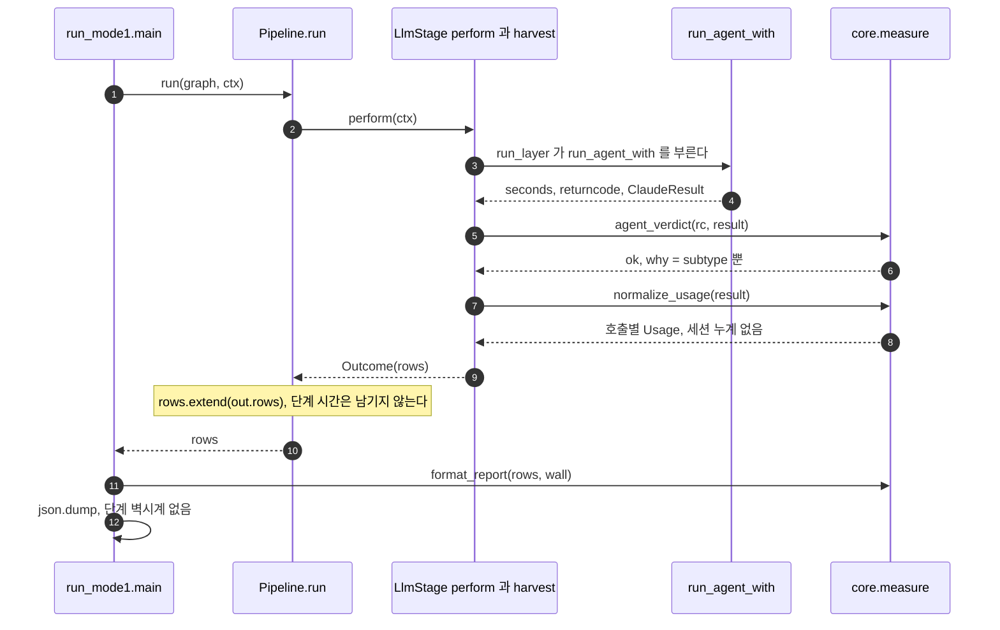
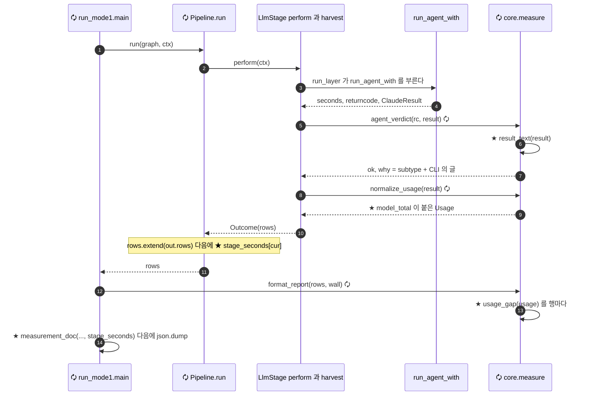
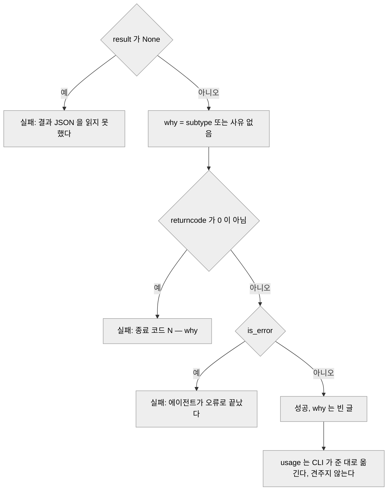
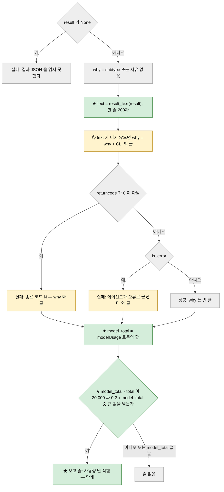
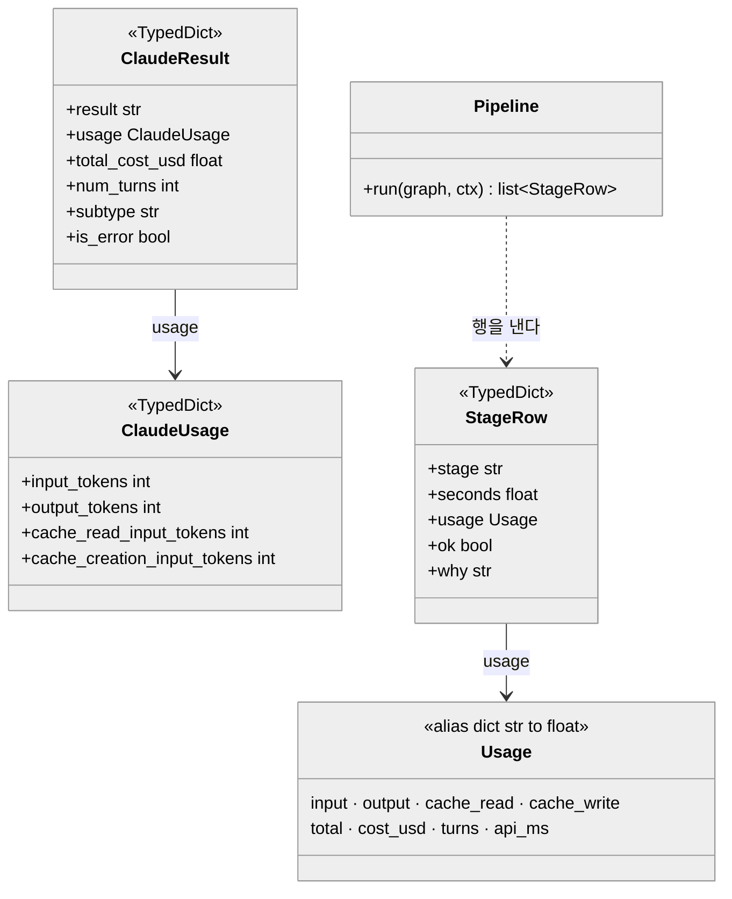
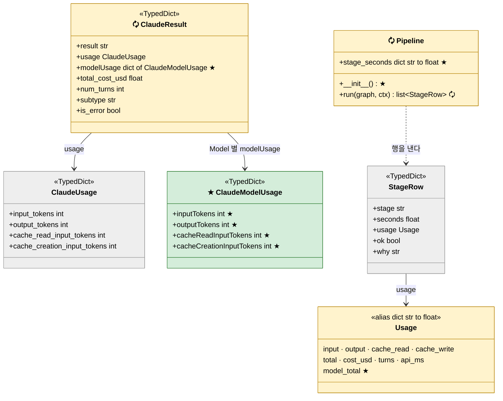

# 📏 A1 — 측정의 뜻과 실패 사유: 구현 계획

> 🔄 2026-11-23 기준 상태: 수행했다 — 구현해서 `main` 에 합쳤다(`git log` 참고). 아래의 승인 줄은 계획서를 쓴 날의 것 그대로다.

> **에이전트 작업자에게:** 필수 하위 스킬 — superpowers:subagent-driven-development(권장) 또는 superpowers:executing-plans 로 이 계획을 작업 단위로 구현한다. 단계는 체크박스(`- [ ]`)로 추적한다.

> 📅 2026-11-22 · 브랜치 `main` · **Before = `29c5ee9`** (이 계획이 고치는 코드 파일은 작업 트리에서 수정되지 않았다. `qa/evals/README.md` 는 커밋되지 않은 수정이 있다 — ⚠️ 참조)
> 📄 근거: `docs/superpowers/specs/2026-11-21-mode1-audit-verification-report.md` 2.2 · 2.4 (다) · `2026-11-22-mode1-session-cache-plan.ko.md` 0단계 결과 R7 · 분할 `docs/superpowers/specs/2026-11-22-mode1-remediation-split.ko.md` · 이 세션에서 읽은 코드: `src/core/measure.py` · `src/core/pipeline.py` · `src/codewiki/python/runner/run_mode1.py` · 시험 파일 셋
> 🔒 지킬 규칙: 더하기만 한다 — 이미 있는 JSON 열쇠의 뜻을 바꾸지 않는다 · 검사를 느슨하게 하지 않는다 · 주석은 지금의 것만 적는다
> 🧪 검증 방법: 단위 시험 먼저, 그다음 여섯 게이트. 유료 실행 없음. **이 계획에 대해 아직 아무것도 돌리지 않았다** — 아래의 기대 결과는 전부 `[미검증]` 이다
> ✋ 승인: **승인 전**
> 🌐 영어 정본: `2026-11-22-mode1-a1-measure-semantics-plan.md`

**목표:** 실패한 세션이 왜 실패했는지를 글로 말하고, 덜 적힌 세션이 표시되고, 단계마다의 벽시계가 기록된다.

**구조:** 함께 쓰는 측정 코드에 더하는 변경 넷. 실패 사유에 CLI 가 이미 돌려주는 글을 붙인다. 세션 사용량에 CLI 가 Model 별로 알려 주는 세션 전체 누계를 더하고, 둘이 어긋나는 행을 보고가 알린다. 파이프라인 루프가 단계마다 걸린 시간을 적고, 실행기가 그것을 측정 JSON 에 쓴다.

**기술:** Python 3 · msgspec · pytest · pyright strict.

---

아래 모든 표와 그림의 범례: **★ 무에서 새로 만듦 · 🗘 있던 것을 바꿈 · 표식 없음 = 그대로 재사용 · ✕ 삭제.** 표식은 변경의 종류이지 구현이나 검증의 상태가 아니다. 주장의 종류: `[코드 확인]` 이 세션에서 소스를 읽음 · `[제안]` 이 계획이 제안함 · `[실측]` 인용한 보고에서 쟀음 · `[미검증]` 확인하지 않음.

## 📋 한 장 요약

| | |
|---|---|
| 🎯 다루는 것 | <span style="color:cyan">실패 사유</span> (failure reason) "종료 코드 1 — success" · 턴과 비용의 뜻 · LLM 단계의 <span style="color:cyan">단계 벽시계</span> (stage wall clock) 이 없음 · 조용히 덜 적히는데 표시가 없는 <span style="color:cyan">덜 적힌 사용량</span> (under-recorded usage) |
| 🧩 한 줄 결론 | 빠진 것은 CLI 가 이미 돌려준다 — `result` 의 글과 `modelUsage` 안의 <span style="color:cyan">세션 전체 누계</span> (session-wide total). 읽어서 적는다 |
| 🟰 그대로 | 측정 JSON 의 기존 열쇠 전부와 그 뜻 · 판정 자체(어느 세션이 실패인가) · `run_agent_with` · `run_layer` · `LlmStage.harvest` · `LlmStage.perform` |
| 🗘 바뀜 | <span style="color:cyan">실패 사유</span> 의 글 · 모든 `usage` 사전에 새 열쇠 하나(`model_total`)와 <span style="color:cyan">측정 문서</span> (measurement document) 에 새 열쇠 하나(`stage_wall_seconds`) · 출력 보고의 새 줄 한 종류 · 출력되는 단계 소계 줄에 <span style="color:cyan">단계 벽시계</span> 칸이 붙음 |
| ⚠️ 함정 | (1) `usage` 는 호출 하나의 몫이고 `modelUsage` 는 세션의 누계다. 보조 요청 때문에 모든 세션에서 조금씩 달라서, 같은지로 견줄 수 없다. (2) 실패한 실행에서 CLI 의 `result` 가 한도 글을 싣는지는 `[미검증]` 이다 — 점검이 확인하지 못했다(보고 7절). (3) 작업 5 는 `qa/evals/README.md` 의 커밋되지 않은 수정 위에 선다 — 그 수정이 없는 체크아웃에서 어디에 쓰는지는 작업 5 의 1단계가 적는다 |
| 🚫 범위 밖 | 기존 열쇠의 토큰 세는 법 바꾸기 · 제한 시간(A2) · 격리(A3) · 2026-11-21 기준선 JSON 다시 쓰기 |

## 📌 정한 것 — 다시 열지 않는다

| 무엇 | 👍 고른 것 | 👎 버린 것 | 누가 · 언제 |
|---|---|---|---|
| 측정 원칙 | 먼저 고치고 나중에 잰다. 2026-11-21 의 실행이 기준선이고, 고치기 전에는 다시 재지 않는다 | 새 기준을 얻으려고 먼저 다시 돌리기 | 사용자 · 2026-11-22 |
| 순서 | A1 을 B1 과 함께 먼저 돌린다 — 둘 다 결정이나 유료 확인이 필요 없고 파일을 나눠 쓰지 않는다 | 다른 계획을 기다리기 | 사용자 · 2026-11-22 |
| 다시 재는 횟수 | 묶음 전체에 두 번 — 측정 A 와 측정 B | 계획마다 | 사용자 · 2026-11-22 |

출처: `docs/superpowers/specs/2026-11-22-mode1-remediation-split.ko.md` "정한 것". 이 계획 자체의 승인은 아직 ✋ 대기다.

## 💡 이 계획이 제안하는 것 — 정해지지 않음

| 무엇 | `[제안]` | 근거 |
|---|---|---|
| <span style="color:cyan">차이 선</span> (gap thresholds) | `USAGE_GAP_FLOOR = 20_000` 토큰과 `USAGE_GAP_SHARE = 0.2`: 차이가 둘 중 큰 쪽을 넘으면 표시한다 | 계획 자신의 시험 숫자뿐이다(94,873 + 6,812 은 표시 안 함 · 114,205 대 1,373,430 은 표시). 기준선 JSON 에 `model_total` 이 없어 그것으로 선을 맞출 수 없다 `[미검증]` |
| <span style="color:cyan">결과 글</span> (result text) 의 꼴 | 한 줄 · 최대 200자, `subtype` 뒤에 붙인다 | 계획의 시험 `test_사유에_싣는_글은_한_줄_200자까지다` |
| 열쇠 이름 | `total` 옆의 `model_total` | 계획. R7 은 `modelUsage` 가 세션 · Model 별 누계라고 적는다 |
| 표시의 자리 | 표시 행마다 보고의 표 아래, 기존 실패 · 건너뜀 줄 곁에 한 줄 | 계획의 작업 3 |

## 📊 현황

| 항목 | 상태 |
|---|---|
| 작업 1 — <span style="color:cyan">실패 사유</span> 에 CLI 의 글을 싣는다 | ❌ 시작 전 |
| 작업 2 — <span style="color:cyan">세션 전체 누계</span> 를 적는다 | ❌ 시작 전 |
| 작업 3 — <span style="color:cyan">덜 적힌 사용량</span> 을 알린다 | ❌ 시작 전 |
| 작업 4 — <span style="color:cyan">단계 벽시계</span> 를 적는다 | ❌ 시작 전 |
| 작업 5 — 정의 · README · 여섯 게이트 | ❌ 시작 전 |
| 이 계획의 승인 | ❌ 승인 전 |
| 시험과 게이트 | ❌ 돌리지 않음 |

## 🔁 전 / 후

| 📍 전 (안 되던 것 · 지금) | 🛠️ After · 제안 | 🎉 해결되는 것 | 🔭 기대 | 진행 |
|---|---|---|---|---|
| 🐞 한도 실패 셋이 "종료 코드 1 — success" 로 적혔다 `[실측]` (점검 2.4 다) | "종료 코드 1 — success · You've hit your session limit …" | 대화 기록을 열지 않고 <span style="color:cyan">실패 사유</span> 를 읽는다 | 세 행이 한도를 이름으로 말한다 — 실패한 실행에서 CLI 의 `result` 가 그 글을 싣는 경우에만 `[미검증]` | ❌ |
| 🐞 `L1-B14` 는 114,205 토큰으로 적혔고 세션은 1,373,430 을 썼다 `[실측]` (점검 2.2). 아무도 몰랐다 | <span style="color:cyan">세션 행</span> (session row) 에 `model_total` 이 실리고, 보고가 "사용량 덜 적힘 — …" 을 낸다 | <span style="color:cyan">덜 적힌 사용량</span> 이 실행한 날 보인다 | 그 행이 1,259,225 토큰으로 표시된다 `[계산값]` — 계획의 시험 숫자에서 | ❌ |
| 🐞 LLM <span style="color:cyan">단계 벽시계</span> 를 파일 수정 시각으로 되짚어야 했다 `[실측]` | JSON 과 소계 줄에 `stage_wall_seconds` | 단계 시간을 실행끼리 대조할 수 있다 | 다음 실행의 JSON 에 있다 `[미검증]` | ❌ |
| 🐞 "턴" 과 "비용" 의 정의가 없다 | `qa/evals/README.md` 가 값마다 뜻을 적는다 | 기록을 누구나 같게 읽는다 | 표가 생긴다. "턴 = 도구 호출 + 1" 은 점검의 `[실측]` 이고 여기서 다시 재지 않았다 | ❌ |

## ★ 신규 · 🗘 변경 항목 (모듈 → 파일 → 클래스 → 함수 → 멤버)

층위마다 따로 Before `29c5ee9` 와 견주었다 `[코드 확인]`.

| 층위 | 표식 | 항목 | 구분 | 소속 |
|---|---|---|---|---|
| 모듈 | 🗘 | `src/core` | 변경 — 파일 둘 | — |
| 모듈 | 🗘 | `src/codewiki/python/runner` | 변경 — 파일 하나 | — |
| 파일 | 🗘 | `src/core/measure.py` · `src/core/pipeline.py` | 변경 | 모듈 `src/core` |
| 파일 | 🗘 | `src/codewiki/python/runner/run_mode1.py` | 변경 | 모듈 `src/codewiki/python/runner` |
| 파일 | 🗘 | `test/core/test_measure.py` · `test/core/test_pipeline.py` · `test/codewiki/test_run_mode1.py` | 변경 — 시험을 더함 | `test/` |
| 파일 | 🗘 | `qa/evals/README.md` | 변경 — 절 하나를 더하고 문단 하나를 고침 | `qa/evals/` |
| 파일 | 🗘 | `src/core/README.md` · `src/codewiki/python/runner/README.md` | `tools/gen_readme.py` 로 갱신 | 모듈 README |
| 클래스 | ★ | `ClaudeModelUsage` | 신규 (`TypedDict`) | `measure.py` |
| 클래스 | 🗘 | `ClaudeResult` | 변경 — 칸 하나 | `measure.py` |
| 클래스 | 🗘 | `Pipeline` | 변경 — `__init__` 과 독스트링 한 문단을 얻는다 | `pipeline.py` |
| 클래스 | — | `ClaudeUsage` · `StageRow` · `LlmStage` · 별칭 `Usage` | 그대로 재사용 (`Usage` 는 열쇠 하나를 얻지만 형은 그대로) | — |
| 함수 | ★ | `result_text` · `usage_gap` | 신규 | `measure.py` |
| 함수 | ★ | `measurement_doc` | 신규 | `run_mode1.py` |
| 함수 | ★ | `Pipeline.__init__` | 신규 | `pipeline.py` |
| 함수 | ★ | 새 시험 16개 (4 + 4 + 5 + 3) | 신규 | 시험 파일 셋 |
| 함수 | 🗘 | `agent_verdict` · `normalize_usage` · `sum_usage` · `format_report` | 변경 | `measure.py` |
| 함수 | 🗘 | `Pipeline.run` | 변경 — 초기화 한 줄, 기록 한 줄 | `pipeline.py` |
| 함수 | 🗘 | `main` | 변경 — `Pipeline` 을 붙들고, `measurement_doc` 을 부르고, <span style="color:cyan">단계 벽시계</span> 칸을 찍는다 | `run_mode1.py` |
| 함수 | — | `run_agent_with` · `run_layer` · `LlmStage.harvest` · `LlmStage.perform` · `stage_totals` | 그대로 재사용 — 바뀌는 경로 위에 있지만 글은 바뀌지 않는다 | — |
| 멤버 | ★ | `ClaudeResult.modelUsage` · `ClaudeModelUsage` 의 칸 넷 | 신규 | `measure.py` |
| 멤버 | ★ | `Pipeline.stage_seconds` | 신규 | `pipeline.py` |
| 멤버 | ★ | 상수 `USAGE_GAP_FLOOR` · `USAGE_GAP_SHARE` | 신규 | `measure.py` |
| 멤버 | ★ | `Usage` 의 열쇠 `model_total` · <span style="color:cyan">측정 문서</span> 의 열쇠 `stage_wall_seconds` | 신규 | JSON |

## ⏱️ 순서 — 세션 하나의 결과가 가는 길

범례: 회색 = 그대로 · 초록 = 신규 · 호박색 = 변경. 그림의 참여자 id 와 메시지 이름은 실제 식별자이고, ★ 와 🗘 는 별칭과 메모에만 있다.

**Before** `[코드 확인]` — `run_mode1.py:262` · `pipeline.py:348-384` · `pipeline.py:623-646` · `measure.py:72-120`



**After · 제안** `[미검증]`



길 자체는 바뀌지 않는다: 같은 참여자가 같은 순서로 서로를 부른다. 바뀌는 것은 불린 함수가 돌려주는 것과 `Pipeline.run` 이 붙드는 것이다.

## 🔀 갈래 — 사유의 판정과 덜 적힘의 판정

범례: 회색 = 그대로 · 초록 = 신규 · 호박색 = 변경.

**Before** `[코드 확인]` — `measure.py:107-120`. 사용량을 견주는 검사는 전혀 없다



**After · 제안** `[미검증]`



판정(어느 세션이 실패인가)은 두 그림에서 같고, `why` 의 글만 길어진다. 덜 적힘의 판정은 `ok` 를 바꾸지 않는다.

## 🧱 구조 — 형의 모양

범례: 회색 = 그대로 · 초록 = 신규 · 호박색 = 변경. 이 계획이 건드리는 멤버만 그렸다.

**Before** `[코드 확인]` — `measure.py:19-66` · `pipeline.py:341-348`



**After · 제안** `[미검증]`



`Usage` 는 사전 별칭이라 형이 바뀌지 않는다. 열쇠가 하나 늘기 때문에만 호박색으로 그렸다. 함수는 여기에 그리지 않았다 — 위의 목록에 있다.

## 🔧 고칠 곳

| 파일 · 심볼 | 바꿈 | 이유 | 근거 |
|---|---|---|---|
| 🗘 `src/core/measure.py` — ★ `result_text` · 🗘 `agent_verdict` | CLI 의 `result` 글을 <span style="color:cyan">실패 사유</span> 에 붙인다 | <span style="color:cyan">실패 사유</span> 가 종료 코드와 `subtype` 만으로 만들어져서 실패에 "success" 가 적힌다 | `[코드 확인]` `measure.py:115-117`. 글 칸은 이미 `measure.py:33` 에 형으로 있다. `[실측]` 점검 2.4 (다) |
| 🗘 `measure.py` — ★ `ClaudeModelUsage` · 🗘 `ClaudeResult` · 🗘 `normalize_usage` · 🗘 `sum_usage` | 형에 `modelUsage` 를 더하고, `model_total` 을 더하고, `sum_usage` 에서 접는다 | `usage` 는 호출 하나의 몫이고 세션 전체는 `modelUsage` 에만 있다 | `[코드 확인]` `measure.py:19-39` · `:72-92` · `:95-101`. `[실측]` 세션 캐시 계획의 R7 |
| 🗘 `measure.py` — ★ `USAGE_GAP_FLOOR` · ★ `USAGE_GAP_SHARE` · ★ `usage_gap` · 🗘 `format_report` | `total` 과 `model_total` 을 견주고, 표시된 행마다 기존 실패 · 건너뜀 줄 뒤에 한 줄을 낸다 | 실행기는 CLI 의 숫자를 옮기기만 하고 서로 견주지 않는다 | `[코드 확인]` `measure.py:150-195`. `[실측]` 점검 2.2 |
| 🗘 `src/core/pipeline.py` — ★ `Pipeline.__init__` · 🗘 `Pipeline.run` | `stage_seconds` 를 갖고, `run` 시작에서 비우고, `rows.extend(out.rows)` 다음에 기록한다 | 세션이 나란히 돌 때 행의 초 합계는 <span style="color:cyan">단계 벽시계</span> 가 아니다 | `[코드 확인]` `pipeline.py:341-350` · `:354` · `:379`. 같은 글 `rows.extend(out.rows)` 가 `pipeline.py:643`(`LlmStage.perform`)에도 있고 거기는 건드리면 안 된다. `__init__` 이 필요한 까닭: `test/codewiki/test_mode1.py:2090` 과 `:2135` 가 `Pipeline.run` 을 그 속성을 한 번도 채우지 않는 함수로 바꾸는데도 `main` 은 돈다 `[코드 확인]`. `[내 판단]` 기본값이 있어야 `main` 이 `stage_seconds` 를 읽는 것이 유효하다 |
| 🗘 `src/codewiki/python/runner/run_mode1.py` — ★ `measurement_doc` · 🗘 `main` · 🗘 `Mapping` import | 문서를 함수 하나에서 만들고, `Pipeline` 개체를 붙들고, <span style="color:cyan">단계 벽시계</span> 칸을 찍는다 | JSON 을 지금은 `main` 안에서 바로 쓰므로 `main` 을 단위로 시험할 수 없다 | `[코드 확인]` `run_mode1.py:125` · `:191` · `:262-263` · `:275-285`. `Pipeline` 은 `run_mode1_5.py:837` 과 `run_mode2.py:513` 에서도 만든다 — 그쪽은 기본 속성만 얻는다 |
| 🗘 `test/core/test_measure.py` · `test/core/test_pipeline.py` · `test/codewiki/test_run_mode1.py` | 시험 16개 (작업 1~4 에 4 · 4 · 5 · 3) | 동작마다 코드보다 먼저 쓰는 실패하는 시험 하나 | `[코드 확인]` 도우미 `_행` 은 `test_measure.py:67`, 가짜 단계 `가짜단계` 는 `test_pipeline.py:52` |
| 🗘 `qa/evals/README.md` | 제목 `## 기준선 — Mode 1 은 2026-11-21` 위에 "값의 뜻" 표를 넣고, 실행기가 <span style="color:cyan">단계 벽시계</span> 를 적지 않는다고 말하는 25~26줄의 문단을 고친다 | 턴과 비용의 정의가 없다. 작업 4 뒤에는 그 문단이 거짓이 된다 | `[코드 확인]` 그 제목과 그 문단은 `29c5ee9` 에 없고 커밋되지 않은 작업 트리 수정에만 있다(작업 5 의 1단계가 두 경우를 다 적는다) |
| 🗘 `src/core/README.md` · `src/codewiki/python/runner/README.md` | `tools/gen_readme.py` 로 다시 생성 | 독스트링이 바뀐다 | `[코드 확인]` 표류 게이트는 루트 `CLAUDE.md` 에 있다 |

**제안 diff — 적용하지 않았다.** 줄여서 보인다: 전문은 작업에 있다. `-` 줄은 전부 `29c5ee9` 의 소스에서 옮겼다.

```diff
--- a/src/core/measure.py
+++ b/src/core/measure.py
     why = result.get("subtype") or "사유 없음"
+    text = result_text(result)
+    if text:
+        why = "%s · %s" % (why, text)
     if returncode != 0:
         return False, "종료 코드 %d — %s" % (returncode, why)
@@
-    keys = ["input", "output", "cache_read", "cache_write", "total", "turns", "api_ms"]
+    keys = ["input", "output", "cache_read", "cache_write", "total", "model_total", "turns", "api_ms"]

--- a/src/core/pipeline.py
+++ b/src/core/pipeline.py
+    def __init__(self) -> None:
+        self.stage_seconds: dict[str, float] = {}
+
     def run(self, graph: StageDagGraph[C], ctx: C) -> list[StageRow]:
         rows: list[StageRow] = []
+        self.stage_seconds = {}
@@
             rows.extend(out.rows)
+            self.stage_seconds[cur] = time.monotonic() - t0

--- a/src/codewiki/python/runner/run_mode1.py
+++ b/src/codewiki/python/runner/run_mode1.py
-    rows = P.Pipeline[Mode1Context]().run(graph, ctx)
+    pipeline = P.Pipeline[Mode1Context]()
+    rows = pipeline.run(graph, ctx)
@@
-    print("\n단계 소계 — 병렬이라 행의 초 합계는 벽시계가 아니다")
+    print("\n단계 소계 — 벽시계는 단계가 걸린 시간이고, 행의 초 합계와 다르다")
```

## 🧭 조각의 순서

| 조각 | 결과물 | 앞서야 하는 것 | 확인 |
|---|---|---|---|
| 작업 1 | <span style="color:cyan">실패 사유</span> 의 글 | — | `test_measure.py` 시험 4 + 판정을 건드리는 묶음 |
| 작업 2 | `model_total` | — | 시험 4 + 사용량을 읽는 모든 시험 |
| 작업 3 | `usage_gap` 과 보고의 줄 | 작업 2 (`model_total`) | 시험 5 |
| 작업 4 | `stage_seconds` · `measurement_doc` | — (`pipeline.py` 와 `run_mode1.py` 를 고친다. 작업 1~3 과 겹치는 파일 없음) | 시험 3 + `npm run typecheck:py` |
| 작업 5 | 정의 · README · 게이트 | 작업 1~4 | 여섯 게이트 (🧪) |

## 📖 용어

| 용어 | 코드 이름 | 뜻 |
|---|---|---|
| <span style="color:cyan">실패 사유</span> | `why` · `agent_verdict` | 두 번째 값 `(ok, why)`. 세션이 왜 실패로 세어지는가 |
| <span style="color:cyan">결과 글</span> | `result_text` · `ClaudeResult` 의 칸 `result` | CLI 가 `result` 에 적은 글을 한 줄 · 최대 200자로 편 것 |
| <span style="color:cyan">호출별 사용량</span> (per-call usage) | `usage` · `ClaudeUsage` | 호출 하나의 토큰. 세션의 일부만 담을 수 있다 |
| <span style="color:cyan">세션 전체 누계</span> | `model_total` · `modelUsage` · `ClaudeModelUsage` | 세션에서 Model 전부의 누계 토큰의 합 |
| <span style="color:cyan">덜 적힌 사용량</span> | `usage_gap` | `model_total - total` 이 선을 넘으면 그 값, 아니면 0 |
| <span style="color:cyan">차이 선</span> | `USAGE_GAP_FLOOR` · `USAGE_GAP_SHARE` | 차이를 셀지 가르는 상수 둘 |
| <span style="color:cyan">단계 벽시계</span> | `Pipeline.stage_seconds` · `stage_wall_seconds` | 단계 이름마다 그 단계가 걸린 벽시계 |
| <span style="color:cyan">측정 문서</span> | `measurement_doc` | `main` 이 `--json` 으로 쓰는 사전 |
| <span style="color:cyan">세션 행</span> | `StageRow` | 측정 표의 한 줄. 한 줄에 세션 하나 |
| <span style="color:cyan">파이프라인 루프</span> (pipeline loop) | `Pipeline.run` | 단계 그래프를 따라 돌며 행을 모으는 루프 |

## ❓ 열림

이 앞부분의 근거를 짚다가 찾은 어긋남 넷은 아래 작업 글에 고쳐 넣었다: 주석 속의 개수(작업 2 의 3단계) · `run` 에서 바꿀 줄의 범위(작업 4 의 3단계) · 작업 4 뒤에 거짓이 되는 README 문단 · 커밋되지 않은 수정에만 있는 README 기준 제목(둘 다 작업 5 의 1단계). 남은 것:

| # | 무엇 | 근거 | 권고 | 영향 |
|---|---|---|---|---|
| 1 | 실패한 글이 CLI 의 `result` 에 없을 수 있다 | `[실측]` 대화 기록에는 "You've hit your session limit" 가 있다(콜드 실행 보고). `[미검증]` 그때의 JSON `result`(점검 7절) | 계획은 그대로 두고 작업 1 은 측정 A 로 판단한다. 시험은 지어낸 값을 쓴다 | 작업 1 이 글 없이 "success" 만 남길 수 있다 |
| 2 | 두 선은 맞춰 볼 기준선이 없다 | `[제안]` | 그대로 두고 첫 `model_total` 자료가 생기면 다시 본다 | 표시에만 영향. 판정은 아니다 |

## 🧪 검증 · 🚫 범위 밖

**검증** — 전부 `[미검증]` 이다. 아무것도 돌리지 않았다.

- 작업마다: 시험을 먼저 쓰고 돌린다(아래 작업 참조).
- 작업 5: README 표류 확인, 그다음 `pytest -q`(이전보다 16개 더 · 새 건너뜀이나 xfail 없음), `npm test`(8), 타입 검사 둘, `npm run doctor`.
- 유료 실행 없음. 실제 세션에서의 효과는 측정 A 와 측정 B 가 본다.

**범위 밖** — 제한 시간과 끝 조건(A2) · 격리(A3) · 프롬프트와 레코드 결함(B1) · 기존 열쇠의 토큰 세는 법 바꾸기 · 2026-11-21 기준선 JSON 다시 쓰기 · 어느 세션이 실패인가의 판정 바꾸기.

명령은 전부 저장소 뿌리에서 `.venv/bin/python` 으로 돌린다.

---

### 작업 1: 실패 사유에 CLI 가 한 말을 싣는다

**파일:**
- 고침: `src/core/measure.py` (`agent_verdict`, 새 `result_text`)
- 시험: `test/core/test_measure.py`

- [ ] **1단계: 실패하는 시험을 쓴다** — `test/core/test_measure.py` 끝에 붙인다:

```python
def test_종료_코드가_0이_아니면_CLI_가_적은_글을_사유에_싣는다():
    ok, why = M.agent_verdict(1, {"subtype": "success", "is_error": True,
                                  "result": "You've hit your session limit · resets 9:50pm"})
    assert ok is False
    assert "종료 코드 1" in why and "session limit" in why


def test_사유에_싣는_글은_한_줄_200자까지다():
    _, why = M.agent_verdict(1, {"subtype": "success", "result": "첫 줄\n" + "가" * 500})
    assert "\n" not in why
    assert M.result_text({"result": "첫 줄\n" + "가" * 500}) == ("첫 줄 " + "가" * 500)[:200]


def test_CLI_가_글을_주지_않으면_사유는_subtype_뿐이다():
    assert M.agent_verdict(1, {"subtype": "error_max_turns"}) == (False, "종료 코드 1 — error_max_turns")


def test_성공한_세션의_글은_사유가_되지_않는다():
    assert M.agent_verdict(0, {"result": "샤드를 썼다", "subtype": "success"}) == (True, "")
```

- [ ] **2단계: 돌려서 실패를 본다**

실행: `.venv/bin/python -m pytest test/core/test_measure.py -q -k "사유"`
기대: 2개 실패, 2개 통과. `test_종료_코드가_0이_아니면_…` 은 `"session limit" in why` 에서, `test_사유에_싣는_글은_…` 은 `AttributeError: module 'core.measure' has no attribute 'result_text'` 로 실패한다.

- [ ] **3단계: 구현한다** — `src/core/measure.py` 의 `agent_verdict` 를 이것으로 바꾼다:

```python
def result_text(result: ClaudeResult) -> str:
    """CLI 가 `result` 칸에 적은 글을 한 줄 · 200자까지로. 없으면 빈 글."""
    return " ".join(str(result.get("result") or "").split())[:200]


def agent_verdict(returncode: int, result: ClaudeResult | None) -> tuple[bool, str]:
    """에이전트가 정말 해냈는가. `(성공인가, 아니라면 왜)` 를 낸다.

    종료 코드만 믿으면 안 된다. `claude` 는 최대 턴 수에 걸리거나 권한에 막혀도 0 을
    내면서 `is_error: true` 만 올릴 수 있다.

    실패면 CLI 가 `result` 칸에 적은 글을 사유 끝에 붙인다. `subtype` 만으로는 왜 실패했는지
    알 수 없는 실패가 있다 — `test_종료_코드가_0이_아니면_CLI_가_적은_글을_사유에_싣는다`.
    """
    if result is None:
        return False, "결과 JSON 을 읽지 못했다 (종료 코드 %d)" % returncode
    why = result.get("subtype") or "사유 없음"
    text = result_text(result)
    if text:
        why = "%s · %s" % (why, text)
    if returncode != 0:
        return False, "종료 코드 %d — %s" % (returncode, why)
    if result.get("is_error"):
        return False, "에이전트가 오류로 끝났다: %s" % why
    return True, ""
```

- [ ] **4단계: 판정에 닿는 시험을 돌린다**

실행: `.venv/bin/python -m pytest test/core/test_measure.py test/codewiki/test_run_mode1.py test/spec/test_run_mode2.py test/term/test_run_mode1_5.py -q`
기대: 전부 통과.

- [ ] **5단계: 커밋** (사용자가 이 계획의 커밋을 승인했을 때만)

제목: `[fix] : core - 실패 사유에 CLI 가 적은 글을 싣는다`

---

### 작업 2: CLI 가 알려 주는 세션 전체 토큰 누계를 적는다

**파일:**
- 고침: `src/core/measure.py` (`ClaudeModelUsage`, `ClaudeResult`, `normalize_usage`, `sum_usage`)
- 시험: `test/core/test_measure.py`

- [ ] **1단계: 실패하는 시험을 쓴다** — `test/core/test_measure.py` 맨 위 `import os` 아래에 `import json` 을 넣고, 끝에 붙인다:

```python
def test_Model_별_누계를_model_total_로_적는다():
    """`usage` 는 호출 하나의 몫이고 `modelUsage` 는 세션의 누계다. 둘을 따로 적는다."""
    got = M.normalize_usage(M.parse_result(json.dumps({
        "usage": {"input_tokens": 4, "output_tokens": 207,
                  "cache_read_input_tokens": 109285, "cache_creation_input_tokens": 4709},
        "modelUsage": {
            "claude-sonnet-5-5": {"inputTokens": 30, "outputTokens": 11278, "cacheReadInputTokens": 1272778,
                                  "cacheCreationInputTokens": 89344, "costUSD": 0.598, "costBasis": "list"},
            "claude-haiku-5-5": {"inputTokens": 6787, "outputTokens": 25}},
        "total_cost_usd": 0.5981, "num_turns": 1})))
    assert got["total"] == 4 + 207 + 109285 + 4709
    assert got["model_total"] == 30 + 11278 + 1272778 + 89344 + 6787 + 25


def test_modelUsage_가_없으면_model_total_은_0이다():
    assert M.normalize_usage(M.parse_result('{"usage": {"input_tokens": 7}}'))["model_total"] == 0
    assert M.normalize_usage(None)["model_total"] == 0


def test_model_total_도_열쇠별로_접는다():
    a = M.normalize_usage({"modelUsage": {"m": {"inputTokens": 3}}})
    b = M.normalize_usage({"modelUsage": {"m": {"outputTokens": 4}}})
    assert M.sum_usage([a, b])["model_total"] == 7


def test_modelUsage_의_토큰_칸에_문자열이_오면_거부한다():
    with pytest.raises(msgspec.ValidationError):
        M.parse_result('{"modelUsage": {"m": {"inputTokens": "많이"}}}')
```

- [ ] **2단계: 돌려서 실패를 본다**

실행: `.venv/bin/python -m pytest test/core/test_measure.py -q -k "model_total or modelUsage"`
기대: 4개 실패 — 셋은 `KeyError: 'model_total'`, 마지막은 예외가 나지 않아서.

- [ ] **3단계: 구현한다** — `src/core/measure.py` 의 `class ClaudeUsage` 뒤에 넣는다:

```python
class ClaudeModelUsage(TypedDict, total=False):
    """`modelUsage` 의 Model 하나 — 세션이 그 Model 로 쓴 토큰의 누계. 칸은 빠질 수 있고, 있으면 정수여야 한다."""
    inputTokens: int
    outputTokens: int
    cacheReadInputTokens: int
    cacheCreationInputTokens: int
```

`ClaudeResult` 의 `usage: ClaudeUsage` 뒤에 칸 하나를 더한다:

```python
    modelUsage: dict[str, ClaudeModelUsage]
```

`normalize_usage` 를 이것으로 바꾼다:

```python
def normalize_usage(result: ClaudeResult | None) -> Usage:
    """`claude -p --output-format json` 의 결과에서 잴 값만 뽑아 평평하게 만든다.

    `total` 은 입력·출력·캐시읽기·캐시생성 넷을 더한 값이다. 캐시 둘을 빼고 "토큰 합" 이라
    부르면 일부만 센 것이다.

    `model_total` 은 `modelUsage` 의 Model 별 누계를 전부 더한 값이다. `usage` 는 호출 하나의 몫이라
    세션의 일부만 담아 올 수 있고, 이 값은 세션 전체다 — `usage_gap` 이 둘을 견준다.

    기계 단계는 `None` 을 받아 전부 0 을 낸다 — `None` 을 그대로 두면 표를 더할 수 없다.
    """
    top: ClaudeResult = result or {}
    u = top.get("usage", {})
    got: Usage = {
        "input": u.get("input_tokens", 0),
        "output": u.get("output_tokens", 0),
        "cache_read": u.get("cache_read_input_tokens", 0),
        "cache_write": u.get("cache_creation_input_tokens", 0),
        "cost_usd": top.get("total_cost_usd", 0.0),
        "turns": top.get("num_turns", 0),
        "api_ms": top.get("duration_api_ms", 0),
    }
    got["total"] = got["input"] + got["output"] + got["cache_read"] + got["cache_write"]
    got["model_total"] = sum(m.get("inputTokens", 0) + m.get("outputTokens", 0)
                             + m.get("cacheReadInputTokens", 0) + m.get("cacheCreationInputTokens", 0)
                             for m in top.get("modelUsage", {}).values())
    return got
```

`sum_usage` 의 `keys` 줄을 이것으로 바꾼다:

```python
    keys = ["input", "output", "cache_read", "cache_write", "total", "model_total", "turns", "api_ms"]
```

그 아래 주석의 `# 정수 여섯은 정수로 접고` 를 `# 정수 열쇠는 정수로 접고` 로 고친다 — 목록의 이름이 여덟이 되므로 주석에서 개수를 뺀다.

- [ ] **4단계: 사용량을 읽는 시험을 전부 돌린다**

실행: `.venv/bin/python -m pytest test/core test/codewiki/test_run_mode1.py test/codewiki/test_mode1.py test/spec/test_run_mode2.py test/term/test_run_mode1_5.py -q`
기대: 전부 통과.

- [ ] **5단계: 커밋**

제목: `[feat] : core - 세션 사용량에 Model 별 누계 합을 함께 적는다`

---

### 작업 3: 사용량이 덜 적힌 행을 알린다

**파일:**
- 고침: `src/core/measure.py` (`USAGE_GAP_FLOOR`, `USAGE_GAP_SHARE`, `usage_gap`, `format_report`)
- 시험: `test/core/test_measure.py`

- [ ] **1단계: 실패하는 시험을 쓴다** — `test/core/test_measure.py` 끝에 붙인다:

```python
def _사용량(total: int, model_total: int) -> M.Usage:
    u = M.normalize_usage(None)
    u["total"], u["model_total"] = total, model_total
    return u


def test_보조_요청_몫만큼의_차이는_덜_적힌_것이_아니다():
    assert M.usage_gap(_사용량(94_873, 94_873 + 6_812)) == 0


def test_작은_세션의_보조_요청_몫도_걸리지_않는다():
    assert M.usage_gap(_사용량(10_000, 16_812)) == 0


def test_앞선_요청이_통째로_빠지면_덜_적힌_토큰_수를_낸다():
    assert M.usage_gap(_사용량(114_205, 1_373_430)) == 1_373_430 - 114_205


def test_누계가_없으면_견주지_않는다():
    assert M.usage_gap(_사용량(500_000, 0)) == 0


def test_덜_적힌_행은_표_아래에_알린다():
    row = _행("annotate-symbols/L1-B14")
    row["usage"] = _사용량(114_205, 1_373_430)
    out = M.format_report([row, _행("verify-terms")])
    assert "사용량 덜 적힘 — annotate-symbols/L1-B14" in out and "1,259,225" in out
    assert "사용량 덜 적힘 — verify-terms" not in out
```

- [ ] **2단계: 돌려서 실패를 본다**

실행: `.venv/bin/python -m pytest test/core/test_measure.py -q -k "덜_적힌 or 보조_요청 or 누계가_없으면"`
기대: 5개 실패 — 넷은 `AttributeError: module 'core.measure' has no attribute 'usage_gap'`, 다섯째는 보고의 단언에서.

- [ ] **3단계: 구현한다** — `src/core/measure.py` 의 `sum_usage` 뒤에 넣는다:

```python
# `usage` 합계가 Model 별 누계보다 이 선을 넘게 작으면 덜 적힌 것으로 본다. 둘은 평소에도 보조 요청
# 몫만큼 다르므로 같은지로 견주면 모든 행이 걸린다 — `test_보조_요청_몫만큼의_차이는_덜_적힌_것이_아니다`.
USAGE_GAP_FLOOR = 20_000
USAGE_GAP_SHARE = 0.2


def usage_gap(usage: Usage) -> int:
    """`usage` 합계가 Model 별 누계보다 덜 적힌 토큰 수. 선을 넘지 않거나 누계가 없으면 0."""
    model_total = int(usage.get("model_total") or 0)
    gap = model_total - int(usage.get("total") or 0)
    return gap if gap > max(USAGE_GAP_FLOOR, USAGE_GAP_SHARE * model_total) else 0
```

`format_report` 의 `return "\n".join(out)` 앞에 넣는다:

```python
    for r in rows:
        gap = usage_gap(r["usage"])
        if gap:
            out.append("사용량 덜 적힘 — %s: 합계가 Model 별 누계보다 %s 토큰 작다"
                       % (r["stage"], "{:,}".format(gap)))
```

- [ ] **4단계: 측정 시험을 돌린다**

실행: `.venv/bin/python -m pytest test/core/test_measure.py -q`
기대: 전부 통과.

- [ ] **5단계: 커밋**

제목: `[feat] : core - 덜 적힌 사용량을 측정 보고에 알린다`

---

### 작업 4: 단계마다의 벽시계를 적는다

**파일:**
- 고침: `src/core/pipeline.py` (`Pipeline`)
- 고침: `src/codewiki/python/runner/run_mode1.py` (import, 새 `measurement_doc`, `main`)
- 시험: `test/core/test_pipeline.py` · `test/codewiki/test_run_mode1.py`

- [ ] **1단계: 실패하는 시험을 쓴다** — `test/core/test_pipeline.py` 끝에 붙인다:

```python
def test_단계마다_걸린_벽시계를_남긴다(tmp_path: Path):
    ctx = P.RunContext(root=str(tmp_path), model="m")
    g = P.build_graph("g", ["a", "b"], {"a": 가짜단계("a"), "b": 가짜단계("b")},
                      P.Edges({("*", P.OK): P.NEXT, ("*", P.FAIL): P.HALT}), [], ctx)
    p = P.Pipeline[P.RunContext]()
    p.run(g, ctx)
    assert list(p.stage_seconds) == ["a", "b"]
    assert all(s >= 0.0 for s in p.stage_seconds.values())


def test_멈춘_뒤의_단계는_벽시계가_없다(tmp_path: Path):
    ctx = P.RunContext(root=str(tmp_path), model="m")
    g = P.build_graph("g", ["a", "b"], {"a": 가짜단계("a", kind=P.FAIL), "b": 가짜단계("b")},
                      P.Edges({("*", P.OK): P.NEXT, ("*", P.FAIL): P.HALT}), [], ctx)
    p = P.Pipeline[P.RunContext]()
    p.run(g, ctx)
    assert list(p.stage_seconds) == ["a"]
```

`test/codewiki/test_run_mode1.py` 끝에 붙인다:

```python
def test_측정_문서는_단계별_벽시계를_싣는다():
    row: R.StageRow = {"stage": "annotate-symbols/L0-B00", "seconds": 60.0,
                       "usage": R.normalize_usage(None), "ok": True, "why": ""}
    doc = R.measurement_doc("/어느/저장소", "claude-sonnet-5-5", "mode1-cold", [row], 8, 8, 100.0,
                            {"annotate-symbols": 61.5})
    assert doc["repo"] == "저장소" and doc["wall_seconds"] == 100.0
    assert doc["stage_wall_seconds"] == {"annotate-symbols": 61.5}
    assert list(doc)[:9] == ["repo", "model", "graph", "stages", "stage_totals", "concurrency",
                             "target", "total", "wall_seconds"]
```

- [ ] **2단계: 돌려서 실패를 본다**

실행: `.venv/bin/python -m pytest test/core/test_pipeline.py test/codewiki/test_run_mode1.py -q -k "벽시계"`
기대: 새 시험 셋이 실패한다 — 둘은 `AttributeError: 'Pipeline' object has no attribute 'stage_seconds'`, 하나는 `AttributeError: module 'run_mode1' has no attribute 'measurement_doc'`.

- [ ] **3단계: 파이프라인 쪽을 구현한다** — `src/core/pipeline.py` 에서 `Pipeline` 의 독스트링과 `run` 의 첫머리를 `cur = graph.first` 줄까지 바꾼다:

```python
class Pipeline(Generic[C]):
    """그래프를 따라 도는 루프. 세 실행기가 이 한 벌을 쓴다.

    `run` 은 **재정의할 수 있다.** 다만 재정의가 루프를 다시 쓰는 자리는 아니다 —
    `super().run()` 을 부르고 앞뒤에 자기 일을 붙이는 자리다.

    `stage_seconds` 는 `run` 이 채운다 — 단계 이름마다 그 단계가 걸린 벽시계 초다. 세션이 나란히 도는
    단계는 행의 초를 더한 값이 벽시계가 아니므로 이 값을 본다.
    """

    def __init__(self) -> None:
        self.stage_seconds: dict[str, float] = {}

    def run(self, graph: StageDagGraph[C], ctx: C) -> list[StageRow]:
        rows: list[StageRow] = []
        self.stage_seconds = {}
        cur = graph.first
```

그리고 `Pipeline.run` 안에서 — 같은 줄이 `LlmStage.perform` 에도 있으니 그쪽이 아니다 — 바로 뒤에 `nxt = graph.next_of(cur, out.kind)` 가 오는 `rows.extend(out.rows)` 줄을 이것으로 바꾼다:

```python
            rows.extend(out.rows)
            self.stage_seconds[cur] = time.monotonic() - t0
```

- [ ] **4단계: 실행기 쪽을 구현한다** — `src/codewiki/python/runner/run_mode1.py` 에서:

`from collections.abc import Sequence` 를 이것으로 바꾼다:

```python
from collections.abc import Mapping, Sequence
```

`def main(` 위에 넣는다:

```python
def measurement_doc(repo: str, model: str, graph_name: str, rows: Sequence[StageRow], concurrency: int,
                    target: int, wall: float, stage_wall: Mapping[str, float]) -> dict[str, object]:
    """`--json` 으로 쓰는 측정 문서.

    `stage_wall_seconds` 는 단계마다의 벽시계다. 세션이 나란히 도는 단계는 행의 초를 더해도 벽시계가 아니다.
    """
    return {"repo": os.path.basename(repo), "model": model, "graph": graph_name, "stages": list(rows),
            "stage_totals": stage_totals(rows), "concurrency": concurrency, "target": target,
            "total": sum_usage([r["usage"] for r in rows]), "wall_seconds": wall,
            "stage_wall_seconds": dict(stage_wall)}
```

`main` 의 `rows = P.Pipeline[Mode1Context]().run(graph, ctx)` 를 이것으로 바꾼다:

```python
    pipeline = P.Pipeline[Mode1Context]()
    rows = pipeline.run(graph, ctx)
```

소계 블록(`print("\n단계 소계 …")` 줄부터 `if json_out:` 블록 끝까지)을 이것으로 바꾼다:

```python
    print("\n단계 소계 — 벽시계는 단계가 걸린 시간이고, 행의 초 합계와 다르다")
    for name, u in stage_totals(rows).items():
        print("  %-16s 벽시계 %10s · 토큰 %12s · 턴 %3d · 비용 $%.4f"
              % (name, hms(pipeline.stage_seconds.get(name, 0.0)), "{:,}".format(u["total"]),
                 u["turns"], u["cost_usd"]))
    if json_out:
        with open(json_out, "w", encoding="utf-8") as f:
            json.dump(measurement_doc(repo, model, graph.name, rows, ctx.concurrency, ctx.target, wall,
                                      pipeline.stage_seconds), f, ensure_ascii=False, indent=1)
        print("\n측정값 %s" % json_out)
```

- [ ] **5단계: 시험과 타입 검사를 돌린다**

실행: `.venv/bin/python -m pytest test/core test/codewiki/test_run_mode1.py test/spec/test_run_mode2.py test/term/test_run_mode1_5.py -q && npm run typecheck:py`
기대: 전부 통과 · `0 errors`.

- [ ] **6단계: 커밋**

제목: `[feat] : core - 단계마다의 벽시계를 재서 측정 JSON 에 싣는다`

---

### 작업 5: 기록되는 값의 뜻을 적는다

**파일:**
- 고침: `qa/evals/README.md`
- 다시 생성: `src/core/README.md` · `src/codewiki/python/runner/README.md`

- [ ] **1단계: 정의를 넣는다** — `qa/evals/README.md` 의 `## 기준선 — Mode 1 은 2026-11-21` 줄 바로 위에 이 절을 넣는다. 그 제목과 아래에서 바꾸는 문단은 이 계획을 쓸 때 아직 커밋되지 않은 README 수정에서 온 것이다. 그것이 없는 체크아웃에서는 `## 지금까지 잰 것` 위에 절을 넣고 문단 바꾸기는 건너뛴다:

```markdown
## 값의 뜻

| 값 | 뜻 |
|---|---|
| `seconds` (행) | 그 세션 하나가 걸린 초. 세션이 나란히 돌므로 더해도 단계의 벽시계가 아니다 |
| `stage_wall_seconds` | 단계마다의 벽시계. 2026-11-22 뒤의 기록에만 있다 |
| `wall_seconds` | 실행 전체의 벽시계 |
| `total` | CLI 의 `usage` 넷(입력 · 출력 · 캐시 읽기 · 캐시 쓰기)의 합. 호출 하나의 몫이다 |
| `model_total` | CLI 의 `modelUsage` 를 Model 전부에 걸쳐 더한 값. 세션 전체의 누계이고, 보조 요청 몫만큼 `total` 보다 크다. 2026-11-22 뒤의 기록에만 있다 |
| `turns` | CLI 의 `num_turns`. 요청 수가 아니다 — 2026-11-21 기록의 배치 세션 91개 전부에서 도구 호출 수 + 1 이었다 |
| `cost_usd` | CLI 가 토큰 수에 정가를 곱해 낸 추정치다. 청구액이 아니다. 캐시 쓰기의 배수가 로그인 방식에 따라 달라, 로그인 방식이 다른 기록끼리는 비용을 대조하지 않는다 |

보고 끝의 `사용량 덜 적힘 — <행>` 줄은 그 행의 `total` 이 `model_total` 보다 크게 작다는 뜻이다. 그 행의 토큰은 `model_total` 로 읽는다.
```

같은 파일에서 `**실행기는 LLM 단계의 벽시계를 따로 적지 않는다.**` 로 시작하는 두 줄짜리 문단을 이것으로 바꾼다:

```markdown
**LLM 단계의 벽시계는 `stage_wall_seconds` 에 있다.** `stages[].seconds` 는 세션마다의 값이라 더하면 병렬 몫이 겹친다.
이 열쇠가 없는 옛 기록은 산출물 파일의 수정 시각으로 재고, 그렇게 쟀다고 노트에 적는다.
```

- [ ] **2단계: README 를 다시 생성하고 표류를 본다**

실행:
```bash
.venv/bin/python tools/gen_readme.py src/codewiki/python/runner src/codewiki/python/machine src/codewiki/python/viz src/term/python/runner src/spec/python/runner src/spec/python/viz src/core src/common tools
.venv/bin/python tools/gen_readme.py --check src/codewiki/python/runner src/codewiki/python/machine src/codewiki/python/viz src/term/python/runner src/spec/python/runner src/spec/python/viz src/core src/common tools
```
기대: 둘째 명령이 0 으로 끝난다.

- [ ] **3단계: 여섯 게이트를 돌린다**

실행:
```bash
.venv/bin/python -m pytest -q
npm test
npm run typecheck
npm run typecheck:py
npm run doctor
```
기대: pytest 는 이 계획 전보다 시험이 16개 늘어 통과하고 새 건너뜀 · xfail 이 없다 · `npm test` 8 통과 · 타입 검사 둘 다 깨끗 · doctor 가 0 으로 끝난다. README 표류 게이트는 2단계에서 봤다.

- [ ] **4단계: 커밋**

제목: `[docs] : qa - 측정값의 뜻과 새 칸 둘을 적는다`

---

## 스스로 점검한 것

- **빠짐 없음:** 사유의 글 → 작업 1 · 덜 적힌 사용량 → 작업 2~3 · 단계 벽시계 → 작업 4 · 턴과 비용의 뜻 → 작업 5.
- **작업을 건너 쓰는 이름:** `result_text` · `ClaudeModelUsage` · `model_total` · `usage_gap` · `USAGE_GAP_FLOOR` · `USAGE_GAP_SHARE` · `stage_seconds` · `measurement_doc` · `stage_wall_seconds`.
- **호환:** 기존 열쇠를 지우거나 뜻을 바꾸지 않는다. 이 계획 전에 쓰인 기록에는 `model_total` 과 `stage_wall_seconds` 가 없다. 읽는 쪽은 0 이 아니라 없는 것으로 다뤄야 한다.
- **여기서 하지 않는 것:** 2026-11-21 기준선 JSON 은 다시 쓰지 않는다. 그 기록의 `L1-B14` 행은 덜 적힌 채로 남고, 노트가 이미 그렇게 적는다.
