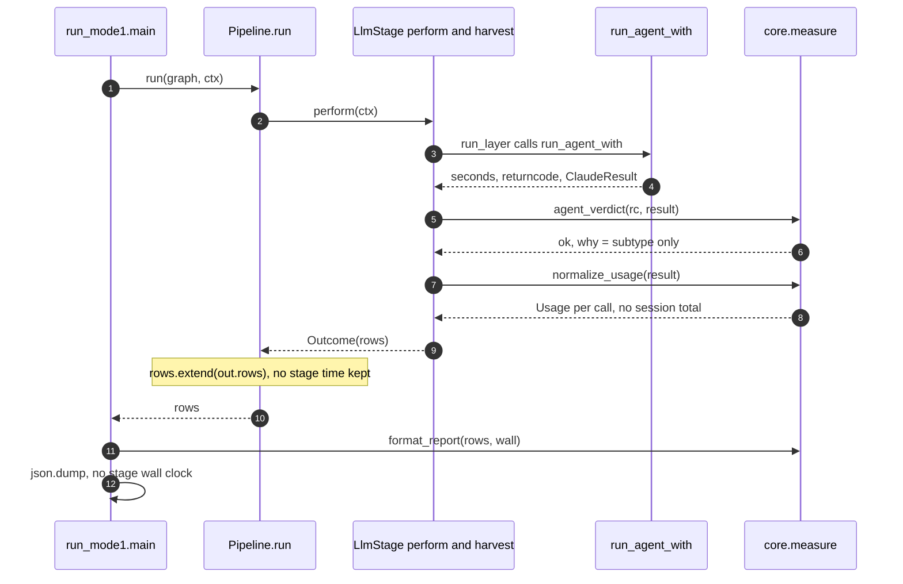
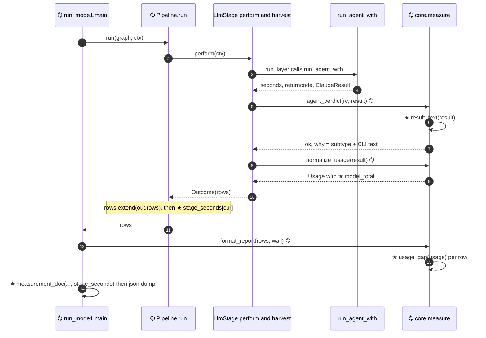
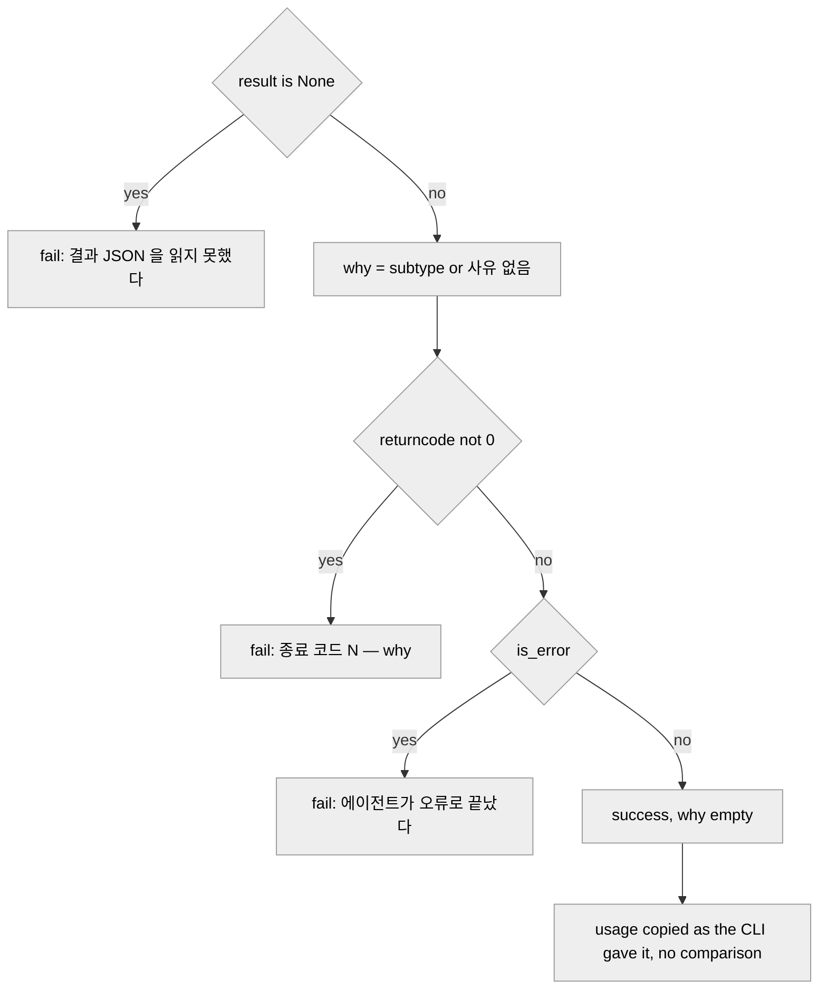
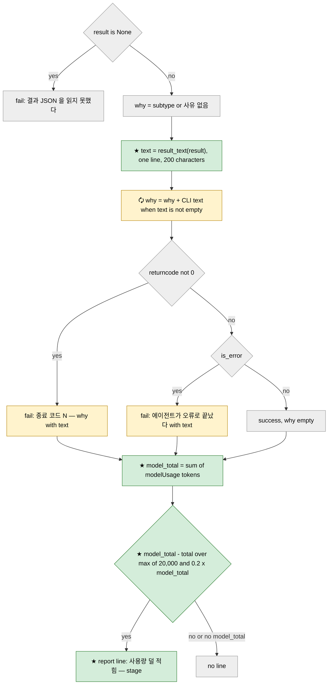
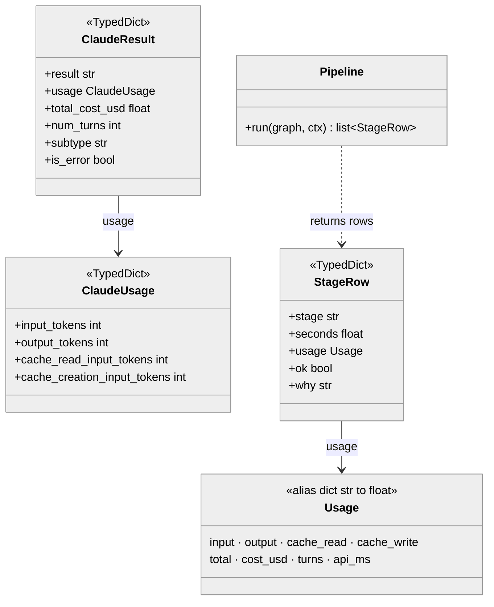
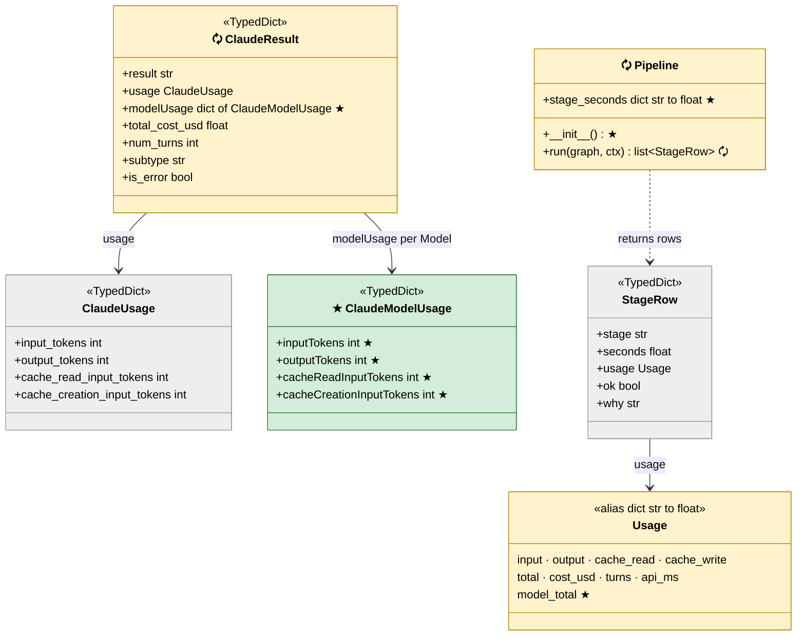

# 📏 A1 — Measurement semantics and failure reason: implementation plan

> 🔄 Status as of 2026-11-23: carried out — implemented and merged into `main` (see `git log`). The approval line below stands as written on the day of the plan.

> **For agentic workers:** REQUIRED SUB-SKILL: Use superpowers:subagent-driven-development (recommended) or superpowers:executing-plans to implement this plan task-by-task. Steps use checkbox (`- [ ]`) syntax for tracking.

> 📅 2026-11-22 · branch `main` · **Before = `29c5ee9`** (the code files this plan edits are unmodified in the working tree; `qa/evals/README.md` has uncommitted edits, see ⚠️)
> 📄 Evidence: `docs/superpowers/specs/2026-11-21-mode1-audit-verification-report.md` §2.2 · §2.4 (다) · `2026-11-22-mode1-session-cache-plan.md` Stage 0 result R7 · split `public.handoff/2026-11-22-mode1-remediation-split.md` · code read in this session: `src/core/measure.py` · `src/core/pipeline.py` · `src/codewiki/python/runner/run_mode1.py` · the three test files
> 🔒 Rules kept: additive only — no existing JSON key changes meaning · no check is loosened · comments state the present only
> 🧪 Verification: unit tests first, then the six gates. No paid run. **Nothing has been run for this plan** — every expected result below is `[unverified]`
> ✋ Approval: **not approved yet**
> 🌐 Korean translation: `2026-11-22-mode1-a1-measure-semantics-plan.ko.md`

**Goal:** A failed session says why in words, an under-recorded session is flagged, and each stage's wall clock is recorded.

**Architecture:** Four additive changes in the shared measuring code. The failure reason gains the text the CLI already returns. The per-session usage gains the session-wide token total the CLI reports per model, and the report flags rows where the two disagree. The pipeline loop records how long each stage took, and the runner writes it into the measurement JSON.

**Tech Stack:** Python 3 · msgspec · pytest · pyright strict.

---

Legend for every table and drawing below: **★ created from nothing · 🗘 existing element changed · no mark = reused unchanged · ✕ removed.** The marks describe the kind of change, not implementation or verification status. Claim kinds: `[code read]` read in the source this session · `[proposed]` proposed by this plan · `[measured]` measured in the cited reports · `[unverified]` not checked.

## 📋 One-page summary

| | |
|---|---|
| 🎯 Covers | <span style="color:cyan">Failure reason</span> "종료 코드 1 — success" · the meaning of turns and cost · missing <span style="color:cyan">stage wall clock</span> for LLM stages · <span style="color:cyan">under-recorded usage</span> that is never flagged |
| 🧩 Conclusion | The CLI already returns what is missing: its message in `result` and the <span style="color:cyan">session-wide total</span> in `modelUsage`. Read them and record them |
| 🟰 Unchanged | Every existing key of the measurement JSON and its meaning · the verdict itself (which sessions count as failed) · `run_agent_with` · `run_layer` · `LlmStage.harvest` · `LlmStage.perform` |
| 🗘 Changed | The <span style="color:cyan">failure reason</span> text · one new key in each `usage` dictionary (`model_total`) and one in the <span style="color:cyan">measurement document</span> (`stage_wall_seconds`) · one new line kind in the printed report · the printed stage subtotal lines gain a <span style="color:cyan">stage wall clock</span> column |
| ⚠️ Traps | (1) `usage` is per call and `modelUsage` is per session. They differ a little in every session (a helper request), so they cannot be compared for equality. (2) Whether the CLI's `result` carries the limit text in a failing run is `[unverified]` — the audit could not check it (report §7). (3) Task 5 builds on uncommitted edits of `qa/evals/README.md`; its Step 1 says where to write on a checkout that lacks them |
| 🚫 Out of scope | Changing how tokens are counted in existing keys · timeouts (A2) · isolation (A3) · rewriting the 2026-11-21 baseline JSON |

## 📌 Decided — not to be reopened

| What | 👍 Chosen | 👎 Dropped | Who · when |
|---|---|---|---|
| Measurement principle | Fix first, measure after. The 2026-11-21 run is the baseline; no re-measurement before the fixes | Re-running first to get a fresh base | user · 2026-11-22 |
| Order | A1 runs first, together with B1 — neither needs a decision or a paid check, and they share no file | Waiting for the other plans | user · 2026-11-22 |
| Number of re-measurements | Twice for the whole batch — Measurement A and Measurement B | After every plan | user · 2026-11-22 |

Source: `public.handoff/2026-11-22-mode1-remediation-split.md` "Decided". The plan's approval itself is still ✋ pending.

## 💡 Proposed by this plan — not decided

| What | `[proposed]` | Basis |
|---|---|---|
| <span style="color:cyan">gap thresholds</span> | `USAGE_GAP_FLOOR = 20_000` tokens and `USAGE_GAP_SHARE = 0.2`: a row is flagged when the gap exceeds the larger of the two | The plan's own test numbers only (94,873 + 6,812 not flagged; 114,205 vs 1,373,430 flagged). The baseline JSON has no `model_total`, so the lines cannot be calibrated on it `[unverified]` |
| <span style="color:cyan">result text</span> shape | One line, at most 200 characters, appended after the `subtype` | Plan's test `test_사유에_싣는_글은_한_줄_200자까지다` |
| Key name | `model_total` beside `total` | Plan; R7 says `modelUsage` is cumulative per session and model |
| Flag placement | One report line per flagged row, after the table, next to the existing 실패 · 건너뜀 lines | Plan's Task 3 |

## 📊 Status

| Item | State |
|---|---|
| Task 1 — the <span style="color:cyan">failure reason</span> carries the CLI's text | ❌ not started |
| Task 2 — record the <span style="color:cyan">session-wide total</span> | ❌ not started |
| Task 3 — flag <span style="color:cyan">under-recorded usage</span> | ❌ not started |
| Task 4 — record each <span style="color:cyan">stage wall clock</span> | ❌ not started |
| Task 5 — definitions · READMEs · six gates | ❌ not started |
| Approval of this plan | ❌ not approved |
| Tests and gates | ❌ not run |

## 🔁 Before / After

| 📍 Before (what did not work · now) | 🛠️ After · proposed | 🎉 What it resolves | 🔭 Expected | Done |
|---|---|---|---|---|
| 🐞 Three limit failures were recorded as "종료 코드 1 — success" `[measured]` (audit §2.4 다) | "종료 코드 1 — success · You've hit your session limit …" | The reason can be read without opening transcripts | The three rows would name the limit — only if the CLI's `result` carries the text on a failing run `[unverified]` | ❌ |
| 🐞 `L1-B14` recorded 114,205 tokens; the session used 1,373,430 `[measured]` (audit §2.2). Nothing noticed | The <span style="color:cyan">session row</span> carries `model_total`; the report prints "사용량 덜 적힘 — …" | <span style="color:cyan">Under-recorded usage</span> is visible on the day of the run | That row is flagged with 1,259,225 tokens `[computed]` from the plan's test numbers | ❌ |
| 🐞 The LLM <span style="color:cyan">stage wall clock</span> had to be reconstructed from file timestamps `[measured]` | `stage_wall_seconds` in the JSON and in the subtotal lines | Stage time is comparable across runs | Present in the next run's JSON `[unverified]` | ❌ |
| 🐞 "turns" and "cost" undefined | `qa/evals/README.md` states what each value is | Records are read the same way by everyone | The table exists; the "turns = tool calls + 1" claim is the audit's `[measured]`, not rechecked here | ❌ |

## ★ New · 🗘 changed items (module → file → class → function → member)

Each level is checked separately against Before `29c5ee9` `[code read]`.

| Level | Mark | Item | Kind | Lives in |
|---|---|---|---|---|
| module | 🗘 | `src/core` | changed — two files | — |
| module | 🗘 | `src/codewiki/python/runner` | changed — one file | — |
| file | 🗘 | `src/core/measure.py` · `src/core/pipeline.py` | changed | module `src/core` |
| file | 🗘 | `src/codewiki/python/runner/run_mode1.py` | changed | module `src/codewiki/python/runner` |
| file | 🗘 | `test/core/test_measure.py` · `test/core/test_pipeline.py` · `test/codewiki/test_run_mode1.py` | changed — tests added | `test/` |
| file | 🗘 | `qa/evals/README.md` | changed — one section added, one paragraph rewritten | `qa/evals/` |
| file | 🗘 | `src/core/README.md` · `src/codewiki/python/runner/README.md` | refreshed by `tools/gen_readme.py` | module READMEs |
| class | ★ | `ClaudeModelUsage` | new (`TypedDict`) | `measure.py` |
| class | 🗘 | `ClaudeResult` | changed — one field | `measure.py` |
| class | 🗘 | `Pipeline` | changed — gains `__init__`, a docstring paragraph | `pipeline.py` |
| class | — | `ClaudeUsage` · `StageRow` · `LlmStage` · the alias `Usage` | reused unchanged (`Usage` gains one key, its type does not change) | — |
| function | ★ | `result_text` · `usage_gap` | new | `measure.py` |
| function | ★ | `measurement_doc` | new | `run_mode1.py` |
| function | ★ | `Pipeline.__init__` | new | `pipeline.py` |
| function | ★ | 16 new tests (4 + 4 + 5 + 3) | new | the three test files |
| function | 🗘 | `agent_verdict` · `normalize_usage` · `sum_usage` · `format_report` | changed | `measure.py` |
| function | 🗘 | `Pipeline.run` | changed — one reset line, one record line | `pipeline.py` |
| function | 🗘 | `main` | changed — keeps the `Pipeline`, calls `measurement_doc`, prints the <span style="color:cyan">stage wall clock</span> column | `run_mode1.py` |
| function | — | `run_agent_with` · `run_layer` · `LlmStage.harvest` · `LlmStage.perform` · `stage_totals` | reused unchanged — they sit on the changed route but their text does not change | — |
| member | ★ | `ClaudeResult.modelUsage` · the four fields of `ClaudeModelUsage` | new | `measure.py` |
| member | ★ | `Pipeline.stage_seconds` | new | `pipeline.py` |
| member | ★ | constants `USAGE_GAP_FLOOR` · `USAGE_GAP_SHARE` | new | `measure.py` |
| member | ★ | key `model_total` of `Usage` · key `stage_wall_seconds` of the <span style="color:cyan">measurement document</span> | new | JSON |

## ⏱️ Sequence — how one session's result travels

Legend: gray = unchanged · green = new · amber = changed. In the diagrams the participant ids and message names are the real identifiers; ★ and 🗘 appear only in aliases and notes.

**Before** `[code read]` — `run_mode1.py:262` · `pipeline.py:348-384` · `pipeline.py:623-646` · `measure.py:72-120`



**After · proposed** `[unverified]`



The route itself does not change: the same participants call each other in the same order. What changes is what the called functions return and what `Pipeline.run` keeps.

## 🔀 Flow — the reason decision and the under-recording decision

Legend: gray = unchanged · green = new · amber = changed.

**Before** `[code read]` — `measure.py:107-120`; there is no check of the usage at all



**After · proposed** `[unverified]`



The verdict (which sessions count as failed) is the same in both drawings; only the text of `why` grows. The gap decision never changes `ok`.

## 🧱 Structure — the typed shapes

Legend: gray = unchanged · green = new · amber = changed. Only the members this plan touches are drawn.

**Before** `[code read]` — `measure.py:19-66` · `pipeline.py:341-348`



**After · proposed** `[unverified]`



`Usage` is a dictionary alias, so its type does not change; it is drawn amber only because its key set grows by one. Functions are not drawn here — they are in the inventory above.

## 🔧 Where to change

| File · symbol | Change | Why | Evidence |
|---|---|---|---|
| 🗘 `src/core/measure.py` — ★ `result_text` · 🗘 `agent_verdict` | Append the CLI's `result` text to the reason | The reason is built from the exit code and `subtype` only, so "success" appears for a failure | `[code read]` `measure.py:115-117`; the text field is already typed at `measure.py:33`; `[measured]` audit §2.4 (다) |
| 🗘 `measure.py` — ★ `ClaudeModelUsage` · 🗘 `ClaudeResult` · 🗘 `normalize_usage` · 🗘 `sum_usage` | Add `modelUsage` to the type; add `model_total`; fold it in `sum_usage` | `usage` is one call's share; the session total is only in `modelUsage` | `[code read]` `measure.py:19-39` · `:72-92` · `:95-101`; `[measured]` R7 in the session-cache plan |
| 🗘 `measure.py` — ★ `USAGE_GAP_FLOOR` · ★ `USAGE_GAP_SHARE` · ★ `usage_gap` · 🗘 `format_report` | Compare `total` with `model_total`; print one line per flagged row after the existing 실패 · 건너뜀 lines | The executor copies the CLI's numbers and never checks them against each other | `[code read]` `measure.py:150-195`; `[measured]` audit §2.2 |
| 🗘 `src/core/pipeline.py` — ★ `Pipeline.__init__` · 🗘 `Pipeline.run` | Keep `stage_seconds`, reset it at the start of `run`, record it after `rows.extend(out.rows)` | The sum of row seconds is not the <span style="color:cyan">stage wall clock</span> when sessions run side by side | `[code read]` `pipeline.py:341-350` · `:354` · `:379`. The same text `rows.extend(out.rows)` is also at `pipeline.py:643` (`LlmStage.perform`) and must not be touched. `__init__` is needed because `test/codewiki/test_mode1.py:2090` and `:2135` replace `Pipeline.run` with a function that never sets the attribute, yet `main` still runs `[code read]`; `[my judgment]` the default keeps `main`'s read of `stage_seconds` valid |
| 🗘 `src/codewiki/python/runner/run_mode1.py` — ★ `measurement_doc` · 🗘 `main` · 🗘 import of `Mapping` | Build the document in one function; keep the `Pipeline` instance; print the <span style="color:cyan">stage wall clock</span> column | The JSON is written inline in `main` today and `main` cannot be unit-tested | `[code read]` `run_mode1.py:125` · `:191` · `:262-263` · `:275-285`. `Pipeline` is also built at `run_mode1_5.py:837` and `run_mode2.py:513`; they only gain the default attribute |
| 🗘 `test/core/test_measure.py` · `test/core/test_pipeline.py` · `test/codewiki/test_run_mode1.py` | 16 tests (4 · 4 · 5 · 3 across Tasks 1–4) | One failing test per behavior, written before the code | `[code read]` helper `_행` at `test_measure.py:67`; fake stage `가짜단계` at `test_pipeline.py:52` |
| 🗘 `qa/evals/README.md` | Insert a "값의 뜻" table above the heading `## 기준선 — Mode 1 은 2026-11-21`, and rewrite the paragraph at lines 25–26 that says the executor does not record the <span style="color:cyan">stage wall clock</span> | Turns and cost have no definition; Task 4 makes that paragraph false | `[code read]` that heading and that paragraph exist only in the uncommitted working-tree edit, not in `29c5ee9` (Task 5 Step 1 covers both cases) |
| 🗘 `src/core/README.md` · `src/codewiki/python/runner/README.md` | Regenerate with `tools/gen_readme.py` | Docstrings change | `[code read]` the drift gate is in the root `CLAUDE.md` |

**Proposed diff — not applied.** Abridged: the full text is in the Tasks. Each `-` line is copied from the source at `29c5ee9`.

```diff
--- a/src/core/measure.py
+++ b/src/core/measure.py
     why = result.get("subtype") or "사유 없음"
+    text = result_text(result)
+    if text:
+        why = "%s · %s" % (why, text)
     if returncode != 0:
         return False, "종료 코드 %d — %s" % (returncode, why)
@@
-    keys = ["input", "output", "cache_read", "cache_write", "total", "turns", "api_ms"]
+    keys = ["input", "output", "cache_read", "cache_write", "total", "model_total", "turns", "api_ms"]

--- a/src/core/pipeline.py
+++ b/src/core/pipeline.py
+    def __init__(self) -> None:
+        self.stage_seconds: dict[str, float] = {}
+
     def run(self, graph: StageDagGraph[C], ctx: C) -> list[StageRow]:
         rows: list[StageRow] = []
+        self.stage_seconds = {}
@@
             rows.extend(out.rows)
+            self.stage_seconds[cur] = time.monotonic() - t0

--- a/src/codewiki/python/runner/run_mode1.py
+++ b/src/codewiki/python/runner/run_mode1.py
-    rows = P.Pipeline[Mode1Context]().run(graph, ctx)
+    pipeline = P.Pipeline[Mode1Context]()
+    rows = pipeline.run(graph, ctx)
@@
-    print("\n단계 소계 — 병렬이라 행의 초 합계는 벽시계가 아니다")
+    print("\n단계 소계 — 벽시계는 단계가 걸린 시간이고, 행의 초 합계와 다르다")
```

## 🧭 Order of the slices

| Slice | Deliverable | Needs | Check |
|---|---|---|---|
| Task 1 | reason text | — | 4 tests in `test_measure.py` + the verdict-touching suites |
| Task 2 | `model_total` | — | 4 tests + every test that reads usage |
| Task 3 | `usage_gap` and the report line | Task 2 (`model_total`) | 5 tests |
| Task 4 | `stage_seconds` · `measurement_doc` | — (edits `pipeline.py` and `run_mode1.py`; no file shared with Tasks 1–3) | 3 tests + `npm run typecheck:py` |
| Task 5 | definitions · READMEs · gates | Tasks 1–4 | six gates (🧪) |

## 📖 Terms

| Term | Code name | Meaning |
|---|---|---|
| <span style="color:cyan">failure reason</span> | `why` · `agent_verdict` | The second value `(ok, why)`; why a session counts as failed |
| <span style="color:cyan">result text</span> | `result_text` · field `result` of `ClaudeResult` | What the CLI wrote in `result`, flattened to one line of at most 200 characters |
| <span style="color:cyan">per-call usage</span> | `usage` · `ClaudeUsage` | Tokens of one call; may hold only part of a session |
| <span style="color:cyan">session-wide total</span> | `model_total` · `modelUsage` · `ClaudeModelUsage` | The sum of every model's cumulative tokens in a session |
| <span style="color:cyan">under-recorded usage</span> | `usage_gap` | `model_total - total` when it exceeds the thresholds, else 0 |
| <span style="color:cyan">gap thresholds</span> | `USAGE_GAP_FLOOR` · `USAGE_GAP_SHARE` | The two constants that decide whether a gap counts |
| <span style="color:cyan">stage wall clock</span> | `Pipeline.stage_seconds` · `stage_wall_seconds` | How long a stage took on the wall clock, per stage name |
| <span style="color:cyan">measurement document</span> | `measurement_doc` | The dictionary `main` writes with `--json` |
| <span style="color:cyan">session row</span> | `StageRow` | One row of the measurement table; one session per row |
| <span style="color:cyan">pipeline loop</span> | `Pipeline.run` | The loop that walks the stage graph and collects rows |

## ❓ Open

Four slips found while grounding this front part are fixed in the task text below: the count in a comment (Task 2 Step 3), the number of lines of `run` to replace (Task 4 Step 3), a README paragraph that Task 4 makes false, and a README anchor that exists only in an uncommitted edit (both Task 5 Step 1). What stays open:

| # | What | Evidence | Recommendation | Impact |
|---|---|---|---|---|
| 1 | The failure text may not be in the CLI's `result` | `[measured]` the transcripts hold "You've hit your session limit" (cold-run report); `[unverified]` the JSON `result` at that moment (audit §7) | Keep the plan; judge Task 1 by Measurement A. The tests use a made-up fixture | Task 1 could still leave "success" with no text |
| 2 | The two thresholds have no baseline to calibrate on | `[proposed]` | Keep; revisit with the first `model_total` data | Only the flag, never the verdict |

## 🧪 Verification · 🚫 Out of scope

**Verification** — every item is `[unverified]`; nothing has been run.

- Inside each Task: tests written first, then run (see the Tasks below).
- Task 5: README drift check, then `pytest -q` (16 more tests than before, no new skip or xfail), `npm test` (8), both type checks, `npm run doctor`.
- No paid run. The effect on a real session is what Measurement A and Measurement B are for.

**Out of scope** — timeouts and the end condition (A2) · isolation (A3) · prompt and record defects (B1) · changing how existing keys count tokens · rewriting the 2026-11-21 baseline JSON · any change to which sessions count as failed.

All commands run from the repository root with `.venv/bin/python`.

---

### Task 1: The failure reason carries what the CLI said

**Files:**
- Modify: `src/core/measure.py` (`agent_verdict`, new `result_text`)
- Test: `test/core/test_measure.py`

- [ ] **Step 1: Write the failing tests** — append to `test/core/test_measure.py`:

```python
def test_종료_코드가_0이_아니면_CLI_가_적은_글을_사유에_싣는다():
    ok, why = M.agent_verdict(1, {"subtype": "success", "is_error": True,
                                  "result": "You've hit your session limit · resets 9:50pm"})
    assert ok is False
    assert "종료 코드 1" in why and "session limit" in why


def test_사유에_싣는_글은_한_줄_200자까지다():
    _, why = M.agent_verdict(1, {"subtype": "success", "result": "첫 줄\n" + "가" * 500})
    assert "\n" not in why
    assert M.result_text({"result": "첫 줄\n" + "가" * 500}) == ("첫 줄 " + "가" * 500)[:200]


def test_CLI_가_글을_주지_않으면_사유는_subtype_뿐이다():
    assert M.agent_verdict(1, {"subtype": "error_max_turns"}) == (False, "종료 코드 1 — error_max_turns")


def test_성공한_세션의_글은_사유가_되지_않는다():
    assert M.agent_verdict(0, {"result": "샤드를 썼다", "subtype": "success"}) == (True, "")
```

- [ ] **Step 2: Run them and see them fail**

Run: `.venv/bin/python -m pytest test/core/test_measure.py -q -k "사유"`
Expected: 2 failed, 2 passed. `test_종료_코드가_0이_아니면_…` fails on `"session limit" in why`; `test_사유에_싣는_글은_…` fails with `AttributeError: module 'core.measure' has no attribute 'result_text'`.

- [ ] **Step 3: Implement** — in `src/core/measure.py` replace `agent_verdict` with:

```python
def result_text(result: ClaudeResult) -> str:
    """CLI 가 `result` 칸에 적은 글을 한 줄 · 200자까지로. 없으면 빈 글."""
    return " ".join(str(result.get("result") or "").split())[:200]


def agent_verdict(returncode: int, result: ClaudeResult | None) -> tuple[bool, str]:
    """에이전트가 정말 해냈는가. `(성공인가, 아니라면 왜)` 를 낸다.

    종료 코드만 믿으면 안 된다. `claude` 는 최대 턴 수에 걸리거나 권한에 막혀도 0 을
    내면서 `is_error: true` 만 올릴 수 있다.

    실패면 CLI 가 `result` 칸에 적은 글을 사유 끝에 붙인다. `subtype` 만으로는 왜 실패했는지
    알 수 없는 실패가 있다 — `test_종료_코드가_0이_아니면_CLI_가_적은_글을_사유에_싣는다`.
    """
    if result is None:
        return False, "결과 JSON 을 읽지 못했다 (종료 코드 %d)" % returncode
    why = result.get("subtype") or "사유 없음"
    text = result_text(result)
    if text:
        why = "%s · %s" % (why, text)
    if returncode != 0:
        return False, "종료 코드 %d — %s" % (returncode, why)
    if result.get("is_error"):
        return False, "에이전트가 오류로 끝났다: %s" % why
    return True, ""
```

- [ ] **Step 4: Run the tests that touch the verdict**

Run: `.venv/bin/python -m pytest test/core/test_measure.py test/codewiki/test_run_mode1.py test/spec/test_run_mode2.py test/term/test_run_mode1_5.py -q`
Expected: all pass.

- [ ] **Step 5: Commit** (only when the user has approved commits for this plan)

Title: `[fix] : core - 실패 사유에 CLI 가 적은 글을 싣는다`

---

### Task 2: Record the session-wide token total the CLI reports

**Files:**
- Modify: `src/core/measure.py` (`ClaudeModelUsage`, `ClaudeResult`, `normalize_usage`, `sum_usage`)
- Test: `test/core/test_measure.py`

- [ ] **Step 1: Write the failing tests** — add `import json` under `import os` at the top of `test/core/test_measure.py`, then append:

```python
def test_Model_별_누계를_model_total_로_적는다():
    """`usage` 는 호출 하나의 몫이고 `modelUsage` 는 세션의 누계다. 둘을 따로 적는다."""
    got = M.normalize_usage(M.parse_result(json.dumps({
        "usage": {"input_tokens": 4, "output_tokens": 207,
                  "cache_read_input_tokens": 109285, "cache_creation_input_tokens": 4709},
        "modelUsage": {
            "claude-sonnet-5-5": {"inputTokens": 30, "outputTokens": 11278, "cacheReadInputTokens": 1272778,
                                  "cacheCreationInputTokens": 89344, "costUSD": 0.598, "costBasis": "list"},
            "claude-haiku-5-5": {"inputTokens": 6787, "outputTokens": 25}},
        "total_cost_usd": 0.5981, "num_turns": 1})))
    assert got["total"] == 4 + 207 + 109285 + 4709
    assert got["model_total"] == 30 + 11278 + 1272778 + 89344 + 6787 + 25


def test_modelUsage_가_없으면_model_total_은_0이다():
    assert M.normalize_usage(M.parse_result('{"usage": {"input_tokens": 7}}'))["model_total"] == 0
    assert M.normalize_usage(None)["model_total"] == 0


def test_model_total_도_열쇠별로_접는다():
    a = M.normalize_usage({"modelUsage": {"m": {"inputTokens": 3}}})
    b = M.normalize_usage({"modelUsage": {"m": {"outputTokens": 4}}})
    assert M.sum_usage([a, b])["model_total"] == 7


def test_modelUsage_의_토큰_칸에_문자열이_오면_거부한다():
    with pytest.raises(msgspec.ValidationError):
        M.parse_result('{"modelUsage": {"m": {"inputTokens": "많이"}}}')
```

- [ ] **Step 2: Run them and see them fail**

Run: `.venv/bin/python -m pytest test/core/test_measure.py -q -k "model_total or modelUsage"`
Expected: 4 failed — `KeyError: 'model_total'` in three, and the last does not raise.

- [ ] **Step 3: Implement** — in `src/core/measure.py`, insert after `class ClaudeUsage`:

```python
class ClaudeModelUsage(TypedDict, total=False):
    """`modelUsage` 의 Model 하나 — 세션이 그 Model 로 쓴 토큰의 누계. 칸은 빠질 수 있고, 있으면 정수여야 한다."""
    inputTokens: int
    outputTokens: int
    cacheReadInputTokens: int
    cacheCreationInputTokens: int
```

Add one field to `ClaudeResult`, after `usage: ClaudeUsage`:

```python
    modelUsage: dict[str, ClaudeModelUsage]
```

Replace `normalize_usage` with:

```python
def normalize_usage(result: ClaudeResult | None) -> Usage:
    """`claude -p --output-format json` 의 결과에서 잴 값만 뽑아 평평하게 만든다.

    `total` 은 입력·출력·캐시읽기·캐시생성 넷을 더한 값이다. 캐시 둘을 빼고 "토큰 합" 이라
    부르면 일부만 센 것이다.

    `model_total` 은 `modelUsage` 의 Model 별 누계를 전부 더한 값이다. `usage` 는 호출 하나의 몫이라
    세션의 일부만 담아 올 수 있고, 이 값은 세션 전체다 — `usage_gap` 이 둘을 견준다.

    기계 단계는 `None` 을 받아 전부 0 을 낸다 — `None` 을 그대로 두면 표를 더할 수 없다.
    """
    top: ClaudeResult = result or {}
    u = top.get("usage", {})
    got: Usage = {
        "input": u.get("input_tokens", 0),
        "output": u.get("output_tokens", 0),
        "cache_read": u.get("cache_read_input_tokens", 0),
        "cache_write": u.get("cache_creation_input_tokens", 0),
        "cost_usd": top.get("total_cost_usd", 0.0),
        "turns": top.get("num_turns", 0),
        "api_ms": top.get("duration_api_ms", 0),
    }
    got["total"] = got["input"] + got["output"] + got["cache_read"] + got["cache_write"]
    got["model_total"] = sum(m.get("inputTokens", 0) + m.get("outputTokens", 0)
                             + m.get("cacheReadInputTokens", 0) + m.get("cacheCreationInputTokens", 0)
                             for m in top.get("modelUsage", {}).values())
    return got
```

In `sum_usage`, replace the `keys` line with:

```python
    keys = ["input", "output", "cache_read", "cache_write", "total", "model_total", "turns", "api_ms"]
```

and its comment `# 정수 여섯은 정수로 접고` with `# 정수 열쇠는 정수로 접고` — the list now holds eight names, so the comment stops counting them.

- [ ] **Step 4: Run every test that reads usage**

Run: `.venv/bin/python -m pytest test/core test/codewiki/test_run_mode1.py test/codewiki/test_mode1.py test/spec/test_run_mode2.py test/term/test_run_mode1_5.py -q`
Expected: all pass.

- [ ] **Step 5: Commit**

Title: `[feat] : core - 세션 사용량에 Model 별 누계 합을 함께 적는다`

---

### Task 3: Flag rows whose usage is under-recorded

**Files:**
- Modify: `src/core/measure.py` (`USAGE_GAP_FLOOR`, `USAGE_GAP_SHARE`, `usage_gap`, `format_report`)
- Test: `test/core/test_measure.py`

- [ ] **Step 1: Write the failing tests** — append to `test/core/test_measure.py`:

```python
def _사용량(total: int, model_total: int) -> M.Usage:
    u = M.normalize_usage(None)
    u["total"], u["model_total"] = total, model_total
    return u


def test_보조_요청_몫만큼의_차이는_덜_적힌_것이_아니다():
    assert M.usage_gap(_사용량(94_873, 94_873 + 6_812)) == 0


def test_작은_세션의_보조_요청_몫도_걸리지_않는다():
    assert M.usage_gap(_사용량(10_000, 16_812)) == 0


def test_앞선_요청이_통째로_빠지면_덜_적힌_토큰_수를_낸다():
    assert M.usage_gap(_사용량(114_205, 1_373_430)) == 1_373_430 - 114_205


def test_누계가_없으면_견주지_않는다():
    assert M.usage_gap(_사용량(500_000, 0)) == 0


def test_덜_적힌_행은_표_아래에_알린다():
    row = _행("annotate-symbols/L1-B14")
    row["usage"] = _사용량(114_205, 1_373_430)
    out = M.format_report([row, _행("verify-terms")])
    assert "사용량 덜 적힘 — annotate-symbols/L1-B14" in out and "1,259,225" in out
    assert "사용량 덜 적힘 — verify-terms" not in out
```

- [ ] **Step 2: Run them and see them fail**

Run: `.venv/bin/python -m pytest test/core/test_measure.py -q -k "덜_적힌 or 보조_요청 or 누계가_없으면"`
Expected: 5 failed — `AttributeError: module 'core.measure' has no attribute 'usage_gap'` in four, and the report assertion in the fifth.

- [ ] **Step 3: Implement** — in `src/core/measure.py`, insert after `sum_usage`:

```python
# `usage` 합계가 Model 별 누계보다 이 선을 넘게 작으면 덜 적힌 것으로 본다. 둘은 평소에도 보조 요청
# 몫만큼 다르므로 같은지로 견주면 모든 행이 걸린다 — `test_보조_요청_몫만큼의_차이는_덜_적힌_것이_아니다`.
USAGE_GAP_FLOOR = 20_000
USAGE_GAP_SHARE = 0.2


def usage_gap(usage: Usage) -> int:
    """`usage` 합계가 Model 별 누계보다 덜 적힌 토큰 수. 선을 넘지 않거나 누계가 없으면 0."""
    model_total = int(usage.get("model_total") or 0)
    gap = model_total - int(usage.get("total") or 0)
    return gap if gap > max(USAGE_GAP_FLOOR, USAGE_GAP_SHARE * model_total) else 0
```

In `format_report`, insert before `return "\n".join(out)`:

```python
    for r in rows:
        gap = usage_gap(r["usage"])
        if gap:
            out.append("사용량 덜 적힘 — %s: 합계가 Model 별 누계보다 %s 토큰 작다"
                       % (r["stage"], "{:,}".format(gap)))
```

- [ ] **Step 4: Run the measure tests**

Run: `.venv/bin/python -m pytest test/core/test_measure.py -q`
Expected: all pass.

- [ ] **Step 5: Commit**

Title: `[feat] : core - 덜 적힌 사용량을 측정 보고에 알린다`

---

### Task 4: Record each stage's wall clock

**Files:**
- Modify: `src/core/pipeline.py` (`Pipeline`)
- Modify: `src/codewiki/python/runner/run_mode1.py` (imports, new `measurement_doc`, `main`)
- Test: `test/core/test_pipeline.py` · `test/codewiki/test_run_mode1.py`

- [ ] **Step 1: Write the failing tests** — append to `test/core/test_pipeline.py`:

```python
def test_단계마다_걸린_벽시계를_남긴다(tmp_path: Path):
    ctx = P.RunContext(root=str(tmp_path), model="m")
    g = P.build_graph("g", ["a", "b"], {"a": 가짜단계("a"), "b": 가짜단계("b")},
                      P.Edges({("*", P.OK): P.NEXT, ("*", P.FAIL): P.HALT}), [], ctx)
    p = P.Pipeline[P.RunContext]()
    p.run(g, ctx)
    assert list(p.stage_seconds) == ["a", "b"]
    assert all(s >= 0.0 for s in p.stage_seconds.values())


def test_멈춘_뒤의_단계는_벽시계가_없다(tmp_path: Path):
    ctx = P.RunContext(root=str(tmp_path), model="m")
    g = P.build_graph("g", ["a", "b"], {"a": 가짜단계("a", kind=P.FAIL), "b": 가짜단계("b")},
                      P.Edges({("*", P.OK): P.NEXT, ("*", P.FAIL): P.HALT}), [], ctx)
    p = P.Pipeline[P.RunContext]()
    p.run(g, ctx)
    assert list(p.stage_seconds) == ["a"]
```

Append to `test/codewiki/test_run_mode1.py`:

```python
def test_측정_문서는_단계별_벽시계를_싣는다():
    row: R.StageRow = {"stage": "annotate-symbols/L0-B00", "seconds": 60.0,
                       "usage": R.normalize_usage(None), "ok": True, "why": ""}
    doc = R.measurement_doc("/어느/저장소", "claude-sonnet-5-5", "mode1-cold", [row], 8, 8, 100.0,
                            {"annotate-symbols": 61.5})
    assert doc["repo"] == "저장소" and doc["wall_seconds"] == 100.0
    assert doc["stage_wall_seconds"] == {"annotate-symbols": 61.5}
    assert list(doc)[:9] == ["repo", "model", "graph", "stages", "stage_totals", "concurrency",
                             "target", "total", "wall_seconds"]
```

- [ ] **Step 2: Run them and see them fail**

Run: `.venv/bin/python -m pytest test/core/test_pipeline.py test/codewiki/test_run_mode1.py -q -k "벽시계"`
Expected: the three new tests fail — `AttributeError: 'Pipeline' object has no attribute 'stage_seconds'` twice, and `AttributeError: module 'run_mode1' has no attribute 'measurement_doc'`.

- [ ] **Step 3: Implement the pipeline part** — in `src/core/pipeline.py`, replace the `Pipeline` docstring and the opening of `run` through the line `cur = graph.first`:

```python
class Pipeline(Generic[C]):
    """그래프를 따라 도는 루프. 세 실행기가 이 한 벌을 쓴다.

    `run` 은 **재정의할 수 있다.** 다만 재정의가 루프를 다시 쓰는 자리는 아니다 —
    `super().run()` 을 부르고 앞뒤에 자기 일을 붙이는 자리다.

    `stage_seconds` 는 `run` 이 채운다 — 단계 이름마다 그 단계가 걸린 벽시계 초다. 세션이 나란히 도는
    단계는 행의 초를 더한 값이 벽시계가 아니므로 이 값을 본다.
    """

    def __init__(self) -> None:
        self.stage_seconds: dict[str, float] = {}

    def run(self, graph: StageDagGraph[C], ctx: C) -> list[StageRow]:
        rows: list[StageRow] = []
        self.stage_seconds = {}
        cur = graph.first
```

and inside `Pipeline.run` — not `LlmStage.perform`, which has the same line — replace the `rows.extend(out.rows)` that is followed by `nxt = graph.next_of(cur, out.kind)` with:

```python
            rows.extend(out.rows)
            self.stage_seconds[cur] = time.monotonic() - t0
```

- [ ] **Step 4: Implement the runner part** — in `src/codewiki/python/runner/run_mode1.py`:

Replace `from collections.abc import Sequence` with:

```python
from collections.abc import Mapping, Sequence
```

Insert above `def main(`:

```python
def measurement_doc(repo: str, model: str, graph_name: str, rows: Sequence[StageRow], concurrency: int,
                    target: int, wall: float, stage_wall: Mapping[str, float]) -> dict[str, object]:
    """`--json` 으로 쓰는 측정 문서.

    `stage_wall_seconds` 는 단계마다의 벽시계다. 세션이 나란히 도는 단계는 행의 초를 더해도 벽시계가 아니다.
    """
    return {"repo": os.path.basename(repo), "model": model, "graph": graph_name, "stages": list(rows),
            "stage_totals": stage_totals(rows), "concurrency": concurrency, "target": target,
            "total": sum_usage([r["usage"] for r in rows]), "wall_seconds": wall,
            "stage_wall_seconds": dict(stage_wall)}
```

In `main`, replace `rows = P.Pipeline[Mode1Context]().run(graph, ctx)` with:

```python
    pipeline = P.Pipeline[Mode1Context]()
    rows = pipeline.run(graph, ctx)
```

Replace the subtotal block (the `print("\n단계 소계 …")` line through the end of the `if json_out:` block) with:

```python
    print("\n단계 소계 — 벽시계는 단계가 걸린 시간이고, 행의 초 합계와 다르다")
    for name, u in stage_totals(rows).items():
        print("  %-16s 벽시계 %10s · 토큰 %12s · 턴 %3d · 비용 $%.4f"
              % (name, hms(pipeline.stage_seconds.get(name, 0.0)), "{:,}".format(u["total"]),
                 u["turns"], u["cost_usd"]))
    if json_out:
        with open(json_out, "w", encoding="utf-8") as f:
            json.dump(measurement_doc(repo, model, graph.name, rows, ctx.concurrency, ctx.target, wall,
                                      pipeline.stage_seconds), f, ensure_ascii=False, indent=1)
        print("\n측정값 %s" % json_out)
```

- [ ] **Step 5: Run the tests and the type check**

Run: `.venv/bin/python -m pytest test/core test/codewiki/test_run_mode1.py test/spec/test_run_mode2.py test/term/test_run_mode1_5.py -q && npm run typecheck:py`
Expected: all pass · `0 errors`.

- [ ] **Step 6: Commit**

Title: `[feat] : core - 단계마다의 벽시계를 재서 측정 JSON 에 싣는다`

---

### Task 5: State what the recorded values mean

**Files:**
- Modify: `qa/evals/README.md`
- Regenerate: `src/core/README.md` · `src/codewiki/python/runner/README.md`

- [ ] **Step 1: Add the definitions** — in `qa/evals/README.md`, insert this section immediately above the line `## 기준선 — Mode 1 은 2026-11-21`. That heading and the paragraph replaced below come from an edit of this README that was still uncommitted when this plan was written; on a checkout without them, insert the section above `## 지금까지 잰 것` and skip the paragraph replacement:

```markdown
## 값의 뜻

| 값 | 뜻 |
|---|---|
| `seconds` (행) | 그 세션 하나가 걸린 초. 세션이 나란히 돌므로 더해도 단계의 벽시계가 아니다 |
| `stage_wall_seconds` | 단계마다의 벽시계. 2026-11-22 뒤의 기록에만 있다 |
| `wall_seconds` | 실행 전체의 벽시계 |
| `total` | CLI 의 `usage` 넷(입력 · 출력 · 캐시 읽기 · 캐시 쓰기)의 합. 호출 하나의 몫이다 |
| `model_total` | CLI 의 `modelUsage` 를 Model 전부에 걸쳐 더한 값. 세션 전체의 누계이고, 보조 요청 몫만큼 `total` 보다 크다. 2026-11-22 뒤의 기록에만 있다 |
| `turns` | CLI 의 `num_turns`. 요청 수가 아니다 — 2026-11-21 기록의 배치 세션 91개 전부에서 도구 호출 수 + 1 이었다 |
| `cost_usd` | CLI 가 토큰 수에 정가를 곱해 낸 추정치다. 청구액이 아니다. 캐시 쓰기의 배수가 로그인 방식에 따라 달라, 로그인 방식이 다른 기록끼리는 비용을 대조하지 않는다 |

보고 끝의 `사용량 덜 적힘 — <행>` 줄은 그 행의 `total` 이 `model_total` 보다 크게 작다는 뜻이다. 그 행의 토큰은 `model_total` 로 읽는다.
```

In the same file, replace the two-line paragraph that starts with `**실행기는 LLM 단계의 벽시계를 따로 적지 않는다.**` with:

```markdown
**LLM 단계의 벽시계는 `stage_wall_seconds` 에 있다.** `stages[].seconds` 는 세션마다의 값이라 더하면 병렬 몫이 겹친다.
이 열쇠가 없는 옛 기록은 산출물 파일의 수정 시각으로 재고, 그렇게 쟀다고 노트에 적는다.
```

- [ ] **Step 2: Regenerate the READMEs and check drift**

Run:
```bash
.venv/bin/python tools/gen_readme.py src/codewiki/python/runner src/codewiki/python/machine src/codewiki/python/viz src/term/python/runner src/spec/python/runner src/spec/python/viz src/core src/common tools
.venv/bin/python tools/gen_readme.py --check src/codewiki/python/runner src/codewiki/python/machine src/codewiki/python/viz src/term/python/runner src/spec/python/runner src/spec/python/viz src/core src/common tools
```
Expected: the second command exits 0.

- [ ] **Step 3: Run the six gates**

Run:
```bash
.venv/bin/python -m pytest -q
npm test
npm run typecheck
npm run typecheck:py
npm run doctor
```
Expected: pytest passes with 16 more tests than before this plan and no new skip or xfail · `npm test` 8 pass · both type checks clean · doctor exits 0. The README drift gate was checked in Step 2.

- [ ] **Step 4: Commit**

Title: `[docs] : qa - 측정값의 뜻과 새 칸 둘을 적는다`

---

## Self-review notes

- **Coverage:** reason text → Task 1 · under-recorded usage → Tasks 2–3 · stage wall clock → Task 4 · meaning of turns and cost → Task 5.
- **Names used across tasks:** `result_text` · `ClaudeModelUsage` · `model_total` · `usage_gap` · `USAGE_GAP_FLOOR` · `USAGE_GAP_SHARE` · `stage_seconds` · `measurement_doc` · `stage_wall_seconds`.
- **Compatibility:** no existing key is removed or redefined. Records written before this plan lack `model_total` and `stage_wall_seconds`; readers must treat them as absent, not zero.
- **Not done here:** the 2026-11-21 baseline JSON is not rewritten. Its `L1-B14` row stays under-recorded and its note already says so.
