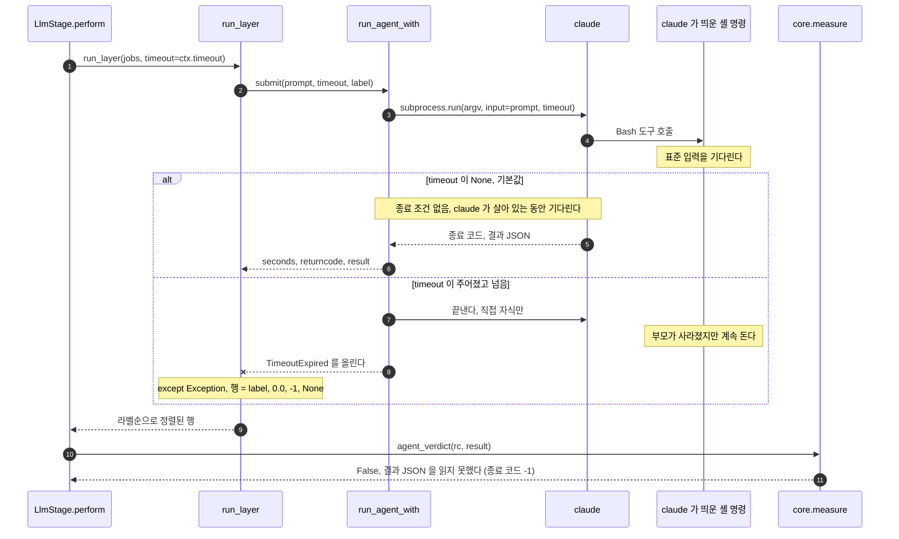
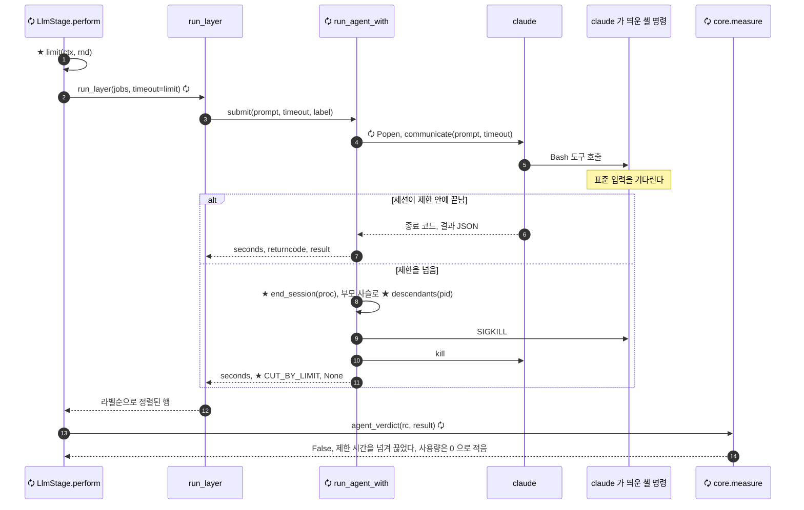
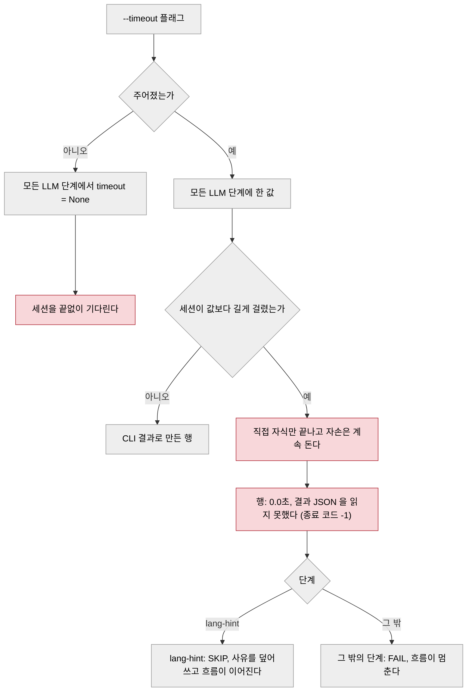
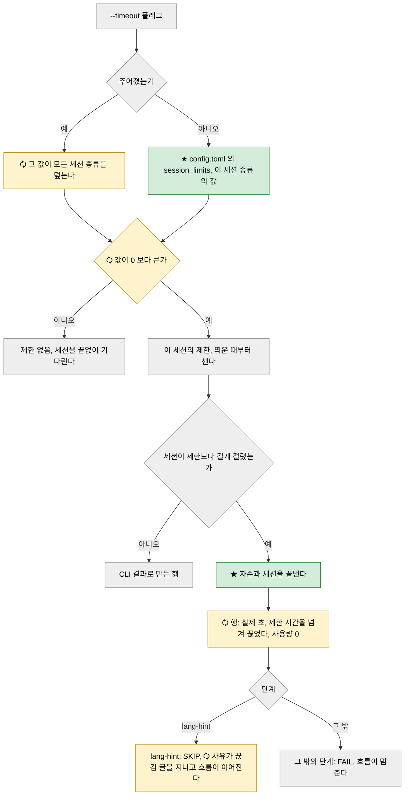
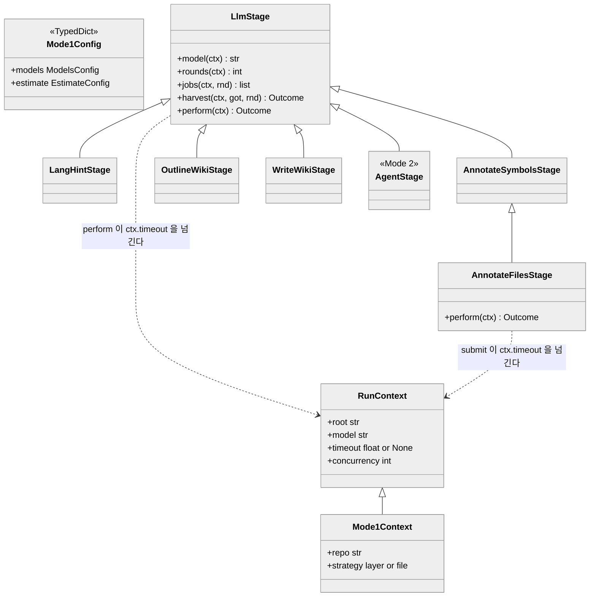
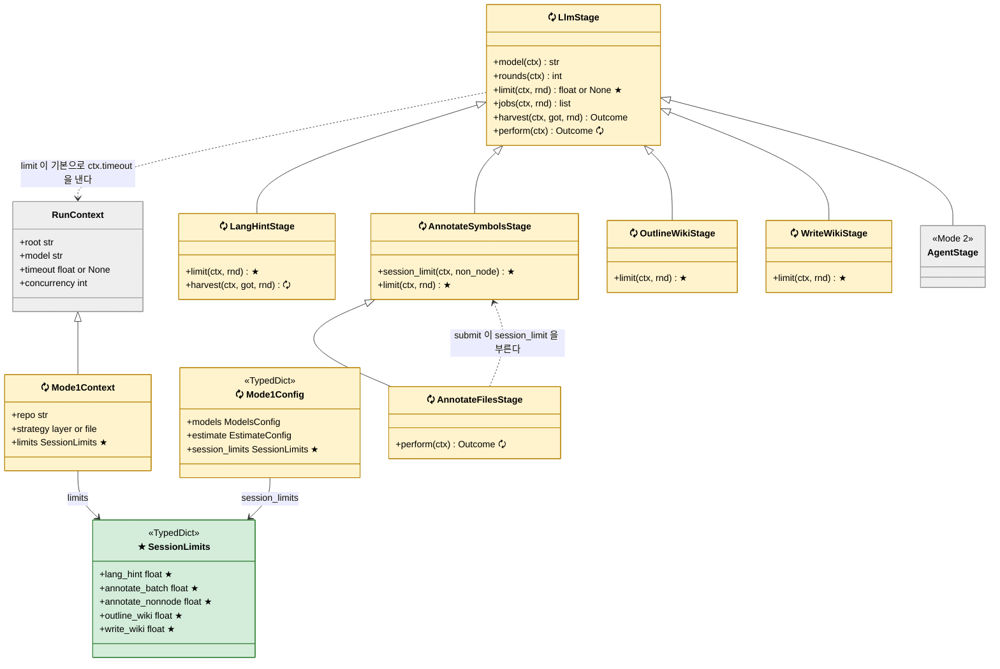

# ⏱️ A2 — 세션 종료 조건: 구현 계획

> 🔴 2026-11-23 기준 상태: 사용자가 보류했고 수행하지 않았다. 세션이 멈추는 일은 원인을 없애서 막는다 — B3 의 프롬프트 문구와 A3 의 허용 규칙. 이 계획서의 제한 시간에 기대는 것을 만들지 않는다.

> **에이전트 작업자에게:** 필수 하위 스킬 — superpowers:subagent-driven-development(권장) 또는 superpowers:executing-plans 로 이 계획을 작업 단위로 구현한다. 단계는 체크박스(`- [ ]`)로 추적한다.

> 📅 2026-11-22 · 브랜치 `main` · **Before = `29c5ee9` + A1 계획** (A2 는 `2026-11-22-mode1-a1-measure-semantics-plan.ko.md` 다음에 구현한다. diff 가 A1 이 바꾸는 줄을 건드리면 그 diff 의 "Before" 는 A1 의 "After" 이고 diff 가 그렇게 적는다. 그 밖의 곳에서 "Before" 는 `29c5ee9` 의 소스다)
> 📄 근거: 분할 `public.handoff/2026-11-22-mode1-remediation-split.ko.md` ("정한 것" · "정한 것이 서로 만나는 자리" · "숨은 결합") · `docs/superpowers/specs/2026-11-21-mode1-cold-run-report.md` 4.1 · `docs/superpowers/specs/2026-11-21-mode1-audit-verification-report.md` 2.2 · 기준선 `qa/evals/runs/2026-11-21-mode1-report-builder-cold-layer-sonnet.{json,md}` · 이 세션에서 읽은 코드: `src/core/pipeline.py` · `src/core/measure.py` · `src/codewiki/python/runner/run_mode1.py` · `src/codewiki/python/runner/mode1/{context,lang,survey,survey_files,wiki,edges,resume}.py` · `src/spec/python/runner/run_mode2.py` · 시험 파일 넷
> 🔒 지킬 규칙: 더하기만 한다 — 이미 있는 플래그 · JSON 열쇠 · 행 칸의 뜻을 바꾸지 않는다 · 검사를 느슨하게 하지 않는다(새 `xfail` 이나 `skip` 없음) · 설정값은 `resource/codewiki/config.toml` 에 둔다 · 주석은 지금의 것만 적는다 · 유료 Model 호출 없음
> 🧪 검증 방법: 가짜 자식 프로세스로 단위 시험, 그다음 여섯 게이트. **저장소 밖의 개인 복제본에서 한 번 돌렸다**(`29c5ee9`, A1 작업 1~5 적용, 그다음 A2 작업 1~7): 결과는 아래 🧪 에 있다. 실제 `claude` 세션은 시작하지 않았다. 실제 세션이 끊길 때 어떻게 되는지는 `[미검증]` 이다
> ✋ 승인: **승인 전**
> 🌐 영어 정본: `2026-11-22-mode1-a2-session-end-condition-plan.md`

**목표:** 실행기가 띄우는 Mode 1 의 모든 세션은 자기 종류의 제한 시간을 가진다. 그것을 넘긴 세션은 그것이 띄운 모든 것과 함께 끝나고, 흐름을 멈추는 실패로 적힌다.

**구조:** 값은 `resource/codewiki/config.toml` 의 새 `[session_limits]` 표에서 와서 `Mode1Context.limits` 로 오고, LLM 단계마다 새 `LlmStage.limit` 훅에서 자기 세션 종류의 값을 고른다. `run_agent_with` 는 시간 초과에서 더 이상 예외를 올리지 않는다. 세션 프로세스의 부모 사슬을 따라가 자손을 전부 끝내고 세션을 끝낸 다음, 걸린 초와 함께 종료 코드 자리에 표지를 담아 돌려주고, `agent_verdict` 가 그것을 사유로 바꾼다.

**기술:** Python 3 (`subprocess.Popen` · `signal` · POSIX `ps` 명령) · msgspec · pytest · pyright strict.

---

아래 모든 표와 그림의 범례: **★ 무에서 새로 만듦 · 🗘 있던 것을 바꿈 · 표식 없음 = 그대로 재사용 · ✕ 삭제.** 표식은 변경의 종류이지 구현이나 검증의 상태가 아니다. 주장의 종류: `[실측]` 센 값 · `[코드 확인]` 이 세션에서 소스를 읽음 · `[제안]` 이 계획이 제안함 · `[판단]` 평가 · `[미검증]` 확인하지 않음. "기준선의 초" 수치는 전부 `qa/evals/runs/2026-11-21-mode1-report-builder-cold-layer-sonnet.json` 에서 다시 계산했다.

## 📋 한 장 요약

| | |
|---|---|
| 🎯 다루는 것 | Mode 1 실행기가 띄운 세션에는 종료 조건이 없다. 기준선에서 `L1-B14` 는 통과하는 샤드를 쓴 다음 멈춘 백그라운드 셸 명령을 기다렸고, 파이프라인은 그것과 함께 약 9분 30초를 기다렸다 `[실측]` (콜드 실행 보고 4.1) |
| 🧩 한 줄 결론 | <span style="color:cyan">세션 종류</span> (session kind) 마다 <span style="color:cyan">세션 제한 시간</span> (session limit) 하나를 설정 파일에서 읽는다. <span style="color:cyan">세션 띄우기</span> (session launch) 는 부모 사슬을 따라가 프로세스 트리 전체를 끝내고 — 프로세스 그룹을 끝내는 방법은 자기 그룹을 만든 손자에 닿지 않는다 `[실측]` — 예외를 올리는 대신 <span style="color:cyan">끊김 값</span> (cut value) 을 돌려준다 |
| 🟰 그대로 | 기존 종료 코드마다 어느 세션이 실패로 세어지는가 · 전이표(`("*", P.FAIL): P.HALT`) · `run_layer` · `LlmStage.harvest` · 샤드 검사 · `--resume` · `--timeout` 을 주지 않을 때의 Mode 2 · 기존 JSON 열쇠 전부 |
| 🗘 바뀜 | `run_agent_with`(시간 초과에서 예외 없음, 프로세스 트리를 끝냄, 행이 초를 남김) · `agent_verdict`(분기 하나) · `LlmStage.perform`(<span style="color:cyan">제한 시간 훅</span> (limit hook) 을 부름) · `--timeout`(이제 설정값을 덮는 값이고 `0` 은 제한 없음) · 새 설정 표 하나 · <span style="color:cyan">측정 문서</span> (measurement document) 에 새 열쇠 하나 · 시작할 때 찍는 새 줄 하나 |
| ⚠️ 함정 | (1) 끊긴 세션은 CLI 결과를 돌려주지 않으므로 그 행의 토큰은 0 이고 A1 의 <span style="color:cyan">덜 적힘 표시</span> (under-recording flag) 가 울릴 수 없다 — 대신 <span style="color:cyan">실패 사유</span> (failure reason) 가 그것을 말한다. (2) 이 값들이면 기준선 자체가 층1 에서 멈췄을 것이다: `L1-B14` 는 774초 걸렸고 배치 제한은 410초다(분할 문서의 "정한 것이 서로 만나는 자리"). (3) 끊긴 `lang-hint` 세션은 흐름을 멈추게 하지 **않는다** — 그 단계는 모든 실패를 "제안 없음" 으로 바꾼다(열린 결정 2). (4) Mode 2 의 에이전트 세션도 `run_agent_with` 를 지난다. `--timeout` 을 주면 그 끊김이 이제 새 방식으로 동작한다("A2 가 다른 계획과 만나는 자리" 참조). (5) 끊는 순간 세션까지의 부모 사슬이 이미 끊어진 프로세스는 찾지 못한다 |
| 🚫 범위 밖 | 격리 인자와 권한(A3) · 멈춤의 방아쇠를 없애는 프롬프트 변경(B3) · 비노드 세션 나누기(B2) · 위키 단계의 꼴(C1) · 산출물이 통과한 뒤의 유예로 끊기(👎 버림) · 모든 유료 실행 |

## 📌 정한 것 — 다시 열지 않는다

| 무엇 | 👍 고른 것 | 👎 버린 것 | 누가 · 언제 |
|---|---|---|---|
| A2 — 멈춘 세션을 끊는 기준 | 세션 시작부터 센 제한 시간, 단계마다 한 값: 기준선의 가장 긴 정상 세션의 2배 — 배치 약 410초 · 비노드 약 1,280초 · 위키 장 약 600초. 값은 `resource/codewiki/config.toml` 에 둔다 | 모든 단계에 1,800초 한 값 · 산출물이 통과한 뒤의 유예로 끊기 | 사용자 · 2026-11-22 |
| A2 — 샤드가 이미 통과한 끊긴 세션 | 실패로 적고 흐름이 멈춘다(지금의 동작) | 성공으로 적고 흐름을 잇는다 | 사용자 · 2026-11-22 |
| 측정 원칙 | 2026-11-21 의 51분 17초 실행이 기준선이다. 고치기 전에는 전량이나 전수조사를 돌리지 않는다 | 새 기준을 얻으려고 다시 돌리기 | 사용자 · 2026-11-22 |
| 전수조사를 재는 때 | A 줄기(A1 · A2 · A3)와 B 줄기(B1 · B2 · B3)를 나란히 다 고친 뒤에 한 번 | A1 · A2 · A3 · B1 뒤에 재고 B2 · B3 를 나중으로 미루기 | 사용자 · 2026-11-22 |
| 14단계 기록을 얻는 법 | 격리 뒤 끊지 않고 한 번에. `--resume` 을 쓰지 않는 규칙은 그대로다. 또 한도에 걸리면 묻는다 | 둘로 나눈 기록 · `--resume` 예외 | 사용자 · 2026-11-22 |
| `resource/codewiki/config.toml` 의 언어 판별 Model 변경 | 그대로 둔다. 다음 측정의 조건에 기준선과 다르다고 적는다 | 되돌리기 · 보류 | 사용자 · 2026-11-22 |

출처: `public.handoff/2026-11-22-mode1-remediation-split.ko.md` "정한 것". 분할 문서는 표본이 하나뿐인 단계의 값을 이 계획이 `[제안]` 으로 적는다고도 말한다 — 그것은 결정이 아니라 아래 열린 결정 1 이다.

## 💡 이 계획이 제안하는 것 — 정해지지 않음

축마다 권고 하나. 답이 코드에서 강제된 축은 적지 않았다.

| # | 축 | 선택지와 득실 | `[제안]` |
|---|---|---|---|
| P1 | 프로세스 트리 전체를 끝내는 법 | (a) 직접 자식만 끝낸다 — 지금의 `subprocess.run(timeout=)`. 손자는 계속 돈다 `[실측]`. (b) 세션을 자기 프로세스 그룹에서 시작하고 `killpg` 한다 — 그룹에 남은 자손에는 닿지만 자기 그룹을 만든 자손은 놓치고 `[실측]`, 세션을 터미널의 전면 그룹에서 빼므로 Ctrl-C 가 더 이상 세션에 닿지 않는다. (c) 세션이 살아 있는 동안 부모 사슬(`ps -A -o pid=,ppid=`)을 따라가 찾은 pid 를 전부 끝낸다 — 두 종류 모두에 닿고 `[실측]`, Ctrl-C 는 그대로이며, `ps` 가 필요하고, 부모가 이미 끝난 프로세스는 놓친다. (d) b 와 c 를 함께 — 가장 철저하지만 b 의 Ctrl-C 값을 치른다 | **(c)**. 이 계획을 쓴 세션에서 CLI 의 Bash 도구가 띄우는 셸은 자기 프로세스 그룹의 리더였다(CLI 2.1.330. `ps` 에서 셸의 그룹 id 가 셸 자신의 pid 와 같고 CLI 의 것과 달랐다) `[실측]`. `claude -p` 도 같은지는 `[미검증]` 이고 (c) 는 그 답에 기대지 않는다 |
| P2 | 어느 신호인가 | (a) 곧바로 `SIGKILL` — 지금 `subprocess.run` 이 직접 자식에게 하는 것. 세션은 결과를 쓸 수 없다. (b) `SIGTERM`, 기다린 다음 `SIGKILL` — CLI 가 사용량이 든 결과를 써 줄 수도 있어 함정 1 을 고치겠지만, 설정값이 하나 더 늘고 기다림이 길어진다. CLI 가 `SIGTERM` 에서 무언가 쓰는지는 `[미검증]` 이고 확인에는 유료 호출이 든다 | **(a)** |
| P3 | 단계마다의 값이 `run_agent_with` 에 닿는 법 | (a) 단계의 훅 `LlmStage.limit(ctx, rnd)` 를 `LlmStage.perform` 이 읽는다 — 이미 있는 훅 `model` · `rounds` · `jobs` 와 같은 꼴. (b) `LlmStage.perform` 이 문맥의 표에서 단계 이름을 찾는다 — 함께 쓰는 단계 기계가 한 단계를 둘로 가르는 Mode 1 의 방식을 알아야 한다. (c) 작업마다 제한을 실어 `(label, prompt, limit)` 로 한다 — `run_layer` 의 시험 대역 20개가 만드는 작업 튜플이 바뀐다 | **(a)** |
| P4 | `annotate-symbols` 안에서 배치와 비노드를 가르는 법 | (a) 구조로: 층 전략에서는 층의 종류(`kind == "non-node"`), 파일 전략에서는 "라벨이 배치 id 가 아니다". (b) 라벨 관례(`NONNODE…` 접두) — 나중에 다른 라벨을 쓰는 세션은 조용히 배치 값을 받는다. (c) 띄우는 곳마다 인자 — 나중에 생기는 띄우는 곳마다 그것을 기억해야 한다 | **(a)** — B2 가 비노드 층에서, 또는 배치 id 가 아닌 라벨로 무엇을 띄우든 B2 자신의 코드 없이 비노드 값을 받는다 |
| P5 | "제한으로 끊김" 이 <span style="color:cyan">세션 행</span> (session row) 에 닿는 법 | (a) 종료 코드 자리의 <span style="color:cyan">끊김 값</span> 과 `agent_verdict` 의 분기 하나. (b) CLI 가 쓴 적 없는 지어낸 CLI 결과(`{"subtype": "timeout", "result": "…"}`)를 A1 의 `result_text` 가 사유로 바꾼다 — 판정은 바뀌지 않지만 `ClaudeResult` 가 CLI 가 쓴 것이 아니다. (c) `JobResult` 의 다섯째 원소 — 네 원소 튜플을 돌려주는 시험 대역을 전부 바꾼다 | **(a)**. 이미 있는 코드가 터진 배치에 대해 그 자리에 `-1` 을 적는다(`pipeline.py:474`) |
| P6 | 설정 파일에 값이 생긴 뒤 `--timeout` 의 뜻 | (a) 모든 종류의 값을 덮는다. (b) 상한이다: 플래그와 설정값 중 작은 쪽. (c) 설정값이 0 인 종류에만 적용한다 | **(a)** — 플래그는 지금까지의 뜻(모든 LLM 단계에 한 값)을 그대로 지닌다 |
| P7 | "제한 없음" 을 적는 법 | (a) 설정 파일과 `--timeout` 에서 `0`. (b) 열쇠를 빼기 — 그러면 열쇠를 잘못 적은 것이 조용히 "제한 없음" 이 된다. (c) 음수 | **(a)**. 다섯 열쇠는 전부 필수라서 잘못 적은 열쇠는 읽기 오류다. 지금은 `--timeout 0` 이면 모든 세션이 곧바로 시간 초과가 되므로 돌아가던 호출은 하나도 바뀌지 않는다 |
| P8 | 설정 표의 꼴 | (a) <span style="color:cyan">세션 종류</span> 마다 평평한 열쇠 다섯. (b) 단계마다 표 하나, 그 안에 열쇠. (c) 자유로운 `dict[str, float]` — 모르는 열쇠에도 읽기 오류가 없다 | **(a)** |
| P9 | "가장 긴 것의 2배" 의 반올림 | (a) 10초 단위로 — 410 · 1,280 · 600, 결정의 세 수치가 나온다. (b) 항상 올림 — 410 · 1,280 · 610 | **(a)** |
| P10 | 실행이 쓴 제한 시간을 기록하는 법 | (a) <span style="color:cyan">측정 문서</span> 에 열쇠 `session_limits` 하나와 시작할 때 찍는 한 줄. (b) 기록 없음 — 도구 커밋과 설정 파일이 알려 주지만 `--timeout` 으로 덮으면 흔적이 없다 | **(a)** |

**구조 개수** (저장소 규칙: 구조를 위한 구조를 만들지 않는다).

| 새것 | 구현 · 소비 (`29c5ee9` 에서 grep) | 삭제 시험 | 이 계획 안 |
|---|---|---|---|
| 훅 `LlmStage.limit` | 직접 하위 클래스 5 가운데 재정의 4개(`grep -c "P.LlmStage\[" src` = 5: `LangHintStage` · `AnnotateSymbolsStage` · `OutlineWikiStage` · `WriteWikiStage`, 그리고 기본값을 그대로 쓰는 Mode 2 의 `AgentStage`) · 소비 1(`LlmStage.perform`) | 이것이 없으면 함께 쓰는 단계 기계가 Mode 1 의 열쇠를 배우지 않는 한 종류별 값이 `run_layer` 에 닿을 수 없다 | 예 |
| 함수 `descendants` · `end_session` | 각 구현 1 · 각 소비 1(`end_session` · `run_agent_with`) — 평범한 함수이고 클래스도 인터페이스도 없다 | `descendants` 가 없으면 자기 그룹을 만든 손자를 쓰는 시험이 실패한다 | 예 |
| `SessionLimits`(`TypedDict`) | 같은 파일의 기존 설정 꼴 둘 `ModelsConfig` · `EstimateConfig` 와 같은 종류 | 이것이 없으면 표를 형 없이 읽는다 | 예 |
| 동작이 있는 모듈 · 층 · 클래스 | 더하지 않는다 | — | — |

## 📊 현황

| 항목 | 상태 |
|---|---|
| 작업 1 — <span style="color:cyan">끊김 값</span> 과 그 <span style="color:cyan">실패 사유</span> | ❌ 시작 전 |
| 작업 2 — 끊긴 세션이 예외를 올리는 대신 걸린 초를 돌려준다 | ❌ 시작 전 |
| 작업 3 — 끊기면 프로세스 트리 전체가 끝난다 | ❌ 시작 전 |
| 작업 4 — <span style="color:cyan">제한 시간 훅</span> | ❌ 시작 전 |
| 작업 5 — 설정값과 <span style="color:cyan">세션 종류</span> 마다의 선택 | ❌ 시작 전 |
| 작업 6 — 실행기가 제한 시간을 읽고 · 찍고 · 적는다 | ❌ 시작 전 |
| 작업 7 — 문서 · README · 여섯 게이트 | ❌ 시작 전 |
| 이 계획의 승인 | ❌ 승인 전 |
| 열린 결정 1~3 | ❌ 답 없음 |
| 개인 복제본에서의 시험 | ✅ 돌렸다 — A1 위에 작업 1~7 을 적용했고 거기서 게이트가 초록이다(🧪). 저장소 자체는 건드리지 않았다 |

## 🔎 지금 코드는 무엇을 하는가 — 질문 여섯

| # | 질문 | `29c5ee9` 에서의 답 | 근거 |
|---|---|---|---|
| 1 | `subprocess.run` 이 `timeout` 에 닿으면 어떻게 되는가 | 직접 자식을 끝내고 `TimeoutExpired` 를 올린다. `run_agent_with` 는 그것을 잡지 않는다. `run_layer` 가 모든 예외를 잡아 `[<label>] 배치가 터졌다: …` 를 찍고 행을 `(label, 0.0, -1, None)` 으로 만든다. `agent_verdict(-1, None)` 은 "결과 JSON 을 읽지 못했다 (종료 코드 -1)" 를 낸다. 단계가 실패하고 흐름이 멈춘다. 행은 0.0초라고 적고 제한을 이름으로 말하지 않는다 | `[코드 확인]` `pipeline.py:438-439` · `:472-474` · `measure.py:113-114` · `pipeline.py:632-633` · `mode1/edges.py:47`. `[실측]` 복제본에서: 작업 2 의 실패하는 실행이 그 행의 이름표 · 종료 코드 자리 · 결과를 `('L1-B14', -1, None)` 으로 보인다 |
| 2 | 끝낸 세션의 셸 명령은 살아남는가 | 그렇다. `subprocess.run(timeout=)` 로는 손자가 호출이 돌아온 뒤에도 살아 있었다. 자기 프로세스 그룹이 있든 없든 마찬가지였다 | `[실측]` 아래의 임시 실험 |
| 3 | 값은 `run_agent_with` 에 어떻게 닿는가 | 모두에 한 값: `--timeout` → `RunContext.timeout` → `LlmStage.perform` → `run_layer(timeout=)` → `run_agent_with`. 파일 전략은 `ctx.timeout` 을 직접 넘긴다. 비노드 세션은 `kind` 가 `non-node` 인 층의 유일한 작업이다 | `[코드 확인]` `run_mode1.py:203` · `:220` · `pipeline.py:66` · `:640-641` · `:466` · `survey_files.py:64` · `survey.py:615-616` |
| 4 | `--timeout` 은 무슨 뜻인가 | 모든 LLM 세션의 제한이다. 기본은 없음 | `[코드 확인]` `run_mode1.py:203` |
| 5 | 끊긴 세션에는 무엇이 적히는가 | 행: `seconds` 0.0 · 사용량 전부 0 · `ok` false · `why` 는 1 과 같다. `resume.json`: `failed_at` 은 그 단계이고 `why` 는 첫 실패 행의 사유다 | `[코드 확인]` `pipeline.py:474` · `:627-631` · `mode1/resume.py:26-32` |
| 6 | 샤드가 통과했을 때 실패한 세션 뒤에도 흐름이 이어지는 곳은 어디인가 | 한 실행 안에서는 어디에도 없다: 실패한 세션은 층을 실패시키고 `AnnotateSymbolsStage.perform` 은 샤드 훑기를 건너뛰고 흐름이 멈춘다. **다음** 실행의 `--resume` 에서는 샤드 파일이 있는 배치를 다시 띄우지 않으므로 끊긴 세션이 쓴 샤드가 쓰인다. 실패한 세션이 흐름을 멈추지 않는 단계는 `lang-hint` 하나다 | `[코드 확인]` `pipeline.py:632-633` · `:644-645` · `survey.py:579-582` · `:625` · `survey_files.py:140` · `mode1/lang.py:63-66` |

**임시 실험** `[실측]` — 가짜 프로세스만, macOS, Python 3.14.6. 가짜 세션이 손자(600초 `sleep`)를 띄우고 멈춘다. 호출하는 쪽이 1.5초 뒤에 세 가지 방법으로 끊는다.

| 호출하는 쪽이 끊는 법 | 손자가 세션의 그룹에 있음 | 손자가 자기 그룹에 있음 |
|---|---|---|
| `subprocess.run(timeout=)` — 지금 | 살아 있다 | 살아 있다 |
| 자기 프로세스 그룹 + `killpg` | 끝났다 | **살아 있다** |
| 부모 사슬 따라가기 + 끝내기 — 이 계획 | 끝났다 | 끝났다 |

## 🔢 값

| <span style="color:cyan">세션 종류</span> (설정 열쇠) | 덮는 세션 | 기준선 표본 `[실측]` | 가장 긴 정상 세션 `[실측]` | × 2, 10초 단위 | 상태 |
|---|---|---|---|---|---|
| `annotate_batch` | `annotate-symbols` 의 배치 세션과 파일 전략의 2패스 세션 | 91 | 204.59초(`L1-B08`. 774.06초인 `L1-B14` 는 멈춘 것이라 뺀다) | 409.18 → **410** | 👍 정함 |
| `annotate_nonnode` | 비노드 층의 모든 세션 | 1 | 638.27초 | 1,276.54 → **1,280** | 👍 정함 |
| `write_wiki` | 위키 장마다 세션 하나 | 19 | 301.72초(`mode1-survey.md`) | 603.43 → **600** | 👍 정함 |
| `lang_hint` | 언어 판별 세션 | 1 | 16.84초 | 33.68 | ❓ 열린 결정 1 |
| `outline_wiki` | 위키 목차 세션 | 1 | 59.82초 | 119.63 | ❓ 열린 결정 1 |

- `[실측]` 가장 긴 정상 배치 세션 둘, `L1-B08`(204.59초)과 `L0-B20`(202.66초)은 콜드 실행 보고 4.1 이 같은 입력 없는 `cat >` 명령 때문에 120초 도구 제한에 걸렸다고 적은 둘이다. 그 명령이 없는 가장 긴 배치 세션은 `L6-B01` 의 104.77초다. 정한 값은 410 그대로다. 이것은 B3 가 그 명령을 없앤 뒤, 측정 가 다음에 값을 고칠 때 쓸 사실이다.
- `[실측]` 위키의 결정 수치는 "약 600초" 이고 정확히 가장 긴 것의 2배는 603.43초다.

## 🔁 전 / 후

| 📍 전 (안 되던 것 · 지금) | 🛠️ After · 제안 | 🎉 해결되는 것 | 🔭 기대 | 진행 |
|---|---|---|---|---|
| 🐞 종료 조건 없음. `L1-B14` 는 774초 돌았고, 샤드가 통과한 뒤에도 파이프라인이 그것을 약 9분 30초 기다렸다 `[실측]` | 배치 <span style="color:cyan">세션 제한 시간</span> 이 410초에 끝낸다 | 멈춤이 치르는 값은 많아야 그 종류의 제한 시간이다 | 기준선의 시간표에서 기다림이 약 6분 일찍 끝나고 실행은 층1 에서 멈췄을 것이다 `[판단]` — 774 − 410 에서 | ❌ |
| 🐞 `--timeout` 이 있어도 끝낸 세션의 셸 명령이 계속 돈다 `[실측]`(임시 실험) | `end_session` 이 부모 사슬에서 찾은 자손을 모두 끝내고 그다음 세션을 끝낸다 | 끊긴 세션의 프로세스가 하나도 남지 않는다 | 작업 3 의 손자 시험 둘이 복제본에서 통과한다 `[실측]`. 실제 CLI 세션은 `[미검증]` | ❌ |
| 🐞 시간 초과 세션의 행이 0.0초와 "결과 JSON 을 읽지 못했다 (종료 코드 -1)" 를 적는다 `[코드 확인]` | 행이 초를 남기고 "제한 시간을 넘겨 끊었다 — CLI 결과가 없어 이 행의 사용량은 0 으로 적혔다" 를 적는다 | 기록과 `resume.json` 이 원인을 이름으로 말한다 | 작업 1 의 시험 | ❌ |
| 🐞 모든 단계에 한 값이고 플래그로만 준다 `[코드 확인]` | `[session_limits]` 에 값 다섯. `--timeout` 이 모두를 덮는다 | 측정 가 뒤에 코드를 바꾸지 않고 값을 고친다 | 설정 파일의 숫자 둘을 고치면 된다 | ❌ |
| 🐞 기록이 어떤 제한이 걸렸는지 말하지 않는다 | 측정 JSON 의 `session_limits`. 시작할 때 한 줄 | 끊긴 행을 그것을 끊은 제한과 함께 읽는다 | 다음 실행의 JSON 에 있다 `[미검증]` | ❌ |

## ★ 신규 · 🗘 변경 항목 (모듈 → 파일 → 클래스 → 함수 → 멤버)

층위마다 따로 Before 와 견주었다 `[코드 확인]`.

| 층위 | 표식 | 항목 | 구분 | 소속 |
|---|---|---|---|---|
| 모듈 | 🗘 | `src/core` | 변경 — 파일 둘 | — |
| 모듈 | 🗘 | `src/codewiki/python/runner` | 변경 — 파일 여섯 | — |
| 모듈 | 🗘 | `resource/codewiki` | 변경 — 파일 하나 | — |
| 파일 | 🗘 | `src/core/measure.py` · `src/core/pipeline.py` | 변경 | 모듈 `src/core` |
| 파일 | 🗘 | `src/codewiki/python/runner/run_mode1.py` · `mode1/context.py` · `mode1/lang.py` · `mode1/survey.py` · `mode1/survey_files.py` · `mode1/wiki.py` | 변경 | 모듈 `src/codewiki/python/runner` |
| 파일 | 🗘 | `resource/codewiki/config.toml` | 변경 — 표 하나를 더함 | 모듈 `resource/codewiki` |
| 파일 | 🗘 | `test/core/test_measure.py` · `test/core/test_pipeline.py` · `test/codewiki/test_mode1.py` · `test/codewiki/test_run_mode1.py` | 변경 — 시험을 더함 | `test/` |
| 파일 | 🗘 | `qa/evals/README.md` · `resource/CLAUDE.md` · `CLAUDE.md` | 변경 — 각각 몇 줄 | 문서 |
| 파일 | 🗘 | `src/core/README.md` · `src/codewiki/python/runner/README.md` | `tools/gen_readme.py` 로 갱신 | 모듈 README |
| 클래스 | ★ | `SessionLimits` | 신규 (`TypedDict`) | `mode1/context.py` |
| 클래스 | 🗘 | `Mode1Config` · `Mode1Context` | 변경 — 각각 칸 하나 | `mode1/context.py` |
| 클래스 | 🗘 | `LlmStage` | 변경 — 훅 하나, 독스트링의 낱말 하나 | `pipeline.py` |
| 클래스 | 🗘 | `LangHintStage` · `AnnotateSymbolsStage` · `AnnotateFilesStage` · `OutlineWikiStage` · `WriteWikiStage` | 변경 | `mode1/` |
| 클래스 | — | `RunContext` · `StageRow` · `ClaudeResult` · `Pipeline` · Mode 2 의 `AgentStage` | 그대로 재사용 | — |
| 함수 | ★ | `descendants` · `end_session` | 신규 | `pipeline.py` |
| 함수 | ★ | `LlmStage.limit` | 신규 | `pipeline.py` |
| 함수 | ★ | `session_limit` · `limits_in_force` · `_no_limits` | 신규 | `mode1/context.py` |
| 함수 | ★ | `LangHintStage.limit` · `AnnotateSymbolsStage.limit` · `AnnotateSymbolsStage.session_limit` · `OutlineWikiStage.limit` · `WriteWikiStage.limit` | 신규 | `mode1/` |
| 함수 | ★ | `limits_line` | 신규 | `run_mode1.py` |
| 함수 | ★ | 새 시험 함수 20개(시험 사례 21개 — 하나는 매개변수로 두 번 돈다)와 시험 도우미 5개 | 신규 | 시험 파일 넷 |
| 함수 | 🗘 | `run_agent_with` | 변경 — 본문을 `Popen` 으로 다시 씀 | `pipeline.py` |
| 함수 | 🗘 | `agent_verdict` | 변경 — 분기 하나 (Before = A1 의 After) | `measure.py` |
| 함수 | 🗘 | `LlmStage.perform` | 변경 — 인자 하나 | `pipeline.py` |
| 함수 | 🗘 | `LangHintStage.harvest` | 변경 — 사유가 실패의 글을 지닌다 | `mode1/lang.py` |
| 함수 | 🗘 | `AnnotateFilesStage.perform` | 변경 — 안쪽 `submit` 이 제한을 고른다 | `mode1/survey_files.py` |
| 함수 | 🗘 | `measurement_doc` · `main` | 변경 (Before = A1 의 After) | `run_mode1.py` |
| 함수 | — | `run_layer` · `LlmStage.harvest` · `claude_argv` · `normalize_usage` · `usage_gap` · `write_resume` | 그대로 재사용 — 바뀌는 길 위에 있지만 글은 바뀌지 않는다 | — |
| 멤버 | ★ | 상수 `CUT_BY_LIMIT` | 신규 | `measure.py` |
| 멤버 | ★ | 형 별칭 `LimitKey` | 신규 | `mode1/context.py` |
| 멤버 | ★ | `Mode1Config.session_limits` · `Mode1Context.limits` · `SessionLimits` 의 칸 다섯 | 신규 | `mode1/context.py` |
| 멤버 | ★ | 열쇠 다섯의 표 `[session_limits]` | 신규 | `config.toml` |
| 멤버 | ★ | <span style="color:cyan">측정 문서</span> 의 열쇠 `session_limits` | 신규 | JSON |
| 멤버 | 🗘 | 플래그 `--timeout` | 변경 — 도움말 글. 설정값을 덮는다. `0` = 제한 없음 | `run_mode1.py` |

## ⏱️ 순서 — 세션 하나의 한살이

범례: ★ 와 🗘 는 별칭 · 메모 · 끝에 붙은 표기에만 있다. 참여자 id 와 메시지 이름은 실제 식별자다.

**Before** `[코드 확인]` — `pipeline.py:426-448` · `:451-475` · `:635-646` · `measure.py:107-120`



**After · 제안** — `claude` 자리에 가짜 자식을 두고 복제본에서 돌렸다



참여자와 그 순서는 같다. 바뀌는 것: 단계가 훅에 값을 묻고, `run_agent_with` 가 예외를 올리는 대신 트리를 끝내고 돌려주며, 판정이 새 값의 사유를 가진다. 제한은 `run_agent_with` 가 프로세스를 시작한 순간부터 센다 — 작업이 층의 풀에서 빈 자리를 기다린 시간은 세지 않는다 `[코드 확인]` (`pipeline.py:465-467`).

## 🔀 갈래 — 어느 제한이 걸리고 끊기면 무엇을 하는가

범례: 회색 = 그대로 · 초록 = 신규 · 호박색 = 변경 · 빨강 = 결함.

**Before** `[코드 확인]`



**After · 제안**



"FAIL, 흐름이 멈춘다" 는 두 그림에서 회색이다: 사용자의 둘째 결정이 지금의 동작이므로 이 계획은 그것을 바꾸지 않고 시험으로 못박는다.

## 🧱 구조 — 형의 모양과 훅

범례: 회색 = 그대로 · 초록 = 신규 · 호박색 = 변경. 이 계획이 건드리는 멤버만 그렸다.

**Before** `[코드 확인]` — `pipeline.py:61-67` · `:594-646` · `mode1/context.py:34-38` · `:222-229` · `run_mode2.py:386`



**After · 제안**



`RunContext` 는 바뀌지 않는다: `timeout` 은 플래그가 주는 한 값 그대로다. Mode 2 의 `AgentStage` 는 기본 훅을 그대로 쓰므로 회색이다. 기본 훅은 `ctx.timeout` — 전에 넘기던 값 — 을 낸다.

## 🔧 고칠 곳

| 파일 · 심볼 | 바꿈 | 이유 | 근거 |
|---|---|---|---|
| 🗘 `src/core/measure.py` — ★ `CUT_BY_LIMIT` · 🗘 `agent_verdict` | 종료 코드 자리를 위한 상수 하나와 그것을 사유로 바꾸는 첫 분기 | 지금은 끊긴 세션의 행이 "결과 JSON 을 읽지 못했다 (종료 코드 -1)" 라고 읽힌다 | `[코드 확인]` `measure.py:113-114`. 이 함수의 Before = A1 의 After (A1 작업 1) |
| 🗘 `src/core/pipeline.py` — 🗘 `run_agent_with` · ★ `descendants` · ★ `end_session` | `Popen` + `communicate(timeout=)`. `TimeoutExpired` 에서 트리를 끝내고, 세션을 기다린 다음, `(seconds, CUT_BY_LIMIT, None)` 을 돌려준다 | `subprocess.run` 은 직접 자식만 끝내고, 끝낸 다음에는 자손까지의 부모 사슬이 사라진다. 예외는 초를 잃는다 | `[코드 확인]` `pipeline.py:436-448` · `:472-474`. `[실측]` 임시 실험 |
| 🗘 `src/core/pipeline.py` — ★ `LlmStage.limit` · 🗘 `LlmStage.perform` · 🗘 `LlmStage` 의 독스트링 | 새 훅, 기본값은 `ctx.timeout`. `perform` 이 `self.limit(ctx, rnd)` 를 넘긴다. "훅 여섯" 이 "훅 일곱" 이 된다 | 단계마다의 값, 그리고 한 단계 안에서 층의 종류마다의 값 | `[코드 확인]` `pipeline.py:595` · `:617-621` · `:640-641` |
| 🗘 `mode1/context.py` — ★ `SessionLimits` · ★ `LimitKey` · 🗘 `Mode1Config` · ★ `_no_limits` · 🗘 `Mode1Context` · ★ `session_limit` · ★ `limits_in_force` | 설정의 꼴, 문맥의 칸(기본: 제한 없음), 그리고 플래그와 설정 가운데 무엇을 쓸지 정하는 한 자리 | 설정 파일은 `load_config` 를 거쳐 형이 있는 꼴로 읽힌다 | `[코드 확인]` `context.py:34-46` · `:218-229` · `:253-254` |
| 🗘 `mode1/lang.py` — ★ `LangHintStage.limit` · 🗘 `LangHintStage.harvest` | `lang_hint` 를 고른다. "제안 없음 — 파일 수로 고른다" 뒤에 괄호로 실패 사유를 남긴다 | 이 단계는 실패한 세션의 사유를 덮어써서, 끊겨도 행에 흔적이 남지 않는다 | `[코드 확인]` `lang.py:63-66` |
| 🗘 `mode1/survey.py` — ★ `AnnotateSymbolsStage.session_limit` · ★ `AnnotateSymbolsStage.limit` | `kind` 가 `non-node` 인 층에는 비노드 값을, 그 밖에는 배치 값을 준다 | 비노드 세션은 자기 층이다 | `[코드 확인]` `survey.py:608-616` |
| 🗘 `mode1/survey_files.py` — 🗘 `AnnotateFilesStage.perform` (안쪽 `submit`) | `ctx.timeout` 을 라벨 종류의 값으로 바꾼다: `/` 앞이 배치 id 인 라벨은 배치 세션이고 그 밖의 라벨은 비노드 세션이다 | 파일 전략은 `LlmStage.perform` 을 지나지 않고 `run_agent_with` 를 직접 부른다 | `[코드 확인]` `survey_files.py:45` · `:63-65` · `:95` · `:148` |
| 🗘 `mode1/wiki.py` — ★ `OutlineWikiStage.limit` · ★ `WriteWikiStage.limit` | `outline_wiki` · `write_wiki` 를 고른다 | 각각 훅 하나 | `[코드 확인]` `wiki.py:36-37` · `:83-84` |
| 🗘 `run_mode1.py` — 🗘 `main` · 🗘 `measurement_doc` · ★ `limits_line` · 모듈 독스트링 | 표를 문맥에 싣고, `--timeout` 의 도움말 글을 바꾸고, 한 줄을 찍고, `session_limits` 를 적는다 | 기록이 어떤 제한이 걸렸는지 말해야 한다 | `[코드 확인]` `run_mode1.py:203` · `:220-223` · `:240`. `measurement_doc` 과 JSON 블록의 Before = A1 의 After (A1 작업 4) |
| 🗘 `resource/codewiki/config.toml` | `[session_limits]` 를 끝에 붙인다 | 값은 설정 파일에 산다 | `[코드 확인]` 파일은 `[estimate]` 로 끝난다. 그 `lang_hint` 줄에는 작업 트리에 커밋되지 않은 수정이 있다. 이 계획은 그 줄을 건드리지 않는다 |
| 🗘 시험 파일 넷 | 시험 함수 20개, 도우미 5개, 기존 시험 하나가 인자를 얻는다 | 동작마다 코드보다 먼저 쓰는 실패하는 시험 하나 | `[코드 확인]` `test_mode1.py` 의 도우미 `_ctx` · `_gated` · `_one_batch_plan` · `_good_record` · `_fake_agent` · `_three_file_graph` · `_rec`. `test_pipeline.py` 의 `한번부르는단계` · `두층부르는단계`. `test_measure.py` 의 `_행` |
| 🗘 `qa/evals/README.md` · `resource/CLAUDE.md` · `CLAUDE.md` | 표 행 하나와 문단 하나 · 칸 하나 · 구절 하나 | 끊긴 행을 기록만 보고도 읽을 수 있어야 한다 | `[코드 확인]` |
| 🗘 `src/core/README.md` · `src/codewiki/python/runner/README.md` | `tools/gen_readme.py` 로 다시 생성 | 서명과 독스트링이 바뀐다 | `[실측]` 복제본에서 정확히 이 파일 둘만 바뀌었다 |

**제안 diff — 적용하지 않았다.** 줄여서 보인다: 전문은 작업에 있다. `pipeline.py` · `survey_files.py` · `lang.py` 의 `-` 줄은 `29c5ee9` 의 소스에서 옮겼고, `measure.py` 의 맥락 줄은 A1 의 After 다.

```diff
--- a/src/core/measure.py            (Before = A1's After)
+++ b/src/core/measure.py
+CUT_BY_LIMIT = -1000
@@ def agent_verdict
+    if returncode == CUT_BY_LIMIT:
+        return False, "제한 시간을 넘겨 끊었다 — CLI 결과가 없어 이 행의 사용량은 0 으로 적혔다"
     if result is None:
         return False, "결과 JSON 을 읽지 못했다 (종료 코드 %d)" % returncode

--- a/src/core/pipeline.py           (Before = 29c5ee9)
+++ b/src/core/pipeline.py
     argv = M.claude_argv(model=model, repo=repo, extra_dirs=[root])
     t0 = time.monotonic()
-    p = subprocess.run(argv, input=prompt, cwd=repo,
-                       capture_output=True, text=True, timeout=timeout)
+    with subprocess.Popen(argv, stdin=subprocess.PIPE, stdout=subprocess.PIPE, stderr=subprocess.PIPE,
+                          text=True, cwd=repo) as proc:
+        try:
+            stdout, stderr = proc.communicate(prompt, timeout=timeout)
+        except subprocess.TimeoutExpired:
+            end_session(proc)
+            proc.wait()
+            ...
+            return seconds, M.CUT_BY_LIMIT, None
@@ class LlmStage
+    def limit(self, ctx: C, rnd: int) -> float | None:
+        return ctx.timeout
@@ def perform
                 got = run_layer(self.model(ctx), self.repo(ctx), ctx.root, jobs,
-                                concurrency=ctx.concurrency, timeout=ctx.timeout)
+                                concurrency=ctx.concurrency, timeout=self.limit(ctx, rnd))

--- a/src/codewiki/python/runner/mode1/survey_files.py   (Before = 29c5ee9)
+++ b/src/codewiki/python/runner/mode1/survey_files.py
         def submit(label: str, prompt: str) -> None:
-            fut = pool.submit(P.run_agent_with, self.model(ctx), ctx.repo, ctx.root, prompt, ctx.timeout, label)
+            limit = self.session_limit(ctx, label.split("/")[0] not in batches)
+            fut = pool.submit(P.run_agent_with, self.model(ctx), ctx.repo, ctx.root, prompt, limit, label)

--- a/src/codewiki/python/runner/mode1/lang.py           (Before = 29c5ee9)
+++ b/src/codewiki/python/runner/mode1/lang.py
             for r in base.rows:
-                r["ok"], r["why"], r["skipped"] = True, "제안 없음 — 파일 수로 고른다", True
+                failed = " (%s)" % r["why"] if r["why"] else ""
+                r["ok"], r["why"], r["skipped"] = True, "제안 없음 — 파일 수로 고른다" + failed, True

--- a/resource/codewiki/config.toml  (Before = 29c5ee9)
+++ b/resource/codewiki/config.toml
 usd_per_batch_max = 1.4
+
+[session_limits]
+annotate_batch = 410
+annotate_nonnode = 1280
+write_wiki = 600
+lang_hint = 410           # open decision 1
+outline_wiki = 600        # open decision 1
```

## 🧭 조각의 순서

| 조각 | 결과물 | 앞서야 하는 것 | 확인 |
|---|---|---|---|
| 작업 1 | <span style="color:cyan">끊김 값</span> 과 사유. 사용자의 둘째 결정을 단계 수준에서 못박는다 | A1 (`agent_verdict` 의 독스트링, `usage_gap`) | `test_measure.py` 시험 3 + `test_mode1.py` 시험 1 |
| 작업 2 | 시간 초과에서 `run_agent_with` 가 예외 대신 돌려준다 | 작업 1 | 가짜 자식을 쓴 시험 3 |
| 작업 3 | 프로세스 트리가 끝난다 | 작업 2 | 손자를 쓴 시험 사례 3 + `npm run typecheck:py` |
| 작업 4 | <span style="color:cyan">제한 시간 훅</span> | — (`LlmStage` 만 고친다) | 시험 2 |
| 작업 5 | 설정 표 · 문맥의 칸 · 종류마다의 선택 | 작업 1 · 4 | 시험 6 + `npm run typecheck:py` |
| 작업 6 | 실행기가 읽고 · 찍고 · 적는다 | 작업 5 · A1 작업 4(`measurement_doc`) | 시험 3, 바뀐 시험 하나 |
| 작업 7 | 문서 · README · 게이트 | 작업 1~6 · A1 작업 5("값의 뜻" 절) | 여섯 게이트 (🧪) |

## 🔗 A2 가 다른 계획과 만나는 자리

| 만나는 것 | 뜻 | 다루는 곳 |
|---|---|---|
| A1 의 <span style="color:cyan">실패 사유</span> | 끊긴 세션은 CLI 결과가 없으므로 A1 의 `result_text` 가 붙일 것이 없다. 새 분기는 `agent_verdict` 에서 A1 의 코드 앞에 서고 그것을 건드리지 않는다 | 작업 1 |
| A1 의 <span style="color:cyan">덜 적힘 표시</span> | `usage_gap` 은 `total` 과 `model_total` 을 견준다. 끊긴 행은 둘 다 0 이라 줄이 찍히지 않는다. 대신 사유 글이 그 사실을 싣고, `qa/evals/README.md` 가 그런 행을 읽는 법을 적는다 | 작업 1 · 7 |
| A1 의 `stage_wall_seconds` | 끊긴 단계의 단계 벽시계는 제한에 닿을 때까지의 기다림을 포함한다. 바꿀 것 없음 | — |
| A3 — 격리 인자 | A3 는 `claude_argv` 와 단계가 필요한 것을 알리는 법을 바꾸고, 그것은 `run_agent_with` 와 `run_layer` 를 지난다. A3 는 이 계획의 `run_agent_with` 에서 출발한다. 작업 2 의 가짜 세션 도우미는 `M.claude_argv` 를 같은 매개변수 셋을 가진 함수로 바꿔 끼운다. A3 가 그 서명을 바꾸면 도우미를 같이 고친다 | A3 계획 |
| B2 — 비노드 세션이 셋이 된다 | 층 전략: `kind` 가 `non-node` 인 층의 모든 작업이 `annotate_nonnode` 를 받는다. 파일 전략: `/` 앞이 배치 id 가 아닌 라벨은 모두 그것을 받는다. B2 는 제한 코드를 더하지 않는다. B2 는 자기 세션을 그 종류의 층 안에 두어야 한다(또는 `AnnotateSymbolsStage.limit` 의 비교 하나를 넓힌다). 나뉜 세션에는 기준선이 없다. 값은 측정 가 뒤에 고친다(분할 문서의 "정한 것이 서로 만나는 자리") | 이 계획, 작업 5 |
| B3 — 입력 없는 `cat >` | B3 는 멈춤의 방아쇠를 프롬프트에서 없앤다. A2 는 그래도 멈출 때의 비용을 묶는다(격리한 0단계 확인에서 다시 나타났다, R6) | B3 계획 |
| C1 — 위키 단계의 꼴 | `write_wiki`(600초)와 `outline_wiki` 는 "세션 하나에 장 하나" 에 맞는다. C1 이 장을 더 적고 더 긴 세션으로 묶으면 두 수는 더 맞지 않으므로 C1 이 설정 파일에서 다시 적어야 한다 | C1 계획 |
| 측정 가 | 제한을 넘긴 세션은 실패하고 흐름이 멈춘다. 멈춘 측정은 단계와 사유로 기록하고 버린다(분할 문서의 함정 3). 기록에 이제 `session_limits` 가 있고, 끊긴 행은 작업 7 의 README 문단대로 읽는다 | 측정 가 |
| `--resume` | 바뀌지 않는다. `annotate-symbols` 에서 끊긴 뒤 `--resume` 은 샤드 파일이 있는 배치를 다시 띄우지 않는다(`survey.py:625` · `survey_files.py:140`). 그래서 끊긴 세션의 샤드가 쓰이고 단계 끝의 훑기가 그것을 검사한다. 세션이 쓰던 도중에 끊겼다면 훑기가 깨진 샤드를 찾아 따로 치우고 한 번 더 실패한다(`survey.py:590-600`). 측정의 `--resume` 을 쓰지 않는 규칙은 영향받지 않는다 | 열린 결정 3 |
| Mode 2 | `run_mode2.py` 는 `AgentStage(P.LlmStage)`(`:386`)를 만들어 `Pipeline.run`(`:513`)으로 돌린다. 그래서 그 세션 하나는 자기 `--timeout`(`:441` · `:480`)에서 온 `ctx.timeout` 으로 `run_agent_with` 가 띄운다. 같은 파일의 함수 `run_agent`(`:237-262`)는 `src/` · `test/` · `qa/` · `tools/` 어디에도 부르는 곳이 없다 `[코드 확인]`(`grep`). **`--timeout` 이 없으면 Mode 2 는 전과 똑같이 동작한다** — 기본 훅이 `None` 을 낸다. **`--timeout` 이 있으면** 끊김이 이제 자손도 끝내고, 행은 0.0초와 "결과 JSON 을 읽지 못했다 (종료 코드 -1)" 대신 걸린 초와 새 사유를 지닌다. 함께 쓰는 띄우기 코드를 한 mode 를 위해 갈라놓을 수 없다(`pipeline.py:600`, "층을 돌고 재는 코드는 이 `perform` 한 벌이다") | 이 계획. `test/spec/test_run_mode2.py`(시험 65개)가 복제본에서 통과했다 |

## 📖 용어

| 용어 | 코드 이름 | 뜻 |
|---|---|---|
| <span style="color:cyan">세션 제한 시간</span> | `session_limit` · `[session_limits]` · `SessionLimits` | 세션 하나가 쓸 수 있는 초. 띄운 때부터 센다 |
| <span style="color:cyan">세션 종류</span> | `LimitKey` | 제한 시간이 그 이름으로 보관되는 다섯 이름 가운데 하나: `lang_hint` · `annotate_batch` · `annotate_nonnode` · `outline_wiki` · `write_wiki` |
| <span style="color:cyan">제한 시간 훅</span> | `LlmStage.limit` | 한 라운드의 세션들이 받을 제한 시간을 정하는 단계의 메서드 |
| <span style="color:cyan">세션 띄우기</span> | `run_agent_with` | `claude` 프로세스를 띄우고 재는 하나뿐인 함수 |
| <span style="color:cyan">층 실행</span> (layer run) | `run_layer` | 한 라운드의 작업을 나란히 돌리고 그 행을 돌려준다 |
| <span style="color:cyan">끊김 값</span> | `CUT_BY_LIMIT` | 실행기가 제한에서 끝낸 세션의 종료 코드 자리에 서는 값 |
| <span style="color:cyan">세션 끝내기</span> (ending the session) | `end_session` · `descendants` | 부모 사슬에서 세션 아래에 있는 프로세스를 전부 끝낸 다음 세션을 끝내는 것 |
| <span style="color:cyan">실패 사유</span> | `why` · `agent_verdict` | `(ok, why)` 의 두 번째 값 |
| <span style="color:cyan">세션 행</span> | `StageRow` | 측정 표의 한 줄. 한 줄에 세션 하나 |
| <span style="color:cyan">덜 적힘 표시</span> | `usage_gap` | `total` 이 `model_total` 보다 훨씬 작은 행에 대해 A1 이 보고에 내는 줄 |
| <span style="color:cyan">적용 중인 제한 시간</span> (limits in force) | `limits_in_force` · `limits_line` · 열쇠 `session_limits` | `--timeout` 을 적용한 뒤 실행이 실제로 쓴 다섯 값 |
| <span style="color:cyan">측정 문서</span> | `measurement_doc` | `main` 이 `--json` 으로 쓰는 사전 |
| <span style="color:cyan">재개 문서</span> (resume document) | `resume.json` · `ResumeDoc` · `write_resume` | 멈춘 실행이 실패한 단계와 사유를 적는 곳 |
| <span style="color:cyan">비노드 층</span> (non-node layer) | `kind == "non-node"` 인 층 · 라벨 `NONNODE` | 전수조사 계획의 마지막 층. 그 세션들은 코드 지도의 노드가 아닌 용어를 쓴다 |
| 정상 세션 | — | 일을 마치고 스스로 끝난 기준선 세션. `L1-B14` 는 그러지 못한 하나다 |

## ❓ 열린 결정

| # | 무엇 | 근거 | 선택지 | 권고 `[제안]` | 막히는 것 |
|---|---|---|---|---|---|
| 1 | 기준선 표본이 하나인 두 종류의 값: `lang_hint`(16.84초)와 `outline_wiki`(59.82초) | `[실측]` "많은 것 중 가장 긴 것의 2배" 와 "하나뿐인 것의 2배" 는 다른 규칙이다: 배치 세션 아무거나 하나를 유일한 표본인 듯 잡고 그 2배로 끊으면 90가지 선택 가운데 87가지에서 다른 정상 배치 세션이 적어도 하나 끊겼을 것이고, 위키 장은 19 가운데 3에서 그렇다. `[실측]` `lang-hint` 표본은 설정 파일이 지금 적은 것과 다른 Model 로 쟀고(결정 "그대로 둔다") 격리 전에 쟀다(낱말 하나에 76,732 토큰). `[실측]` 두 단계를 합치면 51분 17초 실행의 76.7초였다 | (A) 표본의 2배 그대로: 34초 · 120초 — 빠듯하다. 표본 하나보다 두 배 느린 세션은 끊긴다. (B) 측정 가(둘째 `lang-hint` 표본)와 측정 나(둘째 목차 표본)까지 `0`, 제한 없음 — 이 두 단계의 멈춤은 지금처럼 끝이 없다. (C) 같은 방식으로 띄우는 종류의 정한 값을 빌린다: `lang_hint` = 410(전수조사 쪽, A3 가 함께 격리하는 묶음) · `outline_wiki` = 600(위키 쪽) — 멈춤을 7분과 10분에 묶고, 표본의 24배와 10배를 돌지 않으면 세션을 끊을 수 없다 | **(C)**. 셋 중 어느 것도 분포에 근거하지 않는다 — 표본이 하나면 분포가 없다. (C) 는 규칙으로 고른 상한이고, `[판단]` 이 두 단계에서 늦게 끊겨도 비용이 작다 | 작업 5 의 3단계에 있는 두 수(`lang_hint` · `outline_wiki`)뿐. 어느 선택지든 코드와 모든 시험은 같다: 시험은 수가 아니라 꼴을 검사한다 |
| 2 | 끊긴 `lang-hint` 세션 | `[코드 확인]` `lang.py:21` · `:63-66`: 이 단계는 "관문이 아니다" — 실패한 세션은 모두 `SKIP` 이 되고, 행은 `ok` 로 표시되며, 언어는 파일 수로 고른다. 사용자의 둘째 결정은 "지금의 동작" 을 말하고, 이 단계에서 지금의 동작은 이어 가는 것이다 | (a) 유지: 끊김이 "제안 없음" 이 되고 흐름이 이어지며, 행의 사유가 괄호 안에 끊김 글을 지닌다. (b) 여기서도 끊김이 흐름을 멈추게 한다: `emits = P.OK \| P.SKIP \| P.FAIL`, 그리고 종료 코드가 `M.CUT_BY_LIMIT` 이면 `harvest` 가 실패한 결과를 그대로 돌려준다 | **(a)** — 제안이 없다고 흐름이 막힌 적은 없고, 끊김은 제안이 없어지는 한 가지 길이다 | 작업 5 의 `LangHintStage.harvest` 변경과 그 시험. (b) 라면 이 둘이 위에서 말한 대로 바뀐다. 그 밖에는 바뀌는 것이 없다 |
| 3 | `annotate-symbols` 에서 끊긴 뒤 `--resume` 은 끊긴 세션이 쓴 샤드를 쓴다 | `[코드 확인]` `survey.py:625` · `survey_files.py:140`. 단계 끝의 훑기가 모든 샤드를 검사한다(`survey.py:585-606`) | (a) 유지. (b) 끊긴 세션의 샤드를 따로 치워 `--resume` 이 그 배치를 다시 띄우게 한다 | **(a)** — 결정은 끊긴 그 실행에 관한 것이고, 샤드는 모든 샤드가 거치는 같은 검사를 지났으며, 측정은 `--resume` 을 쓰지 않는다 | 없음. (b) 라면 작업이 하나 늘어난다 |

## 🧪 검증 · 🚫 범위 밖

**돌린 것** `[실측]` — `29c5ee9` 의 `main` 을 저장소 밖에 둔 개인 복제본에서, 저장소의 `.venv` 와 `node_modules` 를 이어 붙여 돌렸다. 복제본에는 `out/` 이 없어서 주 체크아웃이 22개를 건너뛰는 곳에서 시험 25개를 건너뛴다.

| 단계 | 명령 | 결과 |
|---|---|---|
| 복제본 그대로 | `npm test` 가 `.tmp/lib.mjs` 를 굽고 난 뒤 `.venv/bin/python -m pytest -q` | 986 통과 · 25 건너뜀 · 2 xfail (`npm test` 전에는 `test/spec/test_components.py` 에서 실패 2개 — 번들이 아직 없었다) |
| A1 작업 1~5 적용 | 실패 확인 단계마다 · 통과 확인 단계마다, 그다음 `pytest -q` · `npm run typecheck:py` | 모든 실패 확인 단계가 A1 계획이 적은 대로 실패했다. 1,002 통과 · 25 건너뜀 · 2 xfail · pyright 0 errors |
| A2 작업 1 실패 확인 | `pytest test/core/test_measure.py test/codewiki/test_mode1.py -q -k "끊"` | 4개 실패 `AttributeError: module 'core.measure' has no attribute 'CUT_BY_LIMIT'` · 1개 통과(필터가 함께 고른 옛 시험) |
| A2 작업 2 실패 확인 | `pytest test/core/test_pipeline.py -q -k "제한_시간 or 끊긴"` | 2개 실패 — `subprocess.TimeoutExpired: … timed out after 2.0 seconds`, 그리고 `('L1-B14', -1, None) == ('L1-B14', -1000, None)` · 1개 통과 |
| A2 작업 3 실패 확인 | `pytest test/core/test_pipeline.py -q -k "손자 or descendants"` | 3개 실패 — `AssertionError: 손자 프로세스가 살아 있다` 두 번, 그리고 `AttributeError: module 'core.pipeline' has no attribute 'descendants'` |
| A2 작업 4 실패 확인 | `pytest test/core/test_pipeline.py -q -k "limit_훅 or 기본으로_ctx"` | 1개 실패 — `assert [9.0, 9.0] == [410.0, 1280.0]` · 1개 통과 |
| A2 작업 5 실패 확인 | `pytest test/codewiki/test_mode1.py -q -k "제한_시간 or session_limit or 비노드_값"` | 6개 실패 · 1개 통과 |
| A2 작업 6 실패 확인 | `pytest test/codewiki/test_mode1.py test/codewiki/test_run_mode1.py -q -k "limits_in_force or 제한_시간을_싣 or 벽시계를_싣 or 없음으로"` | 4개 실패 |
| A2 작업 1~7 적용 | 여섯 게이트 | `pytest -q` 1,023 통과 · 25 건너뜀 · 2 xfail (A1 뒤보다 21개 많고 새 건너뜀이나 xfail 없음) · `npm test` 8 통과 · `npm run typecheck` 깨끗 · `npm run typecheck:py` 0 errors · README 표류 확인 종료 코드 0 (9개 일치) · `npm run doctor` 종료 코드 0 |
| Mode 2 와 Mode 1.5 | `pytest test/spec/test_run_mode2.py test/term/test_run_mode1_5.py test/core/test_import_isolation.py -q` | 141 통과(`test_run_mode2.py` 만: 65) |
| 예행 실행 | 복제본의 `run_mode1.py . --cold --dry-run` | `세션 제한 시간 — lang_hint 6분 50.0초 · annotate_batch 6분 50.0초 · annotate_nonnode 21분 20.0초 · outline_wiki 10분 00.0초 · write_wiki 10분 00.0초` 를 찍는다 |
| 시험 시간 | `pytest -q` | A1 뒤 22.8초 → A2 뒤 31.8초 — 시험 사례 여섯이 각각 제한을 2초씩 기다린다 |
| 그림 | Mermaid 블록 여섯에 `npx --no-install mmdc` | 여섯 모두 그려졌다 |

**돌리지 않은 것** `[미검증]`

- 실제 `claude` 세션 전부. CLI 와 그 셸 명령이 끝날 때 어떻게 되는지, 그리고 `claude -p` 의 셸이 자기 프로세스 그룹의 리더인지는 이 계획으로는 알 수 없다.
- Linux 와 Windows. `ps -A -o pid=,ppid=` 는 POSIX 이고, `ps` 가 없는 기계에서는 `descendants` 가 빈 목록을 돌려주어 끊김이 지금처럼 세션만 끝낸다.
- 주 체크아웃에서의 여섯 게이트. 거기서 기대하는 값: 989 + 16 (A1) + 21 = 1,026 통과.
- `--strategy file` 끝에서 끝까지(가짜 세션을 쓴 그 단계 시험은 돌았다).

**범위 밖** — 격리 인자와 권한 방식(A3) · 프롬프트 변경(B 줄기) · 위키 단계 설계(C1) · 기계 단계의 제한 시간(`MachineStage.perform` 에는 없고 앞으로도 없다) · `run_mode2.py` 의 호출되지 않는 `run_agent` 지우기 · 산출물이 통과한 뒤의 유예로 끊기(👎) · 기준선 기록 다시 쓰기 · 유료 확인 전부: 실제 세션에서의 효과는 측정 가에서 한 번 읽는다.

모든 명령은 저장소 뿌리에서 `.venv/bin/python` 으로 돌린다.

---

### 작업 1: 끊김 값과 그 사유

**파일:**
- 고침: `src/core/measure.py` (`CUT_BY_LIMIT`, `agent_verdict`)
- 시험: `test/core/test_measure.py` · `test/codewiki/test_mode1.py`

- [ ] **1단계: 실패하는 시험을 쓴다** — `test/core/test_measure.py` 끝에 붙인다:

```python
def test_제한_시간에_끊은_세션은_종료_코드_자리에_끊김_값이_온다():
    ok, why = M.agent_verdict(M.CUT_BY_LIMIT, None)
    assert ok is False
    assert "제한 시간" in why and "사용량" in why
    assert "결과 JSON" not in why


def test_끊김_값은_실제_종료_코드와_겹치지_않는다():
    assert M.CUT_BY_LIMIT < -255


def test_끊은_세션의_행은_덜_적힘_표시가_붙지_않는다():
    """끊은 세션은 CLI 결과가 없어 누계도 0 이다. 견줄 값이 없으므로 사유 글이 사용량이 빠졌다고 말한다."""
    row = _행("annotate-symbols/L1-B14", ok=False)
    row["why"] = M.agent_verdict(M.CUT_BY_LIMIT, None)[1]
    out = M.format_report([row])
    assert M.usage_gap(row["usage"]) == 0 and "사용량 덜 적힘" not in out
    assert "실패 — annotate-symbols/L1-B14: 제한 시간" in out
```

`test/codewiki/test_mode1.py` 끝에 붙인다:

```python
# ── 세션 제한 시간 — 끊긴 세션은 실패이고 흐름이 멈춘다 ──────────────────────

def test_제한_시간에_끊긴_세션은_샤드가_검문을_지나도_단계를_실패로_세운다(
        tmp_path: Path, monkeypatch: pytest.MonkeyPatch) -> None:
    c = _ctx(tmp_path); c.cold = True
    raw = tmp_path / "out" / "codegraph-raw"; raw.mkdir(parents=True)
    (raw / "batches.json").write_text(json.dumps(_one_batch_plan("L0-B00")))
    _gated(c)
    shards = raw / "_shards"

    def layer(model: str, repo: str, root: str, jobs: Sequence[tuple[str, str]],
              concurrency: int = 8, timeout: float | None = None) -> list[P.JobResult]:
        for label, _ in jobs:
            (shards / (label + ".json")).write_text(json.dumps({"f": _good_record()}), encoding="utf-8")
        return [(label, 410.2, M.CUT_BY_LIMIT, None) for label, _ in jobs]
    monkeypatch.setattr(P, "run_layer", layer)
    out = SV.AnnotateSymbolsStage().perform(c)
    assert c.plan is not None and SV.AnnotateSymbolsStage.check_shards(str(shards), c.plan) == {}   # 샤드는 검문을 지난다
    assert out.kind == P.FAIL and c.survey_ok is False
    assert [r["stage"] for r in out.rows] == ["annotate-symbols/L0-B00"]        # 검문 행까지 가지 않는다
    row = out.rows[0]
    assert row["ok"] is False and row["seconds"] == 410.2 and "제한 시간" in row["why"]
    assert E.EDGES.dest("annotate-symbols", out.kind) == P.HALT
    doc = Z.write_resume(str(tmp_path / "resume.json"), "mode1-cold", out.rows, E.ORDER, set())
    assert doc is not None and doc["failed_at"] == "annotate-symbols" and "제한 시간" in doc["why"]
```

이 둘째 시험은 사용자의 둘째 결정을 글로 적은 것이다: 샤드는 검사를 통과하는데도 단계는 실패하고, 훑기 행에는 이르지 않으며, 전이는 `HALT` 이고, <span style="color:cyan">재개 문서</span> 가 제한을 이름으로 말한다.

- [ ] **2단계: 돌려서 실패를 본다**

실행: `.venv/bin/python -m pytest test/core/test_measure.py test/codewiki/test_mode1.py -q -k "끊"`
기대: 4개 실패, 1개 통과. 넷 모두 `AttributeError: module 'core.measure' has no attribute 'CUT_BY_LIMIT'` 로 실패한다. 통과하는 하나는 필터가 이름에서 함께 고른 옛 시험이다.

- [ ] **3단계: 구현한다** — `src/core/measure.py` 에서(A1 뒤의 상태). 구역 주석 `# ── 실패 판정 ──…` 과 `def result_text(` 사이에 상수를 넣는다:

```python
# 실행기가 제한 시간에 끊은 세션의 종료 코드 자리에 적는 값. 프로세스의 종료 코드는 0~255 이고 신호로
# 죽으면 `-신호 번호` 라 이 값과 겹치지 않는다 — `test_끊김_값은_실제_종료_코드와_겹치지_않는다`.
CUT_BY_LIMIT = -1000
```

`agent_verdict` 를 이것으로 바꾼다:

```python
def agent_verdict(returncode: int, result: ClaudeResult | None) -> tuple[bool, str]:
    """에이전트가 정말 해냈는가. `(성공인가, 아니라면 왜)` 를 낸다.

    종료 코드만 믿으면 안 된다. `claude` 는 최대 턴 수에 걸리거나 권한에 막혀도 0 을
    내면서 `is_error: true` 만 올릴 수 있다.

    실패면 CLI 가 `result` 칸에 적은 글을 사유 끝에 붙인다. `subtype` 만으로는 왜 실패했는지
    알 수 없는 실패가 있다 — `test_종료_코드가_0이_아니면_CLI_가_적은_글을_사유에_싣는다`.

    종료 코드가 `CUT_BY_LIMIT` 이면 실행기가 제한 시간에 끊은 세션이다. CLI 결과가 없으므로 그 행의
    사용량은 전부 0 이고, 사유가 그것을 말한다.
    """
    if returncode == CUT_BY_LIMIT:
        return False, "제한 시간을 넘겨 끊었다 — CLI 결과가 없어 이 행의 사용량은 0 으로 적혔다"
    if result is None:
        return False, "결과 JSON 을 읽지 못했다 (종료 코드 %d)" % returncode
    why = result.get("subtype") or "사유 없음"
    text = result_text(result)
    if text:
        why = "%s · %s" % (why, text)
    if returncode != 0:
        return False, "종료 코드 %d — %s" % (returncode, why)
    if result.get("is_error"):
        return False, "에이전트가 오류로 끝났다: %s" % why
    return True, ""
```

- [ ] **4단계: 판정에 닿는 시험을 돌린다**

실행: `.venv/bin/python -m pytest test/core/test_measure.py test/codewiki/test_mode1.py test/codewiki/test_run_mode1.py test/spec/test_run_mode2.py test/term/test_run_mode1_5.py -q`
기대: 전부 통과(복제본에서 426).

- [ ] **5단계: 커밋** (사용자가 이 계획의 커밋을 승인했을 때만)

제목: `[feat] : core - 제한 시간에 끊은 세션을 사유로 가르는 끊김 값`

---

### 작업 2: 끊긴 세션이 예외를 올리는 대신 걸린 초를 돌려준다

**파일:**
- 고침: `src/core/pipeline.py` (`run_agent_with`)
- 시험: `test/core/test_pipeline.py`

- [ ] **1단계: 실패하는 시험을 쓴다** — `test/core/test_pipeline.py` 에서 첫 세 import 줄을

```python
import os
import sys
from collections.abc import Sequence
```

다음으로 바꾸고

```python
import os
import signal
import subprocess
import sys
import time
from collections.abc import Iterable, Sequence
```

그다음 끝에 붙인다:

```python
# ── 세션 제한 시간 — 가짜 자식 프로세스로 본다. `claude` 를 부르지 않는다 ──────

# `claude` 자리에 서는 가짜 세션. 표준 입력의 프롬프트를 다 읽은 뒤, `ok` 면 결과 JSON 을 내고 끝나고,
# 아니면 손자 프로세스를 하나 띄우고 그 pid 를 파일에 적은 채 끝나지 않는다. `own-group` 의 손자는 자기 프로세스 그룹을 만든다.
가짜세션 = '''
import subprocess, sys, time
mode, pidfile = sys.argv[1], sys.argv[2]
sys.stdin.read()
if mode == "ok":
    print('{"result": "done", "num_turns": 1}')
    sys.exit(0)
kid = subprocess.Popen([sys.executable, "-c", "import time; time.sleep(600)"],
                       start_new_session=(mode == "own-group"))
with open(pidfile, "w") as f:
    f.write(str(kid.pid))
time.sleep(600)
'''


def _가짜_세션을_끼운다(tmp_path: Path, monkeypatch: pytest.MonkeyPatch, mode: str) -> Path:
    """`claude_argv` 를 가짜 세션의 명령줄로 바꾼다. 손자의 pid 가 적힐 파일을 낸다."""
    script, pidfile = tmp_path / "fake_claude.py", tmp_path / "grandchild.pid"
    script.write_text(가짜세션, encoding="utf-8")

    def argv(model: str, repo: str, extra_dirs: Iterable[str]) -> list[str]:
        return [sys.executable, str(script), mode, str(pidfile)]
    monkeypatch.setattr(M, "claude_argv", argv)
    return pidfile


def _살아_있다(pid: int) -> bool:
    """`ps` 가 그 pid 를 알고 좀비가 아니면 살아 있다."""
    stat = subprocess.run(["ps", "-o", "stat=", "-p", str(pid)], capture_output=True, text=True).stdout.strip()
    return bool(stat) and not stat.startswith("Z")


def _끝나기를_기다린다(pid: int, seconds: float = 5.0) -> bool:
    until = time.monotonic() + seconds
    while time.monotonic() < until:
        if not _살아_있다(pid):
            return True
        time.sleep(0.05)
    return False


def _치운다(pidfile: Path) -> None:
    """시험이 남긴 손자를 끝낸다. 시험이 실패해도 600초짜리 프로세스가 남지 않게 한다."""
    if pidfile.exists():
        try:
            os.kill(int(pidfile.read_text()), signal.SIGKILL)
        except OSError:
            pass


def test_제한_시간_안에_끝난_세션은_결과를_그대로_낸다(tmp_path: Path, monkeypatch: pytest.MonkeyPatch):
    _가짜_세션을_끼운다(tmp_path, monkeypatch, "ok")
    seconds, rc, result = P.run_agent_with("m", str(tmp_path), str(tmp_path), "프롬프트", timeout=30.0, label="x")
    assert rc == 0 and result == {"result": "done", "num_turns": 1}
    assert 0.0 < seconds < 30.0


def test_제한_시간을_넘긴_세션은_예외_없이_걸린_초와_끊김_값을_낸다(tmp_path: Path, monkeypatch: pytest.MonkeyPatch,
                                                capsys: pytest.CaptureFixture[str]):
    pidfile = _가짜_세션을_끼운다(tmp_path, monkeypatch, "same-group")
    try:
        seconds, rc, result = P.run_agent_with("m", str(tmp_path), str(tmp_path), "프롬프트", timeout=2.0, label="L1-B14")
        assert (rc, result) == (M.CUT_BY_LIMIT, None)
        assert 2.0 <= seconds < 10.0
        assert "[L1-B14] 제한 시간 2.0초" in capsys.readouterr().err
    finally:
        _치운다(pidfile)


def test_run_layer_는_끊긴_세션의_걸린_초를_행에_남긴다(tmp_path: Path, monkeypatch: pytest.MonkeyPatch):
    pidfile = _가짜_세션을_끼운다(tmp_path, monkeypatch, "same-group")
    try:
        [(label, seconds, rc, result)] = P.run_layer("m", str(tmp_path), str(tmp_path), [("L1-B14", "프롬프트")],
                                                     timeout=2.0)
        assert (label, rc, result) == ("L1-B14", M.CUT_BY_LIMIT, None)
        assert seconds >= 2.0
    finally:
        _치운다(pidfile)
```

첫째 시험은 지킴이다: 앞뒤 모두 통과하고, 작업 3 이 `subprocess.run` 을 바꿔도 계속 통과한다. 가짜 세션은 무엇을 하기 전에 표준 입력을 끝까지 읽으므로, 이 시험은 프롬프트가 거기에 여전히 닿는다는 것도 보인다.

- [ ] **2단계: 돌려서 실패를 본다**

실행: `.venv/bin/python -m pytest test/core/test_pipeline.py -q -k "제한_시간 or 끊긴"`
기대: 2개 실패, 1개 통과(약 4초). `test_제한_시간을_넘긴_…` 은 `subprocess.TimeoutExpired: Command '[…]' timed out after 2.0 seconds` 로 실패한다. `test_run_layer_는_끊긴_…` 은 `assert ('L1-B14', -1, None) == ('L1-B14', -1000, None)` 로 실패한다 — 지금 코드가 만드는 행이다.

- [ ] **3단계: 구현한다** — `src/core/pipeline.py` 의 `run_agent_with` 안에서, 독스트링의 닫는 줄부터 `seconds = time.monotonic() - t0` 까지를 바꾼다:

```python
    층 하나를 감싸는 하트비트 하나를 `run_layer` 를 부르는 쪽이 건다.

    `timeout` 초를 넘기면 세션을 끊고 `(걸린 초, measure.CUT_BY_LIMIT, None)` 을 낸다. 예외로 올리지 않는다 —
    올리면 부르는 쪽이 걸린 초를 모른 채 0초짜리 행을 남긴다.
    """
    argv = M.claude_argv(model=model, repo=repo, extra_dirs=[root])
    t0 = time.monotonic()
    try:
        p = subprocess.run(argv, input=prompt, cwd=repo,
                           capture_output=True, text=True, timeout=timeout)
    except subprocess.TimeoutExpired:
        seconds = time.monotonic() - t0
        print("[%s] 제한 시간 %s 를 넘겨 세션을 끊었다" % (label or "?", M.hms(timeout or 0.0)), file=sys.stderr)
        return seconds, M.CUT_BY_LIMIT, None
    seconds = time.monotonic() - t0
```

그 아래의 `try: return seconds, p.returncode, M.parse_result(p.stdout)` 블록은 그대로 둔다.

- [ ] **4단계: 파이프라인 시험을 돌린다**

실행: `.venv/bin/python -m pytest test/core/test_pipeline.py test/codewiki/test_run_mode1.py -q`
기대: 전부 통과(복제본에서 144).

- [ ] **5단계: 커밋**

제목: `[fix] : core - 제한 시간에 끊긴 세션이 걸린 초와 끊김 값을 행으로 남긴다`

---

### 작업 3: 끊으면 프로세스 트리 전체가 끝난다

**파일:**
- 고침: `src/core/pipeline.py` (import, 새 `descendants`, 새 `end_session`, `run_agent_with`)
- 시험: `test/core/test_pipeline.py`

- [ ] **1단계: 실패하는 시험을 쓴다** — `test/core/test_pipeline.py` 끝에 붙인다:

```python
@pytest.mark.parametrize("mode", ["same-group", "own-group"])
def test_세션을_끊으면_세션이_띄운_손자_프로세스도_끝난다(tmp_path: Path, monkeypatch: pytest.MonkeyPatch, mode: str):
    """손자가 세션의 프로세스 그룹에 있든 자기 그룹을 만들었든 끝난다."""
    pidfile = _가짜_세션을_끼운다(tmp_path, monkeypatch, mode)
    try:
        _, rc, _ = P.run_agent_with("m", str(tmp_path), str(tmp_path), "프롬프트", timeout=2.0, label="x")
        assert rc == M.CUT_BY_LIMIT
        assert _끝나기를_기다린다(int(pidfile.read_text())), "손자 프로세스가 살아 있다"
    finally:
        _치운다(pidfile)


def test_descendants_는_자식을_찾고_자신은_넣지_않는다():
    kid = subprocess.Popen([sys.executable, "-c", "import time; time.sleep(600)"])
    try:
        found = P.descendants(os.getpid())
        assert kid.pid in found and os.getpid() not in found
        assert P.descendants(kid.pid) == []
    finally:
        kid.kill()
        kid.wait()
```

- [ ] **2단계: 돌려서 실패를 본다**

실행: `.venv/bin/python -m pytest test/core/test_pipeline.py -q -k "손자 or descendants"`
기대: 3개 실패(약 14초 — 손자 사례 둘이 각각 5초를 다 기다린다). 첫 시험의 두 사례는 모두 `AssertionError: 손자 프로세스가 살아 있다` 로 실패하고, 셋째는 `AttributeError: module 'core.pipeline' has no attribute 'descendants'` 로 실패한다.

- [ ] **3단계: 구현한다** — `src/core/pipeline.py` 에서:

이 줄을

```python
import re
import subprocess
```

다음으로 바꾼다

```python
import re
import signal
import subprocess
```

`def run_agent_with(` 위에 넣는다:

```python
def descendants(pid: int) -> list[int]:
    """`pid` 의 자손 프로세스의 pid. `pid` 자신은 넣지 않는다. `ps` 를 못 부르면 빈 목록이다.

    부모 사슬(`ppid`)을 따라 찾는다. 자손은 자기 프로세스 그룹을 만들 수 있어 그룹으로는 다 찾지 못한다 —
    `test_세션을_끊으면_세션이_띄운_손자_프로세스도_끝난다`. `ps -A -o pid=,ppid=` 가 머리 줄 없이
    `pid ppid` 두 칸을 내는 것은 `test_descendants_는_자식을_찾고_자신은_넣지_않는다` 가 지킨다.
    """
    try:
        table = subprocess.run(["ps", "-A", "-o", "pid=,ppid="], capture_output=True, text=True, timeout=10).stdout
    except (OSError, subprocess.SubprocessError):
        return []
    children: dict[int, list[int]] = {}
    for line in table.splitlines():
        cols = line.split()
        if len(cols) == 2 and cols[0].isdigit() and cols[1].isdigit():
            children.setdefault(int(cols[1]), []).append(int(cols[0]))
    found: list[int] = []
    todo = [pid]
    while todo:
        for kid in children.get(todo.pop(), []):
            found.append(kid)
            todo.append(kid)
    return found


def end_session(proc: subprocess.Popen[str]) -> None:
    """세션 프로세스와 그 자손을 전부 끝낸다.

    자손 목록은 세션이 살아 있을 때 뜬다 — 세션이 먼저 죽으면 자손의 부모가 바뀌어 사슬이 끊긴다.
    """
    for pid in descendants(proc.pid):
        try:
            os.kill(pid, signal.SIGKILL)
        except OSError:
            pass
    proc.kill()
```

`run_agent_with` 전체를 이것으로 바꾼다:

```python
def run_agent_with(model: str, repo: str, root: str, prompt: str,
                   timeout: float | None = None,
                   label: str | None = None) -> tuple[float, int, AgentResult | None]:
    """`claude -p` 를 한 번 부른다. `(걸린 초, 종료 코드, 결과 또는 None)`.

    **배치별 시간을 여기서 잰다** — 부르는 쪽은 병렬이라 층 전체만 잴 수 있다.

    **하트비트를 여기 두지 않는다.** 동시에 도는 배치가 저마다 찍으면 화면을 못 읽는다 —
    층 하나를 감싸는 하트비트 하나를 `run_layer` 를 부르는 쪽이 건다.

    `timeout` 초를 넘기면 세션과 세션이 띄운 프로세스를 전부 끝내고(`end_session`)
    `(걸린 초, measure.CUT_BY_LIMIT, None)` 을 낸다. 예외로 올리지 않는다 — 올리면 부르는 쪽이 걸린 초를
    모른 채 0초짜리 행을 남긴다. 끊은 뒤에는 출력을 더 읽지 않는다 — 끝나지 않은 자손이 파이프를 쥐고
    있으면 읽기가 돌아오지 않는다.
    """
    argv = M.claude_argv(model=model, repo=repo, extra_dirs=[root])
    t0 = time.monotonic()
    with subprocess.Popen(argv, stdin=subprocess.PIPE, stdout=subprocess.PIPE, stderr=subprocess.PIPE,
                          text=True, cwd=repo) as proc:
        try:
            stdout, stderr = proc.communicate(prompt, timeout=timeout)
        except subprocess.TimeoutExpired:
            end_session(proc)
            proc.wait()
            seconds = time.monotonic() - t0
            print("[%s] 제한 시간 %s 를 넘겨 세션과 세션이 띄운 프로세스를 끝냈다"
                  % (label or "?", M.hms(timeout or 0.0)), file=sys.stderr)
            return seconds, M.CUT_BY_LIMIT, None
        except BaseException:
            proc.kill()
            raise
    seconds = time.monotonic() - t0
    try:
        return seconds, proc.returncode, M.parse_result(stdout)
    except msgspec.DecodeError as e:
        print("[%s] 결과 JSON 이 꼴에 안 맞는다 — %s" % (label or "?", e), file=sys.stderr)
        tail = (stderr or stdout or "")[-800:]
        if tail:
            print("[%s] %s" % (label or "?", tail), file=sys.stderr)
        return seconds, proc.returncode, None
```

이 본문에서 일부러 한 것이 셋이다. 파이프는 전에 `input=` 과 함께 `capture_output=True` 가 주던 셋이다. `except BaseException: proc.kill(); raise` 는 `subprocess.run` 이 다른 모든 예외에 하던 것이다. 끊은 뒤에는 `proc.wait()` 만 부르고 `communicate()` 를 두 번째로 부르지 않는다.

- [ ] **4단계: 시험과 타입 검사를 돌린다**

실행: `.venv/bin/python -m pytest test/core/test_pipeline.py test/codewiki/test_run_mode1.py -q && npm run typecheck:py`
기대: 전부 통과(복제본에서 147, 약 9초) · `0 errors`.

- [ ] **5단계: 커밋**

제목: `[fix] : core - 세션을 끊을 때 세션이 띄운 프로세스까지 끝낸다`

---

### 작업 4: 제한 시간 훅

**파일:**
- 고침: `src/core/pipeline.py` (`LlmStage`)
- 시험: `test/core/test_pipeline.py`

- [ ] **1단계: 실패하는 시험을 쓴다** — `test/core/test_pipeline.py` 끝에 붙인다:

```python
def _넘겨받은_제한_시간(monkeypatch: pytest.MonkeyPatch) -> list[float | None]:
    """`run_layer` 를 바꿔 끼우고, 층마다 넘겨받은 `timeout` 이 쌓일 목록을 낸다."""
    seen: list[float | None] = []

    def _spy(model: str, repo: str, root: str, jobs: Sequence[tuple[str, str]],
             concurrency: int = 8, timeout: float | None = None) -> list[P.JobResult]:
        seen.append(timeout)
        return [(label, 1.0, 0, {}) for label, _ in jobs]
    monkeypatch.setattr(P, "run_layer", _spy)
    return seen


def test_LLM_단계의_제한_시간은_기본으로_ctx_의_것이다(tmp_path: Path, monkeypatch: pytest.MonkeyPatch):
    seen = _넘겨받은_제한_시간(monkeypatch)
    한번부르는단계().perform(P.RunContext(root=str(tmp_path), model="m"))
    한번부르는단계().perform(P.RunContext(root=str(tmp_path), model="m", timeout=9.0))
    assert seen == [None, 9.0]


def test_LLM_단계는_라운드마다_limit_훅이_낸_값을_층에_넘긴다(tmp_path: Path, monkeypatch: pytest.MonkeyPatch):
    class 층마다다른단계(두층부르는단계):
        def limit(self, ctx: P.RunContext, rnd: int) -> float | None:
            return [410.0, 1280.0][rnd]

    seen = _넘겨받은_제한_시간(monkeypatch)
    층마다다른단계().perform(P.RunContext(root=str(tmp_path), model="m", timeout=9.0))
    assert seen == [410.0, 1280.0]
```

첫째 시험은 Mode 2 와 훅을 재정의하지 않는 모든 단계의 지킴이다: 앞뒤 모두 통과한다.

- [ ] **2단계: 돌려서 둘째가 실패하는 것을 본다**

실행: `.venv/bin/python -m pytest test/core/test_pipeline.py -q -k "limit_훅 or 기본으로_ctx"`
기대: 1개 실패, 1개 통과 — `assert [9.0, 9.0] == [410.0, 1280.0]`.

- [ ] **3단계: 구현한다** — `src/core/pipeline.py` 의 `LlmStage` 클래스에서:

독스트링의 첫 줄에서 `훅 여섯 중` 을 `훅 일곱 중` 으로 바꾼다.

`rounds` 와 `jobs` 사이에 넣는다:

```python
    def limit(self, ctx: C, rnd: int) -> float | None:
        """이 라운드의 세션 하나가 쓸 수 있는 초. 세션을 띄운 때부터 센다. `None` 이면 제한이 없다."""
        return ctx.timeout
```

`perform` 에서 이 줄을

```python
                                concurrency=ctx.concurrency, timeout=ctx.timeout)
```

다음으로 바꾼다

```python
                                concurrency=ctx.concurrency, timeout=self.limit(ctx, rnd))
```

- [ ] **4단계: LLM 단계를 돌리는 시험 묶음을 전부 돌린다**

실행: `.venv/bin/python -m pytest test/core test/codewiki/test_mode1.py test/codewiki/test_run_mode1.py test/spec/test_run_mode2.py test/term/test_run_mode1_5.py -q`
기대: 전부 통과(복제본에서 520).

- [ ] **5단계: 커밋**

제목: `[feat] : core - LLM 단계가 라운드마다 세션 제한 시간을 정하는 훅`

---

### 작업 5: 설정값과 세션 종류마다의 선택

**파일:**
- 고침: `resource/codewiki/config.toml`
- 고침: `src/codewiki/python/runner/mode1/context.py` · `mode1/lang.py` · `mode1/survey.py` · `mode1/survey_files.py` · `mode1/wiki.py`
- 시험: `test/codewiki/test_mode1.py`

- [ ] **1단계: 실패하는 시험을 쓴다** — `test/codewiki/test_mode1.py` 끝에 붙인다:

```python
LIMITS: X.SessionLimits = {"lang_hint": 40.0, "annotate_batch": 410.0, "annotate_nonnode": 1280.0,
                           "outline_wiki": 120.0, "write_wiki": 600.0}


def test_설정이_세션_종류마다_제한_시간을_준다():
    limits = X.load_config()["session_limits"]
    assert set(limits) == set(get_args(X.LimitKey))
    assert min(limits["lang_hint"], limits["annotate_batch"], limits["annotate_nonnode"],
               limits["outline_wiki"], limits["write_wiki"]) >= 0


def test_문맥의_제한_시간은_없는_것이_기본이다(tmp_path: Path):
    c = _ctx(tmp_path)
    assert set(c.limits.values()) == {0.0}
    assert X.session_limit(c, "annotate_batch") is None


def test_session_limit_은_설정값을_내고_timeout_을_주면_그_값이_덮는다(tmp_path: Path):
    c = _ctx(tmp_path); c.limits = LIMITS
    assert X.session_limit(c, "annotate_batch") == 410.0 and X.session_limit(c, "write_wiki") == 600.0
    c.timeout = 30.0
    assert X.session_limit(c, "annotate_batch") == 30.0 and X.session_limit(c, "write_wiki") == 30.0
    c.timeout = 0.0                                      # 0 은 제한 없음 — 설정값이 있어도 없앤다
    assert X.session_limit(c, "annotate_nonnode") is None


def test_단계마다_자기_세션의_제한_시간을_고른다(tmp_path: Path):
    c = _ctx(tmp_path); c.limits = LIMITS
    c.plan = _one_batch_plan()
    c.plan["layers"].append({"level": 1, "symbol_count": None, "kind": "non-node", "note": "", "batches": []})
    survey = SV.AnnotateSymbolsStage()
    assert (survey.limit(c, 0), survey.limit(c, 1)) == (410.0, 1280.0)      # 층의 종류가 가른다
    assert LG.LangHintStage().limit(c, 0) == 40.0
    assert W.OutlineWikiStage().limit(c, 0) == 120.0
    assert W.WriteWikiStage().limit(c, 0) == 600.0 and W.WriteWikiStage().limit(c, 3) == 600.0


def test_파일_전략은_배치와_2패스에_배치_값을_비노드_세션에_비노드_값을_준다(tmp_path: Path, monkeypatch: pytest.MonkeyPatch):
    import mode1.survey_files as SF
    c = _ctx(tmp_path); c.cold = True; c.strategy = "file"; c.concurrency = 1; c.limits = LIMITS
    raw = tmp_path / "out" / "codegraph-raw"; raw.mkdir(parents=True)
    cg = _three_file_graph()
    (raw / "codegraph.json").write_text(json.dumps(cg))
    plan = survey_plan.plan_by_file(cast(survey_plan.CodeGraph, cg))
    (raw / "batches.json").write_text(json.dumps(plan))
    _gated(c)
    ids = {b["files"][0]: b["id"] for b in plan["layers"][0]["batches"]}
    shards: dict[str, dict[str, object]] = {
        ids["b.py"]: {"b.g": _rec("b.py:1")},
        ids["a.py"]: {"a.f": _rec("a.py:1", shallow=["b.g"])},
        ids["c.py"]: {"c.k": _rec("c.py:1")},
        ids["a.py"] + "/p2": {"a.f": _rec("a.py:1", does="다듬음")},
        "NONNODE": {"a.py": {**_rec("a.py:1"), "kind": "file"}},
    }
    seen: dict[str, float | None] = {}
    inner = _fake_agent(shards, [])

    def spy(model: str, repo: str, root: str, prompt: str, timeout: float | None,
            label: str = "") -> tuple[float, int, M.ClaudeResult | None]:
        seen[label] = timeout
        return inner(model, repo, root, prompt, timeout, label)
    monkeypatch.setattr(SF.P, "run_agent_with", spy)
    out = SF.AnnotateFilesStage().perform(c)
    assert out.kind == P.OK, out.why
    assert seen[ids["a.py"]] == 410.0 and seen[ids["a.py"] + "/p2"] == 410.0
    assert seen["NONNODE"] == 1280.0
    assert set(seen.values()) == {410.0, 1280.0}


def test_lang_hint_가_제한_시간에_끊겨도_SKIP_이고_사유에_끊김이_남는다(tmp_path: Path):
    c = _ctx(tmp_path)
    st = LG.LangHintStage()
    out = st.harvest(c, [("lang-hint", 40.1, M.CUT_BY_LIMIT, None)], 0)
    assert out.kind == P.SKIP and c.proposed is None
    row = out.rows[0]
    assert row["ok"] is True and row.get("skipped") is True and row["seconds"] == 40.1
    assert row["why"].startswith("제안 없음 — 파일 수로 고른다 (") and "제한 시간" in row["why"]
    out = st.harvest(c, [("lang-hint", 1.0, 0, {"result": "rust"})], 0)
    assert out.rows[0]["why"] == "제안 없음 — 파일 수로 고른다"
```

`LIMITS` 의 수는 서로 다르게 고른 시험값이다. 어떤 시험도 설정 파일을 수와 견주지 않는다: 값은 코드를 바꾸지 않고 측정 가 뒤에 고치고, 시험은 코드이기 때문이다.

- [ ] **2단계: 돌려서 실패를 본다**

실행: `.venv/bin/python -m pytest test/codewiki/test_mode1.py -q -k "제한_시간 or session_limit or 비노드_값"`
기대: 6개 실패, 1개 통과(작업 1 의 시험). 실패는 차례로: `KeyError: 'session_limits'` · `AttributeError: 'Mode1Context' object has no attribute 'limits'` · `AttributeError: module 'mode1.context' has no attribute 'session_limit'` · `assert (None, None) == (410.0, 1280.0)` · `assert (None == 410.0)` · "제안 없음 — 파일 수로 고른다" 에 대한 `startswith` 단언.

- [ ] **3단계: 설정 표를 더한다** — `resource/codewiki/config.toml` 끝에 붙인다(`usd_per_batch_max = 1.4` 뒤의 빈 줄 다음):

```toml
# 세션 하나의 제한 시간(초). 세션을 띄운 때부터 세고, 넘기면 세션과 세션이 띄운 프로세스를 끝내고 실패로 적는다.
# 0 은 제한 없음. --timeout 을 주면 그 값이 다섯을 모두 덮는다.
# 값의 규칙 — 기준선 기록(qa/evals/README.md)에서 그 종류의 가장 긴 정상 세션의 두 배, 10초 단위.
[session_limits]
annotate_batch = 410      # annotate-symbols 의 배치 세션(파일 전략의 2패스 포함)
annotate_nonnode = 1280   # annotate-symbols 의 비노드 용어 세션
write_wiki = 600          # write-wiki 의 장 세션
lang_hint = 410           # lang-hint. 기준선 표본이 하나라 배치 값을 빌린다
outline_wiki = 600        # outline-wiki. 기준선 표본이 하나라 장 값을 빌린다
```

✋ 마지막 두 줄이 열린 결정 1 이고 여기서는 선택지 (C) 로 적었다. 선택지 (A) 라면 `lang_hint = 34` 와 `outline_wiki = 120` 이고, 선택지 (B) 라면 둘 다 `0` 이다. 어느 쪽이든 그 줄의 주석이 수를 준 규칙을 말한다. 선택에 따라 이 계획에서 바뀌는 것은 그것뿐이다.

- [ ] **4단계: 문맥 쪽을 구현한다** — `src/codewiki/python/runner/mode1/context.py` 에서:

`class Mode1Config` 를 이것으로 바꾼다(그 위의 두 클래스는 그대로다):

```python
class SessionLimits(TypedDict):
    """`[session_limits]` — 세션 종류마다 세션 하나의 제한 시간(초). 0 은 제한 없음이다."""
    lang_hint: float
    annotate_batch: float
    annotate_nonnode: float
    outline_wiki: float
    write_wiki: float


LimitKey = Literal["lang_hint", "annotate_batch", "annotate_nonnode", "outline_wiki", "write_wiki"]


class Mode1Config(TypedDict):
    """`resource/codewiki/config.toml`."""
    models: ModelsConfig
    estimate: EstimateConfig
    session_limits: SessionLimits
```

`def _no_names()` 뒤에 넣는다:

```python
def _no_limits() -> SessionLimits:
    return {"lang_hint": 0.0, "annotate_batch": 0.0, "annotate_nonnode": 0.0, "outline_wiki": 0.0, "write_wiki": 0.0}
```

`class Mode1Context` 에서 `strategy` 줄 뒤에 넣는다:

```python
    limits: SessionLimits = field(default_factory=_no_limits)   # 세션 종류마다의 제한 시간(초). 실행기가 설정 파일에서 채운다
```

`def raw_dir(` 뒤에 넣는다:

```python
def session_limit(c: Mode1Context, key: LimitKey) -> float | None:
    """그 종류의 세션 하나가 쓸 수 있는 초. `None` 이면 제한이 없다.

    `--timeout` 을 줬으면(`c.timeout`) 그 값이 모든 종류를 덮고, 안 줬으면 설정값이다. 0 이하는 제한 없음이다.
    """
    seconds = c.limits[key] if c.timeout is None else c.timeout
    return seconds if seconds > 0 else None
```

- [ ] **5단계: 단계 쪽을 구현한다**

`src/codewiki/python/runner/mode1/lang.py` — `LangHintStage` 에서 `repo` 뒤에 넣는다:

```python
    def limit(self, ctx: Mode1Context, rnd: int) -> float | None:
        return X.session_limit(ctx, "lang_hint")
```

그리고 `harvest` 에서 이 줄을

```python
            for r in base.rows:
                r["ok"], r["why"], r["skipped"] = True, "제안 없음 — 파일 수로 고른다", True
```

다음으로 바꾼다

```python
            for r in base.rows:
                # 세션이 실패해서 제안이 없는 것이면 그 사유를 괄호로 남긴다 — 제한 시간에 끊긴 것도 여기 남는다.
                failed = " (%s)" % r["why"] if r["why"] else ""
                r["ok"], r["why"], r["skipped"] = True, "제안 없음 — 파일 수로 고른다" + failed, True
```

(✋ 열린 결정 2, 여기서는 선택지 (a) 로 적었다. 다른 이유로 실패한 세션의 행도 같은 괄호 안에 그 사유를 남긴다.)

`src/codewiki/python/runner/mode1/survey.py` — `AnnotateSymbolsStage` 에서 `rounds` 와 `jobs` 사이에 넣는다:

```python
    @staticmethod
    def session_limit(ctx: Mode1Context, non_node: bool) -> float | None:
        """조사 세션 하나의 제한 시간. 비노드 용어를 쓰는 세션이면 비노드 값, 심볼 배치를 쓰는 세션이면 배치 값이다."""
        return X.session_limit(ctx, "annotate_nonnode" if non_node else "annotate_batch")

    def limit(self, ctx: Mode1Context, rnd: int) -> float | None:
        """층의 종류가 가른다 — 비노드 층에서 뜨는 세션은 몇 개든 전부 비노드 값을 받는다."""
        assert ctx.plan is not None
        return self.session_limit(ctx, ctx.plan["layers"][rnd].get("kind") == "non-node")
```

`src/codewiki/python/runner/mode1/survey_files.py` — `AnnotateFilesStage.perform` 에서 안쪽 `submit` 을 이것으로 바꾼다:

```python
        def submit(label: str, prompt: str) -> None:
            # 배치 id(2패스는 `<id>/p2`)가 아닌 라벨은 전부 비노드 세션이다.
            limit = self.session_limit(ctx, label.split("/")[0] not in batches)
            fut = pool.submit(P.run_agent_with, self.model(ctx), ctx.repo, ctx.root, prompt, limit, label)
            running[fut] = label
```

`src/codewiki/python/runner/mode1/wiki.py` — `OutlineWikiStage` 에서 `prompt` 뒤에 넣는다:

```python
    def limit(self, ctx: Mode1Context, rnd: int) -> float | None:
        return X.session_limit(ctx, "outline_wiki")
```

그리고 `WriteWikiStage` 에서 `prompt` 뒤에 넣는다:

```python
    def limit(self, ctx: Mode1Context, rnd: int) -> float | None:
        return X.session_limit(ctx, "write_wiki")
```

- [ ] **6단계: Mode 1 시험과 타입 검사를 돌린다**

실행: `.venv/bin/python -m pytest test/codewiki/test_mode1.py test/codewiki/test_run_mode1.py -q && npm run typecheck:py`
기대: 전부 통과(복제본에서 261) · `0 errors`.

- [ ] **7단계: 커밋**

제목: `[feat] : codewiki - 세션 종류마다의 제한 시간을 설정 파일에서 읽어 단계가 고른다`

---

### 작업 6: 실행기가 제한 시간을 읽고 · 찍고 · 적는다

**파일:**
- 고침: `src/codewiki/python/runner/mode1/context.py` (`limits_in_force`)
- 고침: `src/codewiki/python/runner/run_mode1.py` (모듈 독스트링, `measurement_doc`, 새 `limits_line`, `main`)
- 시험: `test/codewiki/test_mode1.py` · `test/codewiki/test_run_mode1.py`

- [ ] **1단계: 실패하는 시험을 쓴다** — `test/codewiki/test_mode1.py` 끝에 붙인다:

```python
def test_limits_in_force_는_timeout_이_덮은_뒤의_값을_낸다(tmp_path: Path):
    c = _ctx(tmp_path); c.limits = LIMITS
    assert X.limits_in_force(c) == {"lang_hint": 40.0, "annotate_batch": 410.0, "annotate_nonnode": 1280.0,
                                    "outline_wiki": 120.0, "write_wiki": 600.0}
    c.timeout = 30.0
    assert set(X.limits_in_force(c).values()) == {30.0}
    c.timeout = 0.0
    assert set(X.limits_in_force(c).values()) == {0.0}


def test_main_은_설정의_제한_시간을_싣고_timeout_을_주면_그_값으로_덮는다(tmp_path: Path, capsys: pytest.CaptureFixture[str]) -> None:
    import run_mode1 as R1
    repo = tmp_path / "대상"; repo.mkdir()
    c = _ctx(tmp_path); c.limits = X.load_config()["session_limits"]

    def limits_lines() -> list[str]:
        return [ln for ln in capsys.readouterr().out.splitlines() if ln.startswith("세션 제한 시간")]
    assert R1.main([str(repo), "--cold", "--dry-run"]) == 0
    assert limits_lines() == [R1.limits_line(X.limits_in_force(c))]
    assert R1.main([str(repo), "--cold", "--dry-run", "--timeout", "30"]) == 0
    c.timeout = 30.0
    assert limits_lines() == [R1.limits_line(X.limits_in_force(c))]
    assert R1.main([str(repo), "--cold", "--dry-run", "--timeout", "0"]) == 0
    assert limits_lines() == ["세션 제한 시간 — lang_hint 없음 · annotate_batch 없음 · annotate_nonnode 없음"
                              " · outline_wiki 없음 · write_wiki 없음"]
```

`test/codewiki/test_run_mode1.py` 의 시험 `test_측정_문서는_단계별_벽시계를_싣는다`(A1 작업 4 가 더한 것)에서 이것을

```python
    doc = R.measurement_doc("/어느/저장소", "claude-sonnet-5-5", "mode1-cold", [row], 8, 8, 100.0,
                            {"annotate-symbols": 61.5})
    assert doc["repo"] == "저장소" and doc["wall_seconds"] == 100.0
```

다음으로 바꾸고

```python
    doc = R.measurement_doc("/어느/저장소", "claude-sonnet-5-5", "mode1-cold", [row], 8, 8, 100.0,
                            {"annotate-symbols": 61.5}, {"annotate_batch": 410.0, "lang_hint": 0.0})
    assert doc["repo"] == "저장소" and doc["wall_seconds"] == 100.0
    assert doc["session_limits"] == {"annotate_batch": 410.0, "lang_hint": 0.0}
```

같은 파일 끝에 붙인다:

```python
def test_제한_시간_한_줄은_0을_없음으로_적는다():
    assert R.limits_line({"annotate_batch": 410.0, "lang_hint": 0.0}) == \
        "세션 제한 시간 — annotate_batch 6분 50.0초 · lang_hint 없음"
```

- [ ] **2단계: 돌려서 실패를 본다**

실행: `.venv/bin/python -m pytest test/codewiki/test_mode1.py test/codewiki/test_run_mode1.py -q -k "limits_in_force or 제한_시간을_싣 or 벽시계를_싣 or 없음으로"`
기대: 4개 실패 — `AttributeError: module 'mode1.context' has no attribute 'limits_in_force'` · `AttributeError: module 'run_mode1' has no attribute 'limits_line'` (두 번) · `TypeError: measurement_doc() takes 8 positional arguments but 9 were given`.

- [ ] **3단계: 문맥 쪽을 구현한다** — `src/codewiki/python/runner/mode1/context.py` 에서:

`from typing import Literal, NotRequired, TypedDict` 를 이것으로 바꾼다:

```python
from typing import Literal, NotRequired, TypedDict, get_args
```

`def session_limit(` 뒤에 넣는다:

```python
def limits_in_force(c: Mode1Context) -> dict[str, float]:
    """이 실행에서 세션 종류마다 실제로 걸리는 제한 시간(초) — `--timeout` 이 덮은 뒤의 값. 제한이 없으면 0 이다."""
    keys: tuple[LimitKey, ...] = get_args(LimitKey)
    return {key: session_limit(c, key) or 0.0 for key in keys}
```

- [ ] **4단계: 실행기 쪽을 구현한다** — `src/codewiki/python/runner/run_mode1.py` 에서(A1 작업 4 뒤의 상태):

모듈 독스트링에서 ``같은 파일의 `[models] lang_hint` 로 가장 싼 Model 을 따로 쓴다.`` 로 끝나는 문단 뒤에 이 절을 넣는다:

```text
## 세션 제한 시간도 같은 파일에서 온다

`[session_limits]` 가 세션 종류마다 세션 하나의 제한 시간(초)을 준다. `main` 이 그것을 `Mode1Context.limits` 에 싣고,
LLM 단계가 `limit` 훅에서 자기 종류의 값을 골라 `run_layer` -> `run_agent_with` 로 넘긴다. 제한을 넘긴 세션은
세션이 띄운 프로세스까지 끝내고 실패 행으로 남는다. `--timeout` 을 주면 그 값 하나가 모든 종류를 덮고, 0 은 제한 없음이다.
```

그리고 같은 독스트링의 "쓰는 법" 블록에서 `[--json 측정.json] [--dry-run]` 을 `[--json 측정.json] [--dry-run] [--timeout 초]` 로 바꾼다.

`measurement_doc` 을 이것으로 바꾸고 그 아래에 `limits_line` 을 더한다:

```python
def measurement_doc(repo: str, model: str, graph_name: str, rows: Sequence[StageRow], concurrency: int,
                    target: int, wall: float, stage_wall: Mapping[str, float],
                    session_limits: Mapping[str, float]) -> dict[str, object]:
    """`--json` 으로 쓰는 측정 문서.

    `stage_wall_seconds` 는 단계마다의 벽시계다. 세션이 나란히 도는 단계는 행의 초를 더해도 벽시계가 아니다.
    `session_limits` 는 이 실행에서 세션 종류마다 걸린 제한 시간(초)이고 0 은 제한 없음이다.
    """
    return {"repo": os.path.basename(repo), "model": model, "graph": graph_name, "stages": list(rows),
            "stage_totals": stage_totals(rows), "concurrency": concurrency, "target": target,
            "total": sum_usage([r["usage"] for r in rows]), "wall_seconds": wall,
            "stage_wall_seconds": dict(stage_wall), "session_limits": dict(session_limits)}


def limits_line(limits: Mapping[str, float]) -> str:
    """시작할 때 찍는 한 줄 — 세션 종류마다의 제한 시간. 0 은 `없음` 으로 적는다."""
    return "세션 제한 시간 — " + " · ".join("%s %s" % (key, hms(seconds) if seconds else "없음")
                                        for key, seconds in limits.items())
```

`main` 에서 `--timeout` 인자 줄을 이것으로 바꾼다:

```python
    ap.add_argument("--timeout", type=float, default=None,
                    help="모든 LLM 세션의 제한 시간(초)을 이 값 하나로 덮는다. 0 은 제한 없음. "
                         "안 주면 resource/codewiki/config.toml 의 [session_limits]")
```

`Mode1Context(...)` 호출의 마지막 줄 `strategy=strategy)` 를 이것으로 바꾼다:

```python
                       strategy=strategy, limits=X.load_config()["session_limits"])
```

`print("LLM Model %s · 흐름 %s · 단계 %s" % (model, graph.name, " -> ".join(graph.order)))` 줄 뒤에 넣는다:

```python
    print(limits_line(X.limits_in_force(ctx)))
```

`json.dump(measurement_doc(…), f, ensure_ascii=False, indent=1)` 문을 이것으로 바꾼다:

```python
            json.dump(measurement_doc(repo, model, graph.name, rows, ctx.concurrency, ctx.target, wall,
                                      pipeline.stage_seconds, X.limits_in_force(ctx)),
                      f, ensure_ascii=False, indent=1)
```

- [ ] **5단계: 시험과 타입 검사와 예행 실행을 돌린다**

실행: `.venv/bin/python -m pytest test/codewiki/test_mode1.py test/codewiki/test_run_mode1.py -q && npm run typecheck:py && .venv/bin/python src/codewiki/python/runner/run_mode1.py . --cold --dry-run | sed -n 3p`
기대: 전부 통과(복제본에서 264) · `0 errors` · 셋째 줄이 `세션 제한 시간 — lang_hint` 로 시작하고 설정 파일의 값으로 다섯 종류를 나열한다.

- [ ] **6단계: 커밋**

제목: `[feat] : codewiki - 실행기가 세션 제한 시간을 문맥에 싣고 측정 JSON 에 적는다`

---

### 작업 7: 제한의 자리와 끊긴 행을 읽는 법을 적는다

**파일:**
- 고침: `qa/evals/README.md` · `resource/CLAUDE.md` · `CLAUDE.md`
- 다시 생성: `src/core/README.md` · `src/codewiki/python/runner/README.md`

- [ ] **1단계: 정의를 넣는다** — `qa/evals/README.md` 에서 A1 작업 5 가 더한 `## 값의 뜻` 절에, 아래 표 행을 표의 마지막 행으로 넣고, 아래 문단을 표와 ``보고 끝의 `사용량 덜 적힘 — <행>` 줄은`` 로 시작하는 문단 사이에 넣는다:

```markdown
| `session_limits` | 그 실행에서 세션 종류마다 걸린 제한 시간(초). `--timeout` 이 덮은 뒤의 값이고 0 은 제한 없음이다. 이 열쇠가 없는 기록은 제한 없이 돈 것이다 |
```

```markdown
**제한 시간에 끊긴 세션의 행** — `ok` 가 `false` 이고 `why` 가 `제한 시간을 넘겨 끊었다` 로 시작한다. `seconds` 는 끊을 때까지 걸린 초다.
CLI 결과가 없어 토큰 · 턴 · 비용이 전부 0 이고 `model_total` 도 0 이라 `사용량 덜 적힘` 줄이 붙지 않는다. 그 세션이 쓴 양은 세션 대화 기록으로만 셀 수 있다.
끊긴 세션이 있는 실행은 그 단계에서 멈춘다 — 측정이었다면 그 기록은 단계와 사유만 적고 대조에 쓰지 않는다.
```

`resource/CLAUDE.md` 에서 칸 `Mode 1 의 Model id 와 비용 어림` 을 이것으로 바꾼다:

```markdown
Mode 1 의 Model id · 비용 어림 · 세션 종류마다의 제한 시간 `[session_limits]`
```

`CLAUDE.md`(뿌리)에서 `resource/CLAUDE.md` 의 행에 있는 ``(Mode 1 의 Model id · 비용 어림 `[estimate]` — 시작할 때 예상 비용 한 줄)`` 를 이것으로 바꾼다:

```markdown
(Mode 1 의 Model id · 비용 어림 `[estimate]` — 시작할 때 예상 비용 한 줄 · 세션 제한 시간 `[session_limits]`)
```

- [ ] **2단계: README 를 다시 생성하고 표류를 본다**

실행:
```bash
.venv/bin/python tools/gen_readme.py src/codewiki/python/runner src/codewiki/python/machine src/codewiki/python/viz src/term/python/runner src/spec/python/runner src/spec/python/viz src/core src/common tools
.venv/bin/python tools/gen_readme.py --check src/codewiki/python/runner src/codewiki/python/machine src/codewiki/python/viz src/term/python/runner src/spec/python/runner src/spec/python/viz src/core src/common tools
```
기대: 둘째 명령이 `README 9개 — 소스와 일치` 를 찍고 0 으로 끝난다. README 둘이 바뀐다: `src/core/README.md` 와 `src/codewiki/python/runner/README.md`.

- [ ] **3단계: 여섯 게이트를 돌린다**

실행:
```bash
.venv/bin/python -m pytest -q
npm test
npm run typecheck
npm run typecheck:py
npm run doctor
```
기대: pytest 는 A1 뒤보다 시험이 21개 늘어 통과하고 새 건너뜀 · xfail 이 없다(복제본에서 1,023 통과 · 25 건너뜀 · 2 xfail. 주 체크아웃은 덜 건너뛴다) · `npm test` 8 통과 · 타입 검사 둘 다 깨끗 · doctor 가 0 으로 끝난다. README 표류 게이트는 2단계에서 봤다. 시험 묶음은 이 계획 전보다 약 9초 더 걸린다.

- [ ] **4단계: 커밋**

제목: `[docs] : codewiki - 세션 제한 시간의 자리와 끊긴 행을 읽는 법`

---

## 스스로 점검한 것

- **빠짐 없음:** 종료 조건 없음 → 작업 2~5 · 끊어도 손자가 산다 → 작업 3 · 끊긴 세션의 행 → 작업 1~2 · 단계별 · 종류별 값 → 작업 4~5 · 파일 전략 → 작업 5 · `--timeout` → 작업 5~6 · 사용자의 둘째 결정 → 작업 1 의 단계 시험 · A1 의 사유와 표시 → 작업 1 · 제한의 기록 → 작업 6~7.
- **작업을 건너 쓰는 이름:** `CUT_BY_LIMIT` · `descendants` · `end_session` · `LlmStage.limit` · `SessionLimits` · `LimitKey` · `_no_limits` · `Mode1Context.limits` · `session_limit` (`mode1/context.py` 의 모듈 함수, 그리고 그것을 부르는 `AnnotateSymbolsStage` 의 같은 이름의 정적 메서드) · `limits_in_force` · `limits_line` · `session_limits` (설정 표와 JSON 열쇠) · 시험 도우미 `가짜세션` · `_가짜_세션을_끼운다` · `_살아_있다` · `_끝나기를_기다린다` · `_치운다` · `_넘겨받은_제한_시간` · `LIMITS`.
- **호환:** 기존 열쇠 · 플래그 · 행 칸을 지우거나 뜻을 다시 정하지 않는다. 이 계획 전에 쓰인 기록에는 `session_limits` 가 없다. 그 기록들은 `--timeout` 을 주지 않았다면 제한 없이 돌았고, 기록은 어느 쪽인지 말하지 않는다. `--timeout 0` 은 "모든 세션이 곧바로 시간 초과" 에서 "제한 없음" 으로 바뀐다.
- **끊김의 알려진 한계:** 세션을 끊는 순간 부모가 이미 끝난 프로세스는 찾지 못한다. `ps` 스냅샷과 끝내기 사이에 pid 가 재사용되면 엉뚱한 프로세스를 칠 수 있다. `ps` 가 없는 기계에서는 세션만 끝난다. 같은 층의 다른 세션들은 하나가 끊겨도 끊기지 않는다 — 전처럼 각자의 끝이나 제한까지 돈다.
- **여기서 하지 않는 것:** 기준선 기록은 다시 쓰지 않는다. 실제 세션에서 잰 것은 없다. 처음의 실제 끊김은, 있다면, 측정 가에서 본다.
