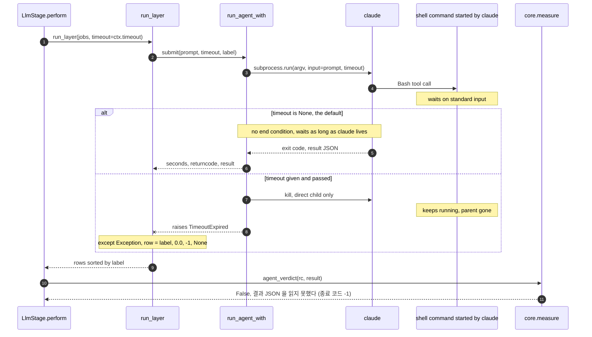
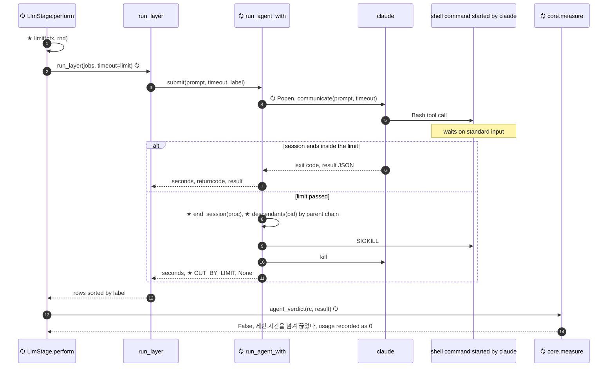
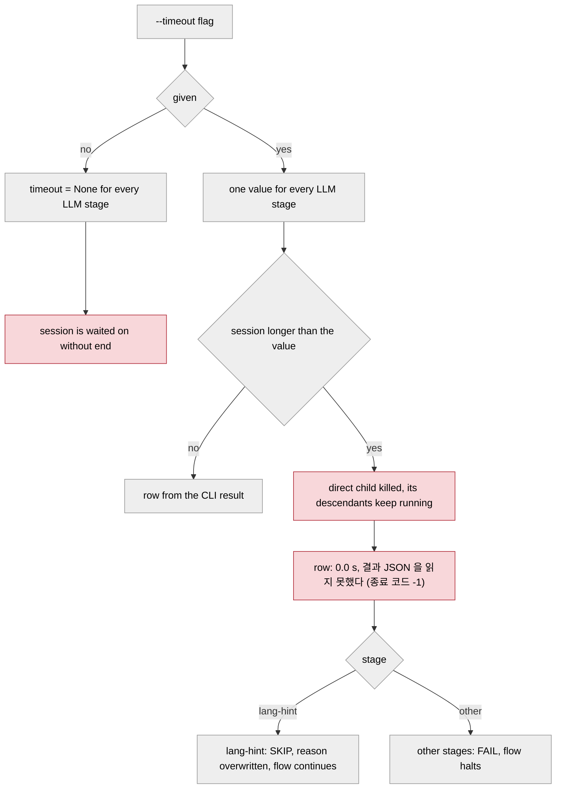
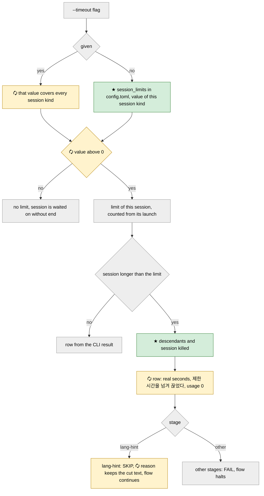
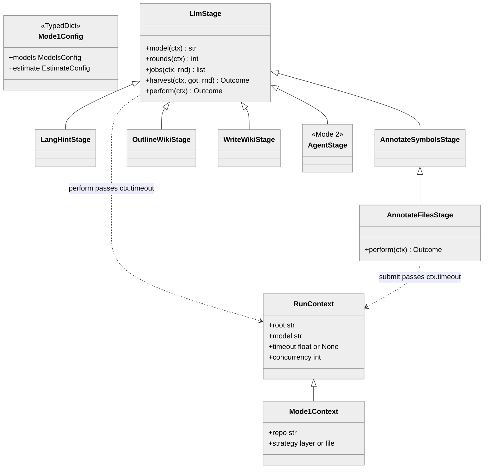
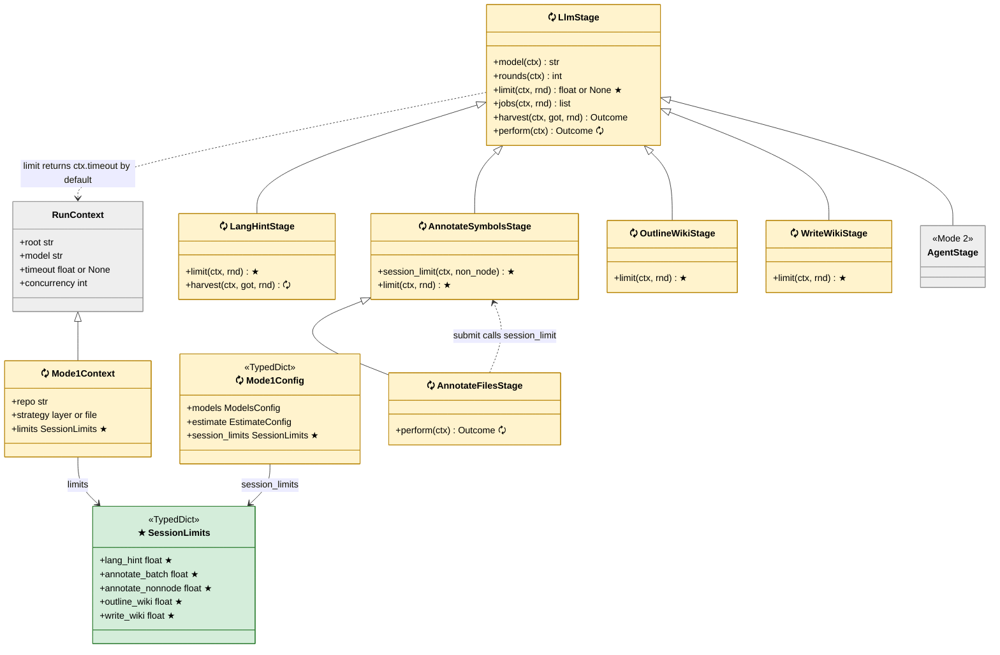

# ⏱️ A2 — Session end condition: implementation plan

> 🔴 Status as of 2026-11-23: shelved by the user, not carried out. A hang is controlled by removing its cause — B3's prompt wording and A3's allow rules. Nothing may depend on this plan's time limits.

> **For agentic workers:** REQUIRED SUB-SKILL: Use superpowers:subagent-driven-development (recommended) or superpowers:executing-plans to implement this plan task-by-task. Steps use checkbox (`- [ ]`) syntax for tracking.

> 📅 2026-11-22 · branch `main` · **Before = `29c5ee9` + plan A1** (A2 is implemented after `2026-11-22-mode1-a1-measure-semantics-plan.md`. Where a diff touches lines A1 changes, its "Before" is A1's "After" and the diff says so. Everywhere else "Before" is the source at `29c5ee9`)
> 📄 Evidence: split `public.handoff/2026-11-22-mode1-remediation-split.md` ("Decided" · "Where the decisions meet" · "Hidden couplings") · `docs/superpowers/specs/2026-11-21-mode1-cold-run-report.md` §4.1 · `docs/superpowers/specs/2026-11-21-mode1-audit-verification-report.md` §2.2 · baseline `qa/evals/runs/2026-11-21-mode1-report-builder-cold-layer-sonnet.{json,md}` · code read in this session: `src/core/pipeline.py` · `src/core/measure.py` · `src/codewiki/python/runner/run_mode1.py` · `src/codewiki/python/runner/mode1/{context,lang,survey,survey_files,wiki,edges,resume}.py` · `src/spec/python/runner/run_mode2.py` · the four test files
> 🔒 Rules kept: additive only — no existing flag, JSON key or row field changes meaning · no check is loosened (no new `xfail` or `skip`) · settings values live in `resource/codewiki/config.toml` · comments state the present only · no paid model call
> 🧪 Verification: unit tests with fake child processes, then the six gates. **Run once in a private clone outside the repository** (`29c5ee9`, A1 tasks 1–5 applied, then A2 tasks 1–7): results in 🧪 below. No real `claude` session was started; what a real session does when it is cut is `[unverified]`
> ✋ Approval: **before approval**
> 🌐 Korean translation: `2026-11-22-mode1-a2-session-end-condition-plan.ko.md`

**Goal:** Every session the Mode 1 runner launches has a time limit of its own kind; a session that passes it is ended together with everything it started, and is recorded as a failure that stops the flow.

**Architecture:** The value comes from a new `[session_limits]` table of `resource/codewiki/config.toml`, travels in `Mode1Context.limits`, and each LLM stage picks the value of its session kind in a new `LlmStage.limit` hook. `run_agent_with` stops raising on a timeout: it walks the parent chain of the session process, kills every descendant and then the session, and returns the seconds it took with a marker in the return-code slot, which `agent_verdict` turns into a reason.

**Tech Stack:** Python 3 (`subprocess.Popen` · `signal` · the POSIX `ps` command) · msgspec · pytest · pyright strict.

---

Legend for every table and drawing below: **★ created from nothing · 🗘 existing element changed · no mark = reused unchanged · ✕ removed.** The marks describe the kind of change, not implementation or verification status. Claim kinds: `[measured]` a counted value · `[code read]` source read in this session · `[proposed]` proposed by this plan · `[judgment]` an assessment · `[unverified]` not checked. Every "seconds of the baseline" figure is recomputed from `qa/evals/runs/2026-11-21-mode1-report-builder-cold-layer-sonnet.json`.

## 📋 One-page summary

| | |
|---|---|
| 🎯 Covers | A session launched by the Mode 1 runner has no end condition. In the baseline `L1-B14` wrote a passing shard and then waited on a hung background shell command; the pipeline waited about 9 min 30 s with it `[measured]` (cold-run report §4.1) |
| 🧩 Conclusion | One <span style="color:cyan">session limit</span> per <span style="color:cyan">session kind</span>, read from the settings file. The <span style="color:cyan">session launch</span> ends the whole process tree by walking the parent chain — a process-group kill does not reach a grandchild that made its own group `[measured]` — and returns a <span style="color:cyan">cut value</span> instead of raising |
| 🟰 Unchanged | Which sessions count as failed for every existing return code · the transition table (`("*", P.FAIL): P.HALT`) · `run_layer` · `LlmStage.harvest` · the shard check · `--resume` · Mode 2 when `--timeout` is not given · every existing JSON key |
| 🗘 Changed | `run_agent_with` (no exception on a timeout, the process tree is ended, the row keeps its seconds) · `agent_verdict` (one new branch) · `LlmStage.perform` (asks the <span style="color:cyan">limit hook</span>) · `--timeout` (now an override of the settings values; `0` means no limit) · one new settings table · one new key in the <span style="color:cyan">measurement document</span> · one new line printed at start |
| ⚠️ Traps | (1) A cut session returns no CLI result, so its row has zero tokens and A1's <span style="color:cyan">under-recording flag</span> cannot fire — the <span style="color:cyan">failure reason</span> says so instead. (2) Under these values the baseline itself would have stopped in layer 1: `L1-B14` took 774 s against a batch limit of 410 s (split, "Where the decisions meet"). (3) A cut `lang-hint` session does **not** stop the flow — that stage turns every failure into "no proposal" (open decision 2). (4) Mode 2's agent session also runs through `run_agent_with`; with `--timeout` its cut now behaves the new way (see "Where A2 meets the other plans"). (5) A process whose parent chain to the session is already broken at the moment of the cut is not found |
| 🚫 Out of scope | Isolation arguments and permissions (A3) · the prompt change that removes the hang trigger (B3) · splitting the non-node session (B2) · wiki stage shape (C1) · cutting by a grace period after the output passes (👎 dropped) · any paid run |

## 📌 Decided — not to be reopened

| What | 👍 Chosen | 👎 Dropped | Who · when |
|---|---|---|---|
| A2 — what cuts a hung session | A time limit counted from session start, one value per stage: twice the longest normal session of the baseline — batch about 410 s · non-node about 1,280 s · wiki page about 600 s. The values live in `resource/codewiki/config.toml` | One value of 1,800 s for every stage · cutting by a grace period after the output passes | user · 2026-11-22 |
| A2 — a cut session whose shard already passed | Recorded as failed, and the flow stops (the present behavior) | Recorded as success and the flow continues | user · 2026-11-22 |
| Measurement principle | The 51 min 17 s run of 2026-11-21 is the baseline. No full or survey run before fixes | Re-running to get a fresh base | user · 2026-11-22 |
| When the survey is measured | Once, after track A (A1 · A2 · A3) and track B (B1 · B2 · B3) are both fixed side by side | Measuring after A1 · A2 · A3 · B1 and leaving B2 · B3 for later | user · 2026-11-22 |
| How to get a 14-stage record | One uninterrupted run after isolation. The no-`--resume` rule stays. If the limit is hit again, ask | Two partial records · a `--resume` exception | user · 2026-11-22 |
| Language-hint model change in `resource/codewiki/config.toml` | Keep it; note in the next measurement's conditions that it differs from the baseline | Revert · defer | user · 2026-11-22 |

Source: `public.handoff/2026-11-22-mode1-remediation-split.md` "Decided". The split also says the value for stages with a single baseline sample is stated by this plan as `[proposed]` — that is open decision 1 below, not a decision.

## 💡 Proposed by this plan — not decided

One recommendation per axis. An axis whose answer was forced by the code is not listed.

| # | Axis | Options and trade-off | `[proposed]` |
|---|---|---|---|
| P1 | How the whole process tree is ended | (a) Kill the direct child only — today's `subprocess.run(timeout=)`; grandchildren keep running `[measured]`. (b) Start the session in its own process group and `killpg` — reaches descendants that stay in the group, misses a descendant that made its own group `[measured]`, and takes the sessions out of the terminal's foreground group so Ctrl-C no longer reaches them. (c) Walk the parent chain (`ps -A -o pid=,ppid=`) while the session is alive and kill every pid found — reaches both kinds `[measured]`, changes nothing about Ctrl-C, needs `ps`, misses a process whose parent has already exited. (d) b and c together — the most thorough, carries b's Ctrl-C cost | **(c)**. The shell that the CLI's Bash tool starts was the leader of its own process group in the session that wrote this plan (CLI 2.1.330; `ps` showed the shell's group id equal to its own pid and different from the CLI's) `[measured]`; whether `claude -p` does the same is `[unverified]`, and (c) does not depend on the answer |
| P2 | Which signal | (a) `SIGKILL` at once — what `subprocess.run` does today to the direct child; the session cannot write a result. (b) `SIGTERM`, wait, then `SIGKILL` — the CLI might flush a result with its usage, which would repair trap 1, at the price of a second settings value and a longer wait; whether the CLI writes anything on `SIGTERM` is `[unverified]` and checking it needs a paid call | **(a)** |
| P3 | How a value per stage reaches `run_agent_with` | (a) A hook on the stage, `LlmStage.limit(ctx, rnd)`, read by `LlmStage.perform` — the same shape as the existing hooks `model` · `rounds` · `jobs`. (b) `LlmStage.perform` looks the stage name up in a table on the context — the shared stage machine would have to know Mode 1's split of one stage into two kinds. (c) Each job carries its limit, `(label, prompt, limit)` — changes the job tuple that 20 test doubles of `run_layer` build | **(a)** |
| P4 | Batch versus non-node inside `annotate-symbols` | (a) Structural: in the layer strategy the kind of the layer (`kind == "non-node"`), in the file strategy "the label is not a batch id". (b) A label convention (`NONNODE…` prefix) — a later session with another label silently gets the batch value. (c) An argument at every launch site — every later launch site has to remember it | **(a)** — whatever B2 launches in the non-node layer, or under a label that is not a batch id, gets the non-node value with no code of B2's own |
| P5 | How "cut by the limit" reaches the <span style="color:cyan">session row</span> | (a) A <span style="color:cyan">cut value</span> in the return-code slot and one branch in `agent_verdict`. (b) A made-up CLI result (`{"subtype": "timeout", "result": "…"}`) that A1's `result_text` turns into the reason — no verdict change, but a `ClaudeResult` the CLI never wrote. (c) A fifth element in `JobResult` — changes every test double that returns a four-tuple | **(a)**. The existing code already writes `-1` in that slot for a crashed batch (`pipeline.py:474`) |
| P6 | What `--timeout` means once the settings file has values | (a) It replaces the value of every kind. (b) It is a ceiling: the smaller of the flag and the settings value. (c) It applies only to kinds whose settings value is 0 | **(a)** — the flag keeps meaning what it meant (one value for every LLM stage) |
| P7 | How "no limit" is spelled | (a) `0`, in the settings file and in `--timeout`. (b) Leaving the key out — a misspelled key then silently means "no limit". (c) A negative number | **(a)**. All five keys are required, so a misspelled key is a load error. `--timeout 0` today makes every session time out at once, so no working invocation changes |
| P8 | Shape of the settings table | (a) Five flat keys, one per <span style="color:cyan">session kind</span>. (b) A table per stage with keys inside. (c) A free-form `dict[str, float]` — no load error for an unknown key | **(a)** |
| P9 | Rounding of "twice the longest" | (a) To the nearest 10 s — gives 410 · 1,280 · 600, the three figures of the decision. (b) Always up — gives 410 · 1,280 · 610 | **(a)** |
| P10 | Recording the limits a run used | (a) One key `session_limits` in the <span style="color:cyan">measurement document</span> and one line printed at start. (b) Nothing — the tool commit and the settings file tell, but a `--timeout` override leaves no trace | **(a)** |

**Structure count** (repository rule: no structure for its own sake).

| New thing | Implementers · consumers (grep at `29c5ee9`) | Deletion test | Inside this plan |
|---|---|---|---|
| Hook `LlmStage.limit` | 4 overriding stages of the 5 direct subclasses (`grep -c "P.LlmStage\[" src` = 5: `LangHintStage` · `AnnotateSymbolsStage` · `OutlineWikiStage` · `WriteWikiStage` · Mode 2's `AgentStage`, which keeps the default) · 1 consumer (`LlmStage.perform`) | Without it the per-kind value cannot reach `run_layer` unless the shared stage machine learns Mode 1's keys | yes |
| Functions `descendants` · `end_session` | 1 implementer each · 1 consumer each (`end_session` · `run_agent_with`) — plain functions, no class, no interface | Without `descendants` the test with a grandchild in its own group fails | yes |
| `SessionLimits` (`TypedDict`) | The same kind of thing as the two existing settings shapes `ModelsConfig` · `EstimateConfig` in the same file | Without it the table is read untyped | yes |
| Module · layer · class with behavior | none added | — | — |

## 📊 Status

| Item | State |
|---|---|
| Task 1 — the <span style="color:cyan">cut value</span> and its <span style="color:cyan">failure reason</span> | ❌ not started |
| Task 2 — a cut session returns its seconds instead of raising | ❌ not started |
| Task 3 — the cut ends the whole process tree | ❌ not started |
| Task 4 — the <span style="color:cyan">limit hook</span> | ❌ not started |
| Task 5 — settings values and the choice per <span style="color:cyan">session kind</span> | ❌ not started |
| Task 6 — the runner loads, prints and records the limits | ❌ not started |
| Task 7 — documents · READMEs · six gates | ❌ not started |
| Approval of this plan | ❌ before approval |
| Open decisions 1–3 | ❌ not answered |
| Trial in a private clone | ✅ run — tasks 1–7 applied on top of A1, gates green there (🧪). The repository itself is untouched |

## 🔎 What the code does today — the six questions

| # | Question | Answer at `29c5ee9` | Evidence |
|---|---|---|---|
| 1 | What happens when `subprocess.run` hits `timeout` | It kills the direct child and raises `TimeoutExpired`. `run_agent_with` does not catch it. `run_layer` catches every exception, prints `[<label>] 배치가 터졌다: …` and makes the row `(label, 0.0, -1, None)`. `agent_verdict(-1, None)` gives "결과 JSON 을 읽지 못했다 (종료 코드 -1)". The stage fails and the flow halts. The row says 0.0 s and never names the limit | `[code read]` `pipeline.py:438-439` · `:472-474` · `measure.py:113-114` · `pipeline.py:632-633` · `mode1/edges.py:47`. `[measured]` in the clone: the red run of Task 2 shows that row's label, return-code slot and result as `('L1-B14', -1, None)` |
| 2 | Do the shell commands of a killed session survive | Yes. With `subprocess.run(timeout=)` a grandchild was still alive after the call returned, whether or not it had its own process group | `[measured]` scratch experiment below |
| 3 | How does a value reach `run_agent_with` | One value for all: `--timeout` → `RunContext.timeout` → `LlmStage.perform` → `run_layer(timeout=)` → `run_agent_with`. The file strategy passes `ctx.timeout` itself. The non-node session is the single job of the layer whose `kind` is `non-node` | `[code read]` `run_mode1.py:203` · `:220` · `pipeline.py:66` · `:640-641` · `:466` · `survey_files.py:64` · `survey.py:615-616` |
| 4 | What `--timeout` means | The limit of every LLM session, default none | `[code read]` `run_mode1.py:203` |
| 5 | What is written for a cut session | Row: `seconds` 0.0 · usage all zero · `ok` false · `why` as in 1. `resume.json`: `failed_at` is the stage, `why` is the first failed row's reason | `[code read]` `pipeline.py:474` · `:627-631` · `mode1/resume.py:26-32` |
| 6 | Where does a passed shard let the flow continue after a failed session | Inside one run, nowhere: a failed session fails the layer, `AnnotateSymbolsStage.perform` skips the shard sweep, and the flow halts. In the **next** run with `--resume`, a batch whose shard file exists is not launched again, so the shard written by the cut session is used. The one stage where a failed session never stops the flow is `lang-hint` | `[code read]` `pipeline.py:632-633` · `:644-645` · `survey.py:579-582` · `:625` · `survey_files.py:140` · `mode1/lang.py:63-66` |

**Scratch experiment** `[measured]` — fake processes only, macOS, Python 3.14.6. A fake session starts a grandchild (`sleep` for 600 s) and then hangs; the caller cuts it after 1.5 s in three ways.

| How the caller cuts | Grandchild in the session's group | Grandchild in its own group |
|---|---|---|
| `subprocess.run(timeout=)` — today | alive | alive |
| own process group + `killpg` | ended | **alive** |
| parent-chain walk + kill — this plan | ended | ended |

## 🔢 The values

| <span style="color:cyan">Session kind</span> (settings key) | Sessions it covers | Baseline samples `[measured]` | Longest normal session `[measured]` | × 2, nearest 10 s | State |
|---|---|---|---|---|---|
| `annotate_batch` | batch sessions of `annotate-symbols`, and the second-pass sessions of the file strategy | 91 | 204.59 s (`L1-B08`; `L1-B14` at 774.06 s is the hang and is left out) | 409.18 → **410** | 👍 decided |
| `annotate_nonnode` | every session of the non-node layer | 1 | 638.27 s | 1,276.54 → **1,280** | 👍 decided |
| `write_wiki` | one session per wiki page | 19 | 301.72 s (`mode1-survey.md`) | 603.43 → **600** | 👍 decided |
| `lang_hint` | the language-hint session | 1 | 16.84 s | 33.68 | ❓ open decision 1 |
| `outline_wiki` | the wiki outline session | 1 | 59.82 s | 119.63 | ❓ open decision 1 |

- `[measured]` The two longest normal batch sessions, `L1-B08` (204.59 s) and `L0-B20` (202.66 s), are the two that the cold-run report §4.1 names as having hit the 120 s tool limit on the same input-less `cat >` command. The longest batch session without that command is `L6-B01` at 104.77 s. The decided value stays 410; this is a fact for the correction after Measurement A, when B3 has removed that command.
- `[measured]` The wiki figure of the decision is "about 600 s"; exactly twice the longest is 603.43 s.

## 🔁 Before / After

| 📍 Before (what did not work · now) | 🛠️ After · proposed | 🎉 What it resolves | 🔭 Expected | Done |
|---|---|---|---|---|
| 🐞 No end condition. `L1-B14` ran 774 s; the pipeline waited about 9 min 30 s on it after its shard had passed `[measured]` | The batch <span style="color:cyan">session limit</span> ends it at 410 s | A hang costs at most the limit of its kind | In the baseline's timeline the wait would have ended about 6 min earlier, and the run would have stopped in layer 1 `[judgment]` from 774 − 410 | ❌ |
| 🐞 With `--timeout`, the shell commands of the killed session keep running `[measured]` (scratch) | `end_session` kills every descendant found on the parent chain, then the session | No process of a cut session is left behind | The two grandchild tests of Task 3 pass in the clone `[measured]`; a real CLI session is `[unverified]` | ❌ |
| 🐞 The row of a timed-out session says 0.0 s and "결과 JSON 을 읽지 못했다 (종료 코드 -1)" `[code read]` | The row keeps the seconds and says "제한 시간을 넘겨 끊었다 — CLI 결과가 없어 이 행의 사용량은 0 으로 적혔다" | The record and `resume.json` name the cause | Test of Task 1 | ❌ |
| 🐞 One value for every stage, and only through a flag `[code read]` | Five values in `[session_limits]`; `--timeout` overrides all | Values are corrected after Measurement A without a code change | Editing two numbers in the settings file is enough | ❌ |
| 🐞 A record does not say which limits were in force | `session_limits` in the measurement JSON; one line at start | A cut row can be read against the limit that cut it | Present in the next run's JSON `[unverified]` | ❌ |

## ★ New · 🗘 changed items (module → file → class → function → member)

Each level is checked separately against Before `[code read]`.

| Level | Mark | Item | Kind | Lives in |
|---|---|---|---|---|
| module | 🗘 | `src/core` | changed — two files | — |
| module | 🗘 | `src/codewiki/python/runner` | changed — six files | — |
| module | 🗘 | `resource/codewiki` | changed — one file | — |
| file | 🗘 | `src/core/measure.py` · `src/core/pipeline.py` | changed | module `src/core` |
| file | 🗘 | `src/codewiki/python/runner/run_mode1.py` · `mode1/context.py` · `mode1/lang.py` · `mode1/survey.py` · `mode1/survey_files.py` · `mode1/wiki.py` | changed | module `src/codewiki/python/runner` |
| file | 🗘 | `resource/codewiki/config.toml` | changed — one table added | module `resource/codewiki` |
| file | 🗘 | `test/core/test_measure.py` · `test/core/test_pipeline.py` · `test/codewiki/test_mode1.py` · `test/codewiki/test_run_mode1.py` | changed — tests added | `test/` |
| file | 🗘 | `qa/evals/README.md` · `resource/CLAUDE.md` · `CLAUDE.md` | changed — a few lines each | documents |
| file | 🗘 | `src/core/README.md` · `src/codewiki/python/runner/README.md` | refreshed by `tools/gen_readme.py` | module READMEs |
| class | ★ | `SessionLimits` | new (`TypedDict`) | `mode1/context.py` |
| class | 🗘 | `Mode1Config` · `Mode1Context` | changed — one field each | `mode1/context.py` |
| class | 🗘 | `LlmStage` | changed — one hook, one docstring word | `pipeline.py` |
| class | 🗘 | `LangHintStage` · `AnnotateSymbolsStage` · `AnnotateFilesStage` · `OutlineWikiStage` · `WriteWikiStage` | changed | `mode1/` |
| class | — | `RunContext` · `StageRow` · `ClaudeResult` · `Pipeline` · Mode 2's `AgentStage` | reused unchanged | — |
| function | ★ | `descendants` · `end_session` | new | `pipeline.py` |
| function | ★ | `LlmStage.limit` | new | `pipeline.py` |
| function | ★ | `session_limit` · `limits_in_force` · `_no_limits` | new | `mode1/context.py` |
| function | ★ | `LangHintStage.limit` · `AnnotateSymbolsStage.limit` · `AnnotateSymbolsStage.session_limit` · `OutlineWikiStage.limit` · `WriteWikiStage.limit` | new | `mode1/` |
| function | ★ | `limits_line` | new | `run_mode1.py` |
| function | ★ | 20 new test functions (21 test cases — one is parametrized twice) and 5 test helpers | new | the four test files |
| function | 🗘 | `run_agent_with` | changed — body rewritten on `Popen` | `pipeline.py` |
| function | 🗘 | `agent_verdict` | changed — one branch (Before = A1's After) | `measure.py` |
| function | 🗘 | `LlmStage.perform` | changed — one argument | `pipeline.py` |
| function | 🗘 | `LangHintStage.harvest` | changed — the reason keeps the failure text | `mode1/lang.py` |
| function | 🗘 | `AnnotateFilesStage.perform` | changed — the inner `submit` picks the limit | `mode1/survey_files.py` |
| function | 🗘 | `measurement_doc` · `main` | changed (Before = A1's After) | `run_mode1.py` |
| function | — | `run_layer` · `LlmStage.harvest` · `claude_argv` · `normalize_usage` · `usage_gap` · `write_resume` | reused unchanged — they sit on the changed route but their text does not change | — |
| member | ★ | constant `CUT_BY_LIMIT` | new | `measure.py` |
| member | ★ | type alias `LimitKey` | new | `mode1/context.py` |
| member | ★ | `Mode1Config.session_limits` · `Mode1Context.limits` · the five fields of `SessionLimits` | new | `mode1/context.py` |
| member | ★ | table `[session_limits]` with five keys | new | `config.toml` |
| member | ★ | key `session_limits` of the <span style="color:cyan">measurement document</span> | new | JSON |
| member | 🗘 | flag `--timeout` | changed — help text; overrides the settings values; `0` = no limit | `run_mode1.py` |

## ⏱️ Sequence — the life of one session

Legend: ★ and 🗘 appear only in aliases, notes and trailing annotations. Participant ids and message names are the real identifiers.

**Before** `[code read]` — `pipeline.py:426-448` · `:451-475` · `:635-646` · `measure.py:107-120`



**After · proposed** — run in the clone with a fake child in place of `claude`



The participants and their order are the same. What changes: the stage asks its hook for the value, `run_agent_with` ends the tree and returns instead of raising, and the verdict has a reason for the new value. The limit counts from the moment `run_agent_with` starts the process — time a job spends waiting for a free slot of the layer's pool is not counted `[code read]` (`pipeline.py:465-467`).

## 🔀 Flow — which limit applies and what a cut does

Legend: gray = unchanged · green = new · amber = changed · red = the defect.

**Before** `[code read]`



**After · proposed**



The decision "FAIL, flow halts" is gray in both drawings: the user's second decision is the present behavior, and this plan pins it with a test instead of changing it.

## 🧱 Structure — the typed shapes and the hook

Legend: gray = unchanged · green = new · amber = changed. Only the members this plan touches are drawn.

**Before** `[code read]` — `pipeline.py:61-67` · `:594-646` · `mode1/context.py:34-38` · `:222-229` · `run_mode2.py:386`



**After · proposed**



`RunContext` does not change: `timeout` stays the one value the flag gives. Mode 2's `AgentStage` is gray because it keeps the default hook, which returns `ctx.timeout` — the value it passed before.

## 🔧 Where to change

| File · symbol | Change | Why | Evidence |
|---|---|---|---|
| 🗘 `src/core/measure.py` — ★ `CUT_BY_LIMIT` · 🗘 `agent_verdict` | A constant for the return-code slot and a first branch that turns it into a reason | Today the row of a cut session reads "결과 JSON 을 읽지 못했다 (종료 코드 -1)" | `[code read]` `measure.py:113-114`. Before of this function = A1's After (A1 Task 1) |
| 🗘 `src/core/pipeline.py` — 🗘 `run_agent_with` · ★ `descendants` · ★ `end_session` | `Popen` + `communicate(timeout=)`; on `TimeoutExpired` end the tree, wait for the session, return `(seconds, CUT_BY_LIMIT, None)` | `subprocess.run` kills only the direct child and, once it has, the parent chain to the descendants is gone; the exception loses the seconds | `[code read]` `pipeline.py:436-448` · `:472-474`; `[measured]` scratch experiment |
| 🗘 `src/core/pipeline.py` — ★ `LlmStage.limit` · 🗘 `LlmStage.perform` · 🗘 docstring of `LlmStage` | New hook, default `ctx.timeout`; `perform` passes `self.limit(ctx, rnd)`; "훅 여섯" becomes "훅 일곱" | A value per stage, and per layer kind inside one stage | `[code read]` `pipeline.py:595` · `:617-621` · `:640-641` |
| 🗘 `mode1/context.py` — ★ `SessionLimits` · ★ `LimitKey` · 🗘 `Mode1Config` · ★ `_no_limits` · 🗘 `Mode1Context` · ★ `session_limit` · ★ `limits_in_force` | The settings shape, the context field (default: no limit), and the one place that resolves flag versus settings | The settings file is read through `load_config` into a typed shape | `[code read]` `context.py:34-46` · `:218-229` · `:253-254` |
| 🗘 `mode1/lang.py` — ★ `LangHintStage.limit` · 🗘 `LangHintStage.harvest` | Pick `lang_hint`; keep the failure reason in parentheses after "제안 없음 — 파일 수로 고른다" | The stage overwrites the reason of a failed session, so a cut would leave no trace in the row | `[code read]` `lang.py:63-66` |
| 🗘 `mode1/survey.py` — ★ `AnnotateSymbolsStage.session_limit` · ★ `AnnotateSymbolsStage.limit` | Non-node value for the layer whose `kind` is `non-node`, batch value otherwise | The non-node session is its own layer | `[code read]` `survey.py:608-616` |
| 🗘 `mode1/survey_files.py` — 🗘 `AnnotateFilesStage.perform` (inner `submit`) | Replace `ctx.timeout` with the value of the label's kind: a label whose part before `/` is a batch id is a batch session, any other label is a non-node session | The file strategy bypasses `LlmStage.perform` and calls `run_agent_with` itself | `[code read]` `survey_files.py:45` · `:63-65` · `:95` · `:148` |
| 🗘 `mode1/wiki.py` — ★ `OutlineWikiStage.limit` · ★ `WriteWikiStage.limit` | Pick `outline_wiki` · `write_wiki` | One hook each | `[code read]` `wiki.py:36-37` · `:83-84` |
| 🗘 `run_mode1.py` — 🗘 `main` · 🗘 `measurement_doc` · ★ `limits_line` · module docstring | Load the table into the context, change the help text of `--timeout`, print one line, write `session_limits` | The record has to say which limits were in force | `[code read]` `run_mode1.py:203` · `:220-223` · `:240`. Before of `measurement_doc` and of the JSON block = A1's After (A1 Task 4) |
| 🗘 `resource/codewiki/config.toml` | Append `[session_limits]` | Values live in the settings file | `[code read]` the file ends with `[estimate]`. Its `lang_hint` line has an uncommitted edit in the working tree; this plan does not touch that line |
| 🗘 the four test files | 20 test functions, 5 helpers, one existing test gains an argument | One failing test per behavior, written before the code | `[code read]` helpers `_ctx` · `_gated` · `_one_batch_plan` · `_good_record` · `_fake_agent` · `_three_file_graph` · `_rec` in `test_mode1.py`; `한번부르는단계` · `두층부르는단계` in `test_pipeline.py`; `_행` in `test_measure.py` |
| 🗘 `qa/evals/README.md` · `resource/CLAUDE.md` · `CLAUDE.md` | One table row and one paragraph · one cell · one phrase | A cut row has to be readable from the record alone | `[code read]` |
| 🗘 `src/core/README.md` · `src/codewiki/python/runner/README.md` | Regenerate with `tools/gen_readme.py` | Signatures and docstrings change | `[measured]` in the clone exactly these two files changed |

**Proposed diff — not applied.** Abridged: the full text is in the Tasks. `-` lines of `pipeline.py`, `survey_files.py` and `lang.py` are copied from the source at `29c5ee9`; the context lines of `measure.py` are A1's After.

```diff
--- a/src/core/measure.py            (Before = A1's After)
+++ b/src/core/measure.py
+CUT_BY_LIMIT = -1000
@@ def agent_verdict
+    if returncode == CUT_BY_LIMIT:
+        return False, "제한 시간을 넘겨 끊었다 — CLI 결과가 없어 이 행의 사용량은 0 으로 적혔다"
     if result is None:
         return False, "결과 JSON 을 읽지 못했다 (종료 코드 %d)" % returncode

--- a/src/core/pipeline.py           (Before = 29c5ee9)
+++ b/src/core/pipeline.py
     argv = M.claude_argv(model=model, repo=repo, extra_dirs=[root])
     t0 = time.monotonic()
-    p = subprocess.run(argv, input=prompt, cwd=repo,
-                       capture_output=True, text=True, timeout=timeout)
+    with subprocess.Popen(argv, stdin=subprocess.PIPE, stdout=subprocess.PIPE, stderr=subprocess.PIPE,
+                          text=True, cwd=repo) as proc:
+        try:
+            stdout, stderr = proc.communicate(prompt, timeout=timeout)
+        except subprocess.TimeoutExpired:
+            end_session(proc)
+            proc.wait()
+            ...
+            return seconds, M.CUT_BY_LIMIT, None
@@ class LlmStage
+    def limit(self, ctx: C, rnd: int) -> float | None:
+        return ctx.timeout
@@ def perform
                 got = run_layer(self.model(ctx), self.repo(ctx), ctx.root, jobs,
-                                concurrency=ctx.concurrency, timeout=ctx.timeout)
+                                concurrency=ctx.concurrency, timeout=self.limit(ctx, rnd))

--- a/src/codewiki/python/runner/mode1/survey_files.py   (Before = 29c5ee9)
+++ b/src/codewiki/python/runner/mode1/survey_files.py
         def submit(label: str, prompt: str) -> None:
-            fut = pool.submit(P.run_agent_with, self.model(ctx), ctx.repo, ctx.root, prompt, ctx.timeout, label)
+            limit = self.session_limit(ctx, label.split("/")[0] not in batches)
+            fut = pool.submit(P.run_agent_with, self.model(ctx), ctx.repo, ctx.root, prompt, limit, label)

--- a/src/codewiki/python/runner/mode1/lang.py           (Before = 29c5ee9)
+++ b/src/codewiki/python/runner/mode1/lang.py
             for r in base.rows:
-                r["ok"], r["why"], r["skipped"] = True, "제안 없음 — 파일 수로 고른다", True
+                failed = " (%s)" % r["why"] if r["why"] else ""
+                r["ok"], r["why"], r["skipped"] = True, "제안 없음 — 파일 수로 고른다" + failed, True

--- a/resource/codewiki/config.toml  (Before = 29c5ee9)
+++ b/resource/codewiki/config.toml
 usd_per_batch_max = 1.4
+
+[session_limits]
+annotate_batch = 410
+annotate_nonnode = 1280
+write_wiki = 600
+lang_hint = 410           # open decision 1
+outline_wiki = 600        # open decision 1
```

## 🧭 Order of the slices

| Slice | Deliverable | Needs | Check |
|---|---|---|---|
| Task 1 | <span style="color:cyan">cut value</span> and reason; the user's second decision pinned at stage level | A1 (the docstring of `agent_verdict`, `usage_gap`) | 3 tests in `test_measure.py` + 1 in `test_mode1.py` |
| Task 2 | `run_agent_with` returns on a timeout | Task 1 | 3 tests with a fake child |
| Task 3 | the process tree is ended | Task 2 | 3 test cases with a grandchild + `npm run typecheck:py` |
| Task 4 | <span style="color:cyan">limit hook</span> | — (edits `LlmStage` only) | 2 tests |
| Task 5 | settings table, context field, the choice per kind | Tasks 1 · 4 | 6 tests + `npm run typecheck:py` |
| Task 6 | the runner loads, prints, records | Task 5 · A1 Task 4 (`measurement_doc`) | 3 tests, one changed test |
| Task 7 | documents · READMEs · gates | Tasks 1–6 · A1 Task 5 (the "값의 뜻" section) | six gates (🧪) |

## 🔗 Where A2 meets the other plans

| What meets | Meaning | Handled where |
|---|---|---|
| A1's <span style="color:cyan">failure reason</span> | A cut session has no CLI result, so A1's `result_text` has nothing to append. The new branch sits before A1's code in `agent_verdict` and does not touch it | Task 1 |
| A1's <span style="color:cyan">under-recording flag</span> | `usage_gap` compares `total` with `model_total`; for a cut row both are 0, so no flag is printed. The reason text carries the fact instead, and `qa/evals/README.md` says how to read such a row | Tasks 1 · 7 |
| A1's `stage_wall_seconds` | The stage wall clock of a stage that was cut includes the wait up to the limit. Nothing to change | — |
| A3 — isolation arguments | A3 changes `claude_argv` and how a stage tells it what it needs, and that passes through `run_agent_with` and `run_layer`. A3 starts from this plan's `run_agent_with`. The fake-session helper of Task 2 replaces `M.claude_argv` with a function of the same three parameters; if A3 changes that signature it updates the helper | A3 plan |
| B2 — the non-node session becomes three | Layer strategy: every job of a layer whose `kind` is `non-node` gets `annotate_nonnode`. File strategy: every label whose part before `/` is not a batch id gets it. B2 adds no limit code. B2 has to keep its sessions inside a layer of that kind (or widen the one comparison in `AnnotateSymbolsStage.limit`). The split sessions have no baseline; the value is corrected after Measurement A (split, "Where the decisions meet") | this plan, Task 5 |
| B3 — the input-less `cat >` | B3 removes the trigger of the hang in the prompt. A2 is what bounds the cost when it happens anyway (it appeared again in the isolated Stage 0 probe, R6) | B3 plan |
| C1 — wiki stage shape | `write_wiki` (600 s) and `outline_wiki` fit "one page per session". If C1 groups pages into fewer, longer sessions, the two numbers no longer fit and C1 has to restate them in the settings file | C1 plan |
| Measurement A | A session that passes its limit fails and the flow stops; a measurement that stops is recorded by stage and reason and discarded (split, trap 3). The record now holds `session_limits`, and a cut row is read as in Task 7's README paragraph | Measurement A |
| `--resume` | Unchanged. After a cut in `annotate-symbols`, `--resume` does not launch a batch whose shard file exists (`survey.py:625` · `survey_files.py:140`), so the shard of the cut session is used and the end-of-stage sweep checks it. If the session was cut in the middle of writing, the sweep finds the broken shard, sets it aside and fails once more (`survey.py:590-600`). The no-`--resume` rule of the measurements is not affected | open decision 3 |
| Mode 2 | `run_mode2.py` builds `AgentStage(P.LlmStage)` (`:386`) and runs it through `Pipeline.run` (`:513`), so its one session is launched by `run_agent_with` with `ctx.timeout` from its own `--timeout` (`:441` · `:480`). The function `run_agent` in the same file (`:237-262`) has no caller in `src/`, `test/`, `qa/` or `tools/` `[code read]` (`grep`). **Without `--timeout` Mode 2 behaves exactly as before** — the default hook returns `None`. **With `--timeout`**, a cut now ends the descendants as well and the row carries the seconds and the new reason instead of 0.0 s and "결과 JSON 을 읽지 못했다 (종료 코드 -1)". The shared launch code cannot be forked for one mode (`pipeline.py:600`, "층을 돌고 재는 코드는 이 `perform` 한 벌이다") | this plan; `test/spec/test_run_mode2.py` (65 tests) passed in the clone |

## 📖 Terms

| Term | Code name | Meaning |
|---|---|---|
| <span style="color:cyan">session limit</span> | `session_limit` · `[session_limits]` · `SessionLimits` | The seconds one session may take, counted from its launch |
| <span style="color:cyan">session kind</span> | `LimitKey` | One of the five names a limit is kept under: `lang_hint` · `annotate_batch` · `annotate_nonnode` · `outline_wiki` · `write_wiki` |
| <span style="color:cyan">limit hook</span> | `LlmStage.limit` | The stage method that names the limit of the sessions of one round |
| <span style="color:cyan">session launch</span> | `run_agent_with` | The one function that starts a `claude` process and measures it |
| <span style="color:cyan">layer run</span> | `run_layer` | Runs the jobs of one round side by side and returns their rows |
| <span style="color:cyan">cut value</span> | `CUT_BY_LIMIT` | What stands in the return-code slot of a session the runner ended at its limit |
| <span style="color:cyan">ending the session</span> | `end_session` · `descendants` | Killing every process found below the session on the parent chain, then the session |
| <span style="color:cyan">failure reason</span> | `why` · `agent_verdict` | The second value of `(ok, why)` |
| <span style="color:cyan">session row</span> | `StageRow` | One row of the measurement table; one session per row |
| <span style="color:cyan">under-recording flag</span> | `usage_gap` | A1's report line for a row whose `total` is far below `model_total` |
| <span style="color:cyan">limits in force</span> | `limits_in_force` · `limits_line` · key `session_limits` | The five values a run really used, after `--timeout` |
| <span style="color:cyan">measurement document</span> | `measurement_doc` | The dictionary `main` writes with `--json` |
| <span style="color:cyan">resume document</span> | `resume.json` · `ResumeDoc` · `write_resume` | Where a stopped run records the failed stage and its reason |
| <span style="color:cyan">non-node layer</span> | layer with `kind == "non-node"` · label `NONNODE` | The last layer of the survey plan; its sessions write terms that are not nodes of the code map |
| normal session | — | A baseline session that ended by itself after its work; `L1-B14` is the one that did not |

## ❓ Open decisions

| # | What | Evidence | Options | Recommendation `[proposed]` | What stays blocked |
|---|---|---|---|---|---|
| 1 | The value for the two kinds with one baseline sample: `lang_hint` (16.84 s) and `outline_wiki` (59.82 s) | `[measured]` "Twice the longest of many" and "twice the only one" are different rules: taking any one batch session as if it were the only sample, twice its length would have cut at least one other normal batch session in 87 of 90 choices, and for wiki pages in 3 of 19. `[measured]` The `lang-hint` sample was taken with a different Model than the settings file now names (decision "keep it"), and before isolation (76,732 tokens for one word). `[measured]` The two stages together took 76.7 s of the 51 min 17 s run | (A) Twice the sample as is: 34 s · 120 s — tight; a session twice as slow as the one sample is cut. (B) `0`, no limit, until Measurement A (a second `lang-hint` sample) and Measurement B (a second outline sample) — a hang in these two stages stays unbounded, as today. (C) Borrow the decided value of the kind that is launched the same way: `lang_hint` = 410 (survey side, the group A3 isolates together) · `outline_wiki` = 600 (wiki side) — bounds a hang at 7 and 10 minutes and cannot cut a session unless it runs 24 and 10 times its sample | **(C)**. None of the three is grounded in a distribution — with one sample there is none. (C) is a ceiling chosen by a rule, and `[judgment]` a late cut in these two stages costs little | Only the two numbers in Task 5 Step 3 (`lang_hint` · `outline_wiki`). All code and every test are the same for any option: the tests check the shape, not the numbers |
| 2 | A `lang-hint` session that is cut | `[code read]` `lang.py:21` · `:63-66`: the stage is "not a gate" — every failed session becomes `SKIP`, the row is marked `ok` and the language is chosen by file count. The user's second decision names "the present behavior", and for this stage the present behavior is to continue | (a) Keep: the cut becomes "no proposal", the flow continues, and the row's reason keeps the cut text in parentheses. (b) Make a cut stop the flow here too: `emits = P.OK \| P.SKIP \| P.FAIL`, and `harvest` returns the failed outcome unchanged when a return code is `M.CUT_BY_LIMIT` | **(a)** — a missing proposal never blocked the flow, and a cut is one way a proposal goes missing | Task 5's change to `LangHintStage.harvest` and its test. With (b) those two change as described; nothing else does |
| 3 | After a cut in `annotate-symbols`, `--resume` uses the shard the cut session wrote | `[code read]` `survey.py:625` · `survey_files.py:140`; the sweep at the end of the stage checks every shard (`survey.py:585-606`) | (a) Keep. (b) Set the shard of a cut session aside so that `--resume` launches the batch again | **(a)** — the decision is about the run that was cut; the shard passed the same check every shard passes, and measurements do not use `--resume` | Nothing. With (b) a task would be added |

## 🧪 Verification · 🚫 Out of scope

**What was run** `[measured]` — in a private clone of `main` at `29c5ee9` outside the repository, with the repository's `.venv` and `node_modules` linked in. The clone has no `out/`, so it skips 25 tests where the main checkout skips 22.

| Step | Command | Result |
|---|---|---|
| Clone as is | `.venv/bin/python -m pytest -q` after `npm test` had built `.tmp/lib.mjs` | 986 passed · 25 skipped · 2 xfailed (before `npm test`: 2 failures in `test/spec/test_components.py`, the bundle did not exist yet) |
| A1 tasks 1–5 applied | each red step, each green step, then `pytest -q` · `npm run typecheck:py` | every red step failed as the A1 plan states; 1,002 passed · 25 skipped · 2 xfailed · pyright 0 errors |
| A2 Task 1 red | `pytest test/core/test_measure.py test/codewiki/test_mode1.py -q -k "끊"` | 4 failed with `AttributeError: module 'core.measure' has no attribute 'CUT_BY_LIMIT'` · 1 passed (an older test the filter also selects) |
| A2 Task 2 red | `pytest test/core/test_pipeline.py -q -k "제한_시간 or 끊긴"` | 2 failed — `subprocess.TimeoutExpired: … timed out after 2.0 seconds`, and `('L1-B14', -1, None) == ('L1-B14', -1000, None)` · 1 passed |
| A2 Task 3 red | `pytest test/core/test_pipeline.py -q -k "손자 or descendants"` | 3 failed — `AssertionError: 손자 프로세스가 살아 있다` twice, and `AttributeError: module 'core.pipeline' has no attribute 'descendants'` |
| A2 Task 4 red | `pytest test/core/test_pipeline.py -q -k "limit_훅 or 기본으로_ctx"` | 1 failed — `assert [9.0, 9.0] == [410.0, 1280.0]` · 1 passed |
| A2 Task 5 red | `pytest test/codewiki/test_mode1.py -q -k "제한_시간 or session_limit or 비노드_값"` | 6 failed · 1 passed |
| A2 Task 6 red | `pytest test/codewiki/test_mode1.py test/codewiki/test_run_mode1.py -q -k "limits_in_force or 제한_시간을_싣 or 벽시계를_싣 or 없음으로"` | 4 failed |
| A2 tasks 1–7 applied | the six gates | `pytest -q` 1,023 passed · 25 skipped · 2 xfailed (21 more than after A1, no new skip or xfail) · `npm test` 8 pass · `npm run typecheck` clean · `npm run typecheck:py` 0 errors · README drift check exit 0 (9 match) · `npm run doctor` exit 0 |
| Mode 2 and Mode 1.5 | `pytest test/spec/test_run_mode2.py test/term/test_run_mode1_5.py test/core/test_import_isolation.py -q` | 141 passed (`test_run_mode2.py` alone: 65) |
| Dry run | `run_mode1.py . --cold --dry-run` in the clone | prints `세션 제한 시간 — lang_hint 6분 50.0초 · annotate_batch 6분 50.0초 · annotate_nonnode 21분 20.0초 · outline_wiki 10분 00.0초 · write_wiki 10분 00.0초` |
| Suite time | `pytest -q` | 22.8 s after A1 → 31.8 s after A2 — six test cases each wait 2 s for a limit |
| Diagrams | `npx --no-install mmdc` on the six Mermaid blocks | all six rendered |

**Not run** `[unverified]`

- Any real `claude` session. What the CLI and its shell commands do when they are killed, and whether the shell of `claude -p` leads its own process group, are not known from this plan.
- Linux and Windows. `ps -A -o pid=,ppid=` is POSIX; on a machine without `ps`, `descendants` returns an empty list and the cut kills the session only, as today.
- The six gates in the main checkout. Expected there: 989 + 16 (A1) + 21 = 1,026 passed.
- `--strategy file` from end to end (its stage test with a fake session ran).

**Out of scope** — isolation arguments and permission mode (A3) · prompt changes (track B) · wiki stage design (C1) · a time limit for machine stages (`MachineStage.perform` has none and gets none) · removing the uncalled `run_agent` of `run_mode2.py` · cutting by a grace period after the output passes (👎) · rewriting the baseline record · any paid check: the effect on real sessions is read once, in Measurement A.

All commands run from the repository root with `.venv/bin/python`.

---

### Task 1: The cut value and its reason

**Files:**
- Modify: `src/core/measure.py` (`CUT_BY_LIMIT`, `agent_verdict`)
- Test: `test/core/test_measure.py` · `test/codewiki/test_mode1.py`

- [ ] **Step 1: Write the failing tests** — append to `test/core/test_measure.py`:

```python
def test_제한_시간에_끊은_세션은_종료_코드_자리에_끊김_값이_온다():
    ok, why = M.agent_verdict(M.CUT_BY_LIMIT, None)
    assert ok is False
    assert "제한 시간" in why and "사용량" in why
    assert "결과 JSON" not in why


def test_끊김_값은_실제_종료_코드와_겹치지_않는다():
    assert M.CUT_BY_LIMIT < -255


def test_끊은_세션의_행은_덜_적힘_표시가_붙지_않는다():
    """끊은 세션은 CLI 결과가 없어 누계도 0 이다. 견줄 값이 없으므로 사유 글이 사용량이 빠졌다고 말한다."""
    row = _행("annotate-symbols/L1-B14", ok=False)
    row["why"] = M.agent_verdict(M.CUT_BY_LIMIT, None)[1]
    out = M.format_report([row])
    assert M.usage_gap(row["usage"]) == 0 and "사용량 덜 적힘" not in out
    assert "실패 — annotate-symbols/L1-B14: 제한 시간" in out
```

Append to `test/codewiki/test_mode1.py`:

```python
# ── 세션 제한 시간 — 끊긴 세션은 실패이고 흐름이 멈춘다 ──────────────────────

def test_제한_시간에_끊긴_세션은_샤드가_검문을_지나도_단계를_실패로_세운다(
        tmp_path: Path, monkeypatch: pytest.MonkeyPatch) -> None:
    c = _ctx(tmp_path); c.cold = True
    raw = tmp_path / "out" / "codegraph-raw"; raw.mkdir(parents=True)
    (raw / "batches.json").write_text(json.dumps(_one_batch_plan("L0-B00")))
    _gated(c)
    shards = raw / "_shards"

    def layer(model: str, repo: str, root: str, jobs: Sequence[tuple[str, str]],
              concurrency: int = 8, timeout: float | None = None) -> list[P.JobResult]:
        for label, _ in jobs:
            (shards / (label + ".json")).write_text(json.dumps({"f": _good_record()}), encoding="utf-8")
        return [(label, 410.2, M.CUT_BY_LIMIT, None) for label, _ in jobs]
    monkeypatch.setattr(P, "run_layer", layer)
    out = SV.AnnotateSymbolsStage().perform(c)
    assert c.plan is not None and SV.AnnotateSymbolsStage.check_shards(str(shards), c.plan) == {}   # 샤드는 검문을 지난다
    assert out.kind == P.FAIL and c.survey_ok is False
    assert [r["stage"] for r in out.rows] == ["annotate-symbols/L0-B00"]        # 검문 행까지 가지 않는다
    row = out.rows[0]
    assert row["ok"] is False and row["seconds"] == 410.2 and "제한 시간" in row["why"]
    assert E.EDGES.dest("annotate-symbols", out.kind) == P.HALT
    doc = Z.write_resume(str(tmp_path / "resume.json"), "mode1-cold", out.rows, E.ORDER, set())
    assert doc is not None and doc["failed_at"] == "annotate-symbols" and "제한 시간" in doc["why"]
```

This second test is the user's second decision written down: the shard passes its check, and the stage still fails, the sweep row is not reached, the transition is `HALT`, and the <span style="color:cyan">resume document</span> names the limit.

- [ ] **Step 2: Run them and see them fail**

Run: `.venv/bin/python -m pytest test/core/test_measure.py test/codewiki/test_mode1.py -q -k "끊"`
Expected: 4 failed, 1 passed. All four fail with `AttributeError: module 'core.measure' has no attribute 'CUT_BY_LIMIT'`. The one that passes is an older test whose name the filter also matches.

- [ ] **Step 3: Implement** — in `src/core/measure.py` (the state after A1). Insert the constant between the section comment `# ── 실패 판정 ──…` and `def result_text(`:

```python
# 실행기가 제한 시간에 끊은 세션의 종료 코드 자리에 적는 값. 프로세스의 종료 코드는 0~255 이고 신호로
# 죽으면 `-신호 번호` 라 이 값과 겹치지 않는다 — `test_끊김_값은_실제_종료_코드와_겹치지_않는다`.
CUT_BY_LIMIT = -1000
```

Replace `agent_verdict` with:

```python
def agent_verdict(returncode: int, result: ClaudeResult | None) -> tuple[bool, str]:
    """에이전트가 정말 해냈는가. `(성공인가, 아니라면 왜)` 를 낸다.

    종료 코드만 믿으면 안 된다. `claude` 는 최대 턴 수에 걸리거나 권한에 막혀도 0 을
    내면서 `is_error: true` 만 올릴 수 있다.

    실패면 CLI 가 `result` 칸에 적은 글을 사유 끝에 붙인다. `subtype` 만으로는 왜 실패했는지
    알 수 없는 실패가 있다 — `test_종료_코드가_0이_아니면_CLI_가_적은_글을_사유에_싣는다`.

    종료 코드가 `CUT_BY_LIMIT` 이면 실행기가 제한 시간에 끊은 세션이다. CLI 결과가 없으므로 그 행의
    사용량은 전부 0 이고, 사유가 그것을 말한다.
    """
    if returncode == CUT_BY_LIMIT:
        return False, "제한 시간을 넘겨 끊었다 — CLI 결과가 없어 이 행의 사용량은 0 으로 적혔다"
    if result is None:
        return False, "결과 JSON 을 읽지 못했다 (종료 코드 %d)" % returncode
    why = result.get("subtype") or "사유 없음"
    text = result_text(result)
    if text:
        why = "%s · %s" % (why, text)
    if returncode != 0:
        return False, "종료 코드 %d — %s" % (returncode, why)
    if result.get("is_error"):
        return False, "에이전트가 오류로 끝났다: %s" % why
    return True, ""
```

- [ ] **Step 4: Run the tests that touch the verdict**

Run: `.venv/bin/python -m pytest test/core/test_measure.py test/codewiki/test_mode1.py test/codewiki/test_run_mode1.py test/spec/test_run_mode2.py test/term/test_run_mode1_5.py -q`
Expected: all pass (426 in the clone).

- [ ] **Step 5: Commit** (only when the user has approved commits for this plan)

Title: `[feat] : core - 제한 시간에 끊은 세션을 사유로 가르는 끊김 값`

---

### Task 2: A cut session returns its seconds instead of raising

**Files:**
- Modify: `src/core/pipeline.py` (`run_agent_with`)
- Test: `test/core/test_pipeline.py`

- [ ] **Step 1: Write the failing tests** — in `test/core/test_pipeline.py`, replace the first three import lines

```python
import os
import sys
from collections.abc import Sequence
```

with

```python
import os
import signal
import subprocess
import sys
import time
from collections.abc import Iterable, Sequence
```

then append:

```python
# ── 세션 제한 시간 — 가짜 자식 프로세스로 본다. `claude` 를 부르지 않는다 ──────

# `claude` 자리에 서는 가짜 세션. 표준 입력의 프롬프트를 다 읽은 뒤, `ok` 면 결과 JSON 을 내고 끝나고,
# 아니면 손자 프로세스를 하나 띄우고 그 pid 를 파일에 적은 채 끝나지 않는다. `own-group` 의 손자는 자기 프로세스 그룹을 만든다.
가짜세션 = '''
import subprocess, sys, time
mode, pidfile = sys.argv[1], sys.argv[2]
sys.stdin.read()
if mode == "ok":
    print('{"result": "done", "num_turns": 1}')
    sys.exit(0)
kid = subprocess.Popen([sys.executable, "-c", "import time; time.sleep(600)"],
                       start_new_session=(mode == "own-group"))
with open(pidfile, "w") as f:
    f.write(str(kid.pid))
time.sleep(600)
'''


def _가짜_세션을_끼운다(tmp_path: Path, monkeypatch: pytest.MonkeyPatch, mode: str) -> Path:
    """`claude_argv` 를 가짜 세션의 명령줄로 바꾼다. 손자의 pid 가 적힐 파일을 낸다."""
    script, pidfile = tmp_path / "fake_claude.py", tmp_path / "grandchild.pid"
    script.write_text(가짜세션, encoding="utf-8")

    def argv(model: str, repo: str, extra_dirs: Iterable[str]) -> list[str]:
        return [sys.executable, str(script), mode, str(pidfile)]
    monkeypatch.setattr(M, "claude_argv", argv)
    return pidfile


def _살아_있다(pid: int) -> bool:
    """`ps` 가 그 pid 를 알고 좀비가 아니면 살아 있다."""
    stat = subprocess.run(["ps", "-o", "stat=", "-p", str(pid)], capture_output=True, text=True).stdout.strip()
    return bool(stat) and not stat.startswith("Z")


def _끝나기를_기다린다(pid: int, seconds: float = 5.0) -> bool:
    until = time.monotonic() + seconds
    while time.monotonic() < until:
        if not _살아_있다(pid):
            return True
        time.sleep(0.05)
    return False


def _치운다(pidfile: Path) -> None:
    """시험이 남긴 손자를 끝낸다. 시험이 실패해도 600초짜리 프로세스가 남지 않게 한다."""
    if pidfile.exists():
        try:
            os.kill(int(pidfile.read_text()), signal.SIGKILL)
        except OSError:
            pass


def test_제한_시간_안에_끝난_세션은_결과를_그대로_낸다(tmp_path: Path, monkeypatch: pytest.MonkeyPatch):
    _가짜_세션을_끼운다(tmp_path, monkeypatch, "ok")
    seconds, rc, result = P.run_agent_with("m", str(tmp_path), str(tmp_path), "프롬프트", timeout=30.0, label="x")
    assert rc == 0 and result == {"result": "done", "num_turns": 1}
    assert 0.0 < seconds < 30.0


def test_제한_시간을_넘긴_세션은_예외_없이_걸린_초와_끊김_값을_낸다(tmp_path: Path, monkeypatch: pytest.MonkeyPatch,
                                                capsys: pytest.CaptureFixture[str]):
    pidfile = _가짜_세션을_끼운다(tmp_path, monkeypatch, "same-group")
    try:
        seconds, rc, result = P.run_agent_with("m", str(tmp_path), str(tmp_path), "프롬프트", timeout=2.0, label="L1-B14")
        assert (rc, result) == (M.CUT_BY_LIMIT, None)
        assert 2.0 <= seconds < 10.0
        assert "[L1-B14] 제한 시간 2.0초" in capsys.readouterr().err
    finally:
        _치운다(pidfile)


def test_run_layer_는_끊긴_세션의_걸린_초를_행에_남긴다(tmp_path: Path, monkeypatch: pytest.MonkeyPatch):
    pidfile = _가짜_세션을_끼운다(tmp_path, monkeypatch, "same-group")
    try:
        [(label, seconds, rc, result)] = P.run_layer("m", str(tmp_path), str(tmp_path), [("L1-B14", "프롬프트")],
                                                     timeout=2.0)
        assert (label, rc, result) == ("L1-B14", M.CUT_BY_LIMIT, None)
        assert seconds >= 2.0
    finally:
        _치운다(pidfile)
```

The first test is a guard: it passes before and after, and it keeps passing when Task 3 replaces `subprocess.run`. The fake session reads its whole standard input before it does anything, so the test also shows that the prompt still arrives there.

- [ ] **Step 2: Run them and see them fail**

Run: `.venv/bin/python -m pytest test/core/test_pipeline.py -q -k "제한_시간 or 끊긴"`
Expected: 2 failed, 1 passed (about 4 s). `test_제한_시간을_넘긴_…` fails with `subprocess.TimeoutExpired: Command '[…]' timed out after 2.0 seconds`. `test_run_layer_는_끊긴_…` fails with `assert ('L1-B14', -1, None) == ('L1-B14', -1000, None)` — the row today's code makes.

- [ ] **Step 3: Implement** — in `src/core/pipeline.py`, inside `run_agent_with`, replace from the closing line of the docstring through `seconds = time.monotonic() - t0`:

```python
    층 하나를 감싸는 하트비트 하나를 `run_layer` 를 부르는 쪽이 건다.

    `timeout` 초를 넘기면 세션을 끊고 `(걸린 초, measure.CUT_BY_LIMIT, None)` 을 낸다. 예외로 올리지 않는다 —
    올리면 부르는 쪽이 걸린 초를 모른 채 0초짜리 행을 남긴다.
    """
    argv = M.claude_argv(model=model, repo=repo, extra_dirs=[root])
    t0 = time.monotonic()
    try:
        p = subprocess.run(argv, input=prompt, cwd=repo,
                           capture_output=True, text=True, timeout=timeout)
    except subprocess.TimeoutExpired:
        seconds = time.monotonic() - t0
        print("[%s] 제한 시간 %s 를 넘겨 세션을 끊었다" % (label or "?", M.hms(timeout or 0.0)), file=sys.stderr)
        return seconds, M.CUT_BY_LIMIT, None
    seconds = time.monotonic() - t0
```

The `try: return seconds, p.returncode, M.parse_result(p.stdout)` block below it stays as it is.

- [ ] **Step 4: Run the pipeline tests**

Run: `.venv/bin/python -m pytest test/core/test_pipeline.py test/codewiki/test_run_mode1.py -q`
Expected: all pass (144 in the clone).

- [ ] **Step 5: Commit**

Title: `[fix] : core - 제한 시간에 끊긴 세션이 걸린 초와 끊김 값을 행으로 남긴다`

---

### Task 3: The cut ends the whole process tree

**Files:**
- Modify: `src/core/pipeline.py` (imports, new `descendants`, new `end_session`, `run_agent_with`)
- Test: `test/core/test_pipeline.py`

- [ ] **Step 1: Write the failing tests** — append to `test/core/test_pipeline.py`:

```python
@pytest.mark.parametrize("mode", ["same-group", "own-group"])
def test_세션을_끊으면_세션이_띄운_손자_프로세스도_끝난다(tmp_path: Path, monkeypatch: pytest.MonkeyPatch, mode: str):
    """손자가 세션의 프로세스 그룹에 있든 자기 그룹을 만들었든 끝난다."""
    pidfile = _가짜_세션을_끼운다(tmp_path, monkeypatch, mode)
    try:
        _, rc, _ = P.run_agent_with("m", str(tmp_path), str(tmp_path), "프롬프트", timeout=2.0, label="x")
        assert rc == M.CUT_BY_LIMIT
        assert _끝나기를_기다린다(int(pidfile.read_text())), "손자 프로세스가 살아 있다"
    finally:
        _치운다(pidfile)


def test_descendants_는_자식을_찾고_자신은_넣지_않는다():
    kid = subprocess.Popen([sys.executable, "-c", "import time; time.sleep(600)"])
    try:
        found = P.descendants(os.getpid())
        assert kid.pid in found and os.getpid() not in found
        assert P.descendants(kid.pid) == []
    finally:
        kid.kill()
        kid.wait()
```

- [ ] **Step 2: Run them and see them fail**

Run: `.venv/bin/python -m pytest test/core/test_pipeline.py -q -k "손자 or descendants"`
Expected: 3 failed (about 14 s — each of the two grandchild cases waits its full 5 s). Both cases of the first test fail with `AssertionError: 손자 프로세스가 살아 있다`; the third fails with `AttributeError: module 'core.pipeline' has no attribute 'descendants'`.

- [ ] **Step 3: Implement** — in `src/core/pipeline.py`:

Replace

```python
import re
import subprocess
```

with

```python
import re
import signal
import subprocess
```

Insert above `def run_agent_with(`:

```python
def descendants(pid: int) -> list[int]:
    """`pid` 의 자손 프로세스의 pid. `pid` 자신은 넣지 않는다. `ps` 를 못 부르면 빈 목록이다.

    부모 사슬(`ppid`)을 따라 찾는다. 자손은 자기 프로세스 그룹을 만들 수 있어 그룹으로는 다 찾지 못한다 —
    `test_세션을_끊으면_세션이_띄운_손자_프로세스도_끝난다`. `ps -A -o pid=,ppid=` 가 머리 줄 없이
    `pid ppid` 두 칸을 내는 것은 `test_descendants_는_자식을_찾고_자신은_넣지_않는다` 가 지킨다.
    """
    try:
        table = subprocess.run(["ps", "-A", "-o", "pid=,ppid="], capture_output=True, text=True, timeout=10).stdout
    except (OSError, subprocess.SubprocessError):
        return []
    children: dict[int, list[int]] = {}
    for line in table.splitlines():
        cols = line.split()
        if len(cols) == 2 and cols[0].isdigit() and cols[1].isdigit():
            children.setdefault(int(cols[1]), []).append(int(cols[0]))
    found: list[int] = []
    todo = [pid]
    while todo:
        for kid in children.get(todo.pop(), []):
            found.append(kid)
            todo.append(kid)
    return found


def end_session(proc: subprocess.Popen[str]) -> None:
    """세션 프로세스와 그 자손을 전부 끝낸다.

    자손 목록은 세션이 살아 있을 때 뜬다 — 세션이 먼저 죽으면 자손의 부모가 바뀌어 사슬이 끊긴다.
    """
    for pid in descendants(proc.pid):
        try:
            os.kill(pid, signal.SIGKILL)
        except OSError:
            pass
    proc.kill()
```

Replace the whole of `run_agent_with` with:

```python
def run_agent_with(model: str, repo: str, root: str, prompt: str,
                   timeout: float | None = None,
                   label: str | None = None) -> tuple[float, int, AgentResult | None]:
    """`claude -p` 를 한 번 부른다. `(걸린 초, 종료 코드, 결과 또는 None)`.

    **배치별 시간을 여기서 잰다** — 부르는 쪽은 병렬이라 층 전체만 잴 수 있다.

    **하트비트를 여기 두지 않는다.** 동시에 도는 배치가 저마다 찍으면 화면을 못 읽는다 —
    층 하나를 감싸는 하트비트 하나를 `run_layer` 를 부르는 쪽이 건다.

    `timeout` 초를 넘기면 세션과 세션이 띄운 프로세스를 전부 끝내고(`end_session`)
    `(걸린 초, measure.CUT_BY_LIMIT, None)` 을 낸다. 예외로 올리지 않는다 — 올리면 부르는 쪽이 걸린 초를
    모른 채 0초짜리 행을 남긴다. 끊은 뒤에는 출력을 더 읽지 않는다 — 끝나지 않은 자손이 파이프를 쥐고
    있으면 읽기가 돌아오지 않는다.
    """
    argv = M.claude_argv(model=model, repo=repo, extra_dirs=[root])
    t0 = time.monotonic()
    with subprocess.Popen(argv, stdin=subprocess.PIPE, stdout=subprocess.PIPE, stderr=subprocess.PIPE,
                          text=True, cwd=repo) as proc:
        try:
            stdout, stderr = proc.communicate(prompt, timeout=timeout)
        except subprocess.TimeoutExpired:
            end_session(proc)
            proc.wait()
            seconds = time.monotonic() - t0
            print("[%s] 제한 시간 %s 를 넘겨 세션과 세션이 띄운 프로세스를 끝냈다"
                  % (label or "?", M.hms(timeout or 0.0)), file=sys.stderr)
            return seconds, M.CUT_BY_LIMIT, None
        except BaseException:
            proc.kill()
            raise
    seconds = time.monotonic() - t0
    try:
        return seconds, proc.returncode, M.parse_result(stdout)
    except msgspec.DecodeError as e:
        print("[%s] 결과 JSON 이 꼴에 안 맞는다 — %s" % (label or "?", e), file=sys.stderr)
        tail = (stderr or stdout or "")[-800:]
        if tail:
            print("[%s] %s" % (label or "?", tail), file=sys.stderr)
        return seconds, proc.returncode, None
```

Three things in this body are deliberate. The pipes are the three that `capture_output=True` with `input=` gave before. `except BaseException: proc.kill(); raise` is what `subprocess.run` did for every other exception. After the cut only `proc.wait()` is called, never a second `communicate()`.

- [ ] **Step 4: Run the tests and the type check**

Run: `.venv/bin/python -m pytest test/core/test_pipeline.py test/codewiki/test_run_mode1.py -q && npm run typecheck:py`
Expected: all pass (147 in the clone, about 9 s) · `0 errors`.

- [ ] **Step 5: Commit**

Title: `[fix] : core - 세션을 끊을 때 세션이 띄운 프로세스까지 끝낸다`

---

### Task 4: The limit hook

**Files:**
- Modify: `src/core/pipeline.py` (`LlmStage`)
- Test: `test/core/test_pipeline.py`

- [ ] **Step 1: Write the failing tests** — append to `test/core/test_pipeline.py`:

```python
def _넘겨받은_제한_시간(monkeypatch: pytest.MonkeyPatch) -> list[float | None]:
    """`run_layer` 를 바꿔 끼우고, 층마다 넘겨받은 `timeout` 이 쌓일 목록을 낸다."""
    seen: list[float | None] = []

    def _spy(model: str, repo: str, root: str, jobs: Sequence[tuple[str, str]],
             concurrency: int = 8, timeout: float | None = None) -> list[P.JobResult]:
        seen.append(timeout)
        return [(label, 1.0, 0, {}) for label, _ in jobs]
    monkeypatch.setattr(P, "run_layer", _spy)
    return seen


def test_LLM_단계의_제한_시간은_기본으로_ctx_의_것이다(tmp_path: Path, monkeypatch: pytest.MonkeyPatch):
    seen = _넘겨받은_제한_시간(monkeypatch)
    한번부르는단계().perform(P.RunContext(root=str(tmp_path), model="m"))
    한번부르는단계().perform(P.RunContext(root=str(tmp_path), model="m", timeout=9.0))
    assert seen == [None, 9.0]


def test_LLM_단계는_라운드마다_limit_훅이_낸_값을_층에_넘긴다(tmp_path: Path, monkeypatch: pytest.MonkeyPatch):
    class 층마다다른단계(두층부르는단계):
        def limit(self, ctx: P.RunContext, rnd: int) -> float | None:
            return [410.0, 1280.0][rnd]

    seen = _넘겨받은_제한_시간(monkeypatch)
    층마다다른단계().perform(P.RunContext(root=str(tmp_path), model="m", timeout=9.0))
    assert seen == [410.0, 1280.0]
```

The first test is a guard for Mode 2 and for every stage that does not override the hook: it passes before and after.

- [ ] **Step 2: Run them and see the second fail**

Run: `.venv/bin/python -m pytest test/core/test_pipeline.py -q -k "limit_훅 or 기본으로_ctx"`
Expected: 1 failed, 1 passed — `assert [9.0, 9.0] == [410.0, 1280.0]`.

- [ ] **Step 3: Implement** — in `src/core/pipeline.py`, class `LlmStage`:

In the first line of its docstring replace `훅 여섯 중` with `훅 일곱 중`.

Insert between `rounds` and `jobs`:

```python
    def limit(self, ctx: C, rnd: int) -> float | None:
        """이 라운드의 세션 하나가 쓸 수 있는 초. 세션을 띄운 때부터 센다. `None` 이면 제한이 없다."""
        return ctx.timeout
```

In `perform`, replace

```python
                                concurrency=ctx.concurrency, timeout=ctx.timeout)
```

with

```python
                                concurrency=ctx.concurrency, timeout=self.limit(ctx, rnd))
```

- [ ] **Step 4: Run every suite that drives an LLM stage**

Run: `.venv/bin/python -m pytest test/core test/codewiki/test_mode1.py test/codewiki/test_run_mode1.py test/spec/test_run_mode2.py test/term/test_run_mode1_5.py -q`
Expected: all pass (520 in the clone).

- [ ] **Step 5: Commit**

Title: `[feat] : core - LLM 단계가 라운드마다 세션 제한 시간을 정하는 훅`

---

### Task 5: The settings values and the choice per session kind

**Files:**
- Modify: `resource/codewiki/config.toml`
- Modify: `src/codewiki/python/runner/mode1/context.py` · `mode1/lang.py` · `mode1/survey.py` · `mode1/survey_files.py` · `mode1/wiki.py`
- Test: `test/codewiki/test_mode1.py`

- [ ] **Step 1: Write the failing tests** — append to `test/codewiki/test_mode1.py`:

```python
LIMITS: X.SessionLimits = {"lang_hint": 40.0, "annotate_batch": 410.0, "annotate_nonnode": 1280.0,
                           "outline_wiki": 120.0, "write_wiki": 600.0}


def test_설정이_세션_종류마다_제한_시간을_준다():
    limits = X.load_config()["session_limits"]
    assert set(limits) == set(get_args(X.LimitKey))
    assert min(limits["lang_hint"], limits["annotate_batch"], limits["annotate_nonnode"],
               limits["outline_wiki"], limits["write_wiki"]) >= 0


def test_문맥의_제한_시간은_없는_것이_기본이다(tmp_path: Path):
    c = _ctx(tmp_path)
    assert set(c.limits.values()) == {0.0}
    assert X.session_limit(c, "annotate_batch") is None


def test_session_limit_은_설정값을_내고_timeout_을_주면_그_값이_덮는다(tmp_path: Path):
    c = _ctx(tmp_path); c.limits = LIMITS
    assert X.session_limit(c, "annotate_batch") == 410.0 and X.session_limit(c, "write_wiki") == 600.0
    c.timeout = 30.0
    assert X.session_limit(c, "annotate_batch") == 30.0 and X.session_limit(c, "write_wiki") == 30.0
    c.timeout = 0.0                                      # 0 은 제한 없음 — 설정값이 있어도 없앤다
    assert X.session_limit(c, "annotate_nonnode") is None


def test_단계마다_자기_세션의_제한_시간을_고른다(tmp_path: Path):
    c = _ctx(tmp_path); c.limits = LIMITS
    c.plan = _one_batch_plan()
    c.plan["layers"].append({"level": 1, "symbol_count": None, "kind": "non-node", "note": "", "batches": []})
    survey = SV.AnnotateSymbolsStage()
    assert (survey.limit(c, 0), survey.limit(c, 1)) == (410.0, 1280.0)      # 층의 종류가 가른다
    assert LG.LangHintStage().limit(c, 0) == 40.0
    assert W.OutlineWikiStage().limit(c, 0) == 120.0
    assert W.WriteWikiStage().limit(c, 0) == 600.0 and W.WriteWikiStage().limit(c, 3) == 600.0


def test_파일_전략은_배치와_2패스에_배치_값을_비노드_세션에_비노드_값을_준다(tmp_path: Path, monkeypatch: pytest.MonkeyPatch):
    import mode1.survey_files as SF
    c = _ctx(tmp_path); c.cold = True; c.strategy = "file"; c.concurrency = 1; c.limits = LIMITS
    raw = tmp_path / "out" / "codegraph-raw"; raw.mkdir(parents=True)
    cg = _three_file_graph()
    (raw / "codegraph.json").write_text(json.dumps(cg))
    plan = survey_plan.plan_by_file(cast(survey_plan.CodeGraph, cg))
    (raw / "batches.json").write_text(json.dumps(plan))
    _gated(c)
    ids = {b["files"][0]: b["id"] for b in plan["layers"][0]["batches"]}
    shards: dict[str, dict[str, object]] = {
        ids["b.py"]: {"b.g": _rec("b.py:1")},
        ids["a.py"]: {"a.f": _rec("a.py:1", shallow=["b.g"])},
        ids["c.py"]: {"c.k": _rec("c.py:1")},
        ids["a.py"] + "/p2": {"a.f": _rec("a.py:1", does="다듬음")},
        "NONNODE": {"a.py": {**_rec("a.py:1"), "kind": "file"}},
    }
    seen: dict[str, float | None] = {}
    inner = _fake_agent(shards, [])

    def spy(model: str, repo: str, root: str, prompt: str, timeout: float | None,
            label: str = "") -> tuple[float, int, M.ClaudeResult | None]:
        seen[label] = timeout
        return inner(model, repo, root, prompt, timeout, label)
    monkeypatch.setattr(SF.P, "run_agent_with", spy)
    out = SF.AnnotateFilesStage().perform(c)
    assert out.kind == P.OK, out.why
    assert seen[ids["a.py"]] == 410.0 and seen[ids["a.py"] + "/p2"] == 410.0
    assert seen["NONNODE"] == 1280.0
    assert set(seen.values()) == {410.0, 1280.0}


def test_lang_hint_가_제한_시간에_끊겨도_SKIP_이고_사유에_끊김이_남는다(tmp_path: Path):
    c = _ctx(tmp_path)
    st = LG.LangHintStage()
    out = st.harvest(c, [("lang-hint", 40.1, M.CUT_BY_LIMIT, None)], 0)
    assert out.kind == P.SKIP and c.proposed is None
    row = out.rows[0]
    assert row["ok"] is True and row.get("skipped") is True and row["seconds"] == 40.1
    assert row["why"].startswith("제안 없음 — 파일 수로 고른다 (") and "제한 시간" in row["why"]
    out = st.harvest(c, [("lang-hint", 1.0, 0, {"result": "rust"})], 0)
    assert out.rows[0]["why"] == "제안 없음 — 파일 수로 고른다"
```

The numbers in `LIMITS` are test values, chosen to differ from one another. No test compares the settings file with a number: the values are corrected after Measurement A without a code change, and a test is code.

- [ ] **Step 2: Run them and see them fail**

Run: `.venv/bin/python -m pytest test/codewiki/test_mode1.py -q -k "제한_시간 or session_limit or 비노드_값"`
Expected: 6 failed, 1 passed (the test of Task 1). The failures, in order: `KeyError: 'session_limits'` · `AttributeError: 'Mode1Context' object has no attribute 'limits'` · `AttributeError: module 'mode1.context' has no attribute 'session_limit'` · `assert (None, None) == (410.0, 1280.0)` · `assert (None == 410.0)` · the `startswith` assertion on "제안 없음 — 파일 수로 고른다".

- [ ] **Step 3: Add the settings table** — append to `resource/codewiki/config.toml` (after a blank line following `usd_per_batch_max = 1.4`):

```toml
# 세션 하나의 제한 시간(초). 세션을 띄운 때부터 세고, 넘기면 세션과 세션이 띄운 프로세스를 끝내고 실패로 적는다.
# 0 은 제한 없음. --timeout 을 주면 그 값이 다섯을 모두 덮는다.
# 값의 규칙 — 기준선 기록(qa/evals/README.md)에서 그 종류의 가장 긴 정상 세션의 두 배, 10초 단위.
[session_limits]
annotate_batch = 410      # annotate-symbols 의 배치 세션(파일 전략의 2패스 포함)
annotate_nonnode = 1280   # annotate-symbols 의 비노드 용어 세션
write_wiki = 600          # write-wiki 의 장 세션
lang_hint = 410           # lang-hint. 기준선 표본이 하나라 배치 값을 빌린다
outline_wiki = 600        # outline-wiki. 기준선 표본이 하나라 장 값을 빌린다
```

✋ The last two lines are open decision 1, written here with option (C). With option (A) they are `lang_hint = 34` and `outline_wiki = 120`; with option (B) both are `0`; in either case their comments say which rule gave the number. Nothing else in this plan changes with the choice.

- [ ] **Step 4: Implement the context part** — in `src/codewiki/python/runner/mode1/context.py`:

Replace `class Mode1Config` with (the two classes above it stay):

```python
class SessionLimits(TypedDict):
    """`[session_limits]` — 세션 종류마다 세션 하나의 제한 시간(초). 0 은 제한 없음이다."""
    lang_hint: float
    annotate_batch: float
    annotate_nonnode: float
    outline_wiki: float
    write_wiki: float


LimitKey = Literal["lang_hint", "annotate_batch", "annotate_nonnode", "outline_wiki", "write_wiki"]


class Mode1Config(TypedDict):
    """`resource/codewiki/config.toml`."""
    models: ModelsConfig
    estimate: EstimateConfig
    session_limits: SessionLimits
```

Insert after `def _no_names()`:

```python
def _no_limits() -> SessionLimits:
    return {"lang_hint": 0.0, "annotate_batch": 0.0, "annotate_nonnode": 0.0, "outline_wiki": 0.0, "write_wiki": 0.0}
```

In `class Mode1Context`, insert after the `strategy` line:

```python
    limits: SessionLimits = field(default_factory=_no_limits)   # 세션 종류마다의 제한 시간(초). 실행기가 설정 파일에서 채운다
```

Insert after `def raw_dir(`:

```python
def session_limit(c: Mode1Context, key: LimitKey) -> float | None:
    """그 종류의 세션 하나가 쓸 수 있는 초. `None` 이면 제한이 없다.

    `--timeout` 을 줬으면(`c.timeout`) 그 값이 모든 종류를 덮고, 안 줬으면 설정값이다. 0 이하는 제한 없음이다.
    """
    seconds = c.limits[key] if c.timeout is None else c.timeout
    return seconds if seconds > 0 else None
```

- [ ] **Step 5: Implement the stage part**

`src/codewiki/python/runner/mode1/lang.py` — insert in `LangHintStage` after `repo`:

```python
    def limit(self, ctx: Mode1Context, rnd: int) -> float | None:
        return X.session_limit(ctx, "lang_hint")
```

and in `harvest` replace

```python
            for r in base.rows:
                r["ok"], r["why"], r["skipped"] = True, "제안 없음 — 파일 수로 고른다", True
```

with

```python
            for r in base.rows:
                # 세션이 실패해서 제안이 없는 것이면 그 사유를 괄호로 남긴다 — 제한 시간에 끊긴 것도 여기 남는다.
                failed = " (%s)" % r["why"] if r["why"] else ""
                r["ok"], r["why"], r["skipped"] = True, "제안 없음 — 파일 수로 고른다" + failed, True
```

(✋ open decision 2, written here with option (a). The row of a session that failed for any other reason keeps that reason in the same parentheses.)

`src/codewiki/python/runner/mode1/survey.py` — insert in `AnnotateSymbolsStage` between `rounds` and `jobs`:

```python
    @staticmethod
    def session_limit(ctx: Mode1Context, non_node: bool) -> float | None:
        """조사 세션 하나의 제한 시간. 비노드 용어를 쓰는 세션이면 비노드 값, 심볼 배치를 쓰는 세션이면 배치 값이다."""
        return X.session_limit(ctx, "annotate_nonnode" if non_node else "annotate_batch")

    def limit(self, ctx: Mode1Context, rnd: int) -> float | None:
        """층의 종류가 가른다 — 비노드 층에서 뜨는 세션은 몇 개든 전부 비노드 값을 받는다."""
        assert ctx.plan is not None
        return self.session_limit(ctx, ctx.plan["layers"][rnd].get("kind") == "non-node")
```

`src/codewiki/python/runner/mode1/survey_files.py` — in `AnnotateFilesStage.perform` replace the inner `submit` with:

```python
        def submit(label: str, prompt: str) -> None:
            # 배치 id(2패스는 `<id>/p2`)가 아닌 라벨은 전부 비노드 세션이다.
            limit = self.session_limit(ctx, label.split("/")[0] not in batches)
            fut = pool.submit(P.run_agent_with, self.model(ctx), ctx.repo, ctx.root, prompt, limit, label)
            running[fut] = label
```

`src/codewiki/python/runner/mode1/wiki.py` — insert in `OutlineWikiStage` after `prompt`:

```python
    def limit(self, ctx: Mode1Context, rnd: int) -> float | None:
        return X.session_limit(ctx, "outline_wiki")
```

and in `WriteWikiStage` after `prompt`:

```python
    def limit(self, ctx: Mode1Context, rnd: int) -> float | None:
        return X.session_limit(ctx, "write_wiki")
```

- [ ] **Step 6: Run the Mode 1 tests and the type check**

Run: `.venv/bin/python -m pytest test/codewiki/test_mode1.py test/codewiki/test_run_mode1.py -q && npm run typecheck:py`
Expected: all pass (261 in the clone) · `0 errors`.

- [ ] **Step 7: Commit**

Title: `[feat] : codewiki - 세션 종류마다의 제한 시간을 설정 파일에서 읽어 단계가 고른다`

---

### Task 6: The runner loads, prints and records the limits

**Files:**
- Modify: `src/codewiki/python/runner/mode1/context.py` (`limits_in_force`)
- Modify: `src/codewiki/python/runner/run_mode1.py` (module docstring, `measurement_doc`, new `limits_line`, `main`)
- Test: `test/codewiki/test_mode1.py` · `test/codewiki/test_run_mode1.py`

- [ ] **Step 1: Write the failing tests** — append to `test/codewiki/test_mode1.py`:

```python
def test_limits_in_force_는_timeout_이_덮은_뒤의_값을_낸다(tmp_path: Path):
    c = _ctx(tmp_path); c.limits = LIMITS
    assert X.limits_in_force(c) == {"lang_hint": 40.0, "annotate_batch": 410.0, "annotate_nonnode": 1280.0,
                                    "outline_wiki": 120.0, "write_wiki": 600.0}
    c.timeout = 30.0
    assert set(X.limits_in_force(c).values()) == {30.0}
    c.timeout = 0.0
    assert set(X.limits_in_force(c).values()) == {0.0}


def test_main_은_설정의_제한_시간을_싣고_timeout_을_주면_그_값으로_덮는다(tmp_path: Path, capsys: pytest.CaptureFixture[str]) -> None:
    import run_mode1 as R1
    repo = tmp_path / "대상"; repo.mkdir()
    c = _ctx(tmp_path); c.limits = X.load_config()["session_limits"]

    def limits_lines() -> list[str]:
        return [ln for ln in capsys.readouterr().out.splitlines() if ln.startswith("세션 제한 시간")]
    assert R1.main([str(repo), "--cold", "--dry-run"]) == 0
    assert limits_lines() == [R1.limits_line(X.limits_in_force(c))]
    assert R1.main([str(repo), "--cold", "--dry-run", "--timeout", "30"]) == 0
    c.timeout = 30.0
    assert limits_lines() == [R1.limits_line(X.limits_in_force(c))]
    assert R1.main([str(repo), "--cold", "--dry-run", "--timeout", "0"]) == 0
    assert limits_lines() == ["세션 제한 시간 — lang_hint 없음 · annotate_batch 없음 · annotate_nonnode 없음"
                              " · outline_wiki 없음 · write_wiki 없음"]
```

In `test/codewiki/test_run_mode1.py`, in the test `test_측정_문서는_단계별_벽시계를_싣는다` (added by A1 Task 4), replace

```python
    doc = R.measurement_doc("/어느/저장소", "claude-sonnet-5-5", "mode1-cold", [row], 8, 8, 100.0,
                            {"annotate-symbols": 61.5})
    assert doc["repo"] == "저장소" and doc["wall_seconds"] == 100.0
```

with

```python
    doc = R.measurement_doc("/어느/저장소", "claude-sonnet-5-5", "mode1-cold", [row], 8, 8, 100.0,
                            {"annotate-symbols": 61.5}, {"annotate_batch": 410.0, "lang_hint": 0.0})
    assert doc["repo"] == "저장소" and doc["wall_seconds"] == 100.0
    assert doc["session_limits"] == {"annotate_batch": 410.0, "lang_hint": 0.0}
```

and append to the same file:

```python
def test_제한_시간_한_줄은_0을_없음으로_적는다():
    assert R.limits_line({"annotate_batch": 410.0, "lang_hint": 0.0}) == \
        "세션 제한 시간 — annotate_batch 6분 50.0초 · lang_hint 없음"
```

- [ ] **Step 2: Run them and see them fail**

Run: `.venv/bin/python -m pytest test/codewiki/test_mode1.py test/codewiki/test_run_mode1.py -q -k "limits_in_force or 제한_시간을_싣 or 벽시계를_싣 or 없음으로"`
Expected: 4 failed — `AttributeError: module 'mode1.context' has no attribute 'limits_in_force'` · `AttributeError: module 'run_mode1' has no attribute 'limits_line'` (twice) · `TypeError: measurement_doc() takes 8 positional arguments but 9 were given`.

- [ ] **Step 3: Implement the context part** — in `src/codewiki/python/runner/mode1/context.py`:

Replace `from typing import Literal, NotRequired, TypedDict` with:

```python
from typing import Literal, NotRequired, TypedDict, get_args
```

Insert after `def session_limit(`:

```python
def limits_in_force(c: Mode1Context) -> dict[str, float]:
    """이 실행에서 세션 종류마다 실제로 걸리는 제한 시간(초) — `--timeout` 이 덮은 뒤의 값. 제한이 없으면 0 이다."""
    keys: tuple[LimitKey, ...] = get_args(LimitKey)
    return {key: session_limit(c, key) or 0.0 for key in keys}
```

- [ ] **Step 4: Implement the runner part** — in `src/codewiki/python/runner/run_mode1.py` (the state after A1 Task 4):

In the module docstring, insert this section after the paragraph that ends with ``같은 파일의 `[models] lang_hint` 로 가장 싼 Model 을 따로 쓴다.``:

```text
## 세션 제한 시간도 같은 파일에서 온다

`[session_limits]` 가 세션 종류마다 세션 하나의 제한 시간(초)을 준다. `main` 이 그것을 `Mode1Context.limits` 에 싣고,
LLM 단계가 `limit` 훅에서 자기 종류의 값을 골라 `run_layer` -> `run_agent_with` 로 넘긴다. 제한을 넘긴 세션은
세션이 띄운 프로세스까지 끝내고 실패 행으로 남는다. `--timeout` 을 주면 그 값 하나가 모든 종류를 덮고, 0 은 제한 없음이다.
```

and in the "쓰는 법" block of the same docstring replace `[--json 측정.json] [--dry-run]` with `[--json 측정.json] [--dry-run] [--timeout 초]`.

Replace `measurement_doc` with, and add `limits_line` below it:

```python
def measurement_doc(repo: str, model: str, graph_name: str, rows: Sequence[StageRow], concurrency: int,
                    target: int, wall: float, stage_wall: Mapping[str, float],
                    session_limits: Mapping[str, float]) -> dict[str, object]:
    """`--json` 으로 쓰는 측정 문서.

    `stage_wall_seconds` 는 단계마다의 벽시계다. 세션이 나란히 도는 단계는 행의 초를 더해도 벽시계가 아니다.
    `session_limits` 는 이 실행에서 세션 종류마다 걸린 제한 시간(초)이고 0 은 제한 없음이다.
    """
    return {"repo": os.path.basename(repo), "model": model, "graph": graph_name, "stages": list(rows),
            "stage_totals": stage_totals(rows), "concurrency": concurrency, "target": target,
            "total": sum_usage([r["usage"] for r in rows]), "wall_seconds": wall,
            "stage_wall_seconds": dict(stage_wall), "session_limits": dict(session_limits)}


def limits_line(limits: Mapping[str, float]) -> str:
    """시작할 때 찍는 한 줄 — 세션 종류마다의 제한 시간. 0 은 `없음` 으로 적는다."""
    return "세션 제한 시간 — " + " · ".join("%s %s" % (key, hms(seconds) if seconds else "없음")
                                        for key, seconds in limits.items())
```

In `main`, replace the `--timeout` argument line with:

```python
    ap.add_argument("--timeout", type=float, default=None,
                    help="모든 LLM 세션의 제한 시간(초)을 이 값 하나로 덮는다. 0 은 제한 없음. "
                         "안 주면 resource/codewiki/config.toml 의 [session_limits]")
```

Replace the last line of the `Mode1Context(...)` call, `strategy=strategy)`, with:

```python
                       strategy=strategy, limits=X.load_config()["session_limits"])
```

Insert after the line `print("LLM Model %s · 흐름 %s · 단계 %s" % (model, graph.name, " -> ".join(graph.order)))`:

```python
    print(limits_line(X.limits_in_force(ctx)))
```

Replace the `json.dump(measurement_doc(…), f, ensure_ascii=False, indent=1)` statement with:

```python
            json.dump(measurement_doc(repo, model, graph.name, rows, ctx.concurrency, ctx.target, wall,
                                      pipeline.stage_seconds, X.limits_in_force(ctx)),
                      f, ensure_ascii=False, indent=1)
```

- [ ] **Step 5: Run the tests, the type check and a dry run**

Run: `.venv/bin/python -m pytest test/codewiki/test_mode1.py test/codewiki/test_run_mode1.py -q && npm run typecheck:py && .venv/bin/python src/codewiki/python/runner/run_mode1.py . --cold --dry-run | sed -n 3p`
Expected: all pass (264 in the clone) · `0 errors` · the third line starts with `세션 제한 시간 — lang_hint` and lists the five kinds with the values of the settings file.

- [ ] **Step 6: Commit**

Title: `[feat] : codewiki - 실행기가 세션 제한 시간을 문맥에 싣고 측정 JSON 에 적는다`

---

### Task 7: Say where the limits live and how a cut row is read

**Files:**
- Modify: `qa/evals/README.md` · `resource/CLAUDE.md` · `CLAUDE.md`
- Regenerate: `src/core/README.md` · `src/codewiki/python/runner/README.md`

- [ ] **Step 1: Add the definitions** — in `qa/evals/README.md`, in the section `## 값의 뜻` that A1 Task 5 added, insert the table row below as the last row of the table, and the paragraph below between the table and the paragraph that starts with ``보고 끝의 `사용량 덜 적힘 — <행>` 줄은``:

```markdown
| `session_limits` | 그 실행에서 세션 종류마다 걸린 제한 시간(초). `--timeout` 이 덮은 뒤의 값이고 0 은 제한 없음이다. 이 열쇠가 없는 기록은 제한 없이 돈 것이다 |
```

```markdown
**제한 시간에 끊긴 세션의 행** — `ok` 가 `false` 이고 `why` 가 `제한 시간을 넘겨 끊었다` 로 시작한다. `seconds` 는 끊을 때까지 걸린 초다.
CLI 결과가 없어 토큰 · 턴 · 비용이 전부 0 이고 `model_total` 도 0 이라 `사용량 덜 적힘` 줄이 붙지 않는다. 그 세션이 쓴 양은 세션 대화 기록으로만 셀 수 있다.
끊긴 세션이 있는 실행은 그 단계에서 멈춘다 — 측정이었다면 그 기록은 단계와 사유만 적고 대조에 쓰지 않는다.
```

In `resource/CLAUDE.md` replace the cell `Mode 1 의 Model id 와 비용 어림` with:

```markdown
Mode 1 의 Model id · 비용 어림 · 세션 종류마다의 제한 시간 `[session_limits]`
```

In `CLAUDE.md` (root), in the row of `resource/CLAUDE.md`, replace ``(Mode 1 의 Model id · 비용 어림 `[estimate]` — 시작할 때 예상 비용 한 줄)`` with:

```markdown
(Mode 1 의 Model id · 비용 어림 `[estimate]` — 시작할 때 예상 비용 한 줄 · 세션 제한 시간 `[session_limits]`)
```

- [ ] **Step 2: Regenerate the READMEs and check drift**

Run:
```bash
.venv/bin/python tools/gen_readme.py src/codewiki/python/runner src/codewiki/python/machine src/codewiki/python/viz src/term/python/runner src/spec/python/runner src/spec/python/viz src/core src/common tools
.venv/bin/python tools/gen_readme.py --check src/codewiki/python/runner src/codewiki/python/machine src/codewiki/python/viz src/term/python/runner src/spec/python/runner src/spec/python/viz src/core src/common tools
```
Expected: the second command prints `README 9개 — 소스와 일치` and exits 0. Two READMEs change: `src/core/README.md` and `src/codewiki/python/runner/README.md`.

- [ ] **Step 3: Run the six gates**

Run:
```bash
.venv/bin/python -m pytest -q
npm test
npm run typecheck
npm run typecheck:py
npm run doctor
```
Expected: pytest passes with 21 more tests than after A1 and no new skip or xfail (1,023 passed · 25 skipped · 2 xfailed in the clone; the main checkout skips fewer) · `npm test` 8 pass · both type checks clean · doctor exits 0. The README drift gate was checked in Step 2. The suite takes about 9 s longer than before this plan.

- [ ] **Step 4: Commit**

Title: `[docs] : codewiki - 세션 제한 시간의 자리와 끊긴 행을 읽는 법`

---

## Self-review notes

- **Coverage:** no end condition → Tasks 2–5 · grandchildren survive a kill → Task 3 · the row of a cut session → Tasks 1–2 · value per stage and per kind → Tasks 4–5 · the file strategy → Task 5 · `--timeout` → Tasks 5–6 · the user's second decision → the stage test of Task 1 · A1's reason and flag → Task 1 · record of the limits → Tasks 6–7.
- **Names used across tasks:** `CUT_BY_LIMIT` · `descendants` · `end_session` · `LlmStage.limit` · `SessionLimits` · `LimitKey` · `_no_limits` · `Mode1Context.limits` · `session_limit` (module function in `mode1/context.py`, and the static method of the same name on `AnnotateSymbolsStage`, which calls it) · `limits_in_force` · `limits_line` · `session_limits` (settings table and JSON key) · test helpers `가짜세션` · `_가짜_세션을_끼운다` · `_살아_있다` · `_끝나기를_기다린다` · `_치운다` · `_넘겨받은_제한_시간` · `LIMITS`.
- **Compatibility:** no existing key, flag or row field is removed or redefined. Records written before this plan lack `session_limits`; they ran without a limit unless `--timeout` was given, and the record does not say which. `--timeout 0` changes from "every session times out at once" to "no limit".
- **Known limits of the cut:** a process whose parent has already exited when the session is cut is not found; a pid that is reused between the `ps` snapshot and the kill would be hit; on a machine without `ps` only the session is killed. The other sessions of the same layer are not cut when one is — they run to their own end or limit, as before.
- **Not done here:** the baseline record is not rewritten. Nothing is measured on a real session; the first real cut, if any, is seen in Measurement A.
