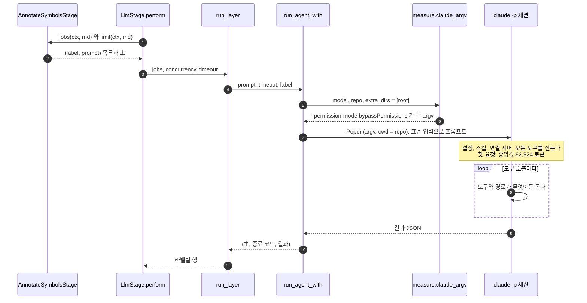
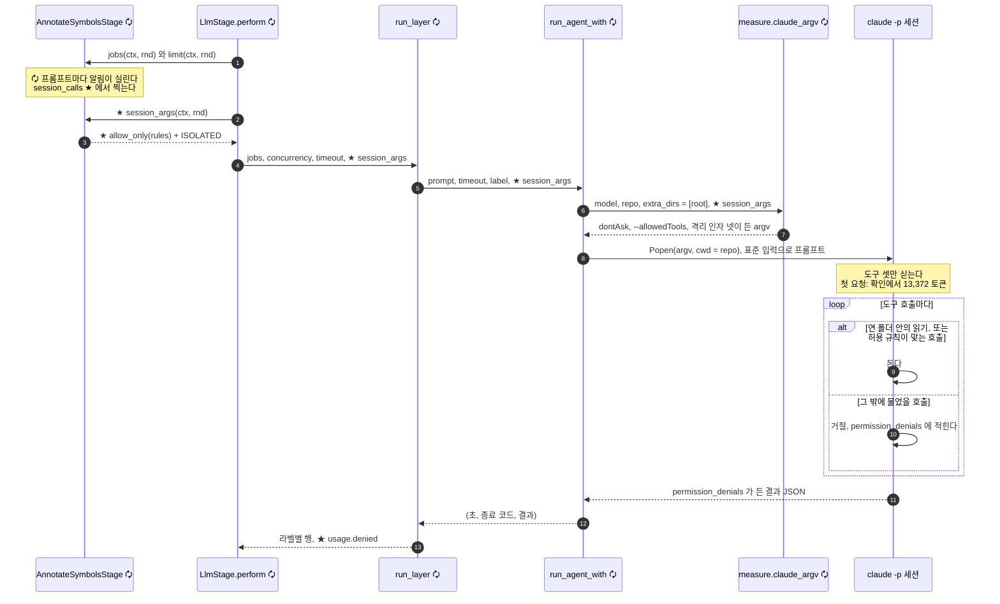
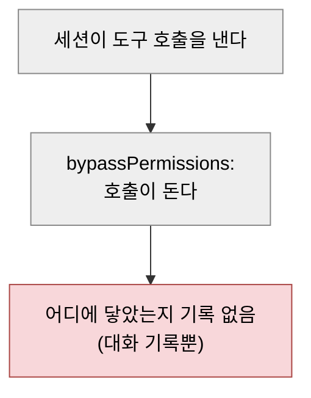
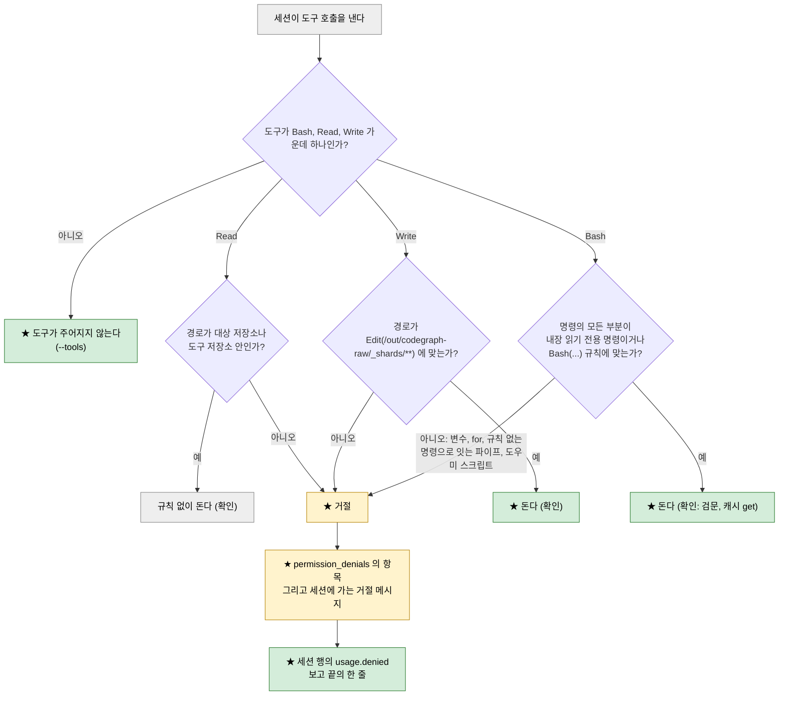
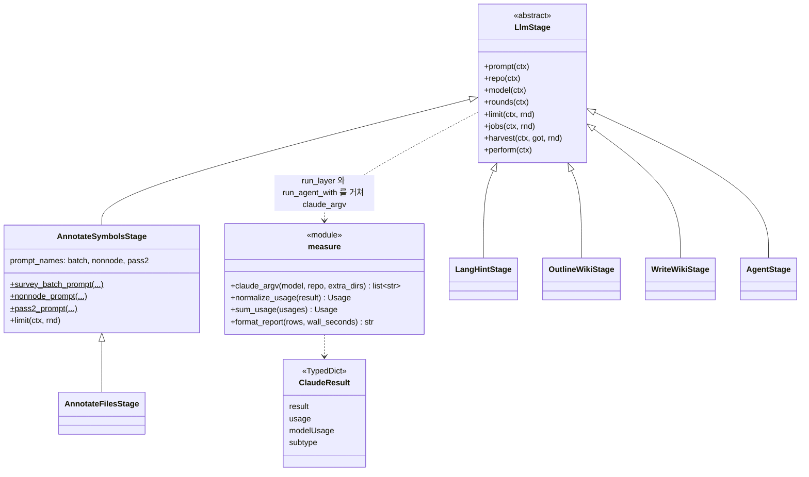
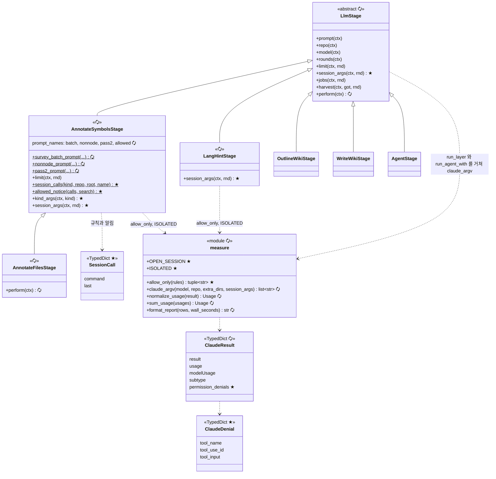

# 🧱 A3 — 세션 격리: 구현 계획

> **에이전트 작업자에게:** 필수 하위 스킬 — superpowers:subagent-driven-development(권장) 또는 superpowers:executing-plans 로 이 계획을 작업 단위로 구현한다. 단계는 체크박스(`- [ ]`)로 추적한다.

> 📅 2026-11-22 · 브랜치 `main` · **Before = `29c5ee9` + 계획 A1 · A2** (A3 는 `2026-11-22-mode1-a1-measure-semantics-plan.ko.md` 와 `2026-11-22-mode1-a2-session-end-condition-plan.ko.md` 다음에 구현한다. `src/` 와 `test/` 의 "Before" 는 그 둘의 "After" 다. 프롬프트 파일 `resource/codewiki/prompts/annotate-symbols.md` 의 "Before" 는 조각 1 에서 **`29c5ee9` + B1**, 조각 2 에서 **`+ B1 · B2 · B3`** 이다 — 여기에 기대는 diff 마다 그렇게 적는다)
> 📄 근거: 분할 문서 `docs/superpowers/specs/2026-11-22-mode1-remediation-split.ko.md` ("정한 것" · "A3 허용 목록 확인" · "정한 것이 서로 만나는 자리") · `2026-11-22-mode1-session-cache-plan.ko.md` (확인 1–3, 결과 R1–R13) · `docs/superpowers/specs/2026-11-21-mode1-cold-run-report.md` §2.3 · §4.1 · §6.2 · `docs/superpowers/specs/2026-11-21-mode1-audit-verification-report.md` §2.1 · 계획 `2026-11-22-mode1-b1-survey-stabilize-plan.ko.md` (작업 1) 과 `2026-11-22-mode1-b2-nonnode-terms-plan.ko.md` (작업 2 · "B2 가 다른 계획과 만나는 자리") · 기준선 `qa/evals/runs/2026-11-21-mode1-report-builder-cold-layer-sonnet.{json,md}` 와 그 전수조사 세션 대화 기록 92개(저장소 밖에 둔다) · 공식 Claude Code 문서, 2026-11-22 에 읽음(권한 방식 · 권한 규칙 · CLI 참조 · 헤드리스 모드 · 설정) · CLI 2.1.330 의 `claude --help` · 이 세션에서 읽은 코드: `src/core/{measure,pipeline}.py` · `src/codewiki/python/runner/mode1/{context,lang,survey,survey_files,wiki}.py` · `src/codewiki/python/runner/run_mode1.py` · `src/spec/python/runner/run_mode2.py` · `resource/codewiki/prompts/annotate-symbols.md` · `qa/gates/test_prompt_resources.py` · 시험 파일 다섯
> 🔒 지킬 규칙: 검사를 느슨하게 하지 않는다(새 `xfail` 이나 `skip` 없음, 결함 심각도 · `DROP_CLASS` · `REPORT_ONLY` 를 바꾸지 않음) · 프롬프트 글은 `resource/` 에 두고, 무엇을 실을지는 파이썬이 정해 행으로 넘긴다 · 더하기만 한다 — 새 훅을 쓰지 않는 단계의 기본 명령줄은 오늘의 것과 바이트까지 같다 · 위키 단계와 Mode 2 는 건드리지 않는다 · 주석은 지금의 것만 적는다 · 유료 Model 호출 없음
> 🧪 검증 방법: 세션 자리에 호출을 기록하는 대역을 둔 단위 시험, 그다음 여섯 게이트. **저장소 밖의 개인 복제본에서 한 번 돌렸다**(`29c5ee9` + A1 + A2, 그다음 아래 작업 일곱): 결과는 🧪 에 있다. 복제본은 A1 과 A2 를 계획서에 적힌 대로 담았고, B 줄기를 흉내 낸 **손으로 만든 대역 둘**(B1 의 해석기 값, B3 의 캐시 `put` 줄 제거)을 담았다 — B2 는 적용하지 않았다. "A3 가 기대는 것" 을 본다. 이 계획은 `claude` 세션을 하나도 시작하지 않았다. 이 인자로 실제 세션이 무엇을 하는지는 허용 목록 확인에서 인용하거나 `[미검증]` 으로 적었다. 효과는 측정 가에서 한 번 읽는다
> ✋ 승인: **승인 전**
> 🌐 영어 정본: [2026-11-22-mode1-a3-session-isolation-plan.md](2026-11-22-mode1-a3-session-isolation-plan.md)
> 
> ⚠️ **다른 바탕 위에 구현했다 (2026-11-23).** 사용자가 A2 계획을 보류해서 A3 는 A1 + B1 위(조각 1)와 A1 + B1 + B3 위(조각 2)에 올라갔다: 브랜치 `mode1-a3-b3`, `mode1-a1-b1` 위 18커밋, 병합 전이다. 아래 글은 쓴 그대로 둔다. 코드가 글과 다른 점: A2 의 것은 없다(`timeout` 은 실행기의 `ctx.timeout` 그대로이고 `limit` 훅이 없다) · 실제 B3 뒤에는 어느 종류의 조사 세션이든 명령 하나, 곧 샤드 검문만 받으므로 캐시 줄 · 캐시 규칙 · 알림의 캐시 줄이 없다 · 비노드 세션은 허용 규칙 아래에 **두지 않고** 알림도 받지 않는다 — 기준선에서 그 샤드가 71,035자이고 `[실측]` `Write` 한 번에 실릴 것으로 보는 양을 넘는다 `[추정]`. B2 가 세션을 나누기 전까지 격리 인자만 받고, 그때까지 O5 는 붙을 자리가 없다 · O1~O4 는 권고대로 구현했다 · 검문 명령의 경로를 셸 따옴표로 감쌌고, `batch` 와 `pass2` 절의 절차 줄은 알림 · 규칙과 같은 목록에서 낸다. 이 바탕에서는 세션을 돌리지 않았으므로 여전히 `[미검증]` 인 것: 실제 해석기 경로로 규칙이 맞는지, `dontAsk` 아래의 2패스 세션과 언어 판별 세션, 증분 실행의 배치 세션이 `Read` 만으로 이름을 찾아보는 모습

**목표:** 전수조사 세션과 언어 판별 세션은 자기 일에 필요한 것만 싣고 뜬다 — 내장 도구 셋, 설정 없음, 스킬 없음, 연결 서버 없음. 둘째 조각에서는 프롬프트가 시키는 호출만 돌리고, 거절된 호출은 하나도 빠짐없이 센다.

**구조:** LLM 단계는 새 훅 `LlmStage.session_args(ctx, rnd)` 로 자기 세션이 어떻게 뜨는지 말한다. 훅은 평범한 명령줄 인자를 돌려준다. 그 값은 매개변수 하나로 `run_layer` → `run_agent_with` → `measure.claude_argv` 를 타고 가며, 기본값은 오늘의 `--permission-mode bypassPermissions` 다. 전수조사 세션에 허용되는 명령은 목록 하나(`AnnotateSymbolsStage.session_calls`)다. 명령줄의 허용 규칙과 프롬프트의 알림이 둘 다 그 목록에서 나오고, 시험 하나가 프롬프트의 절차 줄을 같은 목록에 묶는다.

**기술:** Python 3 · Jinja2 프롬프트 절 · msgspec · pytest · pyright strict · Claude Code CLI 플래그(`--tools` · `--strict-mcp-config` · `--disable-slash-commands` · `--setting-sources` · `--permission-mode` · `--allowedTools`).

**표지:** `[실측]` 실행이나 셈에서 나온 수, 그 자리와 함께 · `[코드 확인]` Before 상태의 소스에서 읽음 · `[문서]` 공식 문서, 2026-11-22 에 읽음 · `[제안]` 이 계획의 제안 · `[판단]` 이 계획의 추론 · `[미검증]` 실제 세션만 보여 줄 수 있다. ★ 새것 · 🗘 바뀜 · ✕ 지움 · 표식 없음 = 그대로 재사용.

---

## 📋 한 장 요약

| | |
|---|---|
| 🎯 다루는 것 | 실행기가 전수조사 세션과 언어 판별 세션을 어떻게 띄우는가: 세션이 시작할 때 무엇을 싣는가, 어떤 도구를 가지는가, 어떤 호출이 묻지 않고 도는가, <span style="color:cyan">거절된 호출</span> (refused call) 은 어디에 적히는가 |
| 🧩 한 줄 결론 | 조각 둘. **조각 1** 은 두 단계에 <span style="color:cyan">격리 인자</span> (isolation arguments) 넷을 더하고 프롬프트는 바꾸지 않는다 — A2 바로 뒤에 들어갈 수 있다. **조각 2** 는 `bypassPermissions` 를 `dontAsk` 와 <span style="color:cyan">허용 규칙</span> (allow rules) 으로 바꾸고, **같은 변경에서** 프롬프트에 <span style="color:cyan">허용된 호출 알림</span> (notice of allowed calls) 을 더한다 — B3 뒤에 들어간다. 규칙과 알림은 한 목록(`session_calls`)에서 나온다 |
| 🟰 그대로 | `outline-wiki` · `write-wiki` · Mode 2 `AgentStage` · Mode 1.5: 오늘과 같은 명령줄이고 시험으로 못박는다. 대상 저장소와 도구 저장소를 여는 `--add-dir`. 세션 단위, 동시 실행 수, 층 순서, 제한 시간(A2), 샤드 검문과 훑기 |
| 🗘 바뀜 | `claude_argv` 가 <span style="color:cyan">세션 인자</span> (session arguments) 를 받는다 · `run_layer` 와 `run_agent_with` 가 그것을 넘긴다 · `LlmStage` 에 여덟째 훅이 생긴다 · `AnnotateSymbolsStage` 와 `LangHintStage` 가 그것을 재정의한다 · 프롬프트 파일에 절 `allowed` 와 `{{allowed}}` 자리 셋이 생긴다 · 세션 행에 `usage.denied` 가 생긴다 |
| ⚠️ 함정 | (1) 알림 없이 규칙만 주면 세션은 거절 한 번에 Bash 를 버린다 `[실측]` — 그래서 둘은 따로 들어가지 않는다. (2) B 줄기의 프롬프트 수정이 명령을 더하거나 이름을 바꾸면 같은 변경에서 목록도 고쳐야 한다. 아니면 시험이 실패한다. (3) `dontAsk` 는 읽기를 막지 않는다: 읽기만 하는 셸 명령은 운영체제 사용자가 읽을 수 있는 경로라면 어디든 닿는다 `[문서]`. (4) 비노드 세션은 이 인자로 돈 적이 없다 — 확인은 배치 하나만 덮었다 |
| 🚫 범위 밖 | 제한 시간(A2) · 프롬프트가 가르치는 절차(B1 · B2 · B3) · 위키 세션과 Mode 2(C1) · 파일 시스템 샌드박스 · 층의 첫 세션들을 띄우는 순서(근거가 변경을 받치지 못한다. ❓ 참조) |

### 두 조각 한눈에

```text
            slice 1  (after A2, no prompt change)          slice 2  (after B3, one change)
            ─────────────────────────────────────          ─────────────────────────────────────────────
argv        --permission-mode bypassPermissions            --permission-mode dontAsk
            + --tools "Bash,Read,Write"                    + --allowedTools <write rule> <command rules>
            + --strict-mcp-config                          + the same four isolation arguments
            + --disable-slash-commands
            + --setting-sources ""
prompt      unchanged                                      + section `allowed`, shown under the role intro
record      unchanged                                      + usage.denied · report line "거절된 호출"
stages      annotate-symbols · lang-hint                   annotate-symbols (rules per kind) · lang-hint (no rules)
measured    1a: first request 12,636 tokens                3b · 3c: 0 denials, shard passed the check
```

| 🧬 꼴 | 조각 1 | 조각 2 |
|---|---|---|
| 단계가 `session_args` 에서 돌려주는 것 | `OPEN_SESSION + ISOLATED` | `allow_only(rules) + ISOLATED` |
| 프롬프트에 닿는 것 | 없음 | `allowed_notice(session_calls(kind, …))` |
| 실제 세션에서 틀어질 수 있는 것 | 기준선의 우회가 여전히 가능하다(B1 이 그 원인을 없앤다) | 거절된 호출. `usage.denied` 에 센다 |

## 📌 정한 것 — 다시 열지 않는다

| 무엇 | 👍 고른 것 | 👎 버린 것 | 누가 | 언제 |
|---|---|---|---|---|
| A3 — 격리 인자 | 👍 따로 주는 인자 넷 `--tools "Bash,Read,Write"` · `--strict-mcp-config` · `--disable-slash-commands` · `--setting-sources ""` | 👎 `--safe-mode` | 사용자 | 2026-11-22 |
| A3 — 범위 | 👍 전수조사(`annotate-symbols`)와 언어 판별만 | 👎 지금 위키 단계와 Mode 2 까지(위키는 C1 을 기다린다) | 사용자 | 2026-11-22 |
| A3 — 권한 방식 | 👍 허용 목록으로 좁힌다. 헤드리스에서 도는 조합은 유료 확인으로 먼저 보았다 | 👎 `bypassPermissions` 를 그대로 두고 측정 가에서 세기 | 사용자 | 2026-11-22 |
| 전수조사를 재는 때 | 👍 A 줄기와 B 줄기를 다 고친 뒤에 한 번(측정 가) | 👎 계획마다 유료 확인 | 사용자 | 2026-11-22 |

출처: 분할 문서의 "정한 것" 표. 이 계획은 거기에 결정을 더하지 않는다.

## 💡 이 계획이 제안하는 것 — 정해지지 않음

모든 행이 `[제안]` 이다. 권고 칸에는 축마다 선택이 하나다. 이유 칸은 읽거나 잰 것과 판단을 가른다.

| # | 축 | 선택지 | 득실 | 권고 |
|---|---|---|---|---|
| P1 | 단계가 선언하는 것 | (a) 평범한 CLI 인자를 돌려주는 훅 `session_args(ctx, rnd)`. `measure.py` 의 상수 둘과 함수 하나로 조립한다 · (b) `claude_argv` 가 인자로 옮기는 스위치(도구 · 격리 · 방식 · 규칙)의 작은 dataclass · (c) 고정된 바탕 뒤에 붙이는 "덧붙임 인자" | (a) 새 형이 없다. 기본값이 오늘의 명령줄을 그대로 낸다. (b) 스위치에 이름을 주지만, 재정의하는 단계 둘과 소비자 하나를 위해 형을 더한다. (c) 될 수 없다: `--permission-mode` 는 되풀이가 아니라 바꿔치기가 필요하다 `[코드 확인]` | **(a)** `[판단]` |
| P2 | 값이 `claude_argv` 에 닿는 길 | (a) `run_layer` 와 `run_agent_with` 에 키워드 매개변수 하나, 늘 넘긴다 · (b) 작업 튜플 `(label, prompt)` 안에 · (c) 기본값과 다를 때만 넘긴다 · (d) `claude_argv` 가 읽는 실행 문맥의 칸 | (a) 시험의 `run_layer` 대역 12개와 `run_agent_with` 대역 6개를 기계적으로 고쳐야 한다 `[실측]`. (b) 모든 단계의 `jobs` 가 돌려주는 꼴이 바뀐다 — A2 계획이 제한 시간에서 같은 수를 버렸다. (c) 호출의 꼴이 값에 따라 달라진다. (d) `measure.py` 가 Mode 1 을 알게 된다 | **(a)** `[판단]` |
| P3 | 단위 | (a) 라운드마다, 그리고 단계가 세션을 직접 띄우는 곳(파일 전략)에서는 <span style="color:cyan">세션 종류</span> (session kind) 마다 · (b) 작업마다, 샤드 파일마다 쓰기 규칙 하나 | (a) 쓰기 규칙이 <span style="color:cyan">샤드 폴더</span> (shard folder) 전체를 덮으므로 세션이 다른 배치의 샤드를 덮어쓸 수 있다. 단계 끝의 훑기가 모든 샤드의 포괄을 검사한다 `[코드 확인]`. (b) 그 틈을 막지만 P2(b) 가 필요하고, 경로가 세션마다 다른 규칙이 필요하다 — 확인한 적이 없다 | **(a)** `[판단]` |
| P4 | 플래그 철자가 사는 곳 | (a) `src/core/measure.py`: 상수 `OPEN_SESSION` · `ISOLATED`, 함수 `allow_only` · (b) 단계마다 · (c) `resource/codewiki/config.toml` | (a) CLI 를 아는 곳이 하나이고 단계는 조립만 한다. (b) `--setting-sources ""` 를 두 번 적는다. (c) 규칙과 알림의 짝이 설정값이 되어, 누가 깨도 시험이 알아채지 못한다 | **(a)** `[판단]` |
| P5 | 허용 명령의 출처 하나 | (a) 파이썬의 목록 `session_calls(kind, repo, root, name)`. 규칙과 알림을 둘 다 거기서 찍고, 시험 하나가 프롬프트의 절차 줄을 그것과 견준다 · (b) 렌더한 프롬프트에서 명령을 파싱해 규칙을 끌어낸다 · (c) 손으로 지키는 목록 둘과 시험 | (a) 절차 글은 B 줄기가 고치는 자리에 그대로 있다. 새 명령마다 목록 하나만 바뀐다. (b) 목록이 아예 없지만, 명령처럼 보이는 줄은 모두 권한이 된다 — 프롬프트의 오타가 세션이 돌릴 수 있는 범위를 넓힌다. (c) 고칠 곳이 둘이다 | **(a)** `[판단]` |
| P6 | 알림이 프롬프트에 들어가는 길 | (a) `annotate-symbols.md` 의 넷째 절 `allowed`. 파이썬에서 한 번 렌더해 세 절에 값 `{{allowed}}` 로 넘긴다 · (b) 글을 세 절에 복사한다 · (c) Jinja2 include 나 macro | (a) 글이 하나다. `prompt_names` 에 이름 `annotate-symbols#allowed` 가 있어야 한다(프롬프트 게이트는 선언한 이름과 절이 하나씩 맞기를 요구한다 `[코드 확인]`). (b) 사본 셋이 표류한다. (c) 프롬프트 환경에 없는 템플릿 로더가 필요하다 `[코드 확인]` | **(a)** `[판단]` |
| P7 | 알림의 글과 자리 | (a) 확인한 글을 두 줄짜리 역할 소개 바로 아래에 둔다 — 낱말 하나가 다르다("아래 두 명령만" → "아래 명령만". 비노드 세션과 2패스 세션은 명령이 하나라서). 비노드 세션은 한 줄을 더 받는다(❓ O5) · (b) 새로 쓴 글 · (c) 확인한 글을 "끝내기 전에" 옆에 | (a) 잰 값이 있는 유일한 글이다: 호출 둘에서 거절 0 `[실측]`. (b) 와 (c) 는 잰 값이 없다 | **(a)** `[판단]` |
| P8 | 명령 규칙의 철자 | (a) 확인한 그대로: `Bash(<interpreter> <tool>/…/check_shard.py *)` 와 `Bash(<interpreter> <tool>/…/file_cache.py get *)` · (b) 캐시 규칙에 대상 저장소도 낱말 하나로 고정한다 | (a) 호출 셋에서 돌았다 `[실측]`. (b) 낱말 하나만큼 좁고 확인하지 않았다 | **(a)** `[판단]` |
| P9 | 조각의 순서 | (a) 조각 1 은 A2 뒤, 조각 2 는 B3 뒤 · (b) 둘 다 B3 뒤 · (c) 조각 2 를 B 줄기 앞에 | (a) 조각 1 은 B 줄기의 파일을 건드리지 않고, 그 인자는 확인에서 바뀌지 않은 프롬프트로 돌았다 `[실측]`. (b) 일정은 단순하지만 의존이 없는 변경을 붙잡아 둔다. (c) B1 과 B3 가 다시 쓰는 절차 줄 위에 목록을 짓는다 | **(a)** `[판단]` |

### 구조 개수

| 종류 | 수 | 무엇 |
|---|---|---|
| 새 모듈 · 파일 | 0 | — |
| 동작이 있는 새 클래스 | 0 | — |
| 새 형 | `TypedDict` 2 + `Literal` 별칭 1 | `ClaudeDenial` (`measure.py`) · `SessionCall` (`mode1/context.py`) · `SessionKind` (`mode1/survey.py`) |
| 새 상수 | 2 | `OPEN_SESSION` · `ISOLATED` |
| 새 함수 | 5 | `allow_only` · `LlmStage.session_args` · `AnnotateSymbolsStage.session_calls` · `.allowed_notice` · `.kind_args` |
| 새 훅의 재정의 | LLM 단계 5개 가운데 2 | `AnnotateSymbolsStage`(그리고 그것을 거쳐 `AnnotateFilesStage`) · `LangHintStage` |
| 훅을 부르는 곳 | 2 | `LlmStage.perform` · 파일 전략의 `submit` |
| `session_calls` 를 읽는 곳 | 2 | 규칙(`kind_args`) · 알림(`allowed_notice`) |
| 인터페이스 · 레지스트리 · 플러그인 자리 | 0 | 구현 하나와 읽는 곳 둘로는 인터페이스를 만들지 않는다 |

## 📊 현황

| 항목 | 상태 | 메모 |
|---|---|---|
| 막는 결정(인자 · 범위 · 권한 방식) | ✅ | 2026-11-22 에 사용자가 정했다 |
| 유료 허용 목록 확인 | ✅ | 2026-11-22 에 돌렸다. 결과는 세션 캐시 계획과 분할 문서에 있다 |
| 이 계획의 작업을 개인 복제본에서 해 봄 | ✅ | 작업 일곱, 시험 먼저. 수는 🧪 에 있다 |
| 저장소에 구현 | ❌ | 승인 전 |
| B2 계획 | 🟡 | 썼다(`2026-11-22-mode1-b2-nonnode-terms-plan.ko.md`). 이 계획을 위해 읽었고 복제본에는 적용하지 않았다 |
| B3 계획 | ❌ | 이 계획을 쓸 때 아직 없었다 — 최종 명령 목록이 다를 수 있다. 그것을 따라 고칠 한 곳은 "A3 가 기대는 것" 에 적었다 |
| 효과 측정 | ❌ | 측정 가, 두 줄기가 끝난 뒤 한 번 |

## 🔎 지금 코드는 무엇을 하는가 — 질문 여섯

| # | 질문 | Before 상태의 답 | 근거 |
|---|---|---|---|
| 1 | 단계는 자기 세션이 어떻게 뜨는지 어떻게 말하는가? | 말할 수 없다. `claude_argv(model, repo, extra_dirs)` 는 모든 호출자에게 `--permission-mode bypassPermissions` 가 든 고정 명령줄 하나를 만든다: `run_agent_with`(Mode 1 의 모든 LLM 단계와 Mode 2 `AgentStage` 가 `run_layer` 를 거쳐 부른다)와 Mode 2 의 호출되지 않는 `run_agent`. `LlmStage` 의 하위 클래스는 다섯이다: `LangHintStage` · `AnnotateSymbolsStage`(그 하위 클래스 `AnnotateFilesStage` 와 함께) · `OutlineWikiStage` · `WriteWikiStage` · `AgentStage` | `[코드 확인]` `src/core/measure.py:174` · `src/core/pipeline.py:488` · `src/spec/python/runner/run_mode2.py:248` · `:386` |
| 2 | 허용 명령의 목록 하나는 어디서 올 수 있는가? | 아직 어디에도 없다. 명령은 프롬프트의 글로만 있다: `29c5ee9` 의 `annotate-symbols.md` 다섯 줄(캐시 `get` · 캐시 `put` · `batch` 의 검문 · `nonnode` 의 검문 · `pass2` 의 검문). 프롬프트를 만드는 함수 셋은 정적 메서드이고 `repo` 와 `root` 를 받으므로, 같은 두 값으로 만든 목록이 규칙과 프롬프트를 둘 다 채울 수 있다 | `[코드 확인]` `resource/codewiki/prompts/annotate-symbols.md:64` · `:67` · `:113` · `:176` · `:211` · `mode1/survey.py:116` · `:163` · `:365` |
| 3 | 어느 전수조사 세션이 어느 호출을 필요로 하는가? | 아래 표를 본다 | `[코드 확인]` |
| 4 | 규칙은 어떻게 생겼고 어디에 고정되는가? | 아래 "규칙 문법" 을 본다 | `[문서]` · `claude --help` |
| 5 | 글은 어떻게 프롬프트에 들어가는가? | `PromptResource.load_prompt("<file>#<section>", **values)` 로만 들어간다. 절이 쓰는 이름과 넘긴 값이 같아야 하고, 긴 글은 파이썬에 둘 수 없다. 단계의 `prompt_names` 와 그 파일의 절은 하나씩 맞아야 한다 | `[코드 확인]` `src/core/pipeline.py:645` · `qa/gates/test_prompt_resources.py` |
| 6 | `--add-dir` 은 계속 무엇을 하고, 세션은 무엇에 여전히 닿는가? | 아래 "세션이 여전히 닿는 것" 을 본다 | `[문서]` · `[실측]` |

### 어느 세션이 어느 호출을 필요로 하는가 `[코드 확인]`

| 세션 | 띄우는 곳 | 읽는 것 | 쓰는 것 | 프롬프트가 돌리라고 하는 셸 명령 |
|---|---|---|---|---|
| 배치(층 전략) | `LlmStage.perform` → `run_layer`, 심볼 층마다 라운드 하나 | 자기 소스 파일, `record-schema.json`, 병합한 레코드 — 모두 대상 저장소 안 | `out/codegraph-raw/_shards/<batch>.json` | 캐시 `get` · 샤드 검문 |
| 따로 치운 뒤의 배치 | 다음 실행에서 같은 길. 프롬프트가 결함을 싣는다 | 거기에 더해 `_shards/<batch>.json.bad` — 샤드 폴더 안 | 같은 샤드 | 같은 둘 |
| 비노드 | 마지막 라운드(층 종류 `non-node`). 오늘은 세션 하나 `NONNODE`. B2 뒤에는 최대 셋: `NONNODE-FILE` · `NONNODE-MODULE` · `NONNODE-NAMED` | 대상 저장소의 병합한 레코드와 파일. B2 뒤에는 `NONNODE-NAMED` 만 병합한 레코드를 열고, 그 안을 찾아본다(B2 계획) | `_shards/NONNODE.json`. B2 뒤에는 `_shards/<session name>.json` | 샤드 검문 |
| 2패스(파일 전략만) | `AnnotateFilesStage.perform` → `submit("<batch>/p2", …)` → `run_agent_with` 를 직접 | 없음 — "소스를 열지 않는다". 레코드는 프롬프트 안에 온다 | `_shards/_pass2/<batch>.json` | 샤드 검문 |
| 파일 전략, 1패스와 비노드 | `submit(<batch>, …)` 와 `submit("NONNODE", …)` | 배치 세션과 비노드 세션과 같다 | 위와 같다 | 위와 같다 |
| 언어 판별 | `LlmStage.perform`, 세션 하나 | 없음 — 루트 문서가 프롬프트 안에 있다 | 없음 | 없음. 기준선에서 도구를 하나도 부르지 않았다(1 턴) `[실측]` |

표의 경로는 모두 대상 저장소 안 — 세션의 작업 폴더다(`run_agent_with` 의 `cwd=repo`) — 이거나, `--add-dir` 로 연 도구 저장소 안에 있다.

### 규칙 문법 `[문서]` — 공식 문서, 2026-11-22 에 읽음, 그리고 `claude --help` (2.1.330)

- `--permission-mode dontAsk` 는 묻게 될 호출을 모두 거절한다. 헤드리스 결과는 거절된 호출을 `permission_denials` 에 적는다.
- 어느 방식에서든 작업 폴더 안의 파일 읽기와 내장된 읽기 전용 셸 명령 묶음(`ls` · `cat` · `head` · `tail` · `grep` · `find` · `wc` · `diff` · `stat` · `du` · `cd` · 읽기 전용 `git` 등)은 규칙 없이 돈다.
- `--allowedTools <tools...>` 는 규칙 여럿을 받고, 규칙 하나가 인자 하나다. `Bash(<text> *)` 는 명령 글을 앞부분으로 맞춘다. `*` 앞의 빈칸도 규칙의 일부이고, 규칙은 뒤에 아무것도 붙지 않은 명령에도 맞는다.
- 복합 명령(`&&` · `||` · `;` · `|` · 줄바꿈)은 모든 부분이 허용될 때만 돈다. 안전하다고 알려지지 않은 변수에 값을 넣는 것으로 명령이 시작하면 허용 규칙이 맞지 않는다.
- `Edit(<path>)` 규칙은 파일을 고치는 모든 내장 도구를 덮고, `Write` 도 거기에 든다. `Write(<path>)` 규칙은 맞지 않는다. 명령줄에서 주면 `/` 로 시작하는 패턴은 세션의 주 작업 폴더에 고정되고, `//` 는 절대 경로, `~/` 는 홈 폴더다.
- 출력 리디렉션(`> file`)은 `Edit` 규칙과 작업 폴더에 비추어 검사한다.
- `--add-dir` 은 폴더를 작업 폴더로 만든다: 묻지 않고 읽을 수 있고, 고치기는 여전히 방식을 따른다. 더한 폴더의 스킬과 명령은 `project` 설정 출처로 실리므로 `--setting-sources ""` 가 그것을 막는다.
- 명령 글에 기대지 않는 경계는 권한 규칙이 아니라 샌드박스 기능의 몫이다.

### 세션이 여전히 닿는 것 — 있는 그대로

| 닿는 것 | 조각 1 뒤 | 조각 2 뒤 | 표지 |
|---|---|---|---|
| 어느 도구 호출이든, 어느 경로든 | 예 — `bypassPermissions` 가 남는다 | 아니오 | `[코드 확인]` |
| 대상 저장소나 도구 저장소의 파일 읽기 | 예 | 예, 규칙 없이 | `[문서]` · 확인에서 `[실측]` |
| 두 저장소 밖 경로에 Read 도구 | 예 | 거절 | `[문서]` · `[미검증]` |
| 두 저장소 밖 경로에 읽기 전용 셸 명령(`cat` · `grep` · `find` · …) | 예 | **예** — 내장 읽기 전용 묶음은 방식이 작업 폴더에 묶어 두지 않는다 | `[문서]` · `[미검증]` |
| 샤드 폴더 밖에 쓰기 | 예 | 거절 | `[문서]`. 확인에서는 그런 시도가 없었다 |
| 다른 배치의 샤드나 `_shards/` 아래 아무 파일 이름에 쓰기 | 예 | **예** — 규칙이 폴더를 덮는다 | `[코드 확인]` |
| 입력 없는 `cat > <path under _shards/>`(기준선의 멈춤 방아쇠) | 예 | 그 폴더라면 **아마 예**. 기다림은 A2 의 제한 시간이 끊는다 | `[미검증]` |
| `PATH` 에서 찾은 해석기로 도는 도우미 스크립트 | 예 | 거절 — 맞는 규칙이 없다 | `[문서]`. 이어 붙인 명령의 거절 하나 `[실측]` |
| 허용된 명령 뒤에 낱말이 더 붙은 것(다른 샤드 경로, 다른 파일) | 예 | **예** — 규칙은 앞부분으로 맞춘다 | `[문서]` |
| 스킬 · 슬래시 명령 · 연결 서버 · 사용자와 프로젝트 설정 | 싣지 않음 | 싣지 않음 | `[실측]` 첫 요청 12,636 토큰, 같은 배치의 86,453 과 견줘 |

`[미검증]` 하나 더: 빈칸 · 쉼표 · 괄호가 든 해석기나 도구 경로는 규칙을 파싱하거나 맞추는 방식을 깰 수 있다. 계획은 이것을 막지 않는다. 측정 가는 그런 글자가 없는 경로에서 돈다.

## 🔢 이 계획이 기대는 수

| 무엇 | 값 | 자리 |
|---|---|---|
| 배치 세션의 첫 요청, 기준선 | 중앙값 82,924 토큰(69,146 – 88,418) | 콜드 실행 보고 §2.3 · 감사 검증 보고 §2.1 |
| 인자 넷을 준 첫 요청 | 12,636 토큰(같은 배치의 기준선: 86,453) | 세션 캐시 계획, 확인 1(호출 1a) |
| 인자 넷과 알림을 준 첫 요청 | 13,372 와 13,374 토큰 | 세션 캐시 계획, 확인 3(호출 3b · 3c) |
| 격리한 호출이 모두 — 첫 호출까지 — 캐시에서 읽은 공유 앞부분 | 3,296 토큰 | 세션 캐시 계획 R4 |
| 알림 없는 규칙 | 거절 1. 세션은 다시 Bash 를 쓰지 않았고 검문을 돌리지 않았다 | 세션 캐시 계획, 확인 3(호출 3a) |
| 알림 있는 규칙 | 두 호출 모두 거절 0. 검문을 돌렸고 통과했다 | 세션 캐시 계획, 확인 3(호출 3b · 3c) |
| 언어 판별 세션, 기준선 | 76,732 토큰 · 16.84 s · \$0.1057 · 1 턴 | 기준선 JSON 의 행 `lang-hint`, 이 계획을 위해 다시 계산 |
| 배치 세션 91개의 도구 호출, 기준선 | Bash 605 · Read 190 · Write 25 · 그 밖 1 | 기준선 대화 기록, 이 계획을 위해 셈 |
| 비노드 세션의 도구 호출, 기준선 | Bash 42 · Read 2 · Write 3 | 같은 셈 |
| 두 <span style="color:cyan">연 폴더</span> (opened folders) 밖의 무언가를 가리킨 호출, 기준선 | 배치: 세션 91개 가운데 90개에서 호출 295 · 비노드: 호출 26 | 같은 셈. 방법은 아래 |

**밖을 가리킨 호출을 센 법 `[실측]`.** 전수조사 대화 기록 92개마다 도구 호출을 호출 id 하나에 한 번씩 셌다. 호출의 입력이 대상 저장소 안도 도구 저장소 안도 아니고, 그 둘의 부모 폴더도 아니고, `/dev` 아래도 아닌 절대 경로를 가리키면 "밖" 으로 센다. 해석기를 맨 이름(`python3` · `python`)으로 띄워 `PATH` 로 찾게 하는 호출도 "밖" 이다. 셸 변수로 만든 경로는 펼치지 않았으므로 이 수는 하한이다. 배치 세션의 종류별 셈(호출 하나가 여러 종류에 들 수 있다): `PATH` 의 해석기 69 세션에서 186 호출 · 홈 폴더 아래 경로 47 세션에서 117 · 세션의 임시 폴더 47 세션에서 60(그리고 Write 도구 호출 3) · 시스템 임시 폴더 19 세션에서 23 · 시스템 경로 1. 분할 문서는 이 호출들이 "기준선에서 세지 않았다" 고 적는다. 이 셈이 측정 가가 견줄 기준선이다.

## 🔁 전 / 후

| 📍 전 (오늘 안 되는 것) | 🛠️ After · 제안 | 🎉 해결되는 것 | 🔭 기대 | 진행 |
|---|---|---|---|---|
| 모든 세션이 사용자와 프로젝트 설정, 스킬, 연결 서버, 모든 내장 도구를 싣는다. 배치 세션의 첫 요청은 중앙값 82,924 토큰이다 `[실측]` | 조각 1: 전수조사 세션과 언어 판별 세션이 격리 인자 넷으로 뜬다 | 전수조사 세션 92개의 시작 문맥과 76,732 토큰짜리 언어 판별 | 첫 요청이 12,636 토큰 가까이 `[실측]`(호출 하나). 실행 전체의 수는 측정 가에서 읽는다 | ❌ |
| 단계는 자기 세션이 어떻게 뜨는지 말할 수 없다. 모두에 명령줄 하나 | `LlmStage.session_args(ctx, rnd)`. 기본값 = 오늘의 인자 | 전수조사와 언어 판별은 바뀌고 위키와 Mode 2 는 바이트까지 그대로다 | 재정의 둘. 단계 셋은 손대지 않고 시험으로 못박는다 | ❌ |
| 어느 호출이든 돈다: 배치 호출 295개가 두 연 폴더 밖의 무언가를 가리켰다 `[실측]` | 조각 2: `dontAsk` + 샤드 폴더 쓰기 규칙 하나 + 프롬프트의 명령마다 규칙 하나 | 도우미 스크립트, 샤드 폴더 밖 쓰기, `PATH` 의 해석기 | 거절하고 센다. 닿는 범위가 0 은 아니다 — 읽기 전용 셸 명령은 남는다("여전히 닿는 것" 참조) | ❌ |
| 한 번 거절된 세션은 Bash 를 포기한다 — 호출 3a 에서 `[실측]` | 허용된 호출 알림이 프롬프트에 있고, 규칙과 같은 목록에서 찍는다 | 세션 안에서 검문이 다시 돈다 | 확인한 호출 둘에서 거절 0 `[실측]`. 세션 92개의 수는 측정 가에서 읽는다 | ❌ |
| 거절된 호출은 대화 기록에서만 보일 것이다 | 세션 행의 `usage.denied` 와 보고 끝의 한 줄 | 측정 가가 커밋된 기록에서 거절을 읽는다 | 수만 남는다. 명령 글은 기록에 들어가지 않는다 | ❌ |

## ★ 신규 · 🗘 변경 항목 (모듈 → 파일 → 클래스 → 함수 → 멤버)

| 수준 | 항목 | 종류 | 자리 | 조각 |
|---|---|---|---|---|
| 모듈 | 없음 | — | — | — |
| 파일 | 🗘 `src/core/measure.py` | 바뀜 | core | 1 · 2 |
| 파일 | 🗘 `src/core/pipeline.py` | 바뀜 | core | 1 |
| 파일 | 🗘 `src/codewiki/python/runner/mode1/survey.py` | 바뀜 | Mode 1 실행기 | 1 · 2 |
| 파일 | 🗘 `src/codewiki/python/runner/mode1/survey_files.py` | 바뀜 | Mode 1 실행기 | 1 · 2 |
| 파일 | 🗘 `src/codewiki/python/runner/mode1/lang.py` | 바뀜 | Mode 1 실행기 | 1 · 2 |
| 파일 | 🗘 `src/codewiki/python/runner/mode1/context.py` | 바뀜 | Mode 1 실행기 | 2 |
| 파일 | 🗘 `resource/codewiki/prompts/annotate-symbols.md` | 바뀜 | 프롬프트 | 2 |
| 파일 | 🗘 `src/codewiki/python/runner/run_mode1.py` (모듈 독스트링) · `resource/CLAUDE.md` · `qa/evals/README.md` · 생성되는 `src/core` 와 `src/codewiki/python/runner` 의 `README.md` | 바뀜 | 문서 | 1 · 2 |
| 파일 | 🗘 `test/core/test_measure.py` · `test/core/test_pipeline.py` · `test/codewiki/test_mode1.py` · `test/codewiki/test_run_mode1.py` · `test/spec/test_run_mode2.py` | 바뀜 | 시험 | 1 · 2 |
| 클래스 | ★ `ClaudeDenial` (`TypedDict`) | 새것 | `measure.py` | 2 |
| 클래스 | 🗘 `ClaudeResult` | 바뀜 | `measure.py` | 2 |
| 클래스 | 🗘 `LlmStage` | 바뀜 | `pipeline.py` | 1 |
| 클래스 | 🗘 `AnnotateSymbolsStage` · 🗘 `AnnotateFilesStage` · 🗘 `LangHintStage` | 바뀜 | `mode1/` | 1 · 2 |
| 클래스 | ★ `SessionCall` (`TypedDict`) | 새것 | `mode1/context.py` | 2 |
| 클래스 | `OutlineWikiStage` · `WriteWikiStage` · `AgentStage` | 그대로 재사용 | — | — |
| 함수 | 🗘 `claude_argv(model, repo, extra_dirs, session_args=OPEN_SESSION)` | 바뀜 | `measure.py` | 1 |
| 함수 | ★ `allow_only(rules)` | 새것 | `measure.py` | 2 |
| 함수 | 🗘 `normalize_usage` · 🗘 `sum_usage` · 🗘 `format_report` | 바뀜 | `measure.py` | 2 |
| 함수 | 🗘 `run_agent_with(…, session_args=OPEN_SESSION)` · 🗘 `run_layer(…, session_args=OPEN_SESSION)` | 바뀜 | `pipeline.py` | 1 |
| 함수 | ★ `LlmStage.session_args(ctx, rnd)` · 🗘 `LlmStage.perform` | 새것 · 바뀜 | `pipeline.py` | 1 |
| 함수 | ★ `AnnotateSymbolsStage.session_args` (재정의) · ★ `LangHintStage.session_args` (재정의) | 새것 | `mode1/survey.py` · `mode1/lang.py` | 1, 본문은 2 에서 🗘 |
| 함수 | ★ `AnnotateSymbolsStage.session_calls` · ★ `.allowed_notice` · ★ `.kind_args` | 새것 | `mode1/survey.py` | 2 |
| 함수 | 🗘 `survey_batch_prompt` · 🗘 `nonnode_prompt` · 🗘 `pass2_prompt` (`allowed` 를 넘긴다) | 바뀜 | `mode1/survey.py` | 2 |
| 함수 | 🗘 `AnnotateFilesStage.perform` (안쪽 `submit`) | 바뀜 | `mode1/survey_files.py` | 1 · 2 |
| 멤버 | ★ `OPEN_SESSION` · ★ `ISOLATED` (모듈 상수) | 새것 | `measure.py` | 1 |
| 멤버 | ★ `ClaudeResult.permission_denials` · ★ `Usage` 의 열쇠 `denied` | 새것 | `measure.py` | 2 |
| 멤버 | ★ `SessionKind` (`Literal`) · 🗘 `AnnotateSymbolsStage.prompt_names` (+ `annotate-symbols#allowed`) | 새것 · 바뀜 | `mode1/survey.py` | 2 |
| 멤버 | ★ 프롬프트 절 `allowed` · ★ `batch` · `nonnode` · `pass2` 의 자리 `{{allowed}}` | 새것 | `annotate-symbols.md` | 2 |

## ⏱️ 순서 — 세션 하나를 띄우는 일과 그 세션이 부를 수 있는 것

**Before** (`29c5ee9` + A1 · A2)



**After · 제안** (조각 2. 조각 1 에서는 메시지 3 이 `OPEN_SESSION + ISOLATED` 를 돌려주고 거절 갈래가 없다)



## 🔀 갈래 — 호출이 허용되거나 거절되는 길

**Before**



**After · 제안** (조각 2). 판정은 CLI 가 내린다. 갈래는 `[문서]` 이고, "확인" 이 붙은 초록 잎 둘은 허용 목록 확인에서 보았다.



범례: 회색 = 그대로 · 초록 = 새것 · 주황 = 호출을 멈출 수 있는 새 동작.

## 🧱 구조 — 훅과 형의 꼴

**Before**



**After · 제안**



## 🔧 고칠 곳

줄 번호는 개인 복제본에서 만든 Before 상태(`29c5ee9` + A1 · A2)의 것이다. A1 이나 A2 가 다른 줄 수로 들어가면 밀린다. 기준은 심볼 이름이다.

| 파일 · 심볼 | 변경 | 이유 | 근거 |
|---|---|---|---|
| `src/core/measure.py` · `claude_argv` (`:174`) | 🗘 넷째 매개변수 `session_args`, 기본값 `OPEN_SESSION`. 박혀 있던 권한 낱말 둘이 리스트 리터럴에서 빠진다 | 모든 호출자의 명령줄을 한 곳이 만든다 | `[코드 확인]` `:180-181` 의 리터럴 |
| `src/core/measure.py` · ★ `OPEN_SESSION` · ★ `ISOLATED` · ★ `allow_only` | 단계가 조립하는 벽돌 셋 | P4 | 정한 인자. 확인한 조합 |
| `src/core/measure.py` · `ClaudeResult` (`:35`) · `normalize_usage` (`:81`) · `sum_usage` (`:110`) · `format_report` (`:198`) | 🗘 `permission_denials` 를 읽고, `denied` 로 세고, 합치고, 거절이 있는 행마다 한 줄 찍는다 | 측정 가가 기록에서 거절을 읽는다 | `[실측]` 헤드리스 호출의 결과가 그 목록을 싣는다(호출 3a) |
| `src/core/pipeline.py` · `run_agent_with` (`:473`) · `run_layer` (`:515`) | 🗘 매개변수 `session_args`, 바꾸지 않고 넘긴다 | P2 | `[코드 확인]` `:488` · `:530` |
| `src/core/pipeline.py` · `LlmStage` (`:658`) | ★ 훅 `session_args`. 🗘 `perform` 이 라운드마다 그 값을 넘긴다 | P1 | `[코드 확인]` `perform` 이 이미 `limit(ctx, rnd)` 를 같은 식으로 넘긴다 |
| `mode1/survey.py` · `AnnotateSymbolsStage` | 조각 1: ★ `OPEN_SESSION + ISOLATED` 를 돌려주는 재정의. 조각 2: ★ `session_calls` · `allowed_notice` · `kind_args`, 🗘 재정의가 층으로 종류를 고른다, 🗘 프롬프트를 만드는 함수 셋이 `allowed` 를 넘긴다, 🗘 `prompt_names` | P3 · P5 · P6 | `[코드 확인]` `limit` 이 같은 층 종류로 고른다(`:616`) |
| `mode1/survey_files.py` · `submit` (`:63`) | 🗘 세션 인자를 `P.run_agent_with` 의 일곱째 인자로 넘긴다 — 이 전략은 `run_layer` 를 거치지 않는다 | 아니면 파일 전략의 세션은 오늘의 명령줄로 뜬다 | `[코드 확인]` `:66` |
| `mode1/lang.py` · `LangHintStage` | ★ 재정의: 조각 1 `OPEN_SESSION + ISOLATED`, 조각 2 `allow_only(()) + ISOLATED` | 정한 범위 | `[실측]` 낱말 하나에 76,732 토큰 |
| `mode1/context.py` | ★ `SessionCall` 을 다른 프롬프트 행 형(`DepRow` · `PendingRow` · `Pass2DepRow`) 옆에 | 프롬프트에 넘기는 행은 여기 산다 | `[코드 확인]` |
| `resource/codewiki/prompts/annotate-symbols.md` | ★ 절 `allowed`. ★ `batch` · `nonnode` · `pass2` 의 역할 소개 아래 `{{allowed}}` | P6 · P7 | `[실측]` 확인한 자리와 글 |
| `mode1/wiki.py` · `run_mode2.py` | 없음 | 정한 범위 | 시험 둘로 못박는다 |

### 제안 diff — 인자가 가는 길 (조각 1)

**제안 diff.** Before 줄은 `29c5ee9` + A1 · A2 의 소스다.

`src/core/measure.py`

```diff
-def claude_argv(model: str, repo: str, extra_dirs: Iterable[str]) -> list[str]:
+OPEN_SESSION: tuple[str, ...] = ("--permission-mode", "bypassPermissions")
+
+ISOLATED: tuple[str, ...] = ("--tools", "Bash,Read,Write", "--strict-mcp-config", "--disable-slash-commands",
+                             "--setting-sources", "")
+
+
+def claude_argv(model: str, repo: str, extra_dirs: Iterable[str],
+                session_args: Sequence[str] = OPEN_SESSION) -> list[str]:
     """헤드리스 `claude` 명령줄. 프롬프트는 여기 싣지 않는다 — 표준 입력으로 준다.
@@
-    argv = ["claude", "-p", "--output-format", "json", "--model", model,
-            "--permission-mode", "bypassPermissions"]
+    argv = ["claude", "-p", "--output-format", "json", "--model", model, *session_args]
     for d in [repo] + list(extra_dirs):
```

`src/core/pipeline.py`

```diff
 def run_agent_with(model: str, repo: str, root: str, prompt: str,
                    timeout: float | None = None,
-                   label: str | None = None) -> tuple[float, int, AgentResult | None]:
+                   label: str | None = None,
+                   session_args: Sequence[str] = M.OPEN_SESSION) -> tuple[float, int, AgentResult | None]:
@@
-    argv = M.claude_argv(model=model, repo=repo, extra_dirs=[root])
+    argv = M.claude_argv(model=model, repo=repo, extra_dirs=[root], session_args=session_args)
@@
 def run_layer(model: str, repo: str, root: str, jobs: Sequence[tuple[str, str]],
               concurrency: int = 8,
-              timeout: float | None = None) -> list[JobResult]:
+              timeout: float | None = None,
+              session_args: Sequence[str] = M.OPEN_SESSION) -> list[JobResult]:
@@
-        futs = {ex.submit(run_agent_with, model, repo, root, prompt, timeout, label): label
+        futs = {ex.submit(run_agent_with, model, repo, root, prompt, timeout, label, session_args): label
@@ class LlmStage
+    def session_args(self, ctx: C, rnd: int) -> Sequence[str]:
+        """이 라운드의 세션들이 받는 권한 · 격리 인자. 재정의하지 않으면 `measure.OPEN_SESSION` 이다."""
+        return M.OPEN_SESSION
+
@@ LlmStage.perform
                 got = run_layer(self.model(ctx), self.repo(ctx), ctx.root, jobs,
-                                concurrency=ctx.concurrency, timeout=self.limit(ctx, rnd))
+                                concurrency=ctx.concurrency, timeout=self.limit(ctx, rnd),
+                                session_args=self.session_args(ctx, rnd))
```

### 제안 diff — 목록 하나, 읽는 곳 둘 (조각 2)

**제안 diff, 요점만.** 전체 코드는 작업 6 에 있다.

`src/codewiki/python/runner/mode1/survey.py`

```diff
+    @staticmethod
+    def session_calls(kind: SessionKind, repo: str, root: str, name: str = "") -> list[SessionCall]:
+        tool = os.path.join(root, "src", "codewiki", "python")
+        shard = "_pass2/%s.json" % name if kind == "pass2" else name + ".json"
+        check: SessionCall = {"command": "%s %s" % (sys.executable, os.path.join(tool, "runner", "check_shard.py")),
+                              "last": os.path.join(repo, "out", "codegraph-raw", "_shards", shard)}
+        cache: SessionCall = {"command": "%s %s get" % (sys.executable, os.path.join(tool, "machine", "file_cache.py")),
+                              "last": repo + " <파일경로>"}
+        return [cache, check] if kind == "batch" else [check]
+
+    def kind_args(self, ctx: Mode1Context, kind: SessionKind) -> Sequence[str]:
+        folder = os.path.relpath(self.shard_dir(ctx), ctx.repo).replace(os.sep, "/")
+        rules = ["Edit(/%s/**)" % folder] + ["Bash(%s *)" % c["command"]
+                                              for c in self.session_calls(kind, ctx.repo, ctx.root)]
+        return M.allow_only(rules) + M.ISOLATED
```

`resource/codewiki/prompts/annotate-symbols.md` — 이 파일의 Before 는 `29c5ee9` + B1 · B2 · B3 다

```diff
 너는 코드베이스 전수조사의 배치 {{bid}} 담당이다. 대상 저장소 {{repo}}. 도구 저장소 {{root}}.
 사람에게 묻지 않는다 — 이 세션은 헤드리스라 되묻는 순간 막힌다. 막히면 무엇이 없어 막혔는지 적고 끝낸다.
 
+{{allowed}}
+
 
@@ end of file
+<!-- section: allowed -->
+## 이 세션은 허용된 호출만 돈다
+
+허용되지 않은 호출은 거절된다. 거절 하나는 그 호출이 막혔다는 뜻이지 Bash 전체가 막혔다는 뜻이 아니다.
+- 파일은 Read 로 읽고, 샤드는 Write 로 쓴다.
+- Bash 는 아래 명령만 돈다. **적힌 글자 그대로, 한 번에 하나씩** 부른다 — 변수(`P=...`) · `for` · `;` · `&&` · `|` 로 잇지 않는다:
+
+    {{ c.command }} {{ c.last }}
+
+
+- 그 밖에 읽기만 하는 명령(`grep` · `ls` · `find` · `wc`)은 Bash 로 돈다. 큰 파일에서 낱말을 찾을 때 쓴다. 이것도 한 번에 하나씩 부른다.
+
```

조각 2 뒤에 배치 세션이 명령줄로 받는 것(출력 예. `<interpreter>` 는 `sys.executable`, `<tool>` 과 `<target>` 은 두 저장소다):

```text
claude -p --output-format json --model <model>
  --permission-mode dontAsk
  --allowedTools "Edit(/out/codegraph-raw/_shards/**)"
                 "Bash(<interpreter> <tool>/src/codewiki/python/machine/file_cache.py get *)"
                 "Bash(<interpreter> <tool>/src/codewiki/python/runner/check_shard.py *)"
  --tools "Bash,Read,Write" --strict-mcp-config --disable-slash-commands --setting-sources ""
  --add-dir <target> --add-dir <tool>
```

## 🧭 조각의 순서

| 조각 | 작업 | 들어가는 때 | 결과물 | 점검 |
|---|---|---|---|---|
| **1 — 격리 인자** | 1 · 2 · 3 · 4 | A2 바로 뒤. B 줄기가 고치는 파일은 `mode1/survey.py` 말고는 건드리지 않고, 거기서도 A2 의 `limit` 옆에 메서드 하나를 더할 뿐이다 | 전수조사 세션과 언어 판별 세션이 인자 넷으로 뜬다. 다른 세션은 모두 오늘의 명령줄 그대로다 | 작업 1–3 의 시험. 작업 4 에서 여섯 게이트 |
| **2 — 허용된 호출** | 5 · 6 · 7 | B3 뒤. 작업 6 은 **변경 하나**다: 규칙, 알림, 둘을 묶는 시험이 커밋 하나로 들어간다 | `dontAsk` + 세션 종류마다의 규칙. 프롬프트의 알림. `usage.denied` | 작업 5–6 의 시험. 작업 7 에서 여섯 게이트 |

조각 1 이 먼저 갈 수 있는 이유 `[실측]`: 바뀌지 않은 프롬프트와 `bypassPermissions` 에 인자 넷을 더했을 때 배치가 끝났고 샤드가 검문을 통과했다(세션 캐시 계획, 확인 1, 호출 1a). 조각 2 가 기다리는 이유 `[코드 확인]`: B1 이 프롬프트의 모든 명령줄에서 해석기를 다시 쓰고 B3 가 캐시 `put` 줄을 없앤다. 조각 2 의 목록은 그러고 남는 것 위에 짓는다. 작업 6 은 프롬프트에 `put` 줄이 아직 있으면 멈추는 단계로 시작한다.

## 🔗 A3 가 다른 계획과 만나는 자리

| 계획 | 만나는 것 | 이 계획이 다루는 법 |
|---|---|---|
| A1 | `ClaudeResult` · `normalize_usage` · `sum_usage` · `format_report` — A1 이 같은 함수들에 `model_total` 과 "사용량 덜 적힘" 줄을 더한다 | 작업 5 가 `model_total` 옆에 `denied` 를, A1 의 줄 뒤에 자기 줄을 더한다. 이 함수들의 Before 는 A1 의 After 다 |
| A2 | `run_agent_with` · `run_layer` · `LlmStage.limit` · A2 가 이미 `timeout` 으로 넓힌 시험 대역 | 새 매개변수는 A2 의 `timeout` 과 `label` 뒤에 온다. 작업 2 가 같은 대역을 한 번 더 넓힌다. 입력 없는 명령을 기다리는 세션은 여전히 A2 의 제한 시간이 끝낸다. A3 는 그 명령을 없애지 않는다 |
| B1 | 프롬프트 명령줄의 해석기. B1 의 계획은 `python=sys.executable` 을 넘긴다 | `session_calls` 가 같은 `sys.executable` 을 쓴다. B1 이 다른 값으로 들어가면 묶는 시험 짝의 첫째가 실패하고 그 줄들을 짚어 준다 — `session_calls` 의 식 하나를 고친다 |
| B2 | 비노드 세션을 최대 셋(`NONNODE-FILE` · `NONNODE-MODULE` · `NONNODE-NAMED`)으로 나눈다. 세션 이름이 작업 라벨이자 샤드 이름이다. `nonnode_prompt` 에 매개변수 `sid` 가 생긴다. 절은 여전히 명령 하나, `_shards/{{sid}}.json` 의 검문을 적는다(B2 계획, "B2 가 다른 계획과 만나는 자리", 행 A3) | 세 세션 모두 종류 `nonnode` 를 받는다: 층 전략에서는 층 종류가 정하고, 파일 전략에서는 배치 id 도 `<batch>/p2` 도 아닌 모든 라벨이다 — A2 의 제한 시간이 쓰는 두 기준과 같다. B2 가 적은 대로 `Bash(… check_shard.py *)` 규칙 하나가 샤드 셋을 덮고, 쓰기 규칙이 파일 셋을 덮는다. `nonnode_prompt` 는 자기 `sid` 를 알림의 샤드 이름으로 넘긴다. B2 는 셋째 세션이 병합한 레코드를 통독하지 않고 찾아본다고 적는다. 도구가 셋이면 찾는 길은 Bash 로 부르는 `grep` 하나뿐이고, 그래서 비노드 알림은 한 줄을 더 싣는다(❓ O5). 기준선의 비노드 세션 하나는 Bash 호출 42개를 냈고 그 가운데 17개가 `PATH` 의 해석기를 거쳤다 `[실측]` — 조각 2 에서는 그것들이 거절된다 |
| B3 | 캐시 `put` 절차를 없앤다. 세션이 미리 채운 캐시를 어떻게 받는지, 프롬프트가 샤드를 어떻게 쓰라고 하는지를 정한다 | 목록에 `put` 행이 없다. B3 가 `get` 을 남기면 바뀌는 것이 없다. B3 가 `get` 도 빼면 `cache` 행을 지운다. B3 가 샤드를 "Write 도구로" 쓰라고 하면 알림의 줄 "샤드는 Write 로 쓴다" 와 맞는다 |
| B2 와 조각 1 | 작업 3 의 셋째 시험이 파일 전략을 끝까지 띄우고 비노드 라벨을 이름으로 댄다 | B2 와 조각 1 가운데 나중에 들어가는 쪽이 그 시험에 B2 의 세션 이름을 적는다(방법은 작업 3 이 적는다) |
| C1 | 위키 세션은 스킬을 부른다. 격리하면 스킬이 사라진다 | 건드리지 않는다. C1 이 꼴을 정할 때 위키 단계에서 같은 훅을 재정의한다 |
| 측정 가 | A3 의 효과를 읽는다 | (1) 전수조사 세션과 언어 판별의 첫 요청 토큰을 대화 기록에서 읽어 82,924 와 76,732 에 견준다 · (2) 거절된 호출: 전수조사 행의 `usage.denied` 합과 "거절된 호출" 줄 · (3) 두 연 폴더 밖의 무언가를 가리킨 호출을 "이 계획이 기대는 수" 의 방법으로 대화 기록에서 세어 295(배치)와 26(비노드)에 견준다 |

## 🧷 A3 가 앞선 계획에 기대는 것

A3 는 이것들을 만들지 않고, 여기서 출발한다. 개인 복제본은 그 가운데 둘을 손으로 흉내 냈다 — 제목이 `(B1 대역)` 과 `(B3 대역)` 인 커밋 — 조각 2 의 작업을 돌려 보려는 것뿐이었다. 그 두 커밋은 A3 에 들지 **않고** 작업 목록에도 없다.

| 어디서 | A3 가 참이기를 바라는 것 | 파일 · 줄 · 이름 | 거기에 기대는 A3 작업 | 복제본에서 |
|---|---|---|---|---|
| A1 | `normalize_usage` 가 `model_total` 을 돌려준다. `sum_usage` 가 열쇠 목록을 합친다. `format_report` 가 `사용량 덜 적힘` 을 찍는 반복으로 끝난다 | `src/core/measure.py` — `normalize_usage` · `sum_usage` · `format_report` | 작업 5 가 같은 세 곳에 `denied` 를 더한다 | A1 을 계획서대로 적용 |
| A2 | `Popen` 위의 `run_agent_with(model, repo, root, prompt, timeout, label)`. `run_layer(…, concurrency, timeout)`. `LlmStage.limit(ctx, rnd)` 와 그것을 넘기는 `perform`. `AnnotateSymbolsStage.session_limit` 와 `survey_files.py` `submit` 의 라벨 검사. 넓힌 시험 대역 | `src/core/pipeline.py` · `mode1/survey.py` · `mode1/survey_files.py` · 시험 파일 넷 | 작업 2 · 3 이 A2 의 매개변수 뒤에 매개변수 하나를, `limit` 옆에 훅 하나를 더한다 | A2 를 계획서대로 적용 |
| B1 (작업 1) | 프롬프트의 명령줄 다섯이 `{{python}}` 으로 시작하고, `load_prompt` 호출 셋이 `python=sys.executable` 을 넘긴다 | `resource/codewiki/prompts/annotate-symbols.md` (`29c5ee9` 에서: 64 · 67 · 113 · 176 · 211 줄) · `mode1/survey.py` `survey_batch_prompt` · `nonnode_prompt` · `pass2_prompt` | 작업 6: `session_calls` 가 같은 `sys.executable` 로 명령을 만든다. 묶는 시험은 그것으로 시작하는 프롬프트 줄을 견준다 | **대역** `(B1 대역)`: 다섯 줄과 인자 셋. B1 의 시험과 B1 의 나머지는 없다 |
| B2 (작업 2) | `nonnode_prompt(repo, root, sid, files, modules, faults, bad)`. 절의 검문 줄이 `_shards/{{sid}}.json` 으로 끝난다. 비노드 라벨은 `NONNODE-FILE` · `NONNODE-MODULE` · `NONNODE-NAMED` 이다. 두 전략 모두 `nonnode_jobs` 로 그것을 띄운다 | `mode1/survey.py` · `mode1/survey_files.py` · 프롬프트의 절 `nonnode` | 작업 6: `nonnode_prompt` 가 `sid` 를 `session_calls` 에 넘긴다. 시험 도우미가 `nonnode_prompt(repo, root, "NONNODE-NAMED")` 를 부른다 | **적용하지 않았다.** 복제본은 `sid` 자리에 리터럴 `"NONNODE"` 를, 시험 도우미에 `nonnode_prompt(repo, root)` 를 두고 같은 코드를 돌렸다. 이 두 식의 B2 꼴은 `[미검증]` 이다 |
| B3 | 캐시 `put` 절차가 `batch` 절에서 사라졌다. 남는 명령은 무엇이든 `{{python}}` 으로 시작하는 줄로 적힌다 | `resource/codewiki/prompts/annotate-symbols.md`, 절 `batch`, "읽는 법" (`29c5ee9` 에서: 63–72 줄) | 작업 6: 목록에 `get` 행이 있고 `put` 행이 없다 | **대역** `(B3 대역)`: `put` 절차의 다섯 줄을 `- 없으면: 파일을 통독한다.` 로 바꿨다. B3 계획은 없었다. 실제 글은 다를 것이다 |

**B3 가 명령을 바꾸면.** 고칠 곳은 `src/codewiki/python/runner/mode1/survey.py` 의 `AnnotateSymbolsStage.session_calls` 하나다. 허용 규칙(`kind_args`)과 알림(`allowed_notice`, 절 `allowed`)은 둘 다 그것이 돌려주는 것에서 찍으므로, 손으로 따라 고칠 것은 없다.

| B3 의 결말 | `session_calls` 의 변경 | 그 밖 |
|---|---|---|
| `get` 을 남기고 `put` 을 없앤다(정한 방향) | 없음 | 없음 |
| `get` 도 없앤다(세션이 캐시를 다른 길로 받는다) | `cache` 행을 지운다. `batch` 는 `[check]` 를 돌려준다 | `test_알림은_역할_소개_바로_아래에_허용된_명령을_적힌_글자_그대로_싣는다` 의 알림 두 줄 단언과 `test_전수조사_세션은_묻는_호출을_거절하고_종류마다_허용_규칙을_받는다` 의 규칙 목록에서 캐시 줄이 빠진다 |
| 새 명령(다른 스크립트, 또는 고정 낱말이 다른 `get`) | 행 하나를 더하거나 고친다: `command` = 해석기, 스크립트, 고정 낱말, `last` = 알림이 그 뒤에 찍는 것 | 같은 두 단언에 그 줄이 더해진다 |
| 어느 세션 종류에만 쓰는 명령 | 그 종류에만 돌려준다 | 없음 |

두 시험이 어느 쪽으로든 빠뜨림을 잡는다: `test_프롬프트가_시키는_명령은_전부_그_세션의_허용_규칙이_덮는다` 는 프롬프트가 어떤 규칙도 덮지 않는 명령을 대면 실패하고, `test_허용_규칙의_명령은_전부_프롬프트의_절차에도_적혀_있다` 는 절차가 더는 대지 않는 명령을 규칙이 허용하면 실패한다.


## 📖 용어

| 용어 | 코드 이름 | 뜻 |
|---|---|---|
| <span style="color:cyan">세션 인자</span> | `session_args` (`LlmStage` 의 훅, `run_layer` · `run_agent_with` · `claude_argv` 의 매개변수) | 권한 방식과 세션이 시작할 때 싣는 것을 정하는 명령줄 인자 |
| <span style="color:cyan">열린 세션</span> (open session) | `measure.OPEN_SESSION` | 오늘의 인자: `--permission-mode bypassPermissions` |
| <span style="color:cyan">격리 인자</span> | `measure.ISOLATED` | 정한 인자 넷 |
| <span style="color:cyan">허용 전용 인자</span> (allow-only arguments) | `measure.allow_only(rules)` | `--permission-mode dontAsk` 뒤에 `--allowedTools` 와 규칙들이 온다 |
| <span style="color:cyan">허용 규칙</span> | `--allowedTools` 뒤의 원소 하나 | `Edit(<path pattern>)` 또는 `Bash(<command prefix> *)` |
| <span style="color:cyan">세션 명령</span> (session call) | `SessionCall` · `AnnotateSymbolsStage.session_calls` | 전수조사 세션이 돌려도 되는 셸 명령 하나: 고정된 앞부분(`command`)과 알림이 그 뒤에 찍는 것(`last`) |
| <span style="color:cyan">세션 종류</span> | `SessionKind` — `"batch"` · `"nonnode"` · `"pass2"` | 전수조사 세션이 어느 세션 명령 목록을 받는가 |
| <span style="color:cyan">허용된 호출 알림</span> | 프롬프트 절 `annotate-symbols#allowed` · `allowed_notice` · 자리 `{{allowed}}` | 무엇이 도는지, 거절 하나가 Bash 를 닫지 않는다는 것을 세션에 알리는 문단 |
| <span style="color:cyan">거절된 호출</span> | `ClaudeResult.permission_denials` · `usage["denied"]` | 허용하는 규칙이 없어 CLI 가 거절한 도구 호출 |
| <span style="color:cyan">샤드 폴더</span> | `AnnotateSymbolsStage.shard_dir(ctx)` — `<target>/out/codegraph-raw/_shards` | 전수조사 세션이 쓰는 유일한 곳 |
| <span style="color:cyan">연 폴더</span> | `claude_argv` 의 `--add-dir` | 대상 저장소와 도구 저장소 |
| 주 작업 폴더 (primary working directory) | `run_agent_with` 의 `cwd=repo` | `/` 로 시작하는 규칙 패턴이 고정되는 곳 |
| 첫 요청 (first request) | — (대화 기록에서 읽는다) | 세션의 첫 Model 요청의 토큰. 시작 문맥이 여기 드러난다 |

## ❓ 열린 결정

작업은 O2 · O3 · O5 의 권고 선택지를 구현한다. 다른 선택지를 고르면 마지막 칸에 적은 작업이 바뀐다. 그 밖에 막히는 것은 없다.

| # | 질문 | 근거 | 선택지 | 권고 | 답이 없으면 막히는 것 |
|---|---|---|---|---|---|
| O1 | 연 폴더 밖의 읽기 | 기준선: 배치 호출 295개가 밖의 무언가를 가리켰다 `[실측]`. 대부분은 B1 이 원인에서 없애는 해석기 우회(호출 186)와 조각 2 가 거절하는 쓰기였다. `dontAsk` 에서 작업 폴더 밖의 Read 도구는 거절되고, 읽기 전용 셸 명령은 거절되지 않는다 `[문서]` | (A) 아무것도 더하지 않고 측정 가에서 센다 · (B) `--settings '{"permissions":{"blockReadsOutsideWorkingDirectories":true}}'` 를 더한다 — `--setting-sources ""` 와 함께 줄 때 `--settings` 가 지켜지는지는 `[미검증]` 이고 유료 호출 하나가 든다 · (C) 샌드박스 기능 — 해석기와 그 라이브러리가 두 폴더 밖에 있으므로 허용된 명령 자체에 예외가 필요하다 · (D) `--restricted` — 파일 도구만 가둔다 `[문서]`, 확인하지 않음 | **(A)** `[판단]` — 남은 틈은 읽기 전용 명령이고, 세션이 그것을 쓰는지가 바로 측정 가가 세는 것이다 | 없음. (B) 는 유료 확인 뒤 `ISOLATED` 에 원소 하나를 더하게 된다 |
| O2 | 언어 판별 세션이 받는 것 | 기준선에서 도구를 하나도 부르지 않았다(1 턴) `[실측]`. 격리 뒤 남은 14.3K 글자 가운데 도구 스키마가 약 7.0K 였다(세션 캐시 계획 R3) | (a) 조각 1 의 인자만 · (b) 인자 넷 + `dontAsk`, 규칙 없음, 알림 없음 · (c) `--tools ""` + 나머지 셋 + `dontAsk` | **(b)** `[판단]` — (b) 의 인자 값은 모두 확인 때 이 계정에서 돌았다. `--tools ""` 는 돌려 본 적이 없다 | 작업 6, `LangHintStage.session_args` 의 한 줄 |
| O3 | 거절 목록이 세션 행에 들어가는가? | 항목은 도구 입력 전체를 담는다: `{tool_name, tool_use_id, tool_input}` `[실측]`. 측정 JSON 은 공개 저장소에 커밋되고, 거절된 명령은 기계의 경로를 싣는다 | (a) 수만 `usage.denied` 로 남기고 보고에 한 줄 · (b) 항목 전체 · (c) 없음. 대화 기록을 읽는다 | **(a)** `[판단]` | 작업 5 |
| O4 | 층의 첫 세션들을 띄우는 순서 | 기준선: 첫 세션 여덟 가운데 여섯이 24,650 토큰의 공유 앞부분을 놓쳤다. 격리 뒤 공유 앞부분은 3,296 토큰이고 첫 호출조차 캐시에서 읽었다 `[실측]` (R4). 얻을 것의 상한: 실행마다 한 번 7 × 3,296 = 23,072 토큰 `[판단]`. 대가는 세션 하나쯤의 기다림(배치 세션 중앙값 58.35 s `[실측]`) | (a) 순서를 그대로 둔다 · (b) 세션 하나를 먼저 띄우고, 그 첫 응답이 오면 나머지를 띄운다 | **(a)** — 근거가 변경을 받치지 못한다. **이 계획에서 뺐다** | 없음 |
| O5 | 알림이 읽기 전용 셸 명령을 말하는가? | 확인한 글은 "Bash 는 아래 두 명령만 돈다" 이고, 확인한 두 세션은 Read 와 그 두 명령으로 끝났다 `[실측]` — 배치 세션만이다. B2 의 `NONNODE-NAMED` 세션은 병합한 레코드(기준선에서 739,145 바이트, B2 계획 🧪)를 찾아보라는 지시를 받는다. `--tools "Bash,Read,Write"` 에는 찾기 도구가 없고, 이어 붙이지 않은 읽기 전용 명령 하나는 규칙 없이 돈다 `[문서]` `[미검증]` | (A) 세 종류 모두 확인한 글 · (B) 모든 종류에 한 줄 더: 읽기 전용 명령(`grep` · `ls` · `find` · `wc`)도 돈다 · (C) 그 줄을 비노드 종류에만 | **(C)** `[판단]` — 배치 세션과 2패스 세션은 잰 값이 있는 유일한 글을 그대로 받는다. 비노드 종류는 이 줄이 없으면 알림이 B2 의 지시와 어긋나므로 이 줄을 받는다. 그 줄 자체는 확인하지 않았다 | 작업 6: 절의 `` 블록, `nonnode_prompt` 의 인자 `search=True`, 시험 하나. (A) 를 고르면 그 셋을 지운다 |

## 🧪 검증 · 🚫 범위 밖

**돌린 것 `[실측]`.** 저장소 밖의 개인 복제본에서: `29c5ee9`, 그다음 A1 과 A2 계획(커밋 12개), 그다음 아래 작업 일곱을 차례로, 각각 시험 먼저.

| 시점 | 명령 | 결과 |
|---|---|---|
| 시작(A1 + A2) | `.venv/bin/python -m pytest -q` | 1023 통과 · 25 건너뜀 · 2 xfail |
| 작업 1 빨강 → 초록 | `pytest test/core/test_measure.py -q -k "세션_인자"` | 3 실패 → 3 통과 |
| 작업 2 빨강 → 초록 | `pytest test/core/test_pipeline.py -q -k "세션_인자 or session_args"` | 4 실패 → 4 통과 |
| 작업 3 빨강 → 초록 | `pytest test/codewiki/test_mode1.py test/spec/test_run_mode2.py -q -k "격리_인자 or 세션_인자"` | 3 실패, 1 통과 → 4 통과 |
| 조각 1 끝 | 여섯 게이트 | pytest 1034 통과 · 25 건너뜀 · 2 xfail · `npm test` 8 통과 · `tsc` 깨끗함 · pyright 0 errors · README 검사 "9개 — 소스와 일치" · doctor "필수 항목이 전부 있다" |
| B 줄기의 대역 | B1 작업 1 을 계획서대로(해석기 줄 다섯, `python=sys.executable`. B1 자신의 시험은 더하지 않음). 캐시 `put` 절차는 B3 계획이 없어서 손으로 없앴다. B2 는 적용하지 않음 | 건드린 시험 묶음이 통과했다 |
| 작업 5 빨강 → 초록 | `pytest test/core/test_measure.py -q -k "거절 or denied or denials"` | 5 실패, 1 통과 → 6 통과 |
| 작업 6 빨강 → 초록 | `pytest test/core/test_measure.py test/codewiki/test_mode1.py -q` | 13 실패, 241 통과 → 254 통과 |
| 조각 2 끝 | 여섯 게이트 | pytest 1048 통과 · 25 건너뜀 · 2 xfail · `npm test` 8 통과 · `tsc` 깨끗함 · pyright 0 errors · README 검사 "9개 — 소스와 일치" · doctor "필수 항목이 전부 있다" |

수는 복제본의 것이다: 복제본에는 B1 · B2 · B3 가 더하는 시험이 하나도 없다. 저장소에서는 합계가 그만큼 다르다. 이 계획이 만드는 차이는 조각 1 에서 시험 +11, 조각 2 에서 +14 다.

**돌리지 않은 것.** `claude` 세션은 없다. 돌리지 않았으므로 `[미검증]` 인 것: 이 인자들 가운데 어느 것으로든 도는 비노드 세션과 2패스 세션 · 어느 것으로든 도는 언어 판별 세션 · `_shards/_pass2/` 에 대한 쓰기 규칙 · `dontAsk` 에서 `.json.bad` 를 읽는 재시도 세션 · 캐시 규칙과 프롬프트 줄이 확인 때 손으로 친 경로가 아니라 실제 실행의 `sys.executable` 에서 올 때의 규칙 맞춤 · 샤드 폴더로의 리디렉션. Mermaid: 이 파일의 블록 여섯은 저장소 루트에서 `npx --no-install mmdc` 로 렌더했고, 여섯 모두 SVG 를 냈다.

**🚫 범위 밖.** 제한 시간과 세션 끝내기(A2) · 프롬프트가 세션에 가르치는 일(B1 · B2 · B3) · 위키 단계, Mode 2, Mode 1.5(명령줄을 그대로 두고 못박는다) · 파일 시스템 샌드박스 · `--no-session-persistence`(세션 캐시 계획의 개요가 싣지만 정한 인자에 없고, 측정 가는 대화 기록을 읽는다) · 띄우는 순서(O4) · 모든 유료 확인.

---

# 작업

모든 명령은 저장소 루트에서 돌린다. 조각 1 은 작업 1–4, 조각 2 는 작업 5–7 이다. 독스트링을 바꾼 때부터 그 조각을 닫는 작업까지는 README 표류 시험(`test/tools/test_gen_readme.py::test_readme_is_not_stale`)이 실패한다. 닫는 작업이 파일을 다시 만든다. 그때까지는 단계마다 적힌 시험 파일을 돌린다.

## 조각 1 — 격리 인자

### 작업 1 (조각 1): 명령줄이 세션 인자를 받는다

**파일:**
- 고침: `src/core/measure.py` (`claude_argv` 와 그 위의 새 상수 둘)
- 시험: `test/core/test_measure.py`

- [ ] **1단계: 실패하는 시험을 쓴다**

`test/core/test_measure.py` 끝에 붙인다:

```python


# ── 세션 인자 — 권한과 세션이 싣는 것을 정하는 명령줄 조각 ────────────────────

def test_세션_인자를_주지_않으면_명령줄은_묻지_않고_전부_허용한다():
    assert M.OPEN_SESSION == ("--permission-mode", "bypassPermissions")
    assert M.claude_argv("m", "/repo", ["/tool"]) == [
        "claude", "-p", "--output-format", "json", "--model", "m",
        "--permission-mode", "bypassPermissions", "--add-dir", "/repo", "--add-dir", "/tool"]


def test_세션_인자는_Model_뒤_폴더_앞에_그대로_실린다():
    argv = M.claude_argv("m", "/repo", ["/tool"], M.OPEN_SESSION + M.ISOLATED)
    assert argv == ["claude", "-p", "--output-format", "json", "--model", "m",
                    "--permission-mode", "bypassPermissions",
                    "--tools", "Bash,Read,Write", "--strict-mcp-config", "--disable-slash-commands",
                    "--setting-sources", "",
                    "--add-dir", "/repo", "--add-dir", "/tool"]


def test_세션_인자를_바꾸면_권한_인자도_그_값으로_바뀐다():
    argv = M.claude_argv("m", "/repo", [], ("--permission-mode", "dontAsk"))
    assert argv.count("--permission-mode") == 1 and "bypassPermissions" not in argv
```

- [ ] **2단계: 돌려서 실패를 본다**

실행: `.venv/bin/python -m pytest test/core/test_measure.py -q -k "세션_인자"`
기대: `3 failed` — 둘은 `AttributeError: module 'core.measure' has no attribute 'OPEN_SESSION'`, 하나는 `TypeError: claude_argv() takes 3 positional arguments but 4 were given` 로 실패한다.

- [ ] **3단계: 최소한으로 구현한다**

`src/core/measure.py` 에서 함수 `claude_argv` 전체를 다음으로 바꾼다:

```python
# 세션 인자의 기본값. 권한을 묻지 않고 모든 호출을 허용한다 — 단계가 `LlmStage.session_args` 를 재정의하지 않으면 이것이 실린다.
OPEN_SESSION: tuple[str, ...] = ("--permission-mode", "bypassPermissions")

# 세션이 시작할 때 싣는 것을 줄이는 인자 넷 — 내장 도구는 셋만 · 연결 서버 없음 · 스킬과 명령 없음 · 설정 파일 없음.
# 권한 인자 뒤에 이어 붙인다.
ISOLATED: tuple[str, ...] = ("--tools", "Bash,Read,Write", "--strict-mcp-config", "--disable-slash-commands",
                             "--setting-sources", "")


def claude_argv(model: str, repo: str, extra_dirs: Iterable[str],
                session_args: Sequence[str] = OPEN_SESSION) -> list[str]:
    """헤드리스 `claude` 명령줄. 프롬프트는 여기 싣지 않는다 — 표준 입력으로 준다.

    `session_args` 는 권한과 세션이 싣는 것을 정하는 인자다. 주지 않으면 `OPEN_SESSION` 이다.

    `--add-dir` 로 대상 저장소와 도구 저장소를 둘 다 열어 준다. 한쪽만 주면 에이전트가
    재료나 규약 중 하나를 못 본다.
    """
    argv = ["claude", "-p", "--output-format", "json", "--model", model, *session_args]
    for d in [repo] + list(extra_dirs):
        argv += ["--add-dir", d]
    return argv
```

이 모듈은 `Iterable` 과 `Sequence` 를 이미 import 한다.

- [ ] **4단계: 돌려서 통과를 본다**

실행: `.venv/bin/python -m pytest test/core/test_measure.py test/codewiki/test_run_mode1.py test/spec/test_run_mode2.py -q`
기대: 전부 통과(복제본에서: `166 passed`). 기존 `test_claude_argv_does_not_pass_the_prompt_on_the_command_line` 은 바꾸지 않고 통과한다 — 기본 명령줄이 전과 같은 리스트다.

- [ ] **5단계: 커밋** (사용자가 이 계획의 커밋을 승인했을 때만)

```bash
git add src/core/measure.py test/core/test_measure.py
```

제목: `[feat] : core - 헤드리스 명령줄이 권한과 격리를 정하는 세션 인자를 받는다`

### 작업 2 (조각 1): 훅, 그리고 명령줄까지 내려가는 길

**파일:**
- 고침: `src/core/pipeline.py` (`run_agent_with` · `run_layer` · `LlmStage`)
- 시험: `test/core/test_pipeline.py` · `test/codewiki/test_mode1.py` · `test/codewiki/test_run_mode1.py` (대역만)

- [ ] **1단계: 실패하는 시험을 쓴다**

`test/core/test_pipeline.py` 끝에 붙인다(`한번부르는단계` · `두층부르는단계` · `가짜세션` 은 이 파일에 이미 있다):

```python


# ── 세션 인자 — 단계의 훅이 정하고 층과 세션 호출을 거쳐 명령줄에 닿는다 ──────

def _넘겨받은_세션_인자(monkeypatch: pytest.MonkeyPatch) -> list[tuple[str, ...]]:
    """`run_layer` 를 바꿔 끼우고, 층마다 넘겨받은 `session_args` 가 쌓일 목록을 낸다."""
    seen: list[tuple[str, ...]] = []

    def _spy(model: str, repo: str, root: str, jobs: Sequence[tuple[str, str]],
             concurrency: int = 8, timeout: float | None = None,
             session_args: Sequence[str] = ("넘어오지 않았다",)) -> list[P.JobResult]:
        seen.append(tuple(session_args))
        return [(label, 1.0, 0, {}) for label, _ in jobs]
    monkeypatch.setattr(P, "run_layer", _spy)
    return seen


def test_LLM_단계의_세션_인자는_기본으로_묻지_않고_전부_허용이다(tmp_path: Path, monkeypatch: pytest.MonkeyPatch):
    seen = _넘겨받은_세션_인자(monkeypatch)
    한번부르는단계().perform(P.RunContext(root=str(tmp_path), model="m"))
    assert seen == [M.OPEN_SESSION]


def test_LLM_단계는_라운드마다_session_args_훅이_낸_값을_층에_넘긴다(tmp_path: Path, monkeypatch: pytest.MonkeyPatch):
    class 층마다다른단계(두층부르는단계):
        def session_args(self, ctx: P.RunContext, rnd: int) -> Sequence[str]:
            return [M.OPEN_SESSION + M.ISOLATED, ("--permission-mode", "dontAsk")][rnd]

    seen = _넘겨받은_세션_인자(monkeypatch)
    층마다다른단계().perform(P.RunContext(root=str(tmp_path), model="m"))
    assert seen == [M.OPEN_SESSION + M.ISOLATED, ("--permission-mode", "dontAsk")]


def test_run_layer_는_세션_인자를_세션마다_그대로_넘긴다(monkeypatch: pytest.MonkeyPatch):
    seen: dict[str, tuple[str, ...]] = {}

    def _agent(model: str, repo: str, root: str, prompt: str, timeout: float | None = None,
               label: str | None = None,
               session_args: Sequence[str] = ("넘어오지 않았다",)) -> tuple[float, int, P.AgentResult | None]:
        seen[label or ""] = tuple(session_args)
        return 1.0, 0, {}
    monkeypatch.setattr(P, "run_agent_with", _agent)
    P.run_layer("m", "/r", "/root", [("a", "p"), ("b", "p")], session_args=M.OPEN_SESSION + M.ISOLATED)
    P.run_layer("m", "/r", "/root", [("c", "p")])
    assert seen == {"a": M.OPEN_SESSION + M.ISOLATED, "b": M.OPEN_SESSION + M.ISOLATED, "c": M.OPEN_SESSION}


def test_run_agent_with_는_세션_인자를_명령줄_짓는_함수에_넘긴다(tmp_path: Path, monkeypatch: pytest.MonkeyPatch):
    script = tmp_path / "fake_claude.py"
    script.write_text(가짜세션, encoding="utf-8")
    seen: list[tuple[str, ...]] = []

    def argv(model: str, repo: str, extra_dirs: Iterable[str],
             session_args: Sequence[str] = ("넘어오지 않았다",)) -> list[str]:
        seen.append(tuple(session_args))
        return [sys.executable, str(script), "ok", str(tmp_path / "unused.pid")]
    monkeypatch.setattr(M, "claude_argv", argv)
    P.run_agent_with("m", str(tmp_path), str(tmp_path), "프롬프트", label="x")
    P.run_agent_with("m", str(tmp_path), str(tmp_path), "프롬프트", label="x", session_args=("--tools", ""))
    assert seen == [M.OPEN_SESSION, ("--tools", "")]
```

- [ ] **2단계: 돌려서 실패를 본다**

실행: `.venv/bin/python -m pytest test/core/test_pipeline.py -q -k "세션_인자 or session_args"`
기대: `4 failed` — 첫째는 `assert [('넘어오지 않았다',)] == [('--permission-mode', 'bypassPermissions')]`, 둘째도 같은 종류의 불일치, 그리고 `TypeError: run_layer() got an unexpected keyword argument 'session_args'`, `TypeError: run_agent_with() got an unexpected keyword argument 'session_args'`.

- [ ] **3단계: 최소한으로 구현한다**

`src/core/pipeline.py` 에서:

(a) `run_agent_with` — 시그니처, 독스트링 문단 하나, 호출 하나:

```python
def run_agent_with(model: str, repo: str, root: str, prompt: str,
                   timeout: float | None = None,
                   label: str | None = None,
                   session_args: Sequence[str] = M.OPEN_SESSION) -> tuple[float, int, AgentResult | None]:
    """`claude -p` 를 한 번 부른다. `(걸린 초, 종료 코드, 결과 또는 None)`.

    `session_args` 는 그 세션의 권한 · 격리 인자다. 명령줄 짓는 함수(`measure.claude_argv`)에 그대로 넘긴다.
```

(독스트링의 나머지는 그대로) 그리고 본문에서:

```python
    argv = M.claude_argv(model=model, repo=repo, extra_dirs=[root], session_args=session_args)
```

(b) `run_layer` — 시그니처, 독스트링 문단 하나, 호출 하나:

```python
def run_layer(model: str, repo: str, root: str, jobs: Sequence[tuple[str, str]],
              concurrency: int = 8,
              timeout: float | None = None,
              session_args: Sequence[str] = M.OPEN_SESSION) -> list[JobResult]:
    """한 층 = 동시에 최대 `concurrency` 개. 층 사이는 부르는 쪽이 순차로 돈다.

    `timeout` 과 `session_args` 는 그 층의 세션 전부에 같은 값으로 간다.
```

그리고 본문에서:

```python
        futs = {ex.submit(run_agent_with, model, repo, root, prompt, timeout, label, session_args): label
                for label, prompt in jobs}
```

(c) `LlmStage` — 클래스 독스트링에서 `훅 일곱` 을 `훅 여덟` 로 바꾸고, `limit` 과 `jobs` 사이에 훅을 더한다:

```python
    def session_args(self, ctx: C, rnd: int) -> Sequence[str]:
        """이 라운드의 세션들이 받는 권한 · 격리 인자. 재정의하지 않으면 `measure.OPEN_SESSION` 이다."""
        return M.OPEN_SESSION
```

그리고 `perform` 에서:

```python
                got = run_layer(self.model(ctx), self.repo(ctx), ctx.root, jobs,
                                concurrency=ctx.concurrency, timeout=self.limit(ctx, rnd),
                                session_args=self.session_args(ctx, rnd))
```

- [ ] **4단계: 시험 대역을 넓힌다**

이제 `perform` 이 늘 `session_args=` 를 넘기므로 `run_layer` 와 `run_agent_with` 의 대역은 모두 그것을 받아야 한다. 아래는 글자 바꾸기이고, 수는 복제본에서 나온 횟수다.

| 파일 | 옛 글 | 새 글 | 수 |
|---|---|---|---|
| `test/codewiki/test_mode1.py` | `concurrency: int = 8, timeout: float \| None = None) -> list[P.JobResult]:` | `concurrency: int = 8, timeout: float \| None = None, session_args: Sequence[str] = ()) -> list[P.JobResult]:` | 9 |
| `test/core/test_pipeline.py` | 같은 옛 글 | 같은 새 글 | 3 |
| `test/codewiki/test_mode1.py` | `label: str = "") -> tuple[float, int, M.ClaudeResult \| None]:` | `label: str = "", session_args: Sequence[str] = ()) -> tuple[float, int, M.ClaudeResult \| None]:` | 2 |
| `test/codewiki/test_run_mode1.py` | `             label: str \| None = None) -> tuple[float, int, R.AgentResult \| None]:` | `             label: str \| None = None,` + 새 줄 `             session_args: Sequence[str] = ()) -> tuple[float, int, R.AgentResult \| None]:` | 4 |
| `test/codewiki/test_run_mode1.py` | `import time` + 다음 줄 `from pathlib import Path` | `import time` · `from collections.abc import Sequence` · `from pathlib import Path` | 1 |
| `test/core/test_pipeline.py`, 도우미 `_가짜_세션을_끼운다` | `def argv(model: str, repo: str, extra_dirs: Iterable[str]) -> list[str]:` | `def argv(model: str, repo: str, extra_dirs: Iterable[str], session_args: Sequence[str] = ()) -> list[str]:` | 1 |

(표에서 `\|` 는 글자 `|` 를 뜻한다.) `test_run_mode1.py` 의 import 는 pyright 때문에 필요하다: 없으면 시험은 통과하지만 `npm run typecheck:py` 가 오류 12개를 낸다.

남은 것이 없는지 본다:

```bash
grep -c "timeout: float | None = None) -> list\[P.JobResult\]:" test/codewiki/test_mode1.py test/core/test_pipeline.py
```

기대: 두 파일 모두 `0`.

- [ ] **5단계: 돌려서 통과를 본다**

실행: `.venv/bin/python -m pytest test/core test/codewiki/test_mode1.py test/codewiki/test_run_mode1.py test/spec/test_run_mode2.py test/term/test_run_mode1_5.py -q`
기대: 전부 통과(복제본에서: `536 passed`).

실행: `npm run -s typecheck:py`
기대: `0 errors, 0 warnings, 0 informations`

- [ ] **6단계: 커밋** (사용자가 이 계획의 커밋을 승인했을 때만)

```bash
git add src/core/pipeline.py test/core/test_pipeline.py test/codewiki/test_mode1.py test/codewiki/test_run_mode1.py
```

제목: `[feat] : core - LLM 단계가 라운드마다 세션 인자를 정하는 훅과 그 값을 명령줄까지 넘기는 길`

### 작업 3 (조각 1): 전수조사와 언어 판별은 격리해서 뜨고, 위키와 Mode 2 는 그대로 못박는다

**파일:**
- 고침: `src/codewiki/python/runner/mode1/survey.py` · `mode1/lang.py` · `mode1/survey_files.py`
- 시험: `test/codewiki/test_mode1.py` · `test/spec/test_run_mode2.py`

- [ ] **1단계: 실패하는 시험을 쓴다**

`test/codewiki/test_mode1.py` 끝에 붙인다(`_ctx` · `_one_batch_plan` · `_gated` · `_good_record` · `_three_file_graph` · `_rec` · `_fake_agent` 는 이 파일에 이미 있다):

```python


# ── 세션 인자 — 전수조사와 언어 판별 세션만 격리해서 띄운다 ─────────────────────

def test_전수조사와_언어_판별_세션은_격리_인자를_받고_위키_세션은_받지_않는다(tmp_path: Path):
    c = _ctx(tmp_path); c.plan = _one_batch_plan()
    c.plan["layers"].append({"level": 1, "symbol_count": None, "kind": "non-node", "note": "", "batches": []})
    isolated = M.OPEN_SESSION + M.ISOLATED
    survey = SV.AnnotateSymbolsStage()
    assert (tuple(survey.session_args(c, 0)), tuple(survey.session_args(c, 1))) == (isolated, isolated)
    assert tuple(LG.LangHintStage().session_args(c, 0)) == isolated
    assert tuple(W.OutlineWikiStage().session_args(c, 0)) == M.OPEN_SESSION
    assert tuple(W.WriteWikiStage().session_args(c, 0)) == M.OPEN_SESSION


def test_전수조사_단계는_층을_띄울_때_격리_인자를_넘긴다(tmp_path: Path, monkeypatch: pytest.MonkeyPatch) -> None:
    c = _ctx(tmp_path); c.cold = True
    raw = tmp_path / "out" / "codegraph-raw"; raw.mkdir(parents=True)
    (raw / "batches.json").write_text(json.dumps(_one_batch_plan("L0-B00")))
    _gated(c)
    seen: list[tuple[str, ...]] = []

    def layer(model: str, repo: str, root: str, jobs: Sequence[tuple[str, str]],
              concurrency: int = 8, timeout: float | None = None, session_args: Sequence[str] = ()) -> list[P.JobResult]:
        seen.append(tuple(session_args))
        for label, _ in jobs:
            (raw / "_shards" / (label + ".json")).write_text(json.dumps({"f": _good_record()}), encoding="utf-8")
        return [(label, 1.0, 0, {}) for label, _ in jobs]
    monkeypatch.setattr(P, "run_layer", layer)
    assert SV.AnnotateSymbolsStage().perform(c).kind == P.OK
    assert seen == [M.OPEN_SESSION + M.ISOLATED]


def test_파일_전략도_세션마다_격리_인자를_넘긴다(tmp_path: Path, monkeypatch: pytest.MonkeyPatch):
    import mode1.survey_files as SF
    c = _ctx(tmp_path); c.cold = True; c.strategy = "file"; c.concurrency = 1
    raw = tmp_path / "out" / "codegraph-raw"; raw.mkdir(parents=True)
    cg = _three_file_graph()
    (raw / "codegraph.json").write_text(json.dumps(cg))
    plan = survey_plan.plan_by_file(cast(survey_plan.CodeGraph, cg))
    (raw / "batches.json").write_text(json.dumps(plan))
    _gated(c)
    ids = {b["files"][0]: b["id"] for b in plan["layers"][0]["batches"]}
    shards: dict[str, dict[str, object]] = {
        ids["b.py"]: {"b.g": _rec("b.py:1")},
        ids["a.py"]: {"a.f": _rec("a.py:1", shallow=["b.g"])},
        ids["c.py"]: {"c.k": _rec("c.py:1")},
        ids["a.py"] + "/p2": {"a.f": _rec("a.py:1", does="다듬음")},
        "NONNODE": {"a.py": {**_rec("a.py:1"), "kind": "file"}},
    }
    seen: dict[str, tuple[str, ...]] = {}
    inner = _fake_agent(shards, [])

    def spy(model: str, repo: str, root: str, prompt: str, timeout: float | None,
            label: str = "", session_args: Sequence[str] = ()) -> tuple[float, int, M.ClaudeResult | None]:
        seen[label] = tuple(session_args)
        return inner(model, repo, root, prompt, timeout, label)
    monkeypatch.setattr(SF.P, "run_agent_with", spy)
    out = SF.AnnotateFilesStage().perform(c)
    assert out.kind == P.OK, out.why
    assert set(seen) == {ids["a.py"], ids["b.py"], ids["c.py"], ids["a.py"] + "/p2", "NONNODE"}
    assert set(seen.values()) == {M.OPEN_SESSION + M.ISOLATED}
```

이 작업 전에 B2 가 들어왔다면, 셋째 시험의 `shards` 의 비노드 항목과 기대 라벨 집합은 `"NONNODE"` 대신 B2 의 세션 이름을 쓴다 — `"NONNODE-FILE": {f: {**_rec(f + ":1"), "kind": "file"} for f in ("a.py", "b.py", "c.py")}, "NONNODE-NAMED": {}` 와 라벨 `"NONNODE-FILE"`, `"NONNODE-NAMED"`(B2 의 계획이 이웃한 파일 전략 시험에 하는 것과 같은 변경). B2 가 이 작업 뒤에 들어오면, B2 계획이 `NONNODE` 를 이름으로 대는 모든 시험에 대해 적은 대로 B2 가 여기서 그 수정을 한다.

`test/spec/test_run_mode2.py` 끝에 붙인다(`_ctx` 는 이 파일에 이미 있다):

```python


# ── 세션 인자 — Mode 2 의 세션은 묻지 않고 전부 허용하는 인자 그대로 뜬다 ──────

def test_AgentStage_의_세션_인자는_기본값_그대로다(tmp_path: Path, monkeypatch: pytest.MonkeyPatch):
    ctx = _ctx(tmp_path)
    assert tuple(R.AgentStage().session_args(ctx, 0)) == M.OPEN_SESSION
    seen: list[tuple[str, ...]] = []

    def layer(model: str, repo: str, root: str, jobs: Sequence[tuple[str, str]],
              concurrency: int = 8, timeout: float | None = None,
              session_args: Sequence[str] = ("넘어오지 않았다",)) -> list[P.JobResult]:
        seen.append(tuple(session_args))
        return [(label, 1.0, 0, {}) for label, _ in jobs]
    monkeypatch.setattr(P, "run_layer", layer)
    R.AgentStage().perform(ctx)
    assert seen == [M.OPEN_SESSION]
    assert M.claude_argv("opus", str(tmp_path), [str(tmp_path)], seen[0]) == [
        "claude", "-p", "--output-format", "json", "--model", "opus",
        "--permission-mode", "bypassPermissions", "--add-dir", str(tmp_path), "--add-dir", str(tmp_path)]
```

- [ ] **2단계: 돌려서 실패를 본다**

실행: `.venv/bin/python -m pytest test/codewiki/test_mode1.py test/spec/test_run_mode2.py -q -k "격리_인자 or 세션_인자"`
기대: `3 failed, 1 passed`. 실패 셋: 전수조사 훅이 격리 튜플을 기대한 자리에서 `('--permission-mode', 'bypassPermissions')` 를 돌려준다. 층을 엿보는 대역이 `[('--permission-mode', 'bypassPermissions')]` 를 보았다. 파일 전략이 아무것도 넘기지 않았다(`{()}`). Mode 2 시험은 이미 통과한다 — 계속 통과해야 하는 지킴 시험이다.

- [ ] **3단계: 최소한으로 구현한다**

`src/codewiki/python/runner/mode1/survey.py` — `from core import pipeline as P` 위에 import 를 더한다:

```python
from core import measure as M
```

그리고 `AnnotateSymbolsStage` 의 `limit` 바로 아래에 메서드를 더한다:

```python
    def session_args(self, ctx: Mode1Context, rnd: int) -> Sequence[str]:
        """전수조사 세션은 층의 종류와 상관없이 격리 인자를 받는다 — 일에 필요한 것은 프롬프트가 전부 싣는다."""
        return M.OPEN_SESSION + M.ISOLATED
```

`src/codewiki/python/runner/mode1/lang.py` — `from core import pipeline as P` 위에 같은 import 를 더하고, `LangHintStage` 의 `limit` 바로 아래에 메서드를 더한다:

```python
    def session_args(self, ctx: Mode1Context, rnd: int) -> Sequence[str]:
        """루트 문서는 프롬프트에 실려 간다 — 세션은 설정 · 스킬 · 연결 서버 없이 뜬다."""
        return M.OPEN_SESSION + M.ISOLATED
```

`src/codewiki/python/runner/mode1/survey_files.py` — `AnnotateFilesStage.perform` 의 안쪽 함수 `submit` 에서 `pool.submit` 줄을 바꾼다:

```python
            # 이 전략에는 라운드가 없다. 전수조사 세션의 인자는 라운드와 상관없이 같다.
            fut = pool.submit(P.run_agent_with, self.model(ctx), ctx.repo, ctx.root, prompt, limit, label,
                              self.session_args(ctx, 0))
```

- [ ] **4단계: 돌려서 통과를 본다**

실행: `.venv/bin/python -m pytest test/codewiki/test_mode1.py test/spec/test_run_mode2.py -q -k "격리_인자 or 세션_인자"`
기대: `4 passed`

실행: `.venv/bin/python -m pytest test/core test/codewiki/test_mode1.py test/codewiki/test_run_mode1.py test/spec/test_run_mode2.py qa/gates/test_prompt_resources.py -q` 와 `npm run -s typecheck:py`
기대: 전부 통과(복제본에서: 게이트 파일 없이 `468 passed`, 게이트는 `5 passed`) · `0 errors, 0 warnings, 0 informations`

- [ ] **5단계: 커밋** (사용자가 이 계획의 커밋을 승인했을 때만)

```bash
git add src/codewiki/python/runner/mode1/survey.py src/codewiki/python/runner/mode1/lang.py src/codewiki/python/runner/mode1/survey_files.py test/codewiki/test_mode1.py test/spec/test_run_mode2.py
```

제목: `[feat] : codewiki - 전수조사와 언어 판별 세션을 격리 인자로 띄운다`

### 작업 4 (조각 1): 세션 인자를 정하는 곳을 적고, README 를 다시 만들고, 여섯 게이트를 닫는다

**파일:**
- 고침: `src/codewiki/python/runner/run_mode1.py` (모듈 독스트링)
- 다시 만듦: `src/core/README.md` · `src/codewiki/python/runner/README.md`

- [ ] **1단계: 모듈 독스트링에 문단을 더한다**

`src/codewiki/python/runner/run_mode1.py` 에서 A2 가 더한 절(`## 세션 제한 시간도 같은 파일에서 온다` 와 그 문단) 바로 뒤에 넣는다:

```text

## 세션 인자는 단계가 정한다

세션의 권한과 세션이 시작할 때 싣는 것은 LLM 단계의 `session_args` 훅이 정하고, 그 값이 `run_layer` -> `run_agent_with` ->
`measure.claude_argv` 로 간다. 전수조사와 언어 판별은 격리 인자(`measure.ISOLATED`)를 붙여 내장 도구 셋만 싣고 설정 · 스킬 ·
연결 서버 없이 뜬다. 위키 단계는 훅을 재정의하지 않아 기본값(`measure.OPEN_SESSION`) 그대로다.
```

- [ ] **2단계: README 를 다시 만들고 검사한다**

```bash
.venv/bin/python tools/gen_readme.py src/codewiki/python/runner src/codewiki/python/machine src/codewiki/python/viz src/term/python/runner src/spec/python/runner src/spec/python/viz src/core src/common tools
.venv/bin/python tools/gen_readme.py --check src/codewiki/python/runner src/codewiki/python/machine src/codewiki/python/viz src/term/python/runner src/spec/python/runner src/spec/python/viz src/core src/common tools
```

기대: 검사가 `README 9개 — 소스와 일치` 를 찍는다. `git status --short` 에는 독스트링 말고도 `src/core/README.md` 와 `src/codewiki/python/runner/README.md` 가 바뀐 것으로 나온다.

- [ ] **3단계: 여섯 게이트를 닫는다**

```bash
.venv/bin/python -m pytest -q ; npm test ; npm run typecheck ; npm run typecheck:py ; npm run doctor
```

기대: pytest 전부 통과, 조각 1 전보다 11개 많다(복제본에서: `1034 passed, 25 skipped, 2 xfailed`) · `npm test` 8 통과 · `tsc` 출력 없음 · pyright `0 errors` · doctor `필수 항목이 전부 있다`.

- [ ] **4단계: 커밋** (사용자가 이 계획의 커밋을 승인했을 때만)

```bash
git add src/codewiki/python/runner/run_mode1.py src/core/README.md src/codewiki/python/runner/README.md
```

제목: `[docs] : codewiki - 세션 인자를 단계가 정한다는 것과 README 갱신`

## 조각 2 — 허용된 호출

조각 2 는 B1 · B2 · B3 가 들어오면 시작한다. `resource/codewiki/prompts/annotate-symbols.md` 와 `mode1/survey.py` 의 "Before" 는 그 셋의 "After" 다.

### 작업 5 (조각 2): 세션 행이 거절된 호출을 센다

**파일:**
- 고침: `src/core/measure.py` (`ClaudeResult` · `normalize_usage` · `sum_usage` · `format_report`, 새 `ClaudeDenial`)
- 시험: `test/core/test_measure.py`

- [ ] **1단계: 실패하는 시험을 쓴다**

`test/core/test_measure.py` 끝에 붙인다:

```python


# ── 거절된 호출 — 허용 규칙 밖이라 CLI 가 막은 도구 호출 ─────────────────────

_거절_둘 = ('{"result": "ok", "permission_denials": ['
          '{"tool_name": "Bash", "tool_use_id": "t1", "tool_input": {"command": "for f in a b; do cat $f; done"}},'
          '{"tool_name": "Write", "tool_use_id": "t2", "tool_input": {"file_path": "/elsewhere/x.json", "content": "{}"}}]}')


def test_거절된_호출_수를_denied_로_적는다():
    assert M.normalize_usage(M.parse_result(_거절_둘))["denied"] == 2


def test_거절이_없거나_결과가_없으면_denied_는_0이다():
    assert M.normalize_usage(M.parse_result('{"result": "ok", "permission_denials": []}'))["denied"] == 0
    assert M.normalize_usage(M.parse_result('{"result": "ok"}'))["denied"] == 0
    assert M.normalize_usage(None)["denied"] == 0


def test_denied_도_열쇠별로_접는다():
    a, b = M.normalize_usage(M.parse_result(_거절_둘)), M.normalize_usage(M.parse_result(_거절_둘))
    assert M.sum_usage([a, b])["denied"] == 4


def test_측정값에는_거절된_호출의_수만_남고_명령_글은_남지_않는다():
    got = M.normalize_usage(M.parse_result(_거절_둘))
    assert all(isinstance(v, (int, float)) for v in got.values())


def test_거절된_호출이_있는_행은_보고_끝에_한_줄씩_남는다():
    rows: list[M.StageRow] = [
        {"stage": "annotate-symbols/L2-B00", "seconds": 51.7, "ok": True, "why": "",
         "usage": M.normalize_usage(M.parse_result(_거절_둘))},
        {"stage": "annotate-symbols/L2-B01", "seconds": 45.1, "ok": True, "why": "",
         "usage": M.normalize_usage(M.parse_result('{"result": "ok"}'))}]
    out = M.format_report(rows)
    assert "거절된 호출 — annotate-symbols/L2-B00: 2건" in out
    assert "거절된 호출 — annotate-symbols/L2-B01" not in out


def test_permission_denials_가_목록이_아니면_거부한다():
    with pytest.raises(msgspec.ValidationError):
        M.parse_result('{"permission_denials": "없음"}')
```

- [ ] **2단계: 돌려서 실패를 본다**

실행: `.venv/bin/python -m pytest test/core/test_measure.py -q -k "거절 or denied or denials"`
기대: `5 failed, 1 passed` — 셋은 `KeyError: 'denied'`, 하나는 `거절된 호출` 줄이 없어서, 하나는 `Failed: DID NOT RAISE ValidationError` 로 실패한다. `test_측정값에는_거절된_호출의_수만_남고_명령_글은_남지_않는다` 는 이미 통과한다. 기록이 명령 글을 받지 않는다는 것을 지키는 시험이다.

- [ ] **3단계: 최소한으로 구현한다**

`src/core/measure.py` 에서:

(a) `class ClaudeResult` 바로 위에 꼴을 더하고, `ClaudeResult` 끝에 칸 하나를 더한다:

```python
class ClaudeDenial(TypedDict, total=False):
    """허용 규칙 밖이라 CLI 가 막은 도구 호출 하나. 측정에는 개수만 쓴다."""
    tool_name: str
    tool_use_id: str
    tool_input: dict[str, object]
```

```python
    is_error: bool
    subtype: str
    permission_denials: list[ClaudeDenial]
```

(b) `normalize_usage` — `기계 단계는 `None` 을 받아` 로 시작하는 문단 앞에 독스트링 문단 하나, 그리고 `got` 리터럴 끝에 항목 하나:

```python
    `denied` 는 CLI 가 막은 도구 호출의 수다(`permission_denials` 의 길이). 막힌 명령의 글은 싣지 않는다.
```

```python
        "api_ms": top.get("duration_api_ms", 0),
        "denied": len(top.get("permission_denials", [])),
    }
```

(c) `sum_usage` — 열쇠 목록(Before 는 A1 의 After):

```python
    keys = ["input", "output", "cache_read", "cache_write", "total", "model_total", "turns", "api_ms", "denied"]
```

(d) `format_report` — A1 의 `사용량 덜 적힘` 을 찍는 반복 뒤, `return` 앞에:

```python
    for r in rows:
        denied = int(r["usage"].get("denied") or 0)
        if denied:
            out.append("거절된 호출 — %s: %d건" % (r["stage"], denied))
    return "\n".join(out)
```

- [ ] **4단계: 돌려서 통과를 본다**

실행: `.venv/bin/python -m pytest test/core/test_measure.py -q -k "거절 or denied or denials"`
기대: `6 passed`

실행: `.venv/bin/python -m pytest test/core test/codewiki test/spec/test_run_mode2.py test/term -q` 와 `npm run -s typecheck:py`
기대: 전부 통과 · `0 errors, 0 warnings, 0 informations`

- [ ] **5단계: 커밋** (사용자가 이 계획의 커밋을 승인했을 때만)

```bash
git add src/core/measure.py test/core/test_measure.py
```

제목: `[feat] : core - 세션 행에 CLI 가 거절한 호출 수를 적고 보고 끝에 알린다`

### 작업 6 (조각 2): 허용된 호출만 — 규칙과 알림을 한 변경으로

**이 작업은 커밋 하나다.** 알림 없는 규칙 아래에서 확인한 세션은 거절 한 번에 Bash 를 포기했다 `[실측]`. 규칙 없는 알림은 있지도 않은 제한을 말한다.

**파일:**
- 고침: `src/core/measure.py` (새 `allow_only`) · `src/codewiki/python/runner/mode1/context.py` (새 `SessionCall`) · `mode1/survey.py` · `mode1/survey_files.py` · `mode1/lang.py` · `resource/codewiki/prompts/annotate-symbols.md`
- 시험: `test/core/test_measure.py` · `test/codewiki/test_mode1.py`

- [ ] **0단계: B 줄기가 프롬프트에 남긴 것을 본다**

```bash
grep -n "file_cache.py put" resource/codewiki/prompts/annotate-symbols.md
grep -c "{{python}} {{root}}/src/codewiki/python/" resource/codewiki/prompts/annotate-symbols.md
grep -n "def nonnode_prompt" -A1 src/codewiki/python/runner/mode1/survey.py
```

기대: 첫째는 아무것도 찍지 않는다(B3 가 `put` 줄을 없앴다) — **한 줄이라도 찍으면 멈춘다: 조각 2 는 B3 뒤에 들어간다.** 둘째는 프롬프트가 세션에 돌리라고 하는 명령줄의 수를 찍는다. 적어 둔다. 셋째는 매개변수 가운데 `sid: str` 을 보인다(B2 가 들어와 있다). 명령이 "`batch` 의 캐시 `get`, `batch` · `nonnode` · `pass2` 의 샤드 검문" 과 다르면 "A3 가 기대는 것" 아래 표가 적은 대로 3(c) 단계에서 `session_calls` 를 고치고, 그 표가 이름을 댄 두 단언도 고친다.

- [ ] **1단계: 실패하는 시험을 쓴다**

(a) `test/core/test_measure.py` 끝에 붙인다:

```python


# ── 허용 규칙 — 묻는 호출을 거절하고 규칙에 맞는 호출만 돌리는 권한 인자 ─────────

def test_allow_only_는_묻지_않고_거절하는_권한_방식에_규칙을_하나씩_싣는다():
    rules = ["Edit(/out/x/**)", "Bash(/py /tool/check.py *)"]
    assert M.allow_only(rules) == ("--permission-mode", "dontAsk", "--allowedTools", *rules)


def test_allow_only_는_규칙이_없으면_허용_인자를_싣지_않는다():
    assert M.allow_only(()) == ("--permission-mode", "dontAsk")


def test_허용_규칙은_규칙_하나가_인자_하나로_실리고_다음_인자_앞에서_끝난다():
    rule = "Bash(/py /tool/check.py *)"
    argv = M.claude_argv("m", "/repo", ["/tool"], M.allow_only([rule]) + M.ISOLATED)
    at = argv.index("--allowedTools")
    assert argv[at + 1:at + 3] == [rule, "--tools"]
    assert argv.count("--permission-mode") == 1 and "bypassPermissions" not in argv
```

(b) `test/codewiki/test_mode1.py` 에서 **작업 3 의 시험 셋**(주석 줄 `# ── 세션 인자 — 전수조사와 언어 판별 세션만 격리해서 띄운다 …` 과 그 아래 시험 셋)을 다음으로 바꾼다:

```python
# ── 세션 인자 — 전수조사와 언어 판별 세션은 격리하고 허용된 호출만 돌린다 ──────────

def _규칙(args: Sequence[str]) -> list[str]:
    """명령줄 조각에서 `--allowedTools` 에 딸린 규칙들 — 다음 `--` 인자 앞까지."""
    a = list(args)
    out: list[str] = []
    for word in a[a.index("--allowedTools") + 1:]:
        if word.startswith("--"):
            break
        out.append(word)
    return out


def _규칙이_덮는_줄인가(line: str, rules: Sequence[str]) -> bool:
    """`Bash(<앞부분> *)` 규칙 가운데 하나가 이 명령 줄을 덮는가 — 앞부분에서 끝나거나 앞부분 뒤에 빈칸이 온다."""
    heads = [r[len("Bash("):-len(" *)")] for r in rules if r.startswith("Bash(")]
    return any(line == h or line.startswith(h + " ") for h in heads)


def _종류별_프롬프트(repo: str, root: str) -> dict[SV.SessionKind, tuple[str, str]]:
    """세션 종류마다 `(샤드 이름, 프롬프트)`."""
    S = SV.AnnotateSymbolsStage
    batch = _one_batch_plan("F00")["layers"][0]["batches"][0]
    return {"batch": ("F00", S.survey_batch_prompt(repo, root, batch, [], faults=["[where] f — where 없음"],
                                                   bad=repo + "/out/codegraph-raw/_shards/F00.json.bad")),
            "nonnode": ("NONNODE-NAMED", S.nonnode_prompt(repo, root, "NONNODE-NAMED")),
            "pass2": ("F00", S.pass2_prompt(repo, root, "F00", "a.py", {}, {}))}


def test_전수조사_세션은_묻는_호출을_거절하고_종류마다_허용_규칙을_받는다(tmp_path: Path):
    c = _ctx(tmp_path); c.plan = _one_batch_plan()
    c.plan["layers"].append({"level": 1, "symbol_count": None, "kind": "non-node", "note": "", "batches": []})
    survey = SV.AnnotateSymbolsStage()
    write = "Edit(/out/codegraph-raw/_shards/**)"
    cache = "Bash(%s %s get *)" % (sys.executable, os.path.join(c.root, "src", "codewiki", "python", "machine", "file_cache.py"))
    check = "Bash(%s %s *)" % (sys.executable, os.path.join(c.root, "src", "codewiki", "python", "runner", "check_shard.py"))
    batch, nonnode = tuple(survey.session_args(c, 0)), tuple(survey.session_args(c, 1))
    for args in (batch, nonnode, tuple(survey.kind_args(c, "pass2"))):
        assert args[:2] == ("--permission-mode", "dontAsk") and "bypassPermissions" not in args
        assert args[-len(M.ISOLATED):] == M.ISOLATED
    assert _규칙(batch) == [write, cache, check]
    assert _규칙(nonnode) == [write, check]
    assert _규칙(survey.kind_args(c, "pass2")) == [write, check]


def test_언어_판별_세션은_규칙_없이_묻는_호출을_전부_거절하고_위키_세션은_그대로다(tmp_path: Path):
    c = _ctx(tmp_path)
    assert tuple(LG.LangHintStage().session_args(c, 0)) == ("--permission-mode", "dontAsk") + M.ISOLATED
    assert tuple(W.OutlineWikiStage().session_args(c, 0)) == M.OPEN_SESSION
    assert tuple(W.WriteWikiStage().session_args(c, 0)) == M.OPEN_SESSION


def test_프롬프트가_시키는_명령은_전부_그_세션의_허용_규칙이_덮는다(tmp_path: Path):
    c = _ctx(tmp_path)
    survey = SV.AnnotateSymbolsStage()
    for kind, (_, prompt) in _종류별_프롬프트(c.repo, c.root).items():
        rules = _규칙(survey.kind_args(c, kind))
        told = [ln.strip() for ln in prompt.splitlines() if ln.strip().startswith(sys.executable + " ")]
        assert told, kind
        assert [ln for ln in told if not _규칙이_덮는_줄인가(ln, rules)] == [], kind


def test_허용_규칙의_명령은_전부_프롬프트의_절차에도_적혀_있다(tmp_path: Path):
    c = _ctx(tmp_path)
    S = SV.AnnotateSymbolsStage
    for kind, (name, prompt) in _종류별_프롬프트(c.repo, c.root).items():
        calls = S.session_calls(kind, c.repo, c.root, name)
        notice = S.allowed_notice(calls, search=kind == "nonnode")
        assert prompt.count(notice) == 1, kind
        procedure = prompt.replace(notice, "")
        assert [x["command"] for x in calls if x["command"] + " " not in procedure] == [], kind


def test_알림은_역할_소개_바로_아래에_허용된_명령을_적힌_글자_그대로_싣는다(tmp_path: Path):
    c = _ctx(tmp_path)
    S = SV.AnnotateSymbolsStage
    _, prompt = _종류별_프롬프트(c.repo, c.root)["batch"]
    notice = S.allowed_notice(S.session_calls("batch", c.repo, c.root, "F00"))
    assert prompt.split("\n\n")[1].startswith("## 이 세션은 허용된 호출만 돈다")
    assert prompt.index(notice) < prompt.index("## 지난 시도가 되돌려졌다")
    tool = os.path.join(c.root, "src", "codewiki", "python")
    assert [ln.strip() for ln in notice.splitlines()[-2:]] == [
        "%s %s get %s <파일경로>" % (sys.executable, os.path.join(tool, "machine", "file_cache.py"), c.repo),
        "%s %s %s" % (sys.executable, os.path.join(tool, "runner", "check_shard.py"),
                      os.path.join(c.repo, "out", "codegraph-raw", "_shards", "F00.json"))]
    assert "거절 하나는 그 호출이 막혔다는 뜻이지 Bash 전체가 막혔다는 뜻이 아니다" in notice


def test_읽기만_하는_명령으로_찾아도_된다는_줄은_비노드_세션의_알림에만_실린다(tmp_path: Path):
    c = _ctx(tmp_path)
    line = "읽기만 하는 명령(`grep` · `ls` · `find` · `wc`)은 Bash 로 돈다"
    got = {kind: line in prompt for kind, (_, prompt) in _종류별_프롬프트(c.repo, c.root).items()}
    assert got == {"batch": False, "nonnode": True, "pass2": False}


def test_전수조사_단계는_층을_띄울_때_그_층의_세션_인자를_넘긴다(tmp_path: Path, monkeypatch: pytest.MonkeyPatch) -> None:
    c = _ctx(tmp_path); c.cold = True
    raw = tmp_path / "out" / "codegraph-raw"; raw.mkdir(parents=True)
    (raw / "batches.json").write_text(json.dumps(_one_batch_plan("L0-B00")))
    _gated(c)
    seen: list[tuple[str, ...]] = []

    def layer(model: str, repo: str, root: str, jobs: Sequence[tuple[str, str]],
              concurrency: int = 8, timeout: float | None = None, session_args: Sequence[str] = ()) -> list[P.JobResult]:
        seen.append(tuple(session_args))
        for label, _ in jobs:
            (raw / "_shards" / (label + ".json")).write_text(json.dumps({"f": _good_record()}), encoding="utf-8")
        return [(label, 1.0, 0, {}) for label, _ in jobs]
    monkeypatch.setattr(P, "run_layer", layer)
    stage = SV.AnnotateSymbolsStage()
    assert stage.perform(c).kind == P.OK
    assert seen == [tuple(stage.kind_args(c, "batch"))]


def test_파일_전략은_세션마다_그_종류의_세션_인자를_넘긴다(tmp_path: Path, monkeypatch: pytest.MonkeyPatch):
    import mode1.survey_files as SF
    c = _ctx(tmp_path); c.cold = True; c.strategy = "file"; c.concurrency = 1
    raw = tmp_path / "out" / "codegraph-raw"; raw.mkdir(parents=True)
    cg = _three_file_graph()
    (raw / "codegraph.json").write_text(json.dumps(cg))
    plan = survey_plan.plan_by_file(cast(survey_plan.CodeGraph, cg))
    (raw / "batches.json").write_text(json.dumps(plan))
    _gated(c)
    ids = {b["files"][0]: b["id"] for b in plan["layers"][0]["batches"]}
    shards: dict[str, dict[str, object]] = {
        ids["b.py"]: {"b.g": _rec("b.py:1")},
        ids["a.py"]: {"a.f": _rec("a.py:1", shallow=["b.g"])},
        ids["c.py"]: {"c.k": _rec("c.py:1")},
        ids["a.py"] + "/p2": {"a.f": _rec("a.py:1", does="다듬음")},
        "NONNODE-FILE": {f: {**_rec(f + ":1"), "kind": "file"} for f in ("a.py", "b.py", "c.py")},
        "NONNODE-NAMED": {},
    }
    seen: dict[str, tuple[str, ...]] = {}
    inner = _fake_agent(shards, [])

    def spy(model: str, repo: str, root: str, prompt: str, timeout: float | None,
            label: str = "", session_args: Sequence[str] = ()) -> tuple[float, int, M.ClaudeResult | None]:
        seen[label] = tuple(session_args)
        return inner(model, repo, root, prompt, timeout, label)
    monkeypatch.setattr(SF.P, "run_agent_with", spy)
    stage = SF.AnnotateFilesStage()
    out = stage.perform(c)
    assert out.kind == P.OK, out.why
    kinds: dict[str, SV.SessionKind] = {ids["a.py"]: "batch", ids["b.py"]: "batch", ids["c.py"]: "batch",
                                        ids["a.py"] + "/p2": "pass2",
                                        "NONNODE-FILE": "nonnode", "NONNODE-NAMED": "nonnode"}
    assert seen == {label: tuple(stage.kind_args(c, kind)) for label, kind in kinds.items()}
```

**B2 를 따르는 두 곳은 이 꼴로 돌리지 않았다** `[미검증]`. (1) `_종류별_프롬프트` 의 비노드 항목 `("NONNODE-NAMED", S.nonnode_prompt(repo, root, "NONNODE-NAMED"))` — B2 가 없는 복제본은 `("NONNODE", S.nonnode_prompt(repo, root))` 를 돌렸다. (2) 마지막 시험의 `shards` 와 `kinds` 의 비노드 항목 — B2 의 계획이 `test_파일_스케줄러는_가중치_순으로_돌고_…` 의 같은 세 파일 계획에 주는 두 세션과 샤드 내용이다(B2 계획, 작업 2: 계획에 모듈 행이 없으므로 `NONNODE-MODULE` 은 뜨지 않는다). 복제본은 `"NONNODE": {"a.py": {**_rec("a.py:1"), "kind": "file"}}` 와 `"NONNODE": "nonnode"` 를 돌렸다. 이 블록의 나머지는 적힌 그대로 돌았다.

(c) 같은 파일에서 기존 시험 둘이 역할 소개 바로 아래 배치 프롬프트의 짜임을 못박는다. 이제 그 자리에 알림이 있으므로 시험이 그것도 못박는다 — 똑같이 엄격하고, 제목이 하나 더 있다:

`test_재조사_절은_역할_소개_아래_범위와_미조사_절은_심볼_목록_아래이고_보고_뒤에는_아무것도_없다` 에서 `heads = [` 부터 첫 `assert p[:at[0]].endswith(…)` 까지의 줄을 다음으로 바꾼다:

```python
    heads = ["## 이 세션은 허용된 호출만 돈다", "## 지난 시도가 되돌려졌다", "## 너보다 아래층은 이미 끝났다",
             "## 네가 맡은 심볼 1개", "## 범위 — 증분 조사다", "## 아직 조사되지 않은 의존 대상", "## 읽는 법"]
    at = [p.index(h) for h in heads]
    assert at == sorted(at) and all(p.count(h) == 1 for h in heads)
    assert p[:at[0]].endswith("무엇이 없어 막혔는지 적고 끝낸다.\n\n")
    assert p[:at[1]].endswith("check_shard.py /repo/out/codegraph-raw/_shards/F00.json\n\n")
```

`test_빠진_절은_빈_줄을_남기지_않는다` 에서 줄 `assert "끝낸다.\n\n## 너보다 아래층" in bare and "의존 -> 없음\n\n## 읽는 법" in bare` 를 다음으로 바꾼다:

```python
    assert "끝낸다.\n\n## 이 세션은 허용된 호출만 돈다" in bare and "_shards/F00.json\n\n## 너보다 아래층" in bare
    assert "의존 -> 없음\n\n## 읽는 법" in bare
```

B2 나 B3 가 어느 절의 역할 소개 바로 아래 글을 못박는 시험을 더했다면 그것도 같은 식으로 바뀐다: 알림이 먼저 오고, 그다음 그 시험이 못박은 것이 온다.

- [ ] **2단계: 돌려서 실패를 본다**

실행: `.venv/bin/python -m pytest test/core/test_measure.py test/codewiki/test_mode1.py -q`
복제본에서의 기대: `13 failed, 241 passed`. 열셋은 이렇다: `allow_only` 시험 셋(`AttributeError: module 'core.measure' has no attribute 'allow_only'`), (b) 의 새 시험 여덟(`AttributeError: … has no attribute 'kind_args'` · `'session_calls'` · `'allowed_notice'`, 그리고 언어 판별에서 `'bypassPermissions' != 'dontAsk'`), (c) 의 짜임 시험 둘(`ValueError: substring not found` · 빠진 제목).

- [ ] **3단계: 구현한다**

(a) `src/core/measure.py` — `def claude_argv` 바로 위에 더한다:

```python
def allow_only(rules: Iterable[str]) -> tuple[str, ...]:
    """묻는 호출을 전부 거절하고 `rules` 에 맞는 호출만 돌리는 권한 인자. `OPEN_SESSION` 자리에 쓴다.

    규칙 하나가 인자 하나다. 규칙이 없으면 허용 인자를 싣지 않는다 — 작업 폴더 안 읽기처럼 어느 권한 방식에서도
    묻지 않는 호출만 돈다.
    """
    listed = tuple(rules)
    return ("--permission-mode", "dontAsk") + (("--allowedTools",) + listed if listed else ())
```

(b) `src/codewiki/python/runner/mode1/context.py` — `class PendingRow(TypedDict):` 바로 위에 더한다:

```python
class SessionCall(TypedDict):
    """조사 세션이 Bash 로 부를 수 있는 명령 하나. 허용 규칙과 프롬프트의 알림이 둘 다 이 행에서 나온다."""
    command: str    # 규칙이 고정하는 앞부분 — 해석기 · 스크립트 · 고정 인자
    last: str       # 알림에 적는 나머지 인자
```

(c) `src/codewiki/python/runner/mode1/survey.py`

`mode1.context` 에서 import 하는 이름들에 `SessionCall` 을 더한다(알파벳 순서의 자리, `RetryInputs` 와 `ShardFault` 사이).

`class AnnotateSymbolsStage(` 바로 위에:

```python
# 조사 세션의 종류. 허용된 호출이 이것으로 갈린다.
SessionKind = Literal["batch", "nonnode", "pass2"]
```

`prompt_names` 에 넷째 이름이 생긴다:

```python
    prompt_names = ("annotate-symbols#batch", "annotate-symbols#nonnode", "annotate-symbols#pass2",
                    "annotate-symbols#allowed")
```

작업 3 의 메서드 `session_args` 를 이 블록으로 바꾼다:

```python
    # ── 허용된 호출 — 허용 규칙과 프롬프트의 알림이 한 목록에서 나온다 ─────────

    @staticmethod
    def session_calls(kind: SessionKind, repo: str, root: str, name: str = "") -> list[SessionCall]:
        """세션 종류마다 Bash 로 부를 수 있는 명령. 프롬프트의 절차가 시키는 명령과 같아야 한다.

        `name` 은 그 세션이 쓰는 샤드의 이름(배치 id 또는 세션 이름)이고 알림에만 쓴다 — 규칙은 `command` 만 본다.
        """
        tool = os.path.join(root, "src", "codewiki", "python")
        shard = "_pass2/%s.json" % name if kind == "pass2" else name + ".json"
        check: SessionCall = {"command": "%s %s" % (sys.executable, os.path.join(tool, "runner", "check_shard.py")),
                              "last": os.path.join(repo, "out", "codegraph-raw", "_shards", shard)}
        cache: SessionCall = {"command": "%s %s get" % (sys.executable, os.path.join(tool, "machine", "file_cache.py")),
                              "last": repo + " <파일경로>"}
        return [cache, check] if kind == "batch" else [check]

    @staticmethod
    def allowed_notice(calls: Sequence[SessionCall], search: bool = False) -> str:
        """프롬프트에 싣는 허용된 호출 알림. 절은 줄바꿈 하나로 끝난다 — 그 하나를 뗀다.

        `search` 가 참이면 읽기만 하는 명령으로 낱말을 찾아도 된다는 줄이 붙는다.
        """
        return AnnotateSymbolsStage.load_prompt("annotate-symbols#allowed", calls=list(calls),
                                                search=search).removesuffix("\n")

    def kind_args(self, ctx: Mode1Context, kind: SessionKind) -> Sequence[str]:
        """그 종류의 세션이 받는 인자 — 샤드 폴더 쓰기와 `session_calls` 의 명령만 허용하고 격리해서 띄운다.

        쓰기 규칙의 `/` 는 세션의 작업 폴더(대상 저장소)에서 시작한다.
        """
        folder = os.path.relpath(self.shard_dir(ctx), ctx.repo).replace(os.sep, "/")
        rules = ["Edit(/%s/**)" % folder] + ["Bash(%s *)" % c["command"]
                                              for c in self.session_calls(kind, ctx.repo, ctx.root)]
        return M.allow_only(rules) + M.ISOLATED

    def session_args(self, ctx: Mode1Context, rnd: int) -> Sequence[str]:
        """층의 종류가 가른다 — 비노드 층의 세션은 비노드 규칙을, 나머지는 배치 규칙을 받는다."""
        assert ctx.plan is not None
        return self.kind_args(ctx, "nonnode" if ctx.plan["layers"][rnd].get("kind") == "non-node" else "batch")
```

프롬프트를 만드는 함수 셋은 저마다 `load_prompt` 호출에 값 하나를 더 넘긴다. 다른 인자는 모두 B 줄기가 남긴 대로 두고 `allowed=` 만 더한다:

```python
        # in survey_batch_prompt
            allowed=AnnotateSymbolsStage.allowed_notice(
                AnnotateSymbolsStage.session_calls("batch", repo, root, batch["id"])),
        # in nonnode_prompt (B2's After: the session name is `sid`)
            allowed=AnnotateSymbolsStage.allowed_notice(
                AnnotateSymbolsStage.session_calls("nonnode", repo, root, sid), search=True),
        # in pass2_prompt
            allowed=AnnotateSymbolsStage.allowed_notice(AnnotateSymbolsStage.session_calls("pass2", repo, root, bid)))
```

(d) `src/codewiki/python/runner/mode1/survey_files.py` — 별칭을 import 하고, `submit` 에서 작업 3 의 주석과 `pool.submit` 줄을 바꾼다:

```python
from mode1.survey import AnnotateSymbolsStage, SessionKind
```

```python
            kind: SessionKind = "pass2" if label.endswith("/p2") else "batch" if label in batches else "nonnode"
            fut = pool.submit(P.run_agent_with, self.model(ctx), ctx.repo, ctx.root, prompt, limit, label,
                              self.kind_args(ctx, kind))
```

(e) `src/codewiki/python/runner/mode1/lang.py` — `LangHintStage.session_args` 의 본문을 바꾼다:

```python
    def session_args(self, ctx: Mode1Context, rnd: int) -> Sequence[str]:
        """루트 문서는 프롬프트에 실려 간다 — 세션은 격리해서 뜨고, 묻는 호출은 전부 거절된다."""
        return M.allow_only(()) + M.ISOLATED
```

(f) `resource/codewiki/prompts/annotate-symbols.md` — 절 `batch`, `nonnode`, `pass2` 마다 절의 둘째 줄(`사람에게 묻지 않는다` 로 시작하는 줄) 바로 아래에 빈 줄과 `{{allowed}}` 줄을 넣고, 그 뒤에 빈 줄 하나를 둔다:

```text
사람에게 묻지 않는다 — 헤드리스 세션이다. 막히면 무엇이 없어 막혔는지 적고 끝낸다.

{{allowed}}

```

그리고 파일 끝에 새 절을 붙인다(앞에 빈 줄 하나, 줄 끝 공백 없음):

```text
<!-- section: allowed -->
## 이 세션은 허용된 호출만 돈다

허용되지 않은 호출은 거절된다. 거절 하나는 그 호출이 막혔다는 뜻이지 Bash 전체가 막혔다는 뜻이 아니다.
- 파일은 Read 로 읽고, 샤드는 Write 로 쓴다.
- Bash 는 아래 명령만 돈다. **적힌 글자 그대로, 한 번에 하나씩** 부른다 — 변수(`P=...`) · `for` · `;` · `&&` · `|` 로 잇지 않는다:

    {{ c.command }} {{ c.last }}


- 그 밖에 읽기만 하는 명령(`grep` · `ls` · `find` · `wc`)은 Bash 로 돈다. 큰 파일에서 낱말을 찾을 때 쓴다. 이것도 한 번에 하나씩 부른다.

```

앞의 다섯 줄은 허용 목록 확인(세션 캐시 계획, 확인 3)의 글에서 낱말 하나("두")를 뺀 것이다. `` 줄은 이 계획의 것이고 세션 앞에 놓인 적이 없다 `[미검증]` (❓ O5).

- [ ] **4단계: 돌려서 통과를 본다**

실행: `.venv/bin/python -m pytest test/core/test_measure.py test/codewiki/test_mode1.py -q`
기대: 전부 통과(복제본에서: `254 passed`).

실행: `.venv/bin/python -m pytest test/core test/codewiki qa/gates test/spec/test_run_mode2.py test/term -q` 와 `npm run -s typecheck:py`
기대: 전부 통과 · `0 errors, 0 warnings, 0 informations`. `qa/gates/test_prompt_resources.py` 는 절 `allowed` 와 이름 `annotate-symbols#allowed` 가 둘 다 있을 때만 통과한다.

- [ ] **5단계: 렌더한 프롬프트 하나를 본다**

```bash
.venv/bin/python - <<'EOF'
import sys
sys.path[:0] = ["src", "src/codewiki/python/runner", "src/codewiki/python/machine", "src/common"]
from mode1 import survey as SV
print(SV.AnnotateSymbolsStage.pass2_prompt("<target>", "<tool>", "L0-B00", "a.py", {}, {})[:700])
EOF
```

기대: 역할 소개(두 줄), 빈 줄, `## 이 세션은 허용된 호출만 돈다`, 알림(문장 하나와 글머리 둘), `<target>/out/codegraph-raw/_shards/_pass2/L0-B00.json` 으로 끝나는 명령줄 하나, 그다음 빈 줄과 `## 소스를 열지 않는다`.

- [ ] **6단계: 커밋 — 커밋 하나로** (사용자가 이 계획의 커밋을 승인했을 때만)

```bash
git add src/core/measure.py src/codewiki/python/runner/mode1/context.py src/codewiki/python/runner/mode1/survey.py src/codewiki/python/runner/mode1/survey_files.py src/codewiki/python/runner/mode1/lang.py resource/codewiki/prompts/annotate-symbols.md test/core/test_measure.py test/codewiki/test_mode1.py
```

제목: `[feat] : codewiki - 전수조사 세션은 허용된 호출만 돌고 프롬프트가 그 목록을 알린다`

### 작업 7 (조각 2): 목록이 사는 곳과 거절을 읽는 법을 적고, README 를 다시 만들고, 여섯 게이트를 닫는다

**파일:**
- 고침: `src/codewiki/python/runner/run_mode1.py` (모듈 독스트링) · `resource/CLAUDE.md` · `qa/evals/README.md`
- 다시 만듦: `src/core/README.md` · `src/codewiki/python/runner/README.md`

- [ ] **1단계: 작업 4 의 독스트링 절을 늘린다**

`src/codewiki/python/runner/run_mode1.py` 에서 작업 4 가 `## 세션 인자는 단계가 정한다` 아래 더한 문단 바로 뒤에 더한다:

```text

전수조사와 언어 판별 세션은 묻는 호출을 전부 거절하는 권한 방식(`measure.allow_only`)으로 뜬다. 전수조사 세션에 허용되는 것은
샤드 폴더에 쓰기와 `AnnotateSymbolsStage.session_calls` 가 내는 명령뿐이고, 같은 목록이 프롬프트의 알림 절(`annotate-symbols#allowed`)로도
실린다. 언어 판별 세션은 허용 규칙이 없다. CLI 가 거절한 호출의 수는 그 세션 행의 `denied` 에 남고 보고 끝에 `거절된 호출` 줄로 나온다.
```

- [ ] **2단계: `resource/CLAUDE.md`**

`**프롬프트 글이 저장소 안 경로를 실행시키면**` 으로 시작하는 문단 바로 뒤에 빈 줄 하나와 다음을 더한다:

```text
**전수조사 세션은 허용된 명령만 돈다.** 그 목록은 `src/codewiki/python/runner/mode1/survey.py` 의 `AnnotateSymbolsStage.session_calls` 하나이고, 허용 규칙과 프롬프트의 알림 절(`annotate-symbols.md` 의 `allowed`)이 둘 다 거기서 나온다. `annotate-symbols.md` 가 세션에 시키는 명령을 더하거나 바꾸면 같은 변경에서 그 목록도 고친다 — `test/codewiki/test_mode1.py` 의 `test_프롬프트가_시키는_명령은_전부_그_세션의_허용_규칙이_덮는다` 가 어긋남을 잡는다.
```

- [ ] **3단계: `qa/evals/README.md`, 절 "값의 뜻"**

표의 `turns` 행 바로 위에 행 하나를 더한다:

```text
| `denied` | CLI 가 허용 규칙 밖이라 거절한 도구 호출의 수(`permission_denials` 의 길이). 거절된 명령의 글은 기록에 남기지 않는다 — 세션 대화 기록에서 읽는다. 이 열쇠가 없는 기록은 권한을 묻지 않고 전부 허용하던 때의 것이다 |
```

그리고 A1 이 `사용량 덜 적힘` 에 대해 더한 줄 뒤에 빈 줄 하나와 다음을 더한다:

```text
보고 끝의 `거절된 호출 — <행>: N건` 줄은 그 세션이 허용되지 않은 호출을 N번 시도했다는 뜻이다. 세션은 거절을 받고도 끝까지 갈 수 있으므로 행의 `ok` 와는 따로 읽는다.
```

- [ ] **4단계: README 를 다시 만들고 검사한다**

```bash
.venv/bin/python tools/gen_readme.py src/codewiki/python/runner src/codewiki/python/machine src/codewiki/python/viz src/term/python/runner src/spec/python/runner src/spec/python/viz src/core src/common tools
.venv/bin/python tools/gen_readme.py --check src/codewiki/python/runner src/codewiki/python/machine src/codewiki/python/viz src/term/python/runner src/spec/python/runner src/spec/python/viz src/core src/common tools
```

기대: `README 9개 — 소스와 일치`

- [ ] **5단계: 여섯 게이트를 닫는다**

```bash
.venv/bin/python -m pytest -q ; npm test ; npm run typecheck ; npm run typecheck:py ; npm run doctor
```

기대: pytest 전부 통과, 조각 2 전보다 14개 많다(복제본에서: `1048 passed, 25 skipped, 2 xfailed`) · `npm test` 8 통과 · `tsc` 출력 없음 · pyright `0 errors` · doctor `필수 항목이 전부 있다`. `qa/gates/test_docs_citations.py` 는 pytest 에 들어 있고, 2단계와 3단계의 두 문서가 인용한 경로를 검사한다.

- [ ] **6단계: 커밋** (사용자가 이 계획의 커밋을 승인했을 때만)

```bash
git add src/codewiki/python/runner/run_mode1.py resource/CLAUDE.md qa/evals/README.md src/core/README.md src/codewiki/python/runner/README.md
```

제목: `[docs] : codewiki - 허용된 호출 목록의 자리와 거절된 호출을 읽는 법`

---

## 스스로 점검한 것

**요청 범위를 덮었는가.** 단계가 자기 인자를 선언하는 법과 그것이 `claude_argv` 에 닿는 길 — P1 · P2, 작업 1–3. 허용 명령의 출처 하나 — P5, 작업 6(`session_calls`), 시험 둘로 프롬프트에 묶인다. 어느 세션이 어느 호출을 필요로 하는가 — 🔎 아래 표. 규칙 문법 — "규칙 문법". 알림이 프롬프트에 들어가는 길 — P6 · P7, 작업 6(f). `--add-dir` 이 지키는 것과 여전히 닿는 것 — "세션이 여전히 닿는 것". 선택지와 권고가 붙은 열린 항목 — ❓ O1–O5. 측정 가가 읽는 것 — 🔗, 마지막 행. 띄우는 순서 — O4, 뺐다.

**작업에 없는 것.** 위키 단계, Mode 2, Mode 1.5 의 변경 없음. 새 `xfail` 이나 `skip` 없음. 결함 심각도, `DROP_CLASS`, `REPORT_ONLY` 를 건드리지 않음. 설정 열쇠 없음(`resource/codewiki/config.toml` 을 고치지 않는다 — P4). 동작이 있는 클래스 없음, 레지스트리 없음.

**작업을 가로질러 쓰는 이름.** `OPEN_SESSION` · `ISOLATED`(작업 1)는 작업 2 · 3 · 6 이 쓴다. `session_args` 는 작업 2 의 훅이고, 작업 3 에서 재정의하고 작업 6 에서 바꾼다. `allow_only` · `SessionCall` · `SessionKind` · `session_calls` · `allowed_notice` · `kind_args` 는 모두 작업 6 에서 정의하고 거기와 그 시험에서만 쓴다. `denied` 는 작업 5 에서 정의하고 작업 7 에서 문서에 적는다.

**기존 동작을 지킨 시험.** `test_claude_argv_does_not_pass_the_prompt_on_the_command_line`(기본 명령줄) · `test_AgentStage_의_세션_인자는_기본값_그대로다`(Mode 2) · 작업 3 과 6 의 위키 단언. 기존 짜임 시험 둘은 작업 6 의 1단계 (c) 에서 고친다. 전보다 제목 하나를 더 단언하고, 덜 단언하는 것은 없다.

**알려진 약점, 한 번 더.** (1) 조각 2 는 B2 없이, B3 대역을 둔 복제본에서 돌았다. B2 를 따르는 두 식은 작업 6 에 표시했다. (2) 규칙과 알림 아래에서 돈 것은 배치 세션뿐이고, 그것도 둘이다. (3) 비노드 세션용 줄은 확인하지 않았다. (4) 쓰기 규칙이 샤드 폴더 전체를 덮는다. (5) 알림은 무엇이 허용되는지를 말할 뿐 무엇을 할지는 말하지 않는다: 2패스 세션은 자기 절 "소스를 열지 않는다" 두 줄 위에서 "파일은 Read 로 읽고" 를 읽는다. 그 절의 지시가 더 엄격하므로 그대로 둔다. 세션이 그 짝을 충돌로 읽는지는 `[미검증]` 이다.
