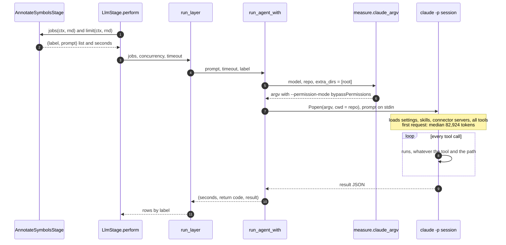
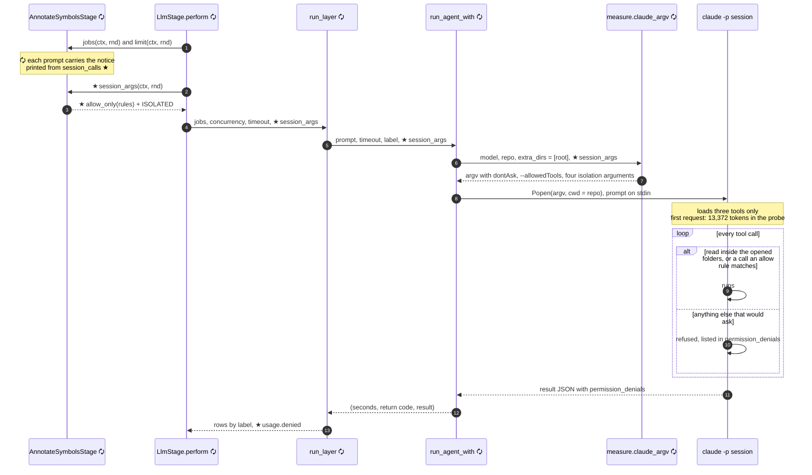
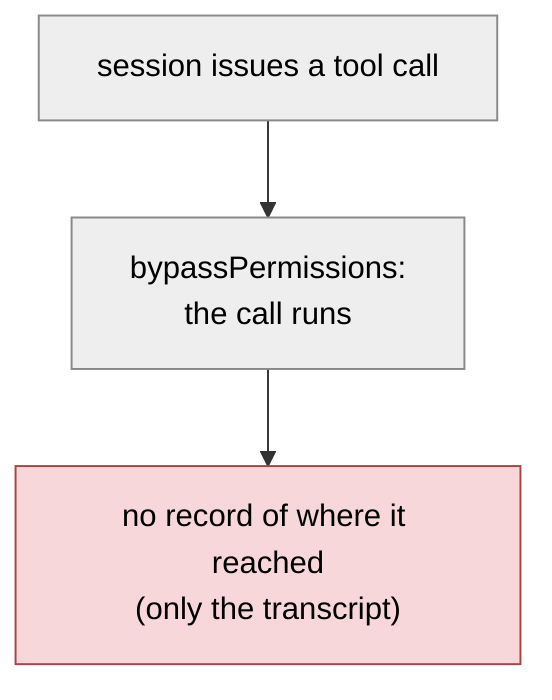
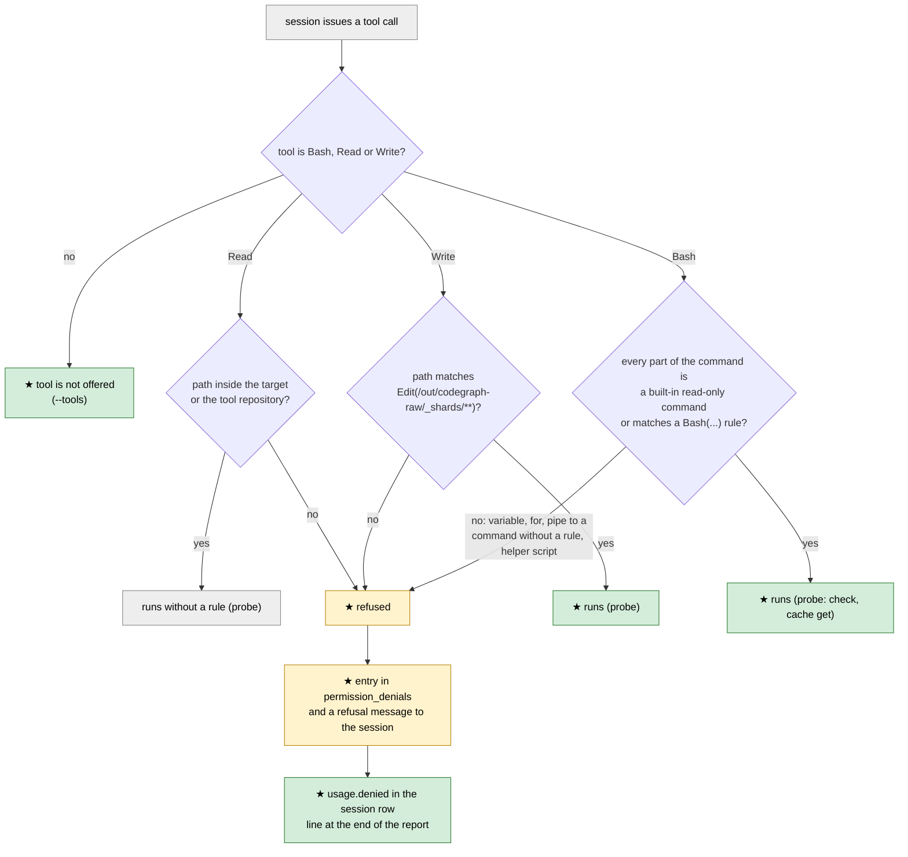
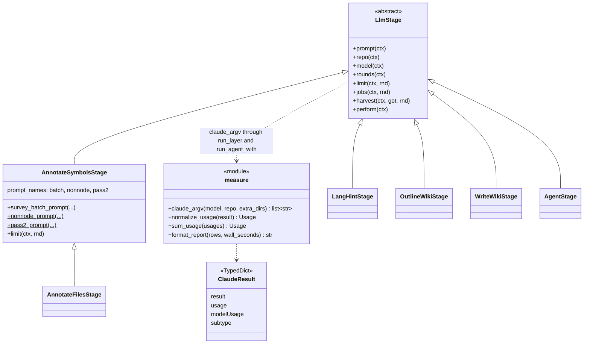
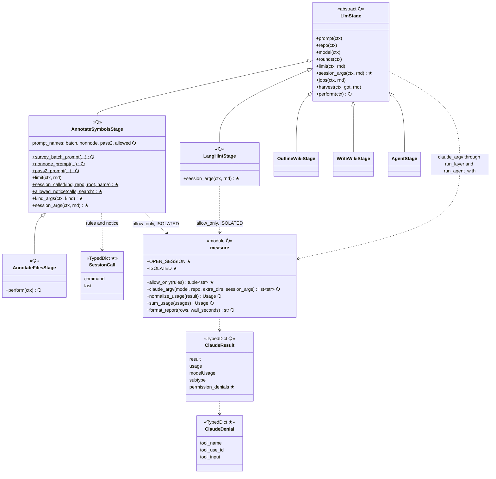

# 🧱 A3 — Session isolation: implementation plan

> 🔄 Status as of 2026-11-23: carried out — implemented and merged into `main` (see `git log`), on A1 + B1 and B3 instead of A2. The approval line below stands as written on the day of the plan.

> **For agentic workers:** REQUIRED SUB-SKILL: Use superpowers:subagent-driven-development (recommended) or superpowers:executing-plans to implement this plan task-by-task. Steps use checkbox (`- [ ]`) syntax for tracking.

> 📅 2026-11-22 · branch `main` · **Before = `29c5ee9` + plans A1 · A2** (A3 is implemented after `2026-11-22-mode1-a1-measure-semantics-plan.md` and `2026-11-22-mode1-a2-session-end-condition-plan.md`. For `src/` and `test/` "Before" is their "After". For the prompt file `resource/codewiki/prompts/annotate-symbols.md` "Before" is **`29c5ee9` + B1** in slice 1 and **`+ B1 · B2 · B3`** in slice 2 — each diff that depends on this says so)
> 📄 Evidence: split `docs/superpowers/specs/2026-11-22-mode1-remediation-split.md` ("Decided" · "A3 allow-list probe" · "Where the decisions meet") · `2026-11-22-mode1-session-cache-plan.md` (Probes 1–3, results R1–R13) · `docs/superpowers/specs/2026-11-21-mode1-cold-run-report.md` §2.3 · §4.1 · §6.2 · `docs/superpowers/specs/2026-11-21-mode1-audit-verification-report.md` §2.1 · plans `2026-11-22-mode1-b1-survey-stabilize-plan.md` (Task 1) and `2026-11-22-mode1-b2-nonnode-terms-plan.md` (Task 2 · "Where B2 meets other plans") · baseline `qa/evals/runs/2026-11-21-mode1-report-builder-cold-layer-sonnet.{json,md}` and its 92 survey session transcripts (kept outside the repository) · official Claude Code documentation, read 2026-11-22 (permission modes · permission rules · CLI reference · headless mode · settings) · `claude --help` of CLI 2.1.330 · code read in this session: `src/core/{measure,pipeline}.py` · `src/codewiki/python/runner/mode1/{context,lang,survey,survey_files,wiki}.py` · `src/codewiki/python/runner/run_mode1.py` · `src/spec/python/runner/run_mode2.py` · `resource/codewiki/prompts/annotate-symbols.md` · `qa/gates/test_prompt_resources.py` · the five test files
> 🔒 Rules kept: no check is loosened (no new `xfail` or `skip`, no change to fault severities, `DROP_CLASS`, `REPORT_ONLY`) · prompt text stays in `resource/`, decided in Python and handed over as rows · additive only — the default command line of every stage that does not opt in is byte for byte today's · wiki stages and Mode 2 are not touched · comments state the present only · no paid model call
> 🧪 Verification: unit tests with spies in place of the session, then the six gates. **Run once in a private clone outside the repository** (`29c5ee9` + A1 + A2, then the seven tasks below): results in 🧪. The clone held A1 and A2 as their plans write them, and **two hand-made stand-ins** for track B (B1's interpreter value, B3's removal of the cache `put` lines) — B2 was not applied; see "What A3 leans on". No `claude` session was started by this plan; what a real session does under these arguments is cited from the allow-list probe or labelled `[unverified]`. The effect is read once, in Measurement A
> ✋ Approval: **before approval**
> 🌐 Korean translation: [2026-11-22-mode1-a3-session-isolation-plan.ko.md](2026-11-22-mode1-a3-session-isolation-plan.ko.md)
> 
> ⚠️ **Implemented on a different base (2026-11-23).** The user shelved plan A2, so A3 went onto A1 + B1 (slice 1) and A1 + B1 + B3 (slice 2): branch `mode1-a3-b3`, 18 commits on `mode1-a1-b1`, not merged. The text below is kept as written. What the code does differently: nothing of A2 is there (`timeout` stays the runner's `ctx.timeout`, no `limit` hook) · after the real B3 every kind of survey session is told one command, the shard check, so the cache row, the cache rule and the cache line of the notice do not exist · the non-node session is **not** under the allow rules and gets no notice — its shard is 71,035 characters at the baseline `[measured]`, more than one `Write` call is expected to carry `[estimate]`; it keeps the isolation arguments until B2 has split it, and O5 has nothing to attach to until then · O1–O4 are implemented as recommended · the paths of the check command are shell-quoted, and the procedure line of the `batch` and `pass2` sections is rendered from the same list as the notice and the rule. Still `[unverified]`, because no session was run on this base: rule matching with the real interpreter path, second-pass and language-hint sessions under `dontAsk`, and how a batch session on an incremental run looks names up with `Read` alone

**Goal:** Survey sessions and the language-hint session start with only what their job needs — three built-in tools, no settings, no skills, no connector servers — and, in the second slice, run only the calls the prompt tells them to run, with every refused call counted.

**Architecture:** An LLM stage says how its sessions start through a new hook `LlmStage.session_args(ctx, rnd)` that returns plain command-line arguments; the value rides `run_layer` → `run_agent_with` → `measure.claude_argv` as one more parameter whose default is today's `--permission-mode bypassPermissions`. The allowed commands of a survey session are one list (`AnnotateSymbolsStage.session_calls`); the allow rules on the command line and the notice in the prompt are both produced from it, and a test binds the prompt's procedure lines to the same list.

**Tech Stack:** Python 3 · Jinja2 prompt sections · msgspec · pytest · pyright strict · Claude Code CLI flags (`--tools` · `--strict-mcp-config` · `--disable-slash-commands` · `--setting-sources` · `--permission-mode` · `--allowedTools`).

**Labels:** `[measured]` a number from a run or a count, with its place · `[code read]` read in the source at the Before state · `[doc]` official documentation, read 2026-11-22 · `[proposed]` this plan's proposal · `[judgment]` this plan's inference · `[unverified]` only a real session could show it. ★ new · 🗘 changed · ✕ removed · no mark = reused as is.

---

## 📋 One-page summary

| | |
|---|---|
| 🎯 Covers | How the runner starts a survey session and the language-hint session: what the session loads at start, which tools it has, which calls run without asking, and where a <span style="color:cyan">refused call</span> is recorded |
| 🧩 Conclusion | Two slices. **Slice 1** adds the four <span style="color:cyan">isolation arguments</span> to the two stages and changes no prompt — it can land right after A2. **Slice 2** replaces `bypassPermissions` by `dontAsk` plus <span style="color:cyan">allow rules</span> and, **in the same change**, adds the <span style="color:cyan">notice of allowed calls</span> to the prompt — it lands after B3. The rules and the notice come from one list (`session_calls`) |
| 🟰 Unchanged | `outline-wiki` · `write-wiki` · Mode 2 `AgentStage` · Mode 1.5: same command line as today, pinned by tests. `--add-dir` for the target and the tool repository. Session unit, concurrency, layer order, time limits (A2), shard check and sweep |
| 🗘 Changed | `claude_argv` takes the <span style="color:cyan">session arguments</span> · `run_layer` and `run_agent_with` pass them · `LlmStage` gains an eighth hook · `AnnotateSymbolsStage` and `LangHintStage` override it · the prompt file gains a section `allowed` and three `{{allowed}}` places · the session row gains `usage.denied` |
| ⚠️ Trap | (1) Rules without the notice make a session drop Bash after one refusal `[measured]` — the two never land apart. (2) A prompt edit of track B that adds or renames a command must edit the list in the same change; a test fails otherwise. (3) `dontAsk` does not fence reads: read-only shell commands still reach any path the operating-system user can read `[doc]`. (4) The non-node session has never run under these arguments — the probe covered one batch only |
| 🚫 Out of scope | Time limits (A2) · the procedure the prompt teaches (B1 · B2 · B3) · wiki sessions and Mode 2 (C1) · a filesystem sandbox · launch order of a layer's first sessions (evidence does not carry a change, see ❓) |

### The two slices at a glance

```text
            slice 1  (after A2, no prompt change)          slice 2  (after B3, one change)
            ─────────────────────────────────────          ─────────────────────────────────────────────
argv        --permission-mode bypassPermissions            --permission-mode dontAsk
            + --tools "Bash,Read,Write"                    + --allowedTools <write rule> <command rules>
            + --strict-mcp-config                          + the same four isolation arguments
            + --disable-slash-commands
            + --setting-sources ""
prompt      unchanged                                      + section `allowed`, shown under the role intro
record      unchanged                                      + usage.denied · report line "거절된 호출"
stages      annotate-symbols · lang-hint                   annotate-symbols (rules per kind) · lang-hint (no rules)
measured    1a: first request 12,636 tokens                3b · 3c: 0 denials, shard passed the check
```

| 🧬 Pattern | Slice 1 | Slice 2 |
|---|---|---|
| What the stage returns from `session_args` | `OPEN_SESSION + ISOLATED` | `allow_only(rules) + ISOLATED` |
| What reaches the prompt | nothing | `allowed_notice(session_calls(kind, …))` |
| What can go wrong in a real session | the detours of the baseline stay possible (B1 removes their cause) | a refused call; counted in `usage.denied` |

## 📌 Decided — not to be reopened

| What | 👍 Chosen | 👎 Dropped | Who | When |
|---|---|---|---|---|
| A3 — isolation arguments | 👍 the four separate arguments `--tools "Bash,Read,Write"` · `--strict-mcp-config` · `--disable-slash-commands` · `--setting-sources ""` | 👎 `--safe-mode` | user | 2026-11-22 |
| A3 — scope | 👍 survey (`annotate-symbols`) and language hint only | 👎 wiki stages and Mode 2 now (wiki waits for C1) | user | 2026-11-22 |
| A3 — permission mode | 👍 narrow it with an allow-list; the headless combination was checked first with a paid probe | 👎 keeping `bypassPermissions` and counting in Measurement A | user | 2026-11-22 |
| When the survey is measured | 👍 once, after track A and track B are both fixed (Measurement A) | 👎 a paid check per plan | user | 2026-11-22 |

Source: the "Decided" table of the split. This plan adds no decision to it.

## 💡 Proposed by this plan — not decided

Every row is `[proposed]`. The recommendation column holds one choice per axis; the reason column separates what was read or measured from the judgment.

| # | Axis | Options | Trade-off | Recommendation |
|---|---|---|---|---|
| P1 | What a stage declares | (a) a hook `session_args(ctx, rnd)` returning plain CLI arguments, composed from two constants and one function of `measure.py` · (b) a small dataclass of switches (tools · isolated · mode · rules) that `claude_argv` translates · (c) "extra arguments" appended to a fixed base | (a) no new type; the default reproduces today's command line. (b) names the switches, but adds a type for two overriding stages and one consumer. (c) cannot work: `--permission-mode` has to be replaced, not repeated `[code read]` | **(a)** `[judgment]` |
| P2 | How the value reaches `claude_argv` | (a) one keyword parameter on `run_layer` and on `run_agent_with`, always passed · (b) inside the job tuple `(label, prompt)` · (c) passed only when it differs from the default · (d) a field of the run context that `claude_argv` reads | (a) costs a mechanical edit of the 12 doubles of `run_layer` and the 6 doubles of `run_agent_with` in the tests `[measured]`. (b) changes the shape every stage's `jobs` returns — the A2 plan rejected the same move for the time limit. (c) makes the call shape depend on the value. (d) makes `measure.py` know about Mode 1 | **(a)** `[judgment]` |
| P3 | Granularity | (a) per round, plus per <span style="color:cyan">session kind</span> where a stage launches sessions itself (file strategy) · (b) per job, with one write rule per shard file | (a) the write rule covers the whole <span style="color:cyan">shard folder</span>, so a session could overwrite another batch's shard; the end-of-stage sweep checks coverage of every shard `[code read]`. (b) closes that, but needs P2(b) and a rule whose path differs per session — never probed | **(a)** `[judgment]` |
| P4 | Where the flag spellings live | (a) `src/core/measure.py`: constants `OPEN_SESSION` · `ISOLATED`, function `allow_only` · (b) in each stage · (c) in `resource/codewiki/config.toml` | (a) one place knows the CLI; stages compose. (b) spells `--setting-sources ""` twice. (c) makes the pairing of rules and notice a setting someone can break without a test noticing | **(a)** `[judgment]` |
| P5 | One source for the allowed commands | (a) a list in Python, `session_calls(kind, repo, root, name)`; rules and notice are both printed from it, and a test checks the prompt's procedure lines against it · (b) derive the rules by parsing the commands out of the rendered prompt · (c) two hand-kept lists and a test | (a) the procedure text stays where track B edits it; one list changes per new command. (b) no list at all, but any line that looks like a command becomes a permission — a prompt typo widens what a session may run. (c) two places to edit | **(a)** `[judgment]` |
| P6 | How the notice gets into the prompt | (a) a fourth section `allowed` in `annotate-symbols.md`, rendered once in Python and handed to the three sections as the value `{{allowed}}` · (b) the text copied into the three sections · (c) a Jinja2 include or macro | (a) one text; needs the name `annotate-symbols#allowed` in `prompt_names` (the prompt gate requires declared names and sections to match one to one `[code read]`). (b) three copies drift. (c) needs a template loader the prompt environment does not have `[code read]` | **(a)** `[judgment]` |
| P7 | Text and place of the notice | (a) the probed text, directly under the two-line role intro — one word differs ("아래 두 명령만" → "아래 명령만", because the non-node and second-pass sessions have one command), and non-node sessions get one more line (❓ O5) · (b) a rewritten text · (c) the probed text next to "끝내기 전에" | (a) is the only text with a measurement: 0 denials in two calls `[measured]`. (b) and (c) have none | **(a)** `[judgment]` |
| P8 | Spelling of the command rules | (a) as probed: `Bash(<interpreter> <tool>/…/check_shard.py *)` and `Bash(<interpreter> <tool>/…/file_cache.py get *)` · (b) also fix the target repository as a word of the cache rule | (a) ran in three calls `[measured]`. (b) is narrower by one word and unprobed | **(a)** `[judgment]` |
| P9 | Order of the slices | (a) slice 1 after A2, slice 2 after B3 · (b) both after B3 · (c) slice 2 before track B | (a) slice 1 touches no file of track B and its arguments ran in the probe with the unchanged prompt `[measured]`. (b) is simpler to schedule but holds back a change that has no dependency. (c) builds the list on procedure lines B1 and B3 rewrite | **(a)** `[judgment]` |

### Structure count

| Kind | Count | Which |
|---|---|---|
| New modules · files | 0 | — |
| New classes with behaviour | 0 | — |
| New typed shapes | 2 `TypedDict` + 1 `Literal` alias | `ClaudeDenial` (`measure.py`) · `SessionCall` (`mode1/context.py`) · `SessionKind` (`mode1/survey.py`) |
| New constants | 2 | `OPEN_SESSION` · `ISOLATED` |
| New functions | 5 | `allow_only` · `LlmStage.session_args` · `AnnotateSymbolsStage.session_calls` · `.allowed_notice` · `.kind_args` |
| Overrides of the new hook | 2 of 5 LLM stages | `AnnotateSymbolsStage` (and through it `AnnotateFilesStage`) · `LangHintStage` |
| Callers of the hook | 2 | `LlmStage.perform` · the file strategy's `submit` |
| Readers of `session_calls` | 2 | the rules (`kind_args`) · the notice (`allowed_notice`) |
| Interfaces · registries · plug-in points | 0 | one implementer and two readers do not make an interface |

## 📊 Status

| Item | State | Note |
|---|---|---|
| Blocking decisions (arguments · scope · permission mode) | ✅ | taken by the user on 2026-11-22 |
| Paid allow-list probe | ✅ | run on 2026-11-22; results in the session cache plan and the split |
| This plan's tasks tried in a private clone | ✅ | seven tasks, test first; counts in 🧪 |
| Implementation in the repository | ❌ | before approval |
| B2 plan | 🟡 | written (`2026-11-22-mode1-b2-nonnode-terms-plan.md`), read for this plan, not applied in the clone |
| B3 plan | ❌ | not written when this plan was written — its final command list may differ; "What A3 leans on" says which one place follows it |
| Effect measured | ❌ | Measurement A, once, after both tracks |

## 🔎 What the code does today — the six questions

| # | Question | Answer at the Before state | Source |
|---|---|---|---|
| 1 | How does a stage say how its sessions start? | It cannot. `claude_argv(model, repo, extra_dirs)` builds one fixed command line with `--permission-mode bypassPermissions` for every caller: `run_agent_with` (all Mode 1 LLM stages and Mode 2 `AgentStage` through `run_layer`) and the uncalled `run_agent` of Mode 2. Five stages subclass `LlmStage`: `LangHintStage` · `AnnotateSymbolsStage` (with its subclass `AnnotateFilesStage`) · `OutlineWikiStage` · `WriteWikiStage` · `AgentStage` | `[code read]` `src/core/measure.py:174` · `src/core/pipeline.py:488` · `src/spec/python/runner/run_mode2.py:248` · `:386` |
| 2 | Where would one list of allowed commands come from? | Nowhere yet. The commands exist only as text in the prompt: five lines of `annotate-symbols.md` at `29c5ee9` (cache `get` · cache `put` · the check in `batch` · the check in `nonnode` · the check in `pass2`). The three prompt builders are static and receive `repo` and `root`, so a list built from the same two values can feed both the rules and the prompt | `[code read]` `resource/codewiki/prompts/annotate-symbols.md:64` · `:67` · `:113` · `:176` · `:211` · `mode1/survey.py:116` · `:163` · `:365` |
| 3 | Which survey session needs which calls? | See the table below | `[code read]` |
| 4 | What do rules look like and where do they anchor? | See "Rule syntax" below | `[doc]` · `claude --help` |
| 5 | How does text get into the prompt? | Only through `PromptResource.load_prompt("<file>#<section>", **values)`; the names a section uses and the values passed must be equal, and long text may not sit in Python. A stage's `prompt_names` and the sections of its file must match one to one | `[code read]` `src/core/pipeline.py:645` · `qa/gates/test_prompt_resources.py` |
| 6 | What does `--add-dir` keep doing, and what can a session still reach? | See "What the session can still reach" below | `[doc]` · `[measured]` |

### Which session needs which calls `[code read]`

| Session | Launched by | Reads | Writes | Shell commands the prompt tells it to run |
|---|---|---|---|---|
| Batch (layer strategy) | `LlmStage.perform` → `run_layer`, one round per symbol layer | its source files, `record-schema.json`, the merged records — all inside the target repository | `out/codegraph-raw/_shards/<batch>.json` | cache `get` · the shard check |
| Batch after quarantine | the same path on the next run; the prompt carries the faults | additionally `_shards/<batch>.json.bad` — inside the shard folder | the same shard | the same two |
| Non-node | the last round (layer kind `non-node`). One session `NONNODE` today; after B2 up to three: `NONNODE-FILE` · `NONNODE-MODULE` · `NONNODE-NAMED` | the merged records and files of the target repository; after B2 only `NONNODE-NAMED` opens the merged records, to search them (B2 plan) | `_shards/NONNODE.json`; after B2 `_shards/<session name>.json` | the shard check |
| Second pass (file strategy only) | `AnnotateFilesStage.perform` → `submit("<batch>/p2", …)` → `run_agent_with` directly | nothing — "소스를 열지 않는다"; the records come inside the prompt | `_shards/_pass2/<batch>.json` | the shard check |
| File strategy, first pass and non-node | `submit(<batch>, …)` and `submit("NONNODE", …)` | as the batch and the non-node session | as above | as above |
| Language hint | `LlmStage.perform`, one session | nothing — the root documents are inside the prompt | nothing | none; it called no tool in the baseline (1 turn) `[measured]` |

Every path in the table lies inside the target repository, which is the session's working directory (`cwd=repo` in `run_agent_with`), or inside the tool repository opened by `--add-dir`.

### Rule syntax `[doc]` — official documentation, read 2026-11-22, and `claude --help` (2.1.330)

- `--permission-mode dontAsk` denies every call that would otherwise ask. A headless result lists the refused calls in `permission_denials`.
- In every mode, file reads inside the working directories and a built-in set of read-only shell commands (`ls` · `cat` · `head` · `tail` · `grep` · `find` · `wc` · `diff` · `stat` · `du` · `cd` · read-only `git`, among others) run without a rule.
- `--allowedTools <tools...>` takes several rules; each rule is one argument. `Bash(<text> *)` matches the command text by prefix; the space before `*` is part of the rule, and the rule also matches the bare command.
- A compound command (`&&` · `||` · `;` · `|` · a newline) runs only if every part is allowed. A leading assignment of a variable that is not known-safe keeps an allow rule from matching.
- `Edit(<path>)` rules cover every built-in tool that edits files, `Write` included; a `Write(<path>)` rule does not match. Given on the command line, a pattern starting with `/` anchors at the session's primary working directory, `//` is an absolute path, `~/` the home directory.
- An output redirection (`> file`) is checked against the `Edit` rules and the working directories.
- `--add-dir` makes a directory a working directory: readable without asking; edits still follow the mode. Skills and commands of an added directory load through the `project` setting source, so `--setting-sources ""` stops them.
- A boundary that does not depend on command text is the sandbox feature, not permission rules.

### What the session can still reach — stated plainly

| Reach | After slice 1 | After slice 2 | Label |
|---|---|---|---|
| Any tool call, any path | yes — `bypassPermissions` stays | no | `[code read]` |
| Read of a file in the target or the tool repository | yes | yes, without a rule | `[doc]` · `[measured]` in the probe |
| Read tool on a path outside both | yes | refused | `[doc]` · `[unverified]` |
| Read-only shell command (`cat` · `grep` · `find` · …) on a path outside both | yes | **yes** — the built-in read-only set is not bound to the working directories by the mode | `[doc]` · `[unverified]` |
| Write outside the shard folder | yes | refused | `[doc]`; the probe saw no such attempt |
| Write of another batch's shard, or of any file name under `_shards/` | yes | **yes** — the rule covers the folder | `[code read]` |
| `cat > <path under _shards/>` without input (the hang trigger of the baseline) | yes | **probably yes** for that folder; A2's limit bounds the wait | `[unverified]` |
| A helper script through the interpreter found on `PATH` | yes | refused — no rule matches | `[doc]`; one refusal of a chained command `[measured]` |
| An allowed command with extra words after it (other shard path, other file) | yes | **yes** — the rule matches by prefix | `[doc]` |
| Skills · slash commands · connector servers · user and project settings | not loaded | not loaded | `[measured]` first request 12,636 tokens against 86,453 for the same batch |

`[unverified]` also: an interpreter or tool path that contains a space, a comma or a parenthesis may break how a rule is parsed or matched. The plan does not guard against it; Measurement A runs on paths without such characters.

## 🔢 The numbers this plan leans on

| What | Value | Place |
|---|---|---|
| First request of a batch session, baseline | median 82,924 tokens (69,146 – 88,418) | cold-run report §2.3 · audit verification report §2.1 |
| First request with the four arguments | 12,636 tokens (same batch at baseline: 86,453) | session cache plan, Probe 1 (call 1a) |
| First request with the four arguments and the notice | 13,372 and 13,374 tokens | session cache plan, Probe 3 (calls 3b · 3c) |
| Shared prefix every isolated call read from cache, the first one included | 3,296 tokens | session cache plan R4 |
| Rules without the notice | 1 refusal; the session never used Bash again and did not run the check | session cache plan, Probe 3 (call 3a) |
| Rules with the notice | 0 refusals in both calls; check run and passed | session cache plan, Probe 3 (calls 3b · 3c) |
| Language-hint session, baseline | 76,732 tokens · 16.84 s · \$0.1057 · 1 turn | baseline JSON, row `lang-hint`, recomputed for this plan |
| Tool calls of the 91 batch sessions, baseline | Bash 605 · Read 190 · Write 25 · other 1 | baseline transcripts, counted for this plan |
| Tool calls of the non-node session, baseline | Bash 42 · Read 2 · Write 3 | the same count |
| Calls naming something outside the two <span style="color:cyan">opened folders</span>, baseline | batch: 295 calls in 90 of 91 sessions · non-node: 26 calls | the same count; method below |

**How the outside calls were counted `[measured]`.** In each of the 92 survey transcripts the tool calls were taken once per call id. A call counts as "outside" when its input names an absolute path that is neither inside the target repository nor inside the tool repository, nor one of their parent folders, nor under `/dev` — or when it starts an interpreter by bare name (`python3` · `python`), which resolves through `PATH`. Paths built from shell variables were not expanded, so the count is a lower bound. By kind, batch sessions (one call can fall in several kinds): interpreter from `PATH` 186 calls in 69 sessions · a path under the home directory 117 in 47 · the session's temporary folder 60 in 47 (plus 3 calls of the Write tool) · the system temporary folder 23 in 19 · a system path 1. The split says these calls "were not counted in the baseline"; this count is the baseline Measurement A compares against.

## 🔁 Before / After

| 📍 Before (what does not work today) | 🛠️ After · proposed | 🎉 What it resolves | 🔭 Expected | Done |
|---|---|---|---|---|
| Every session loads user and project settings, skills, connector servers and every built-in tool; the first request of a batch session is a median 82,924 tokens `[measured]` | Slice 1: survey and language-hint sessions start with the four isolation arguments | The start-up context of 92 survey sessions and the 76,732-token language hint | First request near 12,636 tokens `[measured]` in one call; the run-wide number is read in Measurement A | ❌ |
| A stage cannot say how its sessions start; one command line for all | `LlmStage.session_args(ctx, rnd)`; default = today's arguments | Survey and language hint change while wiki and Mode 2 stay byte for byte | Two overrides; three stages untouched, pinned by tests | ❌ |
| Any call runs: 295 batch calls named something outside the two opened folders `[measured]` | Slice 2: `dontAsk` + a write rule for the shard folder + one rule per command of the prompt | Helper scripts, writes outside the shard folder, the interpreter from `PATH` | Refused and counted; not zero reach — read-only shell commands stay (see "still reach") | ❌ |
| A session that is refused once gives up on Bash `[measured]` in call 3a | The notice of allowed calls sits in the prompt, printed from the same list as the rules | The check runs inside the session again | 0 refusals in two probed calls `[measured]`; the 92-session number is read in Measurement A | ❌ |
| A refused call would be visible only in the transcript | `usage.denied` in the session row and a line at the end of the report | Measurement A reads refusals from the committed record | A count; the command text stays out of the record | ❌ |

## ★ New · 🗘 changed items (module → file → class → function → member)

| Level | Item | Kind | Where | Slice |
|---|---|---|---|---|
| Module | none | — | — | — |
| File | 🗘 `src/core/measure.py` | changed | core | 1 · 2 |
| File | 🗘 `src/core/pipeline.py` | changed | core | 1 |
| File | 🗘 `src/codewiki/python/runner/mode1/survey.py` | changed | Mode 1 runner | 1 · 2 |
| File | 🗘 `src/codewiki/python/runner/mode1/survey_files.py` | changed | Mode 1 runner | 1 · 2 |
| File | 🗘 `src/codewiki/python/runner/mode1/lang.py` | changed | Mode 1 runner | 1 · 2 |
| File | 🗘 `src/codewiki/python/runner/mode1/context.py` | changed | Mode 1 runner | 2 |
| File | 🗘 `resource/codewiki/prompts/annotate-symbols.md` | changed | prompts | 2 |
| File | 🗘 `src/codewiki/python/runner/run_mode1.py` (module docstring) · `resource/CLAUDE.md` · `qa/evals/README.md` · generated `README.md` of `src/core` and `src/codewiki/python/runner` | changed | documents | 1 · 2 |
| File | 🗘 `test/core/test_measure.py` · `test/core/test_pipeline.py` · `test/codewiki/test_mode1.py` · `test/codewiki/test_run_mode1.py` · `test/spec/test_run_mode2.py` | changed | tests | 1 · 2 |
| Class | ★ `ClaudeDenial` (`TypedDict`) | new | `measure.py` | 2 |
| Class | 🗘 `ClaudeResult` | changed | `measure.py` | 2 |
| Class | 🗘 `LlmStage` | changed | `pipeline.py` | 1 |
| Class | 🗘 `AnnotateSymbolsStage` · 🗘 `AnnotateFilesStage` · 🗘 `LangHintStage` | changed | `mode1/` | 1 · 2 |
| Class | ★ `SessionCall` (`TypedDict`) | new | `mode1/context.py` | 2 |
| Class | `OutlineWikiStage` · `WriteWikiStage` · `AgentStage` | reused as is | — | — |
| Function | 🗘 `claude_argv(model, repo, extra_dirs, session_args=OPEN_SESSION)` | changed | `measure.py` | 1 |
| Function | ★ `allow_only(rules)` | new | `measure.py` | 2 |
| Function | 🗘 `normalize_usage` · 🗘 `sum_usage` · 🗘 `format_report` | changed | `measure.py` | 2 |
| Function | 🗘 `run_agent_with(…, session_args=OPEN_SESSION)` · 🗘 `run_layer(…, session_args=OPEN_SESSION)` | changed | `pipeline.py` | 1 |
| Function | ★ `LlmStage.session_args(ctx, rnd)` · 🗘 `LlmStage.perform` | new · changed | `pipeline.py` | 1 |
| Function | ★ `AnnotateSymbolsStage.session_args` (override) · ★ `LangHintStage.session_args` (override) | new | `mode1/survey.py` · `mode1/lang.py` | 1, body 🗘 in 2 |
| Function | ★ `AnnotateSymbolsStage.session_calls` · ★ `.allowed_notice` · ★ `.kind_args` | new | `mode1/survey.py` | 2 |
| Function | 🗘 `survey_batch_prompt` · 🗘 `nonnode_prompt` · 🗘 `pass2_prompt` (pass `allowed`) | changed | `mode1/survey.py` | 2 |
| Function | 🗘 `AnnotateFilesStage.perform` (inner `submit`) | changed | `mode1/survey_files.py` | 1 · 2 |
| Member | ★ `OPEN_SESSION` · ★ `ISOLATED` (module constants) | new | `measure.py` | 1 |
| Member | ★ `ClaudeResult.permission_denials` · ★ key `denied` of `Usage` | new | `measure.py` | 2 |
| Member | ★ `SessionKind` (`Literal`) · 🗘 `AnnotateSymbolsStage.prompt_names` (+ `annotate-symbols#allowed`) | new · changed | `mode1/survey.py` | 2 |
| Member | ★ prompt section `allowed` · ★ place `{{allowed}}` in `batch` · `nonnode` · `pass2` | new | `annotate-symbols.md` | 2 |

## ⏱️ Sequence — one session launch and what it may call

**Before** (`29c5ee9` + A1 · A2)



**After · proposed** (slice 2; in slice 1 message 3 returns `OPEN_SESSION + ISOLATED` and the refusal branch does not exist)



## 🔀 Flow — how a call is allowed or refused

**Before**



**After · proposed** (slice 2). The decision is the CLI's; the branches are `[doc]`, and the two green leaves marked "probe" were seen in the allow-list probe.



Legend: gray = unchanged · green = new · amber = new behaviour that can stop a call.

## 🧱 Structure — the hook and the typed shapes

**Before**



**After · proposed**



## 🔧 Where to change

Line numbers are those of the Before state (`29c5ee9` + A1 · A2) as built in the private clone; they shift if A1 or A2 land with different line counts. The symbol names are the anchor.

| File · symbol | Change | Why | Evidence |
|---|---|---|---|
| `src/core/measure.py` · `claude_argv` (`:174`) | 🗘 fourth parameter `session_args`, default `OPEN_SESSION`; the two hard-coded permission words leave the list literal | one place builds the command line for every caller | `[code read]` the literal at `:180-181` |
| `src/core/measure.py` · ★ `OPEN_SESSION` · ★ `ISOLATED` · ★ `allow_only` | the three building blocks stages compose | P4 | decided arguments; probed combination |
| `src/core/measure.py` · `ClaudeResult` (`:35`) · `normalize_usage` (`:81`) · `sum_usage` (`:110`) · `format_report` (`:198`) | 🗘 read `permission_denials`, count it as `denied`, fold it, print a line per row that has refusals | Measurement A reads refusals from the record | `[measured]` the result of a headless call carries the list (call 3a) |
| `src/core/pipeline.py` · `run_agent_with` (`:473`) · `run_layer` (`:515`) | 🗘 parameter `session_args`, passed on unchanged | P2 | `[code read]` `:488` · `:530` |
| `src/core/pipeline.py` · `LlmStage` (`:658`) | ★ hook `session_args`; 🗘 `perform` passes its value per round | P1 | `[code read]` `perform` already passes `limit(ctx, rnd)` the same way |
| `mode1/survey.py` · `AnnotateSymbolsStage` | slice 1: ★ override returning `OPEN_SESSION + ISOLATED`. Slice 2: ★ `session_calls` · `allowed_notice` · `kind_args`, 🗘 override picks the kind by the layer, 🗘 the three prompt builders pass `allowed`, 🗘 `prompt_names` | P3 · P5 · P6 | `[code read]` `limit` picks by the same layer kind (`:616`) |
| `mode1/survey_files.py` · `submit` (`:63`) | 🗘 passes the session arguments as the seventh argument of `P.run_agent_with` — this strategy does not go through `run_layer` | otherwise file-strategy sessions keep today's command line | `[code read]` `:66` |
| `mode1/lang.py` · `LangHintStage` | ★ override: slice 1 `OPEN_SESSION + ISOLATED`, slice 2 `allow_only(()) + ISOLATED` | the decided scope | `[measured]` 76,732 tokens for one word |
| `mode1/context.py` | ★ `SessionCall` next to the other prompt-row types (`DepRow` · `PendingRow` · `Pass2DepRow`) | rows handed to a prompt live here | `[code read]` |
| `resource/codewiki/prompts/annotate-symbols.md` | ★ section `allowed`; ★ `{{allowed}}` under the role intro of `batch` · `nonnode` · `pass2` | P6 · P7 | `[measured]` the probed place and text |
| `mode1/wiki.py` · `run_mode2.py` | none | decided scope | pinned by two tests |

### Proposed diff — the path of the arguments (slice 1)

**Proposed diff.** Before lines are the source at `29c5ee9` + A1 · A2.

`src/core/measure.py`

```diff
-def claude_argv(model: str, repo: str, extra_dirs: Iterable[str]) -> list[str]:
+OPEN_SESSION: tuple[str, ...] = ("--permission-mode", "bypassPermissions")
+
+ISOLATED: tuple[str, ...] = ("--tools", "Bash,Read,Write", "--strict-mcp-config", "--disable-slash-commands",
+                             "--setting-sources", "")
+
+
+def claude_argv(model: str, repo: str, extra_dirs: Iterable[str],
+                session_args: Sequence[str] = OPEN_SESSION) -> list[str]:
     """헤드리스 `claude` 명령줄. 프롬프트는 여기 싣지 않는다 — 표준 입력으로 준다.
@@
-    argv = ["claude", "-p", "--output-format", "json", "--model", model,
-            "--permission-mode", "bypassPermissions"]
+    argv = ["claude", "-p", "--output-format", "json", "--model", model, *session_args]
     for d in [repo] + list(extra_dirs):
```

`src/core/pipeline.py`

```diff
 def run_agent_with(model: str, repo: str, root: str, prompt: str,
                    timeout: float | None = None,
-                   label: str | None = None) -> tuple[float, int, AgentResult | None]:
+                   label: str | None = None,
+                   session_args: Sequence[str] = M.OPEN_SESSION) -> tuple[float, int, AgentResult | None]:
@@
-    argv = M.claude_argv(model=model, repo=repo, extra_dirs=[root])
+    argv = M.claude_argv(model=model, repo=repo, extra_dirs=[root], session_args=session_args)
@@
 def run_layer(model: str, repo: str, root: str, jobs: Sequence[tuple[str, str]],
               concurrency: int = 8,
-              timeout: float | None = None) -> list[JobResult]:
+              timeout: float | None = None,
+              session_args: Sequence[str] = M.OPEN_SESSION) -> list[JobResult]:
@@
-        futs = {ex.submit(run_agent_with, model, repo, root, prompt, timeout, label): label
+        futs = {ex.submit(run_agent_with, model, repo, root, prompt, timeout, label, session_args): label
@@ class LlmStage
+    def session_args(self, ctx: C, rnd: int) -> Sequence[str]:
+        """이 라운드의 세션들이 받는 권한 · 격리 인자. 재정의하지 않으면 `measure.OPEN_SESSION` 이다."""
+        return M.OPEN_SESSION
+
@@ LlmStage.perform
                 got = run_layer(self.model(ctx), self.repo(ctx), ctx.root, jobs,
-                                concurrency=ctx.concurrency, timeout=self.limit(ctx, rnd))
+                                concurrency=ctx.concurrency, timeout=self.limit(ctx, rnd),
+                                session_args=self.session_args(ctx, rnd))
```

### Proposed diff — one list, two readers (slice 2)

**Proposed diff, main points only.** The full code is in Task 6.

`src/codewiki/python/runner/mode1/survey.py`

```diff
+    @staticmethod
+    def session_calls(kind: SessionKind, repo: str, root: str, name: str = "") -> list[SessionCall]:
+        tool = os.path.join(root, "src", "codewiki", "python")
+        shard = "_pass2/%s.json" % name if kind == "pass2" else name + ".json"
+        check: SessionCall = {"command": "%s %s" % (sys.executable, os.path.join(tool, "runner", "check_shard.py")),
+                              "last": os.path.join(repo, "out", "codegraph-raw", "_shards", shard)}
+        cache: SessionCall = {"command": "%s %s get" % (sys.executable, os.path.join(tool, "machine", "file_cache.py")),
+                              "last": repo + " <파일경로>"}
+        return [cache, check] if kind == "batch" else [check]
+
+    def kind_args(self, ctx: Mode1Context, kind: SessionKind) -> Sequence[str]:
+        folder = os.path.relpath(self.shard_dir(ctx), ctx.repo).replace(os.sep, "/")
+        rules = ["Edit(/%s/**)" % folder] + ["Bash(%s *)" % c["command"]
+                                              for c in self.session_calls(kind, ctx.repo, ctx.root)]
+        return M.allow_only(rules) + M.ISOLATED
```

`resource/codewiki/prompts/annotate-symbols.md` — Before for this file is `29c5ee9` + B1 · B2 · B3

```diff
 너는 코드베이스 전수조사의 배치 {{bid}} 담당이다. 대상 저장소 {{repo}}. 도구 저장소 {{root}}.
 사람에게 묻지 않는다 — 이 세션은 헤드리스라 되묻는 순간 막힌다. 막히면 무엇이 없어 막혔는지 적고 끝낸다.
 
+{{allowed}}
+
 
@@ end of file
+<!-- section: allowed -->
+## 이 세션은 허용된 호출만 돈다
+
+허용되지 않은 호출은 거절된다. 거절 하나는 그 호출이 막혔다는 뜻이지 Bash 전체가 막혔다는 뜻이 아니다.
+- 파일은 Read 로 읽고, 샤드는 Write 로 쓴다.
+- Bash 는 아래 명령만 돈다. **적힌 글자 그대로, 한 번에 하나씩** 부른다 — 변수(`P=...`) · `for` · `;` · `&&` · `|` 로 잇지 않는다:
+
+    {{ c.command }} {{ c.last }}
+
+
+- 그 밖에 읽기만 하는 명령(`grep` · `ls` · `find` · `wc`)은 Bash 로 돈다. 큰 파일에서 낱말을 찾을 때 쓴다. 이것도 한 번에 하나씩 부른다.
+
```

What a batch session receives on its command line after slice 2 (output example; `<interpreter>` is `sys.executable`, `<tool>` and `<target>` are the two repositories):

```text
claude -p --output-format json --model <model>
  --permission-mode dontAsk
  --allowedTools "Edit(/out/codegraph-raw/_shards/**)"
                 "Bash(<interpreter> <tool>/src/codewiki/python/machine/file_cache.py get *)"
                 "Bash(<interpreter> <tool>/src/codewiki/python/runner/check_shard.py *)"
  --tools "Bash,Read,Write" --strict-mcp-config --disable-slash-commands --setting-sources ""
  --add-dir <target> --add-dir <tool>
```

## 🧭 Order of the slices

| Slice | Tasks | Lands | Deliverable | Check |
|---|---|---|---|---|
| **1 — isolation arguments** | 1 · 2 · 3 · 4 | right after A2; touches no file track B edits except `mode1/survey.py`, where it adds one method next to A2's `limit` | survey and language-hint sessions start with the four arguments; every other session keeps today's command line | the tests of tasks 1–3; six gates in task 4 |
| **2 — allowed calls** | 5 · 6 · 7 | after B3. Task 6 is **one change**: the rules, the notice and the tests that bind them land in one commit | `dontAsk` + rules per session kind; the notice in the prompt; `usage.denied` | the tests of tasks 5–6; six gates in task 7 |

Why slice 1 can go first `[measured]`: the four arguments with the unchanged prompt and `bypassPermissions` finished the batch and the shard passed the check (session cache plan, Probe 1, call 1a). Why slice 2 waits `[code read]`: B1 rewrites the interpreter of every command line in the prompt and B3 removes the cache `put` line; the list of slice 2 is built on what remains. Task 6 starts with a step that stops if the `put` line is still in the prompt.

## 🔗 Where A3 meets the other plans

| Plan | What meets | How this plan handles it |
|---|---|---|
| A1 | `ClaudeResult` · `normalize_usage` · `sum_usage` · `format_report` — A1 adds `model_total` and the "사용량 덜 적힘" line in the same functions | Task 5 adds `denied` next to `model_total` and its line after A1's line. Before for these functions is A1's After |
| A2 | `run_agent_with` · `run_layer` · `LlmStage.limit` · the test doubles A2 already widened by `timeout` | The new parameter comes after A2's `timeout` and `label`. Task 2 widens the same doubles once more. A session that waits on an input-less command is still ended by A2's limit; A3 does not remove that command |
| B1 | The interpreter of the prompt's command lines. B1's plan passes `python=sys.executable` | `session_calls` uses the same `sys.executable`. If B1 lands with another value, the first test of the binding pair fails and names the lines — change the one expression in `session_calls` |
| B2 | Splits the non-node session into up to three (`NONNODE-FILE` · `NONNODE-MODULE` · `NONNODE-NAMED`); the session name is the job label and the shard name; `nonnode_prompt` gains the parameter `sid`; the section still names one command, the check on `_shards/{{sid}}.json` (B2 plan, "Where B2 meets other plans", row A3) | All three sessions get the kind `nonnode`: in the layer strategy the layer kind decides, in the file strategy every label that is neither a batch id nor `<batch>/p2` — the same two keys A2's limit uses. One `Bash(… check_shard.py *)` rule covers the three shards and the write rule covers the three files, as B2 states. `nonnode_prompt` passes its `sid` as the shard name of the notice. B2 says the third session searches the merged records rather than reading them through; with three tools the only search is `grep` through Bash, which is why the non-node notice carries one more line (❓ O5). The baseline's single non-node session issued 42 Bash calls, 17 through an interpreter from `PATH` `[measured]` — under slice 2 those are refused |
| B3 | Removes the cache `put` procedure; decides how a session receives the pre-filled cache and how the prompt tells it to write the shard | The list has no `put` row. If B3 keeps `get`, nothing changes; if B3 drops `get` too, delete the `cache` row. If B3 tells the session to write the shard "with the Write tool", it agrees with the notice line "샤드는 Write 로 쓴다" |
| B2 and slice 1 | The third test of Task 3 launches the file strategy to its end and names the non-node label | Whichever of B2 and slice 1 lands second writes B2's session names into that test (Task 3 says how) |
| C1 | Wiki sessions call a skill; isolation would remove it | Not touched. C1 overrides the same hook for the wiki stages when its shape is decided |
| Measurement A | Reads the effect of A3 | (1) first-request tokens of the survey sessions and of the language hint, from the transcripts, against 82,924 and 76,732 · (2) refused calls: sum of `usage.denied` over the survey rows and the "거절된 호출" lines · (3) calls naming something outside the two opened folders, counted from the transcripts with the method of "The numbers", against 295 (batch) and 26 (non-node) |

## 🧷 What A3 leans on from earlier plans

A3 does not produce these; it starts from them. The private clone imitated two of them by hand — commits titled `(B1 대역)` and `(B3 대역)` — only so that the slice-2 tasks could be run. Those two commits are **not** part of A3 and are not in the task list.

| From | What A3 needs to be true | File · line · name | Which A3 task leans on it | In the clone |
|---|---|---|---|---|
| A1 | `normalize_usage` returns `model_total`; `sum_usage` folds a key list; `format_report` ends with the loop that prints `사용량 덜 적힘` | `src/core/measure.py` — `normalize_usage` · `sum_usage` · `format_report` | Task 5 adds `denied` in the same three places | A1 applied as its plan writes it |
| A2 | `run_agent_with(model, repo, root, prompt, timeout, label)` on `Popen`; `run_layer(…, concurrency, timeout)`; `LlmStage.limit(ctx, rnd)` and `perform` passing it; `AnnotateSymbolsStage.session_limit` and the label test in `survey_files.py` `submit`; the widened test doubles | `src/core/pipeline.py` · `mode1/survey.py` · `mode1/survey_files.py` · four test files | Tasks 2 · 3 add one parameter after A2's and one hook next to `limit` | A2 applied as its plan writes it |
| B1 (Task 1) | The five command lines of the prompt start with `{{python}}`, and the three `load_prompt` calls pass `python=sys.executable` | `resource/codewiki/prompts/annotate-symbols.md` (at `29c5ee9`: lines 64 · 67 · 113 · 176 · 211) · `mode1/survey.py` `survey_batch_prompt` · `nonnode_prompt` · `pass2_prompt` | Task 6: `session_calls` builds its commands from the same `sys.executable`; the binding test compares prompt lines that start with it | **stand-in** `(B1 대역)`: the five lines and the three arguments, without B1's test and without the rest of B1 |
| B2 (Task 2) | `nonnode_prompt(repo, root, sid, files, modules, faults, bad)`; the section's check line ends in `_shards/{{sid}}.json`; non-node labels are `NONNODE-FILE` · `NONNODE-MODULE` · `NONNODE-NAMED`; both strategies launch them through `nonnode_jobs` | `mode1/survey.py` · `mode1/survey_files.py` · section `nonnode` of the prompt | Task 6: `nonnode_prompt` hands `sid` to `session_calls`; the test helper calls `nonnode_prompt(repo, root, "NONNODE-NAMED")` | **not applied.** The clone ran the same code with the literal `"NONNODE"` in place of `sid` and `nonnode_prompt(repo, root)` in the test helper. The B2 form of these two expressions is `[unverified]` |
| B3 | The cache `put` procedure is gone from the `batch` section; whatever commands remain are written as lines that start with `{{python}}` | `resource/codewiki/prompts/annotate-symbols.md`, section `batch`, "읽는 법" (at `29c5ee9`: lines 63–72) | Task 6: the list has a `get` row and no `put` row | **stand-in** `(B3 대역)`: the five lines of the `put` procedure replaced by `- 없으면: 파일을 통독한다.` No B3 plan existed; its real text will differ |

**If B3 changes the commands.** The one place is `AnnotateSymbolsStage.session_calls` in `src/codewiki/python/runner/mode1/survey.py`. The allow rules (`kind_args`) and the notice (`allowed_notice`, section `allowed`) are both printed from what it returns, so nothing else follows by hand.

| B3 ends up with | Change in `session_calls` | Anything else |
|---|---|---|
| `get` kept, `put` removed (the decided direction) | none | none |
| `get` removed as well (the session receives the cache another way) | delete the `cache` row; `batch` returns `[check]` | the assertion on the two notice lines in `test_알림은_역할_소개_바로_아래에_허용된_명령을_적힌_글자_그대로_싣는다` and the rule list in `test_전수조사_세션은_묻는_호출을_거절하고_종류마다_허용_규칙을_받는다` lose the cache line |
| a new command (another script, or `get` with other fixed words) | add or edit one row: `command` = interpreter, script and fixed words, `last` = what the notice prints after them | the same two assertions gain the line |
| a command only for some session kind | return it for that kind only | none |

Two tests catch a miss in either direction: `test_프롬프트가_시키는_명령은_전부_그_세션의_허용_규칙이_덮는다` fails when the prompt names a command no rule covers, and `test_허용_규칙의_명령은_전부_프롬프트의_절차에도_적혀_있다` fails when a rule allows a command the procedure no longer names.


## 📖 Terms

| Term | Code name | Meaning |
|---|---|---|
| <span style="color:cyan">session arguments</span> | `session_args` (hook of `LlmStage`, parameter of `run_layer` · `run_agent_with` · `claude_argv`) | the command-line arguments that set the permission mode and what a session loads at start |
| <span style="color:cyan">open session</span> | `measure.OPEN_SESSION` | today's arguments: `--permission-mode bypassPermissions` |
| <span style="color:cyan">isolation arguments</span> | `measure.ISOLATED` | the four decided arguments |
| <span style="color:cyan">allow-only arguments</span> | `measure.allow_only(rules)` | `--permission-mode dontAsk` followed by `--allowedTools` and the rules |
| <span style="color:cyan">allow rule</span> | one element after `--allowedTools` | `Edit(<path pattern>)` or `Bash(<command prefix> *)` |
| <span style="color:cyan">session call</span> | `SessionCall` · `AnnotateSymbolsStage.session_calls` | one shell command a survey session may run: the fixed prefix (`command`) and what the notice prints after it (`last`) |
| <span style="color:cyan">session kind</span> | `SessionKind` — `"batch"` · `"nonnode"` · `"pass2"` | which list of session calls a survey session gets |
| <span style="color:cyan">notice of allowed calls</span> | prompt section `annotate-symbols#allowed` · `allowed_notice` · place `{{allowed}}` | the paragraph that tells the session what runs and that one refusal does not close Bash |
| <span style="color:cyan">refused call</span> | `ClaudeResult.permission_denials` · `usage["denied"]` | a tool call the CLI denied because no rule allowed it |
| <span style="color:cyan">shard folder</span> | `AnnotateSymbolsStage.shard_dir(ctx)` — `<target>/out/codegraph-raw/_shards` | the only place a survey session writes |
| <span style="color:cyan">opened folders</span> | `--add-dir` in `claude_argv` | the target repository and the tool repository |
| primary working directory | `cwd=repo` in `run_agent_with` | where a rule pattern starting with `/` anchors |
| first request | — (read from the transcript) | the tokens of the first model request of a session; the start-up context shows here |

## ❓ Open decisions

The tasks implement the recommended option of O2 · O3 · O5. Choosing another option changes the task named in the last column; nothing else is blocked.

| # | Question | Evidence | Options | Recommendation | What stays blocked without an answer |
|---|---|---|---|---|---|
| O1 | Reads outside the opened folders | Baseline: 295 batch calls named something outside `[measured]`; most were the interpreter detour (186 calls) that B1 removes at the cause, and writes that slice 2 refuses. Under `dontAsk` the Read tool outside the working directories is refused, read-only shell commands are not `[doc]` | (A) add nothing; count in Measurement A · (B) add `--settings '{"permissions":{"blockReadsOutsideWorkingDirectories":true}}'` — whether `--settings` is honoured together with `--setting-sources ""` is `[unverified]` and needs one paid call · (C) the sandbox feature — the interpreter and its libraries live outside the two folders, so the allowed commands themselves would need exceptions · (D) `--restricted` — confines the file tools only `[doc]`, unprobed | **(A)** `[judgment]` — the remaining gap is read-only commands, and whether sessions use it is exactly what Measurement A counts | Nothing. (B) would add one element to `ISOLATED` after a paid check |
| O2 | What the language-hint session gets | It called no tool in the baseline (1 turn) `[measured]`. Tool schemas were about 7.0K of the 14.3K characters left after isolation (session cache plan R3) | (a) slice-1 arguments only · (b) the four arguments + `dontAsk`, no rules, no notice · (c) `--tools ""` + the other three + `dontAsk` | **(b)** `[judgment]` — every argument value of (b) ran on this account in the probe; `--tools ""` did not | Task 6, one line of `LangHintStage.session_args` |
| O3 | Does the refusal list go into the session row? | The entry holds the full tool input: `{tool_name, tool_use_id, tool_input}` `[measured]`. The measurement JSON is committed to a public repository, and a refused command carries machine paths | (a) the count only, as `usage.denied`, plus a report line · (b) the full entries · (c) nothing; read transcripts | **(a)** `[judgment]` | Task 5 |
| O4 | Launch order of a layer's first sessions | Baseline: six of the first eight sessions missed a shared prefix of 24,650 tokens. After isolation the shared prefix is 3,296 tokens and even the first call read it from cache `[measured]` (R4). Upper bound of the gain: 7 × 3,296 = 23,072 tokens once per run `[judgment]`, against a wait of about one session (median batch session 58.35 s `[measured]`) | (a) leave the order · (b) start one session first, the rest when its first response arrives | **(a)** — the evidence does not carry a change; **left out of this plan** | Nothing |
| O5 | Does the notice mention the read-only shell commands? | The probed text says "Bash 는 아래 두 명령만 돈다" and both probed sessions finished with Read and the two commands `[measured]` — batch sessions only. B2's `NONNODE-NAMED` session is told to search the merged records (739,145 bytes at the baseline, B2 plan 🧪); with `--tools "Bash,Read,Write"` there is no search tool, and single read-only commands run without a rule `[doc]` `[unverified]` | (A) the probed text for all three kinds · (B) one more line for all kinds: read-only commands (`grep` · `ls` · `find` · `wc`) also run · (C) that line only for the non-node kind | **(C)** `[judgment]` — batch and second-pass sessions keep the only text that has a measurement; the non-node kind gets a line without which the notice would contradict B2's instruction. The line itself is unprobed | Task 6: the `` block of the section, the argument `search=True` in `nonnode_prompt`, one test. Choosing (A) deletes those three |

## 🧪 Verification · 🚫 Out of scope

**What was run `[measured]`.** In a private clone outside the repository: `29c5ee9`, then the A1 and A2 plans (12 commits), then the seven tasks below in order, each test first.

| Point | Command | Result |
|---|---|---|
| Start (A1 + A2) | `.venv/bin/python -m pytest -q` | 1023 passed · 25 skipped · 2 xfailed |
| Task 1 red → green | `pytest test/core/test_measure.py -q -k "세션_인자"` | 3 failed → 3 passed |
| Task 2 red → green | `pytest test/core/test_pipeline.py -q -k "세션_인자 or session_args"` | 4 failed → 4 passed |
| Task 3 red → green | `pytest test/codewiki/test_mode1.py test/spec/test_run_mode2.py -q -k "격리_인자 or 세션_인자"` | 3 failed, 1 passed → 4 passed |
| End of slice 1 | the six gates | pytest 1034 passed · 25 skipped · 2 xfailed · `npm test` 8 passed · `tsc` clean · pyright 0 errors · README check "9개 — 소스와 일치" · doctor "필수 항목이 전부 있다" |
| Stand-ins for track B | B1 Task 1 as its plan writes it (five interpreter lines, `python=sys.executable`; its own test not added); the cache `put` procedure removed by hand, because no B3 plan existed; B2 not applied | touched suites passed |
| Task 5 red → green | `pytest test/core/test_measure.py -q -k "거절 or denied or denials"` | 5 failed, 1 passed → 6 passed |
| Task 6 red → green | `pytest test/core/test_measure.py test/codewiki/test_mode1.py -q` | 13 failed, 241 passed → 254 passed |
| End of slice 2 | the six gates | pytest 1048 passed · 25 skipped · 2 xfailed · `npm test` 8 passed · `tsc` clean · pyright 0 errors · README check "9개 — 소스와 일치" · doctor "필수 항목이 전부 있다" |

The counts are those of the clone: it holds none of the tests B1 · B2 · B3 add. In the repository the totals differ by those; the differences this plan makes are +11 tests in slice 1 and +14 in slice 2.

**What was not run.** No `claude` session. Not run, therefore `[unverified]`: the non-node and second-pass sessions under any of these arguments · the language-hint session under any of them · the write rule against `_shards/_pass2/` · a retry session reading `.json.bad` under `dontAsk` · rule matching when the cache rule and the prompt line come from `sys.executable` of a real run rather than the probe's typed path · a redirect into the shard folder. Mermaid: the six blocks of this file were rendered from the repository root with `npx --no-install mmdc`; all six produced an SVG.

**🚫 Out of scope.** Time limits and ending a session (A2) · what the prompt teaches a session to do (B1 · B2 · B3) · wiki stages, Mode 2, Mode 1.5 (their command line is pinned unchanged) · a filesystem sandbox · `--no-session-persistence` (the outline in the session cache plan carries it; it is not among the decided arguments, and Measurement A reads transcripts) · launch order (O4) · any paid check.

---

# Tasks

All commands run from the repository root. Slice 1 is tasks 1–4, slice 2 is tasks 5–7. Between a docstring change and the closing task of its slice the README drift test (`test/tools/test_gen_readme.py::test_readme_is_not_stale`) fails; the closing task regenerates the files. Until then run the test files each step names.

## Slice 1 — isolation arguments

### Task 1 (slice 1): The command line takes the session arguments

**Files:**
- Modify: `src/core/measure.py` (`claude_argv` and two new constants above it)
- Test: `test/core/test_measure.py`

- [ ] **Step 1: Write the failing tests**

Append to `test/core/test_measure.py`:

```python


# ── 세션 인자 — 권한과 세션이 싣는 것을 정하는 명령줄 조각 ────────────────────

def test_세션_인자를_주지_않으면_명령줄은_묻지_않고_전부_허용한다():
    assert M.OPEN_SESSION == ("--permission-mode", "bypassPermissions")
    assert M.claude_argv("m", "/repo", ["/tool"]) == [
        "claude", "-p", "--output-format", "json", "--model", "m",
        "--permission-mode", "bypassPermissions", "--add-dir", "/repo", "--add-dir", "/tool"]


def test_세션_인자는_Model_뒤_폴더_앞에_그대로_실린다():
    argv = M.claude_argv("m", "/repo", ["/tool"], M.OPEN_SESSION + M.ISOLATED)
    assert argv == ["claude", "-p", "--output-format", "json", "--model", "m",
                    "--permission-mode", "bypassPermissions",
                    "--tools", "Bash,Read,Write", "--strict-mcp-config", "--disable-slash-commands",
                    "--setting-sources", "",
                    "--add-dir", "/repo", "--add-dir", "/tool"]


def test_세션_인자를_바꾸면_권한_인자도_그_값으로_바뀐다():
    argv = M.claude_argv("m", "/repo", [], ("--permission-mode", "dontAsk"))
    assert argv.count("--permission-mode") == 1 and "bypassPermissions" not in argv
```

- [ ] **Step 2: Run the tests to see them fail**

Run: `.venv/bin/python -m pytest test/core/test_measure.py -q -k "세션_인자"`
Expected: `3 failed` — two with `AttributeError: module 'core.measure' has no attribute 'OPEN_SESSION'`, one with `TypeError: claude_argv() takes 3 positional arguments but 4 were given`.

- [ ] **Step 3: Write the minimal implementation**

In `src/core/measure.py` replace the whole function `claude_argv` with:

```python
# 세션 인자의 기본값. 권한을 묻지 않고 모든 호출을 허용한다 — 단계가 `LlmStage.session_args` 를 재정의하지 않으면 이것이 실린다.
OPEN_SESSION: tuple[str, ...] = ("--permission-mode", "bypassPermissions")

# 세션이 시작할 때 싣는 것을 줄이는 인자 넷 — 내장 도구는 셋만 · 연결 서버 없음 · 스킬과 명령 없음 · 설정 파일 없음.
# 권한 인자 뒤에 이어 붙인다.
ISOLATED: tuple[str, ...] = ("--tools", "Bash,Read,Write", "--strict-mcp-config", "--disable-slash-commands",
                             "--setting-sources", "")


def claude_argv(model: str, repo: str, extra_dirs: Iterable[str],
                session_args: Sequence[str] = OPEN_SESSION) -> list[str]:
    """헤드리스 `claude` 명령줄. 프롬프트는 여기 싣지 않는다 — 표준 입력으로 준다.

    `session_args` 는 권한과 세션이 싣는 것을 정하는 인자다. 주지 않으면 `OPEN_SESSION` 이다.

    `--add-dir` 로 대상 저장소와 도구 저장소를 둘 다 열어 준다. 한쪽만 주면 에이전트가
    재료나 규약 중 하나를 못 본다.
    """
    argv = ["claude", "-p", "--output-format", "json", "--model", model, *session_args]
    for d in [repo] + list(extra_dirs):
        argv += ["--add-dir", d]
    return argv
```

`Iterable` and `Sequence` are already imported in this module.

- [ ] **Step 4: Run the tests to see them pass**

Run: `.venv/bin/python -m pytest test/core/test_measure.py test/codewiki/test_run_mode1.py test/spec/test_run_mode2.py -q`
Expected: all pass (in the clone: `166 passed`). The existing `test_claude_argv_does_not_pass_the_prompt_on_the_command_line` passes unchanged — the default command line is the same list as before.

- [ ] **Step 5: Commit** (only when the user has approved commits for this plan)

```bash
git add src/core/measure.py test/core/test_measure.py
```

Title: `[feat] : core - 헤드리스 명령줄이 권한과 격리를 정하는 세션 인자를 받는다`

### Task 2 (slice 1): The hook and the way down to the command line

**Files:**
- Modify: `src/core/pipeline.py` (`run_agent_with` · `run_layer` · `LlmStage`)
- Test: `test/core/test_pipeline.py` · `test/codewiki/test_mode1.py` · `test/codewiki/test_run_mode1.py` (doubles only)

- [ ] **Step 1: Write the failing tests**

Append to `test/core/test_pipeline.py` (`한번부르는단계` · `두층부르는단계` · `가짜세션` already exist in this file):

```python


# ── 세션 인자 — 단계의 훅이 정하고 층과 세션 호출을 거쳐 명령줄에 닿는다 ──────

def _넘겨받은_세션_인자(monkeypatch: pytest.MonkeyPatch) -> list[tuple[str, ...]]:
    """`run_layer` 를 바꿔 끼우고, 층마다 넘겨받은 `session_args` 가 쌓일 목록을 낸다."""
    seen: list[tuple[str, ...]] = []

    def _spy(model: str, repo: str, root: str, jobs: Sequence[tuple[str, str]],
             concurrency: int = 8, timeout: float | None = None,
             session_args: Sequence[str] = ("넘어오지 않았다",)) -> list[P.JobResult]:
        seen.append(tuple(session_args))
        return [(label, 1.0, 0, {}) for label, _ in jobs]
    monkeypatch.setattr(P, "run_layer", _spy)
    return seen


def test_LLM_단계의_세션_인자는_기본으로_묻지_않고_전부_허용이다(tmp_path: Path, monkeypatch: pytest.MonkeyPatch):
    seen = _넘겨받은_세션_인자(monkeypatch)
    한번부르는단계().perform(P.RunContext(root=str(tmp_path), model="m"))
    assert seen == [M.OPEN_SESSION]


def test_LLM_단계는_라운드마다_session_args_훅이_낸_값을_층에_넘긴다(tmp_path: Path, monkeypatch: pytest.MonkeyPatch):
    class 층마다다른단계(두층부르는단계):
        def session_args(self, ctx: P.RunContext, rnd: int) -> Sequence[str]:
            return [M.OPEN_SESSION + M.ISOLATED, ("--permission-mode", "dontAsk")][rnd]

    seen = _넘겨받은_세션_인자(monkeypatch)
    층마다다른단계().perform(P.RunContext(root=str(tmp_path), model="m"))
    assert seen == [M.OPEN_SESSION + M.ISOLATED, ("--permission-mode", "dontAsk")]


def test_run_layer_는_세션_인자를_세션마다_그대로_넘긴다(monkeypatch: pytest.MonkeyPatch):
    seen: dict[str, tuple[str, ...]] = {}

    def _agent(model: str, repo: str, root: str, prompt: str, timeout: float | None = None,
               label: str | None = None,
               session_args: Sequence[str] = ("넘어오지 않았다",)) -> tuple[float, int, P.AgentResult | None]:
        seen[label or ""] = tuple(session_args)
        return 1.0, 0, {}
    monkeypatch.setattr(P, "run_agent_with", _agent)
    P.run_layer("m", "/r", "/root", [("a", "p"), ("b", "p")], session_args=M.OPEN_SESSION + M.ISOLATED)
    P.run_layer("m", "/r", "/root", [("c", "p")])
    assert seen == {"a": M.OPEN_SESSION + M.ISOLATED, "b": M.OPEN_SESSION + M.ISOLATED, "c": M.OPEN_SESSION}


def test_run_agent_with_는_세션_인자를_명령줄_짓는_함수에_넘긴다(tmp_path: Path, monkeypatch: pytest.MonkeyPatch):
    script = tmp_path / "fake_claude.py"
    script.write_text(가짜세션, encoding="utf-8")
    seen: list[tuple[str, ...]] = []

    def argv(model: str, repo: str, extra_dirs: Iterable[str],
             session_args: Sequence[str] = ("넘어오지 않았다",)) -> list[str]:
        seen.append(tuple(session_args))
        return [sys.executable, str(script), "ok", str(tmp_path / "unused.pid")]
    monkeypatch.setattr(M, "claude_argv", argv)
    P.run_agent_with("m", str(tmp_path), str(tmp_path), "프롬프트", label="x")
    P.run_agent_with("m", str(tmp_path), str(tmp_path), "프롬프트", label="x", session_args=("--tools", ""))
    assert seen == [M.OPEN_SESSION, ("--tools", "")]
```

- [ ] **Step 2: Run the tests to see them fail**

Run: `.venv/bin/python -m pytest test/core/test_pipeline.py -q -k "세션_인자 or session_args"`
Expected: `4 failed` — `assert [('넘어오지 않았다',)] == [('--permission-mode', 'bypassPermissions')]` for the first, the same kind of mismatch for the second, `TypeError: run_layer() got an unexpected keyword argument 'session_args'`, `TypeError: run_agent_with() got an unexpected keyword argument 'session_args'`.

- [ ] **Step 3: Write the minimal implementation**

In `src/core/pipeline.py`:

(a) `run_agent_with` — signature, one docstring paragraph, one call:

```python
def run_agent_with(model: str, repo: str, root: str, prompt: str,
                   timeout: float | None = None,
                   label: str | None = None,
                   session_args: Sequence[str] = M.OPEN_SESSION) -> tuple[float, int, AgentResult | None]:
    """`claude -p` 를 한 번 부른다. `(걸린 초, 종료 코드, 결과 또는 None)`.

    `session_args` 는 그 세션의 권한 · 격리 인자다. 명령줄 짓는 함수(`measure.claude_argv`)에 그대로 넘긴다.
```

(the rest of the docstring stays) and in the body:

```python
    argv = M.claude_argv(model=model, repo=repo, extra_dirs=[root], session_args=session_args)
```

(b) `run_layer` — signature, one docstring paragraph, one call:

```python
def run_layer(model: str, repo: str, root: str, jobs: Sequence[tuple[str, str]],
              concurrency: int = 8,
              timeout: float | None = None,
              session_args: Sequence[str] = M.OPEN_SESSION) -> list[JobResult]:
    """한 층 = 동시에 최대 `concurrency` 개. 층 사이는 부르는 쪽이 순차로 돈다.

    `timeout` 과 `session_args` 는 그 층의 세션 전부에 같은 값으로 간다.
```

and in the body:

```python
        futs = {ex.submit(run_agent_with, model, repo, root, prompt, timeout, label, session_args): label
                for label, prompt in jobs}
```

(c) `LlmStage` — in the class docstring change `훅 일곱` to `훅 여덟`; add the hook between `limit` and `jobs`:

```python
    def session_args(self, ctx: C, rnd: int) -> Sequence[str]:
        """이 라운드의 세션들이 받는 권한 · 격리 인자. 재정의하지 않으면 `measure.OPEN_SESSION` 이다."""
        return M.OPEN_SESSION
```

and in `perform`:

```python
                got = run_layer(self.model(ctx), self.repo(ctx), ctx.root, jobs,
                                concurrency=ctx.concurrency, timeout=self.limit(ctx, rnd),
                                session_args=self.session_args(ctx, rnd))
```

- [ ] **Step 4: Widen the test doubles**

`perform` now always passes `session_args=`, so every double of `run_layer` and of `run_agent_with` must accept it. These are text replacements; the count is the number of occurrences in the clone.

| File | Old text | New text | Count |
|---|---|---|---|
| `test/codewiki/test_mode1.py` | `concurrency: int = 8, timeout: float \| None = None) -> list[P.JobResult]:` | `concurrency: int = 8, timeout: float \| None = None, session_args: Sequence[str] = ()) -> list[P.JobResult]:` | 9 |
| `test/core/test_pipeline.py` | the same old text | the same new text | 3 |
| `test/codewiki/test_mode1.py` | `label: str = "") -> tuple[float, int, M.ClaudeResult \| None]:` | `label: str = "", session_args: Sequence[str] = ()) -> tuple[float, int, M.ClaudeResult \| None]:` | 2 |
| `test/codewiki/test_run_mode1.py` | `             label: str \| None = None) -> tuple[float, int, R.AgentResult \| None]:` | `             label: str \| None = None,` + new line `             session_args: Sequence[str] = ()) -> tuple[float, int, R.AgentResult \| None]:` | 4 |
| `test/codewiki/test_run_mode1.py` | `import time` + next line `from pathlib import Path` | `import time` · `from collections.abc import Sequence` · `from pathlib import Path` | 1 |
| `test/core/test_pipeline.py`, helper `_가짜_세션을_끼운다` | `def argv(model: str, repo: str, extra_dirs: Iterable[str]) -> list[str]:` | `def argv(model: str, repo: str, extra_dirs: Iterable[str], session_args: Sequence[str] = ()) -> list[str]:` | 1 |

(In the table `\|` stands for the character `|`.) The import in `test_run_mode1.py` is needed for pyright: without it the tests pass and `npm run typecheck:py` reports 12 errors.

Check that none is left:

```bash
grep -c "timeout: float | None = None) -> list\[P.JobResult\]:" test/codewiki/test_mode1.py test/core/test_pipeline.py
```

Expected: `0` for both files.

- [ ] **Step 5: Run the tests to see them pass**

Run: `.venv/bin/python -m pytest test/core test/codewiki/test_mode1.py test/codewiki/test_run_mode1.py test/spec/test_run_mode2.py test/term/test_run_mode1_5.py -q`
Expected: all pass (in the clone: `536 passed`).

Run: `npm run -s typecheck:py`
Expected: `0 errors, 0 warnings, 0 informations`

- [ ] **Step 6: Commit** (only when the user has approved commits for this plan)

```bash
git add src/core/pipeline.py test/core/test_pipeline.py test/codewiki/test_mode1.py test/codewiki/test_run_mode1.py
```

Title: `[feat] : core - LLM 단계가 라운드마다 세션 인자를 정하는 훅과 그 값을 명령줄까지 넘기는 길`

### Task 3 (slice 1): Survey and language hint start isolated; wiki and Mode 2 are pinned

**Files:**
- Modify: `src/codewiki/python/runner/mode1/survey.py` · `mode1/lang.py` · `mode1/survey_files.py`
- Test: `test/codewiki/test_mode1.py` · `test/spec/test_run_mode2.py`

- [ ] **Step 1: Write the failing tests**

Append to `test/codewiki/test_mode1.py` (`_ctx` · `_one_batch_plan` · `_gated` · `_good_record` · `_three_file_graph` · `_rec` · `_fake_agent` already exist in this file):

```python


# ── 세션 인자 — 전수조사와 언어 판별 세션만 격리해서 띄운다 ─────────────────────

def test_전수조사와_언어_판별_세션은_격리_인자를_받고_위키_세션은_받지_않는다(tmp_path: Path):
    c = _ctx(tmp_path); c.plan = _one_batch_plan()
    c.plan["layers"].append({"level": 1, "symbol_count": None, "kind": "non-node", "note": "", "batches": []})
    isolated = M.OPEN_SESSION + M.ISOLATED
    survey = SV.AnnotateSymbolsStage()
    assert (tuple(survey.session_args(c, 0)), tuple(survey.session_args(c, 1))) == (isolated, isolated)
    assert tuple(LG.LangHintStage().session_args(c, 0)) == isolated
    assert tuple(W.OutlineWikiStage().session_args(c, 0)) == M.OPEN_SESSION
    assert tuple(W.WriteWikiStage().session_args(c, 0)) == M.OPEN_SESSION


def test_전수조사_단계는_층을_띄울_때_격리_인자를_넘긴다(tmp_path: Path, monkeypatch: pytest.MonkeyPatch) -> None:
    c = _ctx(tmp_path); c.cold = True
    raw = tmp_path / "out" / "codegraph-raw"; raw.mkdir(parents=True)
    (raw / "batches.json").write_text(json.dumps(_one_batch_plan("L0-B00")))
    _gated(c)
    seen: list[tuple[str, ...]] = []

    def layer(model: str, repo: str, root: str, jobs: Sequence[tuple[str, str]],
              concurrency: int = 8, timeout: float | None = None, session_args: Sequence[str] = ()) -> list[P.JobResult]:
        seen.append(tuple(session_args))
        for label, _ in jobs:
            (raw / "_shards" / (label + ".json")).write_text(json.dumps({"f": _good_record()}), encoding="utf-8")
        return [(label, 1.0, 0, {}) for label, _ in jobs]
    monkeypatch.setattr(P, "run_layer", layer)
    assert SV.AnnotateSymbolsStage().perform(c).kind == P.OK
    assert seen == [M.OPEN_SESSION + M.ISOLATED]


def test_파일_전략도_세션마다_격리_인자를_넘긴다(tmp_path: Path, monkeypatch: pytest.MonkeyPatch):
    import mode1.survey_files as SF
    c = _ctx(tmp_path); c.cold = True; c.strategy = "file"; c.concurrency = 1
    raw = tmp_path / "out" / "codegraph-raw"; raw.mkdir(parents=True)
    cg = _three_file_graph()
    (raw / "codegraph.json").write_text(json.dumps(cg))
    plan = survey_plan.plan_by_file(cast(survey_plan.CodeGraph, cg))
    (raw / "batches.json").write_text(json.dumps(plan))
    _gated(c)
    ids = {b["files"][0]: b["id"] for b in plan["layers"][0]["batches"]}
    shards: dict[str, dict[str, object]] = {
        ids["b.py"]: {"b.g": _rec("b.py:1")},
        ids["a.py"]: {"a.f": _rec("a.py:1", shallow=["b.g"])},
        ids["c.py"]: {"c.k": _rec("c.py:1")},
        ids["a.py"] + "/p2": {"a.f": _rec("a.py:1", does="다듬음")},
        "NONNODE": {"a.py": {**_rec("a.py:1"), "kind": "file"}},
    }
    seen: dict[str, tuple[str, ...]] = {}
    inner = _fake_agent(shards, [])

    def spy(model: str, repo: str, root: str, prompt: str, timeout: float | None,
            label: str = "", session_args: Sequence[str] = ()) -> tuple[float, int, M.ClaudeResult | None]:
        seen[label] = tuple(session_args)
        return inner(model, repo, root, prompt, timeout, label)
    monkeypatch.setattr(SF.P, "run_agent_with", spy)
    out = SF.AnnotateFilesStage().perform(c)
    assert out.kind == P.OK, out.why
    assert set(seen) == {ids["a.py"], ids["b.py"], ids["c.py"], ids["a.py"] + "/p2", "NONNODE"}
    assert set(seen.values()) == {M.OPEN_SESSION + M.ISOLATED}
```

If B2 has landed before this task, the non-node entry of `shards` and the expected label set in the third test use B2's session names instead of `"NONNODE"` — `"NONNODE-FILE": {f: {**_rec(f + ":1"), "kind": "file"} for f in ("a.py", "b.py", "c.py")}, "NONNODE-NAMED": {}` and the labels `"NONNODE-FILE"`, `"NONNODE-NAMED"` (the same change B2's plan makes to the neighbouring file-strategy tests). If B2 lands after this task, B2 makes that edit here, as its plan says for every test that names `NONNODE`.

Append to `test/spec/test_run_mode2.py` (`_ctx` already exists in this file):

```python


# ── 세션 인자 — Mode 2 의 세션은 묻지 않고 전부 허용하는 인자 그대로 뜬다 ──────

def test_AgentStage_의_세션_인자는_기본값_그대로다(tmp_path: Path, monkeypatch: pytest.MonkeyPatch):
    ctx = _ctx(tmp_path)
    assert tuple(R.AgentStage().session_args(ctx, 0)) == M.OPEN_SESSION
    seen: list[tuple[str, ...]] = []

    def layer(model: str, repo: str, root: str, jobs: Sequence[tuple[str, str]],
              concurrency: int = 8, timeout: float | None = None,
              session_args: Sequence[str] = ("넘어오지 않았다",)) -> list[P.JobResult]:
        seen.append(tuple(session_args))
        return [(label, 1.0, 0, {}) for label, _ in jobs]
    monkeypatch.setattr(P, "run_layer", layer)
    R.AgentStage().perform(ctx)
    assert seen == [M.OPEN_SESSION]
    assert M.claude_argv("opus", str(tmp_path), [str(tmp_path)], seen[0]) == [
        "claude", "-p", "--output-format", "json", "--model", "opus",
        "--permission-mode", "bypassPermissions", "--add-dir", str(tmp_path), "--add-dir", str(tmp_path)]
```

- [ ] **Step 2: Run the tests to see them fail**

Run: `.venv/bin/python -m pytest test/codewiki/test_mode1.py test/spec/test_run_mode2.py -q -k "격리_인자 or 세션_인자"`
Expected: `3 failed, 1 passed`. The three failures: the survey hook returns `('--permission-mode', 'bypassPermissions')` where the isolated tuple is expected; the layer spy saw `[('--permission-mode', 'bypassPermissions')]`; the file strategy passed nothing (`{()}`). The Mode 2 test passes already — it is a guard that keeps passing.

- [ ] **Step 3: Write the minimal implementation**

`src/codewiki/python/runner/mode1/survey.py` — add the import above `from core import pipeline as P`:

```python
from core import measure as M
```

and add the method to `AnnotateSymbolsStage` directly below `limit`:

```python
    def session_args(self, ctx: Mode1Context, rnd: int) -> Sequence[str]:
        """전수조사 세션은 층의 종류와 상관없이 격리 인자를 받는다 — 일에 필요한 것은 프롬프트가 전부 싣는다."""
        return M.OPEN_SESSION + M.ISOLATED
```

`src/codewiki/python/runner/mode1/lang.py` — add the same import above `from core import pipeline as P`, and add the method to `LangHintStage` directly below `limit`:

```python
    def session_args(self, ctx: Mode1Context, rnd: int) -> Sequence[str]:
        """루트 문서는 프롬프트에 실려 간다 — 세션은 설정 · 스킬 · 연결 서버 없이 뜬다."""
        return M.OPEN_SESSION + M.ISOLATED
```

`src/codewiki/python/runner/mode1/survey_files.py` — in the inner function `submit` of `AnnotateFilesStage.perform` replace the `pool.submit` line:

```python
            # 이 전략에는 라운드가 없다. 전수조사 세션의 인자는 라운드와 상관없이 같다.
            fut = pool.submit(P.run_agent_with, self.model(ctx), ctx.repo, ctx.root, prompt, limit, label,
                              self.session_args(ctx, 0))
```

- [ ] **Step 4: Run the tests to see them pass**

Run: `.venv/bin/python -m pytest test/codewiki/test_mode1.py test/spec/test_run_mode2.py -q -k "격리_인자 or 세션_인자"`
Expected: `4 passed`

Run: `.venv/bin/python -m pytest test/core test/codewiki/test_mode1.py test/codewiki/test_run_mode1.py test/spec/test_run_mode2.py qa/gates/test_prompt_resources.py -q` and `npm run -s typecheck:py`
Expected: all pass (in the clone: `468 passed` without the gate file, `5 passed` for the gate) · `0 errors, 0 warnings, 0 informations`

- [ ] **Step 5: Commit** (only when the user has approved commits for this plan)

```bash
git add src/codewiki/python/runner/mode1/survey.py src/codewiki/python/runner/mode1/lang.py src/codewiki/python/runner/mode1/survey_files.py test/codewiki/test_mode1.py test/spec/test_run_mode2.py
```

Title: `[feat] : codewiki - 전수조사와 언어 판별 세션을 격리 인자로 띄운다`

### Task 4 (slice 1): Say where the session arguments are decided, regenerate the READMEs, close the six gates

**Files:**
- Modify: `src/codewiki/python/runner/run_mode1.py` (module docstring)
- Regenerate: `src/core/README.md` · `src/codewiki/python/runner/README.md`

- [ ] **Step 1: Add the paragraph to the module docstring**

In `src/codewiki/python/runner/run_mode1.py`, directly after the section A2 added (`## 세션 제한 시간도 같은 파일에서 온다` and its paragraph), insert:

```text

## 세션 인자는 단계가 정한다

세션의 권한과 세션이 시작할 때 싣는 것은 LLM 단계의 `session_args` 훅이 정하고, 그 값이 `run_layer` -> `run_agent_with` ->
`measure.claude_argv` 로 간다. 전수조사와 언어 판별은 격리 인자(`measure.ISOLATED`)를 붙여 내장 도구 셋만 싣고 설정 · 스킬 ·
연결 서버 없이 뜬다. 위키 단계는 훅을 재정의하지 않아 기본값(`measure.OPEN_SESSION`) 그대로다.
```

- [ ] **Step 2: Regenerate the READMEs and check them**

```bash
.venv/bin/python tools/gen_readme.py src/codewiki/python/runner src/codewiki/python/machine src/codewiki/python/viz src/term/python/runner src/spec/python/runner src/spec/python/viz src/core src/common tools
.venv/bin/python tools/gen_readme.py --check src/codewiki/python/runner src/codewiki/python/machine src/codewiki/python/viz src/term/python/runner src/spec/python/runner src/spec/python/viz src/core src/common tools
```

Expected: the check prints `README 9개 — 소스와 일치`. `git status --short` shows `src/core/README.md` and `src/codewiki/python/runner/README.md` changed besides the docstring.

- [ ] **Step 3: Close the six gates**

```bash
.venv/bin/python -m pytest -q ; npm test ; npm run typecheck ; npm run typecheck:py ; npm run doctor
```

Expected: pytest all pass, 11 more than before slice 1 (in the clone: `1034 passed, 25 skipped, 2 xfailed`) · `npm test` 8 pass · `tsc` no output · pyright `0 errors` · doctor `필수 항목이 전부 있다`.

- [ ] **Step 4: Commit** (only when the user has approved commits for this plan)

```bash
git add src/codewiki/python/runner/run_mode1.py src/core/README.md src/codewiki/python/runner/README.md
```

Title: `[docs] : codewiki - 세션 인자를 단계가 정한다는 것과 README 갱신`

## Slice 2 — allowed calls

Slice 2 starts when B1 · B2 · B3 are in. Its "Before" for `resource/codewiki/prompts/annotate-symbols.md` and `mode1/survey.py` is their "After".

### Task 5 (slice 2): The session row counts the refused calls

**Files:**
- Modify: `src/core/measure.py` (`ClaudeResult` · `normalize_usage` · `sum_usage` · `format_report`, new `ClaudeDenial`)
- Test: `test/core/test_measure.py`

- [ ] **Step 1: Write the failing tests**

Append to `test/core/test_measure.py`:

```python


# ── 거절된 호출 — 허용 규칙 밖이라 CLI 가 막은 도구 호출 ─────────────────────

_거절_둘 = ('{"result": "ok", "permission_denials": ['
          '{"tool_name": "Bash", "tool_use_id": "t1", "tool_input": {"command": "for f in a b; do cat $f; done"}},'
          '{"tool_name": "Write", "tool_use_id": "t2", "tool_input": {"file_path": "/elsewhere/x.json", "content": "{}"}}]}')


def test_거절된_호출_수를_denied_로_적는다():
    assert M.normalize_usage(M.parse_result(_거절_둘))["denied"] == 2


def test_거절이_없거나_결과가_없으면_denied_는_0이다():
    assert M.normalize_usage(M.parse_result('{"result": "ok", "permission_denials": []}'))["denied"] == 0
    assert M.normalize_usage(M.parse_result('{"result": "ok"}'))["denied"] == 0
    assert M.normalize_usage(None)["denied"] == 0


def test_denied_도_열쇠별로_접는다():
    a, b = M.normalize_usage(M.parse_result(_거절_둘)), M.normalize_usage(M.parse_result(_거절_둘))
    assert M.sum_usage([a, b])["denied"] == 4


def test_측정값에는_거절된_호출의_수만_남고_명령_글은_남지_않는다():
    got = M.normalize_usage(M.parse_result(_거절_둘))
    assert all(isinstance(v, (int, float)) for v in got.values())


def test_거절된_호출이_있는_행은_보고_끝에_한_줄씩_남는다():
    rows: list[M.StageRow] = [
        {"stage": "annotate-symbols/L2-B00", "seconds": 51.7, "ok": True, "why": "",
         "usage": M.normalize_usage(M.parse_result(_거절_둘))},
        {"stage": "annotate-symbols/L2-B01", "seconds": 45.1, "ok": True, "why": "",
         "usage": M.normalize_usage(M.parse_result('{"result": "ok"}'))}]
    out = M.format_report(rows)
    assert "거절된 호출 — annotate-symbols/L2-B00: 2건" in out
    assert "거절된 호출 — annotate-symbols/L2-B01" not in out


def test_permission_denials_가_목록이_아니면_거부한다():
    with pytest.raises(msgspec.ValidationError):
        M.parse_result('{"permission_denials": "없음"}')
```

- [ ] **Step 2: Run the tests to see them fail**

Run: `.venv/bin/python -m pytest test/core/test_measure.py -q -k "거절 or denied or denials"`
Expected: `5 failed, 1 passed` — three with `KeyError: 'denied'`, one with the missing `거절된 호출` line, one with `Failed: DID NOT RAISE ValidationError`. `test_측정값에는_거절된_호출의_수만_남고_명령_글은_남지_않는다` passes already; it is a guard that the record never receives the command text.

- [ ] **Step 3: Write the minimal implementation**

In `src/core/measure.py`:

(a) add the shape directly above `class ClaudeResult` and one field at the end of `ClaudeResult`:

```python
class ClaudeDenial(TypedDict, total=False):
    """허용 규칙 밖이라 CLI 가 막은 도구 호출 하나. 측정에는 개수만 쓴다."""
    tool_name: str
    tool_use_id: str
    tool_input: dict[str, object]
```

```python
    is_error: bool
    subtype: str
    permission_denials: list[ClaudeDenial]
```

(b) `normalize_usage` — one docstring paragraph before the paragraph that starts `기계 단계는 `None` 을 받아`, and one entry at the end of the `got` literal:

```python
    `denied` 는 CLI 가 막은 도구 호출의 수다(`permission_denials` 의 길이). 막힌 명령의 글은 싣지 않는다.
```

```python
        "api_ms": top.get("duration_api_ms", 0),
        "denied": len(top.get("permission_denials", [])),
    }
```

(c) `sum_usage` — the key list (Before is A1's After):

```python
    keys = ["input", "output", "cache_read", "cache_write", "total", "model_total", "turns", "api_ms", "denied"]
```

(d) `format_report` — after A1's loop that prints `사용량 덜 적힘`, before the `return`:

```python
    for r in rows:
        denied = int(r["usage"].get("denied") or 0)
        if denied:
            out.append("거절된 호출 — %s: %d건" % (r["stage"], denied))
    return "\n".join(out)
```

- [ ] **Step 4: Run the tests to see them pass**

Run: `.venv/bin/python -m pytest test/core/test_measure.py -q -k "거절 or denied or denials"`
Expected: `6 passed`

Run: `.venv/bin/python -m pytest test/core test/codewiki test/spec/test_run_mode2.py test/term -q` and `npm run -s typecheck:py`
Expected: all pass · `0 errors, 0 warnings, 0 informations`

- [ ] **Step 5: Commit** (only when the user has approved commits for this plan)

```bash
git add src/core/measure.py test/core/test_measure.py
```

Title: `[feat] : core - 세션 행에 CLI 가 거절한 호출 수를 적고 보고 끝에 알린다`

### Task 6 (slice 2): Allowed calls only — the rules and the notice in one change

**This task is one commit.** Rules without the notice made a probed session give up on Bash after one refusal `[measured]`; the notice without the rules describes limits that do not exist.

**Files:**
- Modify: `src/core/measure.py` (new `allow_only`) · `src/codewiki/python/runner/mode1/context.py` (new `SessionCall`) · `mode1/survey.py` · `mode1/survey_files.py` · `mode1/lang.py` · `resource/codewiki/prompts/annotate-symbols.md`
- Test: `test/core/test_measure.py` · `test/codewiki/test_mode1.py`

- [ ] **Step 0: Check what track B left in the prompt**

```bash
grep -n "file_cache.py put" resource/codewiki/prompts/annotate-symbols.md
grep -c "{{python}} {{root}}/src/codewiki/python/" resource/codewiki/prompts/annotate-symbols.md
grep -n "def nonnode_prompt" -A1 src/codewiki/python/runner/mode1/survey.py
```

Expected: the first prints nothing (B3 removed the `put` line) — **if it prints a line, stop: slice 2 lands after B3.** The second prints the number of command lines the prompt tells sessions to run; write it down. The third shows `sid: str` among the parameters (B2 is in). If the commands differ from "cache `get` in `batch`, the shard check in `batch` · `nonnode` · `pass2`", edit `session_calls` in Step 3(c) as the table under "What A3 leans on" says, and the two assertions it names.

- [ ] **Step 1: Write the failing tests**

(a) Append to `test/core/test_measure.py`:

```python


# ── 허용 규칙 — 묻는 호출을 거절하고 규칙에 맞는 호출만 돌리는 권한 인자 ─────────

def test_allow_only_는_묻지_않고_거절하는_권한_방식에_규칙을_하나씩_싣는다():
    rules = ["Edit(/out/x/**)", "Bash(/py /tool/check.py *)"]
    assert M.allow_only(rules) == ("--permission-mode", "dontAsk", "--allowedTools", *rules)


def test_allow_only_는_규칙이_없으면_허용_인자를_싣지_않는다():
    assert M.allow_only(()) == ("--permission-mode", "dontAsk")


def test_허용_규칙은_규칙_하나가_인자_하나로_실리고_다음_인자_앞에서_끝난다():
    rule = "Bash(/py /tool/check.py *)"
    argv = M.claude_argv("m", "/repo", ["/tool"], M.allow_only([rule]) + M.ISOLATED)
    at = argv.index("--allowedTools")
    assert argv[at + 1:at + 3] == [rule, "--tools"]
    assert argv.count("--permission-mode") == 1 and "bypassPermissions" not in argv
```

(b) In `test/codewiki/test_mode1.py` **replace the three tests of Task 3** (the comment line `# ── 세션 인자 — 전수조사와 언어 판별 세션만 격리해서 띄운다 …` and the three tests under it) with:

```python
# ── 세션 인자 — 전수조사와 언어 판별 세션은 격리하고 허용된 호출만 돌린다 ──────────

def _규칙(args: Sequence[str]) -> list[str]:
    """명령줄 조각에서 `--allowedTools` 에 딸린 규칙들 — 다음 `--` 인자 앞까지."""
    a = list(args)
    out: list[str] = []
    for word in a[a.index("--allowedTools") + 1:]:
        if word.startswith("--"):
            break
        out.append(word)
    return out


def _규칙이_덮는_줄인가(line: str, rules: Sequence[str]) -> bool:
    """`Bash(<앞부분> *)` 규칙 가운데 하나가 이 명령 줄을 덮는가 — 앞부분에서 끝나거나 앞부분 뒤에 빈칸이 온다."""
    heads = [r[len("Bash("):-len(" *)")] for r in rules if r.startswith("Bash(")]
    return any(line == h or line.startswith(h + " ") for h in heads)


def _종류별_프롬프트(repo: str, root: str) -> dict[SV.SessionKind, tuple[str, str]]:
    """세션 종류마다 `(샤드 이름, 프롬프트)`."""
    S = SV.AnnotateSymbolsStage
    batch = _one_batch_plan("F00")["layers"][0]["batches"][0]
    return {"batch": ("F00", S.survey_batch_prompt(repo, root, batch, [], faults=["[where] f — where 없음"],
                                                   bad=repo + "/out/codegraph-raw/_shards/F00.json.bad")),
            "nonnode": ("NONNODE-NAMED", S.nonnode_prompt(repo, root, "NONNODE-NAMED")),
            "pass2": ("F00", S.pass2_prompt(repo, root, "F00", "a.py", {}, {}))}


def test_전수조사_세션은_묻는_호출을_거절하고_종류마다_허용_규칙을_받는다(tmp_path: Path):
    c = _ctx(tmp_path); c.plan = _one_batch_plan()
    c.plan["layers"].append({"level": 1, "symbol_count": None, "kind": "non-node", "note": "", "batches": []})
    survey = SV.AnnotateSymbolsStage()
    write = "Edit(/out/codegraph-raw/_shards/**)"
    cache = "Bash(%s %s get *)" % (sys.executable, os.path.join(c.root, "src", "codewiki", "python", "machine", "file_cache.py"))
    check = "Bash(%s %s *)" % (sys.executable, os.path.join(c.root, "src", "codewiki", "python", "runner", "check_shard.py"))
    batch, nonnode = tuple(survey.session_args(c, 0)), tuple(survey.session_args(c, 1))
    for args in (batch, nonnode, tuple(survey.kind_args(c, "pass2"))):
        assert args[:2] == ("--permission-mode", "dontAsk") and "bypassPermissions" not in args
        assert args[-len(M.ISOLATED):] == M.ISOLATED
    assert _규칙(batch) == [write, cache, check]
    assert _규칙(nonnode) == [write, check]
    assert _규칙(survey.kind_args(c, "pass2")) == [write, check]


def test_언어_판별_세션은_규칙_없이_묻는_호출을_전부_거절하고_위키_세션은_그대로다(tmp_path: Path):
    c = _ctx(tmp_path)
    assert tuple(LG.LangHintStage().session_args(c, 0)) == ("--permission-mode", "dontAsk") + M.ISOLATED
    assert tuple(W.OutlineWikiStage().session_args(c, 0)) == M.OPEN_SESSION
    assert tuple(W.WriteWikiStage().session_args(c, 0)) == M.OPEN_SESSION


def test_프롬프트가_시키는_명령은_전부_그_세션의_허용_규칙이_덮는다(tmp_path: Path):
    c = _ctx(tmp_path)
    survey = SV.AnnotateSymbolsStage()
    for kind, (_, prompt) in _종류별_프롬프트(c.repo, c.root).items():
        rules = _규칙(survey.kind_args(c, kind))
        told = [ln.strip() for ln in prompt.splitlines() if ln.strip().startswith(sys.executable + " ")]
        assert told, kind
        assert [ln for ln in told if not _규칙이_덮는_줄인가(ln, rules)] == [], kind


def test_허용_규칙의_명령은_전부_프롬프트의_절차에도_적혀_있다(tmp_path: Path):
    c = _ctx(tmp_path)
    S = SV.AnnotateSymbolsStage
    for kind, (name, prompt) in _종류별_프롬프트(c.repo, c.root).items():
        calls = S.session_calls(kind, c.repo, c.root, name)
        notice = S.allowed_notice(calls, search=kind == "nonnode")
        assert prompt.count(notice) == 1, kind
        procedure = prompt.replace(notice, "")
        assert [x["command"] for x in calls if x["command"] + " " not in procedure] == [], kind


def test_알림은_역할_소개_바로_아래에_허용된_명령을_적힌_글자_그대로_싣는다(tmp_path: Path):
    c = _ctx(tmp_path)
    S = SV.AnnotateSymbolsStage
    _, prompt = _종류별_프롬프트(c.repo, c.root)["batch"]
    notice = S.allowed_notice(S.session_calls("batch", c.repo, c.root, "F00"))
    assert prompt.split("\n\n")[1].startswith("## 이 세션은 허용된 호출만 돈다")
    assert prompt.index(notice) < prompt.index("## 지난 시도가 되돌려졌다")
    tool = os.path.join(c.root, "src", "codewiki", "python")
    assert [ln.strip() for ln in notice.splitlines()[-2:]] == [
        "%s %s get %s <파일경로>" % (sys.executable, os.path.join(tool, "machine", "file_cache.py"), c.repo),
        "%s %s %s" % (sys.executable, os.path.join(tool, "runner", "check_shard.py"),
                      os.path.join(c.repo, "out", "codegraph-raw", "_shards", "F00.json"))]
    assert "거절 하나는 그 호출이 막혔다는 뜻이지 Bash 전체가 막혔다는 뜻이 아니다" in notice


def test_읽기만_하는_명령으로_찾아도_된다는_줄은_비노드_세션의_알림에만_실린다(tmp_path: Path):
    c = _ctx(tmp_path)
    line = "읽기만 하는 명령(`grep` · `ls` · `find` · `wc`)은 Bash 로 돈다"
    got = {kind: line in prompt for kind, (_, prompt) in _종류별_프롬프트(c.repo, c.root).items()}
    assert got == {"batch": False, "nonnode": True, "pass2": False}


def test_전수조사_단계는_층을_띄울_때_그_층의_세션_인자를_넘긴다(tmp_path: Path, monkeypatch: pytest.MonkeyPatch) -> None:
    c = _ctx(tmp_path); c.cold = True
    raw = tmp_path / "out" / "codegraph-raw"; raw.mkdir(parents=True)
    (raw / "batches.json").write_text(json.dumps(_one_batch_plan("L0-B00")))
    _gated(c)
    seen: list[tuple[str, ...]] = []

    def layer(model: str, repo: str, root: str, jobs: Sequence[tuple[str, str]],
              concurrency: int = 8, timeout: float | None = None, session_args: Sequence[str] = ()) -> list[P.JobResult]:
        seen.append(tuple(session_args))
        for label, _ in jobs:
            (raw / "_shards" / (label + ".json")).write_text(json.dumps({"f": _good_record()}), encoding="utf-8")
        return [(label, 1.0, 0, {}) for label, _ in jobs]
    monkeypatch.setattr(P, "run_layer", layer)
    stage = SV.AnnotateSymbolsStage()
    assert stage.perform(c).kind == P.OK
    assert seen == [tuple(stage.kind_args(c, "batch"))]


def test_파일_전략은_세션마다_그_종류의_세션_인자를_넘긴다(tmp_path: Path, monkeypatch: pytest.MonkeyPatch):
    import mode1.survey_files as SF
    c = _ctx(tmp_path); c.cold = True; c.strategy = "file"; c.concurrency = 1
    raw = tmp_path / "out" / "codegraph-raw"; raw.mkdir(parents=True)
    cg = _three_file_graph()
    (raw / "codegraph.json").write_text(json.dumps(cg))
    plan = survey_plan.plan_by_file(cast(survey_plan.CodeGraph, cg))
    (raw / "batches.json").write_text(json.dumps(plan))
    _gated(c)
    ids = {b["files"][0]: b["id"] for b in plan["layers"][0]["batches"]}
    shards: dict[str, dict[str, object]] = {
        ids["b.py"]: {"b.g": _rec("b.py:1")},
        ids["a.py"]: {"a.f": _rec("a.py:1", shallow=["b.g"])},
        ids["c.py"]: {"c.k": _rec("c.py:1")},
        ids["a.py"] + "/p2": {"a.f": _rec("a.py:1", does="다듬음")},
        "NONNODE-FILE": {f: {**_rec(f + ":1"), "kind": "file"} for f in ("a.py", "b.py", "c.py")},
        "NONNODE-NAMED": {},
    }
    seen: dict[str, tuple[str, ...]] = {}
    inner = _fake_agent(shards, [])

    def spy(model: str, repo: str, root: str, prompt: str, timeout: float | None,
            label: str = "", session_args: Sequence[str] = ()) -> tuple[float, int, M.ClaudeResult | None]:
        seen[label] = tuple(session_args)
        return inner(model, repo, root, prompt, timeout, label)
    monkeypatch.setattr(SF.P, "run_agent_with", spy)
    stage = SF.AnnotateFilesStage()
    out = stage.perform(c)
    assert out.kind == P.OK, out.why
    kinds: dict[str, SV.SessionKind] = {ids["a.py"]: "batch", ids["b.py"]: "batch", ids["c.py"]: "batch",
                                        ids["a.py"] + "/p2": "pass2",
                                        "NONNODE-FILE": "nonnode", "NONNODE-NAMED": "nonnode"}
    assert seen == {label: tuple(stage.kind_args(c, kind)) for label, kind in kinds.items()}
```

**Two places follow B2 and were not run in this form** `[unverified]`. (1) In `_종류별_프롬프트` the non-node entry `("NONNODE-NAMED", S.nonnode_prompt(repo, root, "NONNODE-NAMED"))` — the clone, which has no B2, ran `("NONNODE", S.nonnode_prompt(repo, root))`. (2) In the last test the non-node entries of `shards` and `kinds` — they are the two sessions and shard contents B2's plan gives the same three-file plan in `test_파일_스케줄러는_가중치_순으로_돌고_…` (B2 plan, Task 2: the plan has no module rows, so `NONNODE-MODULE` is not launched); the clone ran `"NONNODE": {"a.py": {**_rec("a.py:1"), "kind": "file"}}` and `"NONNODE": "nonnode"`. Everything else in this block ran as written.

(c) In the same file, two existing tests pin the layout of the batch prompt directly under the role intro. The notice now sits there, so they pin it too — equally strict, one more heading:

In `test_재조사_절은_역할_소개_아래_범위와_미조사_절은_심볼_목록_아래이고_보고_뒤에는_아무것도_없다` replace the lines from `heads = [` through the first `assert p[:at[0]].endswith(…)` with:

```python
    heads = ["## 이 세션은 허용된 호출만 돈다", "## 지난 시도가 되돌려졌다", "## 너보다 아래층은 이미 끝났다",
             "## 네가 맡은 심볼 1개", "## 범위 — 증분 조사다", "## 아직 조사되지 않은 의존 대상", "## 읽는 법"]
    at = [p.index(h) for h in heads]
    assert at == sorted(at) and all(p.count(h) == 1 for h in heads)
    assert p[:at[0]].endswith("무엇이 없어 막혔는지 적고 끝낸다.\n\n")
    assert p[:at[1]].endswith("check_shard.py /repo/out/codegraph-raw/_shards/F00.json\n\n")
```

In `test_빠진_절은_빈_줄을_남기지_않는다` replace the line `assert "끝낸다.\n\n## 너보다 아래층" in bare and "의존 -> 없음\n\n## 읽는 법" in bare` with:

```python
    assert "끝낸다.\n\n## 이 세션은 허용된 호출만 돈다" in bare and "_shards/F00.json\n\n## 너보다 아래층" in bare
    assert "의존 -> 없음\n\n## 읽는 법" in bare
```

If B2 or B3 added tests that pin text directly under the role intro of a section, they change the same way: the notice comes first, then what they pinned.

- [ ] **Step 2: Run the tests to see them fail**

Run: `.venv/bin/python -m pytest test/core/test_measure.py test/codewiki/test_mode1.py -q`
Expected in the clone: `13 failed, 241 passed`. The thirteen: the three `allow_only` tests (`AttributeError: module 'core.measure' has no attribute 'allow_only'`), the eight new tests of (b) (`AttributeError: … has no attribute 'kind_args'` · `'session_calls'` · `'allowed_notice'`, and `'bypassPermissions' != 'dontAsk'` for the language hint), and the two layout tests of (c) (`ValueError: substring not found` · the missing heading).

- [ ] **Step 3: Write the implementation**

(a) `src/core/measure.py` — add directly above `def claude_argv`:

```python
def allow_only(rules: Iterable[str]) -> tuple[str, ...]:
    """묻는 호출을 전부 거절하고 `rules` 에 맞는 호출만 돌리는 권한 인자. `OPEN_SESSION` 자리에 쓴다.

    규칙 하나가 인자 하나다. 규칙이 없으면 허용 인자를 싣지 않는다 — 작업 폴더 안 읽기처럼 어느 권한 방식에서도
    묻지 않는 호출만 돈다.
    """
    listed = tuple(rules)
    return ("--permission-mode", "dontAsk") + (("--allowedTools",) + listed if listed else ())
```

(b) `src/codewiki/python/runner/mode1/context.py` — add directly above `class PendingRow(TypedDict):`

```python
class SessionCall(TypedDict):
    """조사 세션이 Bash 로 부를 수 있는 명령 하나. 허용 규칙과 프롬프트의 알림이 둘 다 이 행에서 나온다."""
    command: str    # 규칙이 고정하는 앞부분 — 해석기 · 스크립트 · 고정 인자
    last: str       # 알림에 적는 나머지 인자
```

(c) `src/codewiki/python/runner/mode1/survey.py`

Add `SessionCall` to the names imported from `mode1.context` (alphabetical place, between `RetryInputs` and `ShardFault`).

Directly above `class AnnotateSymbolsStage(`:

```python
# 조사 세션의 종류. 허용된 호출이 이것으로 갈린다.
SessionKind = Literal["batch", "nonnode", "pass2"]
```

`prompt_names` gains the fourth name:

```python
    prompt_names = ("annotate-symbols#batch", "annotate-symbols#nonnode", "annotate-symbols#pass2",
                    "annotate-symbols#allowed")
```

Replace the method `session_args` of Task 3 with this block:

```python
    # ── 허용된 호출 — 허용 규칙과 프롬프트의 알림이 한 목록에서 나온다 ─────────

    @staticmethod
    def session_calls(kind: SessionKind, repo: str, root: str, name: str = "") -> list[SessionCall]:
        """세션 종류마다 Bash 로 부를 수 있는 명령. 프롬프트의 절차가 시키는 명령과 같아야 한다.

        `name` 은 그 세션이 쓰는 샤드의 이름(배치 id 또는 세션 이름)이고 알림에만 쓴다 — 규칙은 `command` 만 본다.
        """
        tool = os.path.join(root, "src", "codewiki", "python")
        shard = "_pass2/%s.json" % name if kind == "pass2" else name + ".json"
        check: SessionCall = {"command": "%s %s" % (sys.executable, os.path.join(tool, "runner", "check_shard.py")),
                              "last": os.path.join(repo, "out", "codegraph-raw", "_shards", shard)}
        cache: SessionCall = {"command": "%s %s get" % (sys.executable, os.path.join(tool, "machine", "file_cache.py")),
                              "last": repo + " <파일경로>"}
        return [cache, check] if kind == "batch" else [check]

    @staticmethod
    def allowed_notice(calls: Sequence[SessionCall], search: bool = False) -> str:
        """프롬프트에 싣는 허용된 호출 알림. 절은 줄바꿈 하나로 끝난다 — 그 하나를 뗀다.

        `search` 가 참이면 읽기만 하는 명령으로 낱말을 찾아도 된다는 줄이 붙는다.
        """
        return AnnotateSymbolsStage.load_prompt("annotate-symbols#allowed", calls=list(calls),
                                                search=search).removesuffix("\n")

    def kind_args(self, ctx: Mode1Context, kind: SessionKind) -> Sequence[str]:
        """그 종류의 세션이 받는 인자 — 샤드 폴더 쓰기와 `session_calls` 의 명령만 허용하고 격리해서 띄운다.

        쓰기 규칙의 `/` 는 세션의 작업 폴더(대상 저장소)에서 시작한다.
        """
        folder = os.path.relpath(self.shard_dir(ctx), ctx.repo).replace(os.sep, "/")
        rules = ["Edit(/%s/**)" % folder] + ["Bash(%s *)" % c["command"]
                                              for c in self.session_calls(kind, ctx.repo, ctx.root)]
        return M.allow_only(rules) + M.ISOLATED

    def session_args(self, ctx: Mode1Context, rnd: int) -> Sequence[str]:
        """층의 종류가 가른다 — 비노드 층의 세션은 비노드 규칙을, 나머지는 배치 규칙을 받는다."""
        assert ctx.plan is not None
        return self.kind_args(ctx, "nonnode" if ctx.plan["layers"][rnd].get("kind") == "non-node" else "batch")
```

Each of the three prompt builders passes one more value to its `load_prompt` call. Keep every other argument as track B left it and add only `allowed=`:

```python
        # in survey_batch_prompt
            allowed=AnnotateSymbolsStage.allowed_notice(
                AnnotateSymbolsStage.session_calls("batch", repo, root, batch["id"])),
        # in nonnode_prompt (B2's After: the session name is `sid`)
            allowed=AnnotateSymbolsStage.allowed_notice(
                AnnotateSymbolsStage.session_calls("nonnode", repo, root, sid), search=True),
        # in pass2_prompt
            allowed=AnnotateSymbolsStage.allowed_notice(AnnotateSymbolsStage.session_calls("pass2", repo, root, bid)))
```

(d) `src/codewiki/python/runner/mode1/survey_files.py` — import the alias and replace the comment and the `pool.submit` line of Task 3 in `submit`:

```python
from mode1.survey import AnnotateSymbolsStage, SessionKind
```

```python
            kind: SessionKind = "pass2" if label.endswith("/p2") else "batch" if label in batches else "nonnode"
            fut = pool.submit(P.run_agent_with, self.model(ctx), ctx.repo, ctx.root, prompt, limit, label,
                              self.kind_args(ctx, kind))
```

(e) `src/codewiki/python/runner/mode1/lang.py` — replace the body of `LangHintStage.session_args`:

```python
    def session_args(self, ctx: Mode1Context, rnd: int) -> Sequence[str]:
        """루트 문서는 프롬프트에 실려 간다 — 세션은 격리해서 뜨고, 묻는 호출은 전부 거절된다."""
        return M.allow_only(()) + M.ISOLATED
```

(f) `resource/codewiki/prompts/annotate-symbols.md` — in each of the sections `batch`, `nonnode` and `pass2`, directly under the second line of the section (the line that starts `사람에게 묻지 않는다`), insert an empty line, the line `{{allowed}}` and keep one empty line after it:

```text
사람에게 묻지 않는다 — 헤드리스 세션이다. 막히면 무엇이 없어 막혔는지 적고 끝낸다.

{{allowed}}

```

and append the new section at the end of the file (one empty line before it; no trailing spaces):

```text
<!-- section: allowed -->
## 이 세션은 허용된 호출만 돈다

허용되지 않은 호출은 거절된다. 거절 하나는 그 호출이 막혔다는 뜻이지 Bash 전체가 막혔다는 뜻이 아니다.
- 파일은 Read 로 읽고, 샤드는 Write 로 쓴다.
- Bash 는 아래 명령만 돈다. **적힌 글자 그대로, 한 번에 하나씩** 부른다 — 변수(`P=...`) · `for` · `;` · `&&` · `|` 로 잇지 않는다:

    {{ c.command }} {{ c.last }}


- 그 밖에 읽기만 하는 명령(`grep` · `ls` · `find` · `wc`)은 Bash 로 돈다. 큰 파일에서 낱말을 찾을 때 쓴다. 이것도 한 번에 하나씩 부른다.

```

The first five lines are the text of the allow-list probe (session cache plan, Probe 3) with one word removed ("두"). The `` line is this plan's and has not been in front of a session `[unverified]` (❓ O5).

- [ ] **Step 4: Run the tests to see them pass**

Run: `.venv/bin/python -m pytest test/core/test_measure.py test/codewiki/test_mode1.py -q`
Expected: all pass (in the clone: `254 passed`).

Run: `.venv/bin/python -m pytest test/core test/codewiki qa/gates test/spec/test_run_mode2.py test/term -q` and `npm run -s typecheck:py`
Expected: all pass · `0 errors, 0 warnings, 0 informations`. `qa/gates/test_prompt_resources.py` passes only when the section `allowed` and the name `annotate-symbols#allowed` are both present.

- [ ] **Step 5: Look at one rendered prompt**

```bash
.venv/bin/python - <<'EOF'
import sys
sys.path[:0] = ["src", "src/codewiki/python/runner", "src/codewiki/python/machine", "src/common"]
from mode1 import survey as SV
print(SV.AnnotateSymbolsStage.pass2_prompt("<target>", "<tool>", "L0-B00", "a.py", {}, {})[:700])
EOF
```

Expected: the role intro (two lines), an empty line, `## 이 세션은 허용된 호출만 돈다`, the notice (one sentence and two bullets), and one command line ending in `<target>/out/codegraph-raw/_shards/_pass2/L0-B00.json`, then an empty line and `## 소스를 열지 않는다`.

- [ ] **Step 6: Commit — one commit** (only when the user has approved commits for this plan)

```bash
git add src/core/measure.py src/codewiki/python/runner/mode1/context.py src/codewiki/python/runner/mode1/survey.py src/codewiki/python/runner/mode1/survey_files.py src/codewiki/python/runner/mode1/lang.py resource/codewiki/prompts/annotate-symbols.md test/core/test_measure.py test/codewiki/test_mode1.py
```

Title: `[feat] : codewiki - 전수조사 세션은 허용된 호출만 돌고 프롬프트가 그 목록을 알린다`

### Task 7 (slice 2): Say where the list lives and how a refusal is read, regenerate the READMEs, close the six gates

**Files:**
- Modify: `src/codewiki/python/runner/run_mode1.py` (module docstring) · `resource/CLAUDE.md` · `qa/evals/README.md`
- Regenerate: `src/core/README.md` · `src/codewiki/python/runner/README.md`

- [ ] **Step 1: Extend the docstring section of Task 4**

In `src/codewiki/python/runner/run_mode1.py`, directly after the paragraph Task 4 added under `## 세션 인자는 단계가 정한다`, add:

```text

전수조사와 언어 판별 세션은 묻는 호출을 전부 거절하는 권한 방식(`measure.allow_only`)으로 뜬다. 전수조사 세션에 허용되는 것은
샤드 폴더에 쓰기와 `AnnotateSymbolsStage.session_calls` 가 내는 명령뿐이고, 같은 목록이 프롬프트의 알림 절(`annotate-symbols#allowed`)로도
실린다. 언어 판별 세션은 허용 규칙이 없다. CLI 가 거절한 호출의 수는 그 세션 행의 `denied` 에 남고 보고 끝에 `거절된 호출` 줄로 나온다.
```

- [ ] **Step 2: `resource/CLAUDE.md`**

Directly after the paragraph that starts `**프롬프트 글이 저장소 안 경로를 실행시키면**`, add an empty line and:

```text
**전수조사 세션은 허용된 명령만 돈다.** 그 목록은 `src/codewiki/python/runner/mode1/survey.py` 의 `AnnotateSymbolsStage.session_calls` 하나이고, 허용 규칙과 프롬프트의 알림 절(`annotate-symbols.md` 의 `allowed`)이 둘 다 거기서 나온다. `annotate-symbols.md` 가 세션에 시키는 명령을 더하거나 바꾸면 같은 변경에서 그 목록도 고친다 — `test/codewiki/test_mode1.py` 의 `test_프롬프트가_시키는_명령은_전부_그_세션의_허용_규칙이_덮는다` 가 어긋남을 잡는다.
```

- [ ] **Step 3: `qa/evals/README.md`, section "값의 뜻"**

Add one row to the table, directly above the row `turns`:

```text
| `denied` | CLI 가 허용 규칙 밖이라 거절한 도구 호출의 수(`permission_denials` 의 길이). 거절된 명령의 글은 기록에 남기지 않는다 — 세션 대화 기록에서 읽는다. 이 열쇠가 없는 기록은 권한을 묻지 않고 전부 허용하던 때의 것이다 |
```

and, after the line A1 added about `사용량 덜 적힘`, an empty line and:

```text
보고 끝의 `거절된 호출 — <행>: N건` 줄은 그 세션이 허용되지 않은 호출을 N번 시도했다는 뜻이다. 세션은 거절을 받고도 끝까지 갈 수 있으므로 행의 `ok` 와는 따로 읽는다.
```

- [ ] **Step 4: Regenerate the READMEs and check them**

```bash
.venv/bin/python tools/gen_readme.py src/codewiki/python/runner src/codewiki/python/machine src/codewiki/python/viz src/term/python/runner src/spec/python/runner src/spec/python/viz src/core src/common tools
.venv/bin/python tools/gen_readme.py --check src/codewiki/python/runner src/codewiki/python/machine src/codewiki/python/viz src/term/python/runner src/spec/python/runner src/spec/python/viz src/core src/common tools
```

Expected: `README 9개 — 소스와 일치`

- [ ] **Step 5: Close the six gates**

```bash
.venv/bin/python -m pytest -q ; npm test ; npm run typecheck ; npm run typecheck:py ; npm run doctor
```

Expected: pytest all pass, 14 more than before slice 2 (in the clone: `1048 passed, 25 skipped, 2 xfailed`) · `npm test` 8 pass · `tsc` no output · pyright `0 errors` · doctor `필수 항목이 전부 있다`. `qa/gates/test_docs_citations.py` is part of pytest and checks the paths cited in the two documents of Steps 2 and 3.

- [ ] **Step 6: Commit** (only when the user has approved commits for this plan)

```bash
git add src/codewiki/python/runner/run_mode1.py resource/CLAUDE.md qa/evals/README.md src/core/README.md src/codewiki/python/runner/README.md
```

Title: `[docs] : codewiki - 허용된 호출 목록의 자리와 거절된 호출을 읽는 법`

---

## Self-review notes

**Coverage of the brief.** How a stage declares its arguments and how they reach `claude_argv` — P1 · P2, Tasks 1–3. One source for the allowed commands — P5, Task 6 (`session_calls`), bound to the prompt by two tests. Which session needs which calls — the table under 🔎. Rule syntax — "Rule syntax". How the notice enters the prompt — P6 · P7, Task 6(f). What `--add-dir` keeps and what stays reachable — "What the session can still reach". Open items with options and a recommendation — ❓ O1–O5. What Measurement A reads — 🔗, last row. Launch order — O4, left out.

**What the tasks do not contain.** No change to wiki stages, Mode 2 or Mode 1.5; no new `xfail` or `skip`; no fault severity, `DROP_CLASS` or `REPORT_ONLY` touched; no settings key (`resource/codewiki/config.toml` is not edited — P4); no class with behaviour, no registry.

**Names used across tasks.** `OPEN_SESSION` · `ISOLATED` (Task 1) are used by Tasks 2 · 3 · 6. `session_args` is the hook of Task 2, overridden in Task 3 and replaced in Task 6. `allow_only` · `SessionCall` · `SessionKind` · `session_calls` · `allowed_notice` · `kind_args` are all defined in Task 6 and used only there and in its tests. `denied` is defined in Task 5 and documented in Task 7.

**Tests that existing behaviour kept.** `test_claude_argv_does_not_pass_the_prompt_on_the_command_line` (default command line) · `test_AgentStage_의_세션_인자는_기본값_그대로다` (Mode 2) · the wiki assertions of Tasks 3 and 6. Two existing layout tests are edited in Task 6 Step 1(c); they assert one heading more than before, none less.

**Known weak points, stated once more.** (1) Slice 2 was run in a clone without B2 and with a stand-in for B3; the two expressions that follow B2 are marked in Task 6. (2) Only batch sessions have run under the rules and the notice, two of them. (3) The line for non-node sessions is unprobed. (4) The write rule covers the whole shard folder. (5) The notice says what is permitted, not what to do: a second-pass session reads "파일은 Read 로 읽고" two lines above its own section "소스를 열지 않는다". The section's instruction is the stricter one and stays; whether a session reads the pair as a conflict is `[unverified]`.
