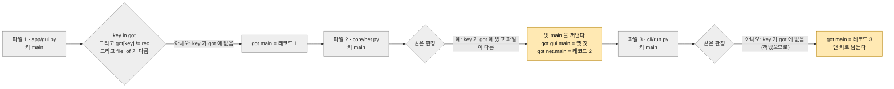
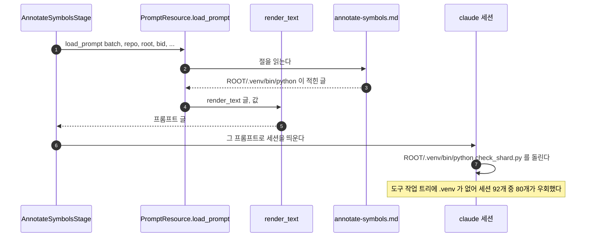
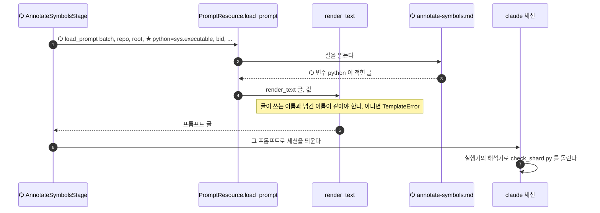
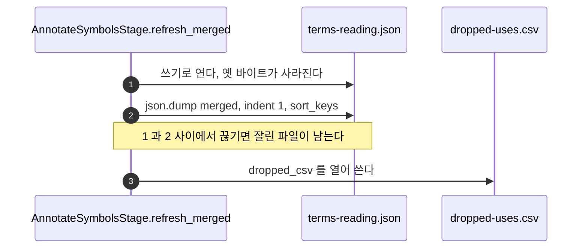
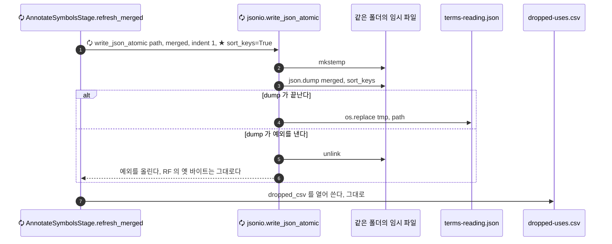
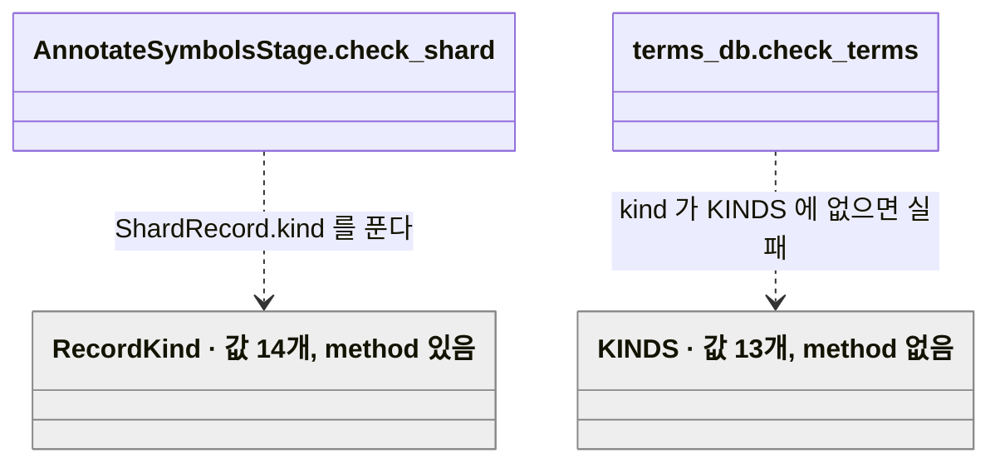
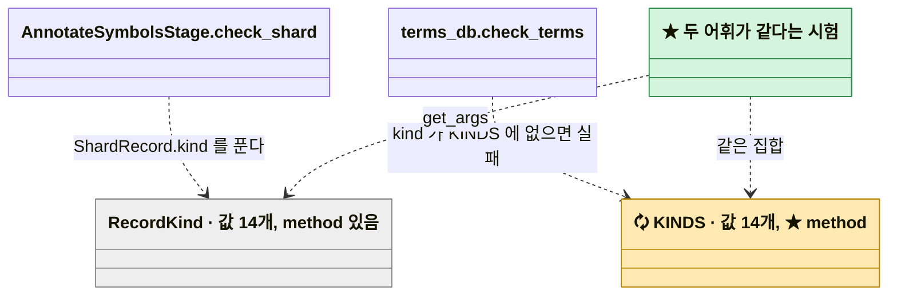

# 🧱 B1 — 전수조사 안정화: 구현 계획

> 📅 2026-11-22 · 브랜치 `main` · **Before = `29c5ee9`**
> 📄 근거: `docs/superpowers/specs/2026-11-21-mode1-audit-verification-report.md` 2.4 (가) · 3절 · 분할 docs/superpowers/specs/2026-11-22-mode1-remediation-split.ko.md · 이번 재작성에서 읽은 코드: `survey.py` · `survey_files.py` · `terms_db.py` · `context.py` · `jsonio.py` · `src/core/pipeline.py` · 프롬프트 다섯 줄
> 🔒 지킬 규칙: 프롬프트는 `resource/` 에 두고, 프롬프트가 쓰는 이름은 전부 코드가 넘긴다 · 검사를 느슨하게 하지 않는다(검사 하나는 일부러 넓어진다 — 작업 3) · 주석은 지금의 것만 적는다
> 🧪 검증 방법: 단위 시험 먼저, 그다음 여섯 게이트. 유료 실행 없음
> ✋ 승인: **승인 전**
> 🌐 영어 정본: `2026-11-22-mode1-b1-survey-stabilize-plan.md`

> **에이전트 작업자에게:** 필수 하위 스킬 — superpowers:subagent-driven-development(권장) 또는 superpowers:executing-plans 로 이 계획을 작업 단위로 구현한다. 단계는 체크박스(`- [ ]`)로 추적한다.

**목표:** 전수조사 프롬프트가 실제로 있는 해석기를 적고, 병합과 검사의 잠복 결함 셋이 닫힌다.

**구조:** 전수조사 길의 작고 독립된 고침 넷. 프롬프트가 `.venv` 경로를 직접 적지 않고, 실행기 자신이 돌고 있는 해석기를 받는다. 샤드 병합이 이미 갈라 놓은 맨 키를 기억한다. 용어 검사의 종류 어휘를 샤드 검문의 것과 같게 한다. 병합한 읽기 파일을 이미 있는 원자적 쓰기로 쓴다.

**기술:** Python 3 · Jinja2 프롬프트 리소스 · pytest · pyright strict.

---

아래에서 쓰는 주장 꼬리표: `[코드 확인]` 소스에서 읽었다 · `[실측]` 인용한 보고서가 잰 값 · `[제안]` 이 계획의 제안 · `[미검증]` 확인하지 않았다. 이 계획은 아직 아무것도 구현되지 않았으므로 아래 어느 행에도 ✅ 를 달지 않았다.

## 📄 한 장 요약

| | |
|---|---|
| 🎯 다루는 것 | 프롬프트 다섯 줄에 박힌 <span style="color:cyan">해석기</span>(interpreter) 경로 · 같은 키를 쓰는 셋째 파일이 <span style="color:cyan">맨 키</span>(bare key)로 남음 · <span style="color:cyan">용어 검사</span>(term check)의 <span style="color:cyan">종류 어휘</span>(kind vocabulary)에 `method` 가 없음 · <span style="color:cyan">병합한 읽기 파일</span>(merged reading file)을 제자리에 바로 씀 |
| 🧩 한 줄 결론 | 고침마다 몇 줄이고 이미 있는 것을 다시 쓴다 — `sys.executable` · `write_json_atomic` · <span style="color:cyan">샤드 검문</span>(shard check)의 어휘 |
| 🟰 그대로 | 레코드 계약 · <span style="color:cyan">샤드</span>(shard) 파일의 꼴 · `terms-reading.json` 의 바이트 · 어느 세션이 도는가 |
| 🗘 바뀜 | 프롬프트 다섯 줄 · 프롬프트를 만드는 함수 셋 · `merge_shards` · `KINDS` · `refresh_merged` · <span style="color:cyan">파일 전략</span>(file strategy)의 병합 쓰기 · `write_json_atomic` 에 선택 인자 하나 |
| ⚠️ 함정 | 프롬프트의 글과 거기에 넘기는 값을 같은 단계에서 바꿔야 한다 — 값 없이 쓰인 이름도, 이름 없이 넘긴 값도 렌더에서 죽는다(`render_text`, `src/core/pipeline.py:554-572`) |
| 🚫 범위 밖 | 비노드 절의 규칙 충돌(B2) · 통독 캐시 절차(B3) · `dropped-uses.csv`(병합마다 통째로 다시 쓰고, 다시 읽는 곳이 없다) |

## 🚦 현황

| 항목 | 진행 |
|---|---|
| 작업 1 — 프롬프트가 <span style="color:cyan">실행기</span>(runner)가 도는 <span style="color:cyan">해석기</span>를 적는다 | ❌ 안 됨 |
| 작업 2 — 같은 키를 쓰는 셋째 파일도 <span style="color:cyan">개명</span>(rename)한다 | ❌ 안 됨 |
| 작업 3 — <span style="color:cyan">용어 검사</span>가 <span style="color:cyan">샤드 검문</span>이 받는 종류를 전부 받는다 | ❌ 안 됨 |
| 작업 4 — <span style="color:cyan">병합한 읽기 파일</span>을 원자적으로 쓴다 | ❌ 안 됨 |
| 작업 5 — README 를 다시 만들고 여섯 게이트를 닫는다 | ❌ 안 됨 |
| 계획 승인 | ❌ 승인 전 |

## ✋ 정한 것과 제안

### 👍 정한 것 — 사용자가 정했고 다시 열지 않는다

| 무엇 | 👍 고른 것 | 👎 버린 것 | 누가 | 언제 |
|---|---|---|---|---|
| 측정 원칙 | 먼저 고치고 나중에 잰다: 2026-11-21 실행이 기준선이고, 고치기 전에는 다시 재지 않는다 | 새 기준을 얻으려 다시 돌리기 | 사용자 | 2026-11-22 |
| 이 계획의 순서 | B1 은 A1 과 함께 먼저 돈다 — 둘 다 결정도 유료 확인도 필요 없다 | — | 사용자 | 2026-11-22 |
| 다시 재는 횟수 | 묶음 전체에서 두 번: 측정 A(<span style="color:cyan">전수조사</span>까지)와 측정 B(전량) | 계획마다 · 끝에 한 번 | 사용자 | 2026-11-22 |

첫째와 셋째 행의 출처: `docs/superpowers/specs/2026-11-22-mode1-remediation-split.ko.md` 의 "정한 것(사용자, 2026-11-22)" 절.

### `[제안]` 제안 — 계획 작성자의 설계 선택(사용자 결정이 아니다)

| 선택 | 버린 대안 | 이유 |
|---|---|---|
| `load_prompt` 에 `python=sys.executable` 을 넘긴다 | 프롬프트에 경로를 두고 세션더러 찾으라고 한다 | `sys.executable` 은 이미 기계 단계를 띄우는 방식이다(`src/codewiki/python/runner/mode1/graph.py:59`) |
| `write_json_atomic` 에 선택 인자 `sort_keys` 를 더한다 | <span style="color:cyan">전수조사</span> 코드 옆에 둘째 <span style="color:cyan">원자적 쓰기</span>를 만든다 | 병합 파일은 `sort_keys=True` 로 쓴다. 바이트가 그대로여야 한다 |
| <span style="color:cyan">용어 검사</span>를 넓히고(`KINDS` 에 `method`) 두 <span style="color:cyan">종류 어휘</span>를 시험으로 묶는다 | <span style="color:cyan">샤드 검문</span>을 좁힌다(`RecordKind` 에서 `method` 를 뺀다) | <span style="color:cyan">샤드 검문</span>은 이미 `method` 를 받는다(`src/codewiki/python/runner/mode1/context.py:53-56`) |
| <span style="color:cyan">갈라 놓은 키 집합</span>(split set)을 `merge_shards` 한 번 부르는 동안만 둔다 | 실행을 넘어 남긴다 | `merge_shards` 는 <span style="color:cyan">샤드</span>의 순수 함수다(독스트링). 실행을 넘는 경우는 안정 심볼 id 몫이다(자체 검토 메모) |
| `dropped-uses.csv` 는 그대로 둔다 | 그것도 원자적으로 쓴다 | 병합마다 통째로 다시 쓰고 다시 읽는 곳이 없다 |

## 📖 용어

| 용어 | 코드 이름 | 뜻 |
|---|---|---|
| <span style="color:cyan">전수조사</span>(survey) | 단계 `annotate-symbols` · `AnnotateSymbolsStage` | 세션들이 심볼마다 레코드를 쓰는 단계 |
| <span style="color:cyan">실행기</span> | `run_mode1.py` | 세션과 기계 단계를 띄우는 프로그램 |
| <span style="color:cyan">해석기</span> | `sys.executable` · 프롬프트 변수 `python` | <span style="color:cyan">실행기</span> 자신이 돌고 있는 파이썬 |
| <span style="color:cyan">샤드</span> | `out/codegraph-raw/_shards/<bid>.json` | 배치 하나의 레코드. 세션 하나가 쓴다 |
| <span style="color:cyan">맨 키</span> | 파일 줄기가 붙지 않은 `Records` 의 키 | 세션이 쓴 그대로의 레코드 키. 예: `main` |
| <span style="color:cyan">갈라 놓은 키 집합</span> | `merge_shards` 의 지역 변수 `split`(신규) | 이번 병합에서 이미 <span style="color:cyan">개명</span>한 <span style="color:cyan">맨 키</span> |
| <span style="color:cyan">개명</span> | `AnnotateSymbolsStage.qualified` | `main` 을 `<파일줄기>.main` 으로 바꾼다 |
| <span style="color:cyan">병합한 읽기 파일</span> | `terms-reading.json` · 산출물 `READING` | <span style="color:cyan">전수조사</span>의 병합 · 보정된 레코드 |
| <span style="color:cyan">원자적 쓰기</span>(atomic write) | `jsonio.write_json_atomic` | 같은 폴더의 임시 파일에 쓰고 `os.replace` 로 바꿔 끼운다 |
| <span style="color:cyan">샤드 검문</span> | `AnnotateSymbolsStage.check_shard` · `check_shard.py` | 세션이 자기 <span style="color:cyan">샤드</span>에 스스로 돌리는 기계 검문 |
| <span style="color:cyan">용어 검사</span> | `terms_db.check_terms` | 용어 레코드의 검사(L1/L2/L3 와 종류) |
| <span style="color:cyan">종류 어휘</span> | `RecordKind`(<span style="color:cyan">샤드 검문</span>) · `KINDS`(<span style="color:cyan">용어 검사</span>) | `kind` 값으로 허용되는 집합 |
| <span style="color:cyan">파일 전략</span> | `AnnotateFilesStage` | 파일 하나가 세션 하나인 <span style="color:cyan">전수조사</span> 변형 |

## 🔁 전과 후

| 📍 전 | 🛠️ After · 제안 | 🎉 해결되는 것 | 🔭 기대 | 진행 |
|---|---|---|---|---|
| 프롬프트가 다섯 줄에서 `<도구>/.venv/bin/python` 을 적는다 `[코드 확인]`. 세션 92개 중 80개가 그 파일을 못 찾고 우회했다 `[실측]` | 프롬프트가 <span style="color:cyan">실행기</span>가 도는 <span style="color:cyan">해석기</span>를 싣는다 `[제안]` | <span style="color:cyan">실행기</span>가 도는 곳이면 검문 명령도 돈다 | 세션이 없는 `.venv` 를 돌아가지 않는다 `[미검증]` — 측정 A 에서 보인다 | ❌ |
| 키 `main` 을 쓰는 파일 셋이 `a.main` · `b.main` · `main` 으로 합쳐진다 `[실측]`(점검 검증 보고서 3절) | 셋 다 <span style="color:cyan">개명</span>된다 `[제안]` | 독스트링의 약속("겹친 전원을 <span style="color:cyan">개명</span>한다")이 지켜진다 | 작업 2 의 시험 둘이 통과한다 `[미검증]` | ❌ |
| 출처 `reading` · 종류 `method` 인 레코드가 <span style="color:cyan">용어 검사</span>에서 실패한다 `[실측]`(점검 검증 보고서 3절) | 통과한다. 시험이 두 <span style="color:cyan">종류 어휘</span>를 묶는다 `[제안]` | <span style="color:cyan">샤드 검문</span>과 <span style="color:cyan">용어 검사</span>가 같은 종류를 받는다 | 묶는 시험이 통과한다 `[미검증]` | ❌ |
| 병합이 도중에 끊기면 잘린 `terms-reading.json` 이 남는다 `[코드 확인]`(`survey.py:508-509`) | 새 파일이 다 쓰일 때까지 옛 파일이 그대로 있다 `[제안]` | 다음 실행이 원본을 읽을 수 있다 | 새 중단 시험이 통과한다 `[미검증]` | ❌ |

## ★ 신규 · 🗘 변경

순서: 모듈 → 파일 → 클래스 → 함수 → 멤버. 항목마다 `29c5ee9` 와 비교해 그 층위에서 따로 표시한다. **★ = 무에서 새로 만듦 · 🗘 = 있던 것이 바뀜 · ✕ = 지움 · 표식 없음 = 그대로 재사용.**

| 층위 | 항목 | 표식 | 구분 | 소속 |
|---|---|---|---|---|
| 모듈 | `codewiki` <span style="color:cyan">실행기</span>(`src/codewiki/python/runner`) | 🗘 | 변경 | — |
| 모듈 | `codewiki` 기계(`src/codewiki/python/machine`) | 🗘 | 변경 | — |
| 모듈 | `resource/codewiki` | 🗘 | 변경 | — |
| 모듈 | `test/codewiki` | 🗘 | 변경 | — |
| 파일 | `resource/codewiki/prompts/annotate-symbols.md` | 🗘 | 변경 | `resource/codewiki` |
| 파일 | `mode1/survey.py` | 🗘 | 변경 | <span style="color:cyan">실행기</span> |
| 파일 | `mode1/survey_files.py` | 🗘 | 변경 | <span style="color:cyan">실행기</span> |
| 파일 | `machine/terms_db.py` | 🗘 | 변경 | 기계 |
| 파일 | `machine/jsonio.py` | 🗘 | 변경 | 기계 |
| 파일 | `test_mode1.py` · `test_run_mode1.py` · `test_terms_db.py` · `test_jsonio.py` | 🗘 | 변경(시험을 덧붙임) | `test/codewiki` |
| 파일 | `src/codewiki/python/runner/README.md` · `src/codewiki/python/machine/README.md` | 🗘 | 다시 생성(글이 달라지는지는 `[미검증]`) | <span style="color:cyan">실행기</span> · 기계 |
| 클래스 | `AnnotateSymbolsStage` | 🗘 | 변경(메서드만) | `mode1/survey.py` |
| 클래스 | `AnnotateFilesStage` | 🗘 | 변경(안쪽 함수 하나만) | `mode1/survey_files.py` |
| 클래스 | 새로 만들거나 지우는 클래스는 없다 | — | 해당 없음 | — |
| 함수 | `survey_batch_prompt` · `nonnode_prompt` · `pass2_prompt` | 🗘 | 변경 | `AnnotateSymbolsStage` |
| 함수 | `merge_shards` · `refresh_merged` | 🗘 | 변경 | `AnnotateSymbolsStage` |
| 함수 | `write_json_atomic` | 🗘 | 변경 | `machine/jsonio.py` |
| 함수 | `write_merged`(`AnnotateFilesStage.perform` 의 안쪽 함수) | 🗘 | 변경 | `AnnotateFilesStage` |
| 함수 | ★ 새 시험 일곱(프롬프트 시험 하나 · 중단 시험 하나 · 병합 시험 둘 · 용어 시험 둘 · `sort_keys` 시험 하나) | ★ | 신규 | `test/codewiki` |
| 함수 | `load_prompt` · `render_text` · `file_of` · `qualified` · `check_terms` · `check_shard` | — | 그대로 재사용 | — |
| 멤버 | 프롬프트 변수 `python`(절 `batch` · `nonnode` · `pass2`) | ★ | 신규 | `annotate-symbols.md` |
| 멤버 | 인자 `sort_keys` | ★ | 신규 | `write_json_atomic` |
| 멤버 | 지역 변수 `split` | ★ | 신규 | `merge_shards` |
| 멤버 | 상수 `KINDS` | 🗘 | 변경 | `machine/terms_db.py` |
| 멤버 | `KINDS` 의 항목 `"method"` | ★ | 신규 | `KINDS` |
| 멤버 | `import jsonio` | ★ | 신규 | `survey_files.py` |
| 멤버 | `import json` | ✕ | 쓰이지 않게 되면 지움 — 쓰임은 `survey_files.py:71` 의 `json.dump` 하나뿐이다 `[코드 확인]` | `survey_files.py` |

## 🔀 그림

범례: 회색 = 그대로 · 초록 = 신규(★) · 호박색 = 변경(🗘). 라벨에도 같은 표식을 달아 색이 안 보여도 뜻이 남는다. 그림 속 식별자는 Before 와 After 사이에서 같다.

### 흐름 — `merge_shards` 가 세 파일에서 온 키 `main` 을 다루는 길

Before. `[코드 확인]` 판정은 `survey.py:438-439` 다. 둘째 파일에서 <span style="color:cyan">맨 키</span>를 꺼내 버렸으므로 셋째 파일은 충돌을 보지 못한다.



After · 제안. `[제안]` 기억한 <span style="color:cyan">갈라 놓은 키 집합</span>이 셋째 키를 <span style="color:cyan">개명</span>한다.



```mermaid
flowchart LR
  F1["파일 1 · app/gui.py<br>키 main"] --> D1{"🗘 key in split?<br>아니면 옛 판정"}
  D1 -- "아니오: key 가 got 에 없음" --> A1["got main = 레코드 1"]
  A1 --> F2["파일 2 · core/net.py<br>키 main"]
  F2 --> D2{"🗘 같은 두 판정"}
  D2 -- "예: split 에 없고 key 가 got 에 있고 파일이 다름" --> A2["🗘 옛 main 을 꺼낸다<br>got gui.main = 옛 것<br>got net.main = 레코드 2<br>★ split.add main"]
  A2 --> F3["파일 3 · cli/run.py<br>키 main"]
  A2 -.-> SP["★ split = main"]
  SP -.-> D3
  F3 --> D3{"🗘 key in split?"}
  D3 -- "예: key 가 split 에 있음" --> A3["★ got run.main = 레코드 3"]
  classDef same fill:#eeeeee,stroke:#888888,color:#222222
  class F1,F2,F3,A1 same
  classDef new fill:#d4f4dd,stroke:#2a8a45,color:#111111
  class SP,A3 new
  classDef chg fill:#ffe9b3,stroke:#b8860b,color:#111111
  class D1,D2,D3,A2 chg
```

### 순서 — 전수조사 프롬프트가 해석기를 얻는 길

Before. `[코드 확인]` 다섯 줄은 `annotate-symbols.md` 의 64 · 67 · 113 · 176 · 211 줄이다. 프롬프트를 만드는 함수들은 <span style="color:cyan">해석기</span>를 넘기지 않는다(`survey.py:137-141` · `:169-171` · `:372-373`).



After · 제안. `[제안]` 단계가 <span style="color:cyan">해석기</span>를 넘긴다. `render_text` 는 여전히 이름과 값이 같기를 요구하므로 프롬프트와 만드는 함수를 함께 고쳐야 한다.



### 순서 — `refresh_merged` 가 병합 파일을 쓰는 길

Before. `[코드 확인]` `survey.py:507-511`.



After · 제안. `[제안]` <span style="color:cyan">파일 전략</span>의 `write_merged` 도 같은 길을 탄다(`survey_files.py:68-71`). CSV 쓰기는 그대로다.



### 클래스 — Before = After

만들거나 지우거나 옮기는 클래스가 없고, 클래스 사이의 의존 화살표도 바뀌지 않는다. 계획이 못 박는 구조적 사실은 데이터 관계 하나다 — 하나여야 했던 두 <span style="color:cyan">종류 어휘</span> 집합.

Before. `[코드 확인]` `RecordKind` 는 값 14개(`context.py:55-56`), `KINDS` 는 `method` 가 없는 13개(`terms_db.py:35-36`)다.



After · 제안. `[제안]`



## 📝 고칠 곳

| 파일 · 심볼 | 바뀌는 것 | 이유 | 근거 |
|---|---|---|---|
| 🗘 `resource/codewiki/prompts/annotate-symbols.md` 64 · 67 · 113 · 176 · 211줄 | `{{root}}/.venv/bin/python` 이 `{{python}}` 이 된다 | <span style="color:cyan">해석기</span>는 <span style="color:cyan">실행기</span>가 도는 것이어야 한다 | `[코드 확인]` `grep -n venv` 가 바로 이 다섯 줄을 낸다. `[실측]` 세션 92개 중 80개가 우회했다(점검 검증 보고서 2.4 (가)) |
| 🗘 `survey.py` · `survey_batch_prompt`(116-141) · `nonnode_prompt`(163-171) · `pass2_prompt`(365-373) | `load_prompt` 부름마다 `python=sys.executable` 이 붙는다 | `render_text` 는 값 없는 이름도 이름 없는 값도 거절한다 | `[코드 확인]` `pipeline.py:554-572`. `import sys` 는 `survey.py:7`. 고친 뒤 세 절이 모두 `{{python}}` 을 쓰므로 안 쓰이는 값이 남지 않는다 |
| 🗘 `survey.py` · `merge_shards`(408-446) | ★ 지역 변수 `split`. `split` 에 든 키는 충돌 판정 없이 <span style="color:cyan">개명</span>한다 | 둘째 <span style="color:cyan">개명</span>이 <span style="color:cyan">맨 키</span>를 꺼내 버려 셋째 파일이 충돌을 보지 못한다 | `[코드 확인]` `survey.py:438-445`. `[실측]` 점검 검증 보고서 3절 |
| 🗘 `terms_db.py` · `KINDS`(35-36) | `"method"` 를 더한다 | <span style="color:cyan">샤드 검문</span>은 `method` 를 받고 <span style="color:cyan">용어 검사</span>는 받지 않는다 | `[코드 확인]` `terms_db.py:343-345` 와 `context.py:55-56`. `[실측]` 점검 검증 보고서 3절 |
| 🗘 `jsonio.py` · `write_json_atomic`(7-21) | ★ 선택 인자 `sort_keys` 를 `json.dump` 에 넘긴다 | 병합 파일은 열쇠를 정렬해 쓴다 | `[코드 확인]` `jsonio.py:7-21` 에는 그런 인자가 없다. `survey.py:509` 와 `survey_files.py:71` 이 `sort_keys=True` 를 넘긴다 |
| 🗘 `survey.py` · `refresh_merged`(498-512) | 읽기 파일을 `write_json_atomic` 으로 쓴다 | 쓰다 끊겨도 반쪽 파일이 다음 실행의 기준으로 남으면 안 된다 | `[코드 확인]` `survey.py:507-509` 가 최종 경로를 곧바로 쓰기로 연다 |
| 🗘 `survey_files.py` · `write_merged`(67-74) | 같은 길. ★ `import jsonio`, ✕ `import json` | 위와 같고 <span style="color:cyan">파일 전략</span> 쪽이다 | `[코드 확인]` `survey_files.py:68-71`. `json` 은 `:71` 에서만 쓰인다 |
| 🗘 시험 파일 넷 | 시험 일곱을 덧붙인다 | 고침마다 시험을 먼저 쓴다 | `[코드 확인]` 도우미 `_shard`(`test_run_mode1.py:352`) · `_one_batch_plan`(`test_mode1.py:1070`) · `_good_record`(`test_mode1.py:1064`)가 있다 |

계획의 코드에서 두 토막을 제안 diff 로 보인다. 둘 다 **제안 diff — 적용하지 않았다**. 전체 코드는 아래 작업에 있고 `-` 줄은 지금의 파일에서 왔다.

`🗘 resource/codewiki/prompts/annotate-symbols.md` — 다섯 줄 가운데 하나(작업 1):

```diff
-    {{root}}/.venv/bin/python {{root}}/src/codewiki/python/runner/check_shard.py {{repo}}/out/codegraph-raw/_shards/{{bid}}.json
+    {{python}} {{root}}/src/codewiki/python/runner/check_shard.py {{repo}}/out/codegraph-raw/_shards/{{bid}}.json
```

`🗘 src/codewiki/python/runner/mode1/survey.py` · `merge_shards` — 분기의 머리(작업 2):

```diff
-                if key in got and got[key] != rec \
+                if key in split:
+                    got[AnnotateSymbolsStage.qualified(key, rec)] = rec
+                elif key in got and got[key] != rec \
                         and AnnotateSymbolsStage.file_of(got[key]) != AnnotateSymbolsStage.file_of(rec):
```

## 🧪 검증

- 단위 시험 먼저(작업마다 실패하는 시험을 쓰고, 실패를 본 뒤 구현한다), 그다음 작업 5 의 여섯 게이트. 유료 실행도 LLM 세션도 없다.
- 시험 일곱을 더한다. 작업 5 는 pytest 가 이전보다 일곱 개 많이 통과하고 새 건너뜀 · xfail 이 없기를 기대한다.
- `[미검증]` 작업 1 이 실제 세션의 우회를 없애는지는 여기 어느 시험도 확인하지 않는다 — 측정 A 에서 드러난다. 측정 A 는 이 변경을 기준선과의 차이 목록에 적어야 한다.
- `[실측]` 이 앞부분의 Mermaid 블록은 문서를 쓸 때 전부 `mmdc` 11.16.0 으로 그려 보았다. 확인한 것은 그림뿐이고 작업의 시험은 하나도 돌리지 않았다.
- `[미검증]` 작업 2 는 한 번의 실행 안의 병합만 고친다. 앞선 실행이 저장한 읽기 파일에서 이미 <span style="color:cyan">개명</span>된 레코드는 다시 한정하지 않는다(자체 검토 메모).

## ❓ 열린 결정

막는 결정은 없다(분할 보고서의 계획 표, "막는 결정" 칸: 없음). 막지 않는 것:

| 질문 | 근거 | 권고 | 영향 |
|---|---|---|---|
| 이 계획의 커밋을 승인하는가? | 작업 1 의 6단계가 "사용자가 이 계획의 커밋을 승인했을 때만" 이라고 적는다 | 계획을 승인할 때 묻는다 | 커밋 단계 다섯이 도는지 여부뿐 |
| `write_merged` 에서 병합 파일 옆에 쓰는 미해결 표(CSV)도 원자적으로 써야 하는가? | `survey_files.py:72-74` 가 맨 `open` 으로 쓴다. 계획은 이를 말하지 않는다 | 이 계획에서는 아니다 — 병합 레코드에서 파생되고 병합마다 다시 쓴다 | 기준선에는 없다. 반쪽 CSV 는 다음 병합이 다시 쓴다 |

## 🚫 범위 밖

- 비노드 절의 규칙 충돌(B2) · 통독 캐시 절차(B3) · `dropped-uses.csv`.
- 앞선 실행이 저장한 <span style="color:cyan">맨 키</span>를 다시 한정하는 것(계획의 id → 이름 표가 필요하다. 안정 심볼 id 와 함께 다룬다).
- `method` 를 빼고, <span style="color:cyan">샤드 검문</span>이 이미 받는 것보다 더 받거나 덜 받게 하는 검사 변경.

명령은 전부 저장소 뿌리에서 `.venv/bin/python` 으로 돌린다. `mode1/` 과 `machine/` 아래 경로는 `src/codewiki/python/runner/mode1/` 과 `src/codewiki/python/machine/` 이다.

---

### 작업 1: 프롬프트가 실행기가 도는 해석기를 적는다

**파일:**
- 고침: `resource/codewiki/prompts/annotate-symbols.md` (64 · 67 · 113 · 176 · 211줄)
- 고침: `src/codewiki/python/runner/mode1/survey.py` (`survey_batch_prompt`, `nonnode_prompt`, `pass2_prompt`)
- 시험: `test/codewiki/test_mode1.py`

- [ ] **1단계: 실패하는 시험을 쓴다** — `test/codewiki/test_mode1.py` 끝에 붙인다:

```python
def test_전수조사_프롬프트는_실행기의_해석기를_적는다():
    """도구 저장소에 `.venv` 가 없어도 검문 명령이 돈다 — 프롬프트가 지금 도는 해석기를 그대로 적는다."""
    b = _one_batch_plan("L0-B00")["layers"][0]["batches"][0]
    S = SV.AnnotateSymbolsStage
    batch = S.survey_batch_prompt("/repo", "/root", b, [])
    nonnode = S.nonnode_prompt("/repo", "/root")
    pass2 = S.pass2_prompt("/repo", "/root", "F00", "a.py", {}, {})
    for p in (batch, nonnode, pass2):
        assert sys.executable + " /root/src/codewiki/python/runner/check_shard.py" in p
        assert "/root/.venv/bin/python" not in p
    assert sys.executable + " /root/src/codewiki/python/machine/file_cache.py get /repo" in batch
    assert sys.executable + " /root/src/codewiki/python/machine/file_cache.py put /repo" in batch
```

- [ ] **2단계: 돌려서 실패를 본다**

실행: `.venv/bin/python -m pytest test/codewiki/test_mode1.py -q -k "실행기의_해석기"`
기대: 1개 실패 — 첫 `assert` 에서(프롬프트가 아직 `/root/.venv/bin/python` 을 적는다).

- [ ] **3단계: 프롬프트를 고친다** — `resource/codewiki/prompts/annotate-symbols.md` 의 다섯 줄에서 `{{root}}/.venv/bin/python` 을 `{{python}}` 으로 바꾼다. 바꾼 뒤의 줄은 이렇다:

64줄:
```
     {{python}} {{root}}/src/codewiki/python/machine/file_cache.py get {{repo}} <파일경로>
```
67줄:
```
     {{python}} {{root}}/src/codewiki/python/machine/file_cache.py put {{repo}} <파일경로> <개요json의_파일경로>
```
113줄:
```
    {{python}} {{root}}/src/codewiki/python/runner/check_shard.py {{repo}}/out/codegraph-raw/_shards/{{bid}}.json
```
176줄:
```
  {{python}} {{root}}/src/codewiki/python/runner/check_shard.py {{repo}}/out/codegraph-raw/_shards/NONNODE.json
```
211줄:
```
  {{python}} {{root}}/src/codewiki/python/runner/check_shard.py {{repo}}/out/codegraph-raw/_shards/_pass2/{{bid}}.json
```

남은 것이 없는지 본다: `grep -c "venv" resource/codewiki/prompts/annotate-symbols.md` 가 `0` 을 낸다.

- [ ] **4단계: 값을 넘긴다** — `src/codewiki/python/runner/mode1/survey.py` 의 `load_prompt` 호출 셋에 `python=sys.executable` 을 더한다. 바꾼 뒤는 이렇다:

`survey_batch_prompt` 안:
```python
        return AnnotateSymbolsStage.load_prompt(
            "annotate-symbols#batch", repo=repo, root=root, python=sys.executable, bid=batch["id"],
            n=len(syms), syms=syms,
            deps=list(deps), targets=scope, target_count=len(scope), total=total,
            reading=X.reading_path(repo, ROOT), pending=list(pending),
            faults=list(faults), fault_count=len(faults), bad=bad)
```

`nonnode_prompt` 안:
```python
        return AnnotateSymbolsStage.load_prompt(
            "annotate-symbols#nonnode", repo=repo, root=root, python=sys.executable,
            reading=X.reading_path(repo, ROOT),
            faults=list(faults), fault_count=len(faults), bad=bad)
```

`pass2_prompt` 안:
```python
        return AnnotateSymbolsStage.load_prompt(
            "annotate-symbols#pass2", repo=repo, root=root, python=sys.executable, bid=bid, file=file,
            mine=mine, theirs=theirs)
```

`survey_batch_prompt` 의 독스트링 첫 줄 뒤에 이 문장을 더한다:

```
        검문 · 통독 캐시 명령의 해석기는 지금 실행기가 도는 해석기다 — 기계 단계를 띄울 때와 같다.
```

- [ ] **5단계: 프롬프트 시험과 프롬프트 게이트를 돌린다**

실행: `.venv/bin/python -m pytest test/codewiki/test_mode1.py test/codewiki/test_run_mode1.py qa/gates/test_prompt_resources.py -q`
기대: 전부 통과.

- [ ] **6단계: 커밋** (사용자가 이 계획의 커밋을 승인했을 때만)

제목: `[fix] : codewiki - 전수조사 프롬프트가 실행기의 해석기를 적는다`

---

### 작업 2: 같은 키를 쓰는 셋째 파일도 개명한다

**파일:**
- 고침: `src/codewiki/python/runner/mode1/survey.py` (`merge_shards`)
- 시험: `test/codewiki/test_run_mode1.py`

- [ ] **1단계: 실패하는 시험을 쓴다** — `test/codewiki/test_run_mode1.py` 의 `test_이미_있는_키와_겹쳐도_양쪽_다_개명한다` 뒤에 넣는다:

```python
def test_세_파일이_같은_키를_쓰면_셋_다_개명한다(tmp_path: Path):
    """둘을 개명하고 나면 맨 키가 비어서, 셋째가 맨 키로 남으면 안 된다."""
    d = _shard(tmp_path, "L0-B00", {"main": {"where": "app/gui.py:10"}})
    _shard(tmp_path, "L0-B01", {"main": {"where": "core/net.py:20"}})
    _shard(tmp_path, "L0-B02", {"main": {"where": "cli/run.py:30"}})
    assert sorted(R.merge_shards(d, {})) == ["gui.main", "net.main", "run.main"]


def test_개명한_파일을_다시_조사한_샤드는_그_파일_것만_갈아_끼운다(tmp_path: Path):
    """같은 파일을 다시 조사한 샤드가 뒤에 오면 그 파일의 개명된 레코드가 새 판이 된다."""
    d = _shard(tmp_path, "L0-B00", {"main": {"where": "app/gui.py:10", "means": "옛"}})
    _shard(tmp_path, "L0-B01", {"main": {"where": "core/net.py:20"}})
    _shard(tmp_path, "L1-B00", {"main": {"where": "app/gui.py:10", "means": "새"}})
    got = R.merge_shards(d, {})
    assert sorted(got) == ["gui.main", "net.main"]
    assert got["gui.main"]["means"] == "새"
```

- [ ] **2단계: 돌려서 실패를 본다**

실행: `.venv/bin/python -m pytest test/codewiki/test_run_mode1.py -q -k "세_파일이 or 다시_조사한_샤드"`
기대: 2개 실패 — 두 결과 모두에 맨 키 `main` 이 들어 있다.

- [ ] **3단계: 구현한다** — `merge_shards` 의 본문을 `got = dict(existing or {})` 부터 `return got` 까지 이것으로 바꾼다:

```python
        got = dict(existing or {})
        split: set[str] = set()      # 겹쳐서 개명한 맨 키. 같은 키가 또 오면 그것도 개명한다
        if not os.path.isdir(shard_dir):
            return got
        for fname in sorted(os.listdir(shard_dir)):
            if not fname.endswith(".json"):
                continue
            try:
                with open(os.path.join(shard_dir, fname), encoding="utf-8") as f:
                    shard: Records = json.load(f)
            except (ValueError, OSError) as ex:
                print("샤드를 건너뛴다 — %s: %s" % (fname, ex), file=sys.stderr)
                continue
            for key, rec in shard.items():
                if key in split:
                    got[AnnotateSymbolsStage.qualified(key, rec)] = rec
                # 자리 주인이 남(다른 파일)일 때만 충돌이다. 같은 파일이면 다시 읽은 새 판이라 갈아 끼운다.
                elif key in got and got[key] != rec \
                        and AnnotateSymbolsStage.file_of(got[key]) != AnnotateSymbolsStage.file_of(rec):
                    # 겹친 전원을 개명한다. 이미 들어와 있던 쪽도 함께 고친다.
                    old = got.pop(key)
                    got[AnnotateSymbolsStage.qualified(key, old)] = old
                    got[AnnotateSymbolsStage.qualified(key, rec)] = rec
                    split.add(key)
                else:
                    got[key] = rec
        return got
```

`merge_shards` 의 독스트링에서 `한쪽만 한정하면 나중에 또 겹친다.` 문장을 이것으로 바꾼다:

```
한쪽만 한정하면 나중에 또 겹친다. 한 번 갈라진 맨 키는 이 호출이 끝날 때까지 기억한다 — 셋째가 와도 맨 키로 남지 않는다.
```

- [ ] **4단계: 병합 시험을 돌린다**

실행: `.venv/bin/python -m pytest test/codewiki/test_run_mode1.py test/codewiki/test_mode1.py -q -k "merge or 샤드 or 개명 or 합"`
기대: 전부 통과. `test_같은_샤드를_두_번_합쳐도_개명하지_않는다` 도 통과한다.

- [ ] **5단계: 커밋**

제목: `[fix] : codewiki - 같은 키를 쓰는 셋째 파일의 레코드도 개명한다`

---

### 작업 3: 용어 검사가 샤드 검문이 받는 종류를 전부 받는다

**파일:**
- 고침: `src/codewiki/python/machine/terms_db.py` (`KINDS`)
- 시험: `test/codewiki/test_terms_db.py`

- [ ] **1단계: 실패하는 시험을 쓴다** — `test/codewiki/test_terms_db.py` 끝에 붙인다:

```python
def test_reading_출처의_method_레코드는_종류_검사를_통과한다(tmp_path: Path):
    """샤드 검문이 받는 종류를 용어 검사가 실패로 세면, 통과한 샤드가 뒤 단계에서 흐름을 멈춘다."""
    repo = _repo(tmp_path)
    db = cast(T.TermsDb, {"x.build_terms": {"source": "reading", "kind": "method", "module": "codegraph",
                                           "where": "codegraph/x.py:3", "means": "용어를 짓는다",
                                           "neighbors": [], "uses": []}})
    assert T.check_terms(db, repo) == []


def test_샤드_검문의_종류_어휘와_용어_검사의_종류_어휘가_같다():
    from typing import get_args

    from mode1 import context as X
    assert T.KINDS == frozenset(get_args(X.RecordKind))
```

- [ ] **2단계: 돌려서 실패를 본다**

실행: `.venv/bin/python -m pytest test/codewiki/test_terms_db.py -q -k "method_레코드 or 종류_어휘"`
기대: 2개 실패 — 첫째는 `[('실패', 'x.build_terms', "kind 값이 이상하다: 'method'")]` 를 돌려주고, 둘째는 `KINDS` 에 `method` 가 없다고 보인다.

- [ ] **3단계: 구현한다** — `src/codewiki/python/machine/terms_db.py` 에서 두 줄짜리 `KINDS` 정의와 그 위 주석을 이것으로 바꾼다:

```python
# reading 레코드가 쓸 수 있는 kind 전부. codegraph 에서 온 kind 는 검사하지 않는다(정적 도구의 어휘).
# 샤드 검문의 어휘(`mode1.context.RecordKind`)와 같다 — `test_샤드_검문의_종류_어휘와_용어_검사의_종류_어휘가_같다`.
KINDS = frozenset({"class", "struct", "enum", "interface", "delegate", "record", "external",
                   "function", "method"}) | NON_NODE_KINDS
```

- [ ] **4단계: 용어 시험을 돌린다**

실행: `.venv/bin/python -m pytest test/codewiki/test_terms_db.py -q`
기대: 전부 통과(골든 저장소가 필요한 시험은 전처럼 건너뛴다).

- [ ] **5단계: 커밋**

제목: `[fix] : codewiki - 용어 검사의 종류 어휘에 method 를 넣어 샤드 검문과 맞춘다`

---

### 작업 4: 병합한 읽기 파일을 원자적으로 쓴다

**파일:**
- 고침: `src/codewiki/python/machine/jsonio.py` (`write_json_atomic`)
- 고침: `src/codewiki/python/runner/mode1/survey.py` (`refresh_merged`)
- 고침: `src/codewiki/python/runner/mode1/survey_files.py` (안쪽의 `write_merged`)
- 시험: `test/codewiki/test_jsonio.py` · `test/codewiki/test_mode1.py`

- [ ] **1단계: 실패하는 시험을 쓴다** — `test/codewiki/test_jsonio.py` 의 `import os` 위에 `import json` 을 넣고, 끝에 붙인다:

```python
def test_sort_keys_면_안쪽_사전까지_열쇠를_정렬해_쓴다(tmp_path: Path) -> None:
    p = tmp_path / "a.json"
    doc = {"나": 1, "가": {"z": 1, "a": 2}}
    jsonio.write_json_atomic(str(p), doc, indent=1, sort_keys=True)
    assert p.read_text(encoding="utf-8") == json.dumps(doc, ensure_ascii=False, indent=1, sort_keys=True)
```

`test/codewiki/test_mode1.py` 끝에 붙인다:

```python
def test_refresh_merged_가_쓰다_죽어도_옛_reading_이_남는다(tmp_path: Path, monkeypatch: pytest.MonkeyPatch):
    """다음 실행은 이 파일을 조사 이전의 원본으로 읽는다. 반쪽 파일이 남으면 그 실행이 시작에서 죽는다."""
    c = _ctx(tmp_path); c.plan = _one_batch_plan("L0-B00")
    d = Path(SV.AnnotateSymbolsStage.shard_dir(c)); d.mkdir(parents=True)
    (d / "L0-B00.json").write_text(json.dumps({"f": _good_record()}), encoding="utf-8")
    reading = Path(X.READING.locate(c)); reading.parent.mkdir(parents=True, exist_ok=True)
    reading.write_text('{"옛": {}}', encoding="utf-8")

    def boom(*a: object, **k: object) -> None:
        raise OSError("디스크가 찼다")
    monkeypatch.setattr(jsonio.json, "dump", boom)
    with pytest.raises(OSError):
        SV.AnnotateSymbolsStage().refresh_merged(c)
    assert reading.read_text(encoding="utf-8") == '{"옛": {}}'
    assert [p.name for p in reading.parent.iterdir()] == [reading.name]
```

- [ ] **2단계: 돌려서 실패를 본다**

실행: `.venv/bin/python -m pytest test/codewiki/test_jsonio.py test/codewiki/test_mode1.py -q -k "sort_keys or 옛_reading"`
기대: 2개 실패 — `TypeError: write_json_atomic() got an unexpected keyword argument 'sort_keys'`, 그리고 읽기 파일이 `{"옛": {}}` 가 아니라 비어 있다.

- [ ] **3단계: 쓰기 선택지를 구현한다** — `src/codewiki/python/machine/jsonio.py` 의 `write_json_atomic` 을 이것으로 바꾼다:

```python
def write_json_atomic(path: str, obj: object, indent: int = 2, trailing_newline: bool = False,
                      sort_keys: bool = False) -> None:
    """`path` 를 `obj` 의 JSON 으로 바꿔 끼운다. 같은 입력이면 같은 바이트다. `sort_keys` 면 사전의 열쇠를 정렬해 쓴다."""
    folder = os.path.dirname(os.path.abspath(path))
    os.makedirs(folder, exist_ok=True)
    fd, tmp = tempfile.mkstemp(dir=folder, prefix="." + os.path.basename(path) + ".", suffix=".tmp")
    try:
        with os.fdopen(fd, "w", encoding="utf-8") as f:
            json.dump(obj, f, ensure_ascii=False, indent=indent, sort_keys=sort_keys)
            if trailing_newline:
                f.write("\n")
        os.replace(tmp, path)
    except BaseException:
        if os.path.exists(tmp):
            os.unlink(tmp)
        raise
```

- [ ] **4단계: 두 전략에서 쓴다** — `src/codewiki/python/runner/mode1/survey.py` 의 `refresh_merged` 끝(`path = X.READING.locate(ctx)` 부터 `return dropped` 까지)을 이것으로 바꾼다:

```python
        jsonio.write_json_atomic(X.READING.locate(ctx), ctx.merged, indent=1, sort_keys=True)
        with open(X.DROPPED.locate(ctx), "w", encoding="utf-8") as f:
            f.write(self.dropped_csv(dropped))
        return dropped
```

`src/codewiki/python/runner/mode1/survey_files.py` 에서 `import survey_plan` 윗줄에 `import jsonio` 를 넣고, 안쪽의 `write_merged` 에서 이 세 줄을

```python
            os.makedirs(os.path.dirname(X.READING.locate(ctx)), exist_ok=True)
            with open(X.READING.locate(ctx), "w", encoding="utf-8") as f:
                json.dump(ctx.merged, f, ensure_ascii=False, indent=1, sort_keys=True)
```

이것으로 바꾼다:

```python
            jsonio.write_json_atomic(X.READING.locate(ctx), ctx.merged, indent=1, sort_keys=True)
```

이 뒤에 `survey_files.py` 에서 `json` 이나 `os` 가 더 쓰이지 않으면 그 import 를 지운다. 두면 pyright 가 쓰지 않는 import 로 잡는다.

- [ ] **5단계: 전수조사 시험과 타입 검사를 돌린다**

실행: `.venv/bin/python -m pytest test/codewiki/test_jsonio.py test/codewiki/test_mode1.py test/codewiki/test_run_mode1.py -q && npm run typecheck:py`
기대: 전부 통과 · `0 errors`. `test_refresh_merged_는_보정본을_reading_과_dropped_csv_로_쓴다` 도 그대로 통과한다 — 바이트가 전과 같다.

- [ ] **6단계: 커밋**

제목: `[fix] : codewiki - 병합한 읽기 레코드를 임시 파일을 거쳐 바꿔 끼운다`

---

### 작업 5: README 를 다시 생성하고 게이트를 닫는다

**파일:**
- 다시 생성: `src/codewiki/python/runner/README.md` · `src/codewiki/python/machine/README.md`

- [ ] **1단계: 다시 생성하고 표류를 본다**

실행:
```bash
.venv/bin/python tools/gen_readme.py src/codewiki/python/runner src/codewiki/python/machine src/codewiki/python/viz src/term/python/runner src/spec/python/runner src/spec/python/viz src/core src/common tools
.venv/bin/python tools/gen_readme.py --check src/codewiki/python/runner src/codewiki/python/machine src/codewiki/python/viz src/term/python/runner src/spec/python/runner src/spec/python/viz src/core src/common tools
```
기대: 둘째 명령이 0 으로 끝난다.

- [ ] **2단계: 여섯 게이트를 돌린다**

실행:
```bash
.venv/bin/python -m pytest -q
npm test
npm run typecheck
npm run typecheck:py
npm run doctor
```
기대: pytest 는 이 계획 전보다 시험이 7개 늘어 통과하고 새 건너뜀 · xfail 이 없다 · `npm test` 8 통과 · 타입 검사 둘 다 깨끗 · doctor 가 0 으로 끝난다.

- [ ] **3단계: 커밋**

제목: `[docs] : codewiki - 전수조사 안정화에 맞춰 모듈 README 를 다시 생성한다`

---

## 스스로 점검한 것

- **빠짐 없음:** 해석기 경로 → 작업 1 · 셋째 파일의 키 충돌 → 작업 2 · 종류 어휘 → 작업 3 · 비원자적 쓰기 → 작업 4.
- **작업을 건너 쓰는 이름:** 프롬프트 변수 `python` · 지역 변수 `split` · `KINDS` · 인자 `sort_keys`.
- **넓어지는 검사 하나:** 작업 3 은 용어 검사의 어휘에 `method` 를 더한다. 느슨하게 하는 것이 아니다 — 샤드 검문이 이미 `method` 를 받고, 둘은 한 어휘여야 했다. 새 시험이 둘을 묶는다.
- **여기서 하지 않는 것:** 앞선 실행에서 맨 키로 조사됐다가 저장된 읽기 파일에서 이미 개명된 레코드는, 새 샤드가 그 맨 키를 다시 써도 개명하지 않는다. 그러려면 계획의 id 와 이름 대응이 있어야 하고, 안정 심볼 id 쪽 일이다.
- **다음 측정에 주는 영향:** 작업 1 뒤에는 세션이 없는 `.venv` 를 우회하지 않는다. 측정 가는 이것을 기준선 뒤에 바뀐 것 가운데 하나로 적는다.
