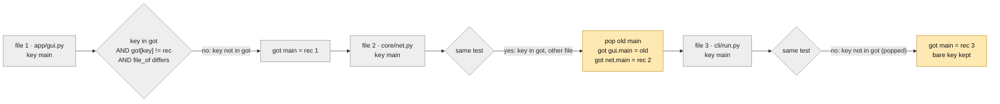
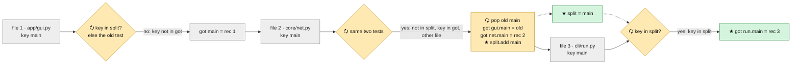
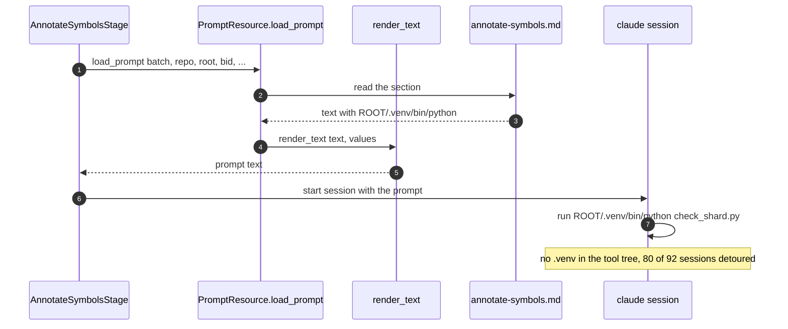
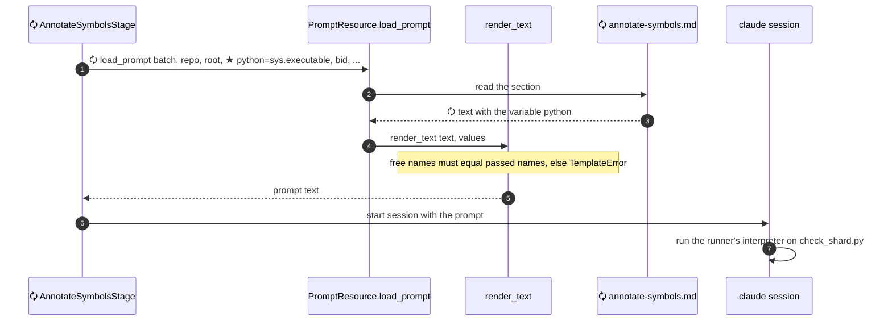
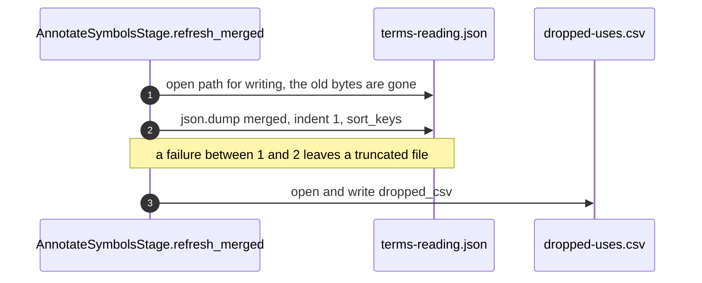
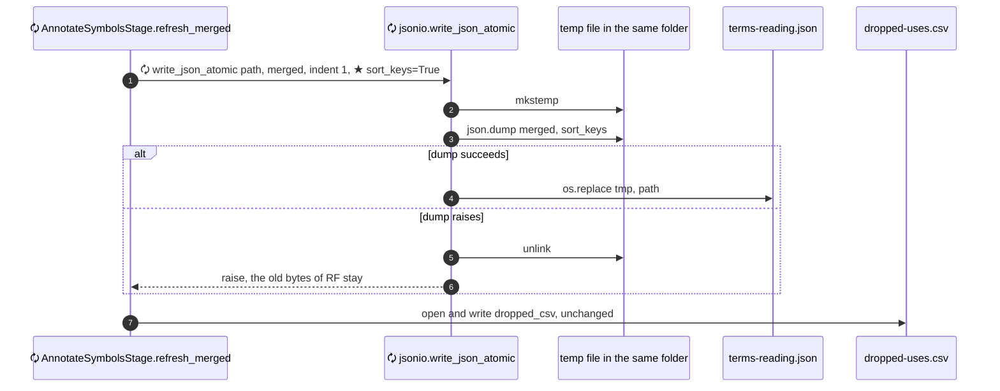
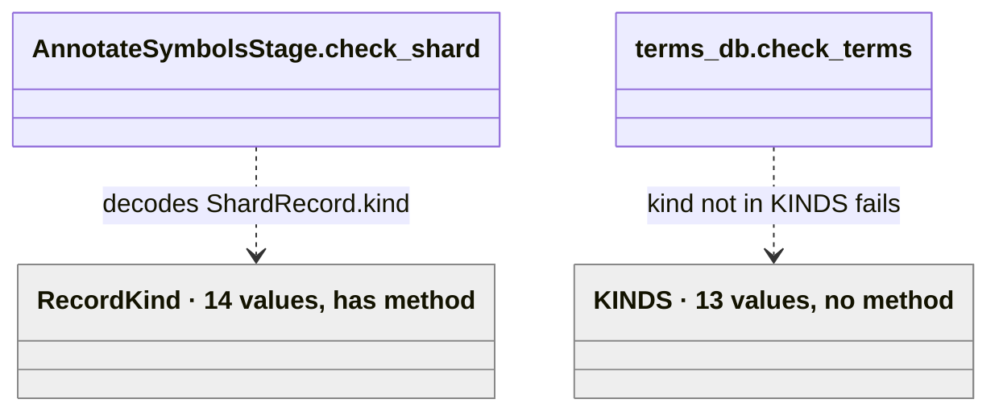
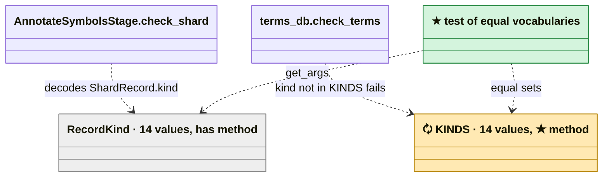

# 🧱 B1 — Survey stabilization: implementation plan

> 🔄 Status as of 2026-11-23: carried out — implemented and merged into `main` (see `git log`). The approval line below stands as written on the day of the plan.

> 📅 2026-11-22 · branch `main` · **Before = `29c5ee9`**
> 📄 Evidence: `docs/superpowers/specs/2026-11-21-mode1-audit-verification-report.md` §2.4 (가) · §3 · split public.handoff/2026-11-22-mode1-remediation-split.md · code read for this restyle: `survey.py` · `survey_files.py` · `terms_db.py` · `context.py` · `jsonio.py` · `src/core/pipeline.py` · the five prompt lines
> 🔒 Rules kept: prompts stay in `resource/` and every name a prompt uses is passed by the code · no check is loosened (one check becomes wider on purpose, see Task 3) · comments state the present only
> 🧪 Verification: unit tests first, then the six gates. No paid run
> ✋ Approval: **not approved yet**
> 🌐 Korean translation: `2026-11-22-mode1-b1-survey-stabilize-plan.ko.md`

> **For agentic workers:** REQUIRED SUB-SKILL: Use superpowers:subagent-driven-development (recommended) or superpowers:executing-plans to implement this plan task-by-task. Steps use checkbox (`- [ ]`) syntax for tracking.

**Goal:** The survey prompt names an interpreter that exists, and three latent defects in merging and checking are closed.

**Architecture:** Four small, independent fixes in the survey path. The prompt stops spelling out a `.venv` path and receives the interpreter the runner itself is running on. Shard merging remembers which bare keys it has already split. The term checker's kind vocabulary is made equal to the shard checker's. The merged reading file is written through the existing atomic writer.

**Tech Stack:** Python 3 · Jinja2 prompt resources · pytest · pyright strict.

---

Claim tags used below: `[코드 확인]` read in the source · `[실측]` measured in the cited reports · `[제안]` proposed by this plan · `[미검증]` not checked. Nothing in this plan is implemented, so no row below is marked ✅.

## 📄 One-page summary

| | |
|---|---|
| 🎯 Covers | <span style="color:cyan">Interpreter</span> path hardcoded in five prompt lines · a third file with the same key keeps the <span style="color:cyan">bare key</span> · the <span style="color:cyan">kind vocabulary</span> of the <span style="color:cyan">term check</span> lacks `method` · the <span style="color:cyan">merged reading file</span> is written in place |
| 🧩 Conclusion | Each fix is a few lines and reuses what exists: `sys.executable`, `write_json_atomic`, the <span style="color:cyan">shard check</span>'s vocabulary |
| 🟰 Unchanged | The record contract · <span style="color:cyan">shard</span> file format · bytes of `terms-reading.json` · which sessions run |
| 🗘 Changed | Five prompt lines · three prompt builders · `merge_shards` · `KINDS` · `refresh_merged` · the <span style="color:cyan">file strategy</span>'s merged write · `write_json_atomic` gains one optional argument |
| ⚠️ Trap | The prompt text and the values passed to it must change in the same step — a name used without a value, or a value without a name, fails to render (`render_text`, `src/core/pipeline.py:554-572`) |
| 🚫 Out of scope | The non-node section's rule conflict (B2) · the read-through cache protocol (B3) · `dropped-uses.csv` (rewritten whole on every merge and never read back) |

## 🚦 Status

| Item | Progress |
|---|---|
| Task 1 — the prompt names the <span style="color:cyan">interpreter</span> the <span style="color:cyan">runner</span> runs on | ❌ not done |
| Task 2 — a third file with the same key is renamed too | ❌ not done |
| Task 3 — the <span style="color:cyan">term check</span> accepts every kind the <span style="color:cyan">shard check</span> accepts | ❌ not done |
| Task 4 — the <span style="color:cyan">merged reading file</span> is written atomically | ❌ not done |
| Task 5 — READMEs regenerated, six gates closed | ❌ not done |
| Plan approval | ❌ not approved yet |

## ✋ Decided and proposed

### 👍 Decided — by the user, not to be reopened

| What | 👍 Chosen | 👎 Dropped | Who | When |
|---|---|---|---|---|
| Measurement principle | Fix first, measure after: the 2026-11-21 run is the baseline, no re-measurement before fixes | Re-running to get a fresh base | user | 2026-11-22 |
| Order of this plan | B1 runs first, together with A1 — neither needs a decision or a paid check | — | user | 2026-11-22 |
| Number of re-measurements | Two for the whole batch: Measurement A (through the survey) and Measurement B (full) | After every plan · once at the end | user | 2026-11-22 |

Source of the first and third rows: `public.handoff/2026-11-22-mode1-remediation-split.md`, section "Decided (user, 2026-11-22)".

### `[제안]` Proposed — design choices of the plan author (not user decisions)

| Choice | Alternative left out | Why |
|---|---|---|
| Pass `python=sys.executable` into `load_prompt` | Keep a path in the prompt and ask the session to find one | `sys.executable` is already how machine stages are launched (`src/codewiki/python/runner/mode1/graph.py:59`) |
| Add an optional `sort_keys` argument to `write_json_atomic` | Write a second <span style="color:cyan">atomic writer</span> next to the survey code | The merged file is written with `sort_keys=True`; the bytes must stay the same |
| Widen the <span style="color:cyan">term check</span> (`KINDS` gains `method`) and pin the two <span style="color:cyan">kind vocabulary</span> sets with a test | Narrow the <span style="color:cyan">shard check</span> (`RecordKind` loses `method`) | The <span style="color:cyan">shard check</span> already accepts `method` (`src/codewiki/python/runner/mode1/context.py:53-56`) |
| Keep the <span style="color:cyan">split set</span> local to one `merge_shards` call | Persist it across runs | `merge_shards` is a pure function of the <span style="color:cyan">shards</span> (its docstring); the cross-run case is left to stable symbol ids (Self-review notes) |
| Leave `dropped-uses.csv` as it is | Write it atomically too | It is rewritten whole on every merge and never read back |

## 📖 Glossary

| Term | Code name | Meaning |
|---|---|---|
| <span style="color:cyan">survey</span> | stage `annotate-symbols` · `AnnotateSymbolsStage` | The pass where sessions write one record per symbol |
| <span style="color:cyan">runner</span> | `run_mode1.py` | The program that starts the sessions and the machine stages |
| <span style="color:cyan">interpreter</span> | `sys.executable` · prompt variable `python` | The Python the <span style="color:cyan">runner</span> itself runs on |
| <span style="color:cyan">shard</span> | `out/codegraph-raw/_shards/<bid>.json` | One batch's records, written by one session |
| <span style="color:cyan">bare key</span> | a key of `Records` without a file stem | The record key as a session wrote it, e.g. `main` |
| <span style="color:cyan">split set</span> | local `split` in `merge_shards` (new) | <span style="color:cyan">Bare keys</span> already renamed during this merge |
| rename | `AnnotateSymbolsStage.qualified` | Turns `main` into `<file stem>.main` |
| <span style="color:cyan">merged reading file</span> | `terms-reading.json` · artifact `READING` | The merged, corrected records of the survey |
| <span style="color:cyan">atomic write</span> | `jsonio.write_json_atomic` | Temp file in the same folder, then `os.replace` |
| <span style="color:cyan">shard check</span> | `AnnotateSymbolsStage.check_shard` · `check_shard.py` | The machine check a session runs on its own <span style="color:cyan">shard</span> |
| <span style="color:cyan">term check</span> | `terms_db.check_terms` | The check of the term records (L1/L2/L3 and kinds) |
| <span style="color:cyan">kind vocabulary</span> | `RecordKind` (<span style="color:cyan">shard check</span>) · `KINDS` (<span style="color:cyan">term check</span>) | The set of allowed `kind` values |
| <span style="color:cyan">file strategy</span> | `AnnotateFilesStage` | The survey variant where one file is one session |

## 🔁 Before and After

| 📍 Before | 🛠️ After · proposed | 🎉 What it resolves | 🔭 Expected | Progress |
|---|---|---|---|---|
| The prompt says `<tool>/.venv/bin/python` in five lines `[코드 확인]`; 80 of 92 sessions found no such file and detoured `[실측]` | The prompt carries the <span style="color:cyan">interpreter</span> the <span style="color:cyan">runner</span> runs on `[제안]` | The check command works wherever the <span style="color:cyan">runner</span> works | Sessions stop detouring around a missing `.venv` `[미검증]` — to be seen in Measurement A | ❌ |
| Three files with key `main` merge to `a.main` · `b.main` · `main` `[실측]` (audit §3) | All three are renamed `[제안]` | The promise in the docstring ("every colliding record is renamed") holds | Tests 2 and 3 of Task 2 pass `[미검증]` | ❌ |
| A record with source `reading` and kind `method` fails the <span style="color:cyan">term check</span> `[실측]` (audit §3) | It passes; a test pins the two <span style="color:cyan">kind vocabulary</span> sets together `[제안]` | The <span style="color:cyan">shard check</span> and the <span style="color:cyan">term check</span> accept the same kinds | The pin test passes `[미검증]` | ❌ |
| An interrupted merge leaves a truncated `terms-reading.json` `[코드 확인]` (`survey.py:508-509`) | The old file stays until the new one is complete `[제안]` | The next run can still load its baseline | The new interruption test passes `[미검증]` | ❌ |

## ★ New · 🗘 Changed

Order: module → file → class → function → member. Each item is marked on its own level against `29c5ee9`. **★ = created from nothing · 🗘 = existing element changed · ✕ = removed · no mark = reused unchanged.**

| Level | Item | Mark | Kind | Belongs to |
|---|---|---|---|---|
| module | `codewiki` <span style="color:cyan">runner</span> (`src/codewiki/python/runner`) | 🗘 | changed | — |
| module | `codewiki` machine (`src/codewiki/python/machine`) | 🗘 | changed | — |
| module | `resource/codewiki` | 🗘 | changed | — |
| module | `test/codewiki` | 🗘 | changed | — |
| file | `resource/codewiki/prompts/annotate-symbols.md` | 🗘 | changed | `resource/codewiki` |
| file | `mode1/survey.py` | 🗘 | changed | <span style="color:cyan">runner</span> |
| file | `mode1/survey_files.py` | 🗘 | changed | <span style="color:cyan">runner</span> |
| file | `machine/terms_db.py` | 🗘 | changed | machine |
| file | `machine/jsonio.py` | 🗘 | changed | machine |
| file | `test_mode1.py` · `test_run_mode1.py` · `test_terms_db.py` · `test_jsonio.py` | 🗘 | changed (tests appended) | `test/codewiki` |
| file | `src/codewiki/python/runner/README.md` · `src/codewiki/python/machine/README.md` | 🗘 | regenerated (`[미검증]` whether the text differs) | <span style="color:cyan">runner</span> · machine |
| class | `AnnotateSymbolsStage` | 🗘 | changed (methods only) | `mode1/survey.py` |
| class | `AnnotateFilesStage` | 🗘 | changed (an inner function only) | `mode1/survey_files.py` |
| class | no class is created or removed | — | not applicable | — |
| function | `survey_batch_prompt` · `nonnode_prompt` · `pass2_prompt` | 🗘 | changed | `AnnotateSymbolsStage` |
| function | `merge_shards` · `refresh_merged` | 🗘 | changed | `AnnotateSymbolsStage` |
| function | `write_json_atomic` | 🗘 | changed | `machine/jsonio.py` |
| function | `write_merged` (inner function of `AnnotateFilesStage.perform`) | 🗘 | changed | `AnnotateFilesStage` |
| function | ★ the seven new tests (one in `test_mode1.py` for the prompt · one for the interruption · two merge tests · two term tests · one for `sort_keys`) | ★ | new | `test/codewiki` |
| function | `load_prompt` · `render_text` · `file_of` · `qualified` · `check_terms` · `check_shard` | — | reused unchanged | — |
| member | prompt variable `python` (sections `batch` · `nonnode` · `pass2`) | ★ | new | `annotate-symbols.md` |
| member | parameter `sort_keys` | ★ | new | `write_json_atomic` |
| member | local `split` | ★ | new | `merge_shards` |
| member | constant `KINDS` | 🗘 | changed | `machine/terms_db.py` |
| member | the entry `"method"` of `KINDS` | ★ | new | `KINDS` |
| member | `import jsonio` | ★ | new | `survey_files.py` |
| member | `import json` | ✕ | removed once unused — its only use is `json.dump` at `survey_files.py:71` `[코드 확인]` | `survey_files.py` |

## 🔀 Diagrams

Legend: gray = unchanged · green = new (★) · amber = changed (🗘). Labels carry the same marks, so the meaning survives without color. Identifiers in the diagrams are stable between Before and After.

### Flow — what `merge_shards` does with the key `main` from three files

Before. `[코드 확인]` the test is `survey.py:438-439`; after the second file the <span style="color:cyan">bare key</span> was popped, so the third file finds no collision.



After · proposed. `[제안]` a remembered <span style="color:cyan">split set</span> qualifies the third key.



### Sequence — how the survey prompt gets its interpreter

Before. `[코드 확인]` the five lines are 64 · 67 · 113 · 176 · 211 of `annotate-symbols.md`; the builders pass no <span style="color:cyan">interpreter</span> (`survey.py:137-141` · `:169-171` · `:372-373`).



After · proposed. `[제안]` the stage passes the <span style="color:cyan">interpreter</span>; `render_text` still demands that names and values match, which is why prompt and builders change together.



### Sequence — how `refresh_merged` writes the merged file

Before. `[코드 확인]` `survey.py:507-511`.



After · proposed. `[제안]` the <span style="color:cyan">file strategy</span>'s `write_merged` takes the same route (`survey_files.py:68-71`); the CSV write stays as it is.



### Class — Before = After

No class is created, removed or moved, and no dependency arrow between classes changes. The one structural fact the plan pins is a data relation: two <span style="color:cyan">kind vocabulary</span> sets that were meant to be one.

Before. `[코드 확인]` `RecordKind` has 14 values (`context.py:55-56`); `KINDS` has 13, without `method` (`terms_db.py:35-36`).



After · proposed. `[제안]`



## 📝 Where to change

| File · symbol | Change | Reason | Source evidence |
|---|---|---|---|
| 🗘 `resource/codewiki/prompts/annotate-symbols.md` lines 64 · 67 · 113 · 176 · 211 | `{{root}}/.venv/bin/python` becomes `{{python}}` | The <span style="color:cyan">interpreter</span> must be the one the <span style="color:cyan">runner</span> runs on | `[코드 확인]` `grep -n venv` prints exactly these five lines; `[실측]` 80 of 92 sessions detoured (audit §2.4 (가)) |
| 🗘 `survey.py` · `survey_batch_prompt` (116-141) · `nonnode_prompt` (163-171) · `pass2_prompt` (365-373) | each `load_prompt` call gains `python=sys.executable` | `render_text` rejects a name without a value and a value without a name | `[코드 확인]` `pipeline.py:554-572`; `import sys` is at `survey.py:7`; each of the three sections uses `{{python}}` after the edit, so no value stays unused |
| 🗘 `survey.py` · `merge_shards` (408-446) | ★ local `split`; a key in `split` is renamed without the collision test | The second rename pops the <span style="color:cyan">bare key</span>, so the third file sees no collision | `[코드 확인]` `survey.py:438-445`; `[실측]` audit §3 |
| 🗘 `terms_db.py` · `KINDS` (35-36) | add `"method"` | The <span style="color:cyan">shard check</span> accepts `method`; the <span style="color:cyan">term check</span> does not | `[코드 확인]` `terms_db.py:343-345` with `context.py:55-56`; `[실측]` audit §3 |
| 🗘 `jsonio.py` · `write_json_atomic` (7-21) | ★ optional `sort_keys`, passed to `json.dump` | The merged file is written with sorted keys | `[코드 확인]` `jsonio.py:7-21` has no such argument; `survey.py:509` and `survey_files.py:71` pass `sort_keys=True` |
| 🗘 `survey.py` · `refresh_merged` (498-512) | the reading file goes through `write_json_atomic` | A cut write must not leave a half file as the next run's baseline | `[코드 확인]` `survey.py:507-509` opens the final path for writing |
| 🗘 `survey_files.py` · `write_merged` (67-74) | same route; ★ `import jsonio`; ✕ `import json` | Same as above, on the <span style="color:cyan">file strategy</span> path | `[코드 확인]` `survey_files.py:68-71`; `json` is used only at `:71` |
| 🗘 four test files | seven tests appended | Each fix is written test first | `[코드 확인]` helpers `_shard` (`test_run_mode1.py:352`), `_one_batch_plan` (`test_mode1.py:1070`), `_good_record` (`test_mode1.py:1064`) exist |

Two excerpts of the plan's code, as proposed diffs. Both are **proposed diff — not applied**; the full code is in the tasks below, and the `-` lines come from the files as they are now.

`🗘 resource/codewiki/prompts/annotate-symbols.md` — one of the five lines (Task 1):

```diff
-    {{root}}/.venv/bin/python {{root}}/src/codewiki/python/runner/check_shard.py {{repo}}/out/codegraph-raw/_shards/{{bid}}.json
+    {{python}} {{root}}/src/codewiki/python/runner/check_shard.py {{repo}}/out/codegraph-raw/_shards/{{bid}}.json
```

`🗘 src/codewiki/python/runner/mode1/survey.py` · `merge_shards` — the branch head (Task 2):

```diff
-                if key in got and got[key] != rec \
+                if key in split:
+                    got[AnnotateSymbolsStage.qualified(key, rec)] = rec
+                elif key in got and got[key] != rec \
                         and AnnotateSymbolsStage.file_of(got[key]) != AnnotateSymbolsStage.file_of(rec):
```

## 🧪 Verification

- Unit tests first (each task writes its failing test, sees it fail, then implements), then the six gates of Task 5. No paid run, no LLM session.
- Seven tests are added; Task 5 expects pytest to pass with seven more tests than before and no new skip or xfail.
- `[미검증]` Whether Task 1 removes the detour in a real session is not checked by any test here — Measurement A is where it shows. Measurement A should list this change among the differences from the baseline.
- `[실측]` Every Mermaid block in this front part was rendered with `mmdc` 11.16.0 when the document was written. Only the diagrams were checked; no test of the tasks has been run.
- `[미검증]` Task 2 fixes one run's merge only. A record renamed in an earlier run's stored reading file is not re-qualified (see Self-review notes).

## ❓ Open decisions

No blocking decision (split report, plan table: "Blocking decision — none"). Non-blocking:

| Question | Evidence | Recommendation | Impact |
|---|---|---|---|
| Are commits approved for this plan? | Task 1 step 6 says "only when the user has approved commits for this plan" | Ask when the plan is approved | Only whether the five commit steps run |
| Should the unresolved table (a CSV) written next to the merged file in `write_merged` also go through an <span style="color:cyan">atomic write</span>? | `survey_files.py:72-74` writes it with a plain `open`; the plan does not mention it | Not in this plan — it is derived from the merged records and rewritten every merge | None for the baseline; a half CSV is rewritten by the next merge |

## 🚫 Out of scope

- The non-node section's rule conflict (B2) · the read-through cache protocol (B3) · `dropped-uses.csv`.
- Re-qualifying a <span style="color:cyan">bare key</span> stored by an earlier run (needs the plan's id-to-name map; belongs with stable symbol ids).
- Any change to a check that would make it accept less or more than the <span style="color:cyan">shard check</span> already does, apart from `method`.

All commands run from the repository root with `.venv/bin/python`. Paths under `mode1/` and `machine/` are `src/codewiki/python/runner/mode1/` and `src/codewiki/python/machine/`.

---

### Task 1: The prompt names the interpreter the runner runs on

**Files:**
- Modify: `resource/codewiki/prompts/annotate-symbols.md` (lines 64, 67, 113, 176, 211)
- Modify: `src/codewiki/python/runner/mode1/survey.py` (`survey_batch_prompt`, `nonnode_prompt`, `pass2_prompt`)
- Test: `test/codewiki/test_mode1.py`

- [ ] **Step 1: Write the failing test** — append to `test/codewiki/test_mode1.py`:

```python
def test_전수조사_프롬프트는_실행기의_해석기를_적는다():
    """도구 저장소에 `.venv` 가 없어도 검문 명령이 돈다 — 프롬프트가 지금 도는 해석기를 그대로 적는다."""
    b = _one_batch_plan("L0-B00")["layers"][0]["batches"][0]
    S = SV.AnnotateSymbolsStage
    batch = S.survey_batch_prompt("/repo", "/root", b, [])
    nonnode = S.nonnode_prompt("/repo", "/root")
    pass2 = S.pass2_prompt("/repo", "/root", "F00", "a.py", {}, {})
    for p in (batch, nonnode, pass2):
        assert sys.executable + " /root/src/codewiki/python/runner/check_shard.py" in p
        assert "/root/.venv/bin/python" not in p
    assert sys.executable + " /root/src/codewiki/python/machine/file_cache.py get /repo" in batch
    assert sys.executable + " /root/src/codewiki/python/machine/file_cache.py put /repo" in batch
```

- [ ] **Step 2: Run it and see it fail**

Run: `.venv/bin/python -m pytest test/codewiki/test_mode1.py -q -k "실행기의_해석기"`
Expected: 1 failed — the first `assert` (the prompt still says `/root/.venv/bin/python`).

- [ ] **Step 3: Change the prompt** — in `resource/codewiki/prompts/annotate-symbols.md`, replace `{{root}}/.venv/bin/python` with `{{python}}` on each of the five lines. They become:

Line 64:
```
     {{python}} {{root}}/src/codewiki/python/machine/file_cache.py get {{repo}} <파일경로>
```
Line 67:
```
     {{python}} {{root}}/src/codewiki/python/machine/file_cache.py put {{repo}} <파일경로> <개요json의_파일경로>
```
Line 113:
```
    {{python}} {{root}}/src/codewiki/python/runner/check_shard.py {{repo}}/out/codegraph-raw/_shards/{{bid}}.json
```
Line 176:
```
  {{python}} {{root}}/src/codewiki/python/runner/check_shard.py {{repo}}/out/codegraph-raw/_shards/NONNODE.json
```
Line 211:
```
  {{python}} {{root}}/src/codewiki/python/runner/check_shard.py {{repo}}/out/codegraph-raw/_shards/_pass2/{{bid}}.json
```

Check that none is left: `grep -c "venv" resource/codewiki/prompts/annotate-symbols.md` prints `0`.

- [ ] **Step 4: Pass the value** — in `src/codewiki/python/runner/mode1/survey.py`, add `python=sys.executable` to the three `load_prompt` calls. They become:

In `survey_batch_prompt`:
```python
        return AnnotateSymbolsStage.load_prompt(
            "annotate-symbols#batch", repo=repo, root=root, python=sys.executable, bid=batch["id"],
            n=len(syms), syms=syms,
            deps=list(deps), targets=scope, target_count=len(scope), total=total,
            reading=X.reading_path(repo, ROOT), pending=list(pending),
            faults=list(faults), fault_count=len(faults), bad=bad)
```

In `nonnode_prompt`:
```python
        return AnnotateSymbolsStage.load_prompt(
            "annotate-symbols#nonnode", repo=repo, root=root, python=sys.executable,
            reading=X.reading_path(repo, ROOT),
            faults=list(faults), fault_count=len(faults), bad=bad)
```

In `pass2_prompt`:
```python
        return AnnotateSymbolsStage.load_prompt(
            "annotate-symbols#pass2", repo=repo, root=root, python=sys.executable, bid=bid, file=file,
            mine=mine, theirs=theirs)
```

In the docstring of `survey_batch_prompt`, add this sentence after its first line:

```
        검문 · 통독 캐시 명령의 해석기는 지금 실행기가 도는 해석기다 — 기계 단계를 띄울 때와 같다.
```

- [ ] **Step 5: Run the prompt tests and the prompt gate**

Run: `.venv/bin/python -m pytest test/codewiki/test_mode1.py test/codewiki/test_run_mode1.py qa/gates/test_prompt_resources.py -q`
Expected: all pass.

- [ ] **Step 6: Commit** (only when the user has approved commits for this plan)

Title: `[fix] : codewiki - 전수조사 프롬프트가 실행기의 해석기를 적는다`

---

### Task 2: A third file with the same key is renamed too

**Files:**
- Modify: `src/codewiki/python/runner/mode1/survey.py` (`merge_shards`)
- Test: `test/codewiki/test_run_mode1.py`

- [ ] **Step 1: Write the failing tests** — in `test/codewiki/test_run_mode1.py`, insert after `test_이미_있는_키와_겹쳐도_양쪽_다_개명한다`:

```python
def test_세_파일이_같은_키를_쓰면_셋_다_개명한다(tmp_path: Path):
    """둘을 개명하고 나면 맨 키가 비어서, 셋째가 맨 키로 남으면 안 된다."""
    d = _shard(tmp_path, "L0-B00", {"main": {"where": "app/gui.py:10"}})
    _shard(tmp_path, "L0-B01", {"main": {"where": "core/net.py:20"}})
    _shard(tmp_path, "L0-B02", {"main": {"where": "cli/run.py:30"}})
    assert sorted(R.merge_shards(d, {})) == ["gui.main", "net.main", "run.main"]


def test_개명한_파일을_다시_조사한_샤드는_그_파일_것만_갈아_끼운다(tmp_path: Path):
    """같은 파일을 다시 조사한 샤드가 뒤에 오면 그 파일의 개명된 레코드가 새 판이 된다."""
    d = _shard(tmp_path, "L0-B00", {"main": {"where": "app/gui.py:10", "means": "옛"}})
    _shard(tmp_path, "L0-B01", {"main": {"where": "core/net.py:20"}})
    _shard(tmp_path, "L1-B00", {"main": {"where": "app/gui.py:10", "means": "새"}})
    got = R.merge_shards(d, {})
    assert sorted(got) == ["gui.main", "net.main"]
    assert got["gui.main"]["means"] == "새"
```

- [ ] **Step 2: Run them and see them fail**

Run: `.venv/bin/python -m pytest test/codewiki/test_run_mode1.py -q -k "세_파일이 or 다시_조사한_샤드"`
Expected: 2 failed — both results contain the bare key `main`.

- [ ] **Step 3: Implement** — in `merge_shards`, replace the body from `got = dict(existing or {})` to `return got` with:

```python
        got = dict(existing or {})
        split: set[str] = set()      # 겹쳐서 개명한 맨 키. 같은 키가 또 오면 그것도 개명한다
        if not os.path.isdir(shard_dir):
            return got
        for fname in sorted(os.listdir(shard_dir)):
            if not fname.endswith(".json"):
                continue
            try:
                with open(os.path.join(shard_dir, fname), encoding="utf-8") as f:
                    shard: Records = json.load(f)
            except (ValueError, OSError) as ex:
                print("샤드를 건너뛴다 — %s: %s" % (fname, ex), file=sys.stderr)
                continue
            for key, rec in shard.items():
                if key in split:
                    got[AnnotateSymbolsStage.qualified(key, rec)] = rec
                # 자리 주인이 남(다른 파일)일 때만 충돌이다. 같은 파일이면 다시 읽은 새 판이라 갈아 끼운다.
                elif key in got and got[key] != rec \
                        and AnnotateSymbolsStage.file_of(got[key]) != AnnotateSymbolsStage.file_of(rec):
                    # 겹친 전원을 개명한다. 이미 들어와 있던 쪽도 함께 고친다.
                    old = got.pop(key)
                    got[AnnotateSymbolsStage.qualified(key, old)] = old
                    got[AnnotateSymbolsStage.qualified(key, rec)] = rec
                    split.add(key)
                else:
                    got[key] = rec
        return got
```

In the docstring of `merge_shards`, replace the sentence `한쪽만 한정하면 나중에 또 겹친다.` with:

```
한쪽만 한정하면 나중에 또 겹친다. 한 번 갈라진 맨 키는 이 호출이 끝날 때까지 기억한다 — 셋째가 와도 맨 키로 남지 않는다.
```

- [ ] **Step 4: Run the merge tests**

Run: `.venv/bin/python -m pytest test/codewiki/test_run_mode1.py test/codewiki/test_mode1.py -q -k "merge or 샤드 or 개명 or 합"`
Expected: all pass, including `test_같은_샤드를_두_번_합쳐도_개명하지_않는다`.

- [ ] **Step 5: Commit**

Title: `[fix] : codewiki - 같은 키를 쓰는 셋째 파일의 레코드도 개명한다`

---

### Task 3: The term check accepts every kind the shard check accepts

**Files:**
- Modify: `src/codewiki/python/machine/terms_db.py` (`KINDS`)
- Test: `test/codewiki/test_terms_db.py`

- [ ] **Step 1: Write the failing tests** — append to `test/codewiki/test_terms_db.py`:

```python
def test_reading_출처의_method_레코드는_종류_검사를_통과한다(tmp_path: Path):
    """샤드 검문이 받는 종류를 용어 검사가 실패로 세면, 통과한 샤드가 뒤 단계에서 흐름을 멈춘다."""
    repo = _repo(tmp_path)
    db = cast(T.TermsDb, {"x.build_terms": {"source": "reading", "kind": "method", "module": "codegraph",
                                           "where": "codegraph/x.py:3", "means": "용어를 짓는다",
                                           "neighbors": [], "uses": []}})
    assert T.check_terms(db, repo) == []


def test_샤드_검문의_종류_어휘와_용어_검사의_종류_어휘가_같다():
    from typing import get_args

    from mode1 import context as X
    assert T.KINDS == frozenset(get_args(X.RecordKind))
```

- [ ] **Step 2: Run them and see them fail**

Run: `.venv/bin/python -m pytest test/codewiki/test_terms_db.py -q -k "method_레코드 or 종류_어휘"`
Expected: 2 failed — the first returns `[('실패', 'x.build_terms', "kind 값이 이상하다: 'method'")]`, the second shows `method` missing from `KINDS`.

- [ ] **Step 3: Implement** — in `src/codewiki/python/machine/terms_db.py`, replace the two-line `KINDS` definition and the comment above it with:

```python
# reading 레코드가 쓸 수 있는 kind 전부. codegraph 에서 온 kind 는 검사하지 않는다(정적 도구의 어휘).
# 샤드 검문의 어휘(`mode1.context.RecordKind`)와 같다 — `test_샤드_검문의_종류_어휘와_용어_검사의_종류_어휘가_같다`.
KINDS = frozenset({"class", "struct", "enum", "interface", "delegate", "record", "external",
                   "function", "method"}) | NON_NODE_KINDS
```

- [ ] **Step 4: Run the term tests**

Run: `.venv/bin/python -m pytest test/codewiki/test_terms_db.py -q`
Expected: all pass (tests that need a golden repository stay skipped as before).

- [ ] **Step 5: Commit**

Title: `[fix] : codewiki - 용어 검사의 종류 어휘에 method 를 넣어 샤드 검문과 맞춘다`

---

### Task 4: The merged reading file is written atomically

**Files:**
- Modify: `src/codewiki/python/machine/jsonio.py` (`write_json_atomic`)
- Modify: `src/codewiki/python/runner/mode1/survey.py` (`refresh_merged`)
- Modify: `src/codewiki/python/runner/mode1/survey_files.py` (inner `write_merged`)
- Test: `test/codewiki/test_jsonio.py` · `test/codewiki/test_mode1.py`

- [ ] **Step 1: Write the failing tests** — in `test/codewiki/test_jsonio.py`, add `import json` above `import os`, then append:

```python
def test_sort_keys_면_안쪽_사전까지_열쇠를_정렬해_쓴다(tmp_path: Path) -> None:
    p = tmp_path / "a.json"
    doc = {"나": 1, "가": {"z": 1, "a": 2}}
    jsonio.write_json_atomic(str(p), doc, indent=1, sort_keys=True)
    assert p.read_text(encoding="utf-8") == json.dumps(doc, ensure_ascii=False, indent=1, sort_keys=True)
```

Append to `test/codewiki/test_mode1.py`:

```python
def test_refresh_merged_가_쓰다_죽어도_옛_reading_이_남는다(tmp_path: Path, monkeypatch: pytest.MonkeyPatch):
    """다음 실행은 이 파일을 조사 이전의 원본으로 읽는다. 반쪽 파일이 남으면 그 실행이 시작에서 죽는다."""
    c = _ctx(tmp_path); c.plan = _one_batch_plan("L0-B00")
    d = Path(SV.AnnotateSymbolsStage.shard_dir(c)); d.mkdir(parents=True)
    (d / "L0-B00.json").write_text(json.dumps({"f": _good_record()}), encoding="utf-8")
    reading = Path(X.READING.locate(c)); reading.parent.mkdir(parents=True, exist_ok=True)
    reading.write_text('{"옛": {}}', encoding="utf-8")

    def boom(*a: object, **k: object) -> None:
        raise OSError("디스크가 찼다")
    monkeypatch.setattr(jsonio.json, "dump", boom)
    with pytest.raises(OSError):
        SV.AnnotateSymbolsStage().refresh_merged(c)
    assert reading.read_text(encoding="utf-8") == '{"옛": {}}'
    assert [p.name for p in reading.parent.iterdir()] == [reading.name]
```

- [ ] **Step 2: Run them and see them fail**

Run: `.venv/bin/python -m pytest test/codewiki/test_jsonio.py test/codewiki/test_mode1.py -q -k "sort_keys or 옛_reading"`
Expected: 2 failed — `TypeError: write_json_atomic() got an unexpected keyword argument 'sort_keys'`, and the reading file is empty instead of `{"옛": {}}`.

- [ ] **Step 3: Implement the writer option** — in `src/codewiki/python/machine/jsonio.py`, replace `write_json_atomic` with:

```python
def write_json_atomic(path: str, obj: object, indent: int = 2, trailing_newline: bool = False,
                      sort_keys: bool = False) -> None:
    """`path` 를 `obj` 의 JSON 으로 바꿔 끼운다. 같은 입력이면 같은 바이트다. `sort_keys` 면 사전의 열쇠를 정렬해 쓴다."""
    folder = os.path.dirname(os.path.abspath(path))
    os.makedirs(folder, exist_ok=True)
    fd, tmp = tempfile.mkstemp(dir=folder, prefix="." + os.path.basename(path) + ".", suffix=".tmp")
    try:
        with os.fdopen(fd, "w", encoding="utf-8") as f:
            json.dump(obj, f, ensure_ascii=False, indent=indent, sort_keys=sort_keys)
            if trailing_newline:
                f.write("\n")
        os.replace(tmp, path)
    except BaseException:
        if os.path.exists(tmp):
            os.unlink(tmp)
        raise
```

- [ ] **Step 4: Use it in both strategies** — in `src/codewiki/python/runner/mode1/survey.py`, replace the end of `refresh_merged` (from `path = X.READING.locate(ctx)` to `return dropped`) with:

```python
        jsonio.write_json_atomic(X.READING.locate(ctx), ctx.merged, indent=1, sort_keys=True)
        with open(X.DROPPED.locate(ctx), "w", encoding="utf-8") as f:
            f.write(self.dropped_csv(dropped))
        return dropped
```

In `src/codewiki/python/runner/mode1/survey_files.py`, add `import jsonio` on the line above `import survey_plan`, and in the inner `write_merged` replace these three lines

```python
            os.makedirs(os.path.dirname(X.READING.locate(ctx)), exist_ok=True)
            with open(X.READING.locate(ctx), "w", encoding="utf-8") as f:
                json.dump(ctx.merged, f, ensure_ascii=False, indent=1, sort_keys=True)
```

with:

```python
            jsonio.write_json_atomic(X.READING.locate(ctx), ctx.merged, indent=1, sort_keys=True)
```

If `json` or `os` is no longer used in `survey_files.py` after this, remove that import; pyright reports an unused import otherwise.

- [ ] **Step 5: Run the survey tests and the type check**

Run: `.venv/bin/python -m pytest test/codewiki/test_jsonio.py test/codewiki/test_mode1.py test/codewiki/test_run_mode1.py -q && npm run typecheck:py`
Expected: all pass · `0 errors`. `test_refresh_merged_는_보정본을_reading_과_dropped_csv_로_쓴다` still passes — the bytes are the same as before.

- [ ] **Step 6: Commit**

Title: `[fix] : codewiki - 병합한 읽기 레코드를 임시 파일을 거쳐 바꿔 끼운다`

---

### Task 5: Regenerate the READMEs and close the gates

**Files:**
- Regenerate: `src/codewiki/python/runner/README.md` · `src/codewiki/python/machine/README.md`

- [ ] **Step 1: Regenerate and check drift**

Run:
```bash
.venv/bin/python tools/gen_readme.py src/codewiki/python/runner src/codewiki/python/machine src/codewiki/python/viz src/term/python/runner src/spec/python/runner src/spec/python/viz src/core src/common tools
.venv/bin/python tools/gen_readme.py --check src/codewiki/python/runner src/codewiki/python/machine src/codewiki/python/viz src/term/python/runner src/spec/python/runner src/spec/python/viz src/core src/common tools
```
Expected: the second command exits 0.

- [ ] **Step 2: Run the six gates**

Run:
```bash
.venv/bin/python -m pytest -q
npm test
npm run typecheck
npm run typecheck:py
npm run doctor
```
Expected: pytest passes with 7 more tests than before this plan and no new skip or xfail · `npm test` 8 pass · both type checks clean · doctor exits 0.

- [ ] **Step 3: Commit**

Title: `[docs] : codewiki - 전수조사 안정화에 맞춰 모듈 README 를 다시 생성한다`

---

## Self-review notes

- **Coverage:** interpreter path → Task 1 · third-file key collision → Task 2 · kind vocabulary → Task 3 · non-atomic write → Task 4.
- **Names used across tasks:** prompt variable `python` · local `split` · `KINDS` · argument `sort_keys`.
- **A check that becomes wider:** Task 3 adds `method` to the term checker's vocabulary. This is not loosening — the shard checker already accepts `method`, and the two were meant to be one vocabulary; the new test binds them.
- **Not done here:** a record surveyed under a bare key in an earlier run and already renamed in the stored reading file is not re-qualified when a new shard reuses the bare key. That needs the plan's id-to-name map and belongs with stable symbol ids.
- **Effect on the next measurement:** with Task 1, sessions no longer detour around a missing `.venv`. Measurement A should note this as one of the changes since the baseline.
