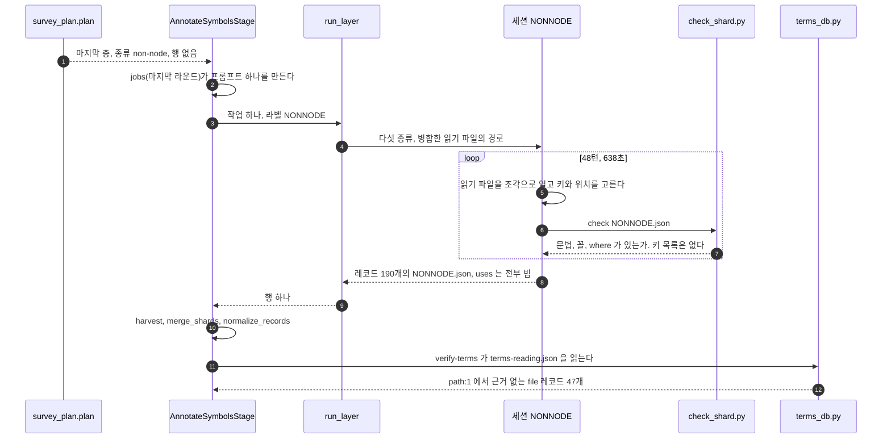
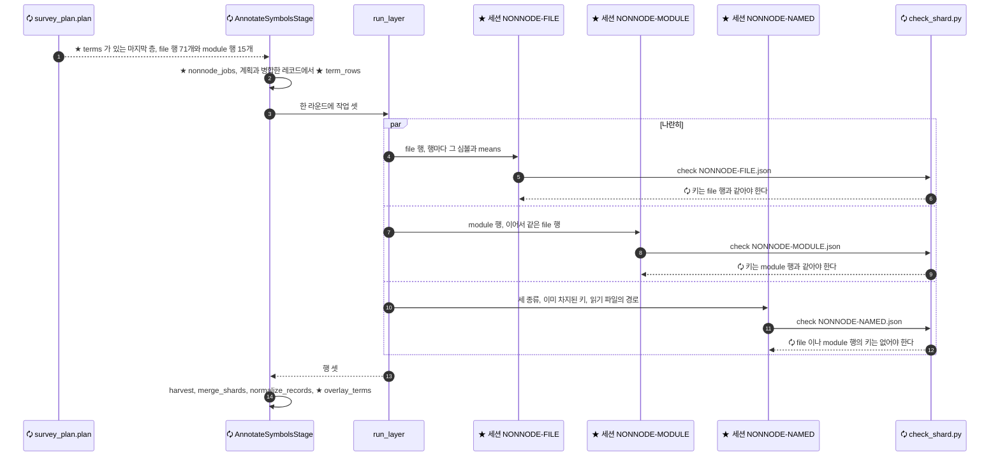
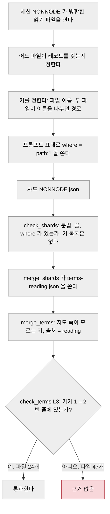
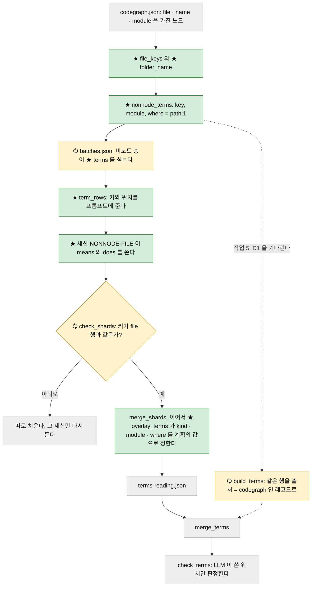
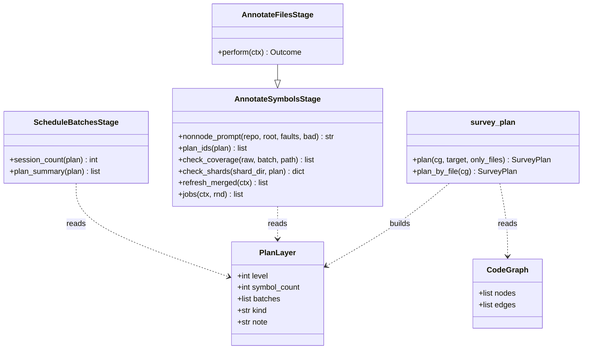
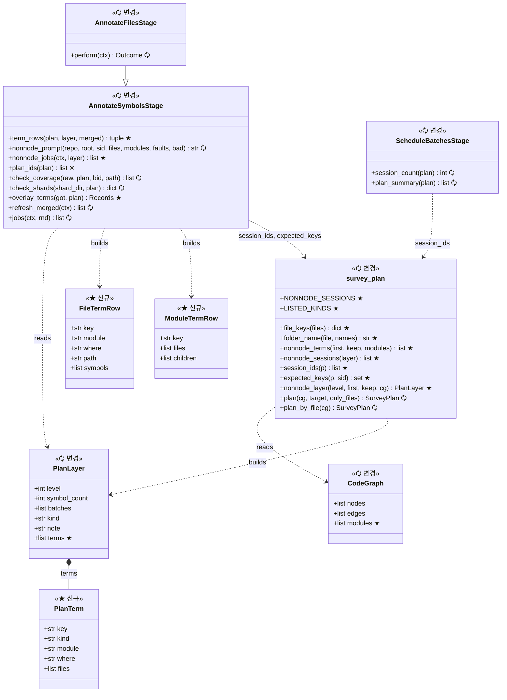

# 🧩 B2 — 비노드 용어, 기계 목록, 세션 셋: 구현 계획

> **에이전트 작업자에게:** 필수 하위 스킬 — superpowers:subagent-driven-development(권장) 또는 superpowers:executing-plans 로 이 계획을 작업 단위로 구현한다. 단계는 체크박스(`- [ ]`)로 추적한다.

> 📅 2026-11-22 · 브랜치 `main` · **Before = `29c5ee9` + B1 계획** (`2026-11-22-mode1-b1-survey-stabilize-plan.ko.md`, 작업 다섯 모두 적용). 이 계획이 B1 이 바꾸는 줄을 건드리면 여기 보인 "Before" 는 B1 의 "After" 이고, 그런 diff 마다 그렇게 적는다. 표의 줄 번호는 `29c5ee9` 의 것이며 B1 이 몇 줄씩 옮긴다
> 📄 근거: 분할 `docs/superpowers/specs/2026-11-22-mode1-remediation-split.ko.md` ("정한 것" · "비노드 용어 다섯 종류" · "측정 가를 읽는 법" · "숨은 결합") · `docs/superpowers/specs/2026-11-21-mode1-audit-verification-report.md` 2.4 (나) · 2.5 · `docs/superpowers/specs/2026-11-21-mode1-cold-run-report.md` 4.4 · `2026-11-22-mode1-session-cache-plan.ko.md` (F11 · D4) · B1 계획 · A2 계획 (B2 의 행) · 이 세션에서 읽은 코드: `src/codewiki/python/machine/survey_plan.py` · `terms_db.py` · `src/codewiki/python/runner/mode1/survey.py` · `survey_files.py` · `graph.py` · `context.py` · `src/codewiki/python/runner/check_shard.py` · `src/core/pipeline.py` · `resource/codewiki/prompts/annotate-symbols.md` · `resource/codewiki/faults.toml` · 시험 파일 · 기준선 실행의 산출물 사본(코드 지도 · 계획 · 샤드 92개 · <span style="color:cyan">병합한 읽기 파일</span> · 용어 DB)
> 🔒 지킬 규칙: 검사를 느슨하게 하지 않는다 — 새 `xfail` 이나 `skip` 없음 · 결함 심각도를 바꾸지 않음 · `terms_db.check_terms` 를 고치지 않음 · 프롬프트 글과 결함 문구는 `resource/` 에 둔다 · 템플릿은 꼴만 주고 데이터는 단계가 정한다 · 주석은 지금의 것만 적는다 · 제한 시간 코드나 설정 열쇠 없음(A2 의 몫) · 허용 목록 코드 없음(A3 의 몫)
> 🧪 검증 방법: 단위 시험 먼저, 그다음 여섯 게이트. 유료 실행 없음. 계획 전체를 B1 위에서 저장소 밖의 개인 복제본에 적용했고, "검증" 절에 적은 무료 확인은 거기서와 기준선 실행의 산출물 사본에서 돌렸다. 실제 세션이 새 프롬프트로 무엇을 하는지는 `[미검증]` 이고 측정 가에서 한 번 읽는다
> ✋ 승인: **승인 전** — 열린 결정 둘(D1 · D2)이 남았다
> 🌐 영어 정본: `2026-11-22-mode1-b2-nonnode-terms-plan.md`

**목표:** `file` 과 `module` 레코드가 무엇이고 어디를 가리키는지는 기계가 정하고, 종류 묶음마다 하나씩인 세션 셋은 글만 쓰며 나란히 돈다.

**구조:** 전수조사 계획(`batches.json`)의 <span style="color:cyan">비노드 층</span>(non-node layer)이 `file` 과 `module` 용어의 목록을 싣는다. 목록은 코드 지도에서 규칙 하나로 계산한다. 비노드 라운드는 세션을 최대 셋(`file` 글 · `module` 글 · `artifact` · `key` · `concept`) 띄우고, 세션마다 자기 샤드 · 자기 검사 · 자기 재시도를 가진다. 샤드 검문은 앞의 두 샤드를 계획의 목록과 견주고, 병합은 목록에 있는 레코드의 종류 · 모듈 · 위치를 계획의 값으로 덮어쓴다.

**기술:** Python 3 · msgspec · Jinja2 · pytest · pyright strict.

---

아래 모든 표와 그림의 범례: **★ 무에서 새로 만듦 · 🗘 있던 것을 바꿈 · 표식 없음 = 그대로 재사용 · ✕ 삭제.** 표식은 변경의 종류이지 구현이나 검증의 상태가 아니다. 주장의 종류: `[실측]` 센 값 — 이 세션에서 기준선 실행의 산출물 사본이나 개인 복제본에서 셌거나 인용한 보고서에 있다(행이 어느 쪽인지 적는다) · `[코드 확인]` 이 세션에서 소스를 읽음 · `[제안]` 이 계획이 제안함 · `[판단]` 이 계획 자신의 추론 · `[미검증]` 확인하지 않음.

## 📋 한 장 요약

| | |
|---|---|
| 🎯 다루는 것 | 혼자 도는 <span style="color:cyan">비노드 세션</span>(non-node session, 638초) · 세션이 스스로 고른 `file` 과 `module` 의 목록과 위치 · "근거 없음" 59건 가운데 47건 뒤에 있는 `file` 규칙 충돌 · 190개 레코드 전부에서 빈 <span style="color:cyan">관계 칸</span>(relation field) · 빈 `module` 위치 15개 |
| 🧩 한 줄 결론 | 계획이 `file` 과 `module` 용어의 <span style="color:cyan">기계 목록</span>(machine list, 키 · 모듈 · 위치)을 싣는다. 목록은 코드 지도에서 규칙 하나로 계산하며 기준선의 키 71개와 15개를 정확히 재현한다 `[실측]`. 세션 하나가 셋으로 바뀐다. 세션의 키는 목록과 견주고, 종류 · 모듈 · 위치는 병합에서 계획의 값으로 덮어쓴다. 사용자 몫으로 둘이 남는다: 47건을 어떻게 없앨 것인가(D1), <span style="color:cyan">관계 칸</span>에 무엇을 담을 것인가(D2) |
| 🟰 그대로 | `terms_db.check_terms` · 결함 심각도 · `batch` 와 `pass2` 프롬프트 절 · `prompt_names` · `merge_shards` · `normalize_records` · 따로 치우기와 재시도 장치 · `project_codegraph`(비노드 레코드는 코드 지도에 싣지 않는다) · `artifact` · `key` · `concept` 종류 — 그 목록과 위치는 지금처럼 세션이 고른다 |
| 🗘 바뀜 | 세션 라벨과 샤드 이름(`NONNODE` → `NONNODE-FILE` · `NONNODE-MODULE` · `NONNODE-NAMED`) · `nonnode` 프롬프트 절 · 계획의 <span style="color:cyan">비노드 층</span>(★ `terms`) · 세션 수와 계획 요약 줄 · <span style="color:cyan">포괄 검사</span>(coverage check)가 이제 비노드 샤드도 덮는다 · 새 결함 문구 하나 · 작업 5 를 하면 `terms-db.json` 이 출처 `codegraph` 인 `file` 과 폴더 `module` 레코드를 가진다 |
| ⚠️ 함정 | (1) 이 계획 이전에 쓰인 `batches.json` 이 있는 실행 폴더에는 <span style="color:cyan">기계 목록</span>이 없다. 그대로 이어 가면 `artifact` · `key` · `concept` 세션만 뜬다. 먼저 `schedule-batches` 를 다시 돌린다. (2) 찍는 비용 어림은 세션 수에 곱해진다(`usd_per_batch_min` · `usd_per_batch_max`). 그래서 세션이 둘 늘면 일이 늘지 않아도 그 줄이 오른다. 설정값은 여기서 건드리지 않는다. (3) `file` 과 `module` 세션의 프롬프트는 심볼 수에 따라 커진다 — 심볼 761개에서 136KB 와 135KB `[실측]`. (4) 작업 2 – 4 는 한 덩어리다: 작업 2 의 프롬프트는 이미 병합에서 기계가 종류 · 모듈 · 위치를 덮어쓰고 목록의 키를 더하거나 빼면 안 된다고 세션에 말하는데, 그것을 참으로 만드는 것이 작업 4 와 3 이다. 그 사이에 실제 전수조사를 돌리지 않는다. (5) A2 의 파일 전략 시험은 라벨 `NONNODE` 를 이름으로 쓴다. A2 와 B2 중 나중에 들어오는 쪽이 그것을 고쳐야 한다("B2 가 다른 계획과 만나는 자리"). (6) 작업 5 는 용어 검사기가 `file` 위치를 통과시키게 하지 않는다 — 위치를 기계가 쓰게 만들 뿐이고, 검사기는 LLM 이 쓴 것만 판정한다. 그것이 검사를 느슨하게 하는 것으로 읽히면 D1 의 다른 선택지를 고른다 |
| 🚫 범위 밖 | 제한 시간(A2) · 격리와 허용 목록(A3) · 통독 캐시 절차 · 실패한 첫 검사 · 입력 없는 `cat >`(B3) · 비노드 레코드를 코드 지도에 싣는 일(C1) · `artifact` 와 `key` 의 기계 후보 · `[estimate]` 설정값 · 증분 실행에서 `artifact` · `key` · `concept` 세션의 범위 절 · 모든 유료 실행 |

## 📌 정한 것 — 다시 열지 않는다

| 무엇 | 👍 고른 것 | 👎 버린 것 | 누가 · 언제 |
|---|---|---|---|
| B2 — 비노드 용어를 누가 내는가 | 기계가 `file` 과 `module` 의 목록과 위치를 낸다. 글은 세션이 쓰되 종류 묶음(`file` 글 / `module` 글 / `artifact` · `key` · `concept`)으로 나눠 나란히 돌린다 | 기계가 틀만 내기 · 세션만 나누기 · 그대로 두고 규칙 충돌만 풀기 | 사용자 · 2026-11-22 |
| 측정 원칙 | 2026-11-21 의 51분 17초 실행이 기준선이다. 고치기 전에는 전량이나 전수조사를 돌리지 않는다 | 새 기준을 얻으려고 다시 돌리기 | 사용자 · 2026-11-22 |
| 전수조사를 재는 때 | A 줄기(A1 · A2 · A3)와 B 줄기(B1 · B2 · B3)를 나란히 다 고친 뒤에 한 번 | A1 · A2 · A3 · B1 뒤에 재고 B2 · B3 를 나중으로 미루기 | 사용자 · 2026-11-22 |
| 다시 재는 횟수 | 둘 — 측정 가(전수조사까지)와 측정 나(전량) | 계획마다 · 끝에 한 번 | 사용자 · 2026-11-22 |
| A2 — 멈춘 세션을 끊는 기준 | 세션 시작부터 센 제한 시간, 단계마다 한 값. 비노드 값은 약 1,280초다. 값은 `resource/codewiki/config.toml` 에 둔다 | 모든 단계에 1,800초 한 값 · 산출물이 통과한 뒤의 유예로 끊기 | 사용자 · 2026-11-22 |
| B3 — 세션의 단위 | 그대로(층 단위 · 배치 목표 8 · 동시 8) | 동시 16 · 배치 목표 크기 바꾸기 | 사용자 · 2026-11-22 |

출처: `docs/superpowers/specs/2026-11-22-mode1-remediation-split.ko.md` 의 "정한 것(사용자, 2026-11-22)". 행은 옮겨 적었고 A2 와 B3 의 행은 이 계획에 닿는 부분만 남기고 줄였다. 같은 문서가 이 계획이 따르는 제약 둘도 적는다 — B2 는 검사기를 느슨하게 해서 풀지 않는다(충돌은 프롬프트나 레코드를 내는 쪽에서 푼다, "숨은 결합"). 그리고 계획 안에서는 유료 확인을 돌리지 않는다(비교는 측정 가 하나다, "이 순서가 바꾸는 것"). 이 계획의 승인 자체는 아직 ✋ 승인 전이다.

## 💡 이 계획이 제안하는 것 — 정해지지 않음

행마다 축 하나와 그 선택지, 득실, 권고 하나. 이름은 모두 `[제안]` 이다.

| # | 축 | 선택지 | 득실 | 권고 |
|---|---|---|---|---|
| P1 | <span style="color:cyan">파일 키</span>(file key) 규칙 | (a) 파일 이름. 두 파일이 이름을 나누면 그 묶음의 모든 파일이 저장소 기준 경로를 쓴다 · (b) 늘 경로 · (c) 심볼처럼 점으로 이은 이름 | (a) 기준선 키 71개를 71 중 71 재현한다 `[실측]`. 같은 이름의 둘째 파일이 생기면 그 파일의 키가 바뀐다. (b) 바뀌지 않지만, 이미 경로인 기준선 키 6개만 이전 실행이 저장한 레코드와 맞는다. (c) 이미 있는 둘 곁에 셋째 표기를 더한다 | **(a)** |
| P2 | `module` 목록 규칙 | (a) 노드가 있는 모든 파일의 <span style="color:cyan">폴더 이름</span>(folder name) — 심볼의 점 이름 가운데 경로를 그대로 따르는 부분 — 에 코드 지도의 모듈을 더한다 · (b) 지도의 모듈만 · (c) 폴더 경로 | (a) 기준선 키 15개를 15 중 15 재현한다 `[실측]`. 심볼 이름이 경로를 따르지 않는 지도에서는 지도의 모듈만으로 물러난다(합성 시험이 못박는다. 골든 C++ / C# 지도는 `[미검증]`). (b) 기준선에서 6개이고 폴더 레코드 9개를 잃는다. (c) 아무도 쓴 적 없는 키를 주고, 지도의 모듈이 폴더인 곳에서는 한 대상에 레코드 둘을 낸다 | **(a)** |
| P3 | <span style="color:cyan">기계 목록</span>이 사는 곳 | (a) 계획의 <span style="color:cyan">비노드 층</span> 안, 새 목록 `terms` · (b) 그 층의 `batches` · (c) 기계가 쓰고 세션이 채우는 뼈대 샤드 · (d) 프롬프트를 만들 때마다 다시 계산 | (a) 얼린 파일 하나. `check_shard.py` 가 이미 계획을 읽고 계획 도장이 이미 그것을 덮는다. (b) 포괄 검사 코드를 재사용하지만, 소스 파일 다섯의 12곳이 층의 `batches` 를 심볼 배치로 읽는다 `[코드 확인]`(`name_of` · `plan_files` · `symbol_layers` · 요약). 그들이 심볼이 아닌 것을 보게 된다. (c) 채운 샤드를 견줄 둘째 사본이 필요하다. (d) 규칙을 두 때에 두 프로세스에서 돌리고 둘 사이에 얼린 결과가 없다 | **(a)** |
| P4 | `file` 레코드의 위치 | (a) `<path>:1` · (b) 키가 글자 그대로 나오는 첫 줄 · (c) 파일의 첫 심볼의 줄 | 읽기 파일을 거쳐 오는 레코드에 지금의 검사기를 대고 기준선 파일 71개에서 센 값 `[실측]`: (a) 실패 0 · "근거 없음" 47. (b) 0 · 32 — 파일 32개는 어느 줄에도 자기 이름이 없다. (c) 0 · 71. 71개 모두에서 통과하는 파일 안 위치는 없다. 그것이 D1 이다 | **(a)** — 기준선이 71번 중 71번 쓴 값이고 L1 이나 L2 에서 실패한 적이 없다 |
| P5 | `module` 레코드의 위치 | (a) 비워 두고 기계가 정한다 · (b) 키가 나오는 폴더 아래 첫 줄 · (c) `<folder>/__init__.py:1` · (d) 폴더 경로 | 기준선 레코드 15개에서 센 값 `[실측]`: (a) 실패 0 · "근거 없음" 0 — 검사기는 `module` 레코드가 위치 없이 있게 둔다. (b) 줄이 있는 것은 15개 중 10개뿐이다. (c) 실패 9: 거기 `__init__.py` 15개는 모두 0줄이라 1번 줄이 없다(L2). 나머지 6개는 지도가 이미 가지고 있어 판정하지 않는다. (d) 실패 9: 검사기는 위치를 파일로 여는데 폴더는 파일이 아니다(L1) | **(a)** — 그러면 프롬프트는 "없어도 된다" 대신 "`module` 은 위치가 없다" 고 말한다 |
| P6 | 세션 하나가 셋이 되는 법 | (a) 세션 이름에 따라 갈라지는 프롬프트 절 `nonnode` 하나 · (b) 절 셋 · (c) 파일 셋 | (a) 재시도 블록(시험이 `batch` 절의 것과 글자까지 같음을 못박는다) · 레코드 계약 · 쓰는 자리 · 검사 명령의 사본을 하나만 둔다. `prompt_names` 가 바뀌지 않는다. 검사 명령은 A3 를 위해 리터럴 한 줄로 남는다. (b) 와 (c) 는 그 부분을 세 번 되풀이하고 선언된 이름 둘을 더한다 | **(a)** |
| P7 | `file` 과 `module` 세션이 받는 것 | (a) 파일마다 그 심볼의 이름과 `means` 를 프롬프트에 · (b) 같은 것에 `does` 를 더해서 · (c) 이름만 · (d) 지금처럼 <span style="color:cyan">병합한 읽기 파일</span>(merged reading file)의 경로 | 기준선에서 잰 크기 `[실측]`: (a) `file` 세션 136KB, `module` 세션 135KB. (b) `does` 95,378자를 더한다. (c) 54KB 이지만 이름만으로 쓴 요약은 프롬프트의 "이름은 거짓말한다" 규칙이 막는 것이다. (d) 739KB 파일을 조각으로 여는 일이다 — 기준선 세션은 48턴이 걸렸다 | **(a)**, 그리고 두 세션에 같은 파일 행(만드는 곳 하나) |
| P8 | 샤드 셋을 갈라 두는 법 | (a) <span style="color:cyan">포괄 검사</span>(coverage check)가 `file` 과 `module` 샤드를 목록과 견주고, 셋째 샤드에 있는 <span style="color:cyan">차지된 키</span>(taken key)를 알린다 · (b) 프롬프트가 부탁할 뿐 아무것도 검사하지 않는다 | (a) 없이는 `merge_shards` 가 두 세션이 쓴 키를 충돌로 보고 `<file stem>.<key>` 로 개명한다 — 둘 다 위치가 있으면 두 레코드를 모두 개명하므로 목록의 `file` 키가 병합한 파일에서 사라지고, 다른 하나가 위치 없는 `module` 레코드면 위치 있는 쪽만 개명한다 `[코드 확인]` `survey.py:436-445`. 어느 경우도 세션에 알려지지 않는다. 기준선에서는 이름 붙은 세 종류의 키 가운데 목록의 키와 같은 것이 없다 `[실측]` | **(a)** — 새 결함 문구 하나, 같은 결함 종류(`coverage`), 같은 심각도 |
| P9 | 목록에 있는 레코드의 종류 · 모듈 · 위치에 마지막 말을 하는 쪽 | (a) 병합이 계획의 값으로 덮어쓴다 — <span style="color:cyan">계획 덮어쓰기</span>(plan overlay) · (b) 세션의 사본을 믿는다 · (c) 세션이 그 칸을 쓰지 않는다 | (b) 잘못 친 위치 하나가 <span style="color:cyan">용어 검사</span>(term check)에서 L1 이나 L2 실패가 되어 흐름을 멈춘다. (c) 샤드 꼴 하나와 스키마 파일 하나가 더 필요하다 | **(a)** |
| P10 | 세션이 뜨는 때 | (a) `file` 과 `module` 세션은 계획에 그 종류의 행이 있을 때만 뜬다. 셋째는 늘 뜬다 · (b) 늘 셋 | (b) 는 맞는 출력이 `{}` 뿐인 세션을 띄운다 | **(a)** |

개인 복제본에서 센 새 함수와 그것을 부르는 곳 `[코드 확인]`: `session_ids` 5곳 · `nonnode_sessions` 5 · `nonnode_layer` 2(같은 리터럴 두 사본을 대신한다) · `nonnode_terms` 작업 5 와 함께면 2, 없으면 1 · `nonnode_jobs` 2(두 전략) · `overlay_terms` 2(두 전략) · `expected_keys` 1, `check_coverage` 안에서이며 단계와 `check_shard.py` 가 둘 다 그것을 부른다. 동작을 가진 클래스 · 모듈 · 인터페이스는 더하지 않는다. 새 클래스 넷은 직렬화되거나 템플릿에 넘기는 데이터의 `TypedDict` 꼴이다.

## 📊 현황

| 항목 | 상태 |
|---|---|
| 작업 1 — 계획이 `file` 과 `module` 용어를 싣는다 | ❌ 시작 전 |
| 작업 2 — 한 라운드에 <span style="color:cyan">비노드 세션</span> 셋 | ❌ 시작 전 |
| 작업 3 — <span style="color:cyan">포괄 검사</span>가 비노드 샤드를 덮는다 | ❌ 시작 전 |
| 작업 4 — 병합에서 <span style="color:cyan">계획 덮어쓰기</span> | ❌ 시작 전 |
| 작업 5 — `file` 과 폴더 `module` 레코드가 지도 쪽에서 온다 | ❌ 시작 전 · D1 을 기다린다 |
| 작업 6 — README · 여섯 게이트 | ❌ 시작 전 |
| 이 계획의 승인 · D1 · D2 | ❌ 승인 전 |
| 개인 복제본에서의 시험(B1 + 작업 1 – 6) | ✅ 거기 적용했고 시험과 게이트를 돌렸다("검증") |
| 실제 실행에 미치는 효과 | ❌ 재지 않음 — 측정 가 |

## 🔁 전 / 후

| 📍 Before (안 되던 것 · 지금) | 🛠️ After · 제안 | 🎉 해결되는 것 | 🔭 기대 | 진행 |
|---|---|---|---|---|
| 🐞 세션 하나가 다섯 종류 레코드 190개를 혼자 쓴다: 638초 · 48턴 · 검사 10번 `[실측]`(검증 보고서 2.5) | 한 라운드에 종류 묶음마다 하나씩 세션 최대 셋 | 비노드 부분이 모든 일의 합이 아니라 가장 느린 세션만큼 걸린다 | 라운드의 벽시계가 638초 아래 `[미검증]` | ❌ |
| 🐞 어느 파일과 폴더가 레코드를 갖는지와 키가 무엇인지를 세션이 정하고, 결과를 아무것과도 견주지 않는다 `[코드 확인]` `survey.py:267` | 계획이 그것을 싣고 <span style="color:cyan">포괄 검사</span>가 샤드를 목록과 견준다 | `file` 이나 `module` 레코드가 빠지거나 넘치면 그 세션 하나만 결함 줄과 함께 돌아간다 | 규칙이 기준선 키를 71 중 71 · 15 중 15 재현한다 `[실측]` | ❌ |
| 🐞 프롬프트가 `file` 레코드에 위치 `path:1` 을 주고(145줄) 그 줄에 이름이 있어야 한다고 요구한다(151 – 152줄). 파일 71개 중 47개는 거기 이름이 없다 `[실측]` | 위치는 기계가 준다. 줄 위의 이름 문장은 세션이 위치를 고르는 `artifact` · `key` · `concept` 만 덮는다 | 프롬프트가 스스로 모순되지 않는다 | 47건은 작업 1 – 4 에서 47건 그대로이고 작업 5 에서 0 이 된다. 기준선 샤드를 다시 돌려 본 값 `[실측]` | ❌ |
| 🐞 <span style="color:cyan">관계 칸</span>이 레코드 190개 모두에서 비어 있다. 세션이 "근거 없음" 이 더 늘 것을 걱정해 비웠다 `[실측]`(2.4 나) | 이 종류들의 칸에 무엇이 담기는지를 프롬프트가 말한다(D2) | 칸은 세션의 짐작이 아니라 규칙으로 비거나 규칙으로 채워진다 | D2 (a) 에서: 모든 비노드 레코드가 빔 | ❌ |
| 🐞 프롬프트가 "없어도 된다" 고 해서(146줄) `module` 위치 15개가 비어 있다 | 기계가 빈 위치를 정하고 프롬프트는 `module` 에 위치가 없다고 말한다 | 빈 위치가 말해진 사실이 된다 | `module` 레코드의 결함 0건, 기준선처럼 `[실측]` | ❌ |
| 🐞 세션이 739KB <span style="color:cyan">병합한 읽기 파일</span>을 가리키고 그것을 조각으로 연다 `[실측]` | `file` 과 `module` 세션은 심볼의 이름과 `means` 를 프롬프트로 받고 파일을 열지 말라는 말을 듣는다. 셋째 세션은 그것을 통독하지 말고 검색하라는 말을 듣는다 | 읽는 데 쓰는 턴이 줄어든다 | `[미검증]` | ❌ |
| 🐞 파일 전략에서 다시 띄운 <span style="color:cyan">비노드 세션</span>은 결함 줄을 받지 못한다 `[코드 확인]` `survey_files.py:147-148` | 두 전략이 모두 `nonnode_jobs` 로 작업을 만들고, 그것이 `retry_inputs` 를 넘긴다 | 재시도 블록이 두 전략 모두에서 세션에 닿는다 | 시험이 못박는다 | ❌ |

## ★ 신규 · 🗘 변경 · ✕ 삭제 항목

| 층위 | 표식 | 항목 | 구분 | 소속 |
|---|---|---|---|---|
| 모듈 | — | 새것 없음. 🗘 `survey_plan` · `mode1.survey` · `mode1.survey_files` · `mode1.graph` · `mode1.context` · `check_shard` · `terms_db`(작업 5) | 변경 | `src/codewiki/python/machine` · `src/codewiki/python/runner` |
| 파일 | 🗘 | `resource/codewiki/prompts/annotate-symbols.md`(절 `nonnode` 만) · `resource/codewiki/faults.toml` · 위의 파이썬 파일 일곱 · 시험 파일 다섯 · 생성되는 README 둘 | 변경 | — |
| 파일 | ★ ✕ | 실행 중에: ★ `_shards/NONNODE-FILE.json` · `NONNODE-MODULE.json` · `NONNODE-NAMED.json` · ✕ `_shards/NONNODE.json` | 신규 · 삭제 | 대상의 `out/codegraph-raw/_shards/` |
| 클래스 | ★ | `PlanTerm` · `GraphModule` | 신규 | `survey_plan.py` |
| 클래스 | ★ | `FileTermRow` · `ModuleTermRow` | 신규 | `mode1/context.py` |
| 클래스 | 🗘 | `PlanLayer` · `CodeGraph` · `GraphNode`(형 꼴) · `AnnotateSymbolsStage` · `AnnotateFilesStage` · `ScheduleBatchesStage` | 변경 | — |
| 함수 | ★ | `file_keys` · `folder_name` · `nonnode_terms` · `nonnode_sessions` · `session_ids` · `expected_keys` · `nonnode_layer` | 신규 | `survey_plan.py` |
| 함수 | ★ | `AnnotateSymbolsStage.term_rows` · `.nonnode_jobs` · `.overlay_terms` | 신규 | `mode1/survey.py` |
| 함수 | 🗘 | `plan` · `plan_by_file` · `main` | 변경 — <span style="color:cyan">비노드 층</span>은 `nonnode_layer` 에서 온다. 찍는 줄이 세션 수를 센다 | `survey_plan.py` |
| 함수 | 🗘 | `AnnotateSymbolsStage.nonnode_prompt` · `.check_coverage` · `.check_shards` · `.refresh_merged` · `.perform` · `.sweep` · `.jobs` | 변경 — 앞의 둘은 서명이 바뀐다 | `mode1/survey.py` |
| 함수 | 🗘 | `AnnotateFilesStage.perform`(세션 수 · 비노드 띄우기 · 안쪽 `write_merged`) · `ScheduleBatchesStage.session_count` · `.plan_summary` · `check_shard.main` · `terms_db.build_terms`(작업 5) | 변경 | — |
| 함수 | ✕ | `AnnotateSymbolsStage.plan_ids` | 삭제 — `survey_plan.session_ids` 가 대신한다. 부르는 시험이 없다 | `mode1/survey.py` |
| 멤버 | ★ | `PlanLayer.terms` · `CodeGraph.modules` · `GraphNode.module` · 상수 `NONNODE_SESSIONS` · `LISTED_KINDS` | 신규 | `survey_plan.py` |
| 멤버 | ★ | 결함 문구 `kind.coverage.detail-taken` · 프롬프트 값 `sid` · `n` · `files` · `modules` · `taken` | 신규 | `faults.toml` · 절 `nonnode` |

## ⏱️ 순서 — 비노드 라운드

**Before** `[코드 확인]` · 수치는 인용한 보고서의 `[실측]`



**After · 제안** `[미검증]`



`run_layer` 는 한 라운드의 작업을 `concurrency` 개(기본 8)의 일꾼 풀에서 돌린다 `[코드 확인]` `pipeline.py:451-475`. 그래서 세션 셋은 새 코드 없이 나란히 돈다. 세션 하나가 실패하면 지금처럼 라운드가 실패한다. 다음 실행에서 `jobs` 는 샤드가 있는 세션을 모두 건너뛰므로 실패한 세션만 결함 줄과 함께 다시 돈다.

## 🔀 갈래 — `file` 레코드가 키와 위치를 얻는 길

**Before** `[코드 확인]` · 수치는 `[실측]`



**After · 제안** — 회색 그대로 · 초록 신규 · 호박색 변경. 점선 갈래는 작업 5 이며 D1 에 선택지 B 라고 답할 때만 있다.



`module` 레코드는 빈 위치와 `NONNODE-MODULE` 세션으로 같은 길을 간다. `artifact` · `key` · `concept` 레코드는 지금의 길을 그대로 간다: 세션이 키와 위치를 고르고 <span style="color:cyan">용어 검사</span>가 위치를 판정한다.

## 🧱 구조 — 형의 꼴과 단계

**Before** `[코드 확인]`



**After · 제안**



## 🔧 고칠 곳

| 파일 · 심볼 | 바꿈 | 이유 | 근거 |
|---|---|---|---|
| 🗘 `src/codewiki/python/machine/survey_plan.py` — ★ `PlanTerm` · `GraphModule` · `NONNODE_SESSIONS` · `LISTED_KINDS` · `file_keys` · `folder_name` · `nonnode_terms` · `nonnode_sessions` · `session_ids` · `expected_keys` · `nonnode_layer` · 🗘 `GraphNode` · `CodeGraph` · `PlanLayer` · `plan` · `plan_by_file` · `main` | 코드 지도를 `file` 과 `module` 행으로 바꾸는 규칙, 세션 이름, 그리고 단계가 계획에 묻는 두 질문: "어느 세션" 과 "어느 키" | 계획은 전수조사가 무엇을 쓸지에 대한 얼린 진술 하나다 | `[코드 확인]` `survey_plan.py:36-50`(꼴) · `:199-205` · `:303-306`(두 <span style="color:cyan">비노드 층</span>) · `:334` |
| 🗘 `resource/codewiki/prompts/annotate-symbols.md` — 절 `nonnode` | 세션마다 갈래가 있는 절 하나. `file` 과 `module` 세션에는 경로 대신 행. 줄 위의 이름 문장은 세 종류에만. 관계 문장(D2) | 정한 분할. P6 · P7 | `[코드 확인]` 118-178줄. 176줄은 B1 의 "After" 다 |
| 🗘 `src/codewiki/python/runner/mode1/context.py` — ★ `FileTermRow` · `ModuleTermRow` | 프롬프트 행의 꼴 | 다른 행 꼴이 거기에 산다(`SymbolRow` · `DepRow` · `PendingRow`) | `[코드 확인]` `context.py:115-148` |
| 🗘 `src/codewiki/python/runner/mode1/survey.py` — ★ `term_rows` · `nonnode_jobs` · `overlay_terms` · 🗘 `nonnode_prompt` · `check_coverage` · `check_shards` · `refresh_merged` · `perform` · `sweep` · `jobs` · ✕ `plan_ids` | 행을 만들고, 세션마다 작업 하나를 띄우고, 세션마다 키를 검사하고, 병합에서 목록에 있는 칸을 덮어쓴다 | 정한 분할. P8 · P9 | `[코드 확인]` `survey.py:163-171` · `:237-271` · `:498-512` · `:573` · `:602` · `:611-625`. `nonnode_prompt` 와 `refresh_merged` 는 B1 의 "After" 다 |
| 🗘 `src/codewiki/python/runner/mode1/survey_files.py` — `AnnotateFilesStage.perform` | `nonnode_jobs` 로 같은 세션을 세고 띄운다. `write_merged` 에서 덮어쓴다 | 파일 전략은 <span style="color:cyan">비노드 세션</span>을 따로 띄운다 | `[코드 확인]` `survey_files.py:53-55` · `:67-74` · `:147-149`. `write_merged` 는 B1 의 "After" 다 |
| 🗘 `src/codewiki/python/runner/mode1/graph.py` — `session_count` · `plan_summary` | `session_ids` 로 세션을 센다. <span style="color:cyan">비노드 세션</span>의 수를 찍는다 | "세션 하나" 가 더 이상 참이 아니다 | `[코드 확인]` `graph.py:212` · `:231-233` |
| 🗘 `src/codewiki/python/runner/check_shard.py` — `main` | 계획과 샤드의 이름을 `check_coverage` 에 넘긴다 | 세션 자신의 검사가 훑기와 같은 검사여야 한다 | `[코드 확인]` `check_shard.py:37-44` |
| 🗘 `resource/codewiki/faults.toml` — `[kind.coverage]` | ★ `detail-taken` | P8 | `[코드 확인]` `faults.toml:25-28` |
| 🗘 `src/codewiki/python/machine/terms_db.py` — `build_terms`(작업 5, D1 을 기다린다) | 같은 행을 출처 `codegraph` 인 레코드로 낸다 | D1 선택지 B | `[코드 확인]` `terms_db.py:119-206` · `:341` · `:361-393` |
| 🗘 시험 | `test_survey_plan.py` · `test_mode1.py` · `test_run_mode1.py` · `test_terms_db.py` · `test_graph_adversarial.py` | 새 시험 20개. `NONNODE` 를 이름으로 쓰거나 `nonnode_prompt` 를 부르는 기존 시험은 새 이름을 따른다 | 작업의 단계 |

### 제안 diff — 적용하지 않았다 (요약)

전문 diff 는 작업의 단계에 있다. 이 요약은 동작이 바뀌는 다섯 곳을 보인다. 아직 없는 이름은 `[제안]` 이다.

`src/codewiki/python/machine/survey_plan.py` — <span style="color:cyan">비노드 층</span>:

```diff
--- a/src/codewiki/python/machine/survey_plan.py
+++ b/src/codewiki/python/machine/survey_plan.py
@@ -197,13 +320,8 @@ def plan(cg: CodeGraph, target: int = 8,
                 for i, b in enumerate(bs)],
         })
 
-    # K5 — 그래프 노드가 아닌 용어는 맨 마지막 별도 층. `symbol_count` 가 None 인 층이 이것이다.
-    last = (max(bylv) + 1) if bylv else 0
-    layers.append({
-        "level": last, "kind": "non-node", "symbol_count": None, "batches": [],
-        "note": "file · module · artifact · key · concept. 심볼 층이 전부 끝난 뒤 한 세션으로 돈다. "
-                "파일 레코드는 그 파일 안 심볼들의 완성 레코드를 재료로 쓴다.",
-    })
+    # K5 — 그래프 노드가 아닌 용어는 맨 마지막 별도 층.
+    layers.append(nonnode_layer((max(bylv) + 1) if bylv else 0, first, keep, cg))
     return {"target": target, "layers": layers,
             "totals": {"symbols": len(keep), "edges": len(edges), "levels": len(bylv),
                        "cyclic_symbols": sum(1 for n in keep if in_cycle.get(n))}}
```

`src/codewiki/python/runner/mode1/survey.py` — 작업 하나가 세션마다 작업 하나가 된다:

```diff
--- a/src/codewiki/python/runner/mode1/survey.py
+++ b/src/codewiki/python/runner/mode1/survey.py
@@ -618,7 +656,7 @@ class AnnotateSymbolsStage(VerifiedGraph, Measured, P.LlmStage[Mode1Context]):
         layer = ctx.plan["layers"][rnd]
         d = self.shard_dir(ctx)
         if layer.get("kind") == "non-node":
-            jobs = [("NONNODE", self.nonnode_prompt(ctx.repo, ctx.root, **self.retry_inputs(d, "NONNODE")))]
+            jobs = self.nonnode_jobs(ctx, layer)
         else:
             names = self.name_of(ctx.plan)
             jobs = [(b["id"], self.survey_batch_prompt(ctx.repo, ctx.root, b,
```

`src/codewiki/python/runner/mode1/survey.py` — 모든 세션의 키를 견준다:

```diff
--- a/src/codewiki/python/runner/mode1/survey.py
+++ b/src/codewiki/python/runner/mode1/survey.py
@@ -305,8 +311,8 @@ class AnnotateSymbolsStage(VerifiedGraph, Measured, P.LlmStage[Mode1Context]):
             with open(path, "rb") as f:
                 raw = f.read()
             got = AnnotateSymbolsStage.check_shard(raw, bid, path)
-            if not got and bid in batches:              # 비노드 세션은 계획 심볼이 없어 대조하지 않는다
-                got = AnnotateSymbolsStage.check_coverage(raw, batches[bid], path)
+            if not got:
+                got = AnnotateSymbolsStage.check_coverage(raw, plan, bid, path)
             if got:
                 bad[bid] = got
         return bad
```

`src/codewiki/python/runner/mode1/survey.py` — 병합이 목록에 있는 칸을 덮어쓴다. **여기서 "Before" 는 B1 의 "After" 다**(원자적 쓰기):

```diff
--- a/src/codewiki/python/runner/mode1/survey.py
+++ b/src/codewiki/python/runner/mode1/survey.py
@@ -548,13 +562,14 @@ class AnnotateSymbolsStage(VerifiedGraph, Measured, P.LlmStage[Mode1Context]):
         return "\n".join(lines) + "\n"
 
     def refresh_merged(self, ctx: Mode1Context) -> list[X.DroppedUse]:
-        """샤드를 다시 합치고 보정해 `terms-reading.json` 과 `dropped-uses.csv` 를 쓴다.
+        """샤드를 다시 합치고 보정하고 기계 목록의 칸을 덮어(`overlay_terms`) `terms-reading.json` 과 `dropped-uses.csv` 를 쓴다.
 
         층 끝(`harvest`)과 파일 끝(`AnnotateFilesStage`)이 같은 것을 부른다 — 병합의 정의는 한 곳이다.
         """
         assert ctx.plan is not None
         raw = self.merge_shards(self.shard_dir(ctx), ctx.baseline)
-        ctx.merged, dropped = self.normalize_records(raw, self.name_of(ctx.plan))
+        fixed, dropped = self.normalize_records(raw, self.name_of(ctx.plan))
+        ctx.merged = self.overlay_terms(fixed, ctx.plan)
         jsonio.write_json_atomic(X.READING.locate(ctx), ctx.merged, indent=1, sort_keys=True)
         with open(X.DROPPED.locate(ctx), "w", encoding="utf-8") as f:
             f.write(self.dropped_csv(dropped))
```

`resource/codewiki/prompts/annotate-symbols.md` — 표와 그 밑의 규칙(요약. 절 전체는 작업 2 의 3단계에 있다):

```diff
 | kind | 무엇 | where 는 어디 |
 |---|---|---|
-| `file` | 소스 파일 하나 | `경로:1` |
-| `module` | 디렉토리 하나 | 없어도 된다 |
 | `artifact` | 이 저장소가 **만들어 내는** 파일 | 그 파일을 **쓰는** 줄 |
 | `key` | 설정·JSON 의 이름난 칸 | 그 키를 **채우는** 줄 |
 | `concept` | 코드에 글자로 있는 낱말 | 그 낱말이 있는 줄 |
 
-**`file` `module` `artifact` `key` `concept` 는 이름이 그 줄에 글자 그대로 있어야 한다** —
+**`artifact` `key` `concept` 는 이름이 그 줄에 글자 그대로 있어야 한다** —
 기계가 L3(근처에 그 이름) 으로 검사한다.
```

## 🧭 조각의 순서

| # | 조각 | 결과물 | 확인 |
|---|---|---|---|
| 1 | 작업 1 | 계획의 <span style="color:cyan">비노드 층</span>이 `file` 과 `module` 행을 싣는다. 세션 이름이 있다 | `test_survey_plan.py`, 새 시험 9개, 그 가운데 둘은 얼린 스냅샷 위에서 |
| 2 | 작업 2 | 두 전략 모두에서 세션 셋이 자기 프롬프트로 뜬다 | `test_mode1.py` · `test_run_mode1.py` · 프롬프트 게이트 |
| 3 | 작업 3 | 키가 빠졌거나 넘치거나 <span style="color:cyan">차지된 키</span>인 샤드를 훑기와 `check_shard.py` 가 잡는다 | `test_mode1.py` |
| 4 | 작업 4 | 목록에 있는 레코드가 병합 뒤에 계획의 종류 · 모듈 · 위치를 지닌다 | `test_mode1.py` |
| 5 | 작업 5 — D1 = B 일 때만 | `file` 과 폴더 `module` 레코드가 지도 쪽에 있다 | `test_terms_db.py` · 엄격한 `xfail` 은 `xfail` 로 남는다 |
| 6 | 작업 6 | README 를 다시 만든다. 여섯 게이트가 초록이다 | 게이트 |

작업 1 – 4 는 이 순서로 서로 기대고, 실제 실행 전에 함께 적용한다. 작업 5 는 작업 1 에만 기댄다. B3 은 이 계획의 결과에서 출발한다.

## 📖 용어

| 용어 | 코드 이름 | 뜻 |
|---|---|---|
| <span style="color:cyan">비노드 층</span> | `kind == "non-node"` 인 `PlanLayer` | 전수조사 계획의 마지막 층. 그 세션들이 코드 지도의 노드가 아닌 용어를 쓴다 |
| <span style="color:cyan">기계 목록</span> | `PlanLayer.terms`, `PlanTerm` 의 행 | 계획이 정한 `file` 과 `module` 용어: 키 · 종류 · 모듈 · 위치 · 용어가 덮는 파일 |
| <span style="color:cyan">목록 종류</span> | `LISTED_KINDS` | `file` 과 `module` — 키와 위치를 기계가 정하는 종류 |
| <span style="color:cyan">비노드 세션</span> | `NONNODE_SESSIONS` — `NONNODE-FILE` · `NONNODE-MODULE` · `NONNODE-NAMED` | 종류 묶음마다 세션 하나. 이름이 작업 라벨이고 샤드의 파일 이름이다 |
| <span style="color:cyan">파일 키</span> | `file_keys` | `file` 레코드의 키: 파일 이름. 이름을 나누는 파일은 모두 경로 |
| <span style="color:cyan">폴더 이름</span> | `folder_name` | 파일이 든 폴더의 점으로 이은 이름. 심볼의 이름에서 읽는다. 폴더의 `module` 레코드의 키 |
| <span style="color:cyan">용어 행</span> | `term_rows` → `FileTermRow` · `ModuleTermRow` | 프롬프트가 <span style="color:cyan">기계 목록</span>에서 보이는 것. 파일마다 그 심볼과 뜻을 싣는다 |
| <span style="color:cyan">포괄 검사</span> | `AnnotateSymbolsStage.check_coverage` | 샤드의 키를 그 세션이 써야 하는 키와 견준다 |
| <span style="color:cyan">차지된 키</span> | 결함 문구 `kind.coverage.detail-taken` | 셋째 세션의 샤드에서 발견된 <span style="color:cyan">기계 목록</span>의 키 |
| <span style="color:cyan">계획 덮어쓰기</span> | `AnnotateSymbolsStage.overlay_terms` | 병합에서 목록에 있는 레코드의 종류 · 모듈 · 위치를 계획의 값으로 바꾼다 |
| <span style="color:cyan">병합한 읽기 파일</span> | `terms-reading.json` (`X.READING`) | 샤드를 모두 병합한 것. 용어 DB 의 입력 |
| <span style="color:cyan">용어 검사</span> | `terms_db.check_terms` | LLM 이 쓴 위치를 판정한다: L1 파일이 있다 · L2 줄이 있다 · L3 이름이 그 줄 근처에 있다 |
| <span style="color:cyan">지도 쪽 레코드</span> | `build_terms` 가 만드는 레코드, `source == "codegraph"` | 구조가 코드 지도에서 온 레코드. 같은 키의 읽기 레코드는 글만 보탠다 |
| <span style="color:cyan">관계 칸</span> | 레코드 필드 `uses` | 레코드가 내보내는 관계 |

## ❓ 열린 결정

| # | 질문 | 근거 | 선택지 | 권고 | 막히는 것 |
|---|---|---|---|---|---|
| D1 | 검사기를 느슨하게 하지 않는다면 `file` 레코드의 "근거 없음" 47건은 어떻게 없어지는가? | 파일 71개 모두에서 L3 를 통과하는 파일 안 위치는 없다(P4) `[실측]`. 검사기는 LLM 이 쓴 것만 판정한다: 출처가 `codegraph` 인 레코드는 건너뛰고, `codegraph+reading` 은 읽기가 더한 관계만 판정한다 `[코드 확인]` `terms_db.py:341-353`. 기준선 `module` 레코드 15개 중 6개는 이미 그렇게 산다(출처 `codegraph+reading`) `[실측]`. 기준선 샤드를 다시 돌려 본 값: 작업 1 – 4 에서 59건, 작업 5 에서 12건 — `file` 47 → 0. 남은 12건은 function 7 · method 3 · class 2 `[실측]` | **A** — 작업 1 – 4 에서 멈춘다: 프롬프트가 더는 모순되지 않고, 위치는 읽기 파일에서 기계가 쓰고, 47건은 "근거 없음" 으로 남는다(흐름을 멈춘 적은 없다). **B** — 작업 5: `build_terms` 가 같은 행을 <span style="color:cyan">지도 쪽 레코드</span>로 낸다. `merge_terms` 는 그러면 지도의 구조를 두고 글만 받으므로 위치는 판정되지 않는다. 비용: 읽기가 없어도 모든 `terms-db.json` 에 `file` 과 폴더 `module` 레코드가 는다(기준선 지도에서 769개 대신 849개 `[실측]`). 기준선 레코드 80개가 출처를 바꾸고 `id` 를 얻는다. `terms_db.py` 가 `survey_plan` 을 import 한다. 엄격한 `xfail` 시험 하나는 개수를 심볼 레코드로 좁혀야 자기 이유로 계속 실패한다. **C** — 위치 = 키가 나오는 첫 줄: 39개 통과 32개 남음, 병합이 소스 파일을 열어야 하고, 위치가 아무 뜻도 없다 | **B** `[판단]` — 정해진 방향(기계가 위치를 낸다)을 출처가 적히는 자리까지 끌고 간 것이다. 분명히 적는다: B 뒤에 검사기는 `file` 위치를 전혀 보지 않는다 | 작업 5 |
| D2 | 비노드 레코드의 <span style="color:cyan">관계 칸</span>에는 무엇이 담기고 누가 채우는가? | `terms_db.py` 와 `normalize_records` 밖에서 레코드의 `uses` 를 읽는 곳이 없다. `neighbors` 는 계약 형에만 나온다 `[코드 확인]`. `project_codegraph` 는 끝이 노드가 아닌 관계를 모두 버린다. 포함 관계는 이미 지도에 있고(`node.file`) 모듈 의존은 `modules[].depends_on` 에 있다. 기준선에서 `artifact` · `key` · `concept` 레코드 104개 가운데 97개가 노드가 있는 파일에 있고, 78개는 자기보다 위에서 시작하는 심볼 아래에 있다. 그 심볼로 가는 관계를 레코드 자신의 줄로 인용하면 78건 중 6건에서 L3 를 통과한다 `[실측]` | **(a)** 다섯 종류 모두 비워 두고 프롬프트가 그렇게 말한다(`uses` 는 `[]`). **(b)** 기계가 `file` 레코드의 포함 관계를 채운다(파일 → 그 심볼, 심볼마다의 위치로 인용): 기준선에서 관계 761개, 읽는 곳이 없고, 모든 심볼이 자기 파일을 이웃으로 얻는다. **(c)** 셋째 세션이 `artifact` · `key` · `concept` 레코드에서 그것을 쓰는 심볼로 가는 관계를 채운다: 심볼 자신의 줄로 인용하지 않으면 78건 중 72건이 "근거 없음" 이 되는데, 그 인용은 관계를 보이지 못한다 | **(a)** `[판단]` — 읽는 곳이 없고, 가질 만한 사실 둘은 이미 지도에 있다. 그러면 측정 가는 "<span style="color:cyan">관계 칸</span>이 찬 레코드" 를 결함이 아니라 규칙에 따른 빔으로 읽는다 | 코드에는 없다. 작업 2 프롬프트의 한 문장(`**uses 는 빈 배열 … 싣지 않는다.**`)이 (a) 를 담는다. (b) 나 (c) 면 그 문장과 작업 하나가 바뀐다 |

## 🤝 B2 가 다른 계획과 만나는 자리

| 계획 | 만나는 자리 | B2 가 지키는 것 | 다른 계획이 알아야 하는 것 |
|---|---|---|---|
| B1 | `nonnode_prompt` 의 `load_prompt` 호출 · 절의 검사 명령 줄 · `refresh_merged` · `write_merged` · 시험 `test_전수조사_프롬프트는_실행기의_해석기를_적는다` | B2 는 B1 의 "After" 에서 출발하고 `python=sys.executable` · `{{python}}` · 원자적 쓰기를 그대로 둔다 | — (B1 이 먼저다) |
| A2 | 나뉜 세션의 제한 시간 | B2 는 제한 코드도 설정 열쇠도 더하지 않는다. 세 세션 모두 `kind` 가 `non-node` 인 층 안에 있고 라벨이 배치 id 가 아니다 — A2 가 비노드 값을 거는 두 조건이다(A2 계획, 행 "B2 — <span style="color:cyan">비노드 세션</span>이 셋이 된다") | A2 의 시험 `test_파일_전략은_배치와_2패스에_배치_값을_비노드_세션에_비노드_값을_준다` 는 라벨과 샤드 열쇠 `NONNODE` 를 쓴다. B2 뒤에 그 시험의 세 파일 계획은 `NONNODE-FILE` 과 `NONNODE-NAMED` 를 띄운다(`module` 행이 없다). A2 의 용어집도 라벨 `NONNODE` 를 적는다. A2 와 B2 는 `mode1/survey.py` · `survey_files.py` · `test_mode1.py` 의 서로 다른 덩어리를 고친다 |
| A3 | 이 프롬프트 파일의 허용 호출 안내와 프롬프트가 이름 붙이는 명령에서 만든 허용 규칙 | 절은 명령 하나를 `batch` 절과 같은 리터럴 꼴로 이름 붙인다: `{{python}} {{root}}/src/codewiki/python/runner/check_shard.py {{repo}}/out/codegraph-raw/_shards/{{sid}}.json`. `check_shard.py *` 규칙 하나가 샤드 셋을 덮는다. 세션은 각자 `_shards/` 아래 파일 하나를 쓴다 | 셋째 세션은 여전히 <span style="color:cyan">병합한 읽기 파일</span>을 연다(통독이 아니라 검색). `file` 과 `module` 세션은 그것을 열지 말라는 말을 듣는다 |
| B3 | B2 뒤의, 같은 프롬프트 파일과 같은 모듈 | B2 는 `nonnode` 절만 고치고 통독 캐시 글 · `batch` 절의 첫 검사 문구 · `cat >` 문구는 건드리지 않는다 | B3 의 "Before" 는 이 계획의 "After" 다. 기준선 <span style="color:cyan">비노드 세션</span>의 검사 실행은 B3 의 주제다. B2 는 첫 검사가 실패할 수 있는 이유를 하나 더한다 — 목록과 다른 키 |
| C1 · 코드 지도 | 비노드 레코드는 싣지 않는다 | 행은 `batches` 가 아니라 `terms` 에 있으므로 `WriteWikiStage.symbol_layers` · `name_of` · `plan_files` 는 전과 같은 것을 본다. `project_codegraph` 는 건드리지 않는다 | 작업 5 를 하면 용어 DB 가 모든 대상에서 `file` 과 폴더 `module` 레코드를 가진다. 그것들은 여전히 싣는 곳에서 건너뛴다 |
| A1 | 세션 행 | 행 이름이 `annotate-symbols/NONNODE-FILE` · `…-MODULE` · `…-NAMED` 가 된다 | 비노드 부분의 벽시계는 세 행의 합이 아니라 가장 긴 것이다 |

**측정 가가 B2 에서 읽는 것**(분할, "측정 가를 읽는 법"): 비노드 부분의 벽시계 · <span style="color:cyan">관계 칸</span>이 찬 레코드 · `file` 레코드의 "근거 없음". 기준선 638초 · 190개 중 0 · 47건 `[실측]`. 이 계획 뒤 `[미검증]`: 세 `NONNODE-*` 행 가운데 가장 긴 것 · D2 = (a) 면 규칙에 따라 0 · D1 = B 면 0, 아니면 1 – 2번 줄에 자기 이름이 없는 파일의 수쯤.

## 🧪 검증 · 🚫 범위 밖

이 세션에서 돌렸다. 모두 무료이고 `[실측]` 이다:

| 무엇 | 방법 | 결과 |
|---|---|---|
| 기준선 코드 지도(노드 763 · 모듈 6)에 대한 규칙 | 기준선 실행의 `codegraph.json` 사본에 `survey_plan.plan` 과 `plan_by_file` 을 돌리고 기준선의 비노드 샤드와 견줌 | `file`: 행 71개, 같은 키 71개, 위치 71 중 71 · 모듈 71 중 71 같음. `module`: 행 15개, 같은 키 15개(<span style="color:cyan">폴더 이름</span> 12 ∪ 지도 모듈 6, 3 겹침), 위치 15 중 15 · 모듈 15 중 15 같음 |
| 얼린 스냅샷 `test/codewiki/fixtures/codegraph-self.json` 에 대한 규칙 | 작업 1 과 작업 5 의 시험 | `file` 행 77개 · `module` 행 15개 · 경로 키 여섯(이름을 나누는 파일 셋) — 못박힘 |
| 기준선 샤드 다시 돌리기 | 배치 샤드 91개와 종류로 셋으로 자른 비노드 샤드를 새 계획(세션 이름 94개)과 함께 `check_shards` · `merge_shards` · `normalize_records` · `overlay_terms` 에 넣음 | 결함 0건. 병합한 레코드가 기준선의 <span style="color:cyan">병합한 읽기 파일</span>(레코드 951개)과 같다 |
| 그 다시 돌리기에 대한 용어 검사 | `terms_db.py <map> --repo <source tree at 29c5ee9> --reading <replayed file> -o <scratch folder>` | 작업 1 – 4 에서: 용어 953개 · 실패 0 · "근거 없음" 59(기준선의 수). 작업 5 에서: 953 · 0 · 12 |
| 프롬프트 크기 | 기준선 계획과 기준선 심볼 레코드로 그린 `nonnode_prompt` | `NONNODE-FILE` 136,450바이트 · `NONNODE-MODULE` 135,179 · `NONNODE-NAMED` 4,366. <span style="color:cyan">병합한 읽기 파일</span>은 739,145바이트 |
| 새 시험은 모두 말한 이유로 먼저 실패하고 자기 단계 뒤에 통과한다 | 개인 복제본에서 작업마다 | 단계에 적은 대로 |
| 개인 복제본의 여섯 게이트(B1 + 작업 1 – 6) | 작업 6 의 명령 | pytest 1013 통과 · 25 건너뜀 · 2 xfail(B1 만 있을 때 993 · 25 · 2. 복제본에는 `out/` 이 없어 주 체크아웃보다 더 건너뛴다) · `npm test` 8 통과 · `tsc` 깨끗 · pyright 0 errors · README 9개 일치 · doctor 종료 코드 0 |
| Mermaid 그림 여섯 | `npx --no-install mmdc`, 그림마다 파일 하나 | 여섯 모두 그려졌다 |

돌리지 않은 것: 어느 세션이든(유료) · 골든 C++ 와 C# 지도 — 환경변수가 여기 없어서 경로를 따르지 않는 이름에 대한 규칙의 물러남은 합성 시험 하나에 기댄다 · 세션 셋이 하나보다 빨리 끝나는지 · 이름과 `means` 만으로 쓴 글이 기준선의 글만큼 좋은지 · 더 큰 저장소에서의 프롬프트 크기 · 주 체크아웃에서의 게이트.

범위 밖과 그 이유: 증분 실행에서 셋째 세션의 범위 절(지금의 비노드 프롬프트에도 없다. `file` 과 `module` 세션은 계획이 범위를 정한다) · `artifact` 와 `key` 의 기계 후보(분할이 "일부" 로 표시했고 정하지 않았다) · `[estimate]` 설정값(함정 2) · 이 변경을 가로지르는 실행 폴더 이어 가기(함정 1).

모든 명령은 저장소 뿌리에서 `.venv/bin/python` 으로 돌린다. `mode1/` 과 `machine/` 아래 경로는 각각 `src/codewiki/python/runner/mode1/` 과 `src/codewiki/python/machine/` 이다. 코드 단계는 "Before"(`29c5ee9` + B1 계획)에 대한 통일 diff 로 준다. diff 는 그것이 이름 붙인 파일에 대한 그 단계의 완전한 변경이다. 그사이에 다른 계획이 들어왔다면 덩어리의 줄 번호가 밀린다 — 문맥으로 적용한다. 커밋 단계는 모두 이 계획의 커밋에 대한 사용자의 승인을 기다린다.

---

### 작업 1: 계획이 `file` 과 `module` 용어를 싣는다

**파일:**
- 고침: `src/codewiki/python/machine/survey_plan.py` (36-50줄과 76줄의 꼴 · 156줄 `plan` 앞의 새 덩어리 · 199-205줄과 303-306줄의 <span style="color:cyan">비노드 층</span> · 334줄의 `main`)
- 시험: `test/codewiki/test_survey_plan.py`

- [ ] **1단계: 실패하는 시험을 쓴다** — `test/codewiki/test_survey_plan.py` 끝에 붙인다:

```diff
--- a/test/codewiki/test_survey_plan.py
+++ b/test/codewiki/test_survey_plan.py
@@ -255,3 +255,99 @@ def test_자기_지도_스냅샷은_계획기의_형으로_엄격하게_읽힌
         raw = json.load(f)
     got = msgspec.convert(raw, CodeGraph)
     assert any(n.get("file") is None for n in got["nodes"])
+
+
+# ── 비노드 층의 기계 목록 — file · module 의 키와 위치는 계획이 정한다
+
+def _cg3(nodes: list[tuple[str, str, str, str]], modules: list[str]) -> CodeGraph:
+    """(id, 이름, 파일, 모듈) 노드와 지도의 모듈 목록."""
+    return {"nodes": [{"id": i, "name": n, "kind": "function", "file": f, "line": 3, "module": m}
+                      for i, n, f, m in nodes],
+            "edges": [], "modules": [{"id": m} for m in modules]}
+
+
+def test_file_키는_파일_이름이고_겹치면_겹친_전원이_경로다():
+    """같은 이름의 파일 둘이 한 키를 다투면 병합이 하나를 덮는다 — 겹친 쪽은 처음부터 경로로 부른다."""
+    got = SP.file_keys(["src/a/build.py", "src/b/build.py", "src/a/plan.py"])
+    assert got == {"src/a/build.py": "src/a/build.py", "src/b/build.py": "src/b/build.py", "src/a/plan.py": "plan.py"}
+
+
+def test_폴더의_module_키는_심볼_이름이_적은_점_경로다():
+    """심볼의 점 이름이 파일 경로의 꼬리로 시작하면 그 꼬리에서 파일 줄기를 뗀 것이 폴더의 이름이다."""
+    assert SP.folder_name("src/core/pipeline.py", ["core.pipeline.Stage", "core.pipeline.load"]) == "core"
+    assert SP.folder_name("tools/doctor.py", ["tools.doctor.main"]) == "tools"
+    assert SP.folder_name("src/a/b/c.py", ["a.b.c.f"]) == "a.b"
+    assert SP.folder_name("src/render/mesh.cpp", ["Mesh", "gfx::Mesh::draw"]) == ""     # 이름이 경로를 따르지 않는다
+    assert SP.folder_name("setup.py", ["setup.main"]) == ""                              # 폴더 마디가 없다
+
+
+def test_비노드_층은_file_과_module_의_키와_위치를_싣는다():
+    cg = _cg3([("C1", "pkg.sub.a.f", "src/pkg/sub/a.py", "pkg"), ("C2", "pkg.sub.a.g", "src/pkg/sub/a.py", "pkg"),
+               ("C3", "pkg.b.h", "src/pkg/b.py", "pkg"), ("C4", "tools.t.main", "tools/t.py", "tools")],
+              ["pkg", "tools"])
+    terms = plan(cg)["layers"][-1].get("terms", [])
+    assert [(t["key"], t["kind"], t["module"], t["where"]) for t in terms] == [
+        ("b.py", "file", "pkg", "src/pkg/b.py:1"), ("a.py", "file", "pkg.sub", "src/pkg/sub/a.py:1"),
+        ("t.py", "file", "tools", "tools/t.py:1"),
+        ("pkg", "module", "pkg", ""), ("pkg.sub", "module", "pkg.sub", ""), ("tools", "module", "tools", "")]
+    assert {t["key"]: t["files"] for t in terms if t["kind"] == "module"} == {
+        "pkg": ["src/pkg/b.py"], "pkg.sub": ["src/pkg/sub/a.py"], "tools": ["tools/t.py"]}
+    assert SP.plan_by_file(cg)["layers"][-1].get("terms", []) == terms
+
+
+def test_이름이_경로를_따르지_않는_지도는_지도의_모듈만_module_로_싣는다():
+    """C++ · C# 지도는 심볼 이름에 폴더가 없다. 폴더마다 레코드를 내지 않고 파일을 지도의 모듈에 붙인다."""
+    cg = _cg3([("C1", "Mesh", "src/render/mesh.cpp", "render"), ("C2", "Shader", "src/render/gl/shader.cpp", "render")],
+              ["render"])
+    terms = plan(cg)["layers"][-1].get("terms", [])
+    assert [(t["key"], t["kind"], t["module"]) for t in terms] == [
+        ("shader.cpp", "file", "render"), ("mesh.cpp", "file", "render"), ("render", "module", "render")]
+    assert terms[-1]["files"] == ["src/render/gl/shader.cpp", "src/render/mesh.cpp"]
+
+
+def test_지도의_모듈_목록에_없는_소속은_module_줄이_되지_않는다():
+    cg = _cg3([("C1", "f", "a.py", ".")], [])
+    terms = plan(cg)["layers"][-1].get("terms", [])
+    assert [(t["key"], t["kind"], t["module"]) for t in terms] == [("a.py", "file", ".")]
+    assert SP.nonnode_sessions(plan(cg)["layers"][-1]) == ["NONNODE-FILE", "NONNODE-NAMED"]
+
+
+def test_증분_계획도_키는_지도_전체에서_정한다():
+    """거른 뒤에 정하면 겹치던 파일 이름이 혼자 남아 다른 키를 얻고, 지난 레코드와 어긋난다."""
+    cg = _cg3([("C1", "a.build.f", "src/a/build.py", "a"), ("C2", "b.build.f", "src/b/build.py", "b")], ["a", "b"])
+    terms = plan(cg, only_files=["src/a/build.py"])["layers"][-1].get("terms", [])
+    assert [(t["key"], t["kind"]) for t in terms] == [("src/a/build.py", "file"), ("a", "module")]
+
+
+def test_계획이_띄우는_세션은_배치와_비노드_세션_셋이다():
+    cg = _cg3([("C1", "pkg.a.f", "src/pkg/a.py", "pkg")], ["pkg"])
+    p = plan(cg)
+    assert SP.session_ids(p) == ["L0-B00", "NONNODE-FILE", "NONNODE-MODULE", "NONNODE-NAMED"]
+    assert SP.expected_keys(p, "L0-B00") == {"pkg.a.f"}
+    assert SP.expected_keys(p, "NONNODE-FILE") == {"a.py"} and SP.expected_keys(p, "NONNODE-MODULE") == {"pkg"}
+    assert SP.expected_keys(p, "NONNODE-NAMED") is None and SP.expected_keys(p, "없는-세션") is None
+
+
+def test_기계_목록이_빈_비노드_세션은_뜨지_않는다():
+    """쓸 레코드가 없는 세션을 띄우면 빈 샤드를 기다리다 `missing` 으로 되돌린다."""
+    layer: SP.PlanLayer = {"level": 1, "kind": "non-node", "symbol_count": None, "batches": [], "note": ""}
+    assert SP.nonnode_sessions(layer) == ["NONNODE-NAMED"]
+
+
+def test_실제_지도_스냅샷의_비노드_목록():
+    """얼린 스냅샷으로 file · module 목록을 못박는다. 스냅샷에는 지도의 모듈 목록이 없어 module 은 폴더뿐이다."""
+    cg = json.load(open(SNAPSHOT, encoding="utf-8"))
+    terms = plan(cg)["layers"][-1].get("terms", [])
+    files = [t for t in terms if t["kind"] == "file"]
+    node_files = {n["file"] for n in cg["nodes"] if n.get("file")}
+    assert len(files) == len(node_files) == 77 and {t["files"][0] for t in files} == node_files
+    assert all(t["where"] == t["files"][0] + ":1" for t in files)
+    assert sorted(t["key"] for t in files if "/" in t["key"]) == [
+        "src/codewiki/python/machine/clang_doc.py", "src/codewiki/python/runner/wiki/build.py",
+        "src/codewiki/python/runner/wiki/check.py", "src/codewiki/python/runner/wiki/clang_doc.py",
+        "src/spec/python/viz/build.py", "src/spec/python/viz/check.py"]
+    assert [t["key"] for t in terms if t["kind"] == "module"] == [
+        "codewiki.python.machine", "codewiki.python.runner", "codewiki.python.runner.mode1",
+        "codewiki.python.runner.wiki", "codewiki.python.viz", "common", "core", "spec.python.runner",
+        "spec.python.viz", "split-work", "split-work.r9-gate-proto", "split-work.reorg",
+        "term.python.runner", "term.python.runner.term", "tools"]
```

마지막 시험은 얼린 스냅샷 `test/codewiki/fixtures/codegraph-self.json` 을 읽는다. 그 스냅샷에는 `modules` 목록도 노드의 `module` 도 없으므로 파일 규칙과 폴더 규칙을 못박는다. 지도의 모듈과의 합집합은 그 위의 합성 시험 둘이 못박는다.

- [ ] **2단계: 돌려서 실패를 본다**

실행: `.venv/bin/python -m pytest test/codewiki/test_survey_plan.py -q`
기대: 9개 실패. 넷은 `AttributeError: module 'survey_plan' has no attribute 'file_keys'` 로 멈추고(`folder_name` · `session_ids` · `nonnode_sessions` 도 같다), 넷은 빈 목록을 기대한 행과 견주며(`assert [] == [...]`), 스냅샷 시험은 `assert (0 == 77)` 에서 멈춘다.

- [ ] **3단계: 구현한다** — `src/codewiki/python/machine/survey_plan.py` 에서:

```diff
--- a/src/codewiki/python/machine/survey_plan.py
+++ b/src/codewiki/python/machine/survey_plan.py
@@ -39,15 +39,21 @@ GraphNode = TypedDict("GraphNode", {
     "kind": NotRequired[str],
     "file": NotRequired[str | None],
     "line": NotRequired[int | None],
+    "module": NotRequired[str | None],
     "abstraction": NotRequired[str],     # 클래스 노드만 — "interface" | "abstract"
 })
 GraphEdge = TypedDict("GraphEdge", {"from": str, "to": str})
 
 
+class GraphModule(TypedDict):
+    id: str
+
+
 class CodeGraph(TypedDict):
     """`prep` 이 낸 codegraph.json 중 이 파일이 실제로 읽는 부분만."""
     nodes: list[GraphNode]
     edges: NotRequired[list[GraphEdge]]
+    modules: NotRequired[list[GraphModule]]
 
 
 class PackedBatch(TypedDict):
@@ -73,10 +79,22 @@ class PlanBatch(TypedDict):
     weight: NotRequired[float]     # 파일 단위 계획만 — 그 파일의 가중치
 
 
+class PlanTerm(TypedDict):
+    """기계가 키와 위치를 정한 비노드 용어 한 줄 — `file` 또는 `module`.
+
+    `files` 는 그 용어가 덮는 파일이다. `file` 줄은 자기 하나, `module` 줄은 그 이름에 바로 든 파일들.
+    """
+    key: str
+    kind: str
+    module: str
+    where: str
+    files: list[str]
+
+
 class PlanLayer(TypedDict):
     """심볼 층과 맨 끝 비노드 층이 한 목록에 섞여 있다.
 
-    비노드 층만 `kind` 와 `note` 를 갖고 `file_count` 는 갖지 않는다 — 그래서 셋이 선택 항목이다.
+    비노드 층만 `kind` · `note` · `terms` 를 갖고 `file_count` 는 갖지 않는다 — 그래서 넷이 선택 항목이다.
     """
     level: int
     symbol_count: int | None
@@ -84,6 +102,7 @@ class PlanLayer(TypedDict):
     file_count: NotRequired[int]
     kind: NotRequired[str]
     note: NotRequired[str]
+    terms: NotRequired[list[PlanTerm]]
 
 
 class PlanTotals(TypedDict):
@@ -153,6 +172,110 @@ def pack(members: Iterable[str], file_of: Mapping[str, str | None],
     return out
 
 
+# ── 비노드 층 — `file` · `module` 은 지도에서 키와 위치가 나온다. 세션은 종류 묶음마다 하나다.
+
+# 세션 이름 -> 그 세션이 쓰는 종류. 순서가 곧 띄우는 순서이고, 세션 이름이 샤드 파일의 이름이다.
+NONNODE_SESSIONS: dict[str, tuple[str, ...]] = {
+    "NONNODE-FILE": ("file",),
+    "NONNODE-MODULE": ("module",),
+    "NONNODE-NAMED": ("artifact", "key", "concept"),
+}
+# 키와 위치를 기계가 정하는 종류. 이 종류만 쓰는 세션은 계획에 그 줄이 있을 때만 뜬다.
+LISTED_KINDS = ("file", "module")
+
+
+def file_keys(files: Iterable[str]) -> dict[str, str]:
+    """파일 경로 -> `file` 레코드의 키. 파일 이름이 혼자면 그 이름이고, 겹치면 겹친 전원이 경로다."""
+    paths = sorted(set(files))
+    count = collections.Counter(p.rsplit("/", 1)[-1] for p in paths)
+    return {p: p if count[p.rsplit("/", 1)[-1]] > 1 else p.rsplit("/", 1)[-1] for p in paths}
+
+
+def folder_name(file: str, names: Iterable[str]) -> str:
+    """파일이 든 폴더의 점 이름. 심볼의 점 이름이 경로의 꼬리로 시작할 때만 정해지고, 아니면 빈 글이다.
+
+    `src/core/pipeline.py` 의 심볼이 `core.pipeline.Stage` 면 꼬리 `core.pipeline` 에서 파일 줄기를 뗀 `core` 다.
+    꼬리는 긴 것부터 맞춰 보고, 폴더 마디가 하나도 남지 않는 꼬리는 보지 않는다.
+    """
+    parts = file.split("/")
+    parts[-1] = parts[-1].rsplit(".", 1)[0]
+    have = list(names)
+    for k in range(len(parts) - 1):
+        dotted = ".".join(parts[k:])
+        if any(n == dotted or n.startswith(dotted + ".") for n in have):
+            return ".".join(parts[k:-1])
+    return ""
+
+
+def nonnode_terms(first: Mapping[str, GraphNode], keep: Collection[str],
+                  modules: Iterable[str]) -> list[PlanTerm]:
+    """비노드 층의 기계 목록 — 파일마다 `file` 한 줄, 폴더 이름과 지도의 모듈마다 `module` 한 줄.
+
+    키와 소속은 지도 전체(`first`)에서 정하고 줄은 `keep` 의 파일 것만 낸다. 파일의 소속은 `folder_name` 이고,
+    그것이 비면 그 파일 노드들이 가장 많이 적은 지도 모듈이다. `file` 의 위치는 `<경로>:1`, `module` 은 위치가 없다.
+    `module` 줄은 폴더 이름과, `modules` 에 있으면서 남긴 노드를 가진 지도 모듈이다.
+    """
+    names: collections.defaultdict[str, list[str]] = collections.defaultdict(list)
+    mods: collections.defaultdict[str, collections.Counter[str]] = collections.defaultdict(collections.Counter)
+    for n in first.values():
+        f = n.get("file")
+        if not f:
+            continue
+        names[f].append(n.get("name") or "")
+        m = n.get("module")
+        if m:
+            mods[f][m] += 1
+    keys = file_keys(names)
+    folder = {f: folder_name(f, names[f]) for f in names}
+    home = {f: folder[f] or (min(mods[f], key=lambda m: (-mods[f][m], m)) if mods[f] else "") for f in names}
+    kept = sorted({first[i].get("file") or "" for i in keep} - {""})
+    rows: list[PlanTerm] = [{"key": keys[f], "kind": "file", "module": home[f], "where": f + ":1", "files": [f]}
+                            for f in kept]
+    listed = set(modules)
+    wanted = {folder[f] for f in kept if folder[f]} | {m for f in kept for m in mods[f] if m in listed}
+    module_rows: list[PlanTerm] = [
+        {"key": m, "kind": "module", "module": m, "where": "", "files": [f for f in kept if home[f] == m]}
+        for m in sorted(wanted)]
+    return rows + module_rows
+
+
+def nonnode_sessions(layer: PlanLayer) -> list[str]:
+    """비노드 층이 띄우는 세션 이름. 기계 목록만 쓰는 세션은 그 종류의 줄이 있을 때만 뜬다."""
+    have = {t["kind"] for t in layer.get("terms", [])}
+    return [sid for sid, kinds in NONNODE_SESSIONS.items()
+            if not set(kinds) <= set(LISTED_KINDS) or have & set(kinds)]
+
+
+def session_ids(p: SurveyPlan) -> list[str]:
+    """계획이 띄우는 세션의 이름 전부 — 층 순서대로 배치 id 들, 비노드 층에서는 `nonnode_sessions`."""
+    out: list[str] = []
+    for L in p["layers"]:
+        out += nonnode_sessions(L) if L.get("kind") == "non-node" else [b["id"] for b in L["batches"]]
+    return out
+
+
+def expected_keys(p: SurveyPlan, sid: str) -> set[str] | None:
+    """세션 `sid` 의 샤드가 가져야 할 키. 배치는 심볼 이름, 기계 목록 세션은 그 종류의 키. 목록이 없는 세션은 `None`."""
+    kinds = NONNODE_SESSIONS.get(sid, ())
+    for L in p["layers"]:
+        if L.get("kind") == "non-node":
+            if kinds and set(kinds) <= set(LISTED_KINDS):
+                return {t["key"] for t in L.get("terms", []) if t["kind"] in kinds}
+            continue
+        for b in L["batches"]:
+            if b["id"] == sid:
+                return {s["name"] or "" for s in b["symbols"]}
+    return None
+
+
+def nonnode_layer(level: int, first: Mapping[str, GraphNode], keep: Collection[str], cg: CodeGraph) -> PlanLayer:
+    """맨 끝의 비노드 층. `symbol_count` 가 None 인 층이 이것이고 배치는 없다 — 기계 목록은 `terms` 에 싣는다."""
+    return {"level": level, "kind": "non-node", "symbol_count": None, "batches": [],
+            "note": "file · module · artifact · key · concept. 심볼이 전부 끝난 뒤 종류 묶음마다 한 세션씩 나란히 돈다. "
+                    "file · module 의 키와 위치는 terms 에 있다.",
+            "terms": nonnode_terms(first, keep, [m["id"] for m in cg.get("modules", [])])}
+
+
 def plan(cg: CodeGraph, target: int = 8,
          only_files: Iterable[str] | None = None) -> SurveyPlan:
     """코드 지도 -> 층 · 배치 계획.
@@ -197,13 +320,8 @@ def plan(cg: CodeGraph, target: int = 8,
                 for i, b in enumerate(bs)],
         })
 
-    # K5 — 그래프 노드가 아닌 용어는 맨 마지막 별도 층. `symbol_count` 가 None 인 층이 이것이다.
-    last = (max(bylv) + 1) if bylv else 0
-    layers.append({
-        "level": last, "kind": "non-node", "symbol_count": None, "batches": [],
-        "note": "file · module · artifact · key · concept. 심볼 층이 전부 끝난 뒤 한 세션으로 돈다. "
-                "파일 레코드는 그 파일 안 심볼들의 완성 레코드를 재료로 쓴다.",
-    })
+    # K5 — 그래프 노드가 아닌 용어는 맨 마지막 별도 층.
+    layers.append(nonnode_layer((max(bylv) + 1) if bylv else 0, first, keep, cg))
     return {"target": target, "layers": layers,
             "totals": {"symbols": len(keep), "edges": len(edges), "levels": len(bylv),
                        "cyclic_symbols": sum(1 for n in keep if in_cycle.get(n))}}
@@ -300,10 +418,7 @@ def plan_by_file(cg: CodeGraph) -> SurveyPlan:
                         for s in sorted(byfile[f])]})
     kept = sum(len(b["symbols"]) for b in batches)
     layers: list[PlanLayer] = [{"level": 0, "symbol_count": kept, "file_count": len(batches), "batches": batches}]
-    layers.append({
-        "level": 1, "kind": "non-node", "symbol_count": None, "batches": [],
-        "note": "file · module · artifact · key · concept. 파일 세션이 전부 끝난 뒤 한 세션으로 돈다.",
-    })
+    layers.append(nonnode_layer(1, first, set(first), cg))
     return {"target": 0, "layers": layers,
             "totals": {"symbols": kept, "edges": len(edges), "levels": 1,
                        "cyclic_symbols": sum(1 for n in first if in_cycle.get(n))}}
@@ -331,7 +446,7 @@ def main(argv: list[str] | None = None) -> int:
              p["totals"]["levels"], p["totals"]["cyclic_symbols"]))
     for L in p["layers"]:
         if L.get("kind") == "non-node":
-            print("  층%d — 비노드 용어 (한 세션)" % L["level"])
+            print("  층%d — 비노드 용어 (세션 %d개)" % (L["level"], len(nonnode_sessions(L))))
         else:
             # 심볼 층은 위에서 file_count 를 반드시 넣지만 형 검사기가 그것을 볼 방법이 없다.
             print("  층%d — 심볼 %d · 파일 %d · 배치 %d"
```

코드 순서대로 규칙이 하는 일:

1. `file_keys` — 파일의 키는 그 이름이다. 두 파일이 이름을 나누면 그 묶음의 모든 파일이 저장소 기준 경로를 키로 쓴다.
2. `folder_name` — 파일 경로의 가장 긴 꼬리(폴더 부분 하나 이상, 점으로 쓰고 확장자 없음) 가운데, 파일의 심볼 이름 하나가 그것으로 시작하는 것에서 파일 자신의 줄기를 뺀 것. 심볼 `core.pipeline.Stage` 가 있는 `src/core/pipeline.py` 는 `core` 를 낸다. 그런 꼬리가 없으면 빈 문자열이다.
3. `nonnode_terms` — 키와 모듈은 지도 전체에서 계산하고, 행은 남긴 노드가 있는 파일에만 낸다. 그래서 증분 계획도 전량 계획과 같은 키를 쓴다. 파일의 모듈은 그 <span style="color:cyan">폴더 이름</span>이고, 없으면 그 노드들의 가장 흔한 `module` 이다. `module` 행은 남긴 파일의 <span style="color:cyan">폴더 이름</span>에, 지도의 `modules` 가 싣고 남긴 노드가 있는 모듈을 더한 것이다.
4. `nonnode_sessions` · `session_ids` · `expected_keys` — 단계가 묻는 두 질문: 계획이 어느 세션을 띄우는가, 세션이 어느 키를 써야 하는가(세션이 키를 고르면 `None`).

- [ ] **4단계: 계획 시험과 타입 검사를 돌린다**

실행: `.venv/bin/python -m pytest test/codewiki/test_survey_plan.py test/codewiki/test_mode1.py -q && npm run typecheck:py`
기대: 전부 통과 · `0 errors`.

- [ ] **5단계: 커밋**

제목: `[feat] : codewiki - 계획이 file 과 module 의 키와 위치를 비노드 층에 싣는다`

---

### 작업 2: 비노드 라운드의 세션 셋

**파일:**
- 고침: `resource/codewiki/prompts/annotate-symbols.md` (절 `nonnode`, 118-178줄)
- 고침: `src/codewiki/python/runner/mode1/context.py` (130줄 `PendingRow` 앞)
- 고침: `src/codewiki/python/runner/mode1/survey.py` (`nonnode_prompt` 163-171 · `plan_ids` 237-240 · `check_shards` 254-271 · `perform` 573 · `sweep` 602 · `jobs` 611-625)
- 고침: `src/codewiki/python/runner/mode1/survey_files.py` (53-55줄 · 147-149줄)
- 고침: `src/codewiki/python/runner/mode1/graph.py` (212줄 · 231-233줄)
- 시험: `test/codewiki/test_mode1.py` · `test/codewiki/test_run_mode1.py`

- [ ] **1단계: 실패하는 시험을 쓴다** — `test/codewiki/test_mode1.py` 와 `test/codewiki/test_run_mode1.py` 에서. 새 시험은 넷이다(`test_term_rows_…` · `test_비노드_세션_셋은_…` · `test_기계_목록이_없는_이름난_것_세션은_…` · `test_비노드_층은_세션_셋을_…`). 나머지 덩어리는 기존 시험을 새 이름으로 옮긴다. **`test_mode1.py` 의 마지막 덩어리는 B1 계획이 더하는 시험을 고친다 — 그 "Before" 는 B1 의 "After" 다.**

```diff
--- a/test/codewiki/test_mode1.py
+++ b/test/codewiki/test_mode1.py
@@ -1133,7 +1133,7 @@ def test_샤드_검문은_계획의_배치마다_파일을_찾는다(tmp_path: P
     plan["layers"].append({"level": 1, "symbol_count": None, "kind": "non-node", "note": "", "batches": []})
     (d / "L0-B00.json").write_text(json.dumps({"f": _good_record()}), encoding="utf-8")
     (d / "L0-B01.json").write_text('{"g": {"means": "a "b" c"}}', encoding="utf-8")
-    (d / "NONNODE.json").write_text(json.dumps({"m.py": {**_good_record(), "kind": "file"}}), encoding="utf-8")
+    (d / "NONNODE-NAMED.json").write_text(json.dumps({"m.json": {**_good_record(), "kind": "artifact"}}), encoding="utf-8")
     bad = SV.AnnotateSymbolsStage.check_shards(str(d), plan)
     assert sorted(bad) == ["L0-B01", "L0-B02"]
     assert bad["L0-B01"][0]["kind"] == "malformed" and bad["L0-B02"][0]["kind"] == "missing"
@@ -1162,7 +1162,8 @@ def test_스키마_파일은_읽기_전용이고_다시_쓸_수_있다(tmp_path:
 def test_프롬프트_둘은_스키마_파일을_가리킨다():
     b = _one_batch_plan()["layers"][0]["batches"][0]
     assert "record-schema.json" in SV.AnnotateSymbolsStage.survey_batch_prompt("/repo", "/root", b, [])
-    assert "record-schema.json" in SV.AnnotateSymbolsStage.nonnode_prompt("/repo", "/root")
+    for sid in survey_plan.NONNODE_SESSIONS:
+        assert "record-schema.json" in SV.AnnotateSymbolsStage.nonnode_prompt("/repo", "/root", sid)
 
 
 def test_annotate_symbols_는_끝에_샤드_전량을_검문하고_틀리면_FAIL(tmp_path: Path):
@@ -1358,7 +1359,9 @@ def test_프롬프트_둘은_자가검사_명령을_준다():
     b = _one_batch_plan("L0-B00")["layers"][0]["batches"][0]
     p = SV.AnnotateSymbolsStage.survey_batch_prompt("/repo", "/root", b, [])
     assert "/root/src/codewiki/python/runner/check_shard.py /repo/out/codegraph-raw/_shards/L0-B00.json" in p
-    assert "check_shard.py /repo/out/codegraph-raw/_shards/NONNODE.json" in SV.AnnotateSymbolsStage.nonnode_prompt("/repo", "/root")
+    for sid in survey_plan.NONNODE_SESSIONS:
+        assert "/root/src/codewiki/python/runner/check_shard.py /repo/out/codegraph-raw/_shards/%s.json\n" % sid \
+            in SV.AnnotateSymbolsStage.nonnode_prompt("/repo", "/root", sid)
 
 
 def test_검문이_통과한_배치의_옛_격리_흔적은_치운다(tmp_path: Path):
@@ -1606,16 +1609,83 @@ def test_재조사_절은_역할_소개_아래_범위와_미조사_절은_심볼
     assert p.endswith("\n\n보고: 레코드 수 · confidence 분포 · 통독한 파일과 캐시로 때운 파일 · 키 충돌 후보 · 읽지 못한 것과 이유.\n")
 
 
+def _nonnode_plan() -> survey_plan.SurveyPlan:
+    """심볼 둘 · 파일 둘 · 모듈 둘(`pkg` 와 그 아래 `pkg.sub`)을 가진 실제 계획."""
+    return survey_plan.plan({"nodes": [
+        {"id": "C1", "name": "pkg.a.f", "kind": "function", "file": "src/pkg/a.py", "line": 3, "module": "pkg"},
+        {"id": "C2", "name": "pkg.sub.b.g", "kind": "function", "file": "src/pkg/sub/b.py", "line": 5, "module": "pkg"}],
+        "edges": [], "modules": [{"id": "pkg"}]})
+
+
+def test_term_rows_는_계획의_파일마다_심볼의_이름과_뜻을_붙인다():
+    plan = _nonnode_plan()
+    files, modules = SV.AnnotateSymbolsStage.term_rows(plan, plan["layers"][-1], {"pkg.a.f": {"means": "에프 뜻"}})
+    assert files == [
+        {"key": "a.py", "module": "pkg", "where": "src/pkg/a.py:1", "path": "src/pkg/a.py",
+         "symbols": [{"name": "pkg.a.f", "means": "에프 뜻"}]},
+        {"key": "b.py", "module": "pkg.sub", "where": "src/pkg/sub/b.py:1", "path": "src/pkg/sub/b.py",
+         "symbols": [{"name": "pkg.sub.b.g", "means": ""}]}]         # 레코드가 없는 심볼도 이름은 싣는다
+    assert modules == [{"key": "pkg", "files": ["a.py"], "children": ["pkg.sub"]},
+                       {"key": "pkg.sub", "files": ["b.py"], "children": []}]
+
+
+def test_비노드_세션_셋은_자기_종류의_글만_받는다():
+    S = SV.AnnotateSymbolsStage
+    plan = _nonnode_plan()
+    files, modules = S.term_rows(plan, plan["layers"][-1], {"pkg.a.f": {"means": "에프 뜻"}})
+    file_p, module_p, named_p = [S.nonnode_prompt("/repo", "/root", sid, files, modules)
+                                 for sid in survey_plan.NONNODE_SESSIONS]
+    assert "## 네가 맡은 것 — `file` 레코드 2개\n" in file_p
+    assert ("- 키 `a.py` · kind `file` · module `pkg` · where `src/pkg/a.py:1`\n    - pkg.a.f — 에프 뜻\n"
+            "- 키 `b.py` · kind `file` · module `pkg.sub` · where `src/pkg/sub/b.py:1`\n    - pkg.sub.b.g — (뜻 없음)\n") in file_p
+    assert "## 네가 맡은 것 — `module` 레코드 2개\n" in module_p
+    assert ("- 키 `pkg` · kind `module` · module `pkg`\n    바로 든 파일: a.py\n    아래 모듈: pkg.sub\n"
+            "- 키 `pkg.sub` · kind `module` · module `pkg.sub`\n    바로 든 파일: b.py\n    아래 모듈: 없음\n") in module_p
+    assert "- `a.py` (src/pkg/a.py)\n    - pkg.a.f — 에프 뜻\n" in module_p
+    assert "## 네가 맡은 것 — 코드 지도의 노드가 아닌 용어 세 종류\n" in named_p
+    assert "레코드를 쓰지 않는다**:\n\n  - a.py\n  - b.py\n  - pkg\n  - pkg.sub\n\n## 금지" in named_p
+    # 이름이 그 줄에 있어야 한다는 규칙은 위치를 세션이 고르는 세 종류에만 실린다
+    rule = "이름이 그 줄에 글자 그대로 있어야 한다"
+    assert rule in named_p and rule not in file_p and rule not in module_p
+    # 합친 읽기 레코드는 이름난 것 세션만 연다
+    assert "이 파일을 **읽기만** 한다" in named_p and "을 열지 않는다** — 쓸 것은 여기 다 있다." not in named_p
+    for p in (file_p, module_p):
+        assert "terms-reading.json 을 열지 않는다** — 쓸 것은 여기 다 있다.\n" in p and "이 파일을 **읽기만** 한다" not in p
+    for sid, p in zip(survey_plan.NONNODE_SESSIONS, (file_p, module_p, named_p)):
+        assert p.startswith("너는 코드베이스 전수조사의 **마지막 층** 담당이다. 세션 %s. " % sid)
+        assert "\n  /repo/out/codegraph-raw/_shards/%s.json      꼴은" % sid in p
+        assert "**uses 는 빈 배열 `[]` 로 둔다**" in p
+
+
+def test_기계_목록이_없는_이름난_것_세션은_피할_이름이_없다고_적는다():
+    p = SV.AnnotateSymbolsStage.nonnode_prompt("/repo", "/root", "NONNODE-NAMED")
+    assert "레코드를 쓰지 않는다**:\n\n  (없음)\n\n## 금지" in p
+
+
+def test_비노드_층은_세션_셋을_한_라운드에_띄우고_샤드가_있는_세션은_건너뛴다(tmp_path: Path):
+    c = _ctx(tmp_path); c.cold = True; c.plan = _nonnode_plan()
+    c.merged = {"pkg.a.f": {"means": "에프 뜻"}}
+    d = Path(SV.AnnotateSymbolsStage.shard_dir(c)); d.mkdir(parents=True)
+    rnd = len(c.plan["layers"]) - 1
+    jobs = SV.AnnotateSymbolsStage().jobs(c, rnd)
+    assert [label for label, _ in jobs] == ["NONNODE-FILE", "NONNODE-MODULE", "NONNODE-NAMED"]
+    assert "    - pkg.a.f — 에프 뜻\n" in jobs[0][1] and "    - pkg.a.f — 에프 뜻\n" in jobs[1][1]
+    (d / "NONNODE-FILE.json").write_text("{}", encoding="utf-8")
+    assert [label for label, _ in SV.AnnotateSymbolsStage().jobs(c, rnd)] == ["NONNODE-MODULE", "NONNODE-NAMED"]
+    assert G.ScheduleBatchesStage.session_count(c.plan) == 4            # 배치 하나 + 비노드 셋
+    assert G.ScheduleBatchesStage.plan_summary(c.plan)[-2] == "  층1 — 비노드 용어 (세션 3개)"
+
+
 def test_비노드_프롬프트도_재조사_절을_역할_소개_아래에_싣는다(tmp_path: Path):
     c = _ctx(tmp_path); c.cold = True; c.plan = _one_batch_plan("L0-B00")
     c.plan["layers"].append({"level": 1, "symbol_count": None, "kind": "non-node", "note": "", "batches": []})
     d = Path(SV.AnnotateSymbolsStage.shard_dir(c)); d.mkdir(parents=True)
     first = SV.AnnotateSymbolsStage().jobs(c, 1)[0][1]
     assert "## 지난 시도" not in first
-    SV.AnnotateSymbolsStage.quarantine(str(d), "NONNODE", [_fault("missing", "-")])
+    SV.AnnotateSymbolsStage.quarantine(str(d), "NONNODE-NAMED", [_fault("missing", "-")])
     [(label, again)] = SV.AnnotateSymbolsStage().jobs(c, 1)
     i, j = again.index("## 지난 시도"), again.index("## 심볼은 이미 전부 끝났다")
-    assert label == "NONNODE" and again[:i] + again[j:] == first
+    assert label == "NONNODE-NAMED" and again[:i] + again[j:] == first
     assert again.endswith("\n\n보고: 종류별 레코드 수 · confidence 분포 · 근거를 못 찾아 뺀 것과 이유.\n")
 
 
@@ -1632,12 +1702,13 @@ def test_배치와_비노드의_재조사_절은_글자까지_같다():
     b = _one_batch_plan("F00")["layers"][0]["batches"][0]
     lines = [S.fault_line(_fault("where", "a.f")), S.fault_line(_fault())]
     batch = S.survey_batch_prompt("/repo", "/root", b, [], faults=lines, bad="/s/F00.json.bad")
-    nonnode = S.nonnode_prompt("/repo", "/root", lines, "/s/F00.json.bad")
 
     def retry_block(p: str, next_head: str) -> str:
         return p[p.index("## 지난 시도가 되돌려졌다"):p.index(next_head)]
 
-    assert retry_block(batch, "## 너보다 아래층은 이미 끝났다") == retry_block(nonnode, "## 심볼은 이미 전부 끝났다")
+    for sid in survey_plan.NONNODE_SESSIONS:
+        nonnode = S.nonnode_prompt("/repo", "/root", sid, faults=lines, bad="/s/F00.json.bad")
+        assert retry_block(batch, "## 너보다 아래층은 이미 끝났다") == retry_block(nonnode, "## 심볼은 이미 전부 끝났다")
 
 
 def test_빈_목록과_빈_값은_대체_글을_싣는다():
@@ -1665,8 +1736,11 @@ def test_빠진_절은_빈_줄을_남기지_않는다():
                 S.survey_batch_prompt("/repo", "/root", b, [], targets=["a.py"], total=2),
                 S.survey_batch_prompt("/repo", "/root", b, [], pending=[{"name": "c", "kind": "k", "file": "c.py", "line": "1"}]),
                 S.survey_batch_prompt("/repo", "/root", b, [], faults=[fault], bad="/s/b"),
-                S.nonnode_prompt("/repo", "/root"), S.nonnode_prompt("/repo", "/root", [fault], "/s/b"),
                 S.pass2_prompt("/repo", "/root", "F00", "a.py", {}, {})]
+    files, modules = S.term_rows(_nonnode_plan(), _nonnode_plan()["layers"][-1], {})
+    for sid in survey_plan.NONNODE_SESSIONS:
+        variants += [S.nonnode_prompt("/repo", "/root", sid), S.nonnode_prompt("/repo", "/root", sid, files, modules),
+                     S.nonnode_prompt("/repo", "/root", sid, files, modules, [fault], "/s/b")]
     assert [i for i, v in enumerate(variants) if "\n\n\n" in v or v.endswith("\n\n") or not v.endswith("\n")] == []
 
 
@@ -1827,7 +1901,8 @@ def test_파일_스케줄러는_가중치_순으로_돌고_shallow_가_풀리면
         ids["a.py"]: {"a.f": _rec("a.py:1", shallow=["b.g"])},      # 세션이 b.g 를 얕게 썼다고 치자
         ids["c.py"]: {"c.k": _rec("c.py:1", shallow=["a.f"])},
         ids["a.py"] + "/p2": {"a.f": _rec("a.py:1", does="다듬음")},
-        "NONNODE": {"a.py": {**_rec("a.py:1"), "kind": "file"}},
+        "NONNODE-FILE": {f: {**_rec(f + ":1"), "kind": "file"} for f in ("a.py", "b.py", "c.py")},
+        "NONNODE-NAMED": {},
     }
     calls: list[str] = []
     monkeypatch.setattr(SF.P, "run_agent_with", _fake_agent(shards, calls))
@@ -1836,7 +1911,7 @@ def test_파일_스케줄러는_가중치_순으로_돌고_shallow_가_풀리면
     assert calls[:3] == [ids["b.py"], ids["a.py"], ids["c.py"]]            # 가중치 순
     assert ids["a.py"] + "/p2" in calls                                   # a.f: into=1(c→a) · b.g 가 있다 → 2패스
     assert ids["c.py"] + "/p2" not in calls                               # c.k: into=0 → 다듬지 않는다
-    assert calls[-1] == "NONNODE"
+    assert calls[-2:] == ["NONNODE-FILE", "NONNODE-NAMED"]         # 모듈 줄이 없는 계획이라 모듈 세션은 뜨지 않는다
     merged = json.loads(Path(X.READING.locate(c)).read_text(encoding="utf-8"))
     assert merged["a.f"]["does"] == "다듬음" and "shallow" not in merged["a.f"]
     assert merged["c.k"].get("shallow") == ["a.f"]                         # 남은 shallow 는 그대로
@@ -1860,14 +1935,14 @@ def test_파일_스케줄러는_틀린_샤드를_격리하고_FAIL_로_끝낸다
     ids = {b["files"][0]: b["id"] for b in plan["layers"][0]["batches"]}
     shards: dict[str, dict[str, object]] = {
         ids["b.py"]: {"b.g": _rec("b.py:1")}, ids["a.py"]: {"a.f": _rec("a.py:1")},
-        ids["c.py"]: {"wrong.key": _rec("c.py:1")}, "NONNODE": {}}
+        ids["c.py"]: {"wrong.key": _rec("c.py:1")}}
     monkeypatch.setattr(SF.P, "run_agent_with", _fake_agent(shards, []))
     out = SF.AnnotateFilesStage().perform(c)
     assert out.kind == P.FAIL and c.survey_ok is False
     assert (raw / "_shards" / (ids["c.py"] + ".json.bad")).exists()
     faults = SV.AnnotateSymbolsStage.load_faults(str(raw / "_shards"), ids["c.py"])
     assert faults and faults[0]["kind"] == "coverage"
-    assert "NONNODE" not in [r["stage"].split("/")[-1] for r in out.rows]      # 실패했으면 비노드 세션을 안 띄운다
+    assert [r["stage"] for r in out.rows if "NONNODE" in r["stage"]] == []      # 실패했으면 비노드 세션을 안 띄운다
 
 
 def test_파일_스케줄러는_도장이_없는_옛_샤드를_옮기고_그_배치를_다시_돌린다(tmp_path: Path, monkeypatch: pytest.MonkeyPatch):
@@ -1886,7 +1961,8 @@ def test_파일_스케줄러는_도장이_없는_옛_샤드를_옮기고_그_배
     stale.write_text(json.dumps(old), encoding="utf-8")
     shards: dict[str, dict[str, object]] = {
         ids["b.py"]: {"b.g": _rec("b.py:1")}, ids["a.py"]: {"a.f": _rec("a.py:1")},
-        ids["c.py"]: {"c.k": _rec("c.py:1")}, "NONNODE": {}}
+        ids["c.py"]: {"c.k": _rec("c.py:1")}, "NONNODE-NAMED": {},
+        "NONNODE-FILE": {f: {**_rec(f + ":1"), "kind": "file"} for f in ("a.py", "b.py", "c.py")}}
     calls: list[str] = []
     monkeypatch.setattr(SF.P, "run_agent_with", _fake_agent(shards, calls))
     out = SF.AnnotateFilesStage().perform(c)
@@ -2156,7 +2232,7 @@ def test_estimate_line_은_세션_수와_비용_범위를_적는다() -> None:
     assert G.ScheduleBatchesStage.estimate_line(0, cfg, full=True) == "전수조사 세션 0개 · 예상 $0~0 · 전량"
 
 
-def test_session_count_는_배치가_없는_층을_한_세션으로_센다() -> None:
+def test_session_count_는_기계_목록이_없는_비노드_층을_한_세션으로_센다() -> None:
     plan = _plan_with(["a.py"])
     assert G.ScheduleBatchesStage.session_count(plan) == 1
     plan["layers"].append({"level": 1, "kind": "non-node", "symbol_count": None, "batches": [], "note": ""})
@@ -2216,14 +2292,15 @@ def test_dry_run_은_층_계획_뒤에_예상_비용_한_줄을_찍는다(tmp_pa
         "edges": [{"from": "a", "to": "b", "kind": "dependency", "label": None, "file": "a.py", "line": 1}]}))
     cfg = X.load_config()["estimate"]
     tail_text = "  (Ctrl-C 로 멈춤)"
-    # 심볼 층 둘(배치 하나씩)과 비노드 층(배치 없음 — 한 세션) = 세션 셋
+    # 심볼 층 둘(배치 하나씩)과 비노드 층의 세션 둘(파일 · 이름난 것. 모듈 줄이 없어 모듈 세션은 없다) = 세션 넷
     assert R1.main([str(repo), "--dry-run"]) == 0       # 증분 그래프지만 changes.json 이 없어 계획이 좁혀지지 않는다
     out = capsys.readouterr().out.rstrip("\n").splitlines()
-    assert out[-2] == "  합계 — 심볼 2 · 층 2 · 배치 2 · 전수조사 세션 3"
-    assert out[-1] == G.ScheduleBatchesStage.estimate_line(3, cfg, full=True) + tail_text
+    assert out[-3] == "  층2 — 비노드 용어 (세션 2개)"
+    assert out[-2] == "  합계 — 심볼 2 · 층 2 · 배치 2 · 전수조사 세션 4"
+    assert out[-1] == G.ScheduleBatchesStage.estimate_line(4, cfg, full=True) + tail_text
     assert R1.main([str(repo), "--dry-run", "--cold"]) == 0
     assert capsys.readouterr().out.rstrip("\n").splitlines()[-1] == \
-        G.ScheduleBatchesStage.estimate_line(3, cfg, full=True) + tail_text
+        G.ScheduleBatchesStage.estimate_line(4, cfg, full=True) + tail_text
     D.write_diff(str(raw / "changes.json"), _diff(["a.py"])["verdicts"], ["a.py"], 1, 2)
     assert R1.main([str(repo), "--dry-run"]) == 0       # diff 가 좁히면 증분이다
     out = capsys.readouterr().out.rstrip("\n").splitlines()
@@ -2502,9 +2579,9 @@ def test_전수조사_프롬프트는_실행기의_해석기를_적는다():
     b = _one_batch_plan("L0-B00")["layers"][0]["batches"][0]
     S = SV.AnnotateSymbolsStage
     batch = S.survey_batch_prompt("/repo", "/root", b, [])
-    nonnode = S.nonnode_prompt("/repo", "/root")
+    nonnode = [S.nonnode_prompt("/repo", "/root", sid) for sid in survey_plan.NONNODE_SESSIONS]
     pass2 = S.pass2_prompt("/repo", "/root", "F00", "a.py", {}, {})
-    for p in (batch, nonnode, pass2):
+    for p in (batch, *nonnode, pass2):
         assert sys.executable + " /root/src/codewiki/python/runner/check_shard.py" in p
         assert "/root/.venv/bin/python" not in p
     assert sys.executable + " /root/src/codewiki/python/machine/file_cache.py get /repo" in batch
--- a/test/codewiki/test_run_mode1.py
+++ b/test/codewiki/test_run_mode1.py
@@ -199,12 +199,14 @@ def test_배치_프롬프트는_아래층이_없으면_최하층이라고_말한
 
 def test_비노드_프롬프트는_심볼이_아닌_종류만_말한다():
     """K5 — file · module · artifact · key · concept 는 층 축이 없다.
-    심볼 레코드가 재료이므로 심볼 층이 전부 끝난 뒤에 돈다."""
-    p = R.nonnode_prompt(repo="/어느/저장소", root="/도구/뿌리")
-    for kind in ["file", "module", "artifact", "key", "concept"]:
-        assert kind in p
-    assert "_shards/" in p
-    assert "이름으로 보아" in p
+    심볼 레코드가 재료이므로 심볼 층이 전부 끝난 뒤에 돈다. 종류 묶음마다 세션 하나다."""
+    import survey_plan
+    for sid, kinds in survey_plan.NONNODE_SESSIONS.items():
+        p = R.nonnode_prompt(repo="/어느/저장소", root="/도구/뿌리", sid=sid)
+        for kind in kinds:
+            assert "`%s`" % kind in p
+        assert "_shards/%s.json" % sid in p
+        assert "이름으로 보아" in p
 
 
 def test_의존_발췌는_아래층에_있는_것만_낸다():
```

- [ ] **2단계: 돌려서 실패를 본다**

실행: `.venv/bin/python -m pytest test/codewiki/test_mode1.py test/codewiki/test_run_mode1.py -q`
기대: 13개 실패(`test_mode1.py` 에서 12, `test_run_mode1.py` 에서 1). 이유: `TypeError: AnnotateSymbolsStage.nonnode_prompt() got an unexpected keyword argument 'sid'` · `… got multiple values for argument 'faults'` · `AttributeError: type object 'AnnotateSymbolsStage' has no attribute 'term_rows'`(시험 셋) · `assert ['NONNODE'] == ['NONNODE-FILE', …]` · `assert ['L0-B01', …, 'NONNODE'] == ['L0-B01', 'L0-B02']` · `'  층2 — 비노드 용어 (한 세션)' == '  층2 — 비노드 용어 (세션 2개)'` · `세션이 실패했다`(파일 스케줄러 시험 둘) · 옛 절에 없는 글에 대한 프롬프트 단언 둘 · `ValueError: substring not found`.

- [ ] **3단계: 프롬프트 절을 바꾼다** — `resource/codewiki/prompts/annotate-symbols.md` 에서, 줄 `<!-- section: nonnode -->` 부터 줄 `<!-- section: pass2 -->` 직전까지를 아래 글로 바꾸고, `<!-- section: pass2 -->` 앞에 빈 줄 하나를 둔다. 재시도 블록(`` 부터 그 `` 까지)은 그대로다 — 시험이 그것을 `batch` 절의 것과 글자까지 같게 못박는다. **끝 가까이의 검사 명령 줄은 B1 의 "After"(`{{python}}`) 이고, 이 계획은 거기서 샤드의 이름만 바꾼다.**

```text
<!-- section: nonnode -->
너는 코드베이스 전수조사의 **마지막 층** 담당이다. 세션 {{sid}}. 대상 저장소 {{repo}}. 도구 저장소 {{root}}.
사람에게 묻지 않는다 — 헤드리스 세션이다. 막히면 무엇이 없어 막혔는지 적고 끝낸다.


## 지난 시도가 되돌려졌다 — 같은 실수를 하지 마라

이 배치는 한 번 돌았고, 기계 검문이 그 샤드에서 결함 {{fault_count}}개를 찾아 되돌렸다:


{{ f|indent(2, first=True) }}


- 되돌린 샤드는 {{bad}} 에 그대로 있다. **결함의 자리를 열어 무엇이 깨졌는지 먼저 본다.**
- 읽은 내용을 다시 쓰되, **끝내기 전에 검문 명령을 반드시 돌려 `통과` 를 본다.**


## 심볼은 이미 전부 끝났다


  {{reading}}   앞선 층들이 합쳐 놓은 심볼 레코드

이 파일을 **읽기만** 한다. 고치지 않는다. 통째로 열지 않는다 — 찾는 이름으로 검색해 그 레코드만 본다.

## 네가 맡은 것 — 코드 지도의 노드가 아닌 용어 세 종류

| kind | 무엇 | where 는 어디 |
|---|---|---|
| `artifact` | 이 저장소가 **만들어 내는** 파일 | 그 파일을 **쓰는** 줄 |
| `key` | 설정·JSON 의 이름난 칸 | 그 키를 **채우는** 줄 |
| `concept` | 코드에 글자로 있는 낱말 | 그 낱말이 있는 줄 |

**`artifact` `key` `concept` 는 이름이 그 줄에 글자 그대로 있어야 한다** —
기계가 L3(근처에 그 이름) 으로 검사한다.

`concept` 은 **코드에 글자로 없는 것을 만들지 않는다** — 계획서에만 있는 개념은 여기 싣지 않는다.
`file` 과 `module` 은 다른 세션이 쓴다. 아래 이름은 그 레코드들의 키라 **이 이름으로는 레코드를 쓰지 않는다**:


  - {{ k }}

  (없음)


아래 재료는 앞선 층들이 합쳐 놓은 심볼 레코드에서 기계가 뽑은 것이다.
**{{reading}} 을 열지 않는다** — 쓸 것은 여기 다 있다.


## 네가 맡은 것 — `file` 레코드 {{n}}개

소스 파일 하나가 레코드 하나다. **키 · kind · module · where 는 기계가 정했다** — 아래 적힌 그대로 옮긴다.
병합할 때 기계가 이 세 칸을 자기 값으로 다시 덮는다. 네가 쓰는 것은 means · does · confidence 다.
목록에 없는 키를 더하지 않고, 있는 키를 빼지 않는다.

means · does 는 **그 파일 안 심볼들의 완성된 뜻을 재료로** 쓴다. 다시 통독하지 않는다.


- 키 `{{ f.key }}` · kind `file` · module `{{ f.module }}` · where `{{ f.where }}`

    - {{ s.name }} — {{ s.means or "(뜻 없음)" }}


  (없음)


## 네가 맡은 것 — `module` 레코드 {{n}}개

폴더 하나 또는 코드 지도의 모듈 하나가 레코드 하나다. **키 · kind · module 은 기계가 정했다** — 아래 적힌 그대로 옮긴다.
`module` 은 위치가 없다. where 는 빈 글 `""` 로 둔다. 네가 쓰는 것은 means · does · confidence 다.
목록에 없는 키를 더하지 않고, 있는 키를 빼지 않는다.

means · does 는 **그 모듈에 든 파일과 그 안 심볼들의 완성된 뜻을 재료로** 쓴다. 다시 통독하지 않는다.


- 키 `{{ m.key }}` · kind `module` · module `{{ m.key }}`
    바로 든 파일: {{ m.files|join(", ") or "없음" }}
    아래 모듈: {{ m.children|join(", ") or "없음" }}

  (없음)


파일마다 든 심볼:


- `{{ f.key }}` ({{ f.path }})

    - {{ s.name }} — {{ s.means or "(뜻 없음)" }}


  (없음)




## 금지 — 이 말이 떠오르면 멈추고 읽는다

  "이건 아마 …할 것이다"  -> 그 자리를 열어 실제로 무엇을 하는지 적는다
  "이름으로 보아 …"       -> 이름은 거짓말한다. 구현을 확인한다
  "보통 이런 건 …"        -> 이 코드베이스를 읽는다. 관례에 대지 않는다
  "읽지 않았지만 …"       -> confidence LOW 로 적거나 아예 쓰지 않는다

## 레코드 계약과 쓰는 곳

{kind, module, where, means, does, uses[], confidence, source:"reading"} 이고
정확한 꼴은 {{repo}}/out/codegraph-raw/record-schema.json (읽기 전용 JSON Schema) 이다.
칸을 빼거나 어휘 밖의 값을 쓰면 기계가 이 샤드를 통째로 되돌린다.
**uses 는 빈 배열 `[]` 로 둔다** — 이 층의 다섯 종류는 관계를 싣지 않는다.
쓰는 곳은 **여기 하나뿐**이다:

  {{repo}}/out/codegraph-raw/_shards/{{sid}}.json      꼴은 {"키": 레코드}

**terms-reading.json 을 고치지 않는다. 커밋하지 않는다.**

끝내기 전에 기계 검문을 돌려 `통과` 가 나올 때까지 고친다:
  {{python}} {{root}}/src/codewiki/python/runner/check_shard.py {{repo}}/out/codegraph-raw/_shards/{{sid}}.json

보고: 종류별 레코드 수 · confidence 분포 · 근거를 못 찾아 뺀 것과 이유.
```

문장 `**uses 는 빈 배열 [] 로 둔다** …` 이 D2 의 선택지 (a) 를 담는다. D2 에 다르게 답하면 그 문장이 바뀌고, 이 단계의 다른 것은 바뀌지 않는다.

- [ ] **4단계: 행의 꼴을 더한다** — `src/codewiki/python/runner/mode1/context.py` 에서:

```diff
--- a/src/codewiki/python/runner/mode1/context.py
+++ b/src/codewiki/python/runner/mode1/context.py
@@ -127,6 +127,22 @@ class DepRow(TypedDict):
     means: str
 
 
+class FileTermRow(TypedDict):
+    """비노드 프롬프트의 파일 한 줄 — 계획이 정한 키 · 소속 · 위치와, 그 파일 심볼들의 이름과 뜻."""
+    key: str
+    module: str
+    where: str
+    path: str
+    symbols: list[DepRow]
+
+
+class ModuleTermRow(TypedDict):
+    """비노드 프롬프트의 모듈 한 줄 — 계획이 정한 키와, 바로 든 파일의 키 · 이름이 이 키로 시작하는 아래 모듈."""
+    key: str
+    files: list[str]
+    children: list[str]
+
+
 class PendingRow(TypedDict):
     """배치 프롬프트의 미조사 의존 줄 하나 — 레코드가 아직 없는 의존 대상의 코드 지도 칸들."""
     name: str
```

- [ ] **5단계: 행을 만들고 세션마다 작업 하나를 띄운다** — `src/codewiki/python/runner/mode1/survey.py` 에서. **`nonnode_prompt` 안의 `load_prompt` 호출은 B1 의 "After"(`python=sys.executable`) 다.**

```diff
--- a/src/codewiki/python/runner/mode1/survey.py
+++ b/src/codewiki/python/runner/mode1/survey.py
@@ -16,8 +16,9 @@ import jsonio
 import survey_plan
 from mode1 import context as X
 from mode1 import diff as D
-from mode1.context import (ROOT, DepRow, FaultKind, Mode1Context, Pass2DepRow, PendingRow, Record, Records,
-                           RetryInputs, ShardFault, ShardRecords, SymbolRow, UnresolvedRow)
+from mode1.context import (ROOT, DepRow, FaultKind, FileTermRow, Mode1Context, ModuleTermRow, Pass2DepRow,
+                           PendingRow, Record, Records, RetryInputs, ShardFault, ShardRecords, SymbolRow,
+                           UnresolvedRow)
 from mode1.graph import VerifiedGraph
 from mode1.measured import Measured
 
@@ -162,17 +163,60 @@ class AnnotateSymbolsStage(VerifiedGraph, Measured, P.LlmStage[Mode1Context]):
         return rows
 
     @staticmethod
-    def nonnode_prompt(repo: str, root: str, faults: Sequence[str] = (), bad: str = "") -> str:
-        """K5 — file · module · artifact · key · concept. 심볼이 전부 읽힌 뒤 한 세션으로 돈다.
+    def term_rows(plan: survey_plan.SurveyPlan, layer: survey_plan.PlanLayer,
+                  merged: Mapping[str, Mapping[str, object]]) -> tuple[list[FileTermRow], list[ModuleTermRow]]:
+        """비노드 층의 기계 목록(`terms`)을 프롬프트 줄로 바꾼다 — 파일 줄들과 모듈 줄들.
+
+        파일 줄의 `symbols` 는 계획에서 그 파일에 든 심볼을 이름 순으로, 뜻은 `merged` 의 `means` 다.
+        레코드가 없는 심볼도 이름은 싣고 뜻을 비운다.
+        """
+        by_file: dict[str, list[DepRow]] = {}
+        for L in plan["layers"]:
+            for b in L.get("batches", []):
+                for s in b["symbols"]:
+                    name = s["name"] or ""
+                    by_file.setdefault(s["file"] or "", []).append(
+                        {"name": name, "means": str((merged.get(name) or {}).get("means") or "")})
+        terms = layer.get("terms", [])
+        files: list[FileTermRow] = [
+            {"key": t["key"], "module": t["module"], "where": t["where"], "path": t["files"][0],
+             "symbols": sorted(by_file.get(t["files"][0], []), key=lambda r: r["name"])}
+            for t in terms if t["kind"] == "file"]
+        key_of = {f["path"]: f["key"] for f in files}
+        names = [t["key"] for t in terms if t["kind"] == "module"]
+        modules: list[ModuleTermRow] = [
+            {"key": t["key"], "files": [key_of[f] for f in t["files"]],
+             "children": [n for n in names if n.startswith(t["key"] + ".")]}
+            for t in terms if t["kind"] == "module"]
+        return files, modules
+
+    @staticmethod
+    def nonnode_prompt(repo: str, root: str, sid: str, files: Sequence[FileTermRow] = (),
+                       modules: Sequence[ModuleTermRow] = (), faults: Sequence[str] = (), bad: str = "") -> str:
+        """K5 — 비노드 세션 `sid` 하나의 프롬프트. 세션 이름은 `survey_plan.NONNODE_SESSIONS` 의 것이고 샤드 이름도 그것이다.
 
         이것들은 코드 지도의 노드가 아니라 층 축이 없다. 대신 심볼 레코드가 재료다 —
-        **심볼 층이 하나라도 남아 있으면 이 세션을 띄우면 안 된다.** `faults` · `bad` 는 `retry_inputs` 가 낸 재조사 절의 값이다.
+        **심볼 층이 하나라도 남아 있으면 이 세션을 띄우면 안 된다.** `files` · `modules` 는 `term_rows` 가 낸 줄이다.
+        `NONNODE-FILE` 은 파일 줄을, `NONNODE-MODULE` 은 모듈 줄과 파일 줄을 받고, `NONNODE-NAMED` 는 두 목록의 키를
+        쓰면 안 되는 이름으로 받는다. `faults` · `bad` 는 `retry_inputs` 가 낸 재조사 절의 값이다.
         """
+        named = sid == "NONNODE-NAMED"
         return AnnotateSymbolsStage.load_prompt(
-            "annotate-symbols#nonnode", repo=repo, root=root, python=sys.executable,
+            "annotate-symbols#nonnode", repo=repo, root=root, python=sys.executable, sid=sid,
             reading=X.reading_path(repo, ROOT),
+            n=len(modules) if sid == "NONNODE-MODULE" else len(files),
+            files=[] if named else list(files), modules=[] if named else list(modules),
+            taken=[f["key"] for f in files] + [m["key"] for m in modules] if named else [],
             faults=list(faults), fault_count=len(faults), bad=bad)
 
+    def nonnode_jobs(self, ctx: Mode1Context, layer: survey_plan.PlanLayer) -> list[tuple[str, str]]:
+        """비노드 층이 띄우는 세션마다 `(세션 이름, 프롬프트)`. 층 전략과 파일 전략이 같은 것을 부른다."""
+        assert ctx.plan is not None
+        files, modules = self.term_rows(ctx.plan, layer, ctx.merged)
+        d = self.shard_dir(ctx)
+        return [(sid, self.nonnode_prompt(ctx.repo, ctx.root, sid, files, modules, **self.retry_inputs(d, sid)))
+                for sid in survey_plan.nonnode_sessions(layer)]
+
     # ── 샤드 검문 — 스키마 파일 · 기계 파서 · 전량 순회 ───────────────────
 
     WHERE_OPTIONAL = ("module", "external")
@@ -236,12 +280,6 @@ class AnnotateSymbolsStage(VerifiedGraph, Measured, P.LlmStage[Mode1Context]):
         """결함 하나를 사람이 읽을 줄로 — 결함 표의 `line` 꼴. 재조사 절 · stderr · check_shard 명령이 이 줄을 찍는다."""
         return AnnotateSymbolsStage.render_text(AnnotateSymbolsStage.FAULTS["line"], f=f)
 
-    @staticmethod
-    def plan_ids(plan: survey_plan.SurveyPlan) -> list[str]:
-        """계획이 띄우는 세션의 이름 전부 — 배치 id 들과, 비노드 층이 있으면 `NONNODE`."""
-        ids = [b["id"] for L in plan["layers"] for b in L.get("batches", [])]
-        return ids + (["NONNODE"] if any(L.get("kind") == "non-node" for L in plan["layers"]) else [])
-
     @staticmethod
     def check_coverage(raw: bytes, batch: survey_plan.PlanBatch, path: str) -> list[ShardFault]:
         """계획의 심볼 이름과 샤드의 키를 양방향으로 대조한다. 문법·꼴이 맞은 뒤에만 부른다."""
@@ -258,7 +296,7 @@ class AnnotateSymbolsStage(VerifiedGraph, Measured, P.LlmStage[Mode1Context]):
         """계획의 배치마다 샤드를 찾아 검문한다 — 문법·꼴·where 가 맞으면 coverage 까지. 틀린 것만 `{배치: 결함들}`."""
         bad: dict[str, list[ShardFault]] = {}
         batches = {b["id"]: b for L in plan["layers"] for b in L.get("batches", [])}
-        for bid in AnnotateSymbolsStage.plan_ids(plan):
+        for bid in survey_plan.session_ids(plan):
             path = os.path.join(shard_dir, bid + ".json")
             if not os.path.exists(path):
                 bad[bid] = [AnnotateSymbolsStage.fault("missing", bid, path, "-",
@@ -267,7 +305,7 @@ class AnnotateSymbolsStage(VerifiedGraph, Measured, P.LlmStage[Mode1Context]):
             with open(path, "rb") as f:
                 raw = f.read()
             got = AnnotateSymbolsStage.check_shard(raw, bid, path)
-            if not got and bid in batches:              # NONNODE 는 계획 심볼이 없어 대조하지 않는다
+            if not got and bid in batches:              # 비노드 세션은 계획 심볼이 없어 대조하지 않는다
                 got = AnnotateSymbolsStage.check_coverage(raw, batches[bid], path)
             if got:
                 bad[bid] = got
@@ -575,7 +613,7 @@ class AnnotateSymbolsStage(VerifiedGraph, Measured, P.LlmStage[Mode1Context]):
                 row = self.row(t0, True, "바뀐 파일 0개 — 지난 조사 결과를 그대로 쓴다")
                 row["skipped"] = True
                 return P.Outcome(P.SKIP, row["why"], [row])
-        n_sessions = sum(len(L.get("batches", [])) or 1 for L in ctx.plan["layers"])
+        n_sessions = len(survey_plan.session_ids(ctx.plan))
         print("조사 세션 예상 %d개 (층 %d)" % (n_sessions, len(ctx.plan["layers"])), flush=True)
         self.claim_shard_dir(ctx)
         self.write_schema(X.RECORD_SCHEMA.locate(ctx))
@@ -597,14 +635,14 @@ class AnnotateSymbolsStage(VerifiedGraph, Measured, P.LlmStage[Mode1Context]):
             for f in faults:
                 print("[%s] 샤드가 틀렸다 %s" % (bid, self.fault_line(f)), file=sys.stderr)
             self.quarantine(d, bid, faults)
-        for bid in self.plan_ids(ctx.plan):
+        for bid in survey_plan.session_ids(ctx.plan):
             if bid not in bad:
                 self.clear_quarantine(d, bid)
         row = self.row(t0, not bad,
                        "" if not bad else "샤드 %d개가 틀려 격리했다 — --resume 이 그 배치만 다시 띄운다: %s"
                        % (len(bad), ", ".join(sorted(bad))))
         row["stage"] = "annotate-symbols/check-shards"
-        n = sum(len(L.get("batches", [])) or 1 for L in ctx.plan["layers"])
+        n = len(survey_plan.session_ids(ctx.plan))
         print("  샤드 검문 — 세션 %d개 중 틀린 것 %d개" % (n, len(bad)), flush=True)
         if bad:
             return P.Outcome(P.FAIL, row["why"], list(out.rows) + [row])
@@ -618,7 +656,7 @@ class AnnotateSymbolsStage(VerifiedGraph, Measured, P.LlmStage[Mode1Context]):
         layer = ctx.plan["layers"][rnd]
         d = self.shard_dir(ctx)
         if layer.get("kind") == "non-node":
-            jobs = [("NONNODE", self.nonnode_prompt(ctx.repo, ctx.root, **self.retry_inputs(d, "NONNODE")))]
+            jobs = self.nonnode_jobs(ctx, layer)
         else:
             names = self.name_of(ctx.plan)
             jobs = [(b["id"], self.survey_batch_prompt(ctx.repo, ctx.root, b,
```

- [ ] **6단계: 파일 전략에서 같은 작업을 쓰고 같은 세션을 센다** — `src/codewiki/python/runner/mode1/survey_files.py` 와 `src/codewiki/python/runner/mode1/graph.py` 에서:

```diff
--- a/src/codewiki/python/runner/mode1/graph.py
+++ b/src/codewiki/python/runner/mode1/graph.py
@@ -209,7 +209,7 @@ class ScheduleBatchesStage(VerifiedGraph, Measured, P.Stage[Mode1Context]):
         out: list[str] = []
         for L in plan.get("layers", []):
             if L.get("kind") == "non-node":
-                out.append("  층%d — 비노드 용어 (한 세션)" % L["level"])
+                out.append("  층%d — 비노드 용어 (세션 %d개)" % (L["level"], len(survey_plan.nonnode_sessions(L))))
             elif plan.get("target") == 0:      # 파일 계획 — 층이 하나고 배치가 곧 파일이다
                 out.append("  파일 %d · 배치 %d · 심볼 %d (가중치 순, 장벽 없음)"
                            % (len(L["batches"]), len(L["batches"]), L["symbol_count"] or 0))
@@ -229,8 +229,8 @@ class ScheduleBatchesStage(VerifiedGraph, Measured, P.Stage[Mode1Context]):
 
     @staticmethod
     def session_count(plan: survey_plan.SurveyPlan) -> int:
-        """계획이 띄울 전수조사(`annotate-symbols`) 세션 수. 배치가 없는 층(비노드 층)은 한 세션이다. 위키 · 목차 세션은 세지 않는다."""
-        return sum(len(L.get("batches", [])) or 1 for L in plan.get("layers", []))
+        """계획이 띄울 전수조사(`annotate-symbols`) 세션 수 — 배치들과 비노드 세션들. 위키 · 목차 세션은 세지 않는다."""
+        return len(survey_plan.session_ids(plan))
 
     @staticmethod
     def estimate_line(n_sessions: int, cfg: X.EstimateConfig, full: bool) -> str:
--- a/src/codewiki/python/runner/mode1/survey_files.py
+++ b/src/codewiki/python/runner/mode1/survey_files.py
@@ -50,9 +50,10 @@ class AnnotateFilesStage(AnnotateSymbolsStage):
         self.write_schema(X.RECORD_SCHEMA.locate(ctx))
         ctx.baseline = self.load_records(X.READING.locate(ctx))
         ctx.merged = self.merge_shards(d, ctx.baseline)
-        has_nonnode = any(L.get("kind") == "non-node" for L in plan["layers"])
+        nonnode = [L for L in plan["layers"] if L.get("kind") == "non-node"]
+        n_nonnode = sum(len(survey_plan.nonnode_sessions(L)) for L in nonnode)
         print("조사 세션 예상 %d개 (파일 %d + 비노드 %d · 2패스는 표가 정한다)"
-              % (len(batches) + int(has_nonnode), len(batches), int(has_nonnode)), flush=True)
+              % (len(batches) + n_nonnode, len(batches), n_nonnode), flush=True)
 
         rows: list[M.StageRow] = []
         queued: set[str] = set()          # 2패스를 넣은 배치 id
@@ -142,8 +143,10 @@ class AnnotateFilesStage(AnnotateSymbolsStage):
                     pending=self.pending_excerpt(ctx.merged, b, nodes), name_of=name_of, **self.retry_inputs(d, bid))
                 submit(bid, prompt)
             drain()
-            if not failed and has_nonnode and not os.path.exists(os.path.join(d, "NONNODE.json")):
-                submit("NONNODE", self.nonnode_prompt(ctx.repo, ctx.root))
+            if not failed:
+                for sid, prompt in [job for L in nonnode for job in self.nonnode_jobs(ctx, L)]:
+                    if not os.path.exists(os.path.join(d, sid + ".json")):
+                        submit(sid, prompt)
                 drain()
         pool.shutdown(wait=True)
 
```

- [ ] **7단계: 전수조사 시험, 프롬프트 게이트, 타입 검사를 돌린다**

실행: `.venv/bin/python -m pytest test/codewiki/test_mode1.py test/codewiki/test_run_mode1.py test/codewiki/test_survey_plan.py qa/gates/test_prompt_resources.py -q && npm run typecheck:py`
기대: 전부 통과 · `0 errors`. 프롬프트 게이트는 절이 쓰는 이름(`repo` · `root` · `python` · `sid` · `reading` · `n` · `files` · `modules` · `taken` · `faults` · `fault_count` · `bad`)이 `nonnode_prompt` 가 넘기는 값과 정확히 같은지 검사한다.

- [ ] **8단계: 커밋**

제목: `[feat] : codewiki - 비노드 층을 종류 묶음 세션 셋으로 나눠 나란히 띄운다`

---

### 작업 3: 샤드 검문이 비노드 샤드를 기계 목록과 견준다

**파일:**
- 고침: `resource/codewiki/faults.toml` (`[kind.coverage]`, 25-28줄)
- 고침: `src/codewiki/python/runner/mode1/survey.py` (`check_coverage` · `check_shards`)
- 고침: `src/codewiki/python/runner/check_shard.py` (37-44줄)
- 시험: `test/codewiki/test_mode1.py`

- [ ] **1단계: 실패하는 시험을 쓴다** — `test/codewiki/test_mode1.py` 에서:

```diff
--- a/test/codewiki/test_mode1.py
+++ b/test/codewiki/test_mode1.py
@@ -1444,6 +1444,41 @@ def test_coverage_는_문법_꼴이_맞을_때만_본다(tmp_path: Path):
     assert [f["kind"] for f in bad["L0-B00"]] == ["malformed"]
 
 
+def test_샤드_검문은_비노드_세션의_키를_기계_목록과_대조한다(tmp_path: Path):
+    d = tmp_path / "_shards"; d.mkdir()
+    plan = _nonnode_plan()
+    rec = _rec("m.py:1")
+    (d / "L0-B00.json").write_text(json.dumps({"pkg.a.f": rec, "pkg.sub.b.g": rec}), encoding="utf-8")
+    (d / "NONNODE-FILE.json").write_text(json.dumps({"a.py": rec, "extra.py": rec}), encoding="utf-8")
+    (d / "NONNODE-MODULE.json").write_text(json.dumps({"pkg": rec}), encoding="utf-8")
+    (d / "NONNODE-NAMED.json").write_text(json.dumps({"out.json": rec, "pkg": rec, "b.py": rec}), encoding="utf-8")
+    bad = SV.AnnotateSymbolsStage.check_shards(str(d), plan)
+    assert {bid: [(f["kind"], f["at"], f["detail"]) for f in faults] for bid, faults in bad.items()} == {
+        "NONNODE-FILE": [("coverage", "b.py", "계획에 있는데 샤드에 없다"),
+                         ("coverage", "extra.py", "샤드에 있는데 계획에 없다")],
+        "NONNODE-MODULE": [("coverage", "pkg.sub", "계획에 있는데 샤드에 없다")],
+        "NONNODE-NAMED": [("coverage", "b.py", "file · module 세션의 키다"),
+                          ("coverage", "pkg", "file · module 세션의 키다")]}
+    (d / "NONNODE-FILE.json").write_text(json.dumps({"a.py": rec, "b.py": rec}), encoding="utf-8")
+    (d / "NONNODE-MODULE.json").write_text(json.dumps({"pkg": rec, "pkg.sub": rec}), encoding="utf-8")
+    (d / "NONNODE-NAMED.json").write_text(json.dumps({"out.json": rec}), encoding="utf-8")
+    assert SV.AnnotateSymbolsStage.check_shards(str(d), plan) == {}
+
+
+def test_check_shard_명령은_비노드_세션의_샤드도_계획과_대조한다(tmp_path: Path):
+    import subprocess
+    tool = os.path.join(ROOT, "src", "codewiki", "python", "runner", "check_shard.py")
+    raw = tmp_path / "out" / "codegraph-raw"; (raw / "_shards").mkdir(parents=True)
+    (raw / "batches.json").write_text(json.dumps(_nonnode_plan()))
+    rec = _rec("m.py:1")
+    (raw / "_shards" / "NONNODE-FILE.json").write_text(json.dumps({"a.py": rec}), encoding="utf-8")
+    (raw / "_shards" / "NONNODE-NAMED.json").write_text(json.dumps({"a.py": rec}), encoding="utf-8")
+    r = subprocess.run([sys.executable, tool, str(raw / "_shards" / "NONNODE-FILE.json")], capture_output=True, text=True)
+    assert r.returncode == 1 and "✗ [coverage] b.py — 계획에 있는데 샤드에 없다\n" in r.stdout
+    r = subprocess.run([sys.executable, tool, str(raw / "_shards" / "NONNODE-NAMED.json")], capture_output=True, text=True)
+    assert r.returncode == 1 and "✗ [coverage] a.py — file · module 세션의 키다\n" in r.stdout
+
+
 def test_check_shard_명령은_옆의_batches_json_이_있으면_coverage_도_본다(tmp_path: Path):
     import subprocess
     tool = os.path.join(ROOT, "src", "codewiki", "python", "runner", "check_shard.py")
```

- [ ] **2단계: 돌려서 실패를 본다**

실행: `.venv/bin/python -m pytest test/codewiki/test_mode1.py -q -k "비노드_세션의_키를 or 비노드_세션의_샤드도"`
기대: 2개 실패 — `assert {} == {'NONNODE-FILE': …}`(훑기가 비노드 샤드에서 아무것도 찾지 못한다) 와 `assert (0 == 1)`(키가 빠진 샤드에서 명령이 0 으로 끝난다).

- [ ] **3단계: 구현한다** — `resource/codewiki/faults.toml` 의 결함 문구, 그다음 `check_coverage` 와 그것을 부르는 둘:

```diff
--- a/resource/codewiki/faults.toml
+++ b/resource/codewiki/faults.toml
@@ -25,4 +25,5 @@ fix = 'where = `경로:줄` 을 넣는다. module 과 external 만 생략할 수
 [kind.coverage]
 detail-not-in-shard = '계획에 있는데 샤드에 없다'
 detail-not-in-plan = '샤드에 있는데 계획에 없다'
+detail-taken = 'file · module 세션의 키다'
 fix = '네 배치의 심볼 목록과 샤드의 키를 하나씩 대조한다. 빠진 것은 읽어 넣고, 목록 밖의 것은 뺀다.'
--- a/src/codewiki/python/runner/check_shard.py
+++ b/src/codewiki/python/runner/check_shard.py
@@ -34,14 +34,11 @@ def main(argv: Sequence[str] | None = None) -> int:
         print("✗ 파일을 못 읽었다 — %s" % e)
         return 1
     got = AnnotateSymbolsStage.check_shard(raw, path=args[0])
-    # 샤드 폴더 옆에 계획이 있으면 배치 id 로 찾아 coverage 까지 본다 — 층 끝 검문과 같은 검사다.
+    # 샤드 폴더 옆에 계획이 있으면 샤드 이름을 세션 이름으로 보고 coverage 까지 본다 — 층 끝 검문과 같은 검사다.
     plan_path = os.path.join(os.path.dirname(os.path.dirname(os.path.abspath(args[0]))), "batches.json")
     bid = os.path.basename(args[0]).removesuffix(".json")
     if not got and os.path.exists(plan_path):
-        plan = P.load(plan_path, survey_plan.SurveyPlan)
-        batch = next((b for L in plan["layers"] for b in L.get("batches", []) if b["id"] == bid), None)
-        if batch is not None:
-            got = AnnotateSymbolsStage.check_coverage(raw, batch, args[0])
+        got = AnnotateSymbolsStage.check_coverage(raw, P.load(plan_path, survey_plan.SurveyPlan), bid, args[0])
     for fault in got:
         print("✗ " + AnnotateSymbolsStage.fault_line(fault))
     print("통과 — %s" % args[0] if not got else "불평 %d — 고치고 다시 돌린다" % len(got))
--- a/src/codewiki/python/runner/mode1/survey.py
+++ b/src/codewiki/python/runner/mode1/survey.py
@@ -281,21 +281,27 @@ class AnnotateSymbolsStage(VerifiedGraph, Measured, P.LlmStage[Mode1Context]):
         return AnnotateSymbolsStage.render_text(AnnotateSymbolsStage.FAULTS["line"], f=f)
 
     @staticmethod
-    def check_coverage(raw: bytes, batch: survey_plan.PlanBatch, path: str) -> list[ShardFault]:
-        """계획의 심볼 이름과 샤드의 키를 양방향으로 대조한다. 문법·꼴이 맞은 뒤에만 부른다."""
+    def check_coverage(raw: bytes, plan: survey_plan.SurveyPlan, bid: str, path: str) -> list[ShardFault]:
+        """세션 `bid` 가 써야 할 키(`survey_plan.expected_keys`)와 샤드의 키를 양방향으로 대조한다. 문법·꼴이 맞은 뒤에만 부른다.
+
+        써야 할 키가 정해지지 않은 비노드 세션은 기계 목록(`terms`)의 키를 쓰지 않았는지만 본다.
+        계획에 없는 이름의 샤드는 대조할 것이 없어 결함이 없다.
+        """
         keys = set(msgspec.json.decode(raw, type=ShardRecords))
-        want = {s["name"] or "" for s in batch["symbols"]}
+        want = survey_plan.expected_keys(plan, bid)
         F = AnnotateSymbolsStage.fault
-        not_in_shard = AnnotateSymbolsStage.fault_detail("coverage", "detail-not-in-shard")
-        not_in_plan = AnnotateSymbolsStage.fault_detail("coverage", "detail-not-in-plan")
-        return ([F("coverage", batch["id"], path, n, not_in_shard) for n in sorted(want - keys)]
-                + [F("coverage", batch["id"], path, k, not_in_plan) for k in sorted(keys - want)])
+        detail = AnnotateSymbolsStage.fault_detail
+        if want is None:
+            taken = {t["key"] for L in plan["layers"] for t in L.get("terms", [])} \
+                if bid in survey_plan.NONNODE_SESSIONS else set[str]()
+            return [F("coverage", bid, path, k, detail("coverage", "detail-taken")) for k in sorted(keys & taken)]
+        return ([F("coverage", bid, path, n, detail("coverage", "detail-not-in-shard")) for n in sorted(want - keys)]
+                + [F("coverage", bid, path, k, detail("coverage", "detail-not-in-plan")) for k in sorted(keys - want)])
 
     @staticmethod
     def check_shards(shard_dir: str, plan: survey_plan.SurveyPlan) -> dict[str, list[ShardFault]]:
-        """계획의 배치마다 샤드를 찾아 검문한다 — 문법·꼴·where 가 맞으면 coverage 까지. 틀린 것만 `{배치: 결함들}`."""
+        """계획이 띄우는 세션마다 샤드를 찾아 검문한다 — 문법·꼴·where 가 맞으면 coverage 까지. 틀린 것만 `{세션: 결함들}`."""
         bad: dict[str, list[ShardFault]] = {}
-        batches = {b["id"]: b for L in plan["layers"] for b in L.get("batches", [])}
         for bid in survey_plan.session_ids(plan):
             path = os.path.join(shard_dir, bid + ".json")
             if not os.path.exists(path):
@@ -305,8 +311,8 @@ class AnnotateSymbolsStage(VerifiedGraph, Measured, P.LlmStage[Mode1Context]):
             with open(path, "rb") as f:
                 raw = f.read()
             got = AnnotateSymbolsStage.check_shard(raw, bid, path)
-            if not got and bid in batches:              # 비노드 세션은 계획 심볼이 없어 대조하지 않는다
-                got = AnnotateSymbolsStage.check_coverage(raw, batches[bid], path)
+            if not got:
+                got = AnnotateSymbolsStage.check_coverage(raw, plan, bid, path)
             if got:
                 bad[bid] = got
         return bad
```

결함 종류는 `coverage` 로 남으므로 심각도 · 따로 치우기 · 재시도 블록이 새 발견을 다른 모든 포괄 발견과 똑같이 다룬다. `DROP_CLASS` 나 `REPORT_ONLY` 의 항목은 하나도 바뀌지 않는다.

- [ ] **4단계: 전수조사 시험과 타입 검사를 돌린다**

실행: `.venv/bin/python -m pytest test/codewiki/test_mode1.py test/codewiki/test_run_mode1.py -q && npm run typecheck:py`
기대: 전부 통과 · `0 errors`.

- [ ] **5단계: 커밋**

제목: `[feat] : codewiki - 샤드 검문이 비노드 세션의 키를 기계 목록과 대조한다`

---

### 작업 4: 병합이 목록에 있는 칸을 계획의 값으로 덮어쓴다

**파일:**
- 고침: `src/codewiki/python/runner/mode1/survey.py` (`normalize_records` 뒤의 새 `overlay_terms` · `refresh_merged` 498-512)
- 고침: `src/codewiki/python/runner/mode1/survey_files.py` (`write_merged`, 67-68줄)
- 시험: `test/codewiki/test_mode1.py`

- [ ] **1단계: 실패하는 시험을 쓴다** — `test/codewiki/test_mode1.py` 에서. 마지막 덩어리는 기존 파일 스케줄러 시험 하나를 고친다: 그 `file` 레코드는 틀린 모듈로 쓰였고 계획의 모듈로 나와야 한다.

```diff
--- a/test/codewiki/test_mode1.py
+++ b/test/codewiki/test_mode1.py
@@ -1888,6 +1888,28 @@ def test_refresh_merged_는_보정본을_reading_과_dropped_csv_로_쓴다(tmp_
     assert Path(X.DROPPED.locate(c)).read_text(encoding="utf-8").splitlines()[1].startswith("m.py,f,os.walk,")
 
 
+def test_병합은_기계가_정한_file_과_module_의_칸을_계획의_값으로_덮는다(tmp_path: Path):
+    c = _ctx(tmp_path); c.plan = _nonnode_plan()
+    d = Path(SV.AnnotateSymbolsStage.shard_dir(c)); d.mkdir(parents=True)
+    (d / "L0-B00.json").write_text(json.dumps({"pkg.a.f": _rec("src/pkg/a.py:3")}), encoding="utf-8")
+    (d / "NONNODE-FILE.json").write_text(json.dumps({
+        "a.py": {**_rec("src/pkg/a.py:99"), "kind": "file", "module": "엉뚱", "means": "세션이 쓴 뜻"},
+        "b.py": {**_rec("src/pkg/sub/b.py:1"), "kind": "module"}}), encoding="utf-8")
+    (d / "NONNODE-MODULE.json").write_text(json.dumps({"pkg": {**_rec("src/pkg:1"), "kind": "module"}}), encoding="utf-8")
+    os.makedirs(os.path.dirname(X.READING.locate(c)), exist_ok=True)
+    SV.AnnotateSymbolsStage().refresh_merged(c)
+    merged = json.loads(Path(X.READING.locate(c)).read_text(encoding="utf-8"))
+    assert [(merged[k]["kind"], merged[k]["module"], merged[k]["where"]) for k in ("a.py", "b.py", "pkg")] == [
+        ("file", "pkg", "src/pkg/a.py:1"), ("file", "pkg.sub", "src/pkg/sub/b.py:1"), ("module", "pkg", "")]
+    assert merged["a.py"]["means"] == "세션이 쓴 뜻"                       # 세션이 쓴 글은 그대로다
+    assert merged["pkg.a.f"]["where"] == "src/pkg/a.py:3" and c.merged == merged
+
+
+def test_overlay_terms_는_file_과_module_이_아닌_레코드를_건드리지_않는다():
+    got: X.Records = {"pkg": {**_rec("src/pkg/a.py:7"), "kind": "class"}}      # 모듈과 이름이 같은 심볼
+    assert SV.AnnotateSymbolsStage.overlay_terms(got, _nonnode_plan()) == got
+
+
 def _fake_agent(shards: dict[str, dict[str, object]], calls: list[str]):
     """라벨을 보고 샤드를 써 주는 가짜 세션. 프롬프트의 '쓰는 곳' 줄에서 경로를 뽑는다."""
     import re
@@ -1948,6 +1970,7 @@ def test_파일_스케줄러는_가중치_순으로_돌고_shallow_가_풀리면
     assert ids["c.py"] + "/p2" not in calls                               # c.k: into=0 → 다듬지 않는다
     assert calls[-2:] == ["NONNODE-FILE", "NONNODE-NAMED"]         # 모듈 줄이 없는 계획이라 모듈 세션은 뜨지 않는다
     merged = json.loads(Path(X.READING.locate(c)).read_text(encoding="utf-8"))
+    assert (merged["a.py"]["kind"], merged["a.py"]["module"], merged["a.py"]["where"]) == ("file", ".", "a.py:1")
     assert merged["a.f"]["does"] == "다듬음" and "shallow" not in merged["a.f"]
     assert merged["c.k"].get("shallow") == ["a.f"]                         # 남은 shallow 는 그대로
     csv = Path(X.UNRESOLVED.locate(c)).read_text(encoding="utf-8").splitlines()
```

- [ ] **2단계: 돌려서 실패를 본다**

실행: `.venv/bin/python -m pytest test/codewiki/test_mode1.py -q -k "덮는다 or overlay_terms or 가중치_순으로"`
기대: 3개 실패 — `assert [('file', '엉뚱', …)] == [('file', 'pkg', …), …]` · `AttributeError: type object 'AnnotateSymbolsStage' has no attribute 'overlay_terms'` · `assert ('file', 'm', 'a.py:1') == ('file', '.', 'a.py:1')`.

- [ ] **3단계: 구현한다** — **바꾸는 두 호출 자리는 모두 B1 의 "After"(`jsonio.write_json_atomic(…, indent=1, sort_keys=True)`) 다. 이 계획은 쓰기 전에 `ctx.merged` 에 대입하는 것만 바꾼다.**

```diff
--- a/src/codewiki/python/runner/mode1/survey.py
+++ b/src/codewiki/python/runner/mode1/survey.py
@@ -539,6 +539,20 @@ class AnnotateSymbolsStage(VerifiedGraph, Measured, P.LlmStage[Mode1Context]):
             out[key] = new
         return out, dropped
 
+    @staticmethod
+    def overlay_terms(got: Records, plan: survey_plan.SurveyPlan) -> Records:
+        """기계가 정한 비노드 용어(`terms`)의 `kind` · `module` · `where` 를 계획의 값으로 덮는다. 세션이 쓴 글은 그대로 둔다.
+
+        종류가 `file` · `module` 인 레코드만 덮는다 — 키가 같은 심볼 레코드는 건드리지 않는다.
+        """
+        out = dict(got)
+        for L in plan["layers"]:
+            for t in L.get("terms", []):
+                rec = out.get(t["key"])
+                if rec is not None and rec.get("kind") in survey_plan.LISTED_KINDS:
+                    out[t["key"]] = {**rec, "kind": t["kind"], "module": t["module"], "where": t["where"]}
+        return out
+
     @staticmethod
     def dropped_csv(rows: Sequence[X.DroppedUse]) -> str:
         """`dropped-uses.csv` 본문. label 만 따옴표로 감싼다 — 세션이 쉼표를 쓰는 칸이 그것뿐이다."""
@@ -548,13 +562,14 @@ class AnnotateSymbolsStage(VerifiedGraph, Measured, P.LlmStage[Mode1Context]):
         return "\n".join(lines) + "\n"
 
     def refresh_merged(self, ctx: Mode1Context) -> list[X.DroppedUse]:
-        """샤드를 다시 합치고 보정해 `terms-reading.json` 과 `dropped-uses.csv` 를 쓴다.
+        """샤드를 다시 합치고 보정하고 기계 목록의 칸을 덮어(`overlay_terms`) `terms-reading.json` 과 `dropped-uses.csv` 를 쓴다.
 
         층 끝(`harvest`)과 파일 끝(`AnnotateFilesStage`)이 같은 것을 부른다 — 병합의 정의는 한 곳이다.
         """
         assert ctx.plan is not None
         raw = self.merge_shards(self.shard_dir(ctx), ctx.baseline)
-        ctx.merged, dropped = self.normalize_records(raw, self.name_of(ctx.plan))
+        fixed, dropped = self.normalize_records(raw, self.name_of(ctx.plan))
+        ctx.merged = self.overlay_terms(fixed, ctx.plan)
         jsonio.write_json_atomic(X.READING.locate(ctx), ctx.merged, indent=1, sort_keys=True)
         with open(X.DROPPED.locate(ctx), "w", encoding="utf-8") as f:
             f.write(self.dropped_csv(dropped))
--- a/src/codewiki/python/runner/mode1/survey_files.py
+++ b/src/codewiki/python/runner/mode1/survey_files.py
@@ -66,7 +66,7 @@ class AnnotateFilesStage(AnnotateSymbolsStage):
             running[fut] = label
 
         def write_merged() -> None:
-            ctx.merged = self.merge_shards(d, ctx.baseline)
+            ctx.merged = self.overlay_terms(self.merge_shards(d, ctx.baseline), plan)
             jsonio.write_json_atomic(X.READING.locate(ctx), ctx.merged, indent=1, sort_keys=True)
             table = self.unresolved_rows(ctx.merged, weight, into, known=set(ctx.merged), queued=queued)
             with open(X.UNRESOLVED.locate(ctx), "w", encoding="utf-8") as f:
```

- [ ] **4단계: 전수조사 시험과 타입 검사를 돌린다**

실행: `.venv/bin/python -m pytest test/codewiki/test_mode1.py test/codewiki/test_run_mode1.py -q && npm run typecheck:py`
기대: 전부 통과 · `0 errors`.

- [ ] **5단계: 커밋**

제목: `[feat] : codewiki - 병합이 기계가 정한 file 과 module 의 칸을 계획의 값으로 덮는다`

---

### 작업 5: `file` 과 폴더 `module` 레코드가 지도 쪽에서 온다

**이 작업은 D1 에 선택지 B 라고 답했을 때만 한다.** 선택지 A 나 C 면 건너뛴다. 그러면 작업 6 은 새 시험 20개 대신 17개를 기대한다.

**파일:**
- 고침: `src/codewiki/python/machine/terms_db.py` (`build_terms`, `_recompute_neighbors(db)` 앞)
- 고침: `test/codewiki/test_graph_adversarial.py` (`test_고유_id_둘_같은_이름_은_용어_둘이다` 의 한 줄)
- 시험: `test/codewiki/test_terms_db.py`

- [ ] **1단계: 실패하는 시험을 쓴다** — `test/codewiki/test_terms_db.py` 에서:

```diff
--- a/test/codewiki/test_terms_db.py
+++ b/test/codewiki/test_terms_db.py
@@ -11,6 +11,7 @@ import pytest
 ROOT = os.path.dirname(os.path.dirname(os.path.dirname(os.path.abspath(__file__))))
 sys.path[:0] = [os.path.join(ROOT, "src"), os.path.join(ROOT, "src", "codewiki", "python", "runner"), os.path.join(ROOT, "src", "codewiki", "python", "machine"),
                 os.path.join(ROOT, "src", "codewiki", "python", "viz")]
+import survey_plan  # noqa: E402
 import terms_db as T  # noqa: E402
 from codegraph_types import CodeGraph  # noqa: E402
 from reading_types import Terms  # noqa: E402
@@ -185,6 +186,42 @@ def test_check_skips_citations_of_codegraph_records(tmp_path: Path):
     assert T.check_terms(db, _repo(tmp_path)) == []
 
 
+# ── 3-1. 파일과 폴더 — 키 · 소속 · 위치는 지도에서 나온다
+def test_build_terms_는_파일과_폴더_레코드를_지도에서_낸다():
+    db = T.build_terms(_graph(), facts={}, hotspot=[])
+    assert {k: (r["module"], r["where"], r["source"]) for k, r in db.items() if r["kind"] == "file"} == {
+        "renderer.cs": ("render", "src/render/renderer.cs:1", "codegraph"),
+        "mesh.cs": ("render", "src/render/mesh.cs:1", "codegraph")}
+    assert db["mesh.cs"]["means"].strip() and [k for k, r in db.items() if r["kind"] == "module"] == ["render"]
+
+
+def test_실제_지도_스냅샷의_파일과_폴더_레코드는_계획의_목록과_같다():
+    """전수조사 계획과 용어 사전이 같은 규칙을 부른다 — 얼린 스냅샷에서 둘의 키 · 소속 · 위치가 같다."""
+    snapshot = os.path.join(ROOT, "test", "codewiki", "fixtures", "codegraph-self.json")
+    cg = json.load(open(snapshot, encoding="utf-8"))
+    db = T.build_terms(cg, facts={}, hotspot=[])
+    terms = survey_plan.plan(cg)["layers"][-1].get("terms", [])
+    assert len(terms) == 92 and {t["key"]: (t["kind"], t["module"], t["where"]) for t in terms} == {
+        k: (r["kind"], r["module"], r["where"]) for k, r in db.items() if r["kind"] in survey_plan.LISTED_KINDS}
+
+
+def test_파일_레코드는_읽기의_글만_받고_위치는_지도의_것을_지킨다(tmp_path: Path):
+    """지도에서 나온 위치는 LLM 이 쓴 것이 아니라 인용 판정의 대상이 아니다. 읽기에서만 온 같은 레코드는 판정한다."""
+    g = cast(CodeGraph, {"nodes": [{"id": "C1", "name": "codegraph.x.build_terms", "kind": "function",
+                                    "module": "codegraph", "file": "codegraph/x.py", "line": 3}],
+                         "edges": [], "modules": [{"id": "codegraph", "depends_on": []}]})
+    reading: Terms = {"x.py": {"kind": "file", "module": "엉뚱", "where": "codegraph/x.py:5",
+                               "means": "용어 사전 함수가 든 파일.", "uses": [], "source": "reading"}}
+    db = T.merge_terms(T.build_terms(g, facts={}, hotspot=[]), reading)
+    assert (db["x.py"]["source"], db["x.py"]["module"], db["x.py"]["where"]) == (
+        "codegraph+reading", "codegraph", "codegraph/x.py:1")
+    assert db["x.py"]["means"] == "용어 사전 함수가 든 파일."
+    repo = _repo(tmp_path)
+    assert T.check_terms(db, repo) == []
+    alone = T.check_terms(T.merge_terms({}, reading), repo)
+    assert [(lvl, term) for lvl, term, _ in alone] == [("근거 없음", "x.py")]
+
+
 # ── 4. 합치기 — 구조 필드는 codegraph 가 이긴다
 def test_merge_reading_overrides_means_but_not_structure():
     """뜻은 reading 이 덮고 구조(id · kind · module · where)는 codegraph 가 이긴다."""
```

- [ ] **2단계: 돌려서 실패를 본다**

실행: `.venv/bin/python -m pytest test/codewiki/test_terms_db.py -q`
기대: 3개 실패 — `assert {} == {'renderer.cs': …}` · 스냅샷 비교(`92 == 92 and {…} == {}`) · `assert ('reading', …, 'codegraph/x.py:5') == ('codegraph+reading', …, 'codegraph/x.py:1')`.

- [ ] **3단계: 구현한다** — `src/codewiki/python/machine/terms_db.py` 에서. `check_terms` · `merge_terms` · `KINDS` · `NON_NODE_KINDS` 는 고치지 않는다.

```diff
--- a/src/codewiki/python/machine/terms_db.py
+++ b/src/codewiki/python/machine/terms_db.py
@@ -27,6 +27,7 @@ from typing import Literal, NotRequired, TypedDict, cast
 from codegraph_types import CodeGraph, Edge, EdgeKind, Node
 from verify_citations import short
 from reading_types import Terms
+import survey_plan
 
 
 # 지도의 노드가 되지 않는 용어 종류. 사람이 부르는 이름(파일·산출물·JSON 키·개념)은 terms-db 에만 산다.
@@ -187,6 +188,23 @@ def build_terms(graph: CodeGraph, facts: Mapping[str, object],
             "source": "codegraph",
         }
 
+    # 파일과 폴더 — 키 · 소속 · 위치는 전수조사 계획과 같은 규칙(`survey_plan.nonnode_terms`)에서 나온다.
+    # 읽기 레코드가 같은 키로 오면 merge_terms 가 글만 받고 이 구조를 지킨다.
+    first = {str(n.get("id")): cast(survey_plan.GraphNode, n) for n in nodes if n.get("kind") != "external"}
+    for t in survey_plan.nonnode_terms(first, set(first), [m.get("id") or "" for m in graph.get("modules", [])]):
+        if t["key"] in db:
+            continue
+        db[t["key"]] = {
+            "id": t["key"],
+            "kind": t["kind"],
+            "module": t["module"],
+            "where": t["where"],
+            "means": f"파일 {len(t['files'])}개를 묶은 폴더." if t["kind"] == "module" else "",
+            "uses": [],
+            "neighbors": [],
+            "source": "codegraph",
+        }
+
     _recompute_neighbors(db)
 
     # 정형문 means — 이웃이 가장 값싼 설명 재료다. LLM 읽기가 붙으면 merge_terms 가 덮어쓴다.
```

- [ ] **4단계: 엄격한 `xfail` 시험이 자기 이유로 계속 실패하게 한다** — `test_고유_id_둘_같은_이름_은_용어_둘이다` 는 엄격한 `xfail` 이다: 이름이 하나인 오버로드 둘은 여전히 용어 하나로 합쳐지고, 시험은 모듈이 아닌 레코드를 센다. 3단계 뒤에는 지도가 `file` 레코드도 하나 내므로 개수가 2 가 되어 시험이 우연히 통과한다(`XPASS(strict)` 는 실패다). 심볼 레코드만 센다:

```diff
--- a/test/codewiki/test_graph_adversarial.py
+++ b/test/codewiki/test_graph_adversarial.py
@@ -101,7 +101,7 @@ def test_고유_id_둘_같은_이름_은_용어_둘이다() -> None:
     g = graph()
     g["nodes"] = [node("cs:pkg.f(int)"), node("cs:pkg.f(float)")]
     terms = terms_db.build_terms(g, {}, [])
-    assert len([r for r in terms.values() if r["kind"] != "module"]) == 2
+    assert len([r for r in terms.values() if r["kind"] not in terms_db.NON_NODE_KINDS]) == 2
 
 
 def test_모듈_의존_누락과_음수_occurrences_는_결함이다(repo: Path) -> None:
```

`xfail` 은 더하지도 지우지도 않는다. 시험이 기다리는 결함(안정 id, 코드 지도 작업의 4단계)은 건드리지 않는다.

- [ ] **5단계: 용어 시험과 타입 검사를 돌린다**

실행: `.venv/bin/python -m pytest test/codewiki -q && npm run typecheck:py`
기대: 실패 없음 · 이 작업 전처럼 2 xfailed · `0 errors`.

- [ ] **6단계: 커밋**

제목: `[fix] : codewiki - 용어 사전이 file 과 폴더 module 레코드를 지도에서 내어 위치를 기계의 것으로 둔다`

---

### 작업 6: README 를 다시 만들고 게이트를 닫는다

**파일:**
- 다시 생성: `src/codewiki/python/runner/README.md` · `src/codewiki/python/machine/README.md`

- [ ] **1단계: 다시 생성하고 표류를 본다**

실행:
```bash
.venv/bin/python tools/gen_readme.py src/codewiki/python/runner src/codewiki/python/machine src/codewiki/python/viz src/term/python/runner src/spec/python/runner src/spec/python/viz src/core src/common tools
.venv/bin/python tools/gen_readme.py --check src/codewiki/python/runner src/codewiki/python/machine src/codewiki/python/viz src/term/python/runner src/spec/python/runner src/spec/python/viz src/core src/common tools
```
기대: 둘째 명령이 종료 코드 0 으로 끝난다(디렉토리 아홉이 일치한다).

- [ ] **2단계: 여섯 게이트를 돌린다**

실행:
```bash
.venv/bin/python -m pytest -q
npm test
npm run typecheck
npm run typecheck:py
npm run doctor
```
기대: pytest 가 이 계획 전보다 20개 많은 시험을 통과한다(작업 5 가 없으면 17개). 건너뜀 수는 같고 2 xfailed · `npm test` 8 통과 · 타입 검사 둘 깨끗 · doctor 종료 코드 0. 1단계의 README 검사가 여섯째 게이트다.

- [ ] **3단계: 커밋**

제목: `[docs] : codewiki - 비노드 세션 분리에 맞춰 모듈 README 를 다시 생성한다`

---

## 스스로 점검한 것

- **빠짐 없음:** 의뢰서의 다섯 질문 — 목록 규칙과 그것이 쓰이는 곳 → P1 · P2 · P3, 작업 1 · 검사기가 받는 위치 → 개수와 함께 P4 · P5, D1, 작업 4 와 5 · 세션 하나를 셋으로 → P6 · P10, 작업 2(라벨, 샤드 이름, 절, 바뀌지 않은 `prompt_names`, 세션 id, 작업 3 의 포괄 검사, 따로 치우기와 재시도는 그대로이고 이제 두 전략이 다 닿는다, 작업 4 의 병합) · 세션이 받는 것 → P7, 작업 2 · <span style="color:cyan">관계 칸</span> → D2.
- **작업을 건너 쓰는 이름:** `PlanTerm` · `PlanLayer.terms` · `NONNODE_SESSIONS` · `LISTED_KINDS` · `file_keys` · `folder_name` · `nonnode_terms` · `nonnode_layer` · `nonnode_sessions` · `session_ids` · `expected_keys`(작업 1) → `FileTermRow` · `ModuleTermRow` · `term_rows` · `nonnode_prompt(repo, root, sid, files, modules, faults, bad)` · `nonnode_jobs`(작업 2) → `check_coverage(raw, plan, bid, path)` · `detail-taken`(작업 3) → `overlay_terms`(작업 4). `plan_ids` 는 작업 2 에서 지워지고 뒤의 어떤 것도 그것을 가리키지 않는다.
- **넓어지는 검사는 있고 좁아지는 검사는 없다:** <span style="color:cyan">포괄 검사</span>가 이제 비노드 샤드 셋에서도 돈다(작업 3). 용어 검사기는 고치지 않는다. 작업 5 를 하면 `file` 위치가 더는 LLM 이 쓴 것이 아니므로 검사기가 그것을 판정하지 않게 된다. 이것은 D1 과 함정 6 에 적었고 사용자가 정할 일이다.
- **이름 바꾸기가 아닌 이유로 단언이 바뀌는 기존 시험 하나:** `test_graph_adversarial.py` 의 엄격한 `xfail`(작업 5 의 4단계). 그것은 표지가 말하는 이유로 여전히 실패한다.
- **작업 5 가 소비자에게 바꾸는 것:** 읽기가 있든 없든 모든 `terms-db.json` 이 출처 `codegraph` 인 `file` 과 폴더 `module` 레코드를 얻는다. `terms_db.py` 밖의 `src/` 에서 레코드의 `source` 를 읽는 곳은 없다 `[코드 확인]`. Mode 1.5 와 Mode 2 는 봉인한 파일을 거쳐 용어 DB 를 읽으며, 실제 대상에서 레코드 80개가 더 있을 때 그들이 무엇을 하는지는 돌려 보지 않았다.
- **여기서 하지 않는 것:** 셋째 세션의 증분 실행 범위 절 · 기계의 `artifact` 와 `key` 후보 · 어림 설정값 · A2 의 시험과 용어집이 라벨 `NONNODE` 를 아직 이름으로 쓴다.
- **다음 측정에 미치는 효과:** 기준선의 `annotate-symbols/NONNODE` 행 하나가 최대 세 행이 된다. 측정 가는 그 가운데 가장 긴 것을 638초와 견주고, D2 = (a) 면 <span style="color:cyan">관계 칸</span>을 규칙에 따라 빈 것으로 읽고, `file` 레코드의 "근거 없음"(기준선에서 47)을 센다.
