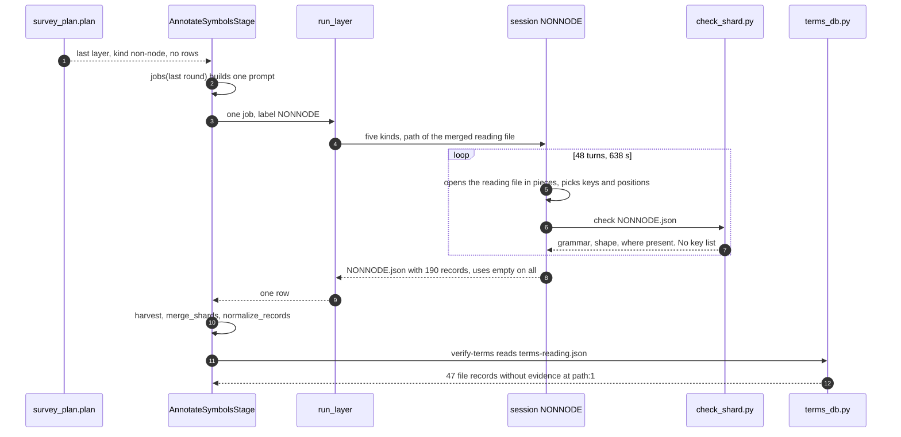
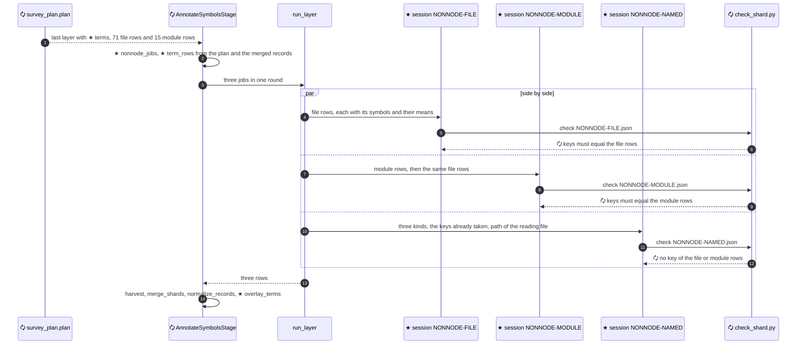
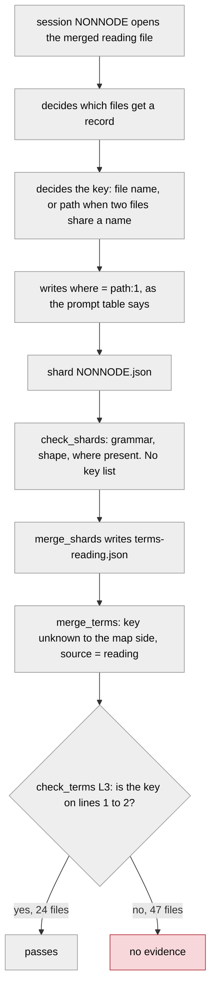
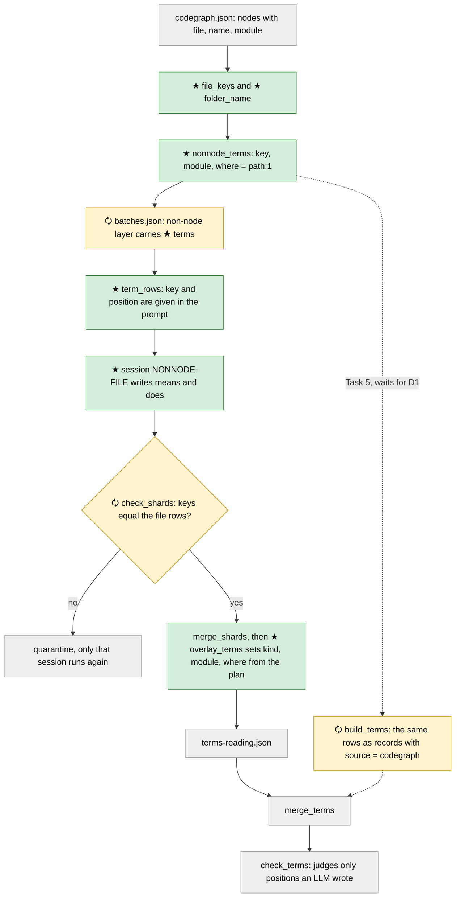
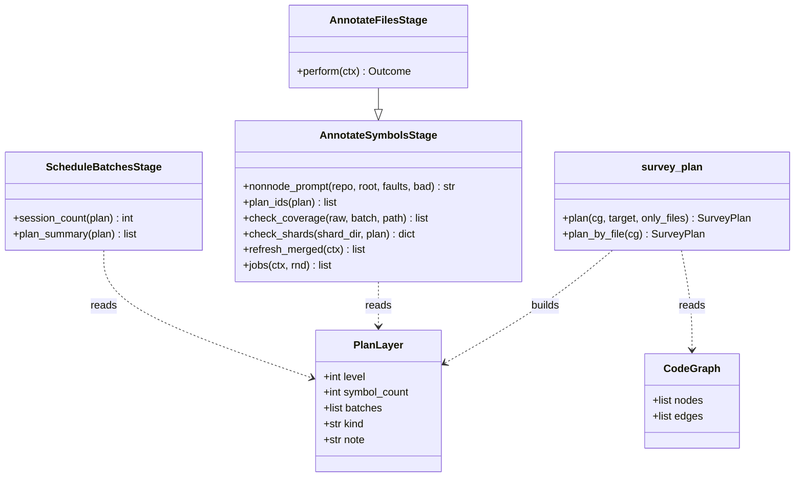
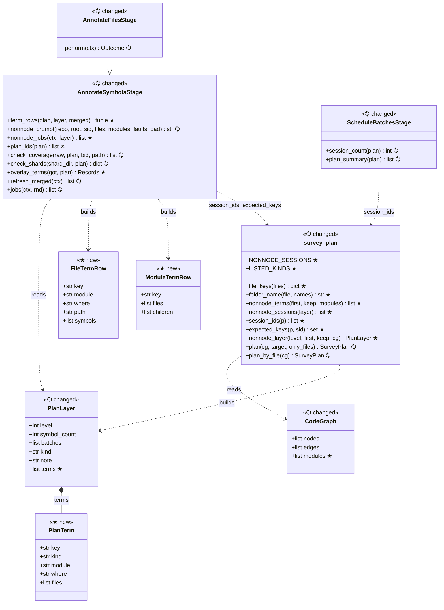

# 🧩 B2 — Non-node terms, machine list and three sessions: implementation plan

> 🔴 Status as of 2026-11-23: superseded by `2026-11-23-mode1-b2-nonnode-rounds-plan.md` in this folder, not carried out. Its Before predates B3 and A3, and its open decision D1 is decided differently; D2 is still open (see `2026-11-23-mode1-b2-decisions-handoff.md`).

> **For agentic workers:** REQUIRED SUB-SKILL: Use superpowers:subagent-driven-development (recommended) or superpowers:executing-plans to implement this plan task-by-task. Steps use checkbox (`- [ ]`) syntax for tracking.

> 📅 2026-11-22 · branch `main` · **Before = `29c5ee9` + plan B1** (`2026-11-22-mode1-b1-survey-stabilize-plan.md`, all five tasks applied). Where this plan touches a line that B1 changes, the "Before" shown here is B1's "After"; each such diff says so. Line numbers in the tables are those of `29c5ee9`; B1 shifts some by a few lines
> 📄 Evidence: split `public.handoff/2026-11-22-mode1-remediation-split.md` ("Decided" · "The five kinds of non-node terms" · "How to read Measurement A" · "Hidden couplings") · `docs/superpowers/specs/2026-11-21-mode1-audit-verification-report.md` §2.4 (나) · §2.5 · `docs/superpowers/specs/2026-11-21-mode1-cold-run-report.md` §4.4 · `2026-11-22-mode1-session-cache-plan.md` (F11 · D4) · plan B1 · plan A2 (its row for B2) · code read in this session: `src/codewiki/python/machine/survey_plan.py` · `terms_db.py` · `src/codewiki/python/runner/mode1/survey.py` · `survey_files.py` · `graph.py` · `context.py` · `src/codewiki/python/runner/check_shard.py` · `src/core/pipeline.py` · `resource/codewiki/prompts/annotate-symbols.md` · `resource/codewiki/faults.toml` · the test files · copies of the baseline run's artifacts (code map, plan, 92 shards, <span style="color:cyan">merged reading file</span>, term database)
> 🔒 Rules kept: no check is loosened — no new `xfail` or `skip`, no fault severity changed, `terms_db.check_terms` not edited · prompt text and fault text stay in `resource/` · the template gives the shape and the stage decides the data · comments state the present only · no time-limit code or settings key (plan A2 owns them) · no allow-list code (plan A3 owns it)
> 🧪 Verification: unit tests first, then the six gates. No paid run. The whole plan was applied in a private scratch clone on top of B1, and the free checks listed under "Verification" were run there and on copies of the baseline run's artifacts. What a real session does with the new prompts is `[unverified]` and is read once, in Measurement A
> ✋ Approval: **not approved yet** — two decisions are open (D1 · D2)
> 🌐 Korean translation: `2026-11-22-mode1-b2-nonnode-terms-plan.ko.md`

**Goal:** The machine decides which `file` and `module` records exist and where they point, and three sessions — one per kind group — write only the text and run side by side.

**Architecture:** The survey plan (`batches.json`) gains the list of `file` and `module` terms on its <span style="color:cyan">non-node layer</span>, computed from the code map by one rule. The non-node round launches up to three sessions (`file` text, `module` text, `artifact` · `key` · `concept`), each with its own shard, its own check and its own retry. The shard check compares the first two shards with the plan's list, and the merge overwrites kind, module and position of listed records with the plan's values.

**Tech Stack:** Python 3 · msgspec · Jinja2 · pytest · pyright strict.

---

Legend for every table and drawing below: **★ created from nothing · 🗘 existing element changed · no mark = reused unchanged · ✕ removed.** The marks describe the kind of change, not implementation or verification status. Claim kinds: `[measured]` measured — in this session on copies of the baseline run's artifacts or in the scratch clone, or in a cited report (the row says which) · `[code read]` read in the source this session · `[proposed]` proposed by this plan · `[judgment]` this plan's own inference · `[unverified]` not checked.

## 📋 One-page summary

| | |
|---|---|
| 🎯 Covers | The <span style="color:cyan">non-node session</span> that runs alone (638 s) · the `file` and `module` lists and positions that the session chose by itself · the `file` rule conflict behind 47 of the 59 "no evidence" findings · the <span style="color:cyan">relation field</span> left empty on all 190 records · the 15 empty `module` positions |
| 🧩 Conclusion | The plan carries a <span style="color:cyan">machine list</span> of `file` and `module` terms (key · module · position), computed from the code map by a rule that reproduces the baseline's 71 and 15 keys exactly `[measured]`. Three sessions replace one. Their keys are checked against the list, and kind · module · position are overwritten from the plan at merge. Two things stay with the user: how the 47 findings go away (D1) and what the <span style="color:cyan">relation field</span> holds (D2) |
| 🟰 Unchanged | `terms_db.check_terms` · fault severities · the `batch` and `pass2` prompt sections · `prompt_names` · `merge_shards` · `normalize_records` · quarantine and retry mechanics · `project_codegraph` (non-node records stay out of the code map) · the kinds `artifact` · `key` · `concept`, whose list and positions a session still chooses |
| 🗘 Changed | Session labels and shard names (`NONNODE` → `NONNODE-FILE` · `NONNODE-MODULE` · `NONNODE-NAMED`) · the `nonnode` prompt section · the plan's <span style="color:cyan">non-node layer</span> (★ `terms`) · the session count and the plan summary line · the <span style="color:cyan">coverage check</span> now covers the non-node shards · one new fault text · with Task 5, `terms-db.json` holds `file` and folder `module` records with source `codegraph` |
| ⚠️ Traps | (1) A run folder whose `batches.json` was written before this plan has no <span style="color:cyan">machine list</span>; resumed as is, only the `artifact` · `key` · `concept` session would launch. Run `schedule-batches` again first. (2) The printed cost estimate multiplies the session count (`usd_per_batch_min` · `usd_per_batch_max`), so two more sessions raise that line while the work does not grow; the settings are not touched here. (3) The prompts of the `file` and `module` sessions grow with the number of symbols — 136 KB and 135 KB at 761 symbols `[measured]`. (4) Tasks 2 – 4 are one unit: the Task 2 prompt already tells the session that the machine overwrites kind · module · position at merge and that no listed key may be added or dropped, which Tasks 4 and 3 make true. No real survey between them. (5) Plan A2's file-strategy test names the label `NONNODE`; whichever of A2 and B2 lands second has to rename it ("Where B2 meets other plans"). (6) Task 5 does not make the term checker pass the `file` positions — it makes them machine-written, and the checker judges only what an LLM wrote. If that reads as loosening, choose another option of D1 |
| 🚫 Out of scope | Time limits (A2) · isolation and the allow-list (A3) · the read-through cache procedure, failed first checks and the input-less `cat >` (B3) · projecting non-node records into the code map (C1) · machine candidates for `artifact` and `key` · the `[estimate]` settings · a scope section for the `artifact` · `key` · `concept` session on incremental runs · any paid run |

## 📌 Decided — not to be reopened

| What | 👍 Chosen | 👎 Dropped | Who · when |
|---|---|---|---|
| B2 — who produces the non-node terms | The machine produces list and position of `file` and `module`. Sessions write the text, split into kind groups (`file` text / `module` text / `artifact` · `key` · `concept`) that run side by side | Machine skeleton only · splitting sessions only · leaving it and fixing only the rule conflict | user · 2026-11-22 |
| Measurement principle | The 51 min 17 s run of 2026-11-21 is the baseline. No full or survey run before fixes | Re-running to get a fresh base | user · 2026-11-22 |
| When the survey is measured | Once, after track A (A1 · A2 · A3) and track B (B1 · B2 · B3) are both fixed side by side | Measuring after A1 · A2 · A3 · B1 and leaving B2 · B3 for later | user · 2026-11-22 |
| Number of re-measurements | Two — Measurement A (through the survey) and Measurement B (full) | After every plan · once at the end | user · 2026-11-22 |
| A2 — what cuts a hung session | A time limit counted from session start, one value per stage; the non-node value is about 1,280 s. The values live in `resource/codewiki/config.toml` | One value of 1,800 s for every stage · cutting by a grace period after the output passes | user · 2026-11-22 |
| B3 — unit of a session | Unchanged (layer unit · batch target 8 · concurrency 8) | Concurrency 16 · changing the batch target size | user · 2026-11-22 |

Source: `public.handoff/2026-11-22-mode1-remediation-split.md`, "Decided (user, 2026-11-22)"; the rows are copied, the A2 and B3 rows shortened to the part that touches this plan. The same document states two constraints this plan works under: B2 must not be solved by loosening the checker — the conflict is resolved in the prompt or in whatever produces the records ("Hidden couplings") — and no paid check runs inside a plan; the comparison is Measurement A alone ("What this order changes"). The plan's approval itself is still ✋ pending.

## 💡 Proposed by this plan — not decided

Every row is one axis with its options, the trade-off and one recommendation. All names are `[proposed]`.

| # | Axis | Options | Trade-off | Recommendation |
|---|---|---|---|---|
| P1 | <span style="color:cyan">file key</span> rule | (a) the file name; when two files share a name, every file of that group uses its repository-relative path · (b) always the path · (c) a dotted name like the symbols | (a) reproduces the 71 baseline keys, 71 of 71 `[measured]`; a file's key changes when a second file with the same name appears. (b) never changes, but only the 6 baseline keys that already are paths would match the records an earlier run stored. (c) is a third spelling beside the two that exist | **(a)** |
| P2 | `module` list rule | (a) the <span style="color:cyan">folder name</span> of every file with nodes — the part of the symbols' dotted names that mirrors the path — plus the modules of the code map · (b) the modules of the map only · (c) folder paths | (a) reproduces the 15 baseline keys, 15 of 15 `[measured]`; on a map whose symbol names do not mirror paths it falls back to the map's modules only (pinned by a synthetic test; golden C++ / C# maps `[unverified]`). (b) gives 6 on the baseline and drops the 9 folder records. (c) gives keys nobody wrote before and, where the map's module is the folder, two records for one thing | **(a)** |
| P3 | Where the <span style="color:cyan">machine list</span> lives | (a) on the plan's <span style="color:cyan">non-node layer</span>, in a new list `terms` · (b) as `batches` of that layer · (c) a skeleton shard the machine writes and the session fills in · (d) computed again whenever a prompt is built | (a) one frozen file; `check_shard.py` already loads the plan, and the plan stamp already covers it. (b) reuses the coverage code but 12 places in five source files read a layer's `batches` as symbol batches `[code read]` (`name_of`, `plan_files`, `symbol_layers`, the summary) and would see non-symbols. (c) needs a second copy to compare the filled shard with. (d) runs the rule at two times in two processes with no frozen result between them | **(a)** |
| P4 | Position of a `file` record | (a) `<path>:1` · (b) the first line on which the key appears literally · (c) the line of the first symbol in the file | With today's checker on records that come through the reading file, counted on the 71 baseline files `[measured]`: (a) 0 failures · 47 "no evidence". (b) 0 · 32 — 32 files never contain their own name on any line. (c) 0 · 71. No in-file position passes for all 71; that is D1 | **(a)** — it is what the baseline wrote 71 of 71 times and it never fails L1 or L2 |
| P5 | Position of a `module` record | (a) empty, set by the machine · (b) the first line under the folder that names the key · (c) `<folder>/__init__.py:1` · (d) the folder path | Counted on the 15 baseline records `[measured]`: (a) 0 failures · 0 "no evidence" — the checker lets a `module` record have no position. (b) a line exists for only 10 of 15. (c) 9 failures: all 15 `__init__.py` files there have 0 lines, so line 1 does not exist (L2); the other 6 records are not judged because the map already has them. (d) 9 failures: the checker opens the position as a file, and a folder is not one (L1) | **(a)** — the prompt then says "a module has no position" instead of "may be omitted" |
| P6 | How one session becomes three | (a) one prompt section `nonnode` with branches on the session name · (b) three sections · (c) three files | (a) keeps one copy of the retry block (a test pins it character-identical to the batch section's), the record contract, the write location and the check command; `prompt_names` does not change; the check command stays one literal line for A3. (b) and (c) repeat those parts three times and add two declared names | **(a)** |
| P7 | What the `file` and `module` sessions receive | (a) per file its symbols' names and `means`, in the prompt · (b) the same plus `does` · (c) names only · (d) the path of the <span style="color:cyan">merged reading file</span>, as today | Sizes on the baseline `[measured]`: (a) 136 KB for the `file` session, 135 KB for the `module` session. (b) adds 95,378 characters of `does`. (c) 54 KB, but a summary written from names alone is what the prompt's "names lie" rule forbids. (d) is a 739 KB file opened in pieces — the baseline session took 48 turns | **(a)**, and the same file rows for both sessions (one builder) |
| P8 | Keeping three shards apart | (a) the <span style="color:cyan">coverage check</span> compares the `file` and `module` shards with the list, and reports a <span style="color:cyan">taken key</span> in the third shard · (b) the prompt asks, nothing checks | Without (a), `merge_shards` takes a key written by two sessions for a collision and renames to `<file stem>.<key>` — both records when both have a position, so a listed `file` key disappears from the merged file; only the positioned one when the other is a `module` record without a position `[code read]` `survey.py:436-445`. Neither case is reported to a session. On the baseline no key of the three named kinds equals a listed key `[measured]` | **(a)** — one new fault text, same fault kind (`coverage`), same severity |
| P9 | Who has the last word on kind · module · position of a listed record | (a) the merge overwrites them from the plan — the <span style="color:cyan">plan overlay</span> · (b) the session's copy is trusted · (c) the session does not write those fields | (b): one mistyped position becomes an L1 or L2 failure in the <span style="color:cyan">term check</span> and stops the flow. (c) needs a second shard shape and a second schema file | **(a)** |
| P10 | When a session launches | (a) the `file` and `module` sessions launch only when the plan lists rows of their kind; the third always · (b) always three | (b) launches a session whose only correct output is `{}` | **(a)** |

New functions and their callers, counted in the scratch clone `[code read]`: `session_ids` 5 call sites · `nonnode_sessions` 5 · `nonnode_layer` 2 (it replaces two copies of the same literal) · `nonnode_terms` 2 with Task 5, 1 without · `nonnode_jobs` 2 (both strategies) · `overlay_terms` 2 (both strategies) · `expected_keys` 1, inside `check_coverage`, which the stage and `check_shard.py` both call. No class with behavior, no module and no interface is added; the four new classes are `TypedDict` shapes of data that is serialized or handed to a template.

## 📊 Status

| Item | State |
|---|---|
| Task 1 — the plan lists `file` and `module` terms | ❌ not started |
| Task 2 — three <span style="color:cyan">non-node sessions</span> in one round | ❌ not started |
| Task 3 — the <span style="color:cyan">coverage check</span> covers the non-node shards | ❌ not started |
| Task 4 — the <span style="color:cyan">plan overlay</span> at merge | ❌ not started |
| Task 5 — `file` and folder `module` records come from the map side | ❌ not started · waits for D1 |
| Task 6 — READMEs · six gates | ❌ not started |
| Approval of this plan · D1 · D2 | ❌ not approved |
| Tried in a scratch clone (B1 + Tasks 1 – 6) | ✅ applied there; tests and gates ran ("Verification") |
| Effect on a real run | ❌ not measured — Measurement A |

## 🔁 Before / After

| 📍 Before (what did not work · now) | 🛠️ After · proposed | 🎉 What it resolves | 🔭 Expected | Done |
|---|---|---|---|---|
| 🐞 One session writes 190 records of five kinds alone: 638 s · 48 turns · 10 check runs `[measured]` (verification report §2.5) | Up to three sessions in one round, one per kind group | The non-node part lasts as long as its slowest session, not as long as all the work | Wall clock of the round below 638 s `[unverified]` | ❌ |
| 🐞 The session decides which files and folders get a record and under which key; nothing compares the result with anything `[code read]` `survey.py:267` | The plan lists them; the <span style="color:cyan">coverage check</span> compares the shard with the list | A missing or extra `file` or `module` record sends that one session back with the fault line | Rule reproduces 71 of 71 and 15 of 15 baseline keys `[measured]` | ❌ |
| 🐞 The prompt gives a `file` record the position `path:1` (line 145) and demands that the name be on that line (lines 151 – 152); 47 of 71 files do not have it there `[measured]` | The position is given by the machine. The name-on-the-line sentence covers only `artifact` · `key` · `concept`, whose position a session chooses | The prompt no longer contradicts itself | The 47 findings stay 47 with Tasks 1 – 4 and become 0 with Task 5 `[measured]` on a replay of the baseline shards | ❌ |
| 🐞 The <span style="color:cyan">relation field</span> is empty on 190 of 190 records; the session emptied it expecting more "no evidence" `[measured]` (§2.4 나) | The prompt says what the field holds for these kinds (D2) | The field is empty by rule or filled by rule, not by a session's guess | Under D2 (a): empty on every non-node record | ❌ |
| 🐞 15 `module` positions are empty because the prompt says "may be omitted" (line 146) | The machine sets the empty position; the prompt says a module has none | The empty position is a stated fact | 0 findings on `module` records, as in the baseline `[measured]` | ❌ |
| 🐞 The session is pointed at the 739 KB <span style="color:cyan">merged reading file</span> and opens it in pieces `[measured]` | The `file` and `module` sessions get the symbols' names and `means` in the prompt and are told not to open the file; the third session is told to search it, not to read it through | Fewer turns spent reading | `[unverified]` | ❌ |
| 🐞 In the file strategy a relaunched <span style="color:cyan">non-node session</span> gets no fault lines `[code read]` `survey_files.py:147-148` | Both strategies build the jobs with `nonnode_jobs`, which passes `retry_inputs` | The retry block reaches the session in both strategies | pinned by a test | ❌ |

## ★ New · 🗘 changed · ✕ removed items

| Level | Mark | Item | Kind | Container |
|---|---|---|---|---|
| module | — | none new. 🗘 `survey_plan` · `mode1.survey` · `mode1.survey_files` · `mode1.graph` · `mode1.context` · `check_shard` · `terms_db` (Task 5) | changed | `src/codewiki/python/machine` · `src/codewiki/python/runner` |
| file | 🗘 | `resource/codewiki/prompts/annotate-symbols.md` (section `nonnode` only) · `resource/codewiki/faults.toml` · the seven Python files above · five test files · two generated READMEs | changed | — |
| file | ★ ✕ | at run time: ★ `_shards/NONNODE-FILE.json` · `NONNODE-MODULE.json` · `NONNODE-NAMED.json` · ✕ `_shards/NONNODE.json` | new · removed | `out/codegraph-raw/_shards/` of the target |
| class | ★ | `PlanTerm` · `GraphModule` | new | `survey_plan.py` |
| class | ★ | `FileTermRow` · `ModuleTermRow` | new | `mode1/context.py` |
| class | 🗘 | `PlanLayer` · `CodeGraph` · `GraphNode` (typed shapes) · `AnnotateSymbolsStage` · `AnnotateFilesStage` · `ScheduleBatchesStage` | changed | — |
| function | ★ | `file_keys` · `folder_name` · `nonnode_terms` · `nonnode_sessions` · `session_ids` · `expected_keys` · `nonnode_layer` | new | `survey_plan.py` |
| function | ★ | `AnnotateSymbolsStage.term_rows` · `.nonnode_jobs` · `.overlay_terms` | new | `mode1/survey.py` |
| function | 🗘 | `plan` · `plan_by_file` · `main` | changed — the <span style="color:cyan">non-node layer</span> comes from `nonnode_layer`; the printed line counts sessions | `survey_plan.py` |
| function | 🗘 | `AnnotateSymbolsStage.nonnode_prompt` · `.check_coverage` · `.check_shards` · `.refresh_merged` · `.perform` · `.sweep` · `.jobs` | changed — signatures of the first two change | `mode1/survey.py` |
| function | 🗘 | `AnnotateFilesStage.perform` (session count, non-node launch, inner `write_merged`) · `ScheduleBatchesStage.session_count` · `.plan_summary` · `check_shard.main` · `terms_db.build_terms` (Task 5) | changed | — |
| function | ✕ | `AnnotateSymbolsStage.plan_ids` | removed — `survey_plan.session_ids` replaces it; no test calls it | `mode1/survey.py` |
| member | ★ | `PlanLayer.terms` · `CodeGraph.modules` · `GraphNode.module` · constants `NONNODE_SESSIONS` · `LISTED_KINDS` | new | `survey_plan.py` |
| member | ★ | fault text `kind.coverage.detail-taken` · prompt values `sid` · `n` · `files` · `modules` · `taken` | new | `faults.toml` · section `nonnode` |

## ⏱️ Sequence — the non-node round

**Before** `[code read]` · numbers `[measured]` in the cited reports



**After · proposed** `[unverified]`



`run_layer` runs the jobs of one round in a pool of `concurrency` workers (default 8) `[code read]` `pipeline.py:451-475`, so the three sessions run side by side without new code. A failed session fails the round as it does today; on the next run `jobs` skips every session whose shard exists, so only the failed one runs again, with its fault lines.

## 🔀 Flow — how a `file` record gets its key and position

**Before** `[code read]` · counts `[measured]`



**After · proposed** — gray unchanged · green new · amber changed. The dotted branch is Task 5 and exists only if D1 is answered with option B.



A `module` record takes the same route with an empty position and the `NONNODE-MODULE` session. An `artifact`, `key` or `concept` record keeps today's route: the session picks key and position, and the <span style="color:cyan">term check</span> judges the position.

## 🧱 Structure — typed shapes and the stage

**Before** `[code read]`



**After · proposed**



## 🔧 Where to change

| File · symbol | Change | Why | Evidence |
|---|---|---|---|
| 🗘 `src/codewiki/python/machine/survey_plan.py` — ★ `PlanTerm` · `GraphModule` · `NONNODE_SESSIONS` · `LISTED_KINDS` · `file_keys` · `folder_name` · `nonnode_terms` · `nonnode_sessions` · `session_ids` · `expected_keys` · `nonnode_layer` · 🗘 `GraphNode` · `CodeGraph` · `PlanLayer` · `plan` · `plan_by_file` · `main` | The rule that turns the map into `file` and `module` rows, the session names, and the two questions the stage asks the plan: "which sessions" and "which keys" | The plan is the one frozen statement of what the survey will write | `[code read]` `survey_plan.py:36-50` (shapes) · `:199-205` · `:303-306` (the two <span style="color:cyan">non-node layers</span>) · `:334` |
| 🗘 `resource/codewiki/prompts/annotate-symbols.md` — section `nonnode` | One section with a branch per session; rows instead of a path for the `file` and `module` sessions; the name-on-the-line sentence only for three kinds; the relation sentence (D2) | Decided split; P6 · P7 | `[code read]` lines 118-178; line 176 is B1's "After" |
| 🗘 `src/codewiki/python/runner/mode1/context.py` — ★ `FileTermRow` · `ModuleTermRow` | Shapes of the prompt rows | The other row shapes live there (`SymbolRow` · `DepRow` · `PendingRow`) | `[code read]` `context.py:115-148` |
| 🗘 `src/codewiki/python/runner/mode1/survey.py` — ★ `term_rows` · `nonnode_jobs` · `overlay_terms` · 🗘 `nonnode_prompt` · `check_coverage` · `check_shards` · `refresh_merged` · `perform` · `sweep` · `jobs` · ✕ `plan_ids` | Build rows, launch one job per session, check keys per session, overwrite listed fields at merge | Decided split; P8 · P9 | `[code read]` `survey.py:163-171` · `:237-271` · `:498-512` · `:573` · `:602` · `:611-625`. `nonnode_prompt` and `refresh_merged` are B1's "After" |
| 🗘 `src/codewiki/python/runner/mode1/survey_files.py` — `AnnotateFilesStage.perform` | Count and launch the same sessions through `nonnode_jobs`; overlay in `write_merged` | The file strategy launches the <span style="color:cyan">non-node session</span> by itself | `[code read]` `survey_files.py:53-55` · `:67-74` · `:147-149`. `write_merged` is B1's "After" |
| 🗘 `src/codewiki/python/runner/mode1/graph.py` — `session_count` · `plan_summary` | Count sessions through `session_ids`; print the number of <span style="color:cyan">non-node sessions</span> | "One session" is no longer true | `[code read]` `graph.py:212` · `:231-233` |
| 🗘 `src/codewiki/python/runner/check_shard.py` — `main` | Hand the plan and the shard's name to `check_coverage` | The session's own check must be the same check as the sweep | `[code read]` `check_shard.py:37-44` |
| 🗘 `resource/codewiki/faults.toml` — `[kind.coverage]` | ★ `detail-taken` | P8 | `[code read]` `faults.toml:25-28` |
| 🗘 `src/codewiki/python/machine/terms_db.py` — `build_terms` (Task 5, waits for D1) | Emit the same rows as records with source `codegraph` | D1 option B | `[code read]` `terms_db.py:119-206` · `:341` · `:361-393` |
| 🗘 tests | `test_survey_plan.py` · `test_mode1.py` · `test_run_mode1.py` · `test_terms_db.py` · `test_graph_adversarial.py` | 20 new tests; existing tests that name `NONNODE` or call `nonnode_prompt` follow the new names | task steps |

### Proposed diff — not applied (digest)

The full diffs are in the task steps. This digest shows the five places where the behavior turns. Names that do not exist yet are `[proposed]`.

`src/codewiki/python/machine/survey_plan.py` — the <span style="color:cyan">non-node layer</span>:

```diff
--- a/src/codewiki/python/machine/survey_plan.py
+++ b/src/codewiki/python/machine/survey_plan.py
@@ -197,13 +320,8 @@ def plan(cg: CodeGraph, target: int = 8,
                 for i, b in enumerate(bs)],
         })
 
-    # K5 — 그래프 노드가 아닌 용어는 맨 마지막 별도 층. `symbol_count` 가 None 인 층이 이것이다.
-    last = (max(bylv) + 1) if bylv else 0
-    layers.append({
-        "level": last, "kind": "non-node", "symbol_count": None, "batches": [],
-        "note": "file · module · artifact · key · concept. 심볼 층이 전부 끝난 뒤 한 세션으로 돈다. "
-                "파일 레코드는 그 파일 안 심볼들의 완성 레코드를 재료로 쓴다.",
-    })
+    # K5 — 그래프 노드가 아닌 용어는 맨 마지막 별도 층.
+    layers.append(nonnode_layer((max(bylv) + 1) if bylv else 0, first, keep, cg))
     return {"target": target, "layers": layers,
             "totals": {"symbols": len(keep), "edges": len(edges), "levels": len(bylv),
                        "cyclic_symbols": sum(1 for n in keep if in_cycle.get(n))}}
```

`src/codewiki/python/runner/mode1/survey.py` — one job becomes one job per session:

```diff
--- a/src/codewiki/python/runner/mode1/survey.py
+++ b/src/codewiki/python/runner/mode1/survey.py
@@ -618,7 +656,7 @@ class AnnotateSymbolsStage(VerifiedGraph, Measured, P.LlmStage[Mode1Context]):
         layer = ctx.plan["layers"][rnd]
         d = self.shard_dir(ctx)
         if layer.get("kind") == "non-node":
-            jobs = [("NONNODE", self.nonnode_prompt(ctx.repo, ctx.root, **self.retry_inputs(d, "NONNODE")))]
+            jobs = self.nonnode_jobs(ctx, layer)
         else:
             names = self.name_of(ctx.plan)
             jobs = [(b["id"], self.survey_batch_prompt(ctx.repo, ctx.root, b,
```

`src/codewiki/python/runner/mode1/survey.py` — every session's keys are compared:

```diff
--- a/src/codewiki/python/runner/mode1/survey.py
+++ b/src/codewiki/python/runner/mode1/survey.py
@@ -305,8 +311,8 @@ class AnnotateSymbolsStage(VerifiedGraph, Measured, P.LlmStage[Mode1Context]):
             with open(path, "rb") as f:
                 raw = f.read()
             got = AnnotateSymbolsStage.check_shard(raw, bid, path)
-            if not got and bid in batches:              # 비노드 세션은 계획 심볼이 없어 대조하지 않는다
-                got = AnnotateSymbolsStage.check_coverage(raw, batches[bid], path)
+            if not got:
+                got = AnnotateSymbolsStage.check_coverage(raw, plan, bid, path)
             if got:
                 bad[bid] = got
         return bad
```

`src/codewiki/python/runner/mode1/survey.py` — the merge overwrites listed fields. **"Before" here is B1's "After"** (the atomic write):

```diff
--- a/src/codewiki/python/runner/mode1/survey.py
+++ b/src/codewiki/python/runner/mode1/survey.py
@@ -548,13 +562,14 @@ class AnnotateSymbolsStage(VerifiedGraph, Measured, P.LlmStage[Mode1Context]):
         return "\n".join(lines) + "\n"
 
     def refresh_merged(self, ctx: Mode1Context) -> list[X.DroppedUse]:
-        """샤드를 다시 합치고 보정해 `terms-reading.json` 과 `dropped-uses.csv` 를 쓴다.
+        """샤드를 다시 합치고 보정하고 기계 목록의 칸을 덮어(`overlay_terms`) `terms-reading.json` 과 `dropped-uses.csv` 를 쓴다.
 
         층 끝(`harvest`)과 파일 끝(`AnnotateFilesStage`)이 같은 것을 부른다 — 병합의 정의는 한 곳이다.
         """
         assert ctx.plan is not None
         raw = self.merge_shards(self.shard_dir(ctx), ctx.baseline)
-        ctx.merged, dropped = self.normalize_records(raw, self.name_of(ctx.plan))
+        fixed, dropped = self.normalize_records(raw, self.name_of(ctx.plan))
+        ctx.merged = self.overlay_terms(fixed, ctx.plan)
         jsonio.write_json_atomic(X.READING.locate(ctx), ctx.merged, indent=1, sort_keys=True)
         with open(X.DROPPED.locate(ctx), "w", encoding="utf-8") as f:
             f.write(self.dropped_csv(dropped))
```

`resource/codewiki/prompts/annotate-symbols.md` — the table and the rule under it (digest; the whole section is in Task 2 Step 3):

```diff
 | kind | 무엇 | where 는 어디 |
 |---|---|---|
-| `file` | 소스 파일 하나 | `경로:1` |
-| `module` | 디렉토리 하나 | 없어도 된다 |
 | `artifact` | 이 저장소가 **만들어 내는** 파일 | 그 파일을 **쓰는** 줄 |
 | `key` | 설정·JSON 의 이름난 칸 | 그 키를 **채우는** 줄 |
 | `concept` | 코드에 글자로 있는 낱말 | 그 낱말이 있는 줄 |
 
-**`file` `module` `artifact` `key` `concept` 는 이름이 그 줄에 글자 그대로 있어야 한다** —
+**`artifact` `key` `concept` 는 이름이 그 줄에 글자 그대로 있어야 한다** —
 기계가 L3(근처에 그 이름) 으로 검사한다.
```

## 🧭 Order of the slices

| # | Slice | Deliverable | Check |
|---|---|---|---|
| 1 | Task 1 | The plan's <span style="color:cyan">non-node layer</span> lists `file` and `module` rows; session names exist | `test_survey_plan.py`, 9 new tests, two of them on the frozen fixture |
| 2 | Task 2 | Three sessions launch with their own prompts in both strategies | `test_mode1.py` · `test_run_mode1.py` · prompt gate |
| 3 | Task 3 | A shard with a missing, extra or <span style="color:cyan">taken key</span> is caught by the sweep and by `check_shard.py` | `test_mode1.py` |
| 4 | Task 4 | Listed records carry the plan's kind · module · position after merge | `test_mode1.py` |
| 5 | Task 5 — only after D1 = B | `file` and folder `module` records exist on the map side | `test_terms_db.py` · the strict `xfail` stays an `xfail` |
| 6 | Task 6 | READMEs regenerated; six gates green | the gates |

Tasks 1 – 4 depend on each other in this order and are applied together before any real run. Task 5 depends on Task 1 only. B3 starts from the result of this plan.

## 📖 Terms

| Term | Code name | Meaning |
|---|---|---|
| <span style="color:cyan">non-node layer</span> | a `PlanLayer` with `kind == "non-node"` | The last layer of the survey plan; its sessions write terms that are not nodes of the code map |
| <span style="color:cyan">machine list</span> | `PlanLayer.terms`, rows of `PlanTerm` | The `file` and `module` terms the plan decided: key · kind · module · position · the files a term covers |
| <span style="color:cyan">listed kinds</span> | `LISTED_KINDS` | `file` and `module` — the kinds whose key and position the machine decides |
| <span style="color:cyan">non-node session</span> | `NONNODE_SESSIONS` — `NONNODE-FILE` · `NONNODE-MODULE` · `NONNODE-NAMED` | One session per kind group. The name is the job label and the shard's file name |
| <span style="color:cyan">file key</span> | `file_keys` | The key of a `file` record: the file name, or the path for every file whose name is shared |
| <span style="color:cyan">folder name</span> | `folder_name` | The dotted name of the folder a file is in, read off the symbols' names; the key of a folder's `module` record |
| <span style="color:cyan">term rows</span> | `term_rows` → `FileTermRow` · `ModuleTermRow` | What a prompt shows of the <span style="color:cyan">machine list</span>, with each file's symbols and their meanings |
| <span style="color:cyan">coverage check</span> | `AnnotateSymbolsStage.check_coverage` | Compares the keys of a shard with the keys its session has to write |
| <span style="color:cyan">taken key</span> | fault text `kind.coverage.detail-taken` | A key of the <span style="color:cyan">machine list</span> found in the shard of the third session |
| <span style="color:cyan">plan overlay</span> | `AnnotateSymbolsStage.overlay_terms` | At merge, kind · module · position of a listed record are replaced by the plan's values |
| <span style="color:cyan">merged reading file</span> | `terms-reading.json` (`X.READING`) | All shards merged; the input of the term database |
| <span style="color:cyan">term check</span> | `terms_db.check_terms` | Judges positions an LLM wrote: L1 file exists · L2 line exists · L3 the name is near the line |
| <span style="color:cyan">map-side record</span> | a record `build_terms` creates, `source == "codegraph"` | A record whose structure comes from the code map; a reading record with the same key contributes only text |
| <span style="color:cyan">relation field</span> | record field `uses` | The outgoing relations of a record |

## ❓ Open decisions

| # | Question | Evidence | Options | Recommendation | What stays blocked |
|---|---|---|---|---|---|
| D1 | How do the 47 "no evidence" findings on `file` records go away, given that the checker is not loosened? | No in-file position passes L3 for all 71 files (P4) `[measured]`. The checker judges only what an LLM wrote: a record with source `codegraph` is skipped, and for `codegraph+reading` only relations the reading added are judged `[code read]` `terms_db.py:341-353`. 6 of the 15 baseline `module` records already live that way (source `codegraph+reading`) `[measured]`. Replay of the baseline shards: 59 findings with Tasks 1 – 4, 12 with Task 5 — `file` 47 → 0; the 12 left are 7 function · 3 method · 2 class `[measured]` | **A** — stop at Tasks 1 – 4: the prompt no longer contradicts itself, the position is machine-written in the reading file, and the 47 findings stay as "no evidence" (they never stopped the flow). **B** — Task 5: `build_terms` emits the same rows as <span style="color:cyan">map-side records</span>; `merge_terms` then keeps the map's structure and takes only the text, so the position is never judged. Costs: every `terms-db.json` gains `file` and folder `module` records even without a reading (849 instead of 769 records on the baseline map `[measured]`); 80 baseline records change source and gain an `id`; `terms_db.py` imports `survey_plan`; one strict `xfail` test needs its count narrowed to symbol records so that it keeps failing for its own reason. **C** — position = first line that names the key: 39 pass and 32 remain, the merge has to open source files, and the positions mean nothing | **B** `[judgment]` — it is the decided direction (the machine produces the position) carried to the place where provenance is recorded. Stated plainly: after B the checker does not look at `file` positions at all | Task 5 |
| D2 | What does the <span style="color:cyan">relation field</span> hold on a non-node record, and who fills it? | Nothing outside `terms_db.py` and `normalize_records` reads a record's `uses`; `neighbors` appears only in a contract type `[code read]`. `project_codegraph` drops every relation whose end is not a node. Containment is already in the map (`node.file`), and module dependencies are in `modules[].depends_on`. On the baseline, 97 of the 104 `artifact` · `key` · `concept` records sit in a file with nodes, 78 under a symbol that starts above them; a relation to that symbol cited at the record's own line would pass L3 in 6 of 78 cases `[measured]` | **(a)** nothing for all five kinds, and the prompt says so (`uses` is `[]`). **(b)** the machine fills containment for `file` records (file → its symbols, cited at each symbol's position): 761 relations on the baseline, no reader, and every symbol gains its file as a neighbor. **(c)** the third session fills a relation from an `artifact` · `key` · `concept` record to the symbol that writes it: 72 of 78 would be "no evidence" unless cited at the symbol's own line, which does not show the relation | **(a)** `[judgment]` — no reader, and the two facts worth having are already in the map. Measurement A then reads "records with a filled <span style="color:cyan">relation field</span>" as empty by rule, not as a defect | Nothing in the code. One sentence of the Task 2 prompt (`**uses 는 빈 배열 … 싣지 않는다.**`) carries (a); with (b) or (c) that sentence and one task change |

## 🤝 Where B2 meets other plans

| Plan | Where they meet | What B2 keeps to | What the other plan has to know |
|---|---|---|---|
| B1 | `nonnode_prompt`'s `load_prompt` call · the check-command line of the section · `refresh_merged` · `write_merged` · the test `test_전수조사_프롬프트는_실행기의_해석기를_적는다` | B2 starts from B1's "After" and keeps `python=sys.executable`, `{{python}}` and the atomic write | — (B1 is first) |
| A2 | Time limit of the split sessions | B2 adds no limit code and no settings key. All three sessions stay inside the layer whose `kind` is `non-node`, and their labels are not batch ids — the two things A2 keys the non-node value on (A2 plan, row "B2 — the <span style="color:cyan">non-node session</span> becomes three") | A2's test `test_파일_전략은_배치와_2패스에_배치_값을_비노드_세션에_비노드_값을_준다` uses the label and shard key `NONNODE`. After B2 the three-file plan of that test launches `NONNODE-FILE` and `NONNODE-NAMED` (it has no `module` rows). A2's glossary also names the label `NONNODE`. A2 and B2 edit different hunks of `mode1/survey.py`, `survey_files.py` and `test_mode1.py` |
| A3 | The notice of allowed calls in this prompt file and the allow rules built from the commands the prompt names | The section names one command, in the same literal form as the batch section: `{{python}} {{root}}/src/codewiki/python/runner/check_shard.py {{repo}}/out/codegraph-raw/_shards/{{sid}}.json`. One rule on `check_shard.py *` covers the three shards. Each session writes one file under `_shards/` | The third session still opens the <span style="color:cyan">merged reading file</span> (search, not read-through). The `file` and `module` sessions are told not to open it |
| B3 | Same prompt file and same module, after B2 | B2 edits only the `nonnode` section and does not touch the read-through cache text, the first-check wording of the batch section, or any `cat >` wording | B3's "Before" is this plan's "After". The check runs of the baseline's <span style="color:cyan">non-node session</span> are B3's subject; B2 adds a second reason a first check can fail — keys that differ from the list |
| C1 · code map | Non-node records are not projected | The rows live in `terms`, not in `batches`, so `WriteWikiStage.symbol_layers`, `name_of` and `plan_files` see what they saw before. `project_codegraph` is untouched | With Task 5 the term database holds `file` and folder `module` records for every target; they are still skipped by the projection |
| A1 | Session rows | Row names become `annotate-symbols/NONNODE-FILE` · `…-MODULE` · `…-NAMED` | The wall clock of the non-node part is the longest of the three rows, not their sum |

**What Measurement A reads for B2** (split, "How to read Measurement A"): wall clock of the non-node part · records with a filled <span style="color:cyan">relation field</span> · "no evidence" on `file` records. Baseline 638 s · 0 of 190 · 47 `[measured]`. After this plan `[unverified]`: the longest of the three `NONNODE-*` rows; 0 by rule if D2 = (a); 0 if D1 = B, otherwise about as many as there are files that do not carry their own name on lines 1 – 2.

## 🧪 Verification · 🚫 Out of scope

Run in this session, all free `[measured]`:

| What | How | Result |
|---|---|---|
| The rule on the baseline code map (763 nodes · 6 modules) | `survey_plan.plan` and `plan_by_file` on a copy of the baseline run's `codegraph.json`, compared with the baseline's non-node shard | `file`: 71 rows, the same 71 keys, 71 of 71 positions and 71 of 71 modules equal. `module`: 15 rows, the same 15 keys (12 <span style="color:cyan">folder names</span> ∪ 6 map modules, 3 shared), 15 of 15 positions and modules equal |
| The rule on the frozen fixture `test/codewiki/fixtures/codegraph-self.json` | the tests of Task 1 and Task 5 | 77 `file` rows · 15 `module` rows · six path keys (three shared file names) — pinned |
| Replay of the baseline shards | the 91 batch shards plus the non-node shard cut into three by kind, through `check_shards`, `merge_shards`, `normalize_records` and `overlay_terms` with the new plan (94 session names) | 0 faults; the merged records are identical to the baseline's <span style="color:cyan">merged reading file</span> (951 records) |
| Term check on that replay | `terms_db.py <map> --repo <source tree at 29c5ee9> --reading <replayed file> -o <scratch folder>` | With Tasks 1 – 4: 953 terms · 0 failures · 59 "no evidence" (the baseline's numbers). With Task 5: 953 · 0 · 12 |
| Prompt sizes | `nonnode_prompt` rendered with the baseline plan and the baseline symbol records | `NONNODE-FILE` 136,450 bytes · `NONNODE-MODULE` 135,179 · `NONNODE-NAMED` 4,366. The <span style="color:cyan">merged reading file</span> is 739,145 bytes |
| Every new test fails first for the stated reason and passes after its step | in the scratch clone, task by task | as written in the steps |
| The six gates in the scratch clone (B1 + Tasks 1 – 6) | the commands of Task 6 | pytest 1013 passed · 25 skipped · 2 xfailed (993 · 25 · 2 with B1 alone there; the clone has no `out/`, so it skips more than the main checkout) · `npm test` 8 pass · `tsc` clean · pyright 0 errors · README 9 match · doctor exits 0 |
| The six Mermaid drawings | `npx --no-install mmdc`, one file per drawing | all six rendered |

Not run: any session (paid) · the golden C++ and C# maps — their environment variables are not set here, so the rule's fallback for names that do not mirror paths rests on one synthetic test · whether three sessions finish sooner than one · whether text written from names and `means` alone is as good as the baseline's · prompt sizes on a larger repository · the gates in the main checkout.

Out of scope, and why: a scope section for the third session on incremental runs (today's non-node prompt has none either; the `file` and `module` sessions are scoped by the plan) · machine candidates for `artifact` and `key` (the split marks them "partly", undecided) · the `[estimate]` settings (trap 2) · resuming a run folder across this change (trap 1).

All commands run from the repository root with `.venv/bin/python`. Paths under `mode1/` and `machine/` are `src/codewiki/python/runner/mode1/` and `src/codewiki/python/machine/`. Code steps are given as unified diffs against "Before" (`29c5ee9` + plan B1); a diff is the complete change of that step for the files it names. If another plan has landed in between, the hunk line numbers shift — apply by context. Every commit step waits for the user's approval of commits for this plan.

---

### Task 1: The plan lists the `file` and `module` terms

**Files:**
- Modify: `src/codewiki/python/machine/survey_plan.py` (shapes at lines 36-50 and 76 · new block before `plan` at line 156 · the <span style="color:cyan">non-node layers</span> at lines 199-205 and 303-306 · `main` at line 334)
- Test: `test/codewiki/test_survey_plan.py`

- [ ] **Step 1: Write the failing tests** — append to `test/codewiki/test_survey_plan.py`:

```diff
--- a/test/codewiki/test_survey_plan.py
+++ b/test/codewiki/test_survey_plan.py
@@ -255,3 +255,99 @@ def test_자기_지도_스냅샷은_계획기의_형으로_엄격하게_읽힌
         raw = json.load(f)
     got = msgspec.convert(raw, CodeGraph)
     assert any(n.get("file") is None for n in got["nodes"])
+
+
+# ── 비노드 층의 기계 목록 — file · module 의 키와 위치는 계획이 정한다
+
+def _cg3(nodes: list[tuple[str, str, str, str]], modules: list[str]) -> CodeGraph:
+    """(id, 이름, 파일, 모듈) 노드와 지도의 모듈 목록."""
+    return {"nodes": [{"id": i, "name": n, "kind": "function", "file": f, "line": 3, "module": m}
+                      for i, n, f, m in nodes],
+            "edges": [], "modules": [{"id": m} for m in modules]}
+
+
+def test_file_키는_파일_이름이고_겹치면_겹친_전원이_경로다():
+    """같은 이름의 파일 둘이 한 키를 다투면 병합이 하나를 덮는다 — 겹친 쪽은 처음부터 경로로 부른다."""
+    got = SP.file_keys(["src/a/build.py", "src/b/build.py", "src/a/plan.py"])
+    assert got == {"src/a/build.py": "src/a/build.py", "src/b/build.py": "src/b/build.py", "src/a/plan.py": "plan.py"}
+
+
+def test_폴더의_module_키는_심볼_이름이_적은_점_경로다():
+    """심볼의 점 이름이 파일 경로의 꼬리로 시작하면 그 꼬리에서 파일 줄기를 뗀 것이 폴더의 이름이다."""
+    assert SP.folder_name("src/core/pipeline.py", ["core.pipeline.Stage", "core.pipeline.load"]) == "core"
+    assert SP.folder_name("tools/doctor.py", ["tools.doctor.main"]) == "tools"
+    assert SP.folder_name("src/a/b/c.py", ["a.b.c.f"]) == "a.b"
+    assert SP.folder_name("src/render/mesh.cpp", ["Mesh", "gfx::Mesh::draw"]) == ""     # 이름이 경로를 따르지 않는다
+    assert SP.folder_name("setup.py", ["setup.main"]) == ""                              # 폴더 마디가 없다
+
+
+def test_비노드_층은_file_과_module_의_키와_위치를_싣는다():
+    cg = _cg3([("C1", "pkg.sub.a.f", "src/pkg/sub/a.py", "pkg"), ("C2", "pkg.sub.a.g", "src/pkg/sub/a.py", "pkg"),
+               ("C3", "pkg.b.h", "src/pkg/b.py", "pkg"), ("C4", "tools.t.main", "tools/t.py", "tools")],
+              ["pkg", "tools"])
+    terms = plan(cg)["layers"][-1].get("terms", [])
+    assert [(t["key"], t["kind"], t["module"], t["where"]) for t in terms] == [
+        ("b.py", "file", "pkg", "src/pkg/b.py:1"), ("a.py", "file", "pkg.sub", "src/pkg/sub/a.py:1"),
+        ("t.py", "file", "tools", "tools/t.py:1"),
+        ("pkg", "module", "pkg", ""), ("pkg.sub", "module", "pkg.sub", ""), ("tools", "module", "tools", "")]
+    assert {t["key"]: t["files"] for t in terms if t["kind"] == "module"} == {
+        "pkg": ["src/pkg/b.py"], "pkg.sub": ["src/pkg/sub/a.py"], "tools": ["tools/t.py"]}
+    assert SP.plan_by_file(cg)["layers"][-1].get("terms", []) == terms
+
+
+def test_이름이_경로를_따르지_않는_지도는_지도의_모듈만_module_로_싣는다():
+    """C++ · C# 지도는 심볼 이름에 폴더가 없다. 폴더마다 레코드를 내지 않고 파일을 지도의 모듈에 붙인다."""
+    cg = _cg3([("C1", "Mesh", "src/render/mesh.cpp", "render"), ("C2", "Shader", "src/render/gl/shader.cpp", "render")],
+              ["render"])
+    terms = plan(cg)["layers"][-1].get("terms", [])
+    assert [(t["key"], t["kind"], t["module"]) for t in terms] == [
+        ("shader.cpp", "file", "render"), ("mesh.cpp", "file", "render"), ("render", "module", "render")]
+    assert terms[-1]["files"] == ["src/render/gl/shader.cpp", "src/render/mesh.cpp"]
+
+
+def test_지도의_모듈_목록에_없는_소속은_module_줄이_되지_않는다():
+    cg = _cg3([("C1", "f", "a.py", ".")], [])
+    terms = plan(cg)["layers"][-1].get("terms", [])
+    assert [(t["key"], t["kind"], t["module"]) for t in terms] == [("a.py", "file", ".")]
+    assert SP.nonnode_sessions(plan(cg)["layers"][-1]) == ["NONNODE-FILE", "NONNODE-NAMED"]
+
+
+def test_증분_계획도_키는_지도_전체에서_정한다():
+    """거른 뒤에 정하면 겹치던 파일 이름이 혼자 남아 다른 키를 얻고, 지난 레코드와 어긋난다."""
+    cg = _cg3([("C1", "a.build.f", "src/a/build.py", "a"), ("C2", "b.build.f", "src/b/build.py", "b")], ["a", "b"])
+    terms = plan(cg, only_files=["src/a/build.py"])["layers"][-1].get("terms", [])
+    assert [(t["key"], t["kind"]) for t in terms] == [("src/a/build.py", "file"), ("a", "module")]
+
+
+def test_계획이_띄우는_세션은_배치와_비노드_세션_셋이다():
+    cg = _cg3([("C1", "pkg.a.f", "src/pkg/a.py", "pkg")], ["pkg"])
+    p = plan(cg)
+    assert SP.session_ids(p) == ["L0-B00", "NONNODE-FILE", "NONNODE-MODULE", "NONNODE-NAMED"]
+    assert SP.expected_keys(p, "L0-B00") == {"pkg.a.f"}
+    assert SP.expected_keys(p, "NONNODE-FILE") == {"a.py"} and SP.expected_keys(p, "NONNODE-MODULE") == {"pkg"}
+    assert SP.expected_keys(p, "NONNODE-NAMED") is None and SP.expected_keys(p, "없는-세션") is None
+
+
+def test_기계_목록이_빈_비노드_세션은_뜨지_않는다():
+    """쓸 레코드가 없는 세션을 띄우면 빈 샤드를 기다리다 `missing` 으로 되돌린다."""
+    layer: SP.PlanLayer = {"level": 1, "kind": "non-node", "symbol_count": None, "batches": [], "note": ""}
+    assert SP.nonnode_sessions(layer) == ["NONNODE-NAMED"]
+
+
+def test_실제_지도_스냅샷의_비노드_목록():
+    """얼린 스냅샷으로 file · module 목록을 못박는다. 스냅샷에는 지도의 모듈 목록이 없어 module 은 폴더뿐이다."""
+    cg = json.load(open(SNAPSHOT, encoding="utf-8"))
+    terms = plan(cg)["layers"][-1].get("terms", [])
+    files = [t for t in terms if t["kind"] == "file"]
+    node_files = {n["file"] for n in cg["nodes"] if n.get("file")}
+    assert len(files) == len(node_files) == 77 and {t["files"][0] for t in files} == node_files
+    assert all(t["where"] == t["files"][0] + ":1" for t in files)
+    assert sorted(t["key"] for t in files if "/" in t["key"]) == [
+        "src/codewiki/python/machine/clang_doc.py", "src/codewiki/python/runner/wiki/build.py",
+        "src/codewiki/python/runner/wiki/check.py", "src/codewiki/python/runner/wiki/clang_doc.py",
+        "src/spec/python/viz/build.py", "src/spec/python/viz/check.py"]
+    assert [t["key"] for t in terms if t["kind"] == "module"] == [
+        "codewiki.python.machine", "codewiki.python.runner", "codewiki.python.runner.mode1",
+        "codewiki.python.runner.wiki", "codewiki.python.viz", "common", "core", "spec.python.runner",
+        "spec.python.viz", "split-work", "split-work.r9-gate-proto", "split-work.reorg",
+        "term.python.runner", "term.python.runner.term", "tools"]
```

The last test reads the frozen snapshot `test/codewiki/fixtures/codegraph-self.json`. That snapshot has no `modules` list and no node `module`, so it pins the file rule and the folder rule; the union with the map's modules is pinned by the two synthetic tests above it.

- [ ] **Step 2: Run them and see them fail**

Run: `.venv/bin/python -m pytest test/codewiki/test_survey_plan.py -q`
Expected: 9 failed. Four stop at `AttributeError: module 'survey_plan' has no attribute 'file_keys'` (and `folder_name` · `session_ids` · `nonnode_sessions`); four compare an empty list with the expected rows (`assert [] == [...]`); the snapshot test stops at `assert (0 == 77)`.

- [ ] **Step 3: Implement** — in `src/codewiki/python/machine/survey_plan.py`:

```diff
--- a/src/codewiki/python/machine/survey_plan.py
+++ b/src/codewiki/python/machine/survey_plan.py
@@ -39,15 +39,21 @@ GraphNode = TypedDict("GraphNode", {
     "kind": NotRequired[str],
     "file": NotRequired[str | None],
     "line": NotRequired[int | None],
+    "module": NotRequired[str | None],
     "abstraction": NotRequired[str],     # 클래스 노드만 — "interface" | "abstract"
 })
 GraphEdge = TypedDict("GraphEdge", {"from": str, "to": str})
 
 
+class GraphModule(TypedDict):
+    id: str
+
+
 class CodeGraph(TypedDict):
     """`prep` 이 낸 codegraph.json 중 이 파일이 실제로 읽는 부분만."""
     nodes: list[GraphNode]
     edges: NotRequired[list[GraphEdge]]
+    modules: NotRequired[list[GraphModule]]
 
 
 class PackedBatch(TypedDict):
@@ -73,10 +79,22 @@ class PlanBatch(TypedDict):
     weight: NotRequired[float]     # 파일 단위 계획만 — 그 파일의 가중치
 
 
+class PlanTerm(TypedDict):
+    """기계가 키와 위치를 정한 비노드 용어 한 줄 — `file` 또는 `module`.
+
+    `files` 는 그 용어가 덮는 파일이다. `file` 줄은 자기 하나, `module` 줄은 그 이름에 바로 든 파일들.
+    """
+    key: str
+    kind: str
+    module: str
+    where: str
+    files: list[str]
+
+
 class PlanLayer(TypedDict):
     """심볼 층과 맨 끝 비노드 층이 한 목록에 섞여 있다.
 
-    비노드 층만 `kind` 와 `note` 를 갖고 `file_count` 는 갖지 않는다 — 그래서 셋이 선택 항목이다.
+    비노드 층만 `kind` · `note` · `terms` 를 갖고 `file_count` 는 갖지 않는다 — 그래서 넷이 선택 항목이다.
     """
     level: int
     symbol_count: int | None
@@ -84,6 +102,7 @@ class PlanLayer(TypedDict):
     file_count: NotRequired[int]
     kind: NotRequired[str]
     note: NotRequired[str]
+    terms: NotRequired[list[PlanTerm]]
 
 
 class PlanTotals(TypedDict):
@@ -153,6 +172,110 @@ def pack(members: Iterable[str], file_of: Mapping[str, str | None],
     return out
 
 
+# ── 비노드 층 — `file` · `module` 은 지도에서 키와 위치가 나온다. 세션은 종류 묶음마다 하나다.
+
+# 세션 이름 -> 그 세션이 쓰는 종류. 순서가 곧 띄우는 순서이고, 세션 이름이 샤드 파일의 이름이다.
+NONNODE_SESSIONS: dict[str, tuple[str, ...]] = {
+    "NONNODE-FILE": ("file",),
+    "NONNODE-MODULE": ("module",),
+    "NONNODE-NAMED": ("artifact", "key", "concept"),
+}
+# 키와 위치를 기계가 정하는 종류. 이 종류만 쓰는 세션은 계획에 그 줄이 있을 때만 뜬다.
+LISTED_KINDS = ("file", "module")
+
+
+def file_keys(files: Iterable[str]) -> dict[str, str]:
+    """파일 경로 -> `file` 레코드의 키. 파일 이름이 혼자면 그 이름이고, 겹치면 겹친 전원이 경로다."""
+    paths = sorted(set(files))
+    count = collections.Counter(p.rsplit("/", 1)[-1] for p in paths)
+    return {p: p if count[p.rsplit("/", 1)[-1]] > 1 else p.rsplit("/", 1)[-1] for p in paths}
+
+
+def folder_name(file: str, names: Iterable[str]) -> str:
+    """파일이 든 폴더의 점 이름. 심볼의 점 이름이 경로의 꼬리로 시작할 때만 정해지고, 아니면 빈 글이다.
+
+    `src/core/pipeline.py` 의 심볼이 `core.pipeline.Stage` 면 꼬리 `core.pipeline` 에서 파일 줄기를 뗀 `core` 다.
+    꼬리는 긴 것부터 맞춰 보고, 폴더 마디가 하나도 남지 않는 꼬리는 보지 않는다.
+    """
+    parts = file.split("/")
+    parts[-1] = parts[-1].rsplit(".", 1)[0]
+    have = list(names)
+    for k in range(len(parts) - 1):
+        dotted = ".".join(parts[k:])
+        if any(n == dotted or n.startswith(dotted + ".") for n in have):
+            return ".".join(parts[k:-1])
+    return ""
+
+
+def nonnode_terms(first: Mapping[str, GraphNode], keep: Collection[str],
+                  modules: Iterable[str]) -> list[PlanTerm]:
+    """비노드 층의 기계 목록 — 파일마다 `file` 한 줄, 폴더 이름과 지도의 모듈마다 `module` 한 줄.
+
+    키와 소속은 지도 전체(`first`)에서 정하고 줄은 `keep` 의 파일 것만 낸다. 파일의 소속은 `folder_name` 이고,
+    그것이 비면 그 파일 노드들이 가장 많이 적은 지도 모듈이다. `file` 의 위치는 `<경로>:1`, `module` 은 위치가 없다.
+    `module` 줄은 폴더 이름과, `modules` 에 있으면서 남긴 노드를 가진 지도 모듈이다.
+    """
+    names: collections.defaultdict[str, list[str]] = collections.defaultdict(list)
+    mods: collections.defaultdict[str, collections.Counter[str]] = collections.defaultdict(collections.Counter)
+    for n in first.values():
+        f = n.get("file")
+        if not f:
+            continue
+        names[f].append(n.get("name") or "")
+        m = n.get("module")
+        if m:
+            mods[f][m] += 1
+    keys = file_keys(names)
+    folder = {f: folder_name(f, names[f]) for f in names}
+    home = {f: folder[f] or (min(mods[f], key=lambda m: (-mods[f][m], m)) if mods[f] else "") for f in names}
+    kept = sorted({first[i].get("file") or "" for i in keep} - {""})
+    rows: list[PlanTerm] = [{"key": keys[f], "kind": "file", "module": home[f], "where": f + ":1", "files": [f]}
+                            for f in kept]
+    listed = set(modules)
+    wanted = {folder[f] for f in kept if folder[f]} | {m for f in kept for m in mods[f] if m in listed}
+    module_rows: list[PlanTerm] = [
+        {"key": m, "kind": "module", "module": m, "where": "", "files": [f for f in kept if home[f] == m]}
+        for m in sorted(wanted)]
+    return rows + module_rows
+
+
+def nonnode_sessions(layer: PlanLayer) -> list[str]:
+    """비노드 층이 띄우는 세션 이름. 기계 목록만 쓰는 세션은 그 종류의 줄이 있을 때만 뜬다."""
+    have = {t["kind"] for t in layer.get("terms", [])}
+    return [sid for sid, kinds in NONNODE_SESSIONS.items()
+            if not set(kinds) <= set(LISTED_KINDS) or have & set(kinds)]
+
+
+def session_ids(p: SurveyPlan) -> list[str]:
+    """계획이 띄우는 세션의 이름 전부 — 층 순서대로 배치 id 들, 비노드 층에서는 `nonnode_sessions`."""
+    out: list[str] = []
+    for L in p["layers"]:
+        out += nonnode_sessions(L) if L.get("kind") == "non-node" else [b["id"] for b in L["batches"]]
+    return out
+
+
+def expected_keys(p: SurveyPlan, sid: str) -> set[str] | None:
+    """세션 `sid` 의 샤드가 가져야 할 키. 배치는 심볼 이름, 기계 목록 세션은 그 종류의 키. 목록이 없는 세션은 `None`."""
+    kinds = NONNODE_SESSIONS.get(sid, ())
+    for L in p["layers"]:
+        if L.get("kind") == "non-node":
+            if kinds and set(kinds) <= set(LISTED_KINDS):
+                return {t["key"] for t in L.get("terms", []) if t["kind"] in kinds}
+            continue
+        for b in L["batches"]:
+            if b["id"] == sid:
+                return {s["name"] or "" for s in b["symbols"]}
+    return None
+
+
+def nonnode_layer(level: int, first: Mapping[str, GraphNode], keep: Collection[str], cg: CodeGraph) -> PlanLayer:
+    """맨 끝의 비노드 층. `symbol_count` 가 None 인 층이 이것이고 배치는 없다 — 기계 목록은 `terms` 에 싣는다."""
+    return {"level": level, "kind": "non-node", "symbol_count": None, "batches": [],
+            "note": "file · module · artifact · key · concept. 심볼이 전부 끝난 뒤 종류 묶음마다 한 세션씩 나란히 돈다. "
+                    "file · module 의 키와 위치는 terms 에 있다.",
+            "terms": nonnode_terms(first, keep, [m["id"] for m in cg.get("modules", [])])}
+
+
 def plan(cg: CodeGraph, target: int = 8,
          only_files: Iterable[str] | None = None) -> SurveyPlan:
     """코드 지도 -> 층 · 배치 계획.
@@ -197,13 +320,8 @@ def plan(cg: CodeGraph, target: int = 8,
                 for i, b in enumerate(bs)],
         })
 
-    # K5 — 그래프 노드가 아닌 용어는 맨 마지막 별도 층. `symbol_count` 가 None 인 층이 이것이다.
-    last = (max(bylv) + 1) if bylv else 0
-    layers.append({
-        "level": last, "kind": "non-node", "symbol_count": None, "batches": [],
-        "note": "file · module · artifact · key · concept. 심볼 층이 전부 끝난 뒤 한 세션으로 돈다. "
-                "파일 레코드는 그 파일 안 심볼들의 완성 레코드를 재료로 쓴다.",
-    })
+    # K5 — 그래프 노드가 아닌 용어는 맨 마지막 별도 층.
+    layers.append(nonnode_layer((max(bylv) + 1) if bylv else 0, first, keep, cg))
     return {"target": target, "layers": layers,
             "totals": {"symbols": len(keep), "edges": len(edges), "levels": len(bylv),
                        "cyclic_symbols": sum(1 for n in keep if in_cycle.get(n))}}
@@ -300,10 +418,7 @@ def plan_by_file(cg: CodeGraph) -> SurveyPlan:
                         for s in sorted(byfile[f])]})
     kept = sum(len(b["symbols"]) for b in batches)
     layers: list[PlanLayer] = [{"level": 0, "symbol_count": kept, "file_count": len(batches), "batches": batches}]
-    layers.append({
-        "level": 1, "kind": "non-node", "symbol_count": None, "batches": [],
-        "note": "file · module · artifact · key · concept. 파일 세션이 전부 끝난 뒤 한 세션으로 돈다.",
-    })
+    layers.append(nonnode_layer(1, first, set(first), cg))
     return {"target": 0, "layers": layers,
             "totals": {"symbols": kept, "edges": len(edges), "levels": 1,
                        "cyclic_symbols": sum(1 for n in first if in_cycle.get(n))}}
@@ -331,7 +446,7 @@ def main(argv: list[str] | None = None) -> int:
              p["totals"]["levels"], p["totals"]["cyclic_symbols"]))
     for L in p["layers"]:
         if L.get("kind") == "non-node":
-            print("  층%d — 비노드 용어 (한 세션)" % L["level"])
+            print("  층%d — 비노드 용어 (세션 %d개)" % (L["level"], len(nonnode_sessions(L))))
         else:
             # 심볼 층은 위에서 file_count 를 반드시 넣지만 형 검사기가 그것을 볼 방법이 없다.
             print("  층%d — 심볼 %d · 파일 %d · 배치 %d"
```

What the rule does, in the order of the code:

1. `file_keys` — the key of a file is its name; if two files share a name, every file of that group is keyed by its repository-relative path.
2. `folder_name` — the longest tail of the file's path (at least one folder part, written with dots, without the extension) that one of the file's symbol names starts with, minus the file's own stem. `src/core/pipeline.py` with a symbol `core.pipeline.Stage` gives `core`. No such tail gives the empty string.
3. `nonnode_terms` — keys and modules are computed over the whole map, rows are emitted only for files that have a kept node, so an incremental plan uses the same keys as a full one. A file's module is its <span style="color:cyan">folder name</span>, or else the most common `module` of its nodes. `module` rows are the <span style="color:cyan">folder names</span> of kept files plus the modules listed in the map's `modules` that have a kept node.
4. `nonnode_sessions` · `session_ids` · `expected_keys` — the two questions the stage asks: which sessions the plan launches, and which keys a session has to write (`None` when the session chooses them).

- [ ] **Step 4: Run the plan tests and the type check**

Run: `.venv/bin/python -m pytest test/codewiki/test_survey_plan.py test/codewiki/test_mode1.py -q && npm run typecheck:py`
Expected: all pass · `0 errors`.

- [ ] **Step 5: Commit**

Title: `[feat] : codewiki - 계획이 file 과 module 의 키와 위치를 비노드 층에 싣는다`

---

### Task 2: Three sessions in the non-node round

**Files:**
- Modify: `resource/codewiki/prompts/annotate-symbols.md` (section `nonnode`, lines 118-178)
- Modify: `src/codewiki/python/runner/mode1/context.py` (before `PendingRow`, line 130)
- Modify: `src/codewiki/python/runner/mode1/survey.py` (`nonnode_prompt` 163-171 · `plan_ids` 237-240 · `check_shards` 254-271 · `perform` 573 · `sweep` 602 · `jobs` 611-625)
- Modify: `src/codewiki/python/runner/mode1/survey_files.py` (lines 53-55 · 147-149)
- Modify: `src/codewiki/python/runner/mode1/graph.py` (lines 212 · 231-233)
- Test: `test/codewiki/test_mode1.py` · `test/codewiki/test_run_mode1.py`

- [ ] **Step 1: Write the failing tests** — in `test/codewiki/test_mode1.py` and `test/codewiki/test_run_mode1.py`. Four tests are new (`test_term_rows_…` · `test_비노드_세션_셋은_…` · `test_기계_목록이_없는_이름난_것_세션은_…` · `test_비노드_층은_세션_셋을_…`); the other hunks move existing tests to the new names. **The last hunk of `test_mode1.py` edits the test that plan B1 adds — its "Before" is B1's "After".**

```diff
--- a/test/codewiki/test_mode1.py
+++ b/test/codewiki/test_mode1.py
@@ -1133,7 +1133,7 @@ def test_샤드_검문은_계획의_배치마다_파일을_찾는다(tmp_path: P
     plan["layers"].append({"level": 1, "symbol_count": None, "kind": "non-node", "note": "", "batches": []})
     (d / "L0-B00.json").write_text(json.dumps({"f": _good_record()}), encoding="utf-8")
     (d / "L0-B01.json").write_text('{"g": {"means": "a "b" c"}}', encoding="utf-8")
-    (d / "NONNODE.json").write_text(json.dumps({"m.py": {**_good_record(), "kind": "file"}}), encoding="utf-8")
+    (d / "NONNODE-NAMED.json").write_text(json.dumps({"m.json": {**_good_record(), "kind": "artifact"}}), encoding="utf-8")
     bad = SV.AnnotateSymbolsStage.check_shards(str(d), plan)
     assert sorted(bad) == ["L0-B01", "L0-B02"]
     assert bad["L0-B01"][0]["kind"] == "malformed" and bad["L0-B02"][0]["kind"] == "missing"
@@ -1162,7 +1162,8 @@ def test_스키마_파일은_읽기_전용이고_다시_쓸_수_있다(tmp_path:
 def test_프롬프트_둘은_스키마_파일을_가리킨다():
     b = _one_batch_plan()["layers"][0]["batches"][0]
     assert "record-schema.json" in SV.AnnotateSymbolsStage.survey_batch_prompt("/repo", "/root", b, [])
-    assert "record-schema.json" in SV.AnnotateSymbolsStage.nonnode_prompt("/repo", "/root")
+    for sid in survey_plan.NONNODE_SESSIONS:
+        assert "record-schema.json" in SV.AnnotateSymbolsStage.nonnode_prompt("/repo", "/root", sid)
 
 
 def test_annotate_symbols_는_끝에_샤드_전량을_검문하고_틀리면_FAIL(tmp_path: Path):
@@ -1358,7 +1359,9 @@ def test_프롬프트_둘은_자가검사_명령을_준다():
     b = _one_batch_plan("L0-B00")["layers"][0]["batches"][0]
     p = SV.AnnotateSymbolsStage.survey_batch_prompt("/repo", "/root", b, [])
     assert "/root/src/codewiki/python/runner/check_shard.py /repo/out/codegraph-raw/_shards/L0-B00.json" in p
-    assert "check_shard.py /repo/out/codegraph-raw/_shards/NONNODE.json" in SV.AnnotateSymbolsStage.nonnode_prompt("/repo", "/root")
+    for sid in survey_plan.NONNODE_SESSIONS:
+        assert "/root/src/codewiki/python/runner/check_shard.py /repo/out/codegraph-raw/_shards/%s.json\n" % sid \
+            in SV.AnnotateSymbolsStage.nonnode_prompt("/repo", "/root", sid)
 
 
 def test_검문이_통과한_배치의_옛_격리_흔적은_치운다(tmp_path: Path):
@@ -1606,16 +1609,83 @@ def test_재조사_절은_역할_소개_아래_범위와_미조사_절은_심볼
     assert p.endswith("\n\n보고: 레코드 수 · confidence 분포 · 통독한 파일과 캐시로 때운 파일 · 키 충돌 후보 · 읽지 못한 것과 이유.\n")
 
 
+def _nonnode_plan() -> survey_plan.SurveyPlan:
+    """심볼 둘 · 파일 둘 · 모듈 둘(`pkg` 와 그 아래 `pkg.sub`)을 가진 실제 계획."""
+    return survey_plan.plan({"nodes": [
+        {"id": "C1", "name": "pkg.a.f", "kind": "function", "file": "src/pkg/a.py", "line": 3, "module": "pkg"},
+        {"id": "C2", "name": "pkg.sub.b.g", "kind": "function", "file": "src/pkg/sub/b.py", "line": 5, "module": "pkg"}],
+        "edges": [], "modules": [{"id": "pkg"}]})
+
+
+def test_term_rows_는_계획의_파일마다_심볼의_이름과_뜻을_붙인다():
+    plan = _nonnode_plan()
+    files, modules = SV.AnnotateSymbolsStage.term_rows(plan, plan["layers"][-1], {"pkg.a.f": {"means": "에프 뜻"}})
+    assert files == [
+        {"key": "a.py", "module": "pkg", "where": "src/pkg/a.py:1", "path": "src/pkg/a.py",
+         "symbols": [{"name": "pkg.a.f", "means": "에프 뜻"}]},
+        {"key": "b.py", "module": "pkg.sub", "where": "src/pkg/sub/b.py:1", "path": "src/pkg/sub/b.py",
+         "symbols": [{"name": "pkg.sub.b.g", "means": ""}]}]         # 레코드가 없는 심볼도 이름은 싣는다
+    assert modules == [{"key": "pkg", "files": ["a.py"], "children": ["pkg.sub"]},
+                       {"key": "pkg.sub", "files": ["b.py"], "children": []}]
+
+
+def test_비노드_세션_셋은_자기_종류의_글만_받는다():
+    S = SV.AnnotateSymbolsStage
+    plan = _nonnode_plan()
+    files, modules = S.term_rows(plan, plan["layers"][-1], {"pkg.a.f": {"means": "에프 뜻"}})
+    file_p, module_p, named_p = [S.nonnode_prompt("/repo", "/root", sid, files, modules)
+                                 for sid in survey_plan.NONNODE_SESSIONS]
+    assert "## 네가 맡은 것 — `file` 레코드 2개\n" in file_p
+    assert ("- 키 `a.py` · kind `file` · module `pkg` · where `src/pkg/a.py:1`\n    - pkg.a.f — 에프 뜻\n"
+            "- 키 `b.py` · kind `file` · module `pkg.sub` · where `src/pkg/sub/b.py:1`\n    - pkg.sub.b.g — (뜻 없음)\n") in file_p
+    assert "## 네가 맡은 것 — `module` 레코드 2개\n" in module_p
+    assert ("- 키 `pkg` · kind `module` · module `pkg`\n    바로 든 파일: a.py\n    아래 모듈: pkg.sub\n"
+            "- 키 `pkg.sub` · kind `module` · module `pkg.sub`\n    바로 든 파일: b.py\n    아래 모듈: 없음\n") in module_p
+    assert "- `a.py` (src/pkg/a.py)\n    - pkg.a.f — 에프 뜻\n" in module_p
+    assert "## 네가 맡은 것 — 코드 지도의 노드가 아닌 용어 세 종류\n" in named_p
+    assert "레코드를 쓰지 않는다**:\n\n  - a.py\n  - b.py\n  - pkg\n  - pkg.sub\n\n## 금지" in named_p
+    # 이름이 그 줄에 있어야 한다는 규칙은 위치를 세션이 고르는 세 종류에만 실린다
+    rule = "이름이 그 줄에 글자 그대로 있어야 한다"
+    assert rule in named_p and rule not in file_p and rule not in module_p
+    # 합친 읽기 레코드는 이름난 것 세션만 연다
+    assert "이 파일을 **읽기만** 한다" in named_p and "을 열지 않는다** — 쓸 것은 여기 다 있다." not in named_p
+    for p in (file_p, module_p):
+        assert "terms-reading.json 을 열지 않는다** — 쓸 것은 여기 다 있다.\n" in p and "이 파일을 **읽기만** 한다" not in p
+    for sid, p in zip(survey_plan.NONNODE_SESSIONS, (file_p, module_p, named_p)):
+        assert p.startswith("너는 코드베이스 전수조사의 **마지막 층** 담당이다. 세션 %s. " % sid)
+        assert "\n  /repo/out/codegraph-raw/_shards/%s.json      꼴은" % sid in p
+        assert "**uses 는 빈 배열 `[]` 로 둔다**" in p
+
+
+def test_기계_목록이_없는_이름난_것_세션은_피할_이름이_없다고_적는다():
+    p = SV.AnnotateSymbolsStage.nonnode_prompt("/repo", "/root", "NONNODE-NAMED")
+    assert "레코드를 쓰지 않는다**:\n\n  (없음)\n\n## 금지" in p
+
+
+def test_비노드_층은_세션_셋을_한_라운드에_띄우고_샤드가_있는_세션은_건너뛴다(tmp_path: Path):
+    c = _ctx(tmp_path); c.cold = True; c.plan = _nonnode_plan()
+    c.merged = {"pkg.a.f": {"means": "에프 뜻"}}
+    d = Path(SV.AnnotateSymbolsStage.shard_dir(c)); d.mkdir(parents=True)
+    rnd = len(c.plan["layers"]) - 1
+    jobs = SV.AnnotateSymbolsStage().jobs(c, rnd)
+    assert [label for label, _ in jobs] == ["NONNODE-FILE", "NONNODE-MODULE", "NONNODE-NAMED"]
+    assert "    - pkg.a.f — 에프 뜻\n" in jobs[0][1] and "    - pkg.a.f — 에프 뜻\n" in jobs[1][1]
+    (d / "NONNODE-FILE.json").write_text("{}", encoding="utf-8")
+    assert [label for label, _ in SV.AnnotateSymbolsStage().jobs(c, rnd)] == ["NONNODE-MODULE", "NONNODE-NAMED"]
+    assert G.ScheduleBatchesStage.session_count(c.plan) == 4            # 배치 하나 + 비노드 셋
+    assert G.ScheduleBatchesStage.plan_summary(c.plan)[-2] == "  층1 — 비노드 용어 (세션 3개)"
+
+
 def test_비노드_프롬프트도_재조사_절을_역할_소개_아래에_싣는다(tmp_path: Path):
     c = _ctx(tmp_path); c.cold = True; c.plan = _one_batch_plan("L0-B00")
     c.plan["layers"].append({"level": 1, "symbol_count": None, "kind": "non-node", "note": "", "batches": []})
     d = Path(SV.AnnotateSymbolsStage.shard_dir(c)); d.mkdir(parents=True)
     first = SV.AnnotateSymbolsStage().jobs(c, 1)[0][1]
     assert "## 지난 시도" not in first
-    SV.AnnotateSymbolsStage.quarantine(str(d), "NONNODE", [_fault("missing", "-")])
+    SV.AnnotateSymbolsStage.quarantine(str(d), "NONNODE-NAMED", [_fault("missing", "-")])
     [(label, again)] = SV.AnnotateSymbolsStage().jobs(c, 1)
     i, j = again.index("## 지난 시도"), again.index("## 심볼은 이미 전부 끝났다")
-    assert label == "NONNODE" and again[:i] + again[j:] == first
+    assert label == "NONNODE-NAMED" and again[:i] + again[j:] == first
     assert again.endswith("\n\n보고: 종류별 레코드 수 · confidence 분포 · 근거를 못 찾아 뺀 것과 이유.\n")
 
 
@@ -1632,12 +1702,13 @@ def test_배치와_비노드의_재조사_절은_글자까지_같다():
     b = _one_batch_plan("F00")["layers"][0]["batches"][0]
     lines = [S.fault_line(_fault("where", "a.f")), S.fault_line(_fault())]
     batch = S.survey_batch_prompt("/repo", "/root", b, [], faults=lines, bad="/s/F00.json.bad")
-    nonnode = S.nonnode_prompt("/repo", "/root", lines, "/s/F00.json.bad")
 
     def retry_block(p: str, next_head: str) -> str:
         return p[p.index("## 지난 시도가 되돌려졌다"):p.index(next_head)]
 
-    assert retry_block(batch, "## 너보다 아래층은 이미 끝났다") == retry_block(nonnode, "## 심볼은 이미 전부 끝났다")
+    for sid in survey_plan.NONNODE_SESSIONS:
+        nonnode = S.nonnode_prompt("/repo", "/root", sid, faults=lines, bad="/s/F00.json.bad")
+        assert retry_block(batch, "## 너보다 아래층은 이미 끝났다") == retry_block(nonnode, "## 심볼은 이미 전부 끝났다")
 
 
 def test_빈_목록과_빈_값은_대체_글을_싣는다():
@@ -1665,8 +1736,11 @@ def test_빠진_절은_빈_줄을_남기지_않는다():
                 S.survey_batch_prompt("/repo", "/root", b, [], targets=["a.py"], total=2),
                 S.survey_batch_prompt("/repo", "/root", b, [], pending=[{"name": "c", "kind": "k", "file": "c.py", "line": "1"}]),
                 S.survey_batch_prompt("/repo", "/root", b, [], faults=[fault], bad="/s/b"),
-                S.nonnode_prompt("/repo", "/root"), S.nonnode_prompt("/repo", "/root", [fault], "/s/b"),
                 S.pass2_prompt("/repo", "/root", "F00", "a.py", {}, {})]
+    files, modules = S.term_rows(_nonnode_plan(), _nonnode_plan()["layers"][-1], {})
+    for sid in survey_plan.NONNODE_SESSIONS:
+        variants += [S.nonnode_prompt("/repo", "/root", sid), S.nonnode_prompt("/repo", "/root", sid, files, modules),
+                     S.nonnode_prompt("/repo", "/root", sid, files, modules, [fault], "/s/b")]
     assert [i for i, v in enumerate(variants) if "\n\n\n" in v or v.endswith("\n\n") or not v.endswith("\n")] == []
 
 
@@ -1827,7 +1901,8 @@ def test_파일_스케줄러는_가중치_순으로_돌고_shallow_가_풀리면
         ids["a.py"]: {"a.f": _rec("a.py:1", shallow=["b.g"])},      # 세션이 b.g 를 얕게 썼다고 치자
         ids["c.py"]: {"c.k": _rec("c.py:1", shallow=["a.f"])},
         ids["a.py"] + "/p2": {"a.f": _rec("a.py:1", does="다듬음")},
-        "NONNODE": {"a.py": {**_rec("a.py:1"), "kind": "file"}},
+        "NONNODE-FILE": {f: {**_rec(f + ":1"), "kind": "file"} for f in ("a.py", "b.py", "c.py")},
+        "NONNODE-NAMED": {},
     }
     calls: list[str] = []
     monkeypatch.setattr(SF.P, "run_agent_with", _fake_agent(shards, calls))
@@ -1836,7 +1911,7 @@ def test_파일_스케줄러는_가중치_순으로_돌고_shallow_가_풀리면
     assert calls[:3] == [ids["b.py"], ids["a.py"], ids["c.py"]]            # 가중치 순
     assert ids["a.py"] + "/p2" in calls                                   # a.f: into=1(c→a) · b.g 가 있다 → 2패스
     assert ids["c.py"] + "/p2" not in calls                               # c.k: into=0 → 다듬지 않는다
-    assert calls[-1] == "NONNODE"
+    assert calls[-2:] == ["NONNODE-FILE", "NONNODE-NAMED"]         # 모듈 줄이 없는 계획이라 모듈 세션은 뜨지 않는다
     merged = json.loads(Path(X.READING.locate(c)).read_text(encoding="utf-8"))
     assert merged["a.f"]["does"] == "다듬음" and "shallow" not in merged["a.f"]
     assert merged["c.k"].get("shallow") == ["a.f"]                         # 남은 shallow 는 그대로
@@ -1860,14 +1935,14 @@ def test_파일_스케줄러는_틀린_샤드를_격리하고_FAIL_로_끝낸다
     ids = {b["files"][0]: b["id"] for b in plan["layers"][0]["batches"]}
     shards: dict[str, dict[str, object]] = {
         ids["b.py"]: {"b.g": _rec("b.py:1")}, ids["a.py"]: {"a.f": _rec("a.py:1")},
-        ids["c.py"]: {"wrong.key": _rec("c.py:1")}, "NONNODE": {}}
+        ids["c.py"]: {"wrong.key": _rec("c.py:1")}}
     monkeypatch.setattr(SF.P, "run_agent_with", _fake_agent(shards, []))
     out = SF.AnnotateFilesStage().perform(c)
     assert out.kind == P.FAIL and c.survey_ok is False
     assert (raw / "_shards" / (ids["c.py"] + ".json.bad")).exists()
     faults = SV.AnnotateSymbolsStage.load_faults(str(raw / "_shards"), ids["c.py"])
     assert faults and faults[0]["kind"] == "coverage"
-    assert "NONNODE" not in [r["stage"].split("/")[-1] for r in out.rows]      # 실패했으면 비노드 세션을 안 띄운다
+    assert [r["stage"] for r in out.rows if "NONNODE" in r["stage"]] == []      # 실패했으면 비노드 세션을 안 띄운다
 
 
 def test_파일_스케줄러는_도장이_없는_옛_샤드를_옮기고_그_배치를_다시_돌린다(tmp_path: Path, monkeypatch: pytest.MonkeyPatch):
@@ -1886,7 +1961,8 @@ def test_파일_스케줄러는_도장이_없는_옛_샤드를_옮기고_그_배
     stale.write_text(json.dumps(old), encoding="utf-8")
     shards: dict[str, dict[str, object]] = {
         ids["b.py"]: {"b.g": _rec("b.py:1")}, ids["a.py"]: {"a.f": _rec("a.py:1")},
-        ids["c.py"]: {"c.k": _rec("c.py:1")}, "NONNODE": {}}
+        ids["c.py"]: {"c.k": _rec("c.py:1")}, "NONNODE-NAMED": {},
+        "NONNODE-FILE": {f: {**_rec(f + ":1"), "kind": "file"} for f in ("a.py", "b.py", "c.py")}}
     calls: list[str] = []
     monkeypatch.setattr(SF.P, "run_agent_with", _fake_agent(shards, calls))
     out = SF.AnnotateFilesStage().perform(c)
@@ -2156,7 +2232,7 @@ def test_estimate_line_은_세션_수와_비용_범위를_적는다() -> None:
     assert G.ScheduleBatchesStage.estimate_line(0, cfg, full=True) == "전수조사 세션 0개 · 예상 $0~0 · 전량"
 
 
-def test_session_count_는_배치가_없는_층을_한_세션으로_센다() -> None:
+def test_session_count_는_기계_목록이_없는_비노드_층을_한_세션으로_센다() -> None:
     plan = _plan_with(["a.py"])
     assert G.ScheduleBatchesStage.session_count(plan) == 1
     plan["layers"].append({"level": 1, "kind": "non-node", "symbol_count": None, "batches": [], "note": ""})
@@ -2216,14 +2292,15 @@ def test_dry_run_은_층_계획_뒤에_예상_비용_한_줄을_찍는다(tmp_pa
         "edges": [{"from": "a", "to": "b", "kind": "dependency", "label": None, "file": "a.py", "line": 1}]}))
     cfg = X.load_config()["estimate"]
     tail_text = "  (Ctrl-C 로 멈춤)"
-    # 심볼 층 둘(배치 하나씩)과 비노드 층(배치 없음 — 한 세션) = 세션 셋
+    # 심볼 층 둘(배치 하나씩)과 비노드 층의 세션 둘(파일 · 이름난 것. 모듈 줄이 없어 모듈 세션은 없다) = 세션 넷
     assert R1.main([str(repo), "--dry-run"]) == 0       # 증분 그래프지만 changes.json 이 없어 계획이 좁혀지지 않는다
     out = capsys.readouterr().out.rstrip("\n").splitlines()
-    assert out[-2] == "  합계 — 심볼 2 · 층 2 · 배치 2 · 전수조사 세션 3"
-    assert out[-1] == G.ScheduleBatchesStage.estimate_line(3, cfg, full=True) + tail_text
+    assert out[-3] == "  층2 — 비노드 용어 (세션 2개)"
+    assert out[-2] == "  합계 — 심볼 2 · 층 2 · 배치 2 · 전수조사 세션 4"
+    assert out[-1] == G.ScheduleBatchesStage.estimate_line(4, cfg, full=True) + tail_text
     assert R1.main([str(repo), "--dry-run", "--cold"]) == 0
     assert capsys.readouterr().out.rstrip("\n").splitlines()[-1] == \
-        G.ScheduleBatchesStage.estimate_line(3, cfg, full=True) + tail_text
+        G.ScheduleBatchesStage.estimate_line(4, cfg, full=True) + tail_text
     D.write_diff(str(raw / "changes.json"), _diff(["a.py"])["verdicts"], ["a.py"], 1, 2)
     assert R1.main([str(repo), "--dry-run"]) == 0       # diff 가 좁히면 증분이다
     out = capsys.readouterr().out.rstrip("\n").splitlines()
@@ -2502,9 +2579,9 @@ def test_전수조사_프롬프트는_실행기의_해석기를_적는다():
     b = _one_batch_plan("L0-B00")["layers"][0]["batches"][0]
     S = SV.AnnotateSymbolsStage
     batch = S.survey_batch_prompt("/repo", "/root", b, [])
-    nonnode = S.nonnode_prompt("/repo", "/root")
+    nonnode = [S.nonnode_prompt("/repo", "/root", sid) for sid in survey_plan.NONNODE_SESSIONS]
     pass2 = S.pass2_prompt("/repo", "/root", "F00", "a.py", {}, {})
-    for p in (batch, nonnode, pass2):
+    for p in (batch, *nonnode, pass2):
         assert sys.executable + " /root/src/codewiki/python/runner/check_shard.py" in p
         assert "/root/.venv/bin/python" not in p
     assert sys.executable + " /root/src/codewiki/python/machine/file_cache.py get /repo" in batch
--- a/test/codewiki/test_run_mode1.py
+++ b/test/codewiki/test_run_mode1.py
@@ -199,12 +199,14 @@ def test_배치_프롬프트는_아래층이_없으면_최하층이라고_말한
 
 def test_비노드_프롬프트는_심볼이_아닌_종류만_말한다():
     """K5 — file · module · artifact · key · concept 는 층 축이 없다.
-    심볼 레코드가 재료이므로 심볼 층이 전부 끝난 뒤에 돈다."""
-    p = R.nonnode_prompt(repo="/어느/저장소", root="/도구/뿌리")
-    for kind in ["file", "module", "artifact", "key", "concept"]:
-        assert kind in p
-    assert "_shards/" in p
-    assert "이름으로 보아" in p
+    심볼 레코드가 재료이므로 심볼 층이 전부 끝난 뒤에 돈다. 종류 묶음마다 세션 하나다."""
+    import survey_plan
+    for sid, kinds in survey_plan.NONNODE_SESSIONS.items():
+        p = R.nonnode_prompt(repo="/어느/저장소", root="/도구/뿌리", sid=sid)
+        for kind in kinds:
+            assert "`%s`" % kind in p
+        assert "_shards/%s.json" % sid in p
+        assert "이름으로 보아" in p
 
 
 def test_의존_발췌는_아래층에_있는_것만_낸다():
```

- [ ] **Step 2: Run them and see them fail**

Run: `.venv/bin/python -m pytest test/codewiki/test_mode1.py test/codewiki/test_run_mode1.py -q`
Expected: 13 failed (12 in `test_mode1.py`, 1 in `test_run_mode1.py`). The reasons: `TypeError: AnnotateSymbolsStage.nonnode_prompt() got an unexpected keyword argument 'sid'` · `… got multiple values for argument 'faults'` · `AttributeError: type object 'AnnotateSymbolsStage' has no attribute 'term_rows'` (three tests) · `assert ['NONNODE'] == ['NONNODE-FILE', …]` · `assert ['L0-B01', …, 'NONNODE'] == ['L0-B01', 'L0-B02']` · `'  층2 — 비노드 용어 (한 세션)' == '  층2 — 비노드 용어 (세션 2개)'` · `세션이 실패했다` (the two file-scheduler tests) · two prompt assertions on text the old section does not contain · `ValueError: substring not found`.

- [ ] **Step 3: Replace the prompt section** — in `resource/codewiki/prompts/annotate-symbols.md`, replace everything from the line `<!-- section: nonnode -->` up to, but not including, the line `<!-- section: pass2 -->` with the text below, and keep one empty line before `<!-- section: pass2 -->`. The retry block (from `` to its ``) is unchanged — a test pins it character-identical to the batch section's. **The check-command line near the end is B1's "After" (`{{python}}`); this plan changes only the shard's name in it.**

```text
<!-- section: nonnode -->
너는 코드베이스 전수조사의 **마지막 층** 담당이다. 세션 {{sid}}. 대상 저장소 {{repo}}. 도구 저장소 {{root}}.
사람에게 묻지 않는다 — 헤드리스 세션이다. 막히면 무엇이 없어 막혔는지 적고 끝낸다.


## 지난 시도가 되돌려졌다 — 같은 실수를 하지 마라

이 배치는 한 번 돌았고, 기계 검문이 그 샤드에서 결함 {{fault_count}}개를 찾아 되돌렸다:


{{ f|indent(2, first=True) }}


- 되돌린 샤드는 {{bad}} 에 그대로 있다. **결함의 자리를 열어 무엇이 깨졌는지 먼저 본다.**
- 읽은 내용을 다시 쓰되, **끝내기 전에 검문 명령을 반드시 돌려 `통과` 를 본다.**


## 심볼은 이미 전부 끝났다


  {{reading}}   앞선 층들이 합쳐 놓은 심볼 레코드

이 파일을 **읽기만** 한다. 고치지 않는다. 통째로 열지 않는다 — 찾는 이름으로 검색해 그 레코드만 본다.

## 네가 맡은 것 — 코드 지도의 노드가 아닌 용어 세 종류

| kind | 무엇 | where 는 어디 |
|---|---|---|
| `artifact` | 이 저장소가 **만들어 내는** 파일 | 그 파일을 **쓰는** 줄 |
| `key` | 설정·JSON 의 이름난 칸 | 그 키를 **채우는** 줄 |
| `concept` | 코드에 글자로 있는 낱말 | 그 낱말이 있는 줄 |

**`artifact` `key` `concept` 는 이름이 그 줄에 글자 그대로 있어야 한다** —
기계가 L3(근처에 그 이름) 으로 검사한다.

`concept` 은 **코드에 글자로 없는 것을 만들지 않는다** — 계획서에만 있는 개념은 여기 싣지 않는다.
`file` 과 `module` 은 다른 세션이 쓴다. 아래 이름은 그 레코드들의 키라 **이 이름으로는 레코드를 쓰지 않는다**:


  - {{ k }}

  (없음)


아래 재료는 앞선 층들이 합쳐 놓은 심볼 레코드에서 기계가 뽑은 것이다.
**{{reading}} 을 열지 않는다** — 쓸 것은 여기 다 있다.


## 네가 맡은 것 — `file` 레코드 {{n}}개

소스 파일 하나가 레코드 하나다. **키 · kind · module · where 는 기계가 정했다** — 아래 적힌 그대로 옮긴다.
병합할 때 기계가 이 세 칸을 자기 값으로 다시 덮는다. 네가 쓰는 것은 means · does · confidence 다.
목록에 없는 키를 더하지 않고, 있는 키를 빼지 않는다.

means · does 는 **그 파일 안 심볼들의 완성된 뜻을 재료로** 쓴다. 다시 통독하지 않는다.


- 키 `{{ f.key }}` · kind `file` · module `{{ f.module }}` · where `{{ f.where }}`

    - {{ s.name }} — {{ s.means or "(뜻 없음)" }}


  (없음)


## 네가 맡은 것 — `module` 레코드 {{n}}개

폴더 하나 또는 코드 지도의 모듈 하나가 레코드 하나다. **키 · kind · module 은 기계가 정했다** — 아래 적힌 그대로 옮긴다.
`module` 은 위치가 없다. where 는 빈 글 `""` 로 둔다. 네가 쓰는 것은 means · does · confidence 다.
목록에 없는 키를 더하지 않고, 있는 키를 빼지 않는다.

means · does 는 **그 모듈에 든 파일과 그 안 심볼들의 완성된 뜻을 재료로** 쓴다. 다시 통독하지 않는다.


- 키 `{{ m.key }}` · kind `module` · module `{{ m.key }}`
    바로 든 파일: {{ m.files|join(", ") or "없음" }}
    아래 모듈: {{ m.children|join(", ") or "없음" }}

  (없음)


파일마다 든 심볼:


- `{{ f.key }}` ({{ f.path }})

    - {{ s.name }} — {{ s.means or "(뜻 없음)" }}


  (없음)




## 금지 — 이 말이 떠오르면 멈추고 읽는다

  "이건 아마 …할 것이다"  -> 그 자리를 열어 실제로 무엇을 하는지 적는다
  "이름으로 보아 …"       -> 이름은 거짓말한다. 구현을 확인한다
  "보통 이런 건 …"        -> 이 코드베이스를 읽는다. 관례에 대지 않는다
  "읽지 않았지만 …"       -> confidence LOW 로 적거나 아예 쓰지 않는다

## 레코드 계약과 쓰는 곳

{kind, module, where, means, does, uses[], confidence, source:"reading"} 이고
정확한 꼴은 {{repo}}/out/codegraph-raw/record-schema.json (읽기 전용 JSON Schema) 이다.
칸을 빼거나 어휘 밖의 값을 쓰면 기계가 이 샤드를 통째로 되돌린다.
**uses 는 빈 배열 `[]` 로 둔다** — 이 층의 다섯 종류는 관계를 싣지 않는다.
쓰는 곳은 **여기 하나뿐**이다:

  {{repo}}/out/codegraph-raw/_shards/{{sid}}.json      꼴은 {"키": 레코드}

**terms-reading.json 을 고치지 않는다. 커밋하지 않는다.**

끝내기 전에 기계 검문을 돌려 `통과` 가 나올 때까지 고친다:
  {{python}} {{root}}/src/codewiki/python/runner/check_shard.py {{repo}}/out/codegraph-raw/_shards/{{sid}}.json

보고: 종류별 레코드 수 · confidence 분포 · 근거를 못 찾아 뺀 것과 이유.
```

The sentence `**uses 는 빈 배열 [] 로 둔다** …` carries option (a) of D2. If D2 is answered differently, that sentence changes and nothing else in this step does.

- [ ] **Step 4: Add the row shapes** — in `src/codewiki/python/runner/mode1/context.py`:

```diff
--- a/src/codewiki/python/runner/mode1/context.py
+++ b/src/codewiki/python/runner/mode1/context.py
@@ -127,6 +127,22 @@ class DepRow(TypedDict):
     means: str
 
 
+class FileTermRow(TypedDict):
+    """비노드 프롬프트의 파일 한 줄 — 계획이 정한 키 · 소속 · 위치와, 그 파일 심볼들의 이름과 뜻."""
+    key: str
+    module: str
+    where: str
+    path: str
+    symbols: list[DepRow]
+
+
+class ModuleTermRow(TypedDict):
+    """비노드 프롬프트의 모듈 한 줄 — 계획이 정한 키와, 바로 든 파일의 키 · 이름이 이 키로 시작하는 아래 모듈."""
+    key: str
+    files: list[str]
+    children: list[str]
+
+
 class PendingRow(TypedDict):
     """배치 프롬프트의 미조사 의존 줄 하나 — 레코드가 아직 없는 의존 대상의 코드 지도 칸들."""
     name: str
```

- [ ] **Step 5: Build the rows and launch one job per session** — in `src/codewiki/python/runner/mode1/survey.py`. **The `load_prompt` call inside `nonnode_prompt` is B1's "After" (`python=sys.executable`).**

```diff
--- a/src/codewiki/python/runner/mode1/survey.py
+++ b/src/codewiki/python/runner/mode1/survey.py
@@ -16,8 +16,9 @@ import jsonio
 import survey_plan
 from mode1 import context as X
 from mode1 import diff as D
-from mode1.context import (ROOT, DepRow, FaultKind, Mode1Context, Pass2DepRow, PendingRow, Record, Records,
-                           RetryInputs, ShardFault, ShardRecords, SymbolRow, UnresolvedRow)
+from mode1.context import (ROOT, DepRow, FaultKind, FileTermRow, Mode1Context, ModuleTermRow, Pass2DepRow,
+                           PendingRow, Record, Records, RetryInputs, ShardFault, ShardRecords, SymbolRow,
+                           UnresolvedRow)
 from mode1.graph import VerifiedGraph
 from mode1.measured import Measured
 
@@ -162,17 +163,60 @@ class AnnotateSymbolsStage(VerifiedGraph, Measured, P.LlmStage[Mode1Context]):
         return rows
 
     @staticmethod
-    def nonnode_prompt(repo: str, root: str, faults: Sequence[str] = (), bad: str = "") -> str:
-        """K5 — file · module · artifact · key · concept. 심볼이 전부 읽힌 뒤 한 세션으로 돈다.
+    def term_rows(plan: survey_plan.SurveyPlan, layer: survey_plan.PlanLayer,
+                  merged: Mapping[str, Mapping[str, object]]) -> tuple[list[FileTermRow], list[ModuleTermRow]]:
+        """비노드 층의 기계 목록(`terms`)을 프롬프트 줄로 바꾼다 — 파일 줄들과 모듈 줄들.
+
+        파일 줄의 `symbols` 는 계획에서 그 파일에 든 심볼을 이름 순으로, 뜻은 `merged` 의 `means` 다.
+        레코드가 없는 심볼도 이름은 싣고 뜻을 비운다.
+        """
+        by_file: dict[str, list[DepRow]] = {}
+        for L in plan["layers"]:
+            for b in L.get("batches", []):
+                for s in b["symbols"]:
+                    name = s["name"] or ""
+                    by_file.setdefault(s["file"] or "", []).append(
+                        {"name": name, "means": str((merged.get(name) or {}).get("means") or "")})
+        terms = layer.get("terms", [])
+        files: list[FileTermRow] = [
+            {"key": t["key"], "module": t["module"], "where": t["where"], "path": t["files"][0],
+             "symbols": sorted(by_file.get(t["files"][0], []), key=lambda r: r["name"])}
+            for t in terms if t["kind"] == "file"]
+        key_of = {f["path"]: f["key"] for f in files}
+        names = [t["key"] for t in terms if t["kind"] == "module"]
+        modules: list[ModuleTermRow] = [
+            {"key": t["key"], "files": [key_of[f] for f in t["files"]],
+             "children": [n for n in names if n.startswith(t["key"] + ".")]}
+            for t in terms if t["kind"] == "module"]
+        return files, modules
+
+    @staticmethod
+    def nonnode_prompt(repo: str, root: str, sid: str, files: Sequence[FileTermRow] = (),
+                       modules: Sequence[ModuleTermRow] = (), faults: Sequence[str] = (), bad: str = "") -> str:
+        """K5 — 비노드 세션 `sid` 하나의 프롬프트. 세션 이름은 `survey_plan.NONNODE_SESSIONS` 의 것이고 샤드 이름도 그것이다.
 
         이것들은 코드 지도의 노드가 아니라 층 축이 없다. 대신 심볼 레코드가 재료다 —
-        **심볼 층이 하나라도 남아 있으면 이 세션을 띄우면 안 된다.** `faults` · `bad` 는 `retry_inputs` 가 낸 재조사 절의 값이다.
+        **심볼 층이 하나라도 남아 있으면 이 세션을 띄우면 안 된다.** `files` · `modules` 는 `term_rows` 가 낸 줄이다.
+        `NONNODE-FILE` 은 파일 줄을, `NONNODE-MODULE` 은 모듈 줄과 파일 줄을 받고, `NONNODE-NAMED` 는 두 목록의 키를
+        쓰면 안 되는 이름으로 받는다. `faults` · `bad` 는 `retry_inputs` 가 낸 재조사 절의 값이다.
         """
+        named = sid == "NONNODE-NAMED"
         return AnnotateSymbolsStage.load_prompt(
-            "annotate-symbols#nonnode", repo=repo, root=root, python=sys.executable,
+            "annotate-symbols#nonnode", repo=repo, root=root, python=sys.executable, sid=sid,
             reading=X.reading_path(repo, ROOT),
+            n=len(modules) if sid == "NONNODE-MODULE" else len(files),
+            files=[] if named else list(files), modules=[] if named else list(modules),
+            taken=[f["key"] for f in files] + [m["key"] for m in modules] if named else [],
             faults=list(faults), fault_count=len(faults), bad=bad)
 
+    def nonnode_jobs(self, ctx: Mode1Context, layer: survey_plan.PlanLayer) -> list[tuple[str, str]]:
+        """비노드 층이 띄우는 세션마다 `(세션 이름, 프롬프트)`. 층 전략과 파일 전략이 같은 것을 부른다."""
+        assert ctx.plan is not None
+        files, modules = self.term_rows(ctx.plan, layer, ctx.merged)
+        d = self.shard_dir(ctx)
+        return [(sid, self.nonnode_prompt(ctx.repo, ctx.root, sid, files, modules, **self.retry_inputs(d, sid)))
+                for sid in survey_plan.nonnode_sessions(layer)]
+
     # ── 샤드 검문 — 스키마 파일 · 기계 파서 · 전량 순회 ───────────────────
 
     WHERE_OPTIONAL = ("module", "external")
@@ -236,12 +280,6 @@ class AnnotateSymbolsStage(VerifiedGraph, Measured, P.LlmStage[Mode1Context]):
         """결함 하나를 사람이 읽을 줄로 — 결함 표의 `line` 꼴. 재조사 절 · stderr · check_shard 명령이 이 줄을 찍는다."""
         return AnnotateSymbolsStage.render_text(AnnotateSymbolsStage.FAULTS["line"], f=f)
 
-    @staticmethod
-    def plan_ids(plan: survey_plan.SurveyPlan) -> list[str]:
-        """계획이 띄우는 세션의 이름 전부 — 배치 id 들과, 비노드 층이 있으면 `NONNODE`."""
-        ids = [b["id"] for L in plan["layers"] for b in L.get("batches", [])]
-        return ids + (["NONNODE"] if any(L.get("kind") == "non-node" for L in plan["layers"]) else [])
-
     @staticmethod
     def check_coverage(raw: bytes, batch: survey_plan.PlanBatch, path: str) -> list[ShardFault]:
         """계획의 심볼 이름과 샤드의 키를 양방향으로 대조한다. 문법·꼴이 맞은 뒤에만 부른다."""
@@ -258,7 +296,7 @@ class AnnotateSymbolsStage(VerifiedGraph, Measured, P.LlmStage[Mode1Context]):
         """계획의 배치마다 샤드를 찾아 검문한다 — 문법·꼴·where 가 맞으면 coverage 까지. 틀린 것만 `{배치: 결함들}`."""
         bad: dict[str, list[ShardFault]] = {}
         batches = {b["id"]: b for L in plan["layers"] for b in L.get("batches", [])}
-        for bid in AnnotateSymbolsStage.plan_ids(plan):
+        for bid in survey_plan.session_ids(plan):
             path = os.path.join(shard_dir, bid + ".json")
             if not os.path.exists(path):
                 bad[bid] = [AnnotateSymbolsStage.fault("missing", bid, path, "-",
@@ -267,7 +305,7 @@ class AnnotateSymbolsStage(VerifiedGraph, Measured, P.LlmStage[Mode1Context]):
             with open(path, "rb") as f:
                 raw = f.read()
             got = AnnotateSymbolsStage.check_shard(raw, bid, path)
-            if not got and bid in batches:              # NONNODE 는 계획 심볼이 없어 대조하지 않는다
+            if not got and bid in batches:              # 비노드 세션은 계획 심볼이 없어 대조하지 않는다
                 got = AnnotateSymbolsStage.check_coverage(raw, batches[bid], path)
             if got:
                 bad[bid] = got
@@ -575,7 +613,7 @@ class AnnotateSymbolsStage(VerifiedGraph, Measured, P.LlmStage[Mode1Context]):
                 row = self.row(t0, True, "바뀐 파일 0개 — 지난 조사 결과를 그대로 쓴다")
                 row["skipped"] = True
                 return P.Outcome(P.SKIP, row["why"], [row])
-        n_sessions = sum(len(L.get("batches", [])) or 1 for L in ctx.plan["layers"])
+        n_sessions = len(survey_plan.session_ids(ctx.plan))
         print("조사 세션 예상 %d개 (층 %d)" % (n_sessions, len(ctx.plan["layers"])), flush=True)
         self.claim_shard_dir(ctx)
         self.write_schema(X.RECORD_SCHEMA.locate(ctx))
@@ -597,14 +635,14 @@ class AnnotateSymbolsStage(VerifiedGraph, Measured, P.LlmStage[Mode1Context]):
             for f in faults:
                 print("[%s] 샤드가 틀렸다 %s" % (bid, self.fault_line(f)), file=sys.stderr)
             self.quarantine(d, bid, faults)
-        for bid in self.plan_ids(ctx.plan):
+        for bid in survey_plan.session_ids(ctx.plan):
             if bid not in bad:
                 self.clear_quarantine(d, bid)
         row = self.row(t0, not bad,
                        "" if not bad else "샤드 %d개가 틀려 격리했다 — --resume 이 그 배치만 다시 띄운다: %s"
                        % (len(bad), ", ".join(sorted(bad))))
         row["stage"] = "annotate-symbols/check-shards"
-        n = sum(len(L.get("batches", [])) or 1 for L in ctx.plan["layers"])
+        n = len(survey_plan.session_ids(ctx.plan))
         print("  샤드 검문 — 세션 %d개 중 틀린 것 %d개" % (n, len(bad)), flush=True)
         if bad:
             return P.Outcome(P.FAIL, row["why"], list(out.rows) + [row])
@@ -618,7 +656,7 @@ class AnnotateSymbolsStage(VerifiedGraph, Measured, P.LlmStage[Mode1Context]):
         layer = ctx.plan["layers"][rnd]
         d = self.shard_dir(ctx)
         if layer.get("kind") == "non-node":
-            jobs = [("NONNODE", self.nonnode_prompt(ctx.repo, ctx.root, **self.retry_inputs(d, "NONNODE")))]
+            jobs = self.nonnode_jobs(ctx, layer)
         else:
             names = self.name_of(ctx.plan)
             jobs = [(b["id"], self.survey_batch_prompt(ctx.repo, ctx.root, b,
```

- [ ] **Step 6: Use the same jobs in the file strategy and count the same sessions** — in `src/codewiki/python/runner/mode1/survey_files.py` and `src/codewiki/python/runner/mode1/graph.py`:

```diff
--- a/src/codewiki/python/runner/mode1/graph.py
+++ b/src/codewiki/python/runner/mode1/graph.py
@@ -209,7 +209,7 @@ class ScheduleBatchesStage(VerifiedGraph, Measured, P.Stage[Mode1Context]):
         out: list[str] = []
         for L in plan.get("layers", []):
             if L.get("kind") == "non-node":
-                out.append("  층%d — 비노드 용어 (한 세션)" % L["level"])
+                out.append("  층%d — 비노드 용어 (세션 %d개)" % (L["level"], len(survey_plan.nonnode_sessions(L))))
             elif plan.get("target") == 0:      # 파일 계획 — 층이 하나고 배치가 곧 파일이다
                 out.append("  파일 %d · 배치 %d · 심볼 %d (가중치 순, 장벽 없음)"
                            % (len(L["batches"]), len(L["batches"]), L["symbol_count"] or 0))
@@ -229,8 +229,8 @@ class ScheduleBatchesStage(VerifiedGraph, Measured, P.Stage[Mode1Context]):
 
     @staticmethod
     def session_count(plan: survey_plan.SurveyPlan) -> int:
-        """계획이 띄울 전수조사(`annotate-symbols`) 세션 수. 배치가 없는 층(비노드 층)은 한 세션이다. 위키 · 목차 세션은 세지 않는다."""
-        return sum(len(L.get("batches", [])) or 1 for L in plan.get("layers", []))
+        """계획이 띄울 전수조사(`annotate-symbols`) 세션 수 — 배치들과 비노드 세션들. 위키 · 목차 세션은 세지 않는다."""
+        return len(survey_plan.session_ids(plan))
 
     @staticmethod
     def estimate_line(n_sessions: int, cfg: X.EstimateConfig, full: bool) -> str:
--- a/src/codewiki/python/runner/mode1/survey_files.py
+++ b/src/codewiki/python/runner/mode1/survey_files.py
@@ -50,9 +50,10 @@ class AnnotateFilesStage(AnnotateSymbolsStage):
         self.write_schema(X.RECORD_SCHEMA.locate(ctx))
         ctx.baseline = self.load_records(X.READING.locate(ctx))
         ctx.merged = self.merge_shards(d, ctx.baseline)
-        has_nonnode = any(L.get("kind") == "non-node" for L in plan["layers"])
+        nonnode = [L for L in plan["layers"] if L.get("kind") == "non-node"]
+        n_nonnode = sum(len(survey_plan.nonnode_sessions(L)) for L in nonnode)
         print("조사 세션 예상 %d개 (파일 %d + 비노드 %d · 2패스는 표가 정한다)"
-              % (len(batches) + int(has_nonnode), len(batches), int(has_nonnode)), flush=True)
+              % (len(batches) + n_nonnode, len(batches), n_nonnode), flush=True)
 
         rows: list[M.StageRow] = []
         queued: set[str] = set()          # 2패스를 넣은 배치 id
@@ -142,8 +143,10 @@ class AnnotateFilesStage(AnnotateSymbolsStage):
                     pending=self.pending_excerpt(ctx.merged, b, nodes), name_of=name_of, **self.retry_inputs(d, bid))
                 submit(bid, prompt)
             drain()
-            if not failed and has_nonnode and not os.path.exists(os.path.join(d, "NONNODE.json")):
-                submit("NONNODE", self.nonnode_prompt(ctx.repo, ctx.root))
+            if not failed:
+                for sid, prompt in [job for L in nonnode for job in self.nonnode_jobs(ctx, L)]:
+                    if not os.path.exists(os.path.join(d, sid + ".json")):
+                        submit(sid, prompt)
                 drain()
         pool.shutdown(wait=True)
 
```

- [ ] **Step 7: Run the survey tests, the prompt gate and the type check**

Run: `.venv/bin/python -m pytest test/codewiki/test_mode1.py test/codewiki/test_run_mode1.py test/codewiki/test_survey_plan.py qa/gates/test_prompt_resources.py -q && npm run typecheck:py`
Expected: all pass · `0 errors`. The prompt gate checks that the names the section uses (`repo` · `root` · `python` · `sid` · `reading` · `n` · `files` · `modules` · `taken` · `faults` · `fault_count` · `bad`) are exactly the values `nonnode_prompt` passes.

- [ ] **Step 8: Commit**

Title: `[feat] : codewiki - 비노드 층을 종류 묶음 세션 셋으로 나눠 나란히 띄운다`

---

### Task 3: The shard check compares the non-node shards with the machine list

**Files:**
- Modify: `resource/codewiki/faults.toml` (`[kind.coverage]`, lines 25-28)
- Modify: `src/codewiki/python/runner/mode1/survey.py` (`check_coverage` · `check_shards`)
- Modify: `src/codewiki/python/runner/check_shard.py` (lines 37-44)
- Test: `test/codewiki/test_mode1.py`

- [ ] **Step 1: Write the failing tests** — in `test/codewiki/test_mode1.py`:

```diff
--- a/test/codewiki/test_mode1.py
+++ b/test/codewiki/test_mode1.py
@@ -1444,6 +1444,41 @@ def test_coverage_는_문법_꼴이_맞을_때만_본다(tmp_path: Path):
     assert [f["kind"] for f in bad["L0-B00"]] == ["malformed"]
 
 
+def test_샤드_검문은_비노드_세션의_키를_기계_목록과_대조한다(tmp_path: Path):
+    d = tmp_path / "_shards"; d.mkdir()
+    plan = _nonnode_plan()
+    rec = _rec("m.py:1")
+    (d / "L0-B00.json").write_text(json.dumps({"pkg.a.f": rec, "pkg.sub.b.g": rec}), encoding="utf-8")
+    (d / "NONNODE-FILE.json").write_text(json.dumps({"a.py": rec, "extra.py": rec}), encoding="utf-8")
+    (d / "NONNODE-MODULE.json").write_text(json.dumps({"pkg": rec}), encoding="utf-8")
+    (d / "NONNODE-NAMED.json").write_text(json.dumps({"out.json": rec, "pkg": rec, "b.py": rec}), encoding="utf-8")
+    bad = SV.AnnotateSymbolsStage.check_shards(str(d), plan)
+    assert {bid: [(f["kind"], f["at"], f["detail"]) for f in faults] for bid, faults in bad.items()} == {
+        "NONNODE-FILE": [("coverage", "b.py", "계획에 있는데 샤드에 없다"),
+                         ("coverage", "extra.py", "샤드에 있는데 계획에 없다")],
+        "NONNODE-MODULE": [("coverage", "pkg.sub", "계획에 있는데 샤드에 없다")],
+        "NONNODE-NAMED": [("coverage", "b.py", "file · module 세션의 키다"),
+                          ("coverage", "pkg", "file · module 세션의 키다")]}
+    (d / "NONNODE-FILE.json").write_text(json.dumps({"a.py": rec, "b.py": rec}), encoding="utf-8")
+    (d / "NONNODE-MODULE.json").write_text(json.dumps({"pkg": rec, "pkg.sub": rec}), encoding="utf-8")
+    (d / "NONNODE-NAMED.json").write_text(json.dumps({"out.json": rec}), encoding="utf-8")
+    assert SV.AnnotateSymbolsStage.check_shards(str(d), plan) == {}
+
+
+def test_check_shard_명령은_비노드_세션의_샤드도_계획과_대조한다(tmp_path: Path):
+    import subprocess
+    tool = os.path.join(ROOT, "src", "codewiki", "python", "runner", "check_shard.py")
+    raw = tmp_path / "out" / "codegraph-raw"; (raw / "_shards").mkdir(parents=True)
+    (raw / "batches.json").write_text(json.dumps(_nonnode_plan()))
+    rec = _rec("m.py:1")
+    (raw / "_shards" / "NONNODE-FILE.json").write_text(json.dumps({"a.py": rec}), encoding="utf-8")
+    (raw / "_shards" / "NONNODE-NAMED.json").write_text(json.dumps({"a.py": rec}), encoding="utf-8")
+    r = subprocess.run([sys.executable, tool, str(raw / "_shards" / "NONNODE-FILE.json")], capture_output=True, text=True)
+    assert r.returncode == 1 and "✗ [coverage] b.py — 계획에 있는데 샤드에 없다\n" in r.stdout
+    r = subprocess.run([sys.executable, tool, str(raw / "_shards" / "NONNODE-NAMED.json")], capture_output=True, text=True)
+    assert r.returncode == 1 and "✗ [coverage] a.py — file · module 세션의 키다\n" in r.stdout
+
+
 def test_check_shard_명령은_옆의_batches_json_이_있으면_coverage_도_본다(tmp_path: Path):
     import subprocess
     tool = os.path.join(ROOT, "src", "codewiki", "python", "runner", "check_shard.py")
```

- [ ] **Step 2: Run them and see them fail**

Run: `.venv/bin/python -m pytest test/codewiki/test_mode1.py -q -k "비노드_세션의_키를 or 비노드_세션의_샤드도"`
Expected: 2 failed — `assert {} == {'NONNODE-FILE': …}` (the sweep finds nothing in the non-node shards) and `assert (0 == 1)` (the command exits 0 on a shard with a missing key).

- [ ] **Step 3: Implement** — the fault text in `resource/codewiki/faults.toml`, then `check_coverage` and its two callers:

```diff
--- a/resource/codewiki/faults.toml
+++ b/resource/codewiki/faults.toml
@@ -25,4 +25,5 @@ fix = 'where = `경로:줄` 을 넣는다. module 과 external 만 생략할 수
 [kind.coverage]
 detail-not-in-shard = '계획에 있는데 샤드에 없다'
 detail-not-in-plan = '샤드에 있는데 계획에 없다'
+detail-taken = 'file · module 세션의 키다'
 fix = '네 배치의 심볼 목록과 샤드의 키를 하나씩 대조한다. 빠진 것은 읽어 넣고, 목록 밖의 것은 뺀다.'
--- a/src/codewiki/python/runner/check_shard.py
+++ b/src/codewiki/python/runner/check_shard.py
@@ -34,14 +34,11 @@ def main(argv: Sequence[str] | None = None) -> int:
         print("✗ 파일을 못 읽었다 — %s" % e)
         return 1
     got = AnnotateSymbolsStage.check_shard(raw, path=args[0])
-    # 샤드 폴더 옆에 계획이 있으면 배치 id 로 찾아 coverage 까지 본다 — 층 끝 검문과 같은 검사다.
+    # 샤드 폴더 옆에 계획이 있으면 샤드 이름을 세션 이름으로 보고 coverage 까지 본다 — 층 끝 검문과 같은 검사다.
     plan_path = os.path.join(os.path.dirname(os.path.dirname(os.path.abspath(args[0]))), "batches.json")
     bid = os.path.basename(args[0]).removesuffix(".json")
     if not got and os.path.exists(plan_path):
-        plan = P.load(plan_path, survey_plan.SurveyPlan)
-        batch = next((b for L in plan["layers"] for b in L.get("batches", []) if b["id"] == bid), None)
-        if batch is not None:
-            got = AnnotateSymbolsStage.check_coverage(raw, batch, args[0])
+        got = AnnotateSymbolsStage.check_coverage(raw, P.load(plan_path, survey_plan.SurveyPlan), bid, args[0])
     for fault in got:
         print("✗ " + AnnotateSymbolsStage.fault_line(fault))
     print("통과 — %s" % args[0] if not got else "불평 %d — 고치고 다시 돌린다" % len(got))
--- a/src/codewiki/python/runner/mode1/survey.py
+++ b/src/codewiki/python/runner/mode1/survey.py
@@ -281,21 +281,27 @@ class AnnotateSymbolsStage(VerifiedGraph, Measured, P.LlmStage[Mode1Context]):
         return AnnotateSymbolsStage.render_text(AnnotateSymbolsStage.FAULTS["line"], f=f)
 
     @staticmethod
-    def check_coverage(raw: bytes, batch: survey_plan.PlanBatch, path: str) -> list[ShardFault]:
-        """계획의 심볼 이름과 샤드의 키를 양방향으로 대조한다. 문법·꼴이 맞은 뒤에만 부른다."""
+    def check_coverage(raw: bytes, plan: survey_plan.SurveyPlan, bid: str, path: str) -> list[ShardFault]:
+        """세션 `bid` 가 써야 할 키(`survey_plan.expected_keys`)와 샤드의 키를 양방향으로 대조한다. 문법·꼴이 맞은 뒤에만 부른다.
+
+        써야 할 키가 정해지지 않은 비노드 세션은 기계 목록(`terms`)의 키를 쓰지 않았는지만 본다.
+        계획에 없는 이름의 샤드는 대조할 것이 없어 결함이 없다.
+        """
         keys = set(msgspec.json.decode(raw, type=ShardRecords))
-        want = {s["name"] or "" for s in batch["symbols"]}
+        want = survey_plan.expected_keys(plan, bid)
         F = AnnotateSymbolsStage.fault
-        not_in_shard = AnnotateSymbolsStage.fault_detail("coverage", "detail-not-in-shard")
-        not_in_plan = AnnotateSymbolsStage.fault_detail("coverage", "detail-not-in-plan")
-        return ([F("coverage", batch["id"], path, n, not_in_shard) for n in sorted(want - keys)]
-                + [F("coverage", batch["id"], path, k, not_in_plan) for k in sorted(keys - want)])
+        detail = AnnotateSymbolsStage.fault_detail
+        if want is None:
+            taken = {t["key"] for L in plan["layers"] for t in L.get("terms", [])} \
+                if bid in survey_plan.NONNODE_SESSIONS else set[str]()
+            return [F("coverage", bid, path, k, detail("coverage", "detail-taken")) for k in sorted(keys & taken)]
+        return ([F("coverage", bid, path, n, detail("coverage", "detail-not-in-shard")) for n in sorted(want - keys)]
+                + [F("coverage", bid, path, k, detail("coverage", "detail-not-in-plan")) for k in sorted(keys - want)])
 
     @staticmethod
     def check_shards(shard_dir: str, plan: survey_plan.SurveyPlan) -> dict[str, list[ShardFault]]:
-        """계획의 배치마다 샤드를 찾아 검문한다 — 문법·꼴·where 가 맞으면 coverage 까지. 틀린 것만 `{배치: 결함들}`."""
+        """계획이 띄우는 세션마다 샤드를 찾아 검문한다 — 문법·꼴·where 가 맞으면 coverage 까지. 틀린 것만 `{세션: 결함들}`."""
         bad: dict[str, list[ShardFault]] = {}
-        batches = {b["id"]: b for L in plan["layers"] for b in L.get("batches", [])}
         for bid in survey_plan.session_ids(plan):
             path = os.path.join(shard_dir, bid + ".json")
             if not os.path.exists(path):
@@ -305,8 +311,8 @@ class AnnotateSymbolsStage(VerifiedGraph, Measured, P.LlmStage[Mode1Context]):
             with open(path, "rb") as f:
                 raw = f.read()
             got = AnnotateSymbolsStage.check_shard(raw, bid, path)
-            if not got and bid in batches:              # 비노드 세션은 계획 심볼이 없어 대조하지 않는다
-                got = AnnotateSymbolsStage.check_coverage(raw, batches[bid], path)
+            if not got:
+                got = AnnotateSymbolsStage.check_coverage(raw, plan, bid, path)
             if got:
                 bad[bid] = got
         return bad
```

The fault kind stays `coverage`, so severity, quarantine and the retry block treat the new findings like every other coverage finding. No entry of `DROP_CLASS` or `REPORT_ONLY` changes.

- [ ] **Step 4: Run the survey tests and the type check**

Run: `.venv/bin/python -m pytest test/codewiki/test_mode1.py test/codewiki/test_run_mode1.py -q && npm run typecheck:py`
Expected: all pass · `0 errors`.

- [ ] **Step 5: Commit**

Title: `[feat] : codewiki - 샤드 검문이 비노드 세션의 키를 기계 목록과 대조한다`

---

### Task 4: The merge overwrites the listed fields from the plan

**Files:**
- Modify: `src/codewiki/python/runner/mode1/survey.py` (new `overlay_terms` after `normalize_records` · `refresh_merged` 498-512)
- Modify: `src/codewiki/python/runner/mode1/survey_files.py` (`write_merged`, lines 67-68)
- Test: `test/codewiki/test_mode1.py`

- [ ] **Step 1: Write the failing tests** — in `test/codewiki/test_mode1.py`. The last hunk edits an existing file-scheduler test: its `file` record is written with a wrong module and has to come out with the plan's.

```diff
--- a/test/codewiki/test_mode1.py
+++ b/test/codewiki/test_mode1.py
@@ -1888,6 +1888,28 @@ def test_refresh_merged_는_보정본을_reading_과_dropped_csv_로_쓴다(tmp_
     assert Path(X.DROPPED.locate(c)).read_text(encoding="utf-8").splitlines()[1].startswith("m.py,f,os.walk,")
 
 
+def test_병합은_기계가_정한_file_과_module_의_칸을_계획의_값으로_덮는다(tmp_path: Path):
+    c = _ctx(tmp_path); c.plan = _nonnode_plan()
+    d = Path(SV.AnnotateSymbolsStage.shard_dir(c)); d.mkdir(parents=True)
+    (d / "L0-B00.json").write_text(json.dumps({"pkg.a.f": _rec("src/pkg/a.py:3")}), encoding="utf-8")
+    (d / "NONNODE-FILE.json").write_text(json.dumps({
+        "a.py": {**_rec("src/pkg/a.py:99"), "kind": "file", "module": "엉뚱", "means": "세션이 쓴 뜻"},
+        "b.py": {**_rec("src/pkg/sub/b.py:1"), "kind": "module"}}), encoding="utf-8")
+    (d / "NONNODE-MODULE.json").write_text(json.dumps({"pkg": {**_rec("src/pkg:1"), "kind": "module"}}), encoding="utf-8")
+    os.makedirs(os.path.dirname(X.READING.locate(c)), exist_ok=True)
+    SV.AnnotateSymbolsStage().refresh_merged(c)
+    merged = json.loads(Path(X.READING.locate(c)).read_text(encoding="utf-8"))
+    assert [(merged[k]["kind"], merged[k]["module"], merged[k]["where"]) for k in ("a.py", "b.py", "pkg")] == [
+        ("file", "pkg", "src/pkg/a.py:1"), ("file", "pkg.sub", "src/pkg/sub/b.py:1"), ("module", "pkg", "")]
+    assert merged["a.py"]["means"] == "세션이 쓴 뜻"                       # 세션이 쓴 글은 그대로다
+    assert merged["pkg.a.f"]["where"] == "src/pkg/a.py:3" and c.merged == merged
+
+
+def test_overlay_terms_는_file_과_module_이_아닌_레코드를_건드리지_않는다():
+    got: X.Records = {"pkg": {**_rec("src/pkg/a.py:7"), "kind": "class"}}      # 모듈과 이름이 같은 심볼
+    assert SV.AnnotateSymbolsStage.overlay_terms(got, _nonnode_plan()) == got
+
+
 def _fake_agent(shards: dict[str, dict[str, object]], calls: list[str]):
     """라벨을 보고 샤드를 써 주는 가짜 세션. 프롬프트의 '쓰는 곳' 줄에서 경로를 뽑는다."""
     import re
@@ -1948,6 +1970,7 @@ def test_파일_스케줄러는_가중치_순으로_돌고_shallow_가_풀리면
     assert ids["c.py"] + "/p2" not in calls                               # c.k: into=0 → 다듬지 않는다
     assert calls[-2:] == ["NONNODE-FILE", "NONNODE-NAMED"]         # 모듈 줄이 없는 계획이라 모듈 세션은 뜨지 않는다
     merged = json.loads(Path(X.READING.locate(c)).read_text(encoding="utf-8"))
+    assert (merged["a.py"]["kind"], merged["a.py"]["module"], merged["a.py"]["where"]) == ("file", ".", "a.py:1")
     assert merged["a.f"]["does"] == "다듬음" and "shallow" not in merged["a.f"]
     assert merged["c.k"].get("shallow") == ["a.f"]                         # 남은 shallow 는 그대로
     csv = Path(X.UNRESOLVED.locate(c)).read_text(encoding="utf-8").splitlines()
```

- [ ] **Step 2: Run them and see them fail**

Run: `.venv/bin/python -m pytest test/codewiki/test_mode1.py -q -k "덮는다 or overlay_terms or 가중치_순으로"`
Expected: 3 failed — `assert [('file', '엉뚱', …)] == [('file', 'pkg', …), …]` · `AttributeError: type object 'AnnotateSymbolsStage' has no attribute 'overlay_terms'` · `assert ('file', 'm', 'a.py:1') == ('file', '.', 'a.py:1')`.

- [ ] **Step 3: Implement** — **both changed call sites are B1's "After" (`jsonio.write_json_atomic(…, indent=1, sort_keys=True)`); this plan changes only what is assigned to `ctx.merged` before the write.**

```diff
--- a/src/codewiki/python/runner/mode1/survey.py
+++ b/src/codewiki/python/runner/mode1/survey.py
@@ -539,6 +539,20 @@ class AnnotateSymbolsStage(VerifiedGraph, Measured, P.LlmStage[Mode1Context]):
             out[key] = new
         return out, dropped
 
+    @staticmethod
+    def overlay_terms(got: Records, plan: survey_plan.SurveyPlan) -> Records:
+        """기계가 정한 비노드 용어(`terms`)의 `kind` · `module` · `where` 를 계획의 값으로 덮는다. 세션이 쓴 글은 그대로 둔다.
+
+        종류가 `file` · `module` 인 레코드만 덮는다 — 키가 같은 심볼 레코드는 건드리지 않는다.
+        """
+        out = dict(got)
+        for L in plan["layers"]:
+            for t in L.get("terms", []):
+                rec = out.get(t["key"])
+                if rec is not None and rec.get("kind") in survey_plan.LISTED_KINDS:
+                    out[t["key"]] = {**rec, "kind": t["kind"], "module": t["module"], "where": t["where"]}
+        return out
+
     @staticmethod
     def dropped_csv(rows: Sequence[X.DroppedUse]) -> str:
         """`dropped-uses.csv` 본문. label 만 따옴표로 감싼다 — 세션이 쉼표를 쓰는 칸이 그것뿐이다."""
@@ -548,13 +562,14 @@ class AnnotateSymbolsStage(VerifiedGraph, Measured, P.LlmStage[Mode1Context]):
         return "\n".join(lines) + "\n"
 
     def refresh_merged(self, ctx: Mode1Context) -> list[X.DroppedUse]:
-        """샤드를 다시 합치고 보정해 `terms-reading.json` 과 `dropped-uses.csv` 를 쓴다.
+        """샤드를 다시 합치고 보정하고 기계 목록의 칸을 덮어(`overlay_terms`) `terms-reading.json` 과 `dropped-uses.csv` 를 쓴다.
 
         층 끝(`harvest`)과 파일 끝(`AnnotateFilesStage`)이 같은 것을 부른다 — 병합의 정의는 한 곳이다.
         """
         assert ctx.plan is not None
         raw = self.merge_shards(self.shard_dir(ctx), ctx.baseline)
-        ctx.merged, dropped = self.normalize_records(raw, self.name_of(ctx.plan))
+        fixed, dropped = self.normalize_records(raw, self.name_of(ctx.plan))
+        ctx.merged = self.overlay_terms(fixed, ctx.plan)
         jsonio.write_json_atomic(X.READING.locate(ctx), ctx.merged, indent=1, sort_keys=True)
         with open(X.DROPPED.locate(ctx), "w", encoding="utf-8") as f:
             f.write(self.dropped_csv(dropped))
--- a/src/codewiki/python/runner/mode1/survey_files.py
+++ b/src/codewiki/python/runner/mode1/survey_files.py
@@ -66,7 +66,7 @@ class AnnotateFilesStage(AnnotateSymbolsStage):
             running[fut] = label
 
         def write_merged() -> None:
-            ctx.merged = self.merge_shards(d, ctx.baseline)
+            ctx.merged = self.overlay_terms(self.merge_shards(d, ctx.baseline), plan)
             jsonio.write_json_atomic(X.READING.locate(ctx), ctx.merged, indent=1, sort_keys=True)
             table = self.unresolved_rows(ctx.merged, weight, into, known=set(ctx.merged), queued=queued)
             with open(X.UNRESOLVED.locate(ctx), "w", encoding="utf-8") as f:
```

- [ ] **Step 4: Run the survey tests and the type check**

Run: `.venv/bin/python -m pytest test/codewiki/test_mode1.py test/codewiki/test_run_mode1.py -q && npm run typecheck:py`
Expected: all pass · `0 errors`.

- [ ] **Step 5: Commit**

Title: `[feat] : codewiki - 병합이 기계가 정한 file 과 module 의 칸을 계획의 값으로 덮는다`

---

### Task 5: `file` and folder `module` records come from the map side

**Do this task only if D1 is answered with option B.** With option A or C, skip it; Task 6 then expects 17 new tests instead of 20.

**Files:**
- Modify: `src/codewiki/python/machine/terms_db.py` (`build_terms`, before `_recompute_neighbors(db)`)
- Modify: `test/codewiki/test_graph_adversarial.py` (one line in `test_고유_id_둘_같은_이름_은_용어_둘이다`)
- Test: `test/codewiki/test_terms_db.py`

- [ ] **Step 1: Write the failing tests** — in `test/codewiki/test_terms_db.py`:

```diff
--- a/test/codewiki/test_terms_db.py
+++ b/test/codewiki/test_terms_db.py
@@ -11,6 +11,7 @@ import pytest
 ROOT = os.path.dirname(os.path.dirname(os.path.dirname(os.path.abspath(__file__))))
 sys.path[:0] = [os.path.join(ROOT, "src"), os.path.join(ROOT, "src", "codewiki", "python", "runner"), os.path.join(ROOT, "src", "codewiki", "python", "machine"),
                 os.path.join(ROOT, "src", "codewiki", "python", "viz")]
+import survey_plan  # noqa: E402
 import terms_db as T  # noqa: E402
 from codegraph_types import CodeGraph  # noqa: E402
 from reading_types import Terms  # noqa: E402
@@ -185,6 +186,42 @@ def test_check_skips_citations_of_codegraph_records(tmp_path: Path):
     assert T.check_terms(db, _repo(tmp_path)) == []
 
 
+# ── 3-1. 파일과 폴더 — 키 · 소속 · 위치는 지도에서 나온다
+def test_build_terms_는_파일과_폴더_레코드를_지도에서_낸다():
+    db = T.build_terms(_graph(), facts={}, hotspot=[])
+    assert {k: (r["module"], r["where"], r["source"]) for k, r in db.items() if r["kind"] == "file"} == {
+        "renderer.cs": ("render", "src/render/renderer.cs:1", "codegraph"),
+        "mesh.cs": ("render", "src/render/mesh.cs:1", "codegraph")}
+    assert db["mesh.cs"]["means"].strip() and [k for k, r in db.items() if r["kind"] == "module"] == ["render"]
+
+
+def test_실제_지도_스냅샷의_파일과_폴더_레코드는_계획의_목록과_같다():
+    """전수조사 계획과 용어 사전이 같은 규칙을 부른다 — 얼린 스냅샷에서 둘의 키 · 소속 · 위치가 같다."""
+    snapshot = os.path.join(ROOT, "test", "codewiki", "fixtures", "codegraph-self.json")
+    cg = json.load(open(snapshot, encoding="utf-8"))
+    db = T.build_terms(cg, facts={}, hotspot=[])
+    terms = survey_plan.plan(cg)["layers"][-1].get("terms", [])
+    assert len(terms) == 92 and {t["key"]: (t["kind"], t["module"], t["where"]) for t in terms} == {
+        k: (r["kind"], r["module"], r["where"]) for k, r in db.items() if r["kind"] in survey_plan.LISTED_KINDS}
+
+
+def test_파일_레코드는_읽기의_글만_받고_위치는_지도의_것을_지킨다(tmp_path: Path):
+    """지도에서 나온 위치는 LLM 이 쓴 것이 아니라 인용 판정의 대상이 아니다. 읽기에서만 온 같은 레코드는 판정한다."""
+    g = cast(CodeGraph, {"nodes": [{"id": "C1", "name": "codegraph.x.build_terms", "kind": "function",
+                                    "module": "codegraph", "file": "codegraph/x.py", "line": 3}],
+                         "edges": [], "modules": [{"id": "codegraph", "depends_on": []}]})
+    reading: Terms = {"x.py": {"kind": "file", "module": "엉뚱", "where": "codegraph/x.py:5",
+                               "means": "용어 사전 함수가 든 파일.", "uses": [], "source": "reading"}}
+    db = T.merge_terms(T.build_terms(g, facts={}, hotspot=[]), reading)
+    assert (db["x.py"]["source"], db["x.py"]["module"], db["x.py"]["where"]) == (
+        "codegraph+reading", "codegraph", "codegraph/x.py:1")
+    assert db["x.py"]["means"] == "용어 사전 함수가 든 파일."
+    repo = _repo(tmp_path)
+    assert T.check_terms(db, repo) == []
+    alone = T.check_terms(T.merge_terms({}, reading), repo)
+    assert [(lvl, term) for lvl, term, _ in alone] == [("근거 없음", "x.py")]
+
+
 # ── 4. 합치기 — 구조 필드는 codegraph 가 이긴다
 def test_merge_reading_overrides_means_but_not_structure():
     """뜻은 reading 이 덮고 구조(id · kind · module · where)는 codegraph 가 이긴다."""
```

- [ ] **Step 2: Run them and see them fail**

Run: `.venv/bin/python -m pytest test/codewiki/test_terms_db.py -q`
Expected: 3 failed — `assert {} == {'renderer.cs': …}` · the snapshot comparison (`92 == 92 and {…} == {}`) · `assert ('reading', …, 'codegraph/x.py:5') == ('codegraph+reading', …, 'codegraph/x.py:1')`.

- [ ] **Step 3: Implement** — in `src/codewiki/python/machine/terms_db.py`. `check_terms`, `merge_terms`, `KINDS` and `NON_NODE_KINDS` are not edited.

```diff
--- a/src/codewiki/python/machine/terms_db.py
+++ b/src/codewiki/python/machine/terms_db.py
@@ -27,6 +27,7 @@ from typing import Literal, NotRequired, TypedDict, cast
 from codegraph_types import CodeGraph, Edge, EdgeKind, Node
 from verify_citations import short
 from reading_types import Terms
+import survey_plan
 
 
 # 지도의 노드가 되지 않는 용어 종류. 사람이 부르는 이름(파일·산출물·JSON 키·개념)은 terms-db 에만 산다.
@@ -187,6 +188,23 @@ def build_terms(graph: CodeGraph, facts: Mapping[str, object],
             "source": "codegraph",
         }
 
+    # 파일과 폴더 — 키 · 소속 · 위치는 전수조사 계획과 같은 규칙(`survey_plan.nonnode_terms`)에서 나온다.
+    # 읽기 레코드가 같은 키로 오면 merge_terms 가 글만 받고 이 구조를 지킨다.
+    first = {str(n.get("id")): cast(survey_plan.GraphNode, n) for n in nodes if n.get("kind") != "external"}
+    for t in survey_plan.nonnode_terms(first, set(first), [m.get("id") or "" for m in graph.get("modules", [])]):
+        if t["key"] in db:
+            continue
+        db[t["key"]] = {
+            "id": t["key"],
+            "kind": t["kind"],
+            "module": t["module"],
+            "where": t["where"],
+            "means": f"파일 {len(t['files'])}개를 묶은 폴더." if t["kind"] == "module" else "",
+            "uses": [],
+            "neighbors": [],
+            "source": "codegraph",
+        }
+
     _recompute_neighbors(db)
 
     # 정형문 means — 이웃이 가장 값싼 설명 재료다. LLM 읽기가 붙으면 merge_terms 가 덮어쓴다.
```

- [ ] **Step 4: Keep the strict `xfail` test failing for its own reason** — `test_고유_id_둘_같은_이름_은_용어_둘이다` is a strict `xfail`: two overloads with one name still collapse into one term, and the test counts the records that are not modules. After Step 3 the map also yields one `file` record, the count becomes 2, and the test would pass by accident (`XPASS(strict)` is a failure). Count symbol records only:

```diff
--- a/test/codewiki/test_graph_adversarial.py
+++ b/test/codewiki/test_graph_adversarial.py
@@ -101,7 +101,7 @@ def test_고유_id_둘_같은_이름_은_용어_둘이다() -> None:
     g = graph()
     g["nodes"] = [node("cs:pkg.f(int)"), node("cs:pkg.f(float)")]
     terms = terms_db.build_terms(g, {}, [])
-    assert len([r for r in terms.values() if r["kind"] != "module"]) == 2
+    assert len([r for r in terms.values() if r["kind"] not in terms_db.NON_NODE_KINDS]) == 2
 
 
 def test_모듈_의존_누락과_음수_occurrences_는_결함이다(repo: Path) -> None:
```

No `xfail` is added or removed; the defect the test waits for (stable ids, stage 4 of the code-map work) is untouched.

- [ ] **Step 5: Run the term tests and the type check**

Run: `.venv/bin/python -m pytest test/codewiki -q && npm run typecheck:py`
Expected: no failure · 2 xfailed, as before this task · `0 errors`.

- [ ] **Step 6: Commit**

Title: `[fix] : codewiki - 용어 사전이 file 과 폴더 module 레코드를 지도에서 내어 위치를 기계의 것으로 둔다`

---

### Task 6: Regenerate the READMEs and close the gates

**Files:**
- Regenerate: `src/codewiki/python/runner/README.md` · `src/codewiki/python/machine/README.md`

- [ ] **Step 1: Regenerate and check drift**

Run:
```bash
.venv/bin/python tools/gen_readme.py src/codewiki/python/runner src/codewiki/python/machine src/codewiki/python/viz src/term/python/runner src/spec/python/runner src/spec/python/viz src/core src/common tools
.venv/bin/python tools/gen_readme.py --check src/codewiki/python/runner src/codewiki/python/machine src/codewiki/python/viz src/term/python/runner src/spec/python/runner src/spec/python/viz src/core src/common tools
```
Expected: the second command exits 0 (nine directories match).

- [ ] **Step 2: Run the six gates**

Run:
```bash
.venv/bin/python -m pytest -q
npm test
npm run typecheck
npm run typecheck:py
npm run doctor
```
Expected: pytest passes with 20 more tests than before this plan (17 without Task 5), the same number of skips and 2 xfailed · `npm test` 8 pass · both type checks clean · doctor exits 0. The README check of Step 1 is the sixth gate.

- [ ] **Step 3: Commit**

Title: `[docs] : codewiki - 비노드 세션 분리에 맞춰 모듈 README 를 다시 생성한다`

---

## Self-review notes

- **Coverage of the brief's five questions:** list rule and where it is written → P1 · P2 · P3, Task 1 · positions the checker accepts → P4 · P5 with counts, D1, Tasks 4 and 5 · one session into three → P6 · P10, Task 2 (labels, shard names, section, `prompt_names` unchanged, session ids, coverage in Task 3, quarantine and retry unchanged and now reached by both strategies, merge in Task 4) · what a session receives → P7, Task 2 · the <span style="color:cyan">relation field</span> → D2.
- **Names used across tasks:** `PlanTerm` · `PlanLayer.terms` · `NONNODE_SESSIONS` · `LISTED_KINDS` · `file_keys` · `folder_name` · `nonnode_terms` · `nonnode_layer` · `nonnode_sessions` · `session_ids` · `expected_keys` (Task 1) → `FileTermRow` · `ModuleTermRow` · `term_rows` · `nonnode_prompt(repo, root, sid, files, modules, faults, bad)` · `nonnode_jobs` (Task 2) → `check_coverage(raw, plan, bid, path)` · `detail-taken` (Task 3) → `overlay_terms` (Task 4). `plan_ids` is removed in Task 2 and nothing later refers to it.
- **A check that becomes wider, none that becomes narrower:** the <span style="color:cyan">coverage check</span> now also runs on the three non-node shards (Task 3). The term checker is not edited. With Task 5 it stops judging `file` positions because they are no longer LLM-written; this is said in D1 and in trap 6 and is the user's call.
- **One existing test's assertion changes for a reason other than renaming:** the strict `xfail` in `test_graph_adversarial.py` (Task 5 Step 4). It still fails for the reason its marker states.
- **What Task 5 changes for consumers:** every `terms-db.json` gains `file` and folder `module` records with source `codegraph`, with or without a reading. Nothing in `src/` outside `terms_db.py` reads a record's `source` `[code read]`; Mode 1.5 and Mode 2 read the term database through the sealed files, and what they do with 80 more records on a real target was not run.
- **Not done here:** the third session has no scope section on incremental runs · `artifact` and `key` candidates from the machine · the estimate settings · A2's test and glossary still name the label `NONNODE`.
- **Effect on the next measurement:** the baseline's one `annotate-symbols/NONNODE` row becomes up to three rows; Measurement A compares the longest of them with 638 s, reads the <span style="color:cyan">relation field</span> as empty by rule if D2 = (a), and counts "no evidence" on `file` records (47 in the baseline).
