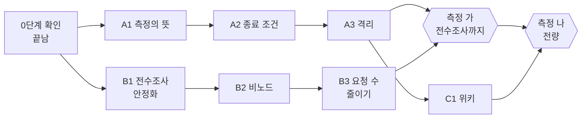

# 🧭 Mode 1 문제 해결 — 14개 항목을 계획으로 나눈 것

> 📅 2026-11-22 · 브랜치 `main` · **Before = `29c5ee9`**
> 📄 근거: `2026-11-21-mode1-audit-verification-report.md` · `docs/superpowers/plans/2026-11-22-mode1-session-cache-plan.ko.md`(사실 F1~F11, 0단계 결과 R1~R7) · `2026-11-21-mode1-cold-run-report.md` · 기준선 `qa/evals/runs/2026-11-21-mode1-report-builder-cold-layer-sonnet.{json,md}`
> 🔒 지킬 규칙: 먼저 고치고 그 뒤에 잰다 · 승인 없는 유료 실행 금지 · 검사를 느슨하게 하지 않는다 · 프롬프트는 `resource/` 에 둔다
> 🧪 검증 방법: 계획마다 여섯 게이트, 묶음 전체에 측정 둘 — 전수조사는 A 줄기와 B 줄기를 다 고친 뒤에 한 번 잰다
> ✋ 승인: 👍 분할 승인 2026-11-22 · 👍 순서 변경 2026-11-22(A · B 줄기를 다 고친 뒤 전수조사). 아래 계획은 저마다 코드를 고치기 전에 따로 승인받는다
> 🌐 영어 정본: `2026-11-22-mode1-remediation-split.md`

표지: `[실측]` 잰 값 · `[코드 확인]` 읽은 소스 · `[제안]` 이 문서의 제안, 정해지지 않음 · `[판단]` 평가 · `[미검증]` 확인하지 않음.

## 🔄 2026-11-23 갱신 — 먼저 읽는다

아래 절들은 2026-11-22 에 쓴 그대로 둔다. 어느 행이 이 절과 어긋나면 이 절이 맞다. 2026-11-23 에 A · B 줄기 계획서를 `docs/superpowers/plans/` 에서 추적되는 폴더 `public.handoff/` 로 옮겼고, B2 의 열린 결정 여덟 가지의 핸드오프(`public.handoff/2026-11-23-mode1-b2-decisions-handoff.md`)도 거기 있다. 아래 절들에 나오는 계획서 이름은 그 폴더에서 찾는다.

| 무엇 | 지금 | 전에는 |
|---|---|---|
| A2 계획(세션 제한 시간) | 👍 보류(사용자, 2026-11-23). 세션이 멈추는 일은 원인을 없애서 막는다 — B3 의 프롬프트 문구와 A3 의 허용 규칙. 실행기에 원래 있던 `--timeout` 인자는 그대로다 | 정해졌고 A3 앞에 있었다 |
| B 줄기의 순서 | 👍 B1 → B3 → B2(사용자, 2026-11-23: B3 먼저). B2 는 아직 승인 전이고 B3 위로 다시 맞춘다 | B1 → B2 → B3 |
| A3 의 바탕 | A1 + B1, 조각 2 는 그 위에 B3 — A2 없이 | A1 + A2 |
| 코드가 있는 곳 | 2026-11-23 에 `main` 으로 빨리 감기 병합했다(30커밋: A1 · B1 · B3 · A3). 같은 날 `origin` 에 push 했다. 본 체크아웃의 여섯 게이트: pytest 1055 통과 · 22 건너뜀 · 2 xfail, 나머지 다섯도 초록 | — |
| A2 를 대신하는 것 | 새로 계획한 것은 없다. `[제안]` 측정 가에서 세션 기록으로 둘을 센다 — 도구 제한 120초에 걸린 명령 수, 그리고 샤드가 통과한 뒤에도 세션이 살아 있던 초. 둘 중 하나라도 0 보다 크면 그때 A2 를 다시 꺼낸다. 그때까지 덮이지 않는 곳: 비노드 세션, 그리고 샤드 폴더 안으로 쓰는 입력 없는 `cat >` `[미검증]` | A2 의 제한 시간 |
| B2 계획 | 쓰인 그대로는 실행할 수 없다 `[판단]`: 바탕이 B3 와 A3 가 없는 B1 이고, A2 와 맞물린 부분이 사라졌고, 비노드 샤드가 얼마나 커도 되는지를 말하지 않는다. 기준선 샤드에서 잰 값: `file` 71개 29,003자 · `artifact` + `key` + `concept` 104개 37,437자 · `module` 15개 4,973자 `[실측]`. 대체 계획은 쓰지 않았다 | B1 다음 차례 |
| B3 계획서 | `public.handoff/2026-11-23-mode1-b3-fewer-requests-plan.md` — 구현과 함께 썼다. 열린 결정 D1~D4 는 사용자가 정한다 | 계획서 없음 |
| 비노드 세션 | 허용 규칙 아래에 두지 않고 `Write` 로 쓰라고도 하지 않는다: 기준선에서 그 샤드가 71,035자다 `[실측]`. `Write` 한 번에 실릴 것으로 보는 양을 넘는다 `[추정]`. B2 가 세션을 나누기 전까지 격리 인자만 받는다 | 다른 종류와 같이 규칙 아래 |
| "측정 가를 읽는 법" 의 B3 행 기준선 값 | 기준선 대화 기록에서 다시 셌다 `[실측]`(B3 계획서 "Counts"): 캐시 스크립트가 돈 것은 Bash 호출 605회 중 226회 · 첫 검문을 실제로 돌려 실패한 세션은 92개 중 8개 · 통과한 뒤에 다시 돈 검문 24회 · 입력 없는 `cat >` 를 낸 세션 7개, 그중 120초를 기다린 것 3개. 측정 가를 어느 값과 대조할지는 B3 의 열린 결정 D4 다 | 605회 중 281회 · 92개 중 45개 · 3개 |

사용자에게 열려 있는 것: 두 브랜치의 병합 · B3 계획서의 D1~D4 · A2 를 보류하고 B2 를 시작하지 않은 지금 측정 가를 언제 돌릴지 · B2 의 D2 — 비노드 레코드의 관계 칸에 무엇을 담는가(D1 은 아래에서 정했다) · 증분 실행의 배치 세션에 찾아볼 수단이 필요한지(지금은 `Read` 와 샤드 검문뿐이다).

### B2 다시 짜기 — 2026-11-23 에 정한 것

B2 계획서에 대한 바깥의 적대적 점검을 `main` 과 기준선 대화 기록에 대어 확인했다. 그 뒤 사용자가 항목마다 정했다.

| 무엇 | 👍 고른 것(사용자, 2026-11-23) | 👎 버린 것 |
|---|---|---|
| 비노드 층의 라운드 | 둘 — `file` 세션이 먼저, 그다음 `module` 과 이름난 종류 | 한 라운드에 세션 셋 |
| 이름난 종류(`artifact` · `key` · `concept`) | 종류마다 세션 하나 | 셋을 한 세션에 · 파일 묶음으로 나누기 |
| `file` 세션 | 크기 상한으로 쪼갠다. 상한 값은 아직 열려 있다 | 모든 파일을 한 세션에 |
| 프롬프트 | 허용된 호출 알림과 `Write` 문장에 맞춘다 | — |
| 병합 | 기계 값(`kind` · `module` · `where`)을 충돌 판정 전에 덮는다 | 병합한 뒤에 덮기 |
| 샤드 검문 | 빈 `where` 는 결함이다. `coverage` 의 수정 문구가 비노드 세션도 덮는다 | — |
| 키 겹침 | `module` 키가 심볼 이름과 같을 때의 동작을 시험으로 못박는다 | — |
| 측정 가 | "이름난 레코드의 근거 없음이 0 으로 남는가" 도 읽는다 | — |
| 폴더 규칙과 최상위 모듈의 빈 `files` | 하지 않는다 | `folder_name` 을 경로 규칙으로 바꾸기 · `files` 채우기 |
| `file` 레코드 47건의 "근거 없음" | 용어 검사기가 `file` 종류만 경로로 대조한다 — L1 과 L2 는 그대로 두고 L3 를 "`where` 의 경로가 키와 같거나 `/` + 키로 끝나는가" 로 본다(키 `y.py` 에 `xy.py` 처럼 글자만 같게 끝나는 경로는 통과하지 않는다). 프롬프트의 "이름이 그 줄에" 문장에서 `file` 을 뺀다. "검사기를 느슨하게 하지 않는다" 에 대해 승인된 예외는 이것 하나다 | `file` 의 L3 면제 · 옛 계획서의 작업 5(`build_terms` 가 지도 쪽 레코드를 낸다) |
| 비노드 세션과 허용 규칙 | 규칙 아래에 둔다 — 아래 유료 확인이 거절 0 으로 돌아온 뒤에 정했다. 둘째 라운드는 `Grep` 도구도 받는다 | 열린 세션으로 그대로 두기 |
| L1~L3 까지 도는 샤드 검문 | 더하지 않는다 — 유료 확인에서 인용 문제가 0건이었다 | 더하기 |
| 진행 방식 | 새 B2 계획서를 먼저 쓰고 이 표의 항목을 전부 작업으로 넣는다. 계획서를 승인받기 전에는 코드를 고치지 않는다 | 검사기를 바로 고치기 |

이 가운데 저장소에 들어간 것은 아직 없다. 기준선 자료에 `d02565f` 의 검사기와 `main` 의 검사기가 모두 "근거 없음" 59건, 그중 `file` 47건을 낸다 `[실측]`. 경로 대조를 저장소 밖에서 시험 삼아 돌리면 12건이 된다. 새 계획서는 `public.handoff/2026-11-23-mode1-b2-nonnode-rounds-plan.md` 다(승인 전, 2026-11-22 의 계획서를 대신한다). 사용자에게 아직 열려 있고 새 계획서에 열린 결정으로 적는 것: `artifact` 의 `where` 가 무엇을 뜻하는가(아래) · 크기 상한 값 · 키 겹침 시험이 못박을 동작 · 고친 `artifact` 문구로 유료 확인을 한 번 더 돌릴지.

**이름난 것 세션 하나의 유료 확인(2026-11-23, 승인받음, 호출 하나, 상한 $1.5).** 기준선 대상의 사본을 `file` 라운드가 끝난 상태로 맞췄다. `artifact` 만 맡기는 프롬프트에 허용된 호출 알림과 파일 요약 71줄을 실었다. 인자: `--permission-mode dontAsk`, 샤드 폴더 · 샤드 검문 · `Grep` 의 규칙, 그리고 `--tools "Bash,Read,Write,Grep"`.

| 읽은 것 | 값 `[실측]` |
|---|---|
| 벽시계 · 턴 · 비용 | 56.8초 · 12 · $0.25 |
| 거절 | 0 — `Grep` 3 · `Read` 6 · `Write` 1 · 샤드 검문 1 |
| 샤드 | 레코드 17개 · 4,848자 · 샤드 검문 통과 |
| 인용(L1~L3) | 문제 0건. `where` 17개 중 16개가 기준선과 같다 |
| 포괄 | 기준선 `artifact` 50개 중 17개, 새로 나온 것 없음 |

- `[실측]` 세션은 쓰는 줄에 이름이 없는 레코드를 뺐다. 프롬프트는 "그 파일을 쓰는 줄" 과 "그 줄에 이름" 을 함께 요구하는데, 둘은 쓰는 호출이 파일 이름을 적을 때만 같이 선다. 기준선 세션은 그런 레코드를 경로를 정의하는 줄로 가리켰다.
- `[판단]` 이름난 세션을 규칙 아래에 두는 것은 기계적으로 된다(표본 하나). 이 실행은 L1~L3 까지 도는 샤드 검문을 요구하지 않는다. 움직인 것은 포괄이고, 그것은 규칙이 아니라 `where` 문구를 따른다.
- `[미검증]` `Grep` 에 허용 규칙이 따로 필요한가(이 호출은 규칙을 실었다) · 실행 사이의 편차 · `key` 와 `concept` 세션.

## 한 장 요약

| | |
|---|---|
| 🎯 다루는 것 | 2026-11-21 실행 뒤에 나온 14개 항목을 어느 계획이 풀고, 어떤 순서로 가는가 |
| 🧩 한 줄 결론 | 고치는 파일로 갈라 세 줄기에 계획 일곱. **A 줄기(A1 · A2 · A3)와 B 줄기(B1 · B2 · B3)를 나란히 끝까지 고친 뒤에 전수조사를 한 번 잰다.** 기준선은 2026-11-21 실행이고, 고치기 전에는 다시 재지 않는다 |
| 🟰 그대로 | 14단계 흐름 · 레코드 계약 · 기준선 기록 |
| 🗘 바뀜 | 아직 없다 — 이 문서는 일의 순서만 정한다 |
| ⚠️ 함정 | (1) 세 계획이 같은 프롬프트 파일과 같은 모듈을 고친다. 줄기 안에서는 차례로 가야 한다. (2) 전수조사를 한 번만 재므로 어느 고침이 무엇을 줄였는지는 실행 하나로 가를 수 없다 — 세션 기록의 성분으로 가른다("측정 가를 읽는 법"). (3) 제한 시간에 걸린 세션은 샤드가 통과했어도 실패로 멈춘다 — 측정 중이면 그 실행을 버린다 |
| 🚫 범위 밖 | C++ 정규화기의 결정 둘과 박힌 네임스페이스 이름 · 안정 심볼 id · 호출자 없는 스크립트 넷 · `위치만` 갈래 |

## 정한 것 (사용자, 2026-11-22)

| 무엇 | 👍 고른 것 | 👎 버린 것 |
|---|---|---|
| 측정의 원칙 | 2026-11-21 의 51분 17초 실행이 기준선이다. 고치기 전에 전량이나 전수조사를 돌리지 않는다 | 새 기준을 얻으려고 다시 돌리기 |
| **전수조사를 재는 때** | **A 줄기(A1 · A2 · A3)와 B 줄기(B1 · B2 · B3)를 나란히 다 고친 뒤에 한 번** | A1 · A2 · A3 · B1 뒤에 재고 B2 · B3 를 그 뒤로 미루기 |
| 0단계 확인 | 돌린다(끝났다 — 세션 하나짜리 호출 넷, 정가 환산 $0.86) | — |
| `resource/codewiki/config.toml` 의 언어 판별 Model 변경 | 그대로 둔다. 다음 측정의 조건에 기준선과 다르다고 적는다 | 되돌리기 · 보류 |
| C++ 정규화기의 결정 둘 | 이 묶음에서 뺀다. 코드 지도 갈래에서 계획한다 | 나란히 가는 계획으로 넣기 |
| 14단계 기록을 얻는 법 | 격리 뒤 끊지 않고 한 번에. `--resume` 을 쓰지 않는 규칙은 그대로다. 또 한도에 걸리면 묻는다 | 둘로 나눈 기록 · `--resume` 예외 |
| 재측정 횟수 | 둘 — 측정 가(전수조사까지)와 측정 나(전량) | 계획마다 · 마지막에 한 번 |
| A2 — 멈춘 세션을 끊는 기준 | 세션 시작부터의 제한 시간, 단계별 값. 기준선의 가장 긴 정상 세션의 2배 — 배치 약 410초 · 비노드 약 1,280초 · 위키 본문 약 600초. 값은 `resource/codewiki/config.toml` 에 둔다 | 모든 단계에 한 값 1,800초 · 산출물이 통과한 뒤의 유예로 끊기 |
| A2 — 끊긴 세션의 샤드가 이미 통과했을 때 | 실패로 적고 멈춘다(지금 동작 그대로) | 성공으로 적고 잇기 |
| A3 — 격리 인자 | 인자 넷: `--tools "Bash,Read,Write" --strict-mcp-config --disable-slash-commands --setting-sources ""` | `--safe-mode` |
| A3 — 격리의 범위 | 전수조사와 언어 판별만. 위키 단계는 C1 에서 꼴을 정할 때까지 지금 그대로 | 위키도 지금 부분 격리 |
| A3 — 권한 방식 | 허용 목록으로 좁힌다. 어떤 조합이 헤드리스에서 도는지는 유료 확인으로 먼저 본다 — 2026-11-22 에 승인받아 돌렸다("A3 허용 목록 확인") | `bypassPermissions` 를 그대로 두고 측정 가에서 세기 |
| B2 — 비노드 용어를 누가 내는가 | 기계가 `file` · `module` 의 목록과 위치를 낸다. 글은 세션이 쓰되 종류 묶음(`file` 글 / `module` 글 / `artifact` · `key` · `concept`)으로 나눠 나란히 돌린다 | 기계가 틀만 내기 · 세션만 나누기 · 그대로 두고 규칙 충돌만 풀기 |
| B3 — 통독 캐시 | 기계가 미리 채운다 — 전수조사 전에 파일마다 개요의 기계 부분을 써 둔다. 세션은 `get` 만 하고 `put` 하지 않는다. 세션이 쓰던 한 줄 요약(`one_line`)은 빠진다 | 절차를 빼기 · 그대로 두기 |
| B3 — 세션의 단위 | 바꾸지 않는다(층 단위 · 배치 목표 8 · 동시 8). B3 는 요청 수만 다룬다 — 통독 캐시 · 첫 검문 불통과 · 입력 없는 `cat >` | 동시 실행 수 16 · 배치 목표 크기 바꾸기 |

## 계획

| 계획 | 다루는 항목 | 파일과 기존 시험 | 막는 결정 | 유료 검증 |
|---|---|---|---|---|
| **A1 측정의 뜻과 실패 사유** | 사유가 "success" 로 적힘 · 턴 · 비용 · 단계 벽시계의 뜻이 흐림 · 덜 적힌 사용량을 모르고 지나감 | `src/core/measure.py` · `src/core/pipeline.py`(`Pipeline.run`) · `run_mode1.py` 의 JSON · `qa/evals/README.md` — `test/core/test_measure.py` · `test/core/test_pipeline.py` | 없음 | 없음 |
| **A2 세션 종료 조건** | 세션에 종료 조건이 없음 — 일을 마친 세션 하나를 약 9분 30초 기다렸다 | `src/core/pipeline.py`(`run_agent_with` · `LlmStage.perform` 과 제한 시간 훅) · `src/core/measure.py`(`agent_verdict`) · `resource/codewiki/config.toml` · `run_mode1.py:203` — `test/core/test_pipeline.py` · `test/core/test_measure.py` · `test/codewiki/test_run_mode1.py` | 👍 정했다 — 단계별 제한 시간 · 끊긴 세션은 실패. 남은 것: 계획서의 미결 셋 — 표본이 하나뿐인 단계의 값 · 끊긴 언어 판별 세션 · 끊긴 뒤의 `--resume` | 없음(가짜 자식 프로세스) |
| **A3 세션 격리** | 시작 문맥 · 언어 판별 세션(낱말 하나에 76,732 토큰) · 세션이 작업 공간 밖을 건드림 · 첫 세션들을 띄우는 순서 | `claude_argv`(`measure.py:126`) · 단계가 필요한 도구를 적는 자리 · 프롬프트의 허용 호출 안내(`annotate-symbols.md` — B 줄기의 파일) — `test_measure.py` · `test/spec/test_run_mode2.py` | 👍 정했다 — 인자 넷 · 전수조사와 언어 판별만 · 허용 목록. 허용 목록의 조합은 확인했고 계획서에 `[제안]` 으로 적는다 | 허용 목록 확인 — 끝남(호출 셋 · $0.66) · 측정 가 |
| **B1 전수조사 안정화** | 프롬프트 다섯 줄의 해석기 경로 · 잠복 결함 셋 | `resource/codewiki/prompts/annotate-symbols.md` · `mode1/survey.py`(`merge_shards` · `refresh_merged` · 프롬프트에 넘기는 값) · `machine/terms_db.py:35` · `machine/jsonio.py` — `test_run_mode1.py` · `test_mode1.py` · `test_terms_db.py` · `test_jsonio.py` | 없음 | 없음 |
| **B2 비노드 용어** | 비노드 세션이 혼자 돎(638초) · 관계 칸 190개가 전부 빔(`file` 규칙 충돌) · `module` 15개의 위치가 빔 | `machine/survey_plan.py`(기계 목록) · `annotate-symbols.md` 의 `nonnode` 절 · `mode1/survey.py` · `mode1/survey_files.py` · `mode1/context.py` · `mode1/graph.py` · `runner/check_shard.py` · `resource/codewiki/faults.toml` · `machine/terms_db.py` 의 `build_terms`(계획서의 열린 결정 D1 이 선택지 B 일 때만) — `test_survey_plan.py` · `test_mode1.py` · `test_run_mode1.py` · `test_terms_db.py` · `test_graph_adversarial.py` | 👍 정했다 — 기계가 틀을 내고 세션을 종류 묶음으로 나눈다. 남은 것: 계획서의 열린 결정 둘 — D1 `file` 의 "근거 없음" 47건을 없애는 법 · D2 관계 칸에 무엇을 담는가 | 측정 가. 그 전의 세션 하나짜리 확인은 승인받고 |
| **B3 요청 수 줄이기** | 통독 캐시 왕복 · 첫 검문 불통과 45개 세션 · 입력 없는 `cat >` 명령 | `annotate-symbols.md:63-72` · `machine/file_cache.py` · `machine/survey_plan.py` — `test_file_cache.py` · `test_survey_plan.py` | 👍 정했다 — 기계가 미리 채운다 · 세션의 단위는 바꾸지 않는다 | 측정 가. 켠 것과 끈 것의 대조 실행은 하지 않는다 |
| **C1 위키 단계** | 층별 작성이 돌지 않음 · 실제 계획 꼴(id 와 이름이 다르다)을 넣는 시험이 없음 · 위키가 검사를 통과 못 함 · 스킬을 건너뛴 2장 · 스킬의 "사용자에게 묻기" · 프롬프트의 서브에이전트 문장 | `mode1/wiki.py:95-125` · `write-wiki.md` · `outline-wiki.md` · `machine/verify_citations.py` — `test_run_mode1.py:402-429` · `test_mode1.py` · `qa/gates/test_wiki.py` | 층을 살릴지 · 한 묶음을 정식으로 할지 · 굵게 묶을지(약 32분 대 9분 42초) · deep-wiki 의존을 어떻게 둘지 | 측정 나 |

| 측정 | 언제 | 무엇을 | 조건 |
|---|---|---|---|
| **가** | **A1 · A2 · A3 · B1 · B2 · B3 뒤** | 전수조사와 용어 검사까지(`--only` 로 앞의 아홉 단계). 기준선의 `annotate-symbols` 와 대조 | 새 복제본 · 도구 작업 트리에 `.venv` · 다른 세션 없이 · 언어 판별 Model 이 다름과 CLI 판을 적는다 |
| **나** | 측정 가와 C1 뒤 | 전량 `--cold` 한 번. 14단계 기록 | 사용 한도 창이 새로 열렸을 때, 다른 세션 없이. CLI 판을 적는다. 한도에 걸리면 단계와 사유만 적고 사용자에게 묻는다 |

## 순서

- **A 줄기와 B 줄기가 나란히 간다.** 줄기 안에서는 차례로 간다 — A 는 같은 두 파일, B 는 같은 프롬프트와 같은 모듈이다. 두 줄기가 파일로 완전히 갈리지는 않는다 — A2 와 B2 가 `mode1/survey.py` · `mode1/survey_files.py` · `test_mode1.py` 를 서로 다른 자리에서 고친다("숨은 결합").
- **측정 가는 두 줄기가 다 끝난 뒤에 한 번이다.** 그 전에는 전수조사를 돌리지 않는다.
- 먼저 손대는 것은 A1 과 B1 이다. 둘 다 결정도 유료 검증도 필요 없다. A2 · A3 · B2 · B3 의 막는 결정은 2026-11-22 에 받았다("정한 것"). A3 의 허용 목록 유료 확인도 같은 날 끝났다("A3 허용 목록 확인").
- C1 은 A3 뒤다. 위키 세션은 스킬을 부르므로 격리의 꼴이 먼저 정해져야 한다. 측정 가가 도는 앞의 아홉 단계는 위키 코드를 타지 않으므로 C1 의 때는 측정 가와 무관하다.
- 측정 나는 측정 가와 C1 뒤다.
- 계획마다 여섯 게이트(pytest · npm test · 타입 검사 둘 · README 표류 · doctor)로 닫는다.

## 이 순서가 바꾸는 것

| 무엇 | 전 | 지금 |
|---|---|---|
| B2 · B3 의 유료 확인 | B2 는 비노드 샤드만 지우고 다시, B3 는 캐시를 켠 것과 끈 것 | 대조는 측정 가 하나다. B3 의 켠 것 · 끈 것 대조는 전수조사를 두 번 돌려야 하므로 하지 않는다. B2 의 세션 하나짜리 확인은 기준선 측정이 아니고, 승인받고 돌린다 |
| 통독 캐시의 결정 | 켠 것과 끈 것을 재서 정한다 | 재지 않고 정했다 — 👍 기계가 미리 채운다. 근거는 기준선의 세션 기록(배치 세션의 Bash 호출 605건 중 281건 `[실측]`)이다. 통독 캐시가 줄인 통독의 양은 재지 못한 채로 남는다 |
| 세션의 단위(배치 목표 크기) | 격리한 뒤의 전수조사 수치를 보고 정한다 | 👍 바꾸지 않는다. 격리한 전수조사 수치가 B3 전에는 없고, 세션 캐시 계획의 계산으로는 단위를 바꿔 얻는 것이 작다(층 장벽 없이 20.1분 → 19.3분 · 이어 쓰기 2%) |
| 어느 고침이 무엇을 줄였나 | 측정 가가 A 줄기와 B1 을, 측정 나가 나머지를 | 실행 하나에 여섯 계획이 섞인다. 아래 표의 성분으로 가른다 |

### 측정 가를 읽는 법

| 계획 | 세션 기록과 측정 JSON 에서 보는 값 | 기준선 `[실측]` |
|---|---|---|
| A1 | "사용량 덜 적힘" 줄 · `stage_wall_seconds` | `L1-B14`: 기록 114,205 대 세션 1,373,430 토큰 |
| A2 | 샤드가 통과한 뒤 세션이 끝나기까지의 시간 | `L1-B14` 약 9분 30초 |
| A3 | 배치 세션의 첫 요청 토큰 · 거절된 호출 수(CLI 결과의 `permission_denials`) · 열어 준 폴더 밖에 닿은 호출 | 중앙 82,924 · 기준선은 `bypassPermissions` 라 거절이 없다 · 밖에 닿은 호출은 기준선에서 세지 않았다 |
| B1 | 없는 해석기를 부르고 우회한 세션 수 | 92개 중 80개 |
| B2 | 비노드 구간의 벽시계(`NONNODE-*` 세 행 가운데 가장 긴 것) · 관계 칸이 찬 레코드 수 — B2 계획서의 열린 결정 D2 가 권고대로 정해지면 이 칸은 규칙으로 비우는 것이라 0 을 결함으로 읽지 않는다 · `file` 레코드의 "근거 없음" | 638초 · 190개 중 0 · 47건 |
| B3 | 캐시 스크립트 호출의 몫 · 세션당 응답 수 · 첫 검문이 불통과인 세션 수 · 입력 없는 `cat >` 이 도구 제한에 걸린 세션 | 605건 중 281건 · 중앙 8 · 92개 중 45개 · 3개 |

성분으로 가르는 것은 실행을 따로 돌려 견주는 것보다 약하다 — 고침끼리 서로 영향을 준다(해석기 우회가 없어지면 요청 수도 준다).

## 정한 것이 서로 만나는 자리

| 만나는 것 | 뜻 | 다루는 곳 |
|---|---|---|
| A2 의 두 결정 | 제한 시간에 걸린 세션은 샤드가 통과했어도 실패이고 흐름이 멈춘다. 기준선의 `L1-B14`(774초)는 배치 제한 약 410초를 넘는다 — 기준선을 이 규칙으로 돌렸다면 층1 에서 멈췄다 `[추정]`. 측정 중에 멈추면 단계와 사유만 적고 그 실행을 버린다 | 멈춤의 방아쇠인 입력 없는 `cat >` 을 B3 가 프롬프트에서 다룬다. 측정 가는 그 뒤에 돈다 |
| A2 의 값과 표본 | 2배 규칙을 표본이 하나뿐인 단계에 그대로 대면 언어 판별 약 34초(16.8초의 2배) · 위키 목차 약 120초(59.8초의 2배)다. 비노드는 B2 가 세션을 나누므로 나눈 세션의 기준선이 없다 | A2 계획서가 표본 하나짜리 단계의 값을 따로 적는다 `[제안]`. 값은 설정 파일에 있어 측정 가 뒤에 코드 없이 고친다 |
| A3 의 허용 목록과 B 줄기의 프롬프트 | 허용할 명령은 프롬프트가 시키는 명령(샤드 검문 · 캐시 `get`)에서 나온다. B1 이 그 명령의 해석기를, B3 가 캐시 절차를 바꾼다. 그리고 세션은 무엇이 허용되는지 프롬프트가 말해 줘야 그 명령을 쓴다 — 말해 주지 않은 호출에서는 거절 하나에 Bash 를 통째로 버렸다 `[실측]` | A3 의 목록은 B1 이 넘기는 해석기 값으로 만들고, B3 가 절차를 바꾸면 목록과 안내를 같이 맞춘다. 허용 호출 안내는 `annotate-symbols.md` 에 들어가므로 A3 의 그 작업은 B1 뒤에 온다 `[제안]`. 두 줄기가 만나는 둘째 자리다 |
| B3 의 미리 채움과 B1 | B1 이 고치는 프롬프트 다섯 줄 가운데 둘(64 · 67줄)이 캐시 `get` · `put` 명령이다. B3 는 `put` 줄을 없앤다 | 같은 줄기라 차례로 간다 — B1 이 먼저다 |
| B2 가 나눈 세션과 A2 | 비노드 세션이 종류 묶음 셋이 되면 제한 값을 댈 표본이 없다. A2 는 층의 종류와 "라벨이 배치 id 가 아니다" 로 비노드 값을 고르므로 세 세션은 코드 변경 없이 그 값을 받는다 `[코드 확인]`(두 계획서) | 나눈 세션에는 비노드의 값(약 1,280초)을 그대로 쓰고 측정 가 뒤에 맞춘다 `[제안]`. A2 의 시험과 용어 표는 라벨을 `NONNODE` 로 적는다 — A2 와 B2 가운데 나중에 들어가는 쪽이 B2 가 만드는 라벨(`NONNODE-FILE` · `NONNODE-NAMED`)로 고친다 |

## A3 허용 목록 확인 — 2026-11-22

0단계와 같은 대상의 임시 복사본에서 배치 `L2-B00` 을 다시 돌렸다. 승인받은 것은 호출 넷 · 상한 $2.0, 쓴 것은 호출 셋 · 정가 환산 $0.66 이다. 인자 · 안내 글 · 값의 표는 `docs/superpowers/plans/2026-11-22-mode1-session-cache-plan.ko.md` 의 "0단계 결과" 절 확인 3 에 있다.

| 호출 | 조합 | 거절 | 세션이 돌린 검문 | 밖에서 돌린 검문 | 요청 · 벽시계 · 환산 |
|---|---|---|---|---|---|
| 1a (0단계) | 인자 넷 + `bypassPermissions` | 0 | 통과 | 통과 | 4 · 39.7초 · $0.16 |
| 3a | 인자 넷 + `dontAsk` + 허용 규칙 셋, 프롬프트 그대로 | 1 | 돌리지 않음 | 통과 | 5 · 51.7초 · $0.20 |
| 3b | 3a + 프롬프트에 허용 호출 안내 | 0 | 통과 | 통과 | 5 · 67.5초 · $0.27 |
| 3c | 3b 와 같음 | 0 | 통과 | 통과 | 4 · 45.1초 · $0.18 |

- `[실측]` **허용 목록은 헤드리스에서 돈다.** 규칙 셋 — 샤드 폴더에 쓰기 `Edit(/out/codegraph-raw/_shards/**)`, 샤드 검문 명령, 캐시 `get` 명령 — 으로 세 호출이 모두 배치를 끝냈고 샤드는 검문을 통과했다. 연 폴더 안의 읽기는 규칙 없이 돌았다.
- `[실측]` **허용된 호출을 프롬프트가 말해 줘야 한다.** 3a 의 세션은 첫 Bash 호출(변수와 `for` 로 이은 한 줄)이 거절되자 Bash 를 다시 쓰지 않았고, 검문도 캐시 `get` 도 돌리지 않은 채 끝냈다. 안내 여덟 줄을 넣은 3b · 3c 는 거절이 없고 세션이 검문을 돌렸다.
- `[실측]` **샤드를 셸로 쓰지 않는다.** 세 호출 모두 `Write` 로 썼다. 기준선과 1a 에 있던 `cat > /tmp/...` 과 1a 가 샤드를 쓴 `python3 - <<` 꼴은 규칙에 없고, 세 호출에서 시도된 적이 없다.
- `[실측]` **캐시 `get` 을 거의 부르지 않았다.** 1a 는 파일 여섯, 3b 는 하나, 3c 는 없다. 세션은 프롬프트에 적힌 시작 줄로 줄 범위를 바로 읽었다.
- `[실측]` CLI 결과에 `permission_denials` 가 있다. 실행기가 세션별 거절 수를 그대로 적을 수 있다.
- `[미검증]` 허용 목록이 시간과 비용을 늘리는가(표본 둘이고 3b 는 샤드를 두 번 썼다) · 검문이 불통과일 때 고쳐 쓰는 고리 · 비노드 세션과 큰 배치 · 연 폴더 밖의 읽기. 공식 문서는 읽기 전용 셸 명령이 규칙 없이 돈다고 적고, 명령 글자에 기대지 않는 파일 시스템 경계는 샌드박스의 몫이라고 적는다.

**A3 계획서에 적을 조합 `[제안]`:** 인자 넷 + `--permission-mode dontAsk` + 위 규칙 셋(해석기와 도구 경로는 실행기가 채운다) + 프롬프트의 허용 호출 안내. 인자와 안내는 같은 변경으로 들어간다 — 안내 없이 인자만 바뀌면 세션이 검문을 돌리지 않는다.

**이 확인이 다른 계획에 남기는 것 `[제안]`:**

- B3 — 멈춤의 방아쇠였던 입력 없는 `cat >` 은 허용 규칙에 없다. B3 가 프롬프트에서 그것을 따로 다룰지는 B3 계획서에서 정한다.
- B3 — 세션이 캐시 `get` 을 거의 부르지 않았다. 기계가 미리 채우는 캐시(👍 정한 것)를 세션이 어떻게 받는지는 이 관찰을 놓고 B3 계획서가 적는다.
- A1 — `permission_denials` 를 세션 행에 적을지는 A3 계획서가 A1 의 형 위에서 정한다.

## 비노드 용어 다섯 종류 — B2 의 결정이 갈리는 자리

비노드 세션은 전수조사의 마지막 세션 하나다. 코드 지도의 노드가 아닌 용어 다섯 종류 190개를 혼자 쓴다(638초 · 검문 10번 `[실측]`).

| 종류 | 수 `[실측]` | 무엇 | 기계가 낼 수 있는가 |
|---|---|---|---|
| `file` | 71 | 소스 파일 하나 | **목록과 위치는 된다** `[실측]` — 지도에 노드가 있는 파일 71개와 정확히 같고, 위치는 71개 전부 `경로:1` 이다. 글은 프롬프트가 "그 파일 안 심볼들의 완성된 means/does 를 재료로 쓴다. 다시 통독하지 않는다" 고 지시한다 `[코드 확인]` |
| `module` | 15 | 디렉토리 하나 | **목록은 된다** `[실측]` — 노드가 있는 폴더 12개와 지도의 모듈 6개를 합친 것과 정확히 같다. 위치는 15개 전부 비어 있다(프롬프트가 "없어도 된다" 고 한다). 설명 글은 세션이 썼다 |
| `artifact` | 50 | 이 저장소가 만들어 내는 파일 | 일부 `[판단]` — 이름의 후보는 단계가 선언한 산출물에서 나온다. "그 파일을 쓰는 줄" 을 찾는 일과 설명은 세션이 했다. 후보와 몇 개가 겹치는지는 `[미검증]` |
| `key` | 26 | 설정 · JSON 의 이름난 칸 | 일부 `[판단]` — 후보는 형 정의와 설정 파일에서 뽑을 수 있다. 어느 것을 실을지는 세션이 골랐다 `[미검증]` |
| `concept` | 28 | 코드에 글자로 있는 낱말 | 아니다 `[판단]` — 무엇이 개념인지 고르는 것 자체가 판단이다 |

- 심볼 레코드의 `module` 값은 서로 다른 것이 39개이고, `module` 레코드 15개 가운데 13개만 그 안에 있다 `[실측]`. 그래서 목록의 출처는 심볼 레코드가 아니라 코드 지도다.
- `file` 레코드의 "근거 없음" 47건은 위치 `경로:1` 과 "이름이 그 줄에 글자 그대로" 가 부딪혀서 난다(점검 검증 보고서 2.4 나). 검사를 느슨하게 해서 풀지 않는다.
- 종류마다의 갈래는 정해졌다("정한 것") — 기계가 `file` 과 `module` 의 목록과 위치를 내고 세션을 종류 묶음으로 나눈다. B2 계획서가 그대로 옮겼고 결정 둘을 열어 둔다 — D1 47건을 없애는 법, D2 관계 칸에 무엇을 담는가.

## 숨은 결합

- Mode 2 도 같은 길로 세션을 띄운다. Mode 2 의 `AgentStage`(`src/spec/python/runner/run_mode2.py:386`)는 `LlmStage` 라 `run_agent_with` 와 `claude_argv` 를 탄다. 함수 `run_agent`(`:237`)도 `claude_argv` 를 부르지만 호출하는 곳이 없다 `[코드 확인]`. A2 와 A3 는 Mode 2 의 시험을 돌린다.
- `run_agent_with` 는 파일 전략도 쓴다(`mode1/survey_files.py:64`). A2 는 그 길을 같이 본다.
- `Pipeline` 은 세 실행기가 모두 만든다(`run_mode1.py:262` · `run_mode1_5.py:837` · `run_mode2.py:513`). A1 은 거기에 더하기만 한다.
- `annotate-symbols.md` 와 `survey.py` 는 B1 · B2 · B3 가 모두 고친다 — 그래서 한 줄기다.
- `terms_db.py` 는 B1(종류 어휘)과 B2(`build_terms` — B2 계획서의 열린 결정 D1 이 선택지 B 일 때만)가 닿는다. 어느 쪽도 `check_terms` 는 고치지 않는다.
- B2 는 검사기를 느슨하게 해서 풀지 않는다. 충돌은 프롬프트나 레코드를 내는 쪽에서 푼다.
- **두 줄기가 만날 수 있는 자리가 셋 있다.** (1) A3 가 "단계가 필요한 도구" 를 단계 클래스에 적게 되면 `mode1/survey.py` 에서 B 줄기와 같은 파일을 고친다. A3 계획서가 그 자리를 정할 때 B 줄기와의 순서를 같이 적는다. (2) "정한 것이 서로 만나는 자리" 의 허용 목록. (3) A2 의 제한 시간 훅과 B2 의 세션 나누기가 `mode1/survey.py` · `mode1/survey_files.py` · `test_mode1.py` 를 서로 다른 자리에서 고친다 — 나중에 들어가는 쪽이 앞의 것 위에 다시 얹는다.
- 실행기는 프롬프트를 표준 입력으로 CLI 에 넘길 뿐이다(`src/core/pipeline.py:438`). 세션이 내는 셸 명령의 입력은 실행기가 바꿀 수 없다 — 입력 없는 `cat >` 은 프롬프트(B3)와 종료 조건(A2)으로만 다룬다.

## 14개 항목의 자리

| 항목 | 계획 |
|---|---|
| 세션에 종료 조건 없음 | A2 |
| 전량 실행이 사용 한도를 넘김 · 14단계 기록 없음 | A3(토큰) + 측정 나 |
| 위키 층별 작성 | C1 |
| 비노드 세션이 혼자 돎 | B2 |
| 비노드 관계 칸이 빔 | B2 |
| 위키가 검사를 통과 못 함 | C1 |
| 해석기 경로 | B1 |
| 통독 캐시 왕복 | B3 |
| 실패 사유 "success" | A1 |
| 측정값의 뜻 | A1 |
| 작업 공간 밖 | A3(권한 방식) · B1(우회의 원인) · B3(`cat >` 이 남긴 빈 파일) |
| 잠복 결함 셋 | B1 |
| 골든 저장소 결정 둘 | 이 묶음 밖 — 코드 지도 갈래 |
| 측정 조건이 달라짐 | 정했다 — 그대로 두고 측정 가 · 나에 적는다 |

## 두 보고서와 다시 대조 — 2026-11-22

점검 검증 보고서(아래 "검증")와 전량 실행 보고(아래 "실행")의 항목을 하나씩 계획에 대 봤다. 위 14개에 이미 있는 것은 적지 않고, **자리가 없었거나 모자랐던 것만** 적는다.

| 보고서의 항목 | 자리 | 상태 |
|---|---|---|
| 세션이 열어 준 폴더 밖에 닿았다(실행 4.1 · 4.2) | A3 | 🗘 A3 에 있었지만 인자 넷은 경계를 만들지 않는다 — 세션은 `bypassPermissions` 로 뜨고 `Bash` 를 쓴다 `[코드 확인]`. 👍 허용 목록으로 좁히기로 정했다. 유료 확인에서 `dontAsk` + 허용 규칙 셋 + 프롬프트의 안내로 배치가 끝났고 거절이 0 이었다 `[실측]`(표본 둘 — "A3 허용 목록 확인"). 연 폴더 밖의 읽기는 `[미검증]` |
| 언어 판별 세션이 낱말 하나에 76,732 토큰(검증 2.1) | A3 | 🗘 계획 표에 이름으로 넣었다. 이 세션은 응답 한 번에 도구를 하나도 부르지 않았다 `[실측]` |
| 비노드 용어의 종류별 갈래 | B2 | 🗘 위 "비노드 용어 다섯 종류" 로 넣었다 |
| `module` 레코드 15개의 위치가 빈 글(실행 4.4) | B2 | 🗘 같은 표에 넣었다 |
| 배치 목표 크기 — 격리 뒤에 본다(검증 6절) · 층 9개 가운데 7개가 세션 1~2개(실행 2.2) | B3 | 🗘 "세션의 단위" 에 이름으로 넣었다. 층 장벽 자체는 병목이 아니다(세션 캐시 계획 F10) |
| 위키 층의 셋째 갈래 "굵게 묶기"(검증 6절) · 실제 계획 꼴을 넣는 시험이 없음(검증 2.3) | C1 | 🗘 막는 결정과 다루는 항목에 넣었다 |
| 프롬프트의 서브에이전트 문장(`write-wiki.md:37`), 호출은 0건(검증 4절 11) | C1 | 🗘 넣었다. 격리가 `Agent` 도구를 빼면 이 문장과 어긋난다 |
| 측정은 CLI 2.1.306, 도움말과 0단계 확인은 2.1.330(검증 2.1) | 측정 가 · 나 | 🗘 조건에 "CLI 판을 적는다" 를 넣었다 |
| 같은 계정의 다른 세션이 한도를 함께 썼다(실행 3) | 측정 가 | 🗘 측정 가에도 "다른 세션 없이" 를 넣었다 |
| 세션 92개 중 45개가 첫 검문 불통과로 고쳐 썼다(실행 4.5) | B3 | 🗘 자리가 없었다. 👍 B3 의 범위로 정했다. 불통과의 사유를 센 적이 없어, B3 계획서를 쓰기 전에 기준선의 세션 기록에서 센다 — 유료 실행이 아니다 |
| 입력 없는 `cat >` 명령 — 세션 셋이 도구 제한 120초에 걸렸다(실행 4.1). 격리한 0단계 확인에서도 다시 나왔다(R6) | A2 + B3 | 🗘 끝난 뒤의 기다림은 A2 에 있었다. 명령 자체는 자리가 없었다. 👍 B3 의 범위로 정했다 — 샤드를 쓰는 법을 프롬프트가 적는다 |
| 한도 실패 때 CLI 가 담은 값을 모른다 — 실행기가 CLI 의 원문을 남기지 않는다(검증 7절) | `[제안]` A1 | ❓ A1 은 `result` 의 글을 사유에 붙이지만 원문은 남기지 않는다. 그 글이 실제로 실리는지는 `[미검증]` 이다. 실패한 세션의 CLI 결과를 남길지는 A1 을 승인할 때 정한다 |
| "전부 HIGH 는 아닌가" 문구(`annotate-symbols.md:88` · `:110`) — 구색을 맞춘 정황(검증 3절) | `[제안]` 고치지 않음 | ❓ 자리가 없었다. 근거가 정황뿐이라 이 묶음에서 문구를 고치지 않는다. 측정 가의 샤드에서 같은 분포(전부 HIGH 인 샤드 16개 · HIGH 아닌 레코드가 하나뿐인 샤드 31개)를 다시 센다 |
| 호출자가 없는 스크립트 넷 · 861줄(검증 5 · 6절) | 묶음 밖 | 🚫 실행 중 결함이 아니다. 둘지 지울지는 따로 정한다 |
| `위치만` 갈래가 `재읽기` 와 결과가 같다(검증 4절 8 · 6절) | 묶음 밖 | 🚫 따로 정한다 |
| 정규화기와 역참조 스크립트에 골든 저장소의 네임스페이스 이름이 상수로 박혀 있다(검증 5절 · `normalize.py:138`) | 묶음 밖 | 🚫 코드 지도 갈래 — C++ 정규화기의 결정 둘과 같은 줄기 |
| 꼴 정의와 호출의 겹침 — `CodeGraph` 꼴 7곳 · 용어 레코드 꼴 4곳 · `git ls-files` 7곳(검증 5절) | 묶음 밖 | 🚫 수치는 맞다. 고칠 대상으로 올린 적이 없다 |
| "막히면 적고 끝낸다" 를 세션이 따르지 않았다(검증 2.4 가) | — | 👁 관찰. B1 이 막히는 원인을 없앤다. 지시 자체는 고치지 않는다 |
| 위키 장 하나를 한 번의 응답으로 쓰는 130~157초(실행 2.4) | — | 👁 관찰. 고칠 대상으로 올리지 않는다 |
| 세션이 보조 스크립트 90개를 임시 폴더에 썼다(실행 6.2) | — | 👁 관찰. B3 가 요청 수를 볼 때 같이 본다 |
| 해석기 우회가 부풀린 시간과 토큰(검증 7절) | — | 👁 재지 못한 채 남는다 — 우회가 없는 실행은 측정 가인데 다른 고침과 섞인다 |

표식: 🗘 이번에 계획에 넣음 · ❓ 자리를 제안함, 정해지지 않음 · 🚫 이 묶음 밖 · 👁 관찰.

## 새로 만들지 않고 다시 쓰는 것

| 무엇 | 자리 | 쓰는 계획 |
|---|---|---|
| 원자적 JSON 쓰기 `write_json_atomic` | `src/codewiki/python/machine/jsonio.py:7` | B1 |
| 실행기 자신의 해석기 `sys.executable` — 기계 단계를 띄울 때 이미 이렇게 한다 | `mode1/graph.py:59` 등 | B1 |
| 제한 시간의 기존 길: `subprocess.run(timeout=)` 과 그 예외를 실패 행으로 바꾸는 자리. A2 는 이것을 다시 쓰지 않고 바꾼다 — 직접 띄운 자식만 끝내고 0.0초짜리 행을 적는다 `[실측]`(A2 계획서) | `src/core/pipeline.py:438-439` · `:472-474` | A2 |
| 이미 있는 샤드는 건너뛴다 | `mode1/survey.py:624` | B2 의 세션 하나짜리 확인 |
| `--only` · `--skip` 과 옛 단계 이름 | `run_mode1.py:199-200` · `mode1/edges.py` 의 `ALIASES` | 측정 가 |
| CLI 의 `result` 글은 이미 형에 있고, `modelUsage` 는 CLI 출력에 있다 | `src/core/measure.py:33` · 0단계 결과 R7 | A1 |

## 계획서를 쓰는 법

- 계획마다 파일 둘: 영어 `<이름>.md` 와 한국어 `<이름>.ko.md`. 앞머리는 시각 계획(visual plan) 꼴, 작업은 시험 먼저 단계로.
- 막는 결정이 있는 계획(A2 · A3 · B2 · B3 · C1)은 계획서를 쓰기 전에 사용자에게 묻는다. 답이 없으면 무엇이 막히는지를 같이 적는다. A2 · A3 · B2 · B3 의 결정은 받았다("정한 것"). A3 의 허용 목록 유료 확인도 끝났다("A3 허용 목록 확인"). C1 의 결정은 C1 계획서를 쓰기 전에 묻는다.
- 구현은 계획서 승인 뒤, 작업 단위로 서브에이전트가 한다.
- 커밋은 사용자가 말할 때만. 제목을 먼저 보인다.
