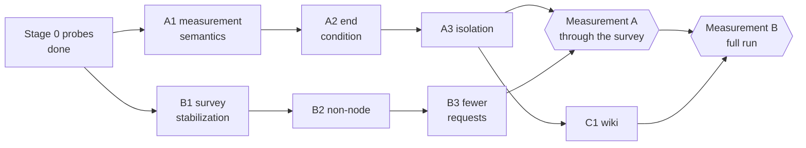

# 🧭 Mode 1 remediation — how the 14 items split into plans

> 📅 2026-11-22 · branch `main` · **Before = `29c5ee9`**
> 📄 Evidence: `2026-11-21-mode1-audit-verification-report.md` · `docs/superpowers/plans/2026-11-22-mode1-session-cache-plan.md` (facts F1–F11, Stage 0 results R1–R7) · `2026-11-21-mode1-cold-run-report.md` · baseline `qa/evals/runs/2026-11-21-mode1-report-builder-cold-layer-sonnet.{json,md}`
> 🔒 Rules kept: fix first, measure after · no paid run without approval · checks are never loosened · prompts stay in `resource/`
> 🧪 Verification: six gates per plan, two measurements for the whole batch — the survey is measured once, after both track A and track B are fixed
> ✋ Approval: 👍 split approved 2026-11-22 · 👍 order changed 2026-11-22 (survey after tracks A and B are fixed). Each plan below still needs its own approval before code changes
> 🌐 Korean translation: `2026-11-22-mode1-remediation-split.ko.md`

Labels: `[measured]` a counted value · `[code read]` source that was read · `[proposed]` proposed here, not decided · `[judgment]` an assessment · `[unverified]` not checked.

## 🔄 Update 2026-11-23 — read this first

The sections below were written on 2026-11-22 and are kept as written. Where a row disagrees with this section, this section holds. On 2026-11-23 the A and B plan documents moved from `docs/superpowers/plans/` to the tracked folder `public.handoff/`, together with a handoff for the eight open B2 decisions (`public.handoff/2026-11-23-mode1-b2-decisions-handoff.md`); plan names in the sections below are found there. This document moved there on 2026-11-24. The two reports of 2026-11-21 and the session-cache plan named under Evidence stay outside git, in `docs/superpowers/specs/` and `docs/superpowers/plans/` on the machine where they were written, and do not open elsewhere.

| What | Now | Was |
|---|---|---|
| Plan A2 (session time limits) | 👍 Shelved (user, 2026-11-23). A hang is controlled by removing its cause — B3's prompt wording and A3's allow rules. The runner's existing `--timeout` argument is untouched | Decided, in front of A3 |
| Order of track B | 👍 B1 → B3 → B2 (user, 2026-11-23: B3 first). B2 is not approved yet and is rebased onto B3 | B1 → B2 → B3 |
| Base of A3 | A1 + B1, and B3 for slice 2 — without A2 | A1 + A2 |
| Where the code is | Merged into `main` on 2026-11-23 by fast-forward (30 commits: A1 · B1 · B3 · A3) and pushed to `origin` the same day. Six gates in the main checkout: pytest 1055 passed · 22 skipped · 2 xfailed, the other five green | — |
| What stands in for A2 | Nothing new is planned. `[proposed]` Measurement A counts two things from the session transcripts — commands that hit the 120 s tool limit, and seconds a session stayed alive after its shard had passed. A2 is taken up again only if either is above zero. Not covered until then: the non-node session, and an input-less `cat >` into the shard folder itself `[unverified]` | A2's time limits |
| B2 plan | Cannot be carried out as written `[judgment]`: its Before is B1 without B3 and A3, its coupling to A2 is void, and it does not say how large a non-node shard may be. Measured on the baseline shard: `file` 71 records 29,003 characters · `artifact` + `key` + `concept` 104 records 37,437 · `module` 15 records 4,973 `[measured]`. No replacement plan is written | Next after B1 |
| B3 plan document | `public.handoff/2026-11-23-mode1-b3-fewer-requests-plan.md` — written together with the implementation; its open decisions D1–D4 are the user's | no plan |
| Non-node session | Not under the allow rules and not told to write with `Write`: its shard is 71,035 characters at the baseline `[measured]`, more than one `Write` call is expected to carry `[estimate]`. It keeps the isolation arguments only, until B2 has split it | Under the rules like the other kinds |
| Baseline values of B3's row in "How to read Measurement A" | Recounted from the baseline transcripts `[measured]` (B3 plan, "Counts"): the cache script ran in 226 of 605 Bash calls · 8 of 92 sessions failed their first real check · 24 checks ran after a pass · 7 sessions issued the input-less `cat >`, 3 of them waited 120 s. Which values Measurement A is read against is B3's open decision D4 | 281 of 605 · 45 of 92 · 3 |

Open with the user: merging the two branches · B3 plan D1–D4 · when Measurement A runs now that A2 is shelved and B2 has not started · B2's D2 — what the relation field holds on a non-node record (D1 is decided below) · whether batch sessions on an incremental run need a way to search (they have `Read` and the shard check only).

### B2 redesign — decided 2026-11-23

An outside adversarial review of the B2 plan was checked against `main` and the baseline transcripts. The user then decided item by item.

| What | 👍 Chosen (user, 2026-11-23) | 👎 Dropped |
|---|---|---|
| Rounds of the non-node layer | Two: `file` sessions first, then `module` and the named kinds | One round with three sessions |
| Named kinds (`artifact` · `key` · `concept`) | One session per kind | One session for all three · chunks by file |
| `file` sessions | Split by a size cap. The cap value is still open | One session for all files |
| Prompts | Brought onto the allowed-call notice and the `Write` sentence | — |
| Merge | Machine values (`kind` · `module` · `where`) are laid over before the collision test | Overlay after the merge |
| Shard check | An empty `where` is a fault. The `coverage` fix wording covers non-node sessions | — |
| Key collisions | A test pins what happens when a `module` key equals a symbol name | — |
| Measurement A | Also reads "named records with no evidence stay at 0" | — |
| Folder rule and empty `files` of top modules | Not done | Replacing `folder_name` with a path rule · filling `files` |
| The 47 `file` records with "no evidence" | A path check in the term checker for kind `file` only: L1 and L2 stay, L3 becomes "the path part of `where` equals the key or ends with `/` + key" (a path that merely ends with the same letters, such as `xy.py` for the key `y.py`, does not pass). `file` leaves the prompt sentence that asks for the name on the line. The one approved exception to "do not loosen the checker" | An L3 exemption for `file` · task 5 of the old plan (map-side records from `build_terms`) |
| Non-node sessions and the allow rules | Under the rules, after the paid check below came back with 0 refusals. The second round also gets the `Grep` tool | Leaving them on the open session |
| A shard check that also runs L1–L3 | Not added — the paid check had 0 citation problems | Adding it |
| How to proceed | A new B2 plan first, carrying every item of this table as a task. No code changes before the plan is approved | Changing the checker right away |

Nothing of this is in the repository yet. On the baseline data both the checker at `d02565f` and the one on `main` give 59 "no evidence" with 47 `file` `[measured]`; the path check brings it to 12 in a trial run outside the repository. The new plan is `public.handoff/2026-11-23-mode1-b2-nonnode-rounds-plan.md` (not approved; it replaces the plan of 2026-11-22). Still open with the user, and written into the new plan as open decisions: what `where` means for an `artifact` (below) · the size cap value · which behaviour the key-collision test pins · whether a second paid check runs with the revised `artifact` wording.

**Paid check of one named session (2026-11-23, approved, one call, cap $1.5).** A copy of the baseline target at the state after the `file` round. An `artifact`-only prompt with the allowed-call notice and the 71 file summaries. Arguments: `--permission-mode dontAsk`, rules for the shard folder, the shard check and `Grep`, and `--tools "Bash,Read,Write,Grep"`.

| Read | Value `[measured]` |
|---|---|
| Wall clock · turns · cost | 56.8 s · 12 · $0.25 |
| Refusals | 0 — `Grep` 3 · `Read` 6 · `Write` 1 · the shard check 1 |
| Shard | 17 records · 4,848 characters · passed the shard check |
| Citations (L1–L3) | 0 problems. 16 of 17 `where` values equal the baseline's |
| Coverage | 17 of the baseline's 50 `artifact` records, none new |

- `[measured]` The session left records out where the writing line does not carry the name. The prompt asks for "the line that writes the file" and for "the name on that line", and the two hold together only when the write call names the file. The baseline session pointed such records at the line that defines the path instead.
- `[judgment]` Putting a named session under the rules works mechanically (one sample). This run does not call for a shard check that also runs L1–L3. Coverage is what moved, and it follows the `where` wording, not the rules.
- `[unverified]` Whether `Grep` needs its own allow rule (the call carried one) · variance between runs · the `key` and `concept` sessions.

## One-page summary

| | |
|---|---|
| 🎯 Covers | Which plan resolves each of the 14 items found after the 2026-11-21 run, and in what order |
| 🧩 Conclusion | Seven plans in three tracks, split by which files they edit. **Track A (A1 · A2 · A3) and track B (B1 · B2 · B3) run side by side to the end, and only then is the survey measured, once.** The baseline is the 2026-11-21 run; nothing is re-measured until fixes are in |
| 🟰 Unchanged | The 14-stage flow, the record contract, the baseline record |
| 🗘 Changed | Nothing yet — this document only orders the work |
| ⚠️ Trap | (1) Three plans edit the same prompt file and the same module; inside a track they run one after another. (2) The survey is measured once, so one run cannot tell which fix saved what — that is split by components of the session transcripts ("How to read Measurement A"). (3) A session that hits its time limit fails and stops the flow even when its shard has passed — in a measurement that run is discarded |
| 🚫 Out of scope | The two C++ normalizer decisions and the hard-coded namespace names · stable symbol ids · the four scripts with no caller · the `위치만` branch |

## Decided (user, 2026-11-22)

| What | 👍 Chosen | 👎 Dropped |
|---|---|---|
| Measurement principle | The 51 min 17 s run of 2026-11-21 is the baseline. No full or survey run before fixes | Re-running to get a fresh base |
| **When the survey is measured** | **Once, after track A (A1 · A2 · A3) and track B (B1 · B2 · B3) are both fixed side by side** | Measuring after A1 · A2 · A3 · B1 and leaving B2 · B3 for later |
| Stage 0 probes | Run (done — four single-session calls, $0.86 list-price estimate) | — |
| Language-hint model change in `resource/codewiki/config.toml` | Keep it; note in the next measurement's conditions that it differs from the baseline | Revert · defer |
| The two C++ normalizer decisions | Out of this batch; planned in the codegraph track | Include as a parallel plan |
| How to get a 14-stage record | One uninterrupted run after isolation. The no-`--resume` rule stays. If the limit is hit again, ask | Two partial records · a `--resume` exception |
| Number of re-measurements | Two — Measurement A (through the survey) and Measurement B (full) | After every plan · once at the end |
| A2 — what cuts a hung session | A time limit counted from session start, one value per stage: twice the longest normal session of the baseline — batch about 410 s · non-node about 1,280 s · wiki page about 600 s. The values live in `resource/codewiki/config.toml` | One value of 1,800 s for every stage · cutting by a grace period after the output passes |
| A2 — a cut session whose shard already passed | Recorded as failed, and the flow stops (the present behavior) | Recorded as success and the flow continues |
| A3 — isolation arguments | The four arguments: `--tools "Bash,Read,Write" --strict-mcp-config --disable-slash-commands --setting-sources ""` | `--safe-mode` |
| A3 — scope of isolation | Survey and language hint only. Wiki stages stay as they are until C1 fixes their shape | Partly isolating the wiki now |
| A3 — permission mode | Narrow it with an allow-list. Which combination works headless is checked first with a paid probe — approved and run on 2026-11-22 ("A3 allow-list probe") | Keeping `bypassPermissions` and counting in Measurement A |
| B2 — who produces the non-node terms | The machine produces list and position of `file` and `module`. Sessions write the text, split into kind groups (`file` text / `module` text / `artifact` · `key` · `concept`) that run side by side | Machine skeleton only · splitting sessions only · leaving it and fixing only the rule conflict |
| B3 — read-through cache | The machine pre-fills it — before the survey it writes the mechanical part of each file's overview. Sessions only `get` and never `put`. The one-line summary sessions used to write (`one_line`) is dropped | Removing the procedure · leaving it |
| B3 — unit of a session | Unchanged (layer unit · batch target 8 · concurrency 8). B3 deals only with request count — read-through cache · failed first checks · the input-less `cat >` | Concurrency 16 · changing the batch target size |

## The plans

| Plan | Items | Files and existing tests | Blocking decision | Paid check |
|---|---|---|---|---|
| **A1 Measurement semantics and failure reason** | reason recorded as "success" · unclear meaning of turns, cost, stage wall clock · under-recorded usage goes unnoticed | `src/core/measure.py` · `src/core/pipeline.py` (`Pipeline.run`) · `run_mode1.py` JSON · `qa/evals/README.md` — `test/core/test_measure.py` · `test/core/test_pipeline.py` | none | none |
| **A2 Session end condition** | a session has no end condition — one finished session was waited on for about 9 min 30 s | `src/core/pipeline.py` (`run_agent_with` · `LlmStage.perform` and a limit hook) · `src/core/measure.py` (`agent_verdict`) · `resource/codewiki/config.toml` · `run_mode1.py:203` — `test/core/test_pipeline.py` · `test/core/test_measure.py` · `test/codewiki/test_run_mode1.py` | 👍 decided — per-stage time limit · a cut session fails. Left: the plan's three open decisions — the value for stages with a single sample · a cut language-hint session · `--resume` after a cut | none (fake child process) |
| **A3 Session isolation** | start-up context · the language-hint session (76,732 tokens for one word) · sessions touch things outside the workspace · launch order of the first sessions | `claude_argv` (`measure.py:126`) · where a stage declares the tools it needs · the notice of allowed calls in the prompt (`annotate-symbols.md` — a file of track B) — `test_measure.py` · `test/spec/test_run_mode2.py` | 👍 decided — the four arguments · survey and language hint only · allow-list. The allow-list combination is probed and goes into the plan as `[proposed]` | allow-list probe — done (three calls · $0.66) · Measurement A |
| **B1 Survey stabilization** | interpreter path in five prompt lines · three latent defects | `resource/codewiki/prompts/annotate-symbols.md` · `mode1/survey.py` (`merge_shards` · `refresh_merged` · prompt values) · `machine/terms_db.py:35` · `machine/jsonio.py` — `test_run_mode1.py` · `test_mode1.py` · `test_terms_db.py` · `test_jsonio.py` | none | none |
| **B2 Non-node terms** | the non-node session runs alone (638 s) · all 190 relation fields empty (`file` rule conflict) · the 15 `module` positions are empty | `machine/survey_plan.py` (the machine list) · `annotate-symbols.md` section `nonnode` · `mode1/survey.py` · `mode1/survey_files.py` · `mode1/context.py` · `mode1/graph.py` · `runner/check_shard.py` · `resource/codewiki/faults.toml` · `machine/terms_db.py` `build_terms` (only if the plan's open decision D1 is answered with option B) — `test_survey_plan.py` · `test_mode1.py` · `test_run_mode1.py` · `test_terms_db.py` · `test_graph_adversarial.py` | 👍 decided — machine skeleton, sessions split into kind groups. Left: the plan's two open decisions — D1 how the 47 "no evidence" findings on `file` go away · D2 what the relation field holds | Measurement A. A single-session probe before it needs approval |
| **B3 Fewer requests** | read-through cache round trips · the 45 sessions whose first check failed · the input-less `cat >` command | `annotate-symbols.md:63-72` · `machine/file_cache.py` · `machine/survey_plan.py` — `test_file_cache.py` · `test_survey_plan.py` | 👍 decided — the machine pre-fills the cache · the session unit stays | Measurement A. No with-and-without comparison run |
| **C1 Wiki stages** | layered writing never ran · no test feeds the real plan shape (id differs from name) · the wiki cannot pass its checker · two pages skipped the skill · the skill's "ask the user" step · the subagent sentence in the prompt | `mode1/wiki.py:95-125` · `write-wiki.md` · `outline-wiki.md` · `machine/verify_citations.py` — `test_run_mode1.py:402-429` · `test_mode1.py` · `qa/gates/test_wiki.py` | revive layering · make the single group official · group coarsely (about 32 min versus 9 min 42 s) · how to keep the deep-wiki dependency | Measurement B |

| Measurement | When | What | Conditions |
|---|---|---|---|
| **A** | **after A1 · A2 · A3 · B1 · B2 · B3** | through the survey and the term check (`--only`, the first nine stages); compared with the baseline's `annotate-symbols` | fresh clone · `.venv` in the tool worktree · no other session · note that the language-hint model differs, and the CLI version |
| **B** | after Measurement A and C1 | one full `--cold` run; the 14-stage record | a fresh usage window, no other session. Note the CLI version. If the limit is hit: record stage and reason, ask the user |

## Order

- **Track A and track B run side by side.** Inside a track the plans run one after another — A edits the same two files, B the same prompt and the same module. The tracks are not disjoint by file: A2 and B2 both edit `mode1/survey.py` · `mode1/survey_files.py` · `test_mode1.py`, in different hunks ("Hidden couplings").
- **Measurement A happens once, after both tracks are finished.** The survey is not run before that.
- A1 and B1 are touched first. Neither needs a decision or a paid check. The blocking decisions of A2 · A3 · B2 · B3 were taken on 2026-11-22 ("Decided"). The paid allow-list probe of A3 was done the same day ("A3 allow-list probe").
- C1 follows A3: wiki sessions call a skill, so the shape of isolation must be fixed first. The first nine stages that Measurement A runs never enter the wiki code, so the timing of C1 does not affect Measurement A.
- Measurement B follows Measurement A and C1.
- Every plan closes on the six gates (pytest · npm test · two type checks · README drift · doctor).

## What this order changes

| What | Before | Now |
|---|---|---|
| Paid checks of B2 · B3 | B2: delete only the non-node shard and rerun. B3: with and without the cache | The comparison is Measurement A alone. B3's with-and-without comparison would need two survey runs, so it is not done. A single-session probe for B2 is not a baseline measurement and still needs approval |
| The read-through cache decision | Decide from a with-and-without measurement | Decided without one — 👍 the machine pre-fills the cache. The basis is the baseline transcripts (281 of 605 Bash calls in batch sessions `[measured]`). How much reading the cache saved stays unmeasured |
| Session unit (batch target size) | Decide from survey numbers measured after isolation | 👍 Unchanged. No isolated survey numbers exist before B3, and by the calculation in the session cache plan a different unit gains little (20.1 min → 19.3 min without layer barriers · 2% from continuation) |
| Which fix saved what | Measurement A showed track A and B1; Measurement B the rest | Six plans are mixed in one run. Split them by the components in the table below |

### How to read Measurement A

| Plan | Value read from the session transcripts and the measurement JSON | Baseline `[measured]` |
|---|---|---|
| A1 | the "사용량 덜 적힘" line · `stage_wall_seconds` | `L1-B14`: 114,205 recorded versus 1,373,430 tokens in the session |
| A2 | time from the shard passing to the session ending | `L1-B14`, about 9 min 30 s |
| A3 | first-request tokens of a batch session · number of denied calls (`permission_denials` of the CLI result) · calls that reach outside the opened folders | median 82,924 · the baseline ran with `bypassPermissions`, so it has no denials · outside calls were not counted in the baseline |
| B1 | sessions that called a missing interpreter and detoured | 80 of 92 |
| B2 | wall clock of the non-node part (the longest of the three `NONNODE-*` rows) · records with a filled relation field — with the recommended answer to the B2 plan's open decision D2 the field is empty by rule, and 0 is then not read as a defect · "no evidence" on `file` records | 638 s · 0 of 190 · 47 |
| B3 | share of cache-script calls · responses per session · sessions whose first check failed · sessions where an input-less `cat >` hit the tool limit | 281 of 605 · median 8 · 45 of 92 · 3 |

Splitting by components is weaker than comparing separate runs — the fixes affect one another (without the interpreter detour there are fewer requests too).

## Where the decisions meet

| What meets | Meaning | Handled where |
|---|---|---|
| The two A2 decisions | A session that hits its time limit fails and stops the flow even when its shard has passed. `L1-B14` of the baseline (774 s) exceeds the batch limit of about 410 s — run under this rule, the baseline would have stopped in layer 1 `[estimate]`. A measurement that stops is recorded by stage and reason and discarded | The trigger of the hang, the input-less `cat >`, is handled by B3 in the prompt. Measurement A runs after that |
| The A2 values and their samples | Applied as is to stages with a single sample, the times-two rule gives about 34 s for the language hint (twice 16.8 s) and about 120 s for the wiki outline (twice 59.8 s). B2 splits the non-node session, so the split sessions have no baseline | The A2 plan states the value for single-sample stages separately `[proposed]`. The values live in the settings file and are corrected after Measurement A without code |
| The A3 allow-list and the prompts of track B | The commands to allow come from what the prompt tells a session to run (shard check · cache `get`). B1 changes the interpreter of those commands and B3 the cache procedure. And a session uses those commands only when the prompt says what is allowed — in the call that was not told, one denial made it drop Bash altogether `[measured]` | The A3 list is built from the interpreter value B1 passes, and list and notice follow B3 when the procedure changes. The notice of allowed calls goes into `annotate-symbols.md`, so that A3 task comes after B1 `[proposed]`. This is the second place where the two tracks meet |
| The B3 pre-fill and B1 | Two of the five prompt lines B1 edits (64 · 67) are the cache `get` and `put` commands. B3 removes the `put` line | Same track, one after another — B1 first |
| The sessions B2 splits and A2 | Once the non-node session becomes three kind groups there is no sample to set their limit on. A2 picks the non-node value by the layer kind and by "the label is not a batch id", so the three sessions get it without a code change `[code read]` (both plans) | The split sessions use the non-node value (about 1,280 s) and are corrected after Measurement A `[proposed]`. A2's test and glossary name the label `NONNODE`; whichever of A2 and B2 lands second renames them to the labels B2 introduces (`NONNODE-FILE` · `NONNODE-NAMED`) |

## A3 allow-list probe — 2026-11-22

Batch `L2-B00` was redone in scratch copies of the same target as Stage 0. The approval covered four calls and a $2.0 cap; three calls were used, list-price estimate $0.66. The arguments, the notice text and the table of values are in Probe 3 of the "Stage 0 results" section of `docs/superpowers/plans/2026-11-22-mode1-session-cache-plan.md`.

| Call | Combination | Denied | Check run by the session | Check run from outside | Requests · wall clock · estimate |
|---|---|---|---|---|---|
| 1a (Stage 0) | four arguments + `bypassPermissions` | 0 | passed | passed | 4 · 39.7 s · $0.16 |
| 3a | four arguments + `dontAsk` + three allow rules, prompt unchanged | 1 | not run | passed | 5 · 51.7 s · $0.20 |
| 3b | 3a + notice of allowed calls in the prompt | 0 | passed | passed | 5 · 67.5 s · $0.27 |
| 3c | same as 3b | 0 | passed | passed | 4 · 45.1 s · $0.18 |

- `[measured]` **The allow-list works headless.** With three rules — writing into the shard folder `Edit(/out/codegraph-raw/_shards/**)`, the shard check command, the cache `get` command — all three calls finished the batch and the shards passed the check. Reads inside the opened folders ran without a rule.
- `[measured]` **The prompt has to name the allowed calls.** The session of 3a had its first Bash call (one line chained with variables and `for`) denied, never used Bash again, and ended without running the check or cache `get`. With the eight-line notice, 3b and 3c had no denial and the session ran the check.
- `[measured]` **The shard is not written through the shell.** All three calls used `Write`. The `cat > /tmp/...` seen in the baseline and in 1a and the `python3 - <<` that 1a wrote its shard with are not in the rules, and none of the three calls tried them.
- `[measured]` **Cache `get` was hardly called.** Six files in 1a, one in 3b, none in 3c. The sessions read the line ranges directly from the start lines the prompt gives.
- `[measured]` The CLI result carries `permission_denials`. The runner can record the number of denials per session as is.
- `[unverified]` Whether the allow-list costs time and money (two samples, and 3b wrote the shard twice) · the fix-and-retry loop after a failed check · the non-node session and large batches · reads outside the opened folders. The official documentation says that read-only shell commands run without a rule, and that a filesystem boundary that does not depend on the command text is the job of sandboxing.

**Combination for the A3 plan `[proposed]`:** the four arguments + `--permission-mode dontAsk` + the three rules above (the runner fills in the interpreter and tool paths) + the notice of allowed calls in the prompt. Arguments and notice land in the same change — with the arguments alone a session does not run the check.

**What this probe leaves for other plans `[proposed]`:**

- B3 — the input-less `cat >` that triggered the hang is not in the allow rules. Whether B3 still handles it in the prompt is decided in the B3 plan.
- B3 — sessions hardly called cache `get`. How a session receives the cache the machine pre-fills (👍 decided) is written in the B3 plan with this observation in view.
- A1 — whether `permission_denials` goes into the session row is decided by the A3 plan on top of the A1 types.

## The five kinds of non-node terms — where the B2 decision forks

The non-node session is the single last session of the survey. It alone writes 190 terms of five kinds that are not nodes of the code map (638 s · 10 check runs `[measured]`).

| Kind | Count `[measured]` | What | Can a machine produce it |
|---|---|---|---|
| `file` | 71 | one source file | **The list and the position, yes** `[measured]` — exactly the 71 files that have nodes in the map, and all 71 positions are `path:1`. For the text the prompt says "use the finished means/does of the symbols in that file as material; do not read it through again" `[code read]` |
| `module` | 15 | one directory | **The list, yes** `[measured]` — exactly the 12 folders that hold nodes plus the 6 modules of the map. All 15 positions are empty (the prompt allows it). The descriptions were written by the session |
| `artifact` | 50 | a file this repository produces | partly `[judgment]` — candidate names come from the outputs that stages declare. Finding "the line that writes that file" and the description were the session's work. How many overlap the candidates is `[unverified]` |
| `key` | 26 | a named field in settings or JSON | partly `[judgment]` — candidates can be drawn from type definitions and settings files. Which ones to include was the session's choice `[unverified]` |
| `concept` | 28 | a word that appears literally in the code | no `[judgment]` — choosing what counts as a concept is itself a judgment |

- The `module` values of symbol records number 39 distinct, and only 13 of the 15 `module` records appear among them `[measured]`. So the list comes from the code map, not from the symbol records.
- The 47 "no evidence" results on `file` records come from the position `path:1` colliding with "the name must appear literally on that line" (verification report 2.4 나). That is not solved by loosening the check.
- The fork per kind is decided ("Decided"): the machine produces list and position of `file` and `module`, and the sessions are split into kind groups. The B2 plan carries it out and leaves two decisions open — D1 how the 47 findings go away, D2 what the relation field holds.

## Hidden couplings

- Mode 2 launches its session through the same path: its `AgentStage` (`src/spec/python/runner/run_mode2.py:386`) is an `LlmStage`, so it goes through `run_agent_with` and `claude_argv`. The function `run_agent` (`:237`) also calls `claude_argv` but has no caller `[code read]`. A2 and A3 run Mode 2's tests.
- `run_agent_with` is also used by the file strategy (`mode1/survey_files.py:64`). A2 covers that path.
- `Pipeline` is instantiated by all three runners (`run_mode1.py:262` · `run_mode1_5.py:837` · `run_mode2.py:513`). A1 only adds to it.
- `annotate-symbols.md` and `survey.py` are edited by B1, B2 and B3 — hence one track.
- `terms_db.py` is touched by B1 (kind vocabulary) and by B2 (`build_terms`, and only if the B2 plan's open decision D1 is answered with option B). Neither edits `check_terms`.
- B2 must not be solved by loosening the checker. The conflict is resolved in the prompt or in whatever produces the records.
- **There are three places where the two tracks can meet.** (1) If A3 has a stage class declare "the tools this stage needs", it edits `mode1/survey.py`, the same file as track B. When the A3 plan fixes that place it also states the order with track B. (2) The allow-list in "Where the decisions meet". (3) A2's limit hook and B2's session split both edit `mode1/survey.py` · `mode1/survey_files.py` · `test_mode1.py`, in different hunks — the second to land rebases onto the first.
- The runner only hands the prompt to the CLI on standard input (`src/core/pipeline.py:438`). It cannot change the input of shell commands a session issues — the input-less `cat >` is handled only through the prompt (B3) and the end condition (A2).

## Where each of the 14 items goes

| Item | Plan |
|---|---|
| No session end condition | A2 |
| A full run exceeds the usage limit · no 14-stage record | A3 (tokens) + Measurement B |
| Wiki layered writing | C1 |
| Non-node session runs alone | B2 |
| Non-node relations empty | B2 |
| Wiki cannot pass its checker | C1 |
| Interpreter path | B1 |
| Read-through cache round trips | B3 |
| Failure reason "success" | A1 |
| Meaning of measured values | A1 |
| Outside the workspace | A3 (permission mode) · B1 (cause of the detour) · B3 (empty files left by `cat >`) |
| Three latent defects | B1 |
| Two golden-repository decisions | out of this batch — codegraph track |
| Measurement conditions changed | decided — keep, and note it in Measurements A and B |

## Re-checked against the two reports — 2026-11-22

Every item of the audit verification report ("verification" below) and the cold-run report ("run" below) was held against the plans. Items already among the 14 above are not repeated; **only what had no home or too little** is listed.

| Item in the reports | Home | State |
|---|---|---|
| Sessions reached outside the folders opened to them (run 4.1 · 4.2) | A3 | 🗘 It was in A3, but the four arguments set no boundary — sessions start with `bypassPermissions` and use `Bash` `[code read]`. 👍 Decided: narrow it with an allow-list. In the paid probe a batch finished with zero denials under `dontAsk` + three allow rules + the notice in the prompt `[measured]` (two samples — "A3 allow-list probe"). Reads outside the opened folders are `[unverified]` |
| The language-hint session spent 76,732 tokens on one word (verification 2.1) | A3 | 🗘 Named in the plan table. That session made one response and called no tool `[measured]` |
| The fork per kind of non-node term | B2 | 🗘 Added as "The five kinds of non-node terms" above |
| The 15 `module` records have an empty position (run 4.4) | B2 | 🗘 In the same table |
| Batch target size — to be looked at after isolation (verification §6) · 7 of 9 layers hold one or two sessions (run 2.2) | B3 | 🗘 Named under "unit of a session". The layer barrier itself is not the bottleneck (session cache plan F10) |
| The third wiki option "group coarsely" (verification §6) · no test feeds the real plan shape (verification 2.3) | C1 | 🗘 Added to the blocking decisions and the items |
| The subagent sentence in the prompt (`write-wiki.md:37`), with 0 calls (verification §4 no. 11) | C1 | 🗘 Added. If isolation removes the `Agent` tool, this sentence no longer fits |
| The run used CLI 2.1.306; the help text and the Stage 0 probes used 2.1.330 (verification 2.1) | Measurements A · B | 🗘 "Note the CLI version" added to the conditions |
| Another session on the same account shared the usage limit (run 3) | Measurement A | 🗘 "No other session" added to Measurement A too |
| 45 of 92 sessions failed their first check and rewrote (run 4.5) | B3 | 🗘 It had no home. 👍 Decided as part of B3. The reasons for the failures were never counted, so they are counted in the baseline transcripts before the B3 plan is written — not a paid run |
| The input-less `cat >` command — three sessions hit the 120 s tool limit (run 4.1). It appeared again in the isolated Stage 0 probe (R6) | A2 + B3 | 🗘 The wait after finishing was in A2. The command itself had no home. 👍 Decided as part of B3 — the prompt says how to write the shard |
| What the CLI returned on a limit failure is unknown — the runner keeps no raw CLI output (verification §7) | `[proposed]` A1 | ❓ A1 appends the `result` text to the reason but keeps no raw output. Whether that text is really there is `[unverified]`. Whether to keep the CLI result of a failed session is decided when A1 is approved |
| The "not all HIGH?" wording (`annotate-symbols.md:88`, `:110`) — signs of filling a quota (verification §3) | `[proposed]` leave as is | ❓ It had no home. The evidence is circumstantial, so the wording is not changed in this batch. Recount the same distribution in Measurement A's shards (16 shards all HIGH · 31 shards with exactly one non-HIGH record) |
| Four scripts with no caller · 861 lines (verification §5 · §6) | out of this batch | 🚫 Not a run-time defect. Keeping or deleting them is decided separately |
| The `위치만` branch gives the same result as `재읽기` (verification §4 no. 8 · §6) | out of this batch | 🚫 Decided separately |
| The normalizer and the reverse-reference script hard-code a golden repository's namespace names (verification §5 · `normalize.py:138`) | out of this batch | 🚫 Codegraph track — the same line as the two C++ normalizer decisions |
| Repeated shape definitions and calls — `CodeGraph` shape in 7 places · term-record shape in 4 · `git ls-files` in 7 (verification §5) | out of this batch | 🚫 The counts are right. They were never raised as something to fix |
| Sessions did not obey "if blocked, write what was missing and stop" (verification 2.4 가) | — | 👁 Observation. B1 removes the cause of the block. The instruction itself is not changed |
| 130–157 s in which a wiki page is written in a single response (run 2.4) | — | 👁 Observation. Not raised as something to fix |
| Sessions wrote 90 helper scripts into a temporary folder (run 6.2) | — | 👁 Observation. B3 looks at it together with the request count |
| Time and tokens inflated by the interpreter detour (verification §7) | — | 👁 Stays unmeasured — the run without the detour is Measurement A, where it is mixed with the other fixes |

Marks: 🗘 added to a plan now · ❓ a home is proposed, not decided · 🚫 out of this batch · 👁 observation.

## Reused, not rebuilt

| What | Where | Used by |
|---|---|---|
| Atomic JSON write `write_json_atomic` | `src/codewiki/python/machine/jsonio.py:7` | B1 |
| The runner's own interpreter `sys.executable` — already how machine stages are launched | `mode1/graph.py:59` and others | B1 |
| The existing limit path: `subprocess.run(timeout=)` and the place that turns its exception into a failed row. A2 replaces it instead of reusing it — it ends only the direct child and writes a 0.0-second row `[measured]` (A2 plan) | `src/core/pipeline.py:438-439`, `:472-474` | A2 |
| Existing shards are skipped | `mode1/survey.py:624` | the single-session probe of B2 |
| `--only` · `--skip` and the old stage names | `run_mode1.py:199-200` · `mode1/edges.py` `ALIASES` | Measurement A |
| The CLI's `result` text is already in the type; `modelUsage` is in the CLI output | `src/core/measure.py:33` · Stage 0 result R7 | A1 |

## How each plan is written

- Two files per plan: English `<name>.md` and Korean `<name>.ko.md`. Front part in the visual-plan style, tasks as test-first steps.
- Plans with a blocking decision (A2 · A3 · B2 · B3 · C1) ask the user before the plan is written, stating what stays blocked without an answer. The decisions of A2 · A3 · B2 · B3 are taken ("Decided"). The paid allow-list probe of A3 is done as well ("A3 allow-list probe"). The C1 decisions are asked before the C1 plan is written.
- Implementation after the plan is approved, task by task through subagents.
- Commits only when the user says so; titles are shown first.
