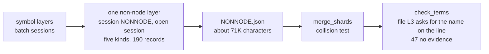
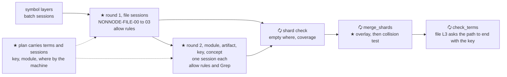

# 🧱 B2 — Non-node terms in two rounds: implementation plan

> 📅 2026-11-23 · branch: none yet (`[proposed]` `mode1-b2-rounds`, off `main`) · **Before = `main` `f12eb4f`** (code identical to `635171a`; A1 · B1 · B3 · A3 are underneath, A2 is shelved) · replaces `2026-11-22-mode1-b2-nonnode-terms-plan.md` in this folder
> 📄 Evidence: `public.handoff/2026-11-22-mode1-remediation-split.md` ("B2 redesign — decided 2026-11-23", the paid-check table under it, "How to read Measurement A") · `qa/evals/runs/2026-11-21-mode1-report-builder-cold-layer-sonnet.md` · the baseline target (code map, plan, 92 shards, merged reading file) · the frozen snapshot `test/codewiki/fixtures/codegraph-self.json`
> 🔒 Rules kept: prompts · fault wording · settings stay in `resource/codewiki/` and Python only reads them · computations are `@staticmethod`s of the stage that uses them · comments state the present only · no new `xfail`/`skip`, `DROP_CLASS` · `REPORT_ONLY` · fault severities untouched — **one approved exception**, the L3 rule for kind `file` (Task 4) · no paid model call, no network
> 🧪 Verification: all nine tasks were carried out in a scratch clone of `f12eb4f`, one commit per task; the red and green runs quoted below are from there, and so are the gates and the replay on the baseline data. No session was launched — everything about real sessions is `[unverified]` (list at the end)
> ✋ Approval: **not approved yet.** Nothing of this plan is in the repository

Labels: `[measured]` a counted value · `[code read]` source that was read · `[proposed]` proposed here, not decided · `[judgment]` an assessment · `[estimate]` derived from measured values · `[unverified]` not checked.

**Goal:** The non-node terms are no longer written by one open session of 638 s. The machine fixes key · module · position of every `file` and `module` record; sessions write the text, in two rounds, under the allow rules.

**Architecture:** The planner ends a plan with two non-node layers instead of one. Each carries the machine list (`terms`) and its sessions (`sessions`). The survey stage already runs one round per layer, so round 1 is the `file` sessions and round 2 is one `module` session plus one session per named kind; round 2 receives the `file` records round 1 wrote. The shard check, the merge and the term check each get one rule.

## 📄 One-page summary

| | |
|---|---|
| 🎯 Covers | The <span style="color:cyan">non-node layer</span>: who decides key and position · how many sessions · which calls they may make · what the checks say about their shards · the 47 `file` findings of the term check |
| 🧩 Conclusion | Nine commits. On the baseline map the plan launches **8** non-node sessions instead of 1 (4 `file` · `module` · `artifact` · `key` · `concept`), 99 survey sessions instead of 92 `[measured]`. Replaying the baseline's non-node records through the new plan, checks and merge gives 0 faults and a merged file equal to the baseline's; the term check goes from 59 to 12 "no evidence", 0 of them `file` `[measured]` |
| 🟰 Unchanged | Symbol layers and batches (the 91 baseline batches come out identical `[measured]`) · the record contract · `folder_name` and the empty `files` of top-level modules (👍 not done) · L1 and L2 for every kind · L3 for every kind but `file` · wiki stages · settings under `[estimate]` |
| 🗘 Changed | `survey_plan.py` (machine list, two layers, session list) · sections `nonnode` and `allowed` of the prompt · `AnnotateSymbolsStage` · `AnnotateFilesStage.perform` · `check_terms` · `check_shard.py` · `faults.toml` · `config.toml` · `measure.py` |
| ⚠️ Traps | (1) A `batches.json` written before this change has no `sessions`: a run that skips `schedule-batches` and resumes on it launches **no** non-node session and the shard check does not complain `[code read]`. (2) The cost line at entry multiplies the session count: 92 → 99 on the baseline; `[estimate]` settings are not adjusted. (3) The layer strategy checks shards once, after the last round — a faulty `file` shard is merged and feeds round 2 before the sweep rejects it (as today between symbol layers) |
| 🚫 Out of scope | What the relation field `uses` holds for non-node records (the old plan's D2 — still open, the prompts say nothing about it, as today) · narrowing the named sessions on an incremental run · machine candidates for `artifact` · `key` · a shard check that runs L1–L3 (👍 not added) · session time limits (A2) · the home copy of the survey skill |

## ✋ Decided, proposed, open

### 👍 Decided by the user (2026-11-23) — not reopened here

| # | What | 👍 Chosen | 👎 Dropped | Task |
|---|---|---|---|---|
| 1 | Rounds of the non-node layer | Two: `file` sessions, then `module` + named kinds | One round with three sessions (the recommendation at the time) | 1 · 7 |
| 2 | Named kinds | One session per kind: `artifact` · `key` · `concept` | One session for all three · chunks by file | 1 · 7 |
| 3 | `file` sessions | Split by a size cap (value: O2) | One session for all files | 1 · 7 |
| 4 | Prompts | Allowed-call notice · procedure line from `session_calls` · "written with the Write tool, not Bash" | — | 7 |
| 5 | The 47 `file` findings | Term check, kind `file` only: L1 · L2 stay, L3 = the path part of `where` ends with the key; a mismatch reports `근거 없음`. `file` leaves the prompt sentence that demands the name on the line. The single approved exception | An L3 exemption · the old plan's task 5 (`build_terms` map-side records) | 4 · 7 |
| 6 | Merge | Machine values (`kind` · `module` · `where`) are laid over a listed record **before** the collision test; a test covers "existing record plus a session that wrote another path" | Overlay after the merge | 5 |
| 7 | Empty `where` | `"where": ""` is a shard-check fault for every kind outside `WHERE_OPTIONAL` | — | 3 |
| 8 | `[kind.coverage]` fix wording | Reads correctly for non-node sessions too | — | 8 |
| 9 | `module` key equal to a symbol name | A test pins what happens. **Which** behaviour is not decided → O3; Task 2 implements the recommendation | — | 2 |
| 10 | Allow rules | Non-node sessions get `--permission-mode dontAsk`, the shard-folder `Edit(...)` rule, their own shard-check command and the isolation arguments. Round 2 also gets the built-in `Grep` (`--tools "Bash,Read,Write,Grep"`) and a `Grep` rule | Leaving them on the open session | 6 · 7 |
| 11 | Shard check with L1–L3 | Not added | Adding it | — |
| 12 | Folder rule · empty `files` | Not done | Replacing `folder_name` with a path rule · filling `files` | — |
| 13 | Measurement A | Also reads the four rows under "Verification" | — | — |

Consequence of 10 `[code read]`: `pipeline.run_layer` gives every job of a round one argument set, so the `module` session gets `Grep` too. Whether the `Grep` rule is needed at all is `[unverified]` (the paid check carried it).

### `[proposed]` Proposed by this plan — one axis per row

| Axis | Chosen (implemented in the scratch clone) | Alternative | Trade-off |
|---|---|---|---|
| P1 Where list and sessions live | In the plan (`batches.json`): each non-node layer carries `terms` and `sessions` | The stage computes them from the code map | Both strategies, the shard check and `check_shard.py` read one answer; the plan's sha already stamps the shard folder. Cost: the trap (1) above |
| P2 Session names | `NONNODE-FILE-00…` · `NONNODE-MODULE` · `NONNODE-ARTIFACT` · `NONNODE-KEY` · `NONNODE-CONCEPT`; the name is the shard's file name | Other names | Every name still starts with `NONNODE`, the prefix the measurement note and the spec use |
| P3 Input of a `file` session | In the prompt: per file its key · module · `where` and the name and `means` of its symbols. The session opens neither sources nor the reading file | Let it read the reading file | Baseline: 78 s of 638 s wrote the 71 `file` records, about 290 s went into exploring `[measured]`. The prompt of a full session is 28–33K characters at cap 250 `[measured]` |
| P4 Input of round 2 | A file index (key · path · `means` of every `file` record) and the `module` rows; the reading file through `Grep` | Paste the whole reading file | The index is the same 71 lines in all four prompts (12–14K characters each `[measured]`) |
| P5 Session kinds | `SessionKind` = `batch` · `file` · `named` · `pass2`; `named` is every session of round 2 | A kind per session | Arguments differ only by round |
| P6 What the overlay touches | Records whose key is listed **and** whose own kind is `file` or `module` | Every record with a listed key | A reading file of an earlier run may hold another kind under that key; the overlay must not relabel it |
| P7 Coverage of a named session | Fault when it writes a key of the machine list (`detail-taken`) | No check | Without it the merge renames one of the two records |

Structure count `[measured]` (grep in the scratch clone): new stage · module · file · abstraction **0**. New shapes 7 `TypedDict` (`PlanTerm` · `PlanSession` · `GraphModule` in the planner; `FileTermRow` · `FileSummaryRow` · `ModuleTermRow` · `SurveyConfig` in `context.py`), each with one producer. New functions 14: `survey_plan` 7, `AnnotateSymbolsStage` 6, `measure.isolated` 1. Removed 1: `AnnotateSymbolsStage.plan_ids` (→ `survey_plan.session_ids`). New setting 1. Deletion test: without `overlay_terms` a session that writes `a.py:1` for `src/pkg/a.py` loses the earlier record to a rename (Task 5's test); without `nonnode_layers` there is no round.

### ❓ Open decisions — for the user

| # | Question | Options | Evidence | Recommendation |
|---|---|---|---|---|
| O1 | What `where` means for an `artifact` | (a) the name-bearing line — the writing line if it carries the name, otherwise the line that defines the path · (b) today's "the line that writes the file" | With (b) the paid check wrote 17 of the baseline's 50 `artifact` records and left out those whose writing line does not carry the name; L3 asks for the name near the line; the baseline session pointed such records at the path-defining line, and 0 `artifact` records are "no evidence" there `[measured]` | **(a)** — it is one table row of the prompt (Task 7). If rejected, that row and its test line go back to (b) and nothing else changes; coverage is then expected near the paid check's `[estimate]`. Whether `key` has the same problem is `[unverified]` |
| O2 | Size cap of a `file` session | (a) 250 symbols · (b) none · (c) 120 · (d) 400 | Baseline map (71 files, 761 symbols; largest file 55): (a) 4 sessions, prompt 5.3–33.5K characters, their baseline records 1.6–10.4K · (b) 1 session, 90.5K in, 27.4K out · (c) 7 sessions, 13–17K in · (d) 2 sessions, 47K in, 13–15K out. Largest batch shard of the baseline: 19.7K characters `[measured]` | **(a) 250**, as `[survey] file_session_symbols` in `resource/codewiki/config.toml`. Files are never split; grouping is the existing `pack`. Corrected after Measurement A without code |
| O3 | A `file` or `module` key equal to a symbol name | (a) the machine list does not carry that key — the symbol keeps it · (b) today: the merge renames the symbol record to `<stem>.<key>`, the non-node record takes the bare key, and `merge_terms` then gives the symbol's code-map term the module's text · (c) rename the non-node key | 0 collisions on the baseline map and on the frozen snapshot; (b) reproduced in a merge simulation `[measured]`. Precedent on the map side: `build_terms` skips a module whose id is already a node name (`terms_db.py:173`) `[code read]` | **(a)** (Task 2). Cost: that file or folder gets no record, and nothing reports it. (c) changes the key rule of every `file` · `module` record |
| O4 | A second paid check with the O1 wording | (a) one call: the `artifact` session of this plan on a copy of the baseline after the `file` round, before Measurement A · (b) none — read it in Measurement A | The first check: 56.8 s · 12 turns · $0.25 · 0 refusals `[measured]`; one sample | **(a)**, cap $1.0. It isolates the wording; Measurement A would mix it with every other change. Needs the user's approval — this plan runs nothing paid |

## 🔁 Before and After

| 📍 Before (`f12eb4f`) | 🛠️ After | 🎉 What it resolves |
|---|---|---|
| One non-node layer, one session `NONNODE`, 190 records in one shard of about 71K characters; 638 s · 48 turns · $3.00 `[measured]` | Two layers, 8 sessions on the baseline; the largest replayed shard is 17.3K characters `[measured]` | The session that runs alone and longest; the single oversized `Write` |
| The session invents key · `module` · `where` of `file` and `module` records | `nonnode_terms` derives them from the code map (71 + 15 on the baseline, the same keys the session chose `[measured]`); the prompt lists them, the merge overlays them | Keys and positions no longer depend on a session |
| Open session (`bypassPermissions`), no notice, no `Write` sentence `[code read]` | `allow_only` rules + isolation; round 2 adds `Grep`; notice and procedure line from `session_calls` | The last survey session outside the allow rules |
| `"where": ""` on a `file` record passes the shard check `[measured]` | `where` fault | An empty position reaching the merge |
| A non-node shard is not compared with the plan | `file` · `module` sessions: both directions; named sessions: no key of the machine list | Missing or foreign keys are caught at the session's own check |
| Merge: an existing `a.py` at `src/pkg/a.py:1` plus a session writing `a.py:1` → `a.a.py`, the old `a.py` is lost `[measured]` | Overlay first: one record `a.py` at `src/pkg/a.py:1` | Incremental runs keep `file` records |
| Term check on the baseline: 59 "no evidence" — `file` 47 · function 7 · method 3 · class 2 `[measured]` | 12 — `file` 0 `[measured]` | The rule conflict "`where` is `<path>:1`" against "the name is on that line" |

## ★ New · 🗘 Changed · ✕ Removed

Order: module → file → class → function → member, against `f12eb4f`. Lines are those of the scratch clone after Task 9.

| Level | Item | Mark | Where |
|---|---|---|---|
| module | `src/codewiki/python/machine` · `src/codewiki/python/runner` · `src/core` · `resource/codewiki` · `test/codewiki` · `test/core` | 🗘 | — |
| file | `machine/survey_plan.py` · `machine/terms_db.py` | 🗘 | machine |
| file | `mode1/survey.py` · `mode1/survey_files.py` · `mode1/context.py` · `mode1/graph.py` · `run_mode1.py` · `check_shard.py` | 🗘 | runner |
| file | `core/measure.py` · `prompts/annotate-symbols.md` · `faults.toml` · `config.toml` | 🗘 | core · resource |
| file | `src/codewiki/CLAUDE.md` · `resource/CLAUDE.md` · `.agents/skills/codebase-terms-survey/SKILL.md` · three generated `README.md` | 🗘 | documents |
| class | `PlanTerm` · `PlanSession` · `GraphModule` | ★ | `survey_plan.py:82` · `:94` |
| class | `FileTermRow` · `FileSummaryRow` · `ModuleTermRow` · `SurveyConfig` | ★ | `mode1/context.py` |
| function | `file_keys` · `folder_name` · `nonnode_terms` · `nonnode_layers` · `session_ids` · `expected_keys` · `listed_terms` | ★ | `survey_plan.py:193–307` |
| function | `file_rows` · `summary_rows` · `module_rows` · `nonnode_jobs` · `overlay_terms` · `layer_kind` | ★ | `AnnotateSymbolsStage` (`survey.py:179–235` · `:539` · `:787`) |
| function | `isolated` | ★ | `measure.py:179` |
| function | `plan` · `plan_by_file` · `nonnode_prompt` · `check_shard` · `check_coverage` · `check_shards` · `merge_shards` · `refresh_merged` · `allowed_notice` · `kind_args` · `session_args` · `jobs` · `plan_summary` · `session_count` · `check_terms` (inner `cite`) · both `perform` | 🗘 | as named |
| function | `plan_ids` | ✕ | `AnnotateSymbolsStage` |
| member | `PlanLayer.terms` · `.sessions` · `CodeGraph.modules` · `GraphNode.module` · `Mode1Config.survey` | ★ | — |
| member | `SessionKind`: `nonnode` ✕ · `file` ★ · `named` ★ | 🗘 | `survey.py:31` |
| member | prompt values `sid` · `kind` · `n` · `rows` · `summaries` · `modules` · `calls` · `allowed` (★), `python` (✕); `search` in section `allowed` (★) | 🗘 | `annotate-symbols.md:134` · `:298` |
| member | `[kind.coverage] detail-taken` (★) · `fix` (🗘) · `[survey] file_session_symbols` (★) | 🗘 | `faults.toml` · `config.toml` |

## 🔀 Diagram — from the symbol layers to the term check

Before `[code read]`.



After. Counts are those of the baseline map `[measured]`; ★ new · 🗘 changed.



## 📝 Where to change

| File · symbol | Change | Task |
|---|---|---|
| ★ `survey_plan.py` `nonnode_terms` · `nonnode_layers` (+ five helpers) | the machine list and the two layers with their sessions | 1 · 2 |
| 🗘 `survey_plan.py` `plan` · `plan_by_file` | append `nonnode_layers(…, file_cap)` instead of one bare layer | 7 |
| 🗘 `survey.py` `check_shard` | `not r.get("where")` instead of `"where" not in r` | 3 |
| 🗘 `terms_db.py` `check_terms` → `cite` | parameter `path_key`; kind `file` passes its key | 4 |
| ★ `survey.py` `overlay_terms`; 🗘 `merge_shards` · `refresh_merged` · `survey_files.py` | overlay on the existing records and on every shard, before the collision loop | 5 |
| ★ `measure.py` `isolated` | the isolation arguments with more built-in tools | 6 |
| 🗘 `annotate-symbols.md` `nonnode` · `allowed` | three bodies chosen by `kind` (`file` · `module` · a named kind); notice variant for `Grep` | 7 |
| 🗘 `survey.py` `nonnode_prompt` · ★ `nonnode_jobs` · `file_rows` · `summary_rows` · `module_rows` · `layer_kind`; 🗘 `kind_args` · `session_args` · `jobs`; `survey_files.py` `perform` | one prompt per planned session; arguments by layer; the file strategy runs the non-node layers in order | 7 |
| 🗘 `graph.py` · `run_mode1.py` · `context.py` · `config.toml` | the cap setting reaches both planners; summary and session count | 7 |
| 🗘 `survey.py` `check_coverage` · `check_shards` · `check_shard.py` · `faults.toml` | coverage by session name for every planned session | 8 |

## 📖 Glossary

| Term | Meaning here |
|---|---|
| non-node term | a record whose key is not a node of the code map: kinds `file` · `module` · `artifact` · `key` · `concept` |
| machine list | the `file` and `module` rows the planner derives (`PlanTerm`: key · kind · module · where · files) |
| named kind | `artifact` · `key` · `concept` — the session finds the names itself |
| round | one layer of the plan = one `run_layer` call; all its sessions share one argument set |
| overlay | writing the machine list's `kind` · `module` · `where` over a record with a listed key |
| allow rules | `--permission-mode dontAsk` plus `--allowedTools`; a call no rule covers is refused |
| L1 · L2 · L3 | the term check's citation levels: the file exists · the line exists · the name is near the line |
| baseline | the cold run of 2026-11-21 and its target clone |

## 🧩 Tasks — one per commit

Commands run from the repository root (`$REPO_ROOT`). **Red** = the task's tests on the parent commit's `src/` and `resource/`; **Green** = the commit. Both were run in the scratch clone `[measured]`. Every task ends with `npm run typecheck:py` → `0 errors`.

Diff notation: zero context lines. `=== path` starts a file. `@@ N · context` gives the line of the parent commit after which a pure addition goes. A hunk that removes lines has no `@@` line when its first removed line occurs exactly once in that file — the removed lines locate it.

The generated READMEs (`src/codewiki/python/machine` · `runner` · `src/core`) drift from Task 1 on, so `test/tools/test_gen_readme.py` is red until Task 9 regenerates them `[measured]`; the task commands below run `test/codewiki test/core qa`. `[proposed]` An implementer who wants every commit green runs the generator at the end of each task instead — the generated text is the same.

### Task 1 — the planner derives `file` and `module` rows and the session list

Files: `src/codewiki/python/machine/survey_plan.py` · `test/codewiki/test_survey_plan.py`. `plan` and `plan_by_file` do not call the new functions yet (Task 7).

**1. Tests**
```diff
=== test/codewiki/test_survey_plan.py
@@ 256 · def test_자기_지도_스냅샷은_계획기의_형으로_엄격하게_읽힌
+
+
+# ── 비노드 층 둘 — file · module 의 키와 위치, 세션 목록은 계획이 정한다
+
+def _cg3(nodes: list[tuple[str, str, str, str]], modules: list[str]) -> CodeGraph:
+    """(id, 이름, 파일, 모듈) 노드와 지도의 모듈 목록."""
+    return {"nodes": [{"id": i, "name": n, "kind": "function", "file": f, "line": 3, "module": m}
+                      for i, n, f, m in nodes],
+            "edges": [], "modules": [{"id": m} for m in modules]}
+
+
+def _first(cg: CodeGraph) -> dict[str, SP.GraphNode]:
+    return {n["id"]: n for n in cg["nodes"] if n.get("kind") != "external"}
+
+
+def test_file_키는_파일_이름이고_겹치면_겹친_전원이_경로다():
+    """같은 이름의 파일 둘이 한 키를 다투면 병합이 하나를 덮는다 — 겹친 쪽은 처음부터 경로로 부른다."""
+    got = SP.file_keys(["src/a/build.py", "src/b/build.py", "src/a/plan.py"])
+    assert got == {"src/a/build.py": "src/a/build.py", "src/b/build.py": "src/b/build.py", "src/a/plan.py": "plan.py"}
+
+
+def test_폴더의_module_키는_심볼_이름이_적은_점_경로다():
+    """심볼의 점 이름이 파일 경로의 꼬리로 시작하면 그 꼬리에서 파일 줄기를 뗀 것이 폴더의 이름이다."""
+    assert SP.folder_name("src/core/pipeline.py", ["core.pipeline.Stage", "core.pipeline.load"]) == "core"
+    assert SP.folder_name("tools/doctor.py", ["tools.doctor.main"]) == "tools"
+    assert SP.folder_name("src/a/b/c.py", ["a.b.c.f"]) == "a.b"
+    assert SP.folder_name("src/render/mesh.cpp", ["Mesh", "gfx::Mesh::draw"]) == ""     # 이름이 경로를 따르지 않는다
+    assert SP.folder_name("setup.py", ["setup.main"]) == ""                              # 폴더 마디가 없다
+
+
+def test_기계_목록은_file_과_module_의_키와_위치를_싣는다():
+    cg = _cg3([("C1", "pkg.sub.a.f", "src/pkg/sub/a.py", "pkg"), ("C2", "pkg.sub.a.g", "src/pkg/sub/a.py", "pkg"),
+               ("C3", "pkg.b.h", "src/pkg/b.py", "pkg"), ("C4", "tools.t.main", "tools/t.py", "tools")],
+              ["pkg", "tools"])
+    terms = SP.nonnode_terms(_first(cg), set(_first(cg)), ["pkg", "tools"])
+    assert [(t["key"], t["kind"], t["module"], t["where"]) for t in terms] == [
+        ("b.py", "file", "pkg", "src/pkg/b.py:1"), ("a.py", "file", "pkg.sub", "src/pkg/sub/a.py:1"),
+        ("t.py", "file", "tools", "tools/t.py:1"),
+        ("pkg", "module", "pkg", ""), ("pkg.sub", "module", "pkg.sub", ""), ("tools", "module", "tools", "")]
+    assert {t["key"]: t["files"] for t in terms if t["kind"] == "module"} == {
+        "pkg": ["src/pkg/b.py"], "pkg.sub": ["src/pkg/sub/a.py"], "tools": ["tools/t.py"]}
+
+
+def test_이름이_경로를_따르지_않는_지도는_지도의_모듈만_module_로_싣는다():
+    """C++ · C# 지도는 심볼 이름에 폴더가 없다. 폴더마다 레코드를 내지 않고 파일을 지도의 모듈에 붙인다."""
+    cg = _cg3([("C1", "Mesh", "src/render/mesh.cpp", "render"), ("C2", "Shader", "src/render/gl/shader.cpp", "render")],
+              ["render"])
+    terms = SP.nonnode_terms(_first(cg), set(_first(cg)), ["render"])
+    assert [(t["key"], t["kind"], t["module"]) for t in terms] == [
+        ("shader.cpp", "file", "render"), ("mesh.cpp", "file", "render"), ("render", "module", "render")]
+    assert terms[-1]["files"] == ["src/render/gl/shader.cpp", "src/render/mesh.cpp"]
+
+
+def test_증분_목록도_키는_지도_전체에서_정한다():
+    """거른 뒤에 정하면 겹치던 파일 이름이 혼자 남아 다른 키를 얻고, 지난 레코드와 어긋난다."""
+    cg = _cg3([("C1", "a.build.f", "src/a/build.py", "a"), ("C2", "b.build.f", "src/b/build.py", "b")], ["a", "b"])
+    terms = SP.nonnode_terms(_first(cg), {"C1"}, ["a", "b"])
+    assert [(t["key"], t["kind"]) for t in terms] == [("src/a/build.py", "file"), ("a", "module")]
+
+
+def test_비노드_층은_둘이고_file_세션이_먼저_돈다():
+    """첫 층은 `file` 줄과 `file` 세션, 둘째 층은 `module` 줄과 `module` 세션 하나 · 이름난 종류마다 세션 하나다."""
+    cg = _cg3([("C1", "pkg.a.f", "src/pkg/a.py", "pkg"), ("C2", "pkg.sub.b.g", "src/pkg/sub/b.py", "pkg")], ["pkg"])
+    one, two = SP.nonnode_layers(4, _first(cg), set(_first(cg)), cg)
+    assert (one["level"], two["level"]) == (4, 5) and one.get("kind") == two.get("kind") == "non-node"
+    assert [t["key"] for t in one.get("terms", [])] == ["a.py", "b.py"]
+    assert one.get("sessions") == [{"id": "NONNODE-FILE-00", "kind": "file", "keys": ["a.py", "b.py"]}]
+    assert [t["key"] for t in two.get("terms", [])] == ["pkg", "pkg.sub"]
+    assert two.get("sessions") == [
+        {"id": "NONNODE-MODULE", "kind": "module", "keys": ["pkg", "pkg.sub"]},
+        {"id": "NONNODE-ARTIFACT", "kind": "artifact", "keys": []}, {"id": "NONNODE-KEY", "kind": "key", "keys": []},
+        {"id": "NONNODE-CONCEPT", "kind": "concept", "keys": []}]
+
+
+def test_file_세션은_심볼_수_상한으로_나뉘고_파일은_쪼개지_않는다():
+    nodes = [("A%d" % i, "p.a.f%d" % i, "src/p/a.py", "p") for i in range(3)] \
+        + [("B%d" % i, "p.b.f%d" % i, "src/p/b.py", "p") for i in range(2)] + [("C0", "p.c.f", "src/p/c.py", "p")]
+    cg = _cg3(nodes, ["p"])
+    sessions = SP.nonnode_layers(1, _first(cg), set(_first(cg)), cg, file_cap=3)[0].get("sessions", [])
+    assert [(s["id"], s["keys"]) for s in sessions] == [
+        ("NONNODE-FILE-00", ["a.py"]), ("NONNODE-FILE-01", ["b.py", "c.py"])]
+    big = SP.nonnode_layers(1, _first(cg), set(_first(cg)), cg, file_cap=2)[0].get("sessions", [])
+    assert [s["keys"] for s in big] == [["a.py"], ["b.py"], ["c.py"]]          # 상한을 넘는 파일은 혼자 한 세션이다
+    assert [s["keys"] for s in SP.nonnode_layers(1, _first(cg), set(_first(cg)), cg)[0].get("sessions", [])] == [
+        ["a.py", "b.py", "c.py"]]                                                # 상한을 주지 않으면 한 세션이다
+
+
+def test_기계_목록이_빈_세션은_계획에_없다():
+    """쓸 레코드가 없는 세션을 띄우면 빈 샤드를 기다리다 `missing` 으로 되돌린다."""
+    cg = _cg3([("C1", "f", "a.py", ".")], [])
+    one, two = SP.nonnode_layers(1, _first(cg), set(), cg)
+    assert one.get("sessions") == [] and one.get("terms") == []
+    assert [s["id"] for s in two.get("sessions", [])] == ["NONNODE-ARTIFACT", "NONNODE-KEY", "NONNODE-CONCEPT"]
+
+
+def test_계획이_띄우는_세션과_세션마다_써야_할_키():
+    cg = _cg3([("C1", "pkg.a.f", "src/pkg/a.py", "pkg")], ["pkg"])
+    p = plan(cg)
+    p["layers"][-1:] = SP.nonnode_layers(1, _first(cg), set(_first(cg)), cg)
+    assert SP.session_ids(p) == ["L0-B00", "NONNODE-FILE-00", "NONNODE-MODULE", "NONNODE-ARTIFACT", "NONNODE-KEY",
+                                 "NONNODE-CONCEPT"]
+    assert SP.expected_keys(p, "L0-B00") == {"pkg.a.f"}
+    assert SP.expected_keys(p, "NONNODE-FILE-00") == {"a.py"} and SP.expected_keys(p, "NONNODE-MODULE") == {"pkg"}
+    assert SP.expected_keys(p, "NONNODE-KEY") is None and SP.expected_keys(p, "없는-세션") is None
+    assert [t["key"] for t in SP.listed_terms(p)] == ["a.py", "pkg"]
+
+
+def test_실제_지도_스냅샷의_비노드_목록():
+    """얼린 스냅샷으로 file · module 목록을 못박는다. 스냅샷에는 지도의 모듈 목록이 없어 module 은 폴더뿐이다."""
+    cg = json.load(open(SNAPSHOT, encoding="utf-8"))
+    first = _first(cg)
+    one, two = SP.nonnode_layers(6, first, set(first), cg, file_cap=250)
+    files = one.get("terms", [])
+    node_files = {n["file"] for n in cg["nodes"] if n.get("file")}
+    assert len(files) == len(node_files) == 77 and {t["files"][0] for t in files} == node_files
+    assert all(t["where"] == t["files"][0] + ":1" for t in files)
+    assert sorted(t["key"] for t in files if "/" in t["key"]) == [
+        "src/codewiki/python/machine/clang_doc.py", "src/codewiki/python/runner/wiki/build.py",
+        "src/codewiki/python/runner/wiki/check.py", "src/codewiki/python/runner/wiki/clang_doc.py",
+        "src/spec/python/viz/build.py", "src/spec/python/viz/check.py"]
+    assert [t["key"] for t in two.get("terms", [])] == [
+        "codewiki.python.machine", "codewiki.python.runner", "codewiki.python.runner.mode1",
+        "codewiki.python.runner.wiki", "codewiki.python.viz", "common", "core", "spec.python.runner",
+        "spec.python.viz", "split-work", "split-work.r9-gate-proto", "split-work.reorg",
+        "term.python.runner", "term.python.runner.term", "tools"]
+    sessions = one.get("sessions", [])
+    assert [len(s["keys"]) for s in sessions] == [30, 25, 22]
+    assert [k for s in sessions for k in s["keys"]] == [t["key"] for t in files]
```
**2. Red** — `.venv/bin/python -m pytest test/codewiki/test_survey_plan.py -q` → `10 failed, 24 passed, 1 skipped`: `AttributeError: module 'survey_plan' has no attribute 'nonnode_layers'` (5) · `'nonnode_terms'` (3) · `'folder_name'` · `'file_keys'`.

**3. Implementation**
```diff
=== src/codewiki/python/machine/survey_plan.py
@@ 41 · GraphNode = TypedDict("GraphNode", {
+    "module": NotRequired[str | None],
@@ 46 · GraphEdge = TypedDict("GraphEdge", {"from": str, "to": str})
+class GraphModule(TypedDict):
+    id: str
+
+
@@ 50 · class CodeGraph(TypedDict):
+    modules: NotRequired[list[GraphModule]]
@@ 75 · class PlanBatch(TypedDict):
+class PlanTerm(TypedDict):
+    """기계가 키와 위치를 정한 비노드 용어 한 줄 — `file` 또는 `module`.
+
+    `files` 는 그 용어가 덮는 파일이다. `file` 줄은 자기 하나, `module` 줄은 그 이름에 바로 든 파일들.
+    """
+    key: str
+    kind: str
+    module: str
+    where: str
+    files: list[str]
+
+
+class PlanSession(TypedDict):
+    """비노드 층의 세션 하나. `id` 가 작업 라벨이자 샤드 파일의 이름이다.
+
+    `keys` 는 기계 목록에서 이 세션이 써야 할 키다. 키를 세션이 고르는 종류(`NAMED_KINDS`)는 빈 목록이다.
+    """
+    id: str
+    kind: str
+    keys: list[str]
+
+
-    """심볼 층과 맨 끝 비노드 층이 한 목록에 섞여 있다.
+    """심볼 층과 맨 끝의 비노드 층들이 한 목록에 섞여 있다.
-    비노드 층만 `kind` 와 `note` 를 갖고 `file_count` 는 갖지 않는다 — 그래서 셋이 선택 항목이다.
+    비노드 층만 `kind` · `note` · `terms` · `sessions` 를 갖고 `file_count` 는 갖지 않는다 — 그래서 다섯이 선택 항목이다.
@@ 86 · class PlanLayer(TypedDict):
+    terms: NotRequired[list[PlanTerm]]
+    sessions: NotRequired[list[PlanSession]]
@@ 155 · def pack(members: Iterable[str], file_of: Mapping[str, str | None],
+# ── 비노드 층 — `file` · `module` 은 지도에서 키와 위치가 나온다. 세션 목록도 계획이 정한다.
+
+# 키와 위치를 기계가 정하는 종류와, 세션이 고르는 종류. 뒤의 것은 종류마다 세션 하나다.
+LISTED_KINDS = ("file", "module")
+NAMED_KINDS = ("artifact", "key", "concept")
+
+
+def file_keys(files: Iterable[str]) -> dict[str, str]:
+    """파일 경로 -> `file` 레코드의 키. 파일 이름이 혼자면 그 이름이고, 겹치면 겹친 전원이 경로다."""
+    paths = sorted(set(files))
+    count = collections.Counter(p.rsplit("/", 1)[-1] for p in paths)
+    return {p: p if count[p.rsplit("/", 1)[-1]] > 1 else p.rsplit("/", 1)[-1] for p in paths}
+
+
+def folder_name(file: str, names: Iterable[str]) -> str:
+    """파일이 든 폴더의 점 이름. 심볼의 점 이름이 경로의 꼬리로 시작할 때만 정해지고, 아니면 빈 글이다.
+
+    `src/core/pipeline.py` 의 심볼이 `core.pipeline.Stage` 면 꼬리 `core.pipeline` 에서 파일 줄기를 뗀 `core` 다.
+    꼬리는 긴 것부터 맞춰 보고, 폴더 마디가 하나도 남지 않는 꼬리는 보지 않는다.
+    """
+    parts = file.split("/")
+    parts[-1] = parts[-1].rsplit(".", 1)[0]
+    have = list(names)
+    for k in range(len(parts) - 1):
+        dotted = ".".join(parts[k:])
+        if any(n == dotted or n.startswith(dotted + ".") for n in have):
+            return ".".join(parts[k:-1])
+    return ""
+
+
+def nonnode_terms(first: Mapping[str, GraphNode], keep: Collection[str],
+                  modules: Iterable[str]) -> list[PlanTerm]:
+    """기계 목록 — 파일마다 `file` 한 줄, 폴더 이름과 지도의 모듈마다 `module` 한 줄. `file` 줄이 앞이다.
+
+    키와 소속은 지도 전체(`first`)에서 정하고 줄은 `keep` 의 파일 것만 낸다. 파일의 소속은 `folder_name` 이고,
+    그것이 비면 그 파일 노드들이 가장 많이 적은 지도 모듈이다. `file` 의 위치는 `<경로>:1`, `module` 은 위치가 없다.
+    `module` 줄은 폴더 이름과, `modules` 에 있으면서 남긴 노드를 가진 지도 모듈이다.
+    """
+    names: collections.defaultdict[str, list[str]] = collections.defaultdict(list)
+    mods: collections.defaultdict[str, collections.Counter[str]] = collections.defaultdict(collections.Counter)
+    for n in first.values():
+        f = n.get("file")
+        if not f:
+            continue
+        names[f].append(n.get("name") or "")
+        m = n.get("module")
+        if m:
+            mods[f][m] += 1
+    keys = file_keys(names)
+    folder = {f: folder_name(f, names[f]) for f in names}
+    home = {f: folder[f] or (min(mods[f], key=lambda m: (-mods[f][m], m)) if mods[f] else "") for f in names}
+    kept = sorted({first[i].get("file") or "" for i in keep} - {""})
+    rows: list[PlanTerm] = [{"key": keys[f], "kind": "file", "module": home[f], "where": f + ":1", "files": [f]}
+                            for f in kept]
+    listed = set(modules)
+    wanted = {folder[f] for f in kept if folder[f]} | {m for f in kept for m in mods[f] if m in listed}
+    module_rows: list[PlanTerm] = [
+        {"key": m, "kind": "module", "module": m, "where": "", "files": [f for f in kept if home[f] == m]}
+        for m in sorted(wanted)]
+    return rows + module_rows
+
+
+def nonnode_layers(level: int, first: Mapping[str, GraphNode], keep: Collection[str], cg: CodeGraph,
+                   file_cap: int | None = None) -> list[PlanLayer]:
+    """맨 끝의 비노드 층 둘. 첫 층은 `file` 줄과 `file` 세션들, 둘째 층은 `module` 줄과 나머지 세션들이다.
+
+    `file` 세션은 `pack` 으로 묶는다 — 한 세션이 맡는 파일들의 심볼 수가 `file_cap` 을 넘지 않게 하되 파일은 쪼개지 않는다.
+    `file_cap` 이 없으면 세션 하나다. 둘째 층은 `module` 줄이 있을 때의 `NONNODE-MODULE` 과, `NAMED_KINDS` 마다 하나다.
+    줄이 없는 세션은 싣지 않는다. 둘째 층의 세션은 첫 층이 쓴 `file` 레코드를 재료로 받는다.
+    """
+    terms = nonnode_terms(first, keep, [m["id"] for m in cg.get("modules", [])])
+    files = [t for t in terms if t["kind"] == "file"]
+    modules = [t for t in terms if t["kind"] == "module"]
+    key_of = {t["files"][0]: t["key"] for t in files}
+    file_of = {i: first[i].get("file") for i in keep if first[i].get("file") in key_of}
+    packed = pack(file_of, file_of, file_cap or max(1, len(file_of)))
+    first_sessions: list[PlanSession] = [
+        {"id": "NONNODE-FILE-%02d" % k, "kind": "file", "keys": [key_of[f] for f in b["files"]]}
+        for k, b in enumerate(packed)]
+    second_sessions: list[PlanSession] = []
+    if modules:
+        second_sessions.append({"id": "NONNODE-MODULE", "kind": "module", "keys": [t["key"] for t in modules]})
+    for kind in NAMED_KINDS:
+        second_sessions.append({"id": "NONNODE-" + kind.upper(), "kind": kind, "keys": []})
+    return [
+        {"level": level, "kind": "non-node", "symbol_count": None, "batches": [],
+         "note": "file. 심볼이 전부 끝난 뒤에 돈다. 키와 위치는 terms 에, 세션마다 맡은 키는 sessions 에 있다.",
+         "terms": files, "sessions": first_sessions},
+        {"level": level + 1, "kind": "non-node", "symbol_count": None, "batches": [],
+         "note": "module · artifact · key · concept. file 층이 끝난 뒤에 돈다. module 의 키는 terms 에 있다.",
+         "terms": modules, "sessions": second_sessions}]
+
+
+def session_ids(p: SurveyPlan) -> list[str]:
+    """계획이 띄우는 세션의 이름 전부 — 층 순서대로 배치 id 들, 비노드 층에서는 `sessions` 의 id 들."""
+    out: list[str] = []
+    for L in p["layers"]:
+        out += [s["id"] for s in L.get("sessions", [])] if L.get("kind") == "non-node" else [b["id"] for b in L["batches"]]
+    return out
+
+
+def expected_keys(p: SurveyPlan, sid: str) -> set[str] | None:
+    """세션 `sid` 의 샤드가 가져야 할 키. 배치는 심볼 이름, 기계 목록 세션은 `keys`. 키를 세션이 고르거나 계획에 없으면 `None`."""
+    for L in p["layers"]:
+        for s in L.get("sessions", []):
+            if s["id"] == sid:
+                return set(s["keys"]) if s["kind"] in LISTED_KINDS else None
+        for b in L["batches"]:
+            if b["id"] == sid:
+                return {x["name"] or "" for x in b["symbols"]}
+    return None
+
+
+def listed_terms(p: SurveyPlan) -> list[PlanTerm]:
+    """계획의 기계 목록 전부 — 비노드 층들의 `terms` 를 층 순서대로 이은 것."""
+    return [t for L in p["layers"] for t in L.get("terms", [])]
+
+
```
**4. Green** — `34 passed, 1 skipped`. The snapshot test pins 77 `file` rows, 15 `module` rows and file sessions of 30 · 25 · 22 files at cap 250 `[measured]`.

**5. Commit** — `[feat] : codewiki - 계획기가 file 과 module 의 키와 위치, 비노드 세션 목록을 지도에서 낸다`

### Task 2 — a key that equals a symbol name or an earlier row is not listed (O3, option a)

Files: `survey_plan.py` · `test_survey_plan.py`. The second test goes one step past decision 9: it also pins that keys are unique inside the list and that a `file` row wins over a `module` row of the same name.

**1. Tests**
```diff
=== test/codewiki/test_survey_plan.py
@@ 384 · def test_실제_지도_스냅샷의_비노드_목록():
+
+
+def test_심볼_이름과_같은_키는_기계_목록에_싣지_않는다():
+    """용어 사전은 키로 합친다 — 심볼과 같은 키의 `module` 레코드가 오면 심볼의 용어가 모듈의 글을 받는다."""
+    cg = _cg3([("C1", "render", "src/render/main.cpp", "render"), ("C2", "Mesh", "src/render/mesh.cpp", "render"),
+               ("C3", "a.py", "a.py", "render")], ["render"])
+    first = _first(cg)
+    one, two = SP.nonnode_layers(1, first, set(first), cg)
+    assert [(t["key"], t["kind"]) for t in one.get("terms", [])] == [("main.cpp", "file"), ("mesh.cpp", "file")]
+    assert one.get("sessions") == [{"id": "NONNODE-FILE-00", "kind": "file", "keys": ["main.cpp", "mesh.cpp"]}]
+    assert two.get("terms") == [] and [s["id"] for s in two.get("sessions", [])] == [
+        "NONNODE-ARTIFACT", "NONNODE-KEY", "NONNODE-CONCEPT"]
+
+
+def test_기계_목록의_키는_하나씩이고_file_줄이_먼저_갖는다():
+    """확장자 없는 파일 `bin/tools` 와 폴더 `tools` 가 한 키를 다투면 `file` 줄이 갖고 `module` 줄은 싣지 않는다."""
+    cg = _cg3([("C1", "run", "bin/tools", "tools"), ("C2", "tools.t.main", "tools/t.py", "tools")], ["tools"])
+    terms = SP.nonnode_terms(_first(cg), set(_first(cg)), ["tools"])
+    assert [(t["key"], t["kind"]) for t in terms] == [("tools", "file"), ("t.py", "file")]
```
**2. Red** — same command → `2 failed, 34 passed, 1 skipped`: the list still carries `a.py` and `render`, both names of symbols (first test), and the `module` row `tools` next to the `file` row `tools` (second).

**3. Implementation**
```diff
=== src/codewiki/python/machine/survey_plan.py
@@ 222 · def nonnode_terms(first: Mapping[str, GraphNode], keep: Collection[str],
+    키는 하나씩이다 — 심볼 이름과 같은 키의 줄과, 앞선 줄과 같은 키의 줄은 싣지 않는다. 용어 사전이 키로 합치므로
+    그 키의 주인은 심볼(또는 앞선 줄)이다.
-    return rows + module_rows
+    taken = {n.get("name") or "" for n in first.values()}
+    out: list[PlanTerm] = []
+    for t in rows + module_rows:
+        if t["key"] not in taken:
+            taken.add(t["key"])
+            out.append(t)
+    return out
```
**4. Green** — `36 passed, 1 skipped`. **5. Commit** — `[feat] : codewiki - 심볼 이름이나 앞선 줄과 같은 키는 기계 목록에 싣지 않는다`

### Task 3 — an empty `where` is a shard-check fault

Files: `mode1/survey.py` · `test/codewiki/test_mode1.py`. The fault text stays `where 없음 (kind …)`.

**1. Test**
```diff
=== test/codewiki/test_mode1.py
@@ 1495 · def test_결함_설명_넷은_검문_결과와_격리_사유에_글자_그대로
+def test_빈_where_는_없는_where_와_같은_결함이고_module_은_비워도_된다():
+    raw = json.dumps({"a.py": {**_good_record(), "kind": "file", "where": ""},
+                      "pkg": {**_good_record(), "kind": "module", "where": ""}}).encode()
+    got = SV.AnnotateSymbolsStage.check_shard(raw, "B", "p")
+    assert [(f["kind"], f["at"], f["detail"]) for f in got] == [("where", "a.py", "where 없음 (kind file)")]
+
+
```
**2. Red** — `.venv/bin/python -m pytest test/codewiki/test_mode1.py -q` → `1 failed, 218 passed`: `assert [] == [('where', 'a…(kind file)')]`.

**3. Implementation**
```diff
=== src/codewiki/python/runner/mode1/survey.py
@@ 279 · class AnnotateSymbolsStage(VerifiedGraph, Measured, P.LlmStage[Mode1Context]):
+        `where` 규칙은 `WHERE_OPTIONAL` 밖의 종류에 그 칸이 없거나 빈 글인 것을 잡는다.
-                if "where" not in r and r["kind"] not in AnnotateSymbolsStage.WHERE_OPTIONAL]
+                if not r.get("where") and r["kind"] not in AnnotateSymbolsStage.WHERE_OPTIONAL]
```
**4. Green** — `219 passed`. **5. Commit** — `[fix] : codewiki - 샤드 검문이 빈 where 를 없는 where 와 같은 결함으로 본다`

### Task 4 — the term check's L3 for kind `file` is "the path ends with the key" (the approved exception)

Files: `machine/terms_db.py` · `test/codewiki/test_terms_db.py` · `src/codewiki/CLAUDE.md` · `.agents/skills/codebase-terms-survey/SKILL.md` (the tracked copy; the home copy lives outside the repository and is not touched). L1 and L2 run before the new branch and are unchanged; every other kind takes the old path.

**1. Test**
```diff
=== test/codewiki/test_terms_db.py
@@ 187 · def test_check_skips_citations_of_codegraph_records(tmp_path: Path):
+# ── 3-1. file 레코드 — L3 은 줄의 글자가 아니라 where 의 경로다
+def test_file_레코드의_L3_은_where_의_경로가_키로_끝나는가다(tmp_path: Path):
+    """파일 이름은 그 파일의 첫 줄에 없는 것이 보통이다. `file` 의 근거는 경로이고 L1 · L2 는 다른 종류와 같다."""
+    repo = _repo(tmp_path)
+    for name in ("y.py", "xy.py"):
+        (tmp_path / "codegraph" / name).write_text("import os\n", encoding="utf-8")
+
+    def judge(key: str, where: str, kind: str = "file") -> list[tuple[str, str]]:
+        r: Terms = {key: {"kind": kind, "module": "codegraph", "where": where, "means": "파일.", "uses": [],
+                          "source": "reading"}}
+        return [(lvl, why) for lvl, _term, why in T.check_terms(T.merge_terms({}, r), repo)]
+
+    assert judge("y.py", "codegraph/y.py:1") == []                   # 첫 줄에 이름이 없어도 경로가 키로 끝난다
+    assert judge("codegraph/y.py", "codegraph/y.py:1") == []         # 키가 경로 전체다
+    assert judge("y.py", "codegraph/x.py:1") == [
+        ("근거 없음", "where L3 경로가 'y.py' 로 끝나지 않는다: codegraph/x.py:1")]
+    assert judge("y.py", "codegraph/xy.py:1") == [                    # 마디 경계에서 끝나야 한다
+        ("근거 없음", "where L3 경로가 'y.py' 로 끝나지 않는다: codegraph/xy.py:1")]
+    assert judge("y.py", "codegraph/gone/y.py:1") == [("실패", "where L1 파일 없음: codegraph/gone/y.py")]
+    assert judge("y.py", "codegraph/y.py:9") == [("실패", "where L2 줄 없음: codegraph/y.py:9 (파일은 1줄)")]
+    assert judge("y.py", "codegraph/y.py:1", kind="artifact") == [    # 다른 비노드 종류는 이름이 그 줄 근처에 있어야 한다
+        ("근거 없음", "where L3 그 줄 근처에 'y.py' 이 없다: codegraph/y.py:1")]
+
+
```
**2. Red** — `.venv/bin/python -m pytest test/codewiki/test_terms_db.py -q` → `1 failed, 20 passed, 2 skipped`: `assert [('근거 없음', 'w…raph/y.py:1')] == []`.

**3. Implementation**
```diff
=== .agents/skills/codebase-terms-survey/SKILL.md
-| `where` | `경로:줄`. 파일은 `:1`, 함수·클래스는 선언 줄, 산출물은 그 파일을 **쓰는** 줄, 키는 그 키를 **채우는** 줄, 개념은 그 낱말이 있는 줄 | `module` `external` 빼고 **필수.** 기계가 L1(파일) L2(줄) L3(근처에 이름) 로 검사 |
+| `where` | `경로:줄`. 파일은 `:1`, 함수·클래스는 선언 줄, 산출물은 그 파일을 **쓰는** 줄, 키는 그 키를 **채우는** 줄, 개념은 그 낱말이 있는 줄 | `module` `external` 빼고 **필수.** 기계가 L1(파일) L2(줄) L3(근처에 이름) 로 검사. `file` 의 L3 은 줄의 글자가 아니라 `where` 의 경로가 키로 끝나는가다 |
=== src/codewiki/CLAUDE.md
-- `kind` 가 `file` `artifact` `key` `concept` `module` 이면 **이름이 그 줄에 글자 그대로** 있어야 한다
+- `kind` 가 `artifact` `key` `concept` `module` 이면 **이름이 그 줄에 글자 그대로** 있어야 한다
@@ 134 · Mode 1 냉시동은 27분 08초 중 에이전트가 26분 53초(99.1%) · 17,925
+- `kind` 가 `file` 이면 L3 은 줄의 글자가 아니라 **`where` 의 경로가 키로 끝나는가**다 — 키와 같거나 `/` + 키로 끝난다.
+  L1 · L2 는 다른 종류와 같다
=== src/codewiki/python/machine/terms_db.py
@@ 296 · def check_terms(db: TermsDb, repo: str) -> list[tuple[str, str, str]]:
+    `file` 레코드의 `where` 만은 L3 이 다르다 — 줄의 글자가 아니라 경로가 키로 끝나는가를 본다
+    (키와 같거나 `/` + 키로 끝난다). 파일 이름은 그 파일 안에 적혀 있지 않은 것이 보통이다.
-    def cite(term: str, where: str, stem: str, what: str) -> None:
+    def cite(term: str, where: str, stem: str, what: str, path_key: str = "") -> None:
@@ 320 · def check_terms(db: TermsDb, repo: str) -> list[tuple[str, str, str]]:
+        if path_key:
+            if f != path_key and not f.endswith("/" + path_key):
+                out.append(("근거 없음", term, f"{what} L3 경로가 '{path_key}' 로 끝나지 않는다: {where}"))
+            return
-            cite(key, rec.get("where", ""), _stem(key, rec.get("kind")), "where")
+            if rec.get("kind") == "file":
+                cite(key, rec.get("where", ""), "", "where", path_key=key)
+            else:
+                cite(key, rec.get("where", ""), _stem(key, rec.get("kind")), "where")
```
**4. Green** — `21 passed, 2 skipped`. **5. Commit** — `[fix] : codewiki - 용어 검사가 file 레코드의 L3 을 where 의 경로가 키로 끝나는가로 본다`

### Task 5 — the merge lays the machine values over a listed record before the collision test

Files: `mode1/survey.py` · `mode1/survey_files.py` · `test_mode1.py`. The overlay runs on the existing records and on every shard.

**1. Tests**
```diff
=== test/codewiki/test_mode1.py
@@ 1787 · def test_dropped_csv_머리줄과_label_의_따옴표():
+def _listed_terms() -> list[survey_plan.PlanTerm]:
+    return [{"key": "a.py", "kind": "file", "module": "pkg", "where": "src/pkg/a.py:1", "files": ["src/pkg/a.py"]},
+            {"key": "pkg", "kind": "module", "module": "pkg", "where": "", "files": ["src/pkg/a.py"]}]
+
+
+def test_병합은_기계_목록의_칸을_충돌_판정_전에_덮는다(tmp_path: Path):
+    """증분 실행 — 지난 실행의 `a.py` 가 있고 세션이 `where` 의 경로를 다르게 적어도 개명하지 않는다."""
+    d = tmp_path / "_shards"; d.mkdir()
+    (d / "NONNODE-FILE-00.json").write_text(json.dumps(
+        {"a.py": {**_rec("a.py:1"), "kind": "file", "module": "엉뚱", "means": "새 글"}}), encoding="utf-8")
+    (d / "NONNODE-MODULE.json").write_text(json.dumps(
+        {"pkg": {**_rec("src/pkg:1"), "kind": "module", "module": "엉뚱"}}), encoding="utf-8")
+    old: X.Records = {"a.py": {**_rec("src/pkg/a.py:1"), "kind": "file", "module": "pkg", "means": "옛 글"}}
+    got = SV.AnnotateSymbolsStage.merge_shards(str(d), old, _listed_terms())
+    assert sorted(got) == ["a.py", "pkg"]
+    assert [got["a.py"][k] for k in ("kind", "module", "where", "means")] == ["file", "pkg", "src/pkg/a.py:1", "새 글"]
+    assert [got["pkg"][k] for k in ("kind", "module", "where")] == ["module", "pkg", ""]
+    assert sorted(SV.AnnotateSymbolsStage.merge_shards(str(d), old)) == ["a.a.py", "pkg"]     # 목록이 없으면 경로가 달라 개명한다
+
+
+def test_병합은_지난_실행의_레코드에도_기계_목록의_칸을_덮는다(tmp_path: Path):
+    """파일이 옮겨져 지난 레코드의 `where` 가 낡았어도 같은 키의 새 레코드가 그 자리를 갈아 끼운다."""
+    d = tmp_path / "_shards"; d.mkdir()
+    (d / "NONNODE-FILE-00.json").write_text(json.dumps(
+        {"a.py": {**_rec("src/pkg/a.py:1"), "kind": "file", "means": "새 글"}}), encoding="utf-8")
+    old: X.Records = {"a.py": {**_rec("old/a.py:1"), "kind": "file", "means": "옛 글"}}
+    got = SV.AnnotateSymbolsStage.merge_shards(str(d), old, _listed_terms())
+    assert {k: (r["where"], r["means"]) for k, r in got.items()} == {"a.py": ("src/pkg/a.py:1", "새 글")}
+
+
+def test_overlay_terms_는_file_과_module_이_아닌_레코드를_건드리지_않는다():
+    got: X.Records = {"pkg": {**_rec("src/pkg/a.py:7"), "kind": "class"}, "b.py": {**_rec("b.py:1"), "kind": "file"}}
+    assert SV.AnnotateSymbolsStage.overlay_terms(got, _listed_terms()) == got
+
+
```
**2. Red** — `test_mode1.py` → `3 failed, 219 passed`: `TypeError: merge_shards() takes 2 positional arguments but 3 were given` (2) · `AttributeError: … no attribute 'overlay_terms'`.

**3. Implementation**
```diff
=== src/codewiki/python/runner/mode1/survey.py
-    def merge_shards(shard_dir: str, existing: Records | None) -> Records:
+    def overlay_terms(got: Records, terms: Sequence[survey_plan.PlanTerm]) -> Records:
+        """기계 목록(`terms`)에 든 키의 `file` · `module` 레코드에 계획의 `kind` · `module` · `where` 를 덮는다. 글은 그대로 둔다.
+
+        종류가 `file` · `module` 인 레코드만 덮는다 — 키가 같은 다른 종류의 레코드는 건드리지 않는다.
+        """
+        listed = {t["key"]: t for t in terms}
+        out: Records = {}
+        for key, rec in got.items():
+            t = listed.get(key)
+            if t is not None and rec.get("kind") in survey_plan.LISTED_KINDS:
+                rec = {**rec, "kind": t["kind"], "module": t["module"], "where": t["where"]}
+            out[key] = rec
+        return out
+
+    @staticmethod
+    def merge_shards(shard_dir: str, existing: Records | None,
+                     terms: Sequence[survey_plan.PlanTerm] = ()) -> Records:
@@ 478 · class AnnotateSymbolsStage(VerifiedGraph, Measured, P.LlmStage[Mode1Context]):
+        `terms` 는 계획의 기계 목록이다. `existing` 과 샤드의 레코드에 `overlay_terms` 로 계획의 칸을 덮은 **뒤에**
+        충돌을 본다 — 세션이 `where` 의 경로를 다르게 적어도 같은 키의 `file` 레코드는 같은 파일의 것이다.
+
-        got = dict(existing or {})
+        got = AnnotateSymbolsStage.overlay_terms(dict(existing or {}), terms)
-            for key, rec in shard.items():
+            for key, rec in AnnotateSymbolsStage.overlay_terms(shard, terms).items():
-        raw = self.merge_shards(self.shard_dir(ctx), ctx.baseline)
+        raw = self.merge_shards(self.shard_dir(ctx), ctx.baseline, survey_plan.listed_terms(ctx.plan))
=== src/codewiki/python/runner/mode1/survey_files.py
-        ctx.merged = self.merge_shards(d, ctx.baseline)
+        terms = survey_plan.listed_terms(plan)
+        ctx.merged = self.merge_shards(d, ctx.baseline, terms)
-            ctx.merged = self.merge_shards(d, ctx.baseline)
+            ctx.merged = self.merge_shards(d, ctx.baseline, terms)
```
**4. Green** — `222 passed`. **5. Commit** — `[fix] : codewiki - 병합이 기계 목록의 칸을 충돌 판정 전에 덮는다`

### Task 6 — the isolation arguments can carry more built-in tools

Files: `src/core/measure.py` · `test/core/test_measure.py`. `ISOLATED` keeps its value.

**1. Test**
```diff
=== test/core/test_measure.py
@@ 227 · def test_세션_인자는_Model_뒤_폴더_앞에_그대로_실린다():
+def test_격리_인자는_내장_도구를_더_실을_수_있고_더하지_않으면_ISOLATED_다():
+    assert M.isolated() == M.ISOLATED
+    assert M.isolated(("Grep",)) == ("--tools", "Bash,Read,Write,Grep", "--strict-mcp-config",
+                                     "--disable-slash-commands", "--setting-sources", "")
+
+
```
**2. Red** — `.venv/bin/python -m pytest test/core/test_measure.py -q` → `1 failed, 43 passed`: `AttributeError: module 'core.measure' has no attribute 'isolated'`.

**3. Implementation**
```diff
=== src/core/measure.py
-# 세션이 시작할 때 싣는 것을 줄이는 인자 넷 — 내장 도구는 셋만 · 연결 서버 없음 · 스킬과 명령 없음 · 설정 파일 없음.
-# 권한 인자 뒤에 이어 붙인다.
-ISOLATED: tuple[str, ...] = ("--tools", "Bash,Read,Write", "--strict-mcp-config", "--disable-slash-commands",
-                             "--setting-sources", "")
+def isolated(more_tools: Sequence[str] = ()) -> tuple[str, ...]:
+    """세션이 시작할 때 싣는 것을 줄이는 인자 넷 — 내장 도구는 `Bash` · `Read` · `Write` 와 `more_tools` 만 ·
+    연결 서버 없음 · 스킬과 명령 없음 · 설정 파일 없음. 권한 인자 뒤에 이어 붙인다."""
+    return ("--tools", ",".join(("Bash", "Read", "Write", *more_tools)), "--strict-mcp-config",
+            "--disable-slash-commands", "--setting-sources", "")
+
+
+# 내장 도구를 더하지 않은 격리 인자.
+ISOLATED: tuple[str, ...] = isolated()
```
**4. Green** — `44 passed`. **5. Commit** — `[feat] : core - 격리 인자에 내장 도구를 더 실을 수 있다`

### Task 7 — the switch: two non-node rounds, one prompt per planned session, allow rules for all of them

Files: `machine/survey_plan.py` · `mode1/context.py` · `mode1/graph.py` · `mode1/survey.py` · `mode1/survey_files.py` · `run_mode1.py` · `resource/codewiki/config.toml` · `resource/codewiki/prompts/annotate-symbols.md` · `test_mode1.py` · `test_run_mode1.py` · `test_survey_plan.py`.

This is one commit because the plan's shape, the prompt's values and the session arguments only hold together: `render_text` demands that the names a template uses equal the values passed. What it does, in order of the diff: the cap setting (O2) · the two prompt sections · `plan` and `plan_by_file` end with `nonnode_layers` · row shapes · summary line and session count · the prompt builders and `nonnode_jobs` · arguments per layer (`layer_kind`, `kind_args`) · the file strategy runs the non-node layers one after another and, unlike before, hands a returned non-node session its retry block. The `artifact` row carries the O1 wording. Neither section says what `uses` should hold.

**1. Tests** — helpers `_nonnode_plan` · `_session` · `_nonnode_shards` · `_nonnode_prompt`, three new tests, and the existing tests that named `NONNODE`, called `nonnode_prompt(repo, root)` or built a bare non-node layer.
```diff
=== test/codewiki/test_mode1.py
@@ 233 · def _plan_with(files: list[str]) -> survey_plan.SurveyPlan:
+def _nonnode_plan() -> survey_plan.SurveyPlan:
+    """심볼 둘(파일 둘 · 폴더 둘)과 지도의 모듈 하나로 `plan` 이 지은 계획 — 배치 하나에 비노드 층 둘이 딸린다."""
+    cg = {"nodes": [
+        {"id": "a", "name": "pkg.a.f", "kind": "function", "file": "src/pkg/a.py", "line": 1, "module": "pkg"},
+        {"id": "b", "name": "pkg.sub.b.g", "kind": "function", "file": "src/pkg/sub/b.py", "line": 1, "module": "pkg.sub"}],
+        "edges": [], "modules": [{"id": "pkg", "files": ["src/pkg/a.py"]}]}
+    return survey_plan.plan(cast(survey_plan.CodeGraph, cg))
+
+
+def _session(plan: survey_plan.SurveyPlan, sid: str) -> survey_plan.PlanSession:
+    return next(x for L in plan["layers"] for x in L.get("sessions", []) if x["id"] == sid)
+
+
+def _nonnode_shards(plan: survey_plan.SurveyPlan) -> dict[str, dict[str, object]]:
+    """비노드 세션마다 검문을 지나는 샤드 — 목록이 있는 세션은 그 키 전부, 이름난 종류의 세션은 빈 샤드."""
+    terms = {t["key"]: t for t in survey_plan.listed_terms(plan)}
+    return {x["id"]: {k: {**_good_record(), "kind": terms[k]["kind"], "module": terms[k]["module"],
+                          "where": terms[k]["where"], "means": k + " 뜻", "uses": []} for k in x["keys"]}
+            for L in plan["layers"] for x in L.get("sessions", [])}
+
+
+def _nonnode_prompt(sid: str = "NONNODE-FILE-00", repo: str = "/repo", root: str = "/root",
+                    faults: Sequence[str] = (), bad: str = "") -> str:
+    """`_nonnode_plan` 의 세션 하나의 프롬프트. 재료는 계획에서만 뽑는다 — 합친 레코드는 비어 있다."""
+    S = SV.AnnotateSymbolsStage
+    plan = _nonnode_plan()
+    x = _session(plan, sid)
+    if x["kind"] == "file":
+        return S.nonnode_prompt(repo, root, x, rows=S.file_rows(plan, x, {}), faults=faults, bad=bad)
+    return S.nonnode_prompt(repo, root, x, summaries=S.summary_rows({}), modules=S.module_rows(plan), faults=faults, bad=bad)
+
+
@@ 259 · def test_schedule_batches_는_diff_의_targets_로_좁힌다(tmp_path: Path, mon
-    def fake_plan(cg: object, target: int = 8, only_files: list[str] | None = None) -> survey_plan.SurveyPlan:
-        seen["only"] = only_files
+    def fake_plan(cg: object, target: int = 8, only_files: list[str] | None = None,
+                  file_cap: int | None = None) -> survey_plan.SurveyPlan:
+        seen["only"], seen["cap"] = only_files, file_cap
@@ 266 · def test_schedule_batches_는_diff_의_targets_로_좁힌다(tmp_path: Path, mon
+    assert seen["cap"] == X.load_config()["survey"]["file_session_symbols"] == 250     # file 세션의 상한은 설정이 준다
@@ 1142 · def test_샤드_검문은_계획의_배치마다_파일을_찾는다(tmp_path: P
-    plan["layers"].append({"level": 1, "symbol_count": None, "kind": "non-node", "note": "", "batches": []})
+    plan["layers"].append({"level": 1, "symbol_count": None, "kind": "non-node", "note": "", "batches": [],
+                           "sessions": [{"id": "NONNODE-KEY", "kind": "key", "keys": []}]})
-    (d / "NONNODE.json").write_text(json.dumps({"m.py": {**_good_record(), "kind": "file"}}), encoding="utf-8")
+    (d / "NONNODE-KEY.json").write_text(json.dumps({"칸": {**_good_record(), "kind": "key"}}), encoding="utf-8")
-    assert "record-schema.json" in SV.AnnotateSymbolsStage.nonnode_prompt("/repo", "/root")
+    assert all("record-schema.json" in _nonnode_prompt(sid) for sid in survey_plan.session_ids(_nonnode_plan())[1:])
-    assert "check_shard.py /repo/out/codegraph-raw/_shards/NONNODE.json" in SV.AnnotateSymbolsStage.nonnode_prompt("/repo", "/root")
+    for sid in survey_plan.session_ids(_nonnode_plan())[1:]:
+        assert "check_shard.py /repo/out/codegraph-raw/_shards/%s.json\n" % sid in _nonnode_prompt(sid)
@@ 1628 · def test_비노드_프롬프트도_재조사_절을_역할_소개_아래에_싣
-    c = _ctx(tmp_path); c.cold = True; c.plan = _one_batch_plan("L0-B00")
-    c.plan["layers"].append({"level": 1, "symbol_count": None, "kind": "non-node", "note": "", "batches": []})
+    c = _ctx(tmp_path); c.cold = True; c.plan = _nonnode_plan()
-    SV.AnnotateSymbolsStage.quarantine(str(d), "NONNODE", [_fault("missing", "-")])
+    SV.AnnotateSymbolsStage.quarantine(str(d), "NONNODE-FILE-00", [_fault("missing", "-")])
-    assert label == "NONNODE" and again[:i] + again[j:] == first
-    assert again.endswith("\n\n보고: 종류별 레코드 수 · confidence 분포 · 근거를 못 찾아 뺀 것과 이유.\n")
+    assert label == "NONNODE-FILE-00" and again[:i] + again[j:] == first
+    assert again.endswith("\n\n보고: 레코드 수 · confidence 분포 · 근거를 못 찾아 뺀 것과 이유.\n")
+    SV.AnnotateSymbolsStage.quarantine(str(d), "NONNODE-KEY", [_fault("missing", "-")])
+    second = dict(SV.AnnotateSymbolsStage().jobs(c, 2))       # 되돌려진 세션만 재조사 절을 받는다
+    assert [sid for sid, pr in second.items() if "## 지난 시도" in pr] == ["NONNODE-KEY"]
-    nonnode = S.nonnode_prompt("/repo", "/root", lines, "/s/F00.json.bad")
+    listed = _nonnode_prompt("NONNODE-FILE-00", faults=lines, bad="/s/F00.json.bad")
+    named = _nonnode_prompt("NONNODE-CONCEPT", faults=lines, bad="/s/F00.json.bad")
-    assert retry_block(batch, "## 너보다 아래층은 이미 끝났다") == retry_block(nonnode, "## 심볼은 이미 전부 끝났다")
+    assert retry_block(batch, "## 너보다 아래층은 이미 끝났다") == retry_block(listed, "## 심볼은 이미 전부 끝났다") \
+        == retry_block(named, "## 심볼과 파일은 이미 전부 끝났다")
+
+
+def test_file_세션의_프롬프트는_맡은_키마다_기계가_정한_칸과_그_파일_심볼의_뜻을_싣는다():
+    S = SV.AnnotateSymbolsStage
+    plan = _nonnode_plan()
+    x = _session(plan, "NONNODE-FILE-00")
+    rows = S.file_rows(plan, x, {"pkg.a.f": {"means": "에프 뜻"}})
+    assert rows == [
+        {"key": "a.py", "module": "pkg", "where": "src/pkg/a.py:1", "symbols": [{"name": "pkg.a.f", "means": "에프 뜻"}]},
+        {"key": "b.py", "module": "pkg.sub", "where": "src/pkg/sub/b.py:1", "symbols": [{"name": "pkg.sub.b.g", "means": ""}]}]
+    p = S.nonnode_prompt("/repo", "/root", x, rows=rows)
+    assert "## 네가 맡은 것 — `file` 레코드 2개\n" in p
+    assert ("\n- 키 `a.py` · kind `file` · module `pkg` · where `src/pkg/a.py:1`\n    - pkg.a.f — 에프 뜻\n"
+            "- 키 `b.py` · kind `file` · module `pkg.sub` · where `src/pkg/sub/b.py:1`\n    - pkg.sub.b.g — (뜻 없음)\n\n## 금지") in p
+    assert "**소스도 /repo/docs/codegraph/terms-reading.json 도 열지 않는다**" in p
+    assert "/repo/out/codegraph-raw/_shards/NONNODE-FILE-00.json      꼴은" in p
+    half = dict(x, keys=["b.py"])                                    # 세션은 맡은 키의 줄만 받는다
+    assert [r["key"] for r in S.file_rows(plan, cast(survey_plan.PlanSession, half), {})] == ["b.py"]
+
+
+def test_둘째_층의_프롬프트는_파일_색인을_싣고_module_세션은_제_줄을_이름난_종류는_제_표_한_줄을_싣는다():
+    S = SV.AnnotateSymbolsStage
+    plan = _nonnode_plan()
+    merged: dict[str, dict[str, object]] = {
+        "b.py": {"kind": "file", "where": "src/pkg/sub/b.py:1", "means": ""},
+        "a.py": {"kind": "file", "where": "src/pkg/a.py:1", "means": "에이 파일"},
+        "pkg.a.f": {"kind": "function", "where": "src/pkg/a.py:1", "means": "에프 뜻"}}
+    summaries, modules = S.summary_rows(merged), S.module_rows(plan)
+    assert summaries == [{"key": "a.py", "path": "src/pkg/a.py", "means": "에이 파일"},
+                         {"key": "b.py", "path": "src/pkg/sub/b.py", "means": ""}]
+    assert modules == [{"key": "pkg", "files": ["a.py"], "children": ["pkg.sub"]},
+                       {"key": "pkg.sub", "files": ["b.py"], "children": []}]
+    index = "\n  - `a.py` src/pkg/a.py — 에이 파일\n  - `b.py` src/pkg/sub/b.py — (뜻 없음)\n\n## 네가 맡은 것"
+    prompts = {sid: S.nonnode_prompt("/repo", "/root", _session(plan, sid), summaries=summaries, modules=modules)
+               for sid in ("NONNODE-MODULE", "NONNODE-ARTIFACT", "NONNODE-KEY", "NONNODE-CONCEPT")}
+    assert all(index in p and "_shards/%s.json      꼴은" % sid in p for sid, p in prompts.items())
+    module = prompts["NONNODE-MODULE"]
+    assert "## 네가 맡은 것 — `module` 레코드 2개\n" in module and "where 는 빈 글 `\"\"` 로 둔다" in module
+    assert ("\n- 키 `pkg` · kind `module` · module `pkg`\n    바로 든 파일: a.py\n    아래 모듈: pkg.sub\n"
+            "- 키 `pkg.sub` · kind `module` · module `pkg.sub`\n    바로 든 파일: b.py\n    아래 모듈: 없음\n\n## 금지") in module
+    for kind in ("artifact", "key", "concept"):
+        p = prompts["NONNODE-" + kind.upper()]
+        table = [ln for ln in p.splitlines() if ln.startswith("| `")]
+        assert len(table) == 1 and table[0].startswith("| `%s` |" % kind), kind
+        assert "**`%s` 는 이름이 그 줄에 글자 그대로 있어야 한다**" % kind in p
+        assert "**이 이름으로는 레코드를 쓰지 않는다**:\n\n  - pkg\n  - pkg.sub\n\n## 금지" in p    # 기계 목록의 키는 쓰지 않는다
+        assert ("코드에 글자로 없는 것을 만들지 않는다" in p) == (kind == "concept")
+    assert "| `artifact` | 이 저장소가 **만들어 내는** 파일 | 그 이름이 글자로 적힌 줄 — 파일을 **쓰는** 줄에 이름이 있으면 그 줄, " \
+           "없으면 그 경로를 **정하는** 줄 |" in prompts["NONNODE-ARTIFACT"]
-                S.nonnode_prompt("/repo", "/root"), S.nonnode_prompt("/repo", "/root", [fault], "/s/b"),
@@ 1688 · def test_빠진_절은_빈_줄을_남기지_않는다():
+    for sid in survey_plan.session_ids(_nonnode_plan())[1:]:
+        variants += [_nonnode_prompt(sid), _nonnode_prompt(sid, faults=[fault], bad="/s/b")]
@@ 1884 · def test_파일_스케줄러는_가중치_순으로_돌고_shallow_가_풀리면
-        "NONNODE": {"a.py": {**_rec("a.py:1"), "kind": "file"}},
+        **_nonnode_shards(plan),
-    assert calls[-1] == "NONNODE"
+    assert calls[-4:] == ["NONNODE-FILE-00", "NONNODE-ARTIFACT", "NONNODE-KEY", "NONNODE-CONCEPT"]   # file 층이 먼저 끝난다
-        ids["c.py"]: {"wrong.key": _rec("c.py:1")}, "NONNODE": {}}
+        ids["c.py"]: {"wrong.key": _rec("c.py:1")}, **_nonnode_shards(plan)}
-    assert "NONNODE" not in [r["stage"].split("/")[-1] for r in out.rows]      # 실패했으면 비노드 세션을 안 띄운다
+    assert [r["stage"] for r in out.rows if "NONNODE" in r["stage"]] == []      # 실패했으면 비노드 세션을 안 띄운다
-        ids["c.py"]: {"c.k": _rec("c.py:1")}, "NONNODE": {}}
+        ids["c.py"]: {"c.k": _rec("c.py:1")}, **_nonnode_shards(plan)}
-def test_session_count_는_배치가_없는_층을_한_세션으로_센다() -> None:
+def test_session_count_는_배치와_비노드_층의_세션을_센다() -> None:
@@ 2216 · def test_session_count_는_배치가_없는_층을_한_세션으로_센다() ->
-    plan["layers"].append({"level": 1, "kind": "non-node", "symbol_count": None, "batches": [], "note": ""})
-    assert G.ScheduleBatchesStage.session_count(plan) == 2
+    assert G.ScheduleBatchesStage.session_count(_nonnode_plan()) == 1 + 1 + 4      # 배치 · file 세션 · module 과 이름난 종류 셋
@@ 2222 · def test_계획_요약_합계는_배치와_전수조사_세션을_따로_적는
-    plan = _plan_with(["a.py"])
-    plan["layers"].append({"level": 1, "kind": "non-node", "symbol_count": None, "batches": [], "note": ""})
-    assert G.ScheduleBatchesStage.plan_summary(plan)[-1] == "  합계 — 심볼 1 · 층 1 · 배치 1 · 전수조사 세션 2"
+    assert G.ScheduleBatchesStage.plan_summary(_nonnode_plan())[1:] == [
+        "  층1 — 비노드 용어 file (세션 1개)", "  층2 — 비노드 용어 module · artifact · key · concept (세션 4개)",
+        "  합계 — 심볼 2 · 층 1 · 배치 1 · 전수조사 세션 6"]
@@ 2233 · def test_schedule_batches_는_끝에_예상_비용_한_줄을_찍는다(
-    def fake_plan(cg: object, target: int = 8, only_files: list[str] | None = None) -> survey_plan.SurveyPlan:
+    def fake_plan(cg: object, target: int = 8, only_files: list[str] | None = None,
+                  file_cap: int | None = None) -> survey_plan.SurveyPlan:
@@ 2251 · def test_schedule_batches_는_좁혀지지_않은_계획을_전량이라고_찍
-    def fake_plan(cg: object, target: int = 8, only_files: list[str] | None = None) -> survey_plan.SurveyPlan:
+    def fake_plan(cg: object, target: int = 8, only_files: list[str] | None = None,
+                  file_cap: int | None = None) -> survey_plan.SurveyPlan:
-    # 심볼 층 둘(배치 하나씩)과 비노드 층(배치 없음 — 한 세션) = 세션 셋
+    # 심볼 층 둘(배치 하나씩) · file 세션 하나 · 이름난 종류 셋(폴더가 없어 module 세션은 없다) = 세션 여섯
-    assert out[-2] == "  합계 — 심볼 2 · 층 2 · 배치 2 · 전수조사 세션 3"
-    assert out[-1] == G.ScheduleBatchesStage.estimate_line(3, cfg, full=True) + tail_text
+    assert out[-2] == "  합계 — 심볼 2 · 층 2 · 배치 2 · 전수조사 세션 6"
+    assert out[-1] == G.ScheduleBatchesStage.estimate_line(6, cfg, full=True) + tail_text
-        G.ScheduleBatchesStage.estimate_line(3, cfg, full=True) + tail_text
+        G.ScheduleBatchesStage.estimate_line(6, cfg, full=True) + tail_text
@@ 2559 · def test_전수조사_프롬프트는_실행기의_해석기를_적는다():
-    nonnode = S.nonnode_prompt("/repo", "/root")
-    for p in (batch, nonnode, pass2):
+    for p in (batch, _nonnode_prompt("NONNODE-FILE-00"), _nonnode_prompt("NONNODE-MODULE"), pass2):
-        "NONNODE": {"a.py": {**_rec("a.py:1"), "kind": "file"}}}
+        **_nonnode_shards(plan)}
-def test_배치와_2패스_프롬프트는_샤드를_Write_도구로_쓰라고_하고_비노드_프롬프트는_그러지_않는다():
+def test_전수조사_프롬프트는_어느_종류든_샤드를_Write_도구로_쓰라고_한다():
-    for p in (S.survey_batch_prompt("/repo", "/root", b, []), S.pass2_prompt("/repo", "/root", "F00", "a.py", {}, {})):
+    prompts = [S.survey_batch_prompt("/repo", "/root", b, []), S.pass2_prompt("/repo", "/root", "F00", "a.py", {}, {})]
+    prompts += [_nonnode_prompt(sid) for sid in survey_plan.session_ids(_nonnode_plan())[1:]]
+    assert len(prompts) == 7
+    for p in prompts:
@@ 2786 · def test_배치와_2패스_프롬프트는_샤드를_Write_도구로_쓰라고_
-    nonnode = S.nonnode_prompt("/repo", "/root")
-    assert "Write 도구로" not in nonnode and "Bash 로 쓰지 않는다" not in nonnode
-    assert '꼴은 {"키": 레코드}\n\n**terms-reading.json 을 고치지 않는다. 커밋하지 않는다.**\n' in nonnode
-# ── 세션 인자 — 전수조사와 언어 판별 세션은 격리하고, 배치와 2패스 세션은 허용된 호출만 돌린다 ──
+# ── 세션 인자 — 전수조사와 언어 판별 세션은 격리하고, 전수조사 세션은 어느 종류든 허용된 호출만 돌린다 ──
-            "nonnode": ("NONNODE", S.nonnode_prompt(repo, root)),
+            "file": ("NONNODE-FILE-00", _nonnode_prompt("NONNODE-FILE-00", repo, root)),
+            "named": ("NONNODE-ARTIFACT", _nonnode_prompt("NONNODE-ARTIFACT", repo, root)),
-def test_비노드_세션은_허용_규칙_없이_격리_인자만_받고_프롬프트에_알림이_없다(tmp_path: Path):
-    c = _ctx(tmp_path); c.plan = _one_batch_plan()
-    c.plan["layers"].append({"level": 1, "symbol_count": None, "kind": "non-node", "note": "", "batches": []})
+def test_비노드_세션도_허용된_호출만_돌고_둘째_층의_세션은_Grep_을_더_받는다(tmp_path: Path):
+    c = _ctx(tmp_path); c.plan = _nonnode_plan()
-    assert tuple(survey.session_args(c, 1)) == M.OPEN_SESSION + M.ISOLATED
-    assert tuple(survey.kind_args(c, "nonnode")) == M.OPEN_SESSION + M.ISOLATED
-    prompt = SV.AnnotateSymbolsStage.nonnode_prompt(c.repo, c.root)
-    assert "허용된 호출" not in prompt and "거절" not in prompt
-    assert prompt.split("\n\n")[1].startswith("## 심볼은 이미 전부 끝났다")
+    head = ("--permission-mode", "dontAsk", "--allowedTools",
+            "Edit(/out/codegraph-raw/_shards/**)", "Bash(%s *)" % _검문_명령(c.root))
+    assert [survey.layer_kind(L) for L in c.plan["layers"]] == ["batch", "file", "named"]
+    assert tuple(survey.session_args(c, 1)) == tuple(survey.kind_args(c, "file")) == head + M.ISOLATED
+    assert tuple(survey.session_args(c, 2)) == tuple(survey.kind_args(c, "named")) == head + ("Grep",) + M.isolated(("Grep",))
+    tools = [list(survey.session_args(c, rnd))[list(survey.session_args(c, rnd)).index("--tools") + 1] for rnd in (1, 2)]
+    assert tools == ["Bash,Read,Write", "Bash,Read,Write,Grep"]      # module 세션도 둘째 층이라 Grep 을 받는다
-            "nonnode": shlex.quote(os.path.join(shards, "NONNODE.json")),
+            "file": shlex.quote(os.path.join(shards, "NONNODE-FILE-00.json")),
+            "named": shlex.quote(os.path.join(shards, "NONNODE-ARTIFACT.json")),
-        if kind == "nonnode":    # 비노드 절은 규칙 아래에 있지 않아 경로를 그대로 적는다
-            script = os.path.join(c.root, "src", "codewiki", "python", "runner", "check_shard.py")
-            assert told == {"%s %s %s" % (sys.executable, script, os.path.join(shards, "NONNODE.json"))}
-        else:
-            assert told == {"%s %s" % (x["command"], x["last"]) for x in calls}, kind
+        assert told == {"%s %s" % (x["command"], x["last"]) for x in calls}, kind
@@ 2887 · def test_프롬프트가_시키는_명령은_전부_그_세션의_허용_규칙
-    for kind in ("batch", "pass2"):
+    for kind in prompts:
@@ 2899 · def test_허용_규칙_아래의_프롬프트에는_해석기로_시작하지_
-    for kind in ("batch", "pass2"):
+    for kind in prompts:
-    shard = {"batch": os.path.join(shards, "F00.json"), "pass2": os.path.join(shards, "_pass2", "F00.json")}
-    for kind in ("batch", "pass2"):
+    shard = {"batch": os.path.join(shards, "F00.json"), "pass2": os.path.join(shards, "_pass2", "F00.json"),
+             "file": os.path.join(shards, "NONNODE-FILE-00.json"), "named": os.path.join(shards, "NONNODE-ARTIFACT.json")}
+    for kind in prompts:
-        notice = S.allowed_notice(S.session_calls(kind, c.repo, c.root, name))
+        notice = S.allowed_notice(S.session_calls(kind, c.repo, c.root, name), search=kind == "named")
@@ 2929 · def test_허용_규칙의_명령은_전부_프롬프트의_절차에도_적혀_
-    for kind in ("batch", "pass2"):
+    for kind in prompts:
-        notice = S.allowed_notice(calls)
+        notice = S.allowed_notice(calls, search=kind == "named")
@@ 2956 · def test_알림은_역할_소개_바로_아래에_허용된_명령을_적힌_글
+    listed = S.allowed_notice(S.session_calls("file", c.repo, c.root, "NONNODE-FILE-00"))
+    assert listed == text % (_검문_명령(c.root), shlex.quote(os.path.join(shards, "NONNODE-FILE-00.json")))
+    assert listed + "\n\n## 심볼은 이미 전부 끝났다" in prompts["file"][1]
+
+
+def test_Grep_을_받는_세션의_알림은_찾는_일을_Grep_도구로_하라고_적는다(tmp_path: Path):
+    c = _ctx(tmp_path)
+    S = SV.AnnotateSymbolsStage
+    shard = shlex.quote(os.path.join(c.repo, "out", "codegraph-raw", "_shards", "NONNODE-ARTIFACT.json"))
+    named = S.allowed_notice(S.session_calls("named", c.repo, c.root, "NONNODE-ARTIFACT"), search=True)
+    assert named == (
+        "## 이 세션은 허용된 호출만 돈다\n\n"
+        "허용되지 않은 호출은 거절된다. 거절 하나는 그 호출이 막혔다는 뜻이지 그 도구 전체가 막혔다는 뜻이 아니다.\n"
+        "- 파일은 Read 로 읽고, 글자를 찾을 때는 Grep 도구를 쓰고, 샤드는 Write 로 쓴다.\n"
+        "- Bash 는 아래 명령만 돈다. **적힌 글자 그대로, 한 번에 하나씩** 부른다 — "
+        "변수(`P=...`) · `for` · `;` · `&&` · `|` 로 잇지 않는다. 찾는 일도 Bash 로 하지 않는다:\n"
+        "    %s %s") % (_검문_명령(c.root), shard)
+    assert named + "\n\n## 심볼과 파일은 이미 전부 끝났다" in _종류별_프롬프트(c.repo, c.root)["named"][1]
+    assert "Grep 도구" not in _종류별_프롬프트(c.repo, c.root)["file"][1]       # 첫 층은 찾지 않는다
@@ 2971 · def test_전수조사_단계는_층을_띄울_때_그_층의_세션_인자를_
-    plan = _one_batch_plan("L0-B00")
-    plan["layers"].append({"level": 1, "symbol_count": None, "kind": "non-node", "note": "", "batches": []})
+    plan = _nonnode_plan()
-    shards: dict[str, dict[str, object]] = {"L0-B00": {"f": _good_record()},
-                                            "NONNODE": {"m.py": {**_rec("m.py:1"), "kind": "file"}}}
+    shards: dict[str, dict[str, object]] = {
+        "L0-B00": {"pkg.a.f": _rec("src/pkg/a.py:1"), "pkg.sub.b.g": _rec("src/pkg/sub/b.py:1")}, **_nonnode_shards(plan)}
@@ 2977 · def test_전수조사_단계는_층을_띄울_때_그_층의_세션_인자를_
+    rounds: list[dict[str, str]] = []
@@ 2981 · def test_전수조사_단계는_층을_띄울_때_그_층의_세션_인자를_
+        rounds.append(dict(jobs))
-    assert seen == [tuple(stage.kind_args(c, "batch")), tuple(stage.kind_args(c, "nonnode"))]
+    assert seen == [tuple(stage.kind_args(c, kind)) for kind in ("batch", "file", "named")]
+    assert [list(r) for r in rounds] == [["L0-B00"], ["NONNODE-FILE-00"],
+                                         ["NONNODE-MODULE", "NONNODE-ARTIFACT", "NONNODE-KEY", "NONNODE-CONCEPT"]]
+    # 첫 비노드 층은 심볼의 뜻을, 둘째 층은 첫 층이 쓴 file 레코드의 뜻을 받는다
+    assert "- 키 `a.py` · kind `file` · module `pkg` · where `src/pkg/a.py:1`\n    - pkg.a.f — 뜻\n" in rounds[1]["NONNODE-FILE-00"]
+    assert all("\n  - `a.py` src/pkg/a.py — a.py 뜻\n  - `b.py` src/pkg/sub/b.py — b.py 뜻\n" in pr for pr in rounds[2].values())
@@ 3007 · def test_파일_전략은_세션마다_그_종류의_세션_인자를_넘긴다(
-        "NONNODE": {"a.py": {**_rec("a.py:1"), "kind": "file"}},
+        **_nonnode_shards(plan),
-                                        ids["a.py"] + "/p2": "pass2", "NONNODE": "nonnode"}
+                                        ids["a.py"] + "/p2": "pass2", "NONNODE-FILE-00": "file",
+                                        "NONNODE-ARTIFACT": "named", "NONNODE-KEY": "named", "NONNODE-CONCEPT": "named"}
=== test/codewiki/test_run_mode1.py
-def test_비노드_프롬프트는_심볼이_아닌_종류만_말한다():
+def test_비노드_프롬프트는_세션이_맡은_종류_하나를_말한다():
-    심볼 레코드가 재료이므로 심볼 층이 전부 끝난 뒤에 돈다."""
-    p = R.nonnode_prompt(repo="/어느/저장소", root="/도구/뿌리")
+    심볼 레코드가 재료이므로 심볼 층이 전부 끝난 뒤에 돌고, 세션 하나가 종류 하나를 맡는다."""
-        assert kind in p
-    assert "_shards/" in p
-    assert "이름으로 보아" in p
+        sid = "NONNODE-" + kind.upper()
+        p = R.nonnode_prompt("/어느/저장소", "/도구/뿌리", {"id": sid, "kind": kind, "keys": []})
+        assert "## 네가 맡은 것 — " in p and "`%s`" % kind in p
+        assert "_shards/%s.json" % sid in p
+        assert "이름으로 보아" in p
=== test/codewiki/test_survey_plan.py
-    p["layers"][-1:] = SP.nonnode_layers(1, _first(cg), set(_first(cg)), cg)
+    assert [L.get("kind") for L in p["layers"]] == [None, "non-node", "non-node"]     # 비노드 층 둘이 계획의 끝이다
```
**2. Red** — `.venv/bin/python -m pytest test/codewiki/test_mode1.py test/codewiki/test_run_mode1.py test/codewiki/test_survey_plan.py -q` → `26 failed, 300 passed, 1 skipped`: `StopIteration` (10, `_session` finds no session in the old plan) · `AssertionError: 세션이 실패했다` (3, the fake agent has no shard for `NONNODE`) · `KeyError: 'survey'` · `KeyError: 'NONNODE'` · `TypeError: allowed_notice() got an unexpected keyword argument 'search'` · the rest follow from the old `nonnode_prompt` signature and the old session count.

**3. Implementation**
```diff
=== resource/codewiki/config.toml
@@ 5 · lang_hint = "claude-haiku-5-5"  # lang-hint. 낱말 하나를 내는 것이 전
+# 전수조사의 비노드 층. file 세션 하나가 맡는 파일들의 심볼 수 상한이다 — 파일은 쪼개지 않으므로 큰 파일 하나는 넘을 수 있다.
+[survey]
+file_session_symbols = 250
+
=== resource/codewiki/prompts/annotate-symbols.md
-너는 코드베이스 전수조사의 **마지막 층** 담당이다. 대상 저장소 {{repo}}. 도구 저장소 {{root}}.
+너는 코드베이스 전수조사의 **마지막 층** 담당이다. 세션 {{sid}}. 대상 저장소 {{repo}}. 도구 저장소 {{root}}.
@@ 137
+{{allowed}}
+
@@ 150
+
-  {{reading}}   앞선 층들이 합쳐 놓은 심볼 레코드
+아래 재료는 앞선 층들이 합쳐 놓은 심볼 레코드에서 기계가 뽑은 것이다.
+**소스도 {{reading}} 도 열지 않는다** — 쓸 것은 여기 다 있다.
+
+## 네가 맡은 것 — `file` 레코드 {{n}}개
+
+소스 파일 하나가 레코드 하나다. **키 · kind · module · where 는 기계가 정했다** — 아래 적힌 그대로 옮긴다.
+병합할 때 기계가 kind · module · where 를 자기 값으로 다시 덮는다. 네가 쓰는 것은 means · does · confidence 다.
+목록에 없는 키를 더하지 않고, 있는 키를 빼지 않는다.
+
+means · does 는 **그 파일 안 심볼들의 완성된 뜻을 재료로** 쓴다.
+
+
+- 키 `{{ f.key }}` · kind `file` · module `{{ f.module }}` · where `{{ f.where }}`
+
+    - {{ s.name }} — {{ s.means or "(뜻 없음)" }}
+
+
+  (없음)
+
+
+## 심볼과 파일은 이미 전부 끝났다
+
+  {{reading}}   앞선 층들이 합쳐 놓은 심볼 레코드와 파일 레코드
+
+이 파일을 **읽기만** 한다. 고치지 않는다. 통째로 열지 않는다 — 필요한 이름을 Grep 으로 찾아 그 레코드만 본다.
+파일마다의 요약은 아래와 같다(앞 층이 쓴 `file` 레코드의 means). 맨 앞은 그 레코드의 키다:
+
+
+  - `{{ f.key }}` {{ f.path }} — {{ f.means or "(뜻 없음)" }}
+
+  (없음)
+
+
+
+## 네가 맡은 것 — `module` 레코드 {{n}}개
-이 파일을 **읽기만** 한다. 고치지 않는다.
+폴더 하나 또는 코드 지도의 모듈 하나가 레코드 하나다. **키 · kind · module 은 기계가 정했다** — 아래 적힌 그대로 옮긴다.
+`module` 은 위치가 없다. where 는 빈 글 `""` 로 둔다. 네가 쓰는 것은 means · does · confidence 다.
+목록에 없는 키를 더하지 않고, 있는 키를 빼지 않는다.
-## 네가 맡은 것 — 코드 지도의 노드가 아닌 용어 다섯 종류
+means · does 는 **그 모듈에 바로 든 파일의 요약과 아래 모듈을 재료로** 쓴다.
+
+
+- 키 `{{ m.key }}` · kind `module` · module `{{ m.key }}`
+    바로 든 파일: {{ m.files|join(", ") or "없음" }}
+    아래 모듈: {{ m.children|join(", ") or "없음" }}
+
+  (없음)
+
+
+## 네가 맡은 것 — 코드 지도의 노드가 아닌 용어 가운데 `{{kind}}` 한 종류
-| `file` | 소스 파일 하나 | `경로:1` |
-| `module` | 디렉토리 하나 | 없어도 된다 |
-| `artifact` | 이 저장소가 **만들어 내는** 파일 | 그 파일을 **쓰는** 줄 |
+
+| `artifact` | 이 저장소가 **만들어 내는** 파일 | 그 이름이 글자로 적힌 줄 — 파일을 **쓰는** 줄에 이름이 있으면 그 줄, 없으면 그 경로를 **정하는** 줄 |
+
@@ 164
+
@@ 165
+
-**`file` `module` `artifact` `key` `concept` 는 이름이 그 줄에 글자 그대로 있어야 한다** —
-기계가 L3(근처에 그 이름) 으로 검사한다.
-
-`file` 레코드는 **그 파일 안 심볼들의 완성된 means/does 를 재료로** 쓴다. 다시 통독하지 않는다.
+**`{{kind}}` 는 이름이 그 줄에 글자 그대로 있어야 한다** — 기계가 L3(근처에 그 이름) 으로 검사한다.
+줄 번호는 Grep 이 낸 번호를 그대로 옮긴다. 어림하지 않는다.
+
@@ 171
+
+다른 종류는 다른 세션이 맡는다. 여기 쓰지 않는다.
+위 파일 요약의 키와 아래 이름은 `file` · `module` 레코드의 키다. **이 이름으로는 레코드를 쓰지 않는다**:
+
+
+  - {{ m.key }}
+
+  (없음)
+
+
+
-  {{repo}}/out/codegraph-raw/_shards/NONNODE.json      꼴은 {"키": 레코드}
+  {{repo}}/out/codegraph-raw/_shards/{{sid}}.json      꼴은 {"키": 레코드}
@@ 188
+이 파일은 **Write 도구로** 쓴다. Bash 로 쓰지 않는다.
-  {{python}} {{root}}/src/codewiki/python/runner/check_shard.py {{repo}}/out/codegraph-raw/_shards/NONNODE.json
+
+    {{ c.command }} {{ c.last }}
+
-보고: 종류별 레코드 수 · confidence 분포 · 근거를 못 찾아 뺀 것과 이유.
+보고: 레코드 수 · confidence 분포 · 근거를 못 찾아 뺀 것과 이유.
-허용되지 않은 호출은 거절된다. 거절 하나는 그 호출이 막혔다는 뜻이지 Bash 전체가 막혔다는 뜻이 아니다.
+허용되지 않은 호출은 거절된다. 거절 하나는 그 호출이 막혔다는 뜻이지 {{ "그 도구" if search else "Bash" }} 전체가 막혔다는 뜻이 아니다.
+
+- 파일은 Read 로 읽고, 글자를 찾을 때는 Grep 도구를 쓰고, 샤드는 Write 로 쓴다.
+- Bash 는 아래 명령만 돈다. **적힌 글자 그대로, 한 번에 하나씩** 부른다 — 변수(`P=...`) · `for` · `;` · `&&` · `|` 로 잇지 않는다. 찾는 일도 Bash 로 하지 않는다:
+
@@ 239
+
=== src/codewiki/python/machine/survey_plan.py
-         only_files: Iterable[str] | None = None) -> SurveyPlan:
-    """코드 지도 -> 층 · 배치 계획.
+         only_files: Iterable[str] | None = None, file_cap: int | None = None) -> SurveyPlan:
+    """코드 지도 -> 층 · 배치 계획. 맨 끝은 `nonnode_layers` 의 비노드 층 둘이고 `file_cap` 은 거기로 간다.
-    # K5 — 그래프 노드가 아닌 용어는 맨 마지막 별도 층. `symbol_count` 가 None 인 층이 이것이다.
-    last = (max(bylv) + 1) if bylv else 0
-    layers.append({
-        "level": last, "kind": "non-node", "symbol_count": None, "batches": [],
-        "note": "file · module · artifact · key · concept. 심볼 층이 전부 끝난 뒤 한 세션으로 돈다. "
-                "파일 레코드는 그 파일 안 심볼들의 완성 레코드를 재료로 쓴다.",
-    })
+    # K5 — 그래프 노드가 아닌 용어는 맨 마지막의 별도 층들. `symbol_count` 가 None 인 층이 이것이다.
+    layers += nonnode_layers((max(bylv) + 1) if bylv else 0, first, keep, cg, file_cap)
-def plan_by_file(cg: CodeGraph) -> SurveyPlan:
-    """코드 지도 -> 파일 하나가 배치 하나인 계획. 층은 하나(0)이고 배치 순서가 곧 우선순위다.
+def plan_by_file(cg: CodeGraph, file_cap: int | None = None) -> SurveyPlan:
+    """코드 지도 -> 파일 하나가 배치 하나인 계획. 심볼 층은 하나(0)이고 배치 순서가 곧 우선순위다. 그 뒤는 `nonnode_layers` 다.
@@ 459 · def plan_by_file(cg: CodeGraph) -> SurveyPlan:
-    layers.append({
-        "level": 1, "kind": "non-node", "symbol_count": None, "batches": [],
-        "note": "file · module · artifact · key · concept. 파일 세션이 전부 끝난 뒤 한 세션으로 돈다.",
-    })
+    layers += nonnode_layers(1, first, set(first), cg, file_cap)
-            print("  층%d — 비노드 용어 (한 세션)" % L["level"])
+            print("  층%d — 비노드 용어 (세션 %d개)" % (L["level"], len(L.get("sessions", []))))
=== src/codewiki/python/runner/mode1/context.py
@@ 33 · class EstimateConfig(TypedDict):
+class SurveyConfig(TypedDict):
+    """`[survey]` — 비노드 층의 `file` 세션 하나가 맡는 파일들의 심볼 수 상한."""
+    file_session_symbols: int
+
+
@@ 36 · class Mode1Config(TypedDict):
+    survey: SurveyConfig
@@ 129 · class DepRow(TypedDict):
+class FileTermRow(TypedDict):
+    """`file` 세션 프롬프트의 파일 한 줄 — 계획이 정한 키 · 소속 · 위치와, 그 파일 심볼들의 이름과 뜻."""
+    key: str
+    module: str
+    where: str
+    symbols: list[DepRow]
+
+
+class FileSummaryRow(TypedDict):
+    """둘째 비노드 층 프롬프트의 파일 색인 한 줄 — `file` 레코드의 키 · 경로 · 뜻. `means` 는 빈 글일 수 있다."""
+    key: str
+    path: str
+    means: str
+
+
+class ModuleTermRow(TypedDict):
+    """둘째 비노드 층 프롬프트의 모듈 한 줄 — 계획이 정한 키와, 바로 든 파일의 키 · 이름이 이 키로 시작하는 아래 모듈."""
+    key: str
+    files: list[str]
+    children: list[str]
+
+
=== src/codewiki/python/runner/mode1/graph.py
-                out.append("  층%d — 비노드 용어 (한 세션)" % L["level"])
+                sessions = L.get("sessions", [])
+                kinds = " · ".join(dict.fromkeys(s["kind"] for s in sessions)) or "없음"
+                out.append("  층%d — 비노드 용어 %s (세션 %d개)" % (L["level"], kinds, len(sessions)))
-        """계획이 띄울 전수조사(`annotate-symbols`) 세션 수. 배치가 없는 층(비노드 층)은 한 세션이다. 위키 · 목차 세션은 세지 않는다."""
-        return sum(len(L.get("batches", [])) or 1 for L in plan.get("layers", []))
+        """계획이 띄울 전수조사(`annotate-symbols`) 세션 수 — 배치들과 비노드 층의 세션들. 위키 · 목차 세션은 세지 않는다."""
+        return len(survey_plan.session_ids(plan))
@@ 251 · class ScheduleBatchesStage(VerifiedGraph, Measured, P.Stage[Mode1Context]):
+        cap = X.load_config()["survey"]["file_session_symbols"]
-            ctx.plan = survey_plan.plan_by_file(cg)
+            ctx.plan = survey_plan.plan_by_file(cg, file_cap=cap)
-            ctx.plan = survey_plan.plan(cg, ctx.target, only_files=only)
+            ctx.plan = survey_plan.plan(cg, ctx.target, only_files=only, file_cap=cap)
=== src/codewiki/python/runner/mode1/survey.py
-from mode1.context import (ROOT, DepRow, FaultKind, FileOutline, Mode1Context, OutlineRow, OutlineSymbol,
-                           Pass2DepRow, PendingRow, Record, Records, RetryInputs, SessionCall, ShardFault,
-                           ShardRecords, SymbolRow, UnresolvedRow)
+from mode1.context import (ROOT, DepRow, FaultKind, FileOutline, FileSummaryRow, FileTermRow, Mode1Context,
+                           ModuleTermRow, OutlineRow, OutlineSymbol, Pass2DepRow, PendingRow, Record, Records,
+                           RetryInputs, SessionCall, ShardFault, ShardRecords, SymbolRow, UnresolvedRow)
-SessionKind = Literal["batch", "nonnode", "pass2"]
+# `file` 은 첫 비노드 층의 세션, `named` 는 둘째 비노드 층의 세션(`module` 세션과 이름난 종류의 세션들)이다.
+SessionKind = Literal["batch", "file", "named", "pass2"]
-    def nonnode_prompt(repo: str, root: str, faults: Sequence[str] = (), bad: str = "") -> str:
-        """K5 — file · module · artifact · key · concept. 심볼이 전부 읽힌 뒤 한 세션으로 돈다.
+    def file_rows(plan: survey_plan.SurveyPlan, session: survey_plan.PlanSession,
+                  merged: Mapping[str, Mapping[str, object]]) -> list[FileTermRow]:
+        """`file` 세션이 맡은 키마다 계획이 정한 키 · 소속 · 위치와, 그 파일 심볼들의 이름과 뜻.
+
+        심볼은 계획에서 그 파일에 든 것을 이름 순으로, 뜻은 `merged` 의 `means` 다. 레코드가 없는 심볼도 이름은 싣고 뜻을 비운다.
+        """
+        by_file: dict[str, list[DepRow]] = {}
+        for L in plan["layers"]:
+            for b in L["batches"]:
+                for s in b["symbols"]:
+                    name = s["name"] or ""
+                    by_file.setdefault(s["file"] or "", []).append(
+                        {"name": name, "means": str((merged.get(name) or {}).get("means") or "")})
+        mine = set(session["keys"])
+        return [{"key": t["key"], "module": t["module"], "where": t["where"],
+                 "symbols": sorted(by_file.get(t["files"][0], []), key=lambda r: r["name"])}
+                for t in survey_plan.listed_terms(plan) if t["kind"] == "file" and t["key"] in mine]
+
+    @staticmethod
+    def summary_rows(merged: Mapping[str, Mapping[str, object]]) -> list[FileSummaryRow]:
+        """합친 레코드의 `file` 레코드마다 키 · 경로 · 뜻을 경로 순으로 낸다 — 둘째 비노드 층의 세션이 받는 파일 색인이다."""
+        rows: list[FileSummaryRow] = [
+            {"key": k, "path": AnnotateSymbolsStage.file_of(dict(r)), "means": str(r.get("means") or "")}
+            for k, r in merged.items() if r.get("kind") == "file"]
+        return sorted(rows, key=lambda r: (r["path"], r["key"]))
+
+    @staticmethod
+    def module_rows(plan: survey_plan.SurveyPlan) -> list[ModuleTermRow]:
+        """계획의 `module` 줄마다 키와, 바로 든 파일의 키 · 이름이 이 키로 시작하는 아래 모듈."""
+        terms = survey_plan.listed_terms(plan)
+        key_of = {t["files"][0]: t["key"] for t in terms if t["kind"] == "file"}
+        names = [t["key"] for t in terms if t["kind"] == "module"]
+        return [{"key": t["key"], "files": [key_of[f] for f in t["files"] if f in key_of],
+                 "children": [n for n in names if n.startswith(t["key"] + ".")]}
+                for t in terms if t["kind"] == "module"]
+
+    @staticmethod
+    def nonnode_prompt(repo: str, root: str, session: survey_plan.PlanSession,
+                       rows: Sequence[FileTermRow] = (), summaries: Sequence[FileSummaryRow] = (),
+                       modules: Sequence[ModuleTermRow] = (), faults: Sequence[str] = (), bad: str = "") -> str:
+        """K5 — 비노드 세션 하나의 프롬프트. 세션의 `id` 가 샤드의 이름이고 `kind` 가 절의 갈래를 고른다.
-        **심볼 층이 하나라도 남아 있으면 이 세션을 띄우면 안 된다.** `faults` · `bad` 는 `retry_inputs` 가 낸 재조사 절의 값이다.
+        **심볼 층이 하나라도 남아 있으면 이 세션을 띄우면 안 된다.** `file` 세션은 `rows`(`file_rows`)를 받는다.
+        나머지는 `summaries`(`summary_rows`)와 `modules`(`module_rows`)를 받는다 — `module` 세션에는 쓸 줄이고,
+        이름난 종류의 세션에는 쓰면 안 되는 키다. `faults` · `bad` 는 `retry_inputs` 가 낸 재조사 절의 값이다.
@@ 183 · class AnnotateSymbolsStage(VerifiedGraph, Measured, P.LlmStage[Mode1Context]):
+        kind: SessionKind = "file" if session["kind"] == "file" else "named"
+        calls = AnnotateSymbolsStage.session_calls(kind, repo, root, session["id"])
-            "annotate-symbols#nonnode", repo=repo, root=root, python=sys.executable,
-            reading=X.reading_path(repo, ROOT),
-            faults=list(faults), fault_count=len(faults), bad=bad)
+            "annotate-symbols#nonnode", repo=repo, root=root, sid=session["id"], kind=session["kind"],
+            reading=X.reading_path(repo, ROOT), n=len(session["keys"]),
+            rows=list(rows), summaries=list(summaries), modules=list(modules),
+            faults=list(faults), fault_count=len(faults), bad=bad,
+            calls=calls, allowed=AnnotateSymbolsStage.allowed_notice(calls, search=kind == "named"))
+
+    def nonnode_jobs(self, ctx: Mode1Context, layer: survey_plan.PlanLayer) -> list[tuple[str, str]]:
+        """비노드 층 하나가 띄우는 세션마다 `(세션 이름, 프롬프트)`. 층 전략과 파일 전략이 같은 것을 부른다.
+
+        `file` 세션은 맡은 파일의 줄을, 나머지는 `ctx.merged` 의 `file` 레코드 색인과 계획의 `module` 줄을 받는다.
+        """
+        assert ctx.plan is not None
+        d = self.shard_dir(ctx)
+        summaries, modules = self.summary_rows(ctx.merged), self.module_rows(ctx.plan)
+        jobs: list[tuple[str, str]] = []
+        for s in layer.get("sessions", []):
+            retry = self.retry_inputs(d, s["id"])
+            if s["kind"] == "file":
+                prompt = self.nonnode_prompt(ctx.repo, ctx.root, s, rows=self.file_rows(ctx.plan, s, ctx.merged), **retry)
+            else:
+                prompt = self.nonnode_prompt(ctx.repo, ctx.root, s, summaries=summaries, modules=modules, **retry)
+            jobs.append((s["id"], prompt))
+        return jobs
@@ 302 · class AnnotateSymbolsStage(VerifiedGraph, Measured, P.LlmStage[Mode1Context]):
-    @staticmethod
-    def plan_ids(plan: survey_plan.SurveyPlan) -> list[str]:
-        """계획이 띄우는 세션의 이름 전부 — 배치 id 들과, 비노드 층이 있으면 `NONNODE`."""
-        ids = [b["id"] for L in plan["layers"] for b in L.get("batches", [])]
-        return ids + (["NONNODE"] if any(L.get("kind") == "non-node" for L in plan["layers"]) else [])
-
-        """계획의 배치마다 샤드를 찾아 검문한다 — 문법·꼴·where 가 맞으면 coverage 까지. 틀린 것만 `{배치: 결함들}`."""
+        """계획이 띄우는 세션마다 샤드를 찾아 검문한다 — 문법·꼴·where 가 맞으면 배치는 coverage 까지. 틀린 것만 `{세션: 결함들}`."""
-        for bid in AnnotateSymbolsStage.plan_ids(plan):
+        for bid in survey_plan.session_ids(plan):
-            if not got and bid in batches:              # NONNODE 는 계획 심볼이 없어 대조하지 않는다
+            if not got and bid in batches:              # 비노드 세션은 계획 심볼이 없어 대조하지 않는다
-        n_sessions = sum(len(L.get("batches", [])) or 1 for L in ctx.plan["layers"])
+        n_sessions = len(survey_plan.session_ids(ctx.plan))
-        for bid in self.plan_ids(ctx.plan):
+        for bid in survey_plan.session_ids(ctx.plan):
-        n = sum(len(L.get("batches", [])) or 1 for L in ctx.plan["layers"])
+        n = len(survey_plan.session_ids(ctx.plan))
-        어느 종류든 제 샤드의 검문 하나다. 경로는 셸 따옴표로 감싼다 — 빈칸이 있어도 한 줄이 세 조각으로 읽힌다. `name` 은 그 세션이 쓰는 샤드의 이름(배치 id 또는 `NONNODE`)이고
+        어느 종류든 제 샤드의 검문 하나다. 경로는 셸 따옴표로 감싼다 — 빈칸이 있어도 한 줄이 세 조각으로 읽힌다. `name` 은 그 세션이 쓰는 샤드의 이름(배치 id 또는 비노드 세션의 이름)이고
-    def allowed_notice(calls: Sequence[SessionCall]) -> str:
-        """프롬프트에 싣는 허용된 호출 알림. 절은 줄바꿈 하나로 끝난다 — 그 하나를 뗀다."""
-        return AnnotateSymbolsStage.load_prompt("annotate-symbols#allowed", calls=list(calls)).removesuffix("\n")
+    def allowed_notice(calls: Sequence[SessionCall], search: bool = False) -> str:
+        """프롬프트에 싣는 허용된 호출 알림. `search` 는 그 세션이 `Grep` 도구를 받는가다. 절은 줄바꿈 하나로 끝난다 — 그 하나를 뗀다."""
+        return AnnotateSymbolsStage.load_prompt("annotate-symbols#allowed", calls=list(calls),
+                                                search=search).removesuffix("\n")
+
+    @staticmethod
+    def layer_kind(layer: survey_plan.PlanLayer) -> SessionKind:
+        """그 층의 세션들이 받는 종류. 심볼 층은 `batch`, `file` 세션뿐인 비노드 층은 `file`, 나머지 비노드 층은 `named` 다."""
+        if layer.get("kind") != "non-node":
+            return "batch"
+        return "file" if all(s["kind"] == "file" for s in layer.get("sessions", [])) else "named"
-        """그 종류의 세션이 받는 인자. 어느 종류든 격리해서 띄운다.
+        """그 종류의 세션이 받는 인자. 어느 종류든 격리해서, 샤드 폴더 쓰기와 `session_calls` 의 명령만 허용해 띄운다.
-        배치와 2패스 세션에는 샤드 폴더 쓰기와 `session_calls` 의 명령만 허용한다 — 이 둘의 프롬프트에 알림이 실린다.
-        쓰기 규칙의 `/` 는 세션의 작업 폴더(대상 저장소)에서 시작한다. 비노드 세션은 허용 규칙 아래에 있지 않다.
+        어느 종류의 프롬프트에도 알림이 실린다. 쓰기 규칙의 `/` 는 세션의 작업 폴더(대상 저장소)에서 시작한다.
+        `named` 는 내장 도구 `Grep` 과 그 허용 규칙을 더 받는다 — 한 층의 세션은 인자를 함께 쓰므로 `module` 세션도 받는다.
-        if kind == "nonnode":
-            return M.OPEN_SESSION + M.ISOLATED
@@ 732 · class AnnotateSymbolsStage(VerifiedGraph, Measured, P.LlmStage[Mode1Context]):
+        if kind == "named":
+            return M.allow_only(rules + ["Grep"]) + M.isolated(("Grep",))
-        """층의 종류가 가른다 — 비노드 층의 세션은 비노드 종류의 인자를, 나머지는 배치 종류의 인자를 받는다."""
+        """층이 가른다 — 그 층의 `layer_kind` 가 낸 종류의 인자다."""
-        return self.kind_args(ctx, "nonnode" if ctx.plan["layers"][rnd].get("kind") == "non-node" else "batch")
+        return self.kind_args(ctx, self.layer_kind(ctx.plan["layers"][rnd]))
-            jobs = [("NONNODE", self.nonnode_prompt(ctx.repo, ctx.root, **self.retry_inputs(d, "NONNODE")))]
+            jobs = self.nonnode_jobs(ctx, layer)
=== src/codewiki/python/runner/mode1/survey_files.py
-        has_nonnode = any(L.get("kind") == "non-node" for L in plan["layers"])
+        nonnode = [L for L in plan["layers"] if L.get("kind") == "non-node"]
+        kind_of: dict[str, SessionKind] = {s["id"]: self.layer_kind(L) for L in nonnode for s in L.get("sessions", [])}
-              % (len(batches) + int(has_nonnode), len(batches), int(has_nonnode)), flush=True)
+              % (len(batches) + len(kind_of), len(batches), len(kind_of)), flush=True)
-            # 이 전략에는 라운드가 없다. 라벨의 꼴이 세션의 종류를 가른다 — `<배치 id>/p2` · 배치 id · 그 밖(비노드).
-            kind: SessionKind = "pass2" if label.endswith("/p2") else "batch" if label in batches else "nonnode"
+            # 이 전략에는 라운드가 없다. 라벨이 세션의 종류를 가른다 — `<배치 id>/p2` · 비노드 세션의 이름 · 그 밖(배치 id).
+            kind: SessionKind = "pass2" if label.endswith("/p2") else kind_of.get(label, "batch")
-            if not failed and has_nonnode and not os.path.exists(os.path.join(d, "NONNODE.json")):
-                submit("NONNODE", self.nonnode_prompt(ctx.repo, ctx.root))
+            for layer in nonnode:       # 비노드 층은 차례로 돈다 — 둘째 층의 프롬프트가 첫 층이 쓴 file 레코드를 싣는다
+                if failed:
+                    break
+                for sid, prompt in self.nonnode_jobs(ctx, layer):
+                    if not os.path.exists(os.path.join(d, sid + ".json")):
+                        submit(sid, prompt)
=== src/codewiki/python/runner/run_mode1.py
-            미리 = (survey_plan.plan_by_file(cg_doc) if ctx.strategy == "file"
-                  else survey_plan.plan(cg_doc, ctx.target, only_files=narrowed))
+            cap = X.load_config()["survey"]["file_session_symbols"]
+            미리 = (survey_plan.plan_by_file(cg_doc, file_cap=cap) if ctx.strategy == "file"
+                  else survey_plan.plan(cg_doc, ctx.target, only_files=narrowed, file_cap=cap))
```
**4. Green** — `326 passed, 1 skipped`; `test/codewiki test/core qa` → `755 passed, 25 skipped, 2 xfailed`.

**5. Commit** — `[feat] : codewiki - 비노드 층을 file 층과 module 및 이름난 종류의 층으로 나누고 세션마다 허용된 호출만 돌린다`

### Task 8 — the shard check compares a non-node shard with the plan; the fix wording fits every session

Files: `mode1/survey.py` · `check_shard.py` · `resource/codewiki/faults.toml` · `test_mode1.py`. `check_coverage` takes the plan and the session name; a session the plan does not know is not compared.

**1. Tests**
```diff
=== test/codewiki/test_mode1.py
@@ 1499 · def test_check_shard_명령은_옆의_batches_json_이_있으면_coverage_도_
+def test_coverage_검문은_비노드_세션의_샤드도_맡은_키와_대조한다():
+    S = SV.AnnotateSymbolsStage
+    plan = _nonnode_plan()
+    good = _nonnode_shards(plan)
+    taken = "기계 목록의 키다 — file · module 세션이 쓴다"
+
+    def faults(sid: str, shard: dict[str, object]) -> list[tuple[str, str]]:
+        return [(f["at"], f["detail"]) for f in S.check_coverage(json.dumps(shard).encode(), plan, sid, "/s/x.json")]
+
+    assert [sid for sid, shard in good.items() if faults(sid, shard)] == []
+    files = good["NONNODE-FILE-00"]
+    assert faults("NONNODE-FILE-00", {"a.py": files["a.py"], "c.py": files["b.py"]}) == [
+        ("b.py", "계획에 있는데 샤드에 없다"), ("c.py", "샤드에 있는데 계획에 없다")]
+    assert faults("NONNODE-MODULE", {"pkg": good["NONNODE-MODULE"]["pkg"]}) == [("pkg.sub", "계획에 있는데 샤드에 없다")]
+    concept = {**_good_record(), "kind": "concept"}
+    assert faults("NONNODE-CONCEPT", {"층": concept}) == []                  # 이름난 종류의 키는 세션이 고른다
+    assert faults("NONNODE-CONCEPT", {"층": concept, "pkg": concept, "a.py": concept}) == [("a.py", taken), ("pkg", taken)]
+    assert faults("없는-세션", {"pkg": concept}) == []                       # 계획에 없는 세션은 대조하지 않는다
+
+
+def test_층_끝_검문과_check_shard_명령은_비노드_샤드의_coverage_도_본다(tmp_path: Path):
+    import subprocess
+    tool = os.path.join(ROOT, "src", "codewiki", "python", "runner", "check_shard.py")
+    raw = tmp_path / "out" / "codegraph-raw"; (raw / "_shards").mkdir(parents=True)
+    plan = _nonnode_plan()
+    (raw / "batches.json").write_text(json.dumps(plan))
+    shards: dict[str, dict[str, object]] = {
+        "L0-B00": {"pkg.a.f": _rec("src/pkg/a.py:1"), "pkg.sub.b.g": _rec("src/pkg/sub/b.py:1")}, **_nonnode_shards(plan)}
+    del shards["NONNODE-FILE-00"]["b.py"]
+    shards["NONNODE-KEY"]["pkg"] = {**_good_record(), "kind": "key"}
+    for sid, shard in shards.items():
+        (raw / "_shards" / (sid + ".json")).write_text(json.dumps(shard), encoding="utf-8")
+    bad = SV.AnnotateSymbolsStage.check_shards(str(raw / "_shards"), plan)
+    assert {sid: [(f["kind"], f["at"]) for f in faults] for sid, faults in bad.items()} == {
+        "NONNODE-FILE-00": [("coverage", "b.py")], "NONNODE-KEY": [("coverage", "pkg")]}
+    no = subprocess.run([sys.executable, tool, str(raw / "_shards" / "NONNODE-KEY.json")], capture_output=True, text=True)
+    assert no.returncode == 1 and "[coverage] pkg — 기계 목록의 키다 — file · module 세션이 쓴다" in no.stdout
+    ok = subprocess.run([sys.executable, tool, str(raw / "_shards" / "NONNODE-MODULE.json")], capture_output=True, text=True)
+    assert ok.returncode == 0 and "통과" in ok.stdout
+
+
+def test_coverage_의_고치는_법은_배치에도_비노드_세션에도_맞는_말이다():
+    assert SV.AnnotateSymbolsStage.FIX["coverage"] == (
+        "네가 맡은 목록과 샤드의 키를 하나씩 대조한다 — 배치는 심볼 목록, file · module 세션은 키 목록이다. "
+        "빠진 것은 채워 넣고, 목록에 없는 것과 다른 세션이 맡은 키는 뺀다.")
+
+
```
**2. Red** — `.venv/bin/python -m pytest test/codewiki/test_mode1.py -q` → `3 failed, 225 passed`: `TypeError: check_coverage() takes 3 positional arguments but 4 were given` · `assert {} == {'NONNODE-FIL…', 'pkg')]}` · the fix text is the old sentence.

**3. Implementation**
```diff
=== resource/codewiki/faults.toml
-fix = '네 배치의 심볼 목록과 샤드의 키를 하나씩 대조한다. 빠진 것은 읽어 넣고, 목록 밖의 것은 뺀다.'
+detail-taken = '기계 목록의 키다 — file · module 세션이 쓴다'
+fix = '네가 맡은 목록과 샤드의 키를 하나씩 대조한다 — 배치는 심볼 목록, file · module 세션은 키 목록이다. 빠진 것은 채워 넣고, 목록에 없는 것과 다른 세션이 맡은 키는 뺀다.'
=== src/codewiki/python/runner/check_shard.py
-    # 샤드 폴더 옆에 계획이 있으면 배치 id 로 찾아 coverage 까지 본다 — 층 끝 검문과 같은 검사다.
+    # 샤드 폴더 옆에 계획이 있으면 샤드의 이름으로 세션을 찾아 coverage 까지 본다 — 층 끝 검문과 같은 검사다.
-        plan = P.load(plan_path, survey_plan.SurveyPlan)
-        batch = next((b for L in plan["layers"] for b in L.get("batches", []) if b["id"] == bid), None)
-        if batch is not None:
-            got = AnnotateSymbolsStage.check_coverage(raw, batch, args[0])
+        got = AnnotateSymbolsStage.check_coverage(raw, P.load(plan_path, survey_plan.SurveyPlan), bid, args[0])
=== src/codewiki/python/runner/mode1/survey.py
-    def check_coverage(raw: bytes, batch: survey_plan.PlanBatch, path: str) -> list[ShardFault]:
-        """계획의 심볼 이름과 샤드의 키를 양방향으로 대조한다. 문법·꼴이 맞은 뒤에만 부른다."""
+    def check_coverage(raw: bytes, plan: survey_plan.SurveyPlan, sid: str, path: str) -> list[ShardFault]:
+        """계획이 세션 `sid` 에 맡긴 키와 샤드의 키를 대조한다. 문법·꼴이 맞은 뒤에만 부른다.
+
+        배치와 기계 목록 세션(`file` · `module`)은 양방향이다. 이름난 종류의 세션은 키를 스스로 고르므로
+        기계 목록의 키를 썼는가만 본다. 계획에 없는 세션은 대조하지 않는다.
+        """
-        want = {s["name"] or "" for s in batch["symbols"]}
-        not_in_shard = AnnotateSymbolsStage.fault_detail("coverage", "detail-not-in-shard")
-        not_in_plan = AnnotateSymbolsStage.fault_detail("coverage", "detail-not-in-plan")
-        return ([F("coverage", batch["id"], path, n, not_in_shard) for n in sorted(want - keys)]
-                + [F("coverage", batch["id"], path, k, not_in_plan) for k in sorted(keys - want)])
+        detail = AnnotateSymbolsStage.fault_detail
+        want = survey_plan.expected_keys(plan, sid)
+        if want is None:
+            listed = {t["key"] for t in survey_plan.listed_terms(plan)} if sid in survey_plan.session_ids(plan) else set[str]()
+            return [F("coverage", sid, path, k, detail("coverage", "detail-taken")) for k in sorted(keys & listed)]
+        return ([F("coverage", sid, path, n, detail("coverage", "detail-not-in-shard")) for n in sorted(want - keys)]
+                + [F("coverage", sid, path, k, detail("coverage", "detail-not-in-plan")) for k in sorted(keys - want)])
-        """계획이 띄우는 세션마다 샤드를 찾아 검문한다 — 문법·꼴·where 가 맞으면 배치는 coverage 까지. 틀린 것만 `{세션: 결함들}`."""
+        """계획이 띄우는 세션마다 샤드를 찾아 검문한다 — 문법·꼴·where 가 맞으면 coverage 까지. 틀린 것만 `{세션: 결함들}`."""
-        batches = {b["id"]: b for L in plan["layers"] for b in L.get("batches", [])}
-            if not got and bid in batches:              # 비노드 세션은 계획 심볼이 없어 대조하지 않는다
-                got = AnnotateSymbolsStage.check_coverage(raw, batches[bid], path)
+            if not got:
+                got = AnnotateSymbolsStage.check_coverage(raw, plan, bid, path)
```
**4. Green** — `228 passed`; `test/codewiki test/core qa` → `758 passed, 25 skipped, 2 xfailed`. **5. Commit** — `[feat] : codewiki - 샤드 검문이 비노드 세션의 샤드도 맡은 키와 대조한다`

### Task 9 — documents, generated READMEs, gates

Files: `src/codewiki/python/runner/run_mode1.py` (module docstring) · `resource/CLAUDE.md` · `src/codewiki/CLAUDE.md` · `.agents/skills/codebase-terms-survey/SKILL.md` · the three generated READMEs. No test: the sentences below stated the old contract.

**1. Edit**
```diff
=== .agents/skills/codebase-terms-survey/SKILL.md
-7. **비노드 용어는 맨 마지막 층** — file · module · artifact · key · concept.
-   심볼이 전부 읽힌 뒤라야 파일 레코드가 그 안 심볼들의 완성 레코드를 재료로 쓸 수 있다.
+7. **비노드 용어는 맨 마지막의 두 층** — 먼저 file, 그 뒤 module · artifact · key · concept(종류마다 한 세션).
+   심볼이 전부 읽힌 뒤라야 파일 레코드가 그 안 심볼들의 완성 레코드를 재료로 쓸 수 있고, 파일 레코드가 끝난 뒤라야
+   모듈 레코드가 그것을 재료로 쓴다. `file` · `module` 의 키 · 소속 · 위치는 기계가 정한다 — 세션은 뜻과 동작만 쓴다.
=== resource/CLAUDE.md
-| `codewiki/config.toml` | Mode 1 의 Model id 와 비용 어림 | `context.py` 의 `CONFIG_PATH` |
+| `codewiki/config.toml` | Mode 1 의 Model id · 비노드 `file` 세션의 심볼 수 상한(`[survey]`) · 비용 어림 | `context.py` 의 `CONFIG_PATH` |
-**전수조사의 배치 · 2패스 세션은 허용된 명령만 돈다.** 그 목록은 `src/codewiki/python/runner/mode1/survey.py` 의 `AnnotateSymbolsStage.session_calls` 하나이고, 허용 규칙과 프롬프트의 알림 절(`annotate-symbols.md` 의 `allowed`)이 둘 다 거기서 나온다. `annotate-symbols.md` 가 세션에 시키는 명령을 더하거나 바꾸면 같은 변경에서 그 목록도 고친다 — `test/codewiki/test_mode1.py` 의 `test_세션_종류마다_허용된_명령은_제_샤드의_검문_하나이고_프롬프트가_시키는_명령과_같다` 와 `test_프롬프트가_시키는_명령은_전부_그_세션의_허용_규칙이_덮는다` 가 어긋남을 잡고, `test_허용_규칙_아래의_프롬프트에는_해석기로_시작하지_않는_셸_명령_줄이_없다` 가 해석기로 시작하지 않는 `ls` · `git` 같은 셸 명령 줄이 절차에 끼어드는 것을 잡는다. 비노드 세션은 허용 규칙 아래에 있지 않아 `nonnode` 절에는 알림 자리가 없다. 어느 종류가 규칙을 받는지는 같은 파일의 `AnnotateSymbolsStage.kind_args` 가 정하고, 규칙을 받는 종류의 절에만 알림을 싣는다(`test_허용_규칙과_알림은_같은_종류에_함께_실린다`).
+**전수조사 세션은 어느 종류든(배치 · 비노드 · 2패스) 허용된 명령만 돈다.** 그 목록은 `src/codewiki/python/runner/mode1/survey.py` 의 `AnnotateSymbolsStage.session_calls` 하나이고, 허용 규칙과 프롬프트의 알림 절(`annotate-symbols.md` 의 `allowed`)이 둘 다 거기서 나온다. `annotate-symbols.md` 가 세션에 시키는 명령을 더하거나 바꾸면 같은 변경에서 그 목록도 고친다 — `test/codewiki/test_mode1.py` 의 `test_세션_종류마다_허용된_명령은_제_샤드의_검문_하나이고_프롬프트가_시키는_명령과_같다` 와 `test_프롬프트가_시키는_명령은_전부_그_세션의_허용_규칙이_덮는다` 가 어긋남을 잡고, `test_허용_규칙_아래의_프롬프트에는_해석기로_시작하지_않는_셸_명령_줄이_없다` 가 해석기로 시작하지 않는 `ls` · `git` 같은 셸 명령 줄이 절차에 끼어드는 것을 잡는다. 둘째 비노드 층의 세션은 내장 도구 `Grep` 을 더 받고, 알림이 찾는 일을 그 도구로 하라고 적는다(`allowed` 절의 `search`). 종류마다의 인자는 같은 파일의 `AnnotateSymbolsStage.kind_args` 가 정하고, 규칙을 받는 종류의 절에만 알림을 싣는다(`test_허용_규칙과_알림은_같은_종류에_함께_실린다`).
=== src/codewiki/CLAUDE.md
-| K5 | 비노드 용어(file · module · artifact · key · concept)는 맨 마지막 별도 층 |
+| K5 | 비노드 용어는 맨 마지막의 별도 층 둘 — `file` 층(세션은 심볼 수 상한 `[survey] file_session_symbols` 로 나눈다), 그 뒤 `module` · `artifact` · `key` · `concept` 층(종류마다 한 세션). `file` · `module` 의 키 · 소속 · 위치는 기계가 정하고(`survey_plan.nonnode_terms`) 병합이 그 값으로 덮는다 |
=== src/codewiki/python/runner/run_mode1.py
-병렬로 읽는다(K2 · K4). 배치는 8심볼(K3), 비노드 용어는 맨 마지막 층(K5), 위키도 같은
+병렬로 읽는다(K2 · K4). 배치는 8심볼(K3), 비노드 용어는 맨 마지막의 두 층(K5), 위키도 같은
-`measure.claude_argv` 로 간다. 전수조사와 언어 판별은 격리 인자(`measure.ISOLATED`)를 붙여 내장 도구 셋만 싣고 설정 · 스킬 ·
+`measure.claude_argv` 로 간다. 전수조사와 언어 판별은 격리 인자(`measure.isolated`)를 붙여 내장 도구 셋(둘째 비노드 층은 `Grep` 까지 넷)만 싣고 설정 · 스킬 ·
-전수조사의 배치 · 2패스 세션과 언어 판별 세션은 묻는 호출을 전부 거절하는 권한 방식(`measure.allow_only`)으로 뜬다. 배치 · 2패스 세션에
+전수조사 세션(배치 · 비노드 · 2패스)과 언어 판별 세션은 묻는 호출을 전부 거절하는 권한 방식(`measure.allow_only`)으로 뜬다. 전수조사 세션에
-(`annotate-symbols#allowed`)로도 실린다. 언어 판별 세션은 허용 규칙이 없다. 비노드 세션은 허용 규칙 아래에 있지 않다 — 격리 인자만 받고
-프롬프트에 알림이 없다. 종류마다의 인자는 `AnnotateSymbolsStage.kind_args` 가 정한다. CLI 가 거절한 호출의 수는 그 세션 행의 `denied` 에
+(`annotate-symbols#allowed`)로도 실린다. 둘째 비노드 층의 세션(`module` · `artifact` · `key` · `concept`)은 내장 도구 `Grep` 과 그 허용 규칙을
+더 받는다. 언어 판별 세션은 허용 규칙이 없다. 종류마다의 인자는 `AnnotateSymbolsStage.kind_args` 가 정한다. CLI 가 거절한 호출의 수는 그 세션 행의 `denied` 에
```
**2. Regenerate and run the gates**
```bash
.venv/bin/python tools/gen_readme.py src/codewiki/python/runner src/codewiki/python/machine src/codewiki/python/viz src/term/python/runner src/spec/python/runner src/spec/python/viz src/core src/common tools
.venv/bin/python -m pytest -q        # 1076 passed · 25 skipped · 2 xfailed
npm test                             # 8 pass
npm run typecheck                    # passes
npm run typecheck:py                 # 0 errors
.venv/bin/python tools/gen_readme.py --check src/codewiki/python/runner src/codewiki/python/machine src/codewiki/python/viz src/term/python/runner src/spec/python/runner src/spec/python/viz src/core src/common tools   # README 9개 — 소스와 일치
npm run doctor                       # 필수 항목이 전부 있다
```

The values in the comments are the scratch clone's after this task `[measured]`. Its starting point was 1052 passed · 25 skipped · 2 xfailed (the clone has no `out/`, hence three more skips than the main checkout's 1055 · 22 · 2); the plan adds 24 tests.

**3. Commit** — `[docs] : codewiki - 비노드 두 층과 허용된 호출을 문서에 맞추고 README 를 다시 만든다`

## 🧪 Verification

**Replay on the baseline data** `[measured]` — scratch clone after Task 9, a copy of the baseline's shard folder, no session:

| Step | Result |
|---|---|
| Plan built by the new code from the baseline code map, cap 250 | the 91 batches equal the baseline plan's; non-node sessions `NONNODE-FILE-00…03` (20 · 26 · 20 · 5 files; 245 · 244 · 248 · 24 symbols) · `MODULE` (15 keys) · `ARTIFACT` · `KEY` · `CONCEPT`; 99 sessions against 92 |
| The baseline `NONNODE.json` (190 records) cut into the eight shards by the plan's keys and by kind | every record lands in a shard; sizes in characters: `FILE` 8,164 · 10,365 · 7,287 · 1,625 · `MODULE` 4,643 · `ARTIFACT` 17,331 · `KEY` 8,482 · `CONCEPT` 9,336 |
| `check_shards` over the 99 shards | 0 faults |
| `merge_shards` with the machine list, then `normalize_records` | 951 records, the same keys as the baseline's merged file and **no differing field** — the baseline session had written the values the machine derives; 0 dropped edges |
| `check_terms` with Task 4 on that merged file | 953 terms · 0 failures · "no evidence" **12** (function 7 · method 3 · class 2) · `file` **0**. The same on the baseline's own merged file |
| Prompt sizes in characters | `FILE` 32,040 · 33,460 · 28,423 · 5,341 · `MODULE` 14,481 · `ARTIFACT` 12,133 · `KEY` 12,044 · `CONCEPT` 12,130 |

**What Measurement A reads for B2** (👍 13; the comparison values are the baseline's):

| Read | Baseline |
|---|---|
| The longest `NONNODE-*` row of the survey | 638 s |
| "No evidence" on `file` records | 47 → 0 expected |
| Named records (`artifact` · `key` · `concept`) with "no evidence" | 0, must stay 0 |
| Refusals per non-node session (`denied`) | — (the open session had none to count) |

**`[unverified]` — no session was launched:** time · turns · cost · refusals of every new session (one `artifact` sample exists, with the old wording) · whether `Grep` needs its own allow rule · whether a session writes a shard of 10–17K characters with one `Write` call (the paid check's was 4.8K) · whether a `file` session keeps to its listed keys and writes from the pasted `means` alone · the effect of the O1 wording on `artifact` coverage · `key` and `concept` sessions altogether · a `module` session that has `Grep` but is told to work from the index · named sessions on an incremental run (they are not narrowed).

**Known gaps, not closed here** `[code read]`: a `file` · `module` session that writes a listed key with a kind outside `file` · `module` passes the shard check and is not overlaid · `survey_plan.py` run as a command has no cap argument (one `file` session) · the three traps of the summary.
