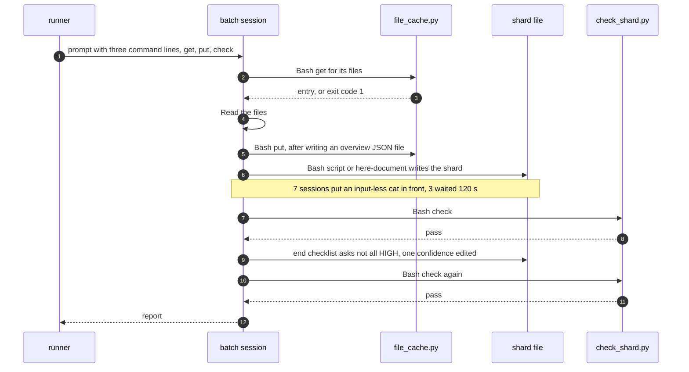
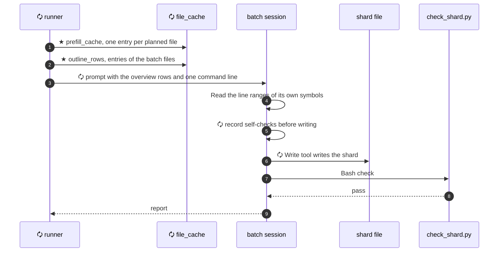
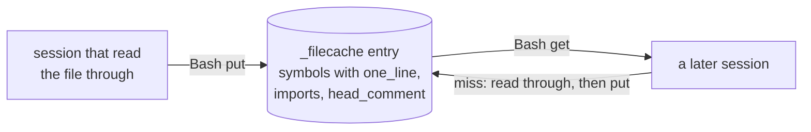
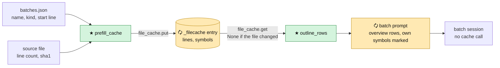
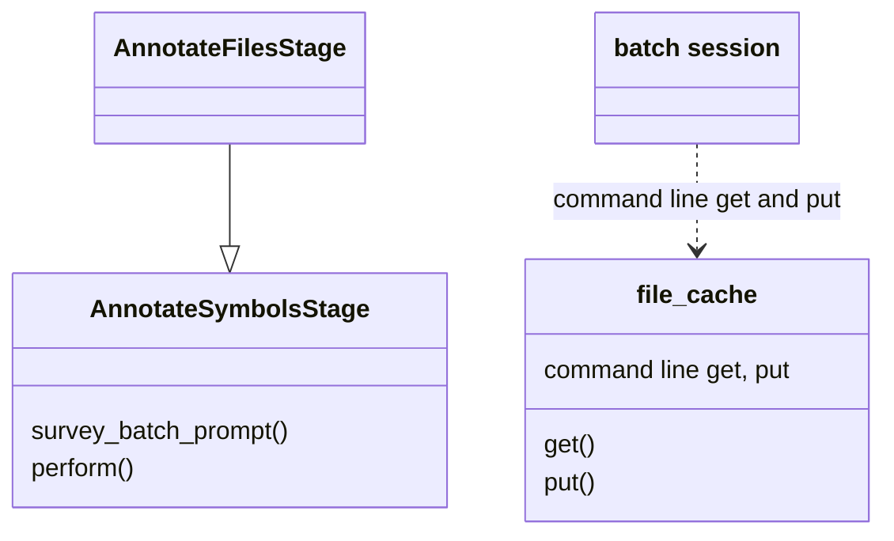
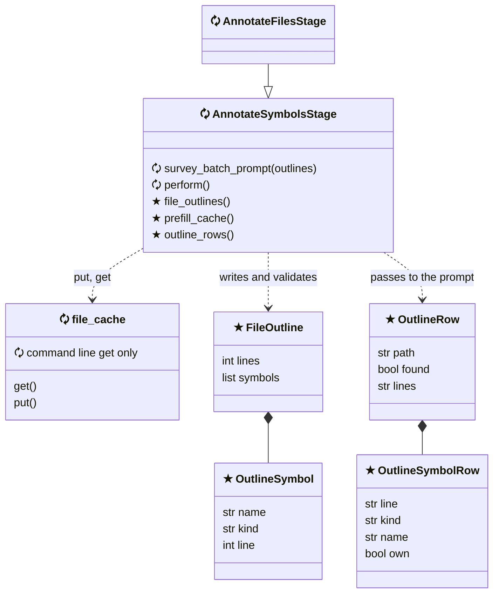

# ✂️ B3 — Fewer requests per survey session: implementation plan

> 🔄 Status as of 2026-11-23: carried out — implemented and merged into `main` (see `git log`). Its open decisions D1–D4 are still the user's. The approval line below stands as written before the merge.

> 📅 2026-11-23 · branch `mode1-b3` (local, not pushed) · **Before = `mode1-a1-b1` (A1 + B1)**, commit `9932518`. Plans B2 and A2 are **not** underneath
> 📄 Evidence: `docs/superpowers/specs/2026-11-22-mode1-remediation-split.md` ("Decided", "How to read Measurement A", "A3 allow-list probe") · `docs/superpowers/plans/2026-11-22-mode1-session-cache-plan.md` (F9, R6, R8–R13) · `docs/superpowers/specs/2026-11-21-mode1-cold-run-report.md` §2.2 · §4.1 · §4.5 · `docs/superpowers/specs/2026-11-21-mode1-audit-verification-report.md` §2.5 and the "통독 캐시 왕복" row · the baseline run's session transcripts (92 survey sessions, recounted for this plan) · the baseline run's target clone
> 🔒 Rules kept: prompts stay in `resource/` · the template gives the shape, the stage decides the data · no check loosened (no new `xfail`/`skip`, fault severities · `DROP_CLASS` · `REPORT_ONLY` untouched) · comments state the present only · no paid model call
> 🧪 Verification: every task was written test first; the failing run and the passing run are quoted in the task. Six gates at the end. No session was launched — what sessions do with the new prompt is `[unverified]` until Measurement A
> ✋ Approval: **implemented on branch `mode1-b3`, not merged — awaiting the user's review**
> ⚠️ Changed after this plan was written, on branch `mode1-a3-b3` (B3 + A3): the sentence "이 파일은 **Write 도구로** 쓴다" was taken out of section `nonnode` again (`542d68e`, open decision D2 — the single non-node shard is too large for one `Write`), and the check line of sections `batch` and `pass2` is now rendered from A3's list of allowed calls with shell-quoted paths (`48fed68`). Tasks 1–7 below describe `mode1-b3` as it was

Labels: `[measured]` a counted value · `[code read]` source that was read · `[proposed]` proposed here, not decided · `[judgment]` an assessment · `[estimate]` derived from measured values · `[unverified]` not checked.

**Goal:** A batch session of the survey needs fewer requests: no call to the cache script, no shell command to write the shard, no second check after a passed one.

**Architecture:** The survey stage writes one overview per planned file into the read-through cache before any session starts, and puts the overview rows of a batch's files into that batch's prompt. The prompt names one command line (the shard check), says the shard is written with the `Write` tool, and asks the record self-checks before the shard is written instead of after the check.

## 📄 One-page summary

| | |
|---|---|
| 🎯 Covers | <span style="color:cyan">Read-through cache</span> round trips · the sessions "whose first check failed" · the input-less `cat >` in front of the shard-writing shell command |
| 🧩 Conclusion | Seven commits. The machine <span style="color:cyan">pre-fills</span> the cache (👍 decided) and the batch prompt carries the <span style="color:cyan">overview</span> (`[proposed]`, open decision D1). The recount changes the picture of the second item: **8 of 92** sessions failed their first real check, none of them on a checker fault — the extra requests after writing are **second checks after a pass**, 18 of 24 of them after the session lowered a `confidence` value |
| 🟰 Unchanged | The 14-stage flow · session unit (layer · batch target 8 · concurrency 8) · record contract · <span style="color:cyan">shard check</span> and its faults · merge · the `nonnode` and `pass2` sections except one added sentence each |
| 🗘 Changed | Section `batch` of the prompt ("읽는 법", a new "쓰기 전에", "끝내기 전에") · one sentence in each of the three sections · `AnnotateSymbolsStage` (three functions, one parameter) · both `perform` · `file_cache.py` command line |
| ⚠️ Trap | (1) B3 only changes wording. Sessions still start with `bypassPermissions`, and plan A2 is shelved — a session that ignores the wording can hang the flow exactly as in the baseline until A3's allow-list lands ("Couplings"). (2) The single non-node session of this base would have to write about 71,000 characters in one `Write` call (open decision D2) |
| 🚫 Out of scope | Time limits (A2, shelved) · permission mode and allow rules (A3) · splitting the non-node session (B2) · batch size, layers, concurrency · the wording "confidence 가 전부 HIGH 는 아닌가" itself |

## 🚦 Status

| Item | Commit on `mode1-b3` | Progress |
|---|---|---|
| Task 1 — the machine writes an overview per planned file before the survey | `8dd7f83` | ✅ |
| Task 2 — the batch prompt carries the overview; no cache command in the prompt | `2951df4` | ✅ |
| Task 3 — the cache script's command line loses `put` | `f5deb94` | ✅ |
| Task 4 — all three sections say the shard is written with the `Write` tool | `820909e` | ✅ |
| Task 5 — the three record self-checks move in front of the write | `e57c9ee` | ✅ |
| Task 6 — documents and comments say who writes the cache | `51929a6` | ✅ |
| Task 7 — README regenerated, six gates | `033b299` | ✅ |
| Effect on real sessions | — | ❌ not measured — Measurement A |
| Merge into `main` · home copy of the survey skill | — | ❌ not done |

## ✋ Decided and proposed

### 👍 Decided — by the user, not reopened here

| What | 👍 Chosen | 👎 Dropped | When |
|---|---|---|---|
| Read-through cache | The machine pre-fills it before the survey. Sessions never `put`. The one-line summary sessions wrote (`one_line`) is dropped | Removing the procedure · leaving it | 2026-11-22 |
| Unit of a session | Unchanged (layer · batch target 8 · concurrency 8). B3 deals with request count only | Concurrency 16 · another batch target | 2026-11-22 |
| How the effect is read | No with-and-without run. Once, in Measurement A | A comparison run | 2026-11-22 |
| Order of track B | B1 → **B3** → B2. B2 is rebased onto B3 | B1 → B2 → B3 | 2026-11-23 |
| Plan A2 (session time limits) | **Shelved.** A hang is controlled by removing its cause — B3's wording now, A3's allow-list after B3 | A time limit per stage | 2026-11-23 |

The first three rows are from the split document, section "Decided". The decision of 2026-11-22 also reads "sessions only `get`"; how the overview reaches a session is the open decision D1 below.

### `[proposed]` Proposed by this plan — one axis per row

| Axis | Chosen (implemented) | Alternative | Trade-off |
|---|---|---|---|
| P1 Route of the overview | The batch prompt carries the rows; the session calls no cache script | Keep a `get` line in the prompt | **Open decision D1** |
| P2 What an overview holds | File line count + name · kind · start line of every planned symbol of the file | (b) add signatures from the code map · (c) list only the other batches' symbols | The plan symbol holds exactly name · kind · file · line `[code read]` (`survey_plan.PlanSymbol`). (b): 558 of 763 nodes of the baseline code map carry a signature `[measured]`, but the plan does not — it needs a new plan field or a second read. (c) is shorter by the 761 own rows of 3,036 `[measured]` and loses the range hint between own symbols |
| P3 Where the pre-fill runs | First lines of the survey stage's `perform`, both strategies | (b) a new machine stage · (c) inside `schedule-batches` | (b) changes the stage list a test pins (`test_mode1.py:955`, 14 and 15) and the transitions. (c) ties a cache entry to the planning run instead of the survey run, so a file changed in between leaves a stale entry |
| P4 What `put` becomes | The function stays (one caller, `prefill_cache`); the command-line `put` goes | Keep the command-line `put` | Kept, a session could overwrite a machine entry with its own shape. Callers of the command-line `put` after Task 2: none `[measured]` (grep) |
| P5 How the prompt says "do not write through the shell" | One sentence under the shard path, in all three sections: "이 파일은 **Write 도구로** 쓴다. Bash 로 쓰지 않는다." | (b) forbid `cat >` and here-documents by name · (c) leave it to A3 | (b) spells out the commands to a reader that had not thought of them. (c) leaves the baseline's hang cause in place until A3. The sentence agrees with A3's notice ("the shard is written with Write") |
| P6 Second checks after a pass | Move the three record self-checks into a new "쓰기 전에" block in front of "쓰는 곳"; wording unchanged | (b) leave them after the write · (c) drop the "not all HIGH" line | 18 of the 24 second checks follow a `confidence` edit `[measured]`. (c) changes what records say, which the split document proposes to leave alone |
| P7 A file without a usable entry | The row says "(개요 없음 — 이 파일은 통독한다)" and the session goes on | Fail the stage | An unreadable or just-changed file is no reason to stop a survey; the session reads it as before |

## 🧮 Structure count

| What | Count | Implementers · consumers `[measured]` (grep on `mode1-b3`) |
|---|---|---|
| New stage · module · file | 0 | — |
| New typed shapes | 4 `TypedDict` | `FileOutline` · `OutlineSymbol`: written by `prefill_cache`, validated by `outline_rows`. `OutlineRow` · `OutlineSymbolRow`: built by `outline_rows`, read by the template |
| New functions | 3 | `prefill_cache` 1 · 2 (`survey.py:635`, `survey_files.py:51`) · `outline_rows` 1 · 2 (`survey.py:681`, `survey_files.py:144`) · `file_outlines` 1 · 1 (plus its own test) |
| Removed | 1 command-line sub-command | `put` on the command line: 0 callers left. The function `put`: 1 caller in `src/` |
| Command lines in a batch prompt | 3 → 1 | `get` · `put` · check → check |

Deletion test: without `prefill_cache` every overview row says "개요 없음" and sessions read files through; without `outline_rows` the prompt has no overview. `[judgment]` After D1 = prompt route the on-disk cache has one writer and one reader in the same stage, and the command-line `get` has no caller; that is recorded under open decision D3, not acted on.

## 🔢 Counts from the baseline run's session transcripts

Method `[measured]`: every survey session's tool calls and results were pulled out in order (92 sessions — 91 batch, 1 non-node — 868 tool calls). A Bash call counts as a **check run** when a simple command of it executes `check_shard.py`; calls that only name the file (`ls` · `grep` · `wc` · `ps`) were excluded after reading them, and the outcome is taken from the checker's own verdict line or, without one, from the output read by eye. No keyword heuristic decides pass or fail.

| What | Count |
|---|---|
| Check runs | 124 — batch 120, non-node 4 |
| Outcome of the 124 | pass 116 · interpreter missing 3 · never reached the checker (input-less `cat >` in front) 2 · shard missing because the session's own shell writer failed 1 · `--help` probe 1 · wrong path to the checker 1 |
| Checker fault lines (`✗ [kind] …`) or `불평 N` verdicts in any run | **0** |
| **First check run of a session** | pass **84** · not a pass **8** — interpreter 3 (`L0-B06` · `L0-B21` · `NONNODE`), `cat >` 2 (`L0-B20` · `L1-B14`), own writer 1 (`L0-B13`), `--help` 1 (`L0-B16`), wrong path 1 (`L0-B40`) |
| Check runs per session | 1 run: 64 sessions · 2: 25 · 3: 2 · 4: 1. The last run is a pass in 92 of 92 |
| **Runs after a session's first pass** | **24**, in 22 sessions. In 18 of them the calls in between assign a record's `confidence` (15 change nothing else); samples read: one record set to `MEDIUM`, then the check again |
| Non-node session | 4 runs — 1 interpreter missing (exit code 127), 3 pass. 5 Bash calls name the checker |
| Responses per batch session | median 8 (min 4 · max 14 · n 91 · sum 734). Non-node: 46 |
| Bash calls of batch sessions | 605. **281** name `file_cache.py`; **226 run it** — 181 `get`, 45 `put`; 55 only name it (mostly `ls` probes after the interpreter was not found) |
| `get` | in 91 of 91 batch sessions (1 call: 9 sessions · 2: 74 · 3: 8). 97 `get` calls printed the missing-interpreter line; 41 calls, in 41 sessions, printed an entry |
| `put` | in 44 sessions |
| Responses holding a cache call | 226 of 734; in 146 of them every tool call is a cache call |
| Input-less `cat >` | issued by **7** sessions. 3 waited for the 120 s tool limit (`L0-B20` · `L1-B08` · `L1-B14`). The other 4 named `/tmp/x`, a directory on that machine, so the redirect failed at once and the command went on |
| How the shard was written | `Write` tool straight to the shard: 21 sessions · through the shell: 71 |
| Cache after the run | 62 of 71 planned files had an entry (638 symbol rows); 7 entries list fewer symbols than the plan |

**Against the reports** (the reports are not edited):

| Report says | Recount | What the report's number is |
|---|---|---|
| "45 of 92 sessions failed the first check and rewrote" (cold-run §4.5) | 8 of 92; none on a checker fault | 45 = sessions whose first Bash call that *names* `check_shard.py` prints no `통과`. 39 of those calls are not runs (35 `ls`, then `grep` · `wc` · a loop) |
| "the non-node session ran the check 10 times" (cold-run §2.2 · verification §2.5) | 4 runs | not reproduced by any count tried |
| "281 of 605 call the cache script — 175 reads, 47 writes" (verification, 통독 캐시 왕복) | 281 name it, 226 run it — 181 `get`, 45 `put` | 281 is the count of calls naming the file |
| "three sessions had the `cat >`" (cold-run §4.1) | 7 issued it, 3 waited | the report counts the ones that hit the limit |

**B3 applied to the baseline plan** `[measured]` (the code of `mode1-b3` run on a copy of the baseline target's plan and sources; no session):

| | Before | After |
|---|---|---|
| Files with an entry before the first session | 0 | 71 of 71 (761 symbol rows · 94,886 bytes) |
| Batch prompts · characters in all | 91 · 352,576 | 91 · 540,731 (+53%) |
| Characters per prompt, median · max | 3,642 · 7,357 | 4,822 · 19,017 |
| Overview rows per prompt | — | median 20 · max 190 · 3,036 in all, 761 of them "네 심볼" |

## 🔁 Before and After

| 📍 Before (`mode1-a1-b1`) | 🛠️ After (`mode1-b3`) | 🎉 What it resolves | 🔭 Expected | Progress |
|---|---|---|---|---|
| The prompt tells a session to `get` each file and, on a miss, to read the file through, write an overview JSON and `put` it `[code read]`; 226 of 605 Bash calls did that `[measured]` | The stage writes the entries; the prompt lists them; no cache command | A request round per `get` and per `put`; the overview-writing work | Share of cache-script calls 0 `[unverified]` | ✅ code · ❌ measured |
| Entries exist only for files some session finished: 62 of 71 at the end of the baseline `[measured]` | 71 of 71 before the first session `[measured]` | Layer-0 sessions get an overview too | — | ✅ |
| The prompt does not say how to write the shard `[code read]`; 71 of 92 sessions used the shell, 7 with an input-less `cat >` in front `[measured]` | One sentence in each section: `Write` tool, not Bash | The command that waited 120 s in 3 sessions and held one for about 9 min 30 s | No input-less `cat >` `[unverified]` — and not enforced before A3 | ✅ code · ❌ measured |
| "confidence 가 전부 HIGH 는 아닌가" stands after the write, next to the check; 18 second checks follow a `confidence` edit `[measured]` | The three record self-checks stand in front of "쓰는 곳" | One rewrite and one check per affected session | Fewer second checks `[unverified]` | ✅ code · ❌ measured |
| The command line of `file_cache.py` takes `get` and `put` | `get` only | A session cannot replace a machine entry | — | ✅ |

## ★ New · 🗘 Changed · ✕ Removed

Order: module → file → class → function → member, against `9932518`.

| Level | Item | Mark | Belongs to |
|---|---|---|---|
| module | `src/codewiki/python/runner` · `src/codewiki/python/machine` · `resource/codewiki` · `test/codewiki` | 🗘 | — |
| file | `resource/codewiki/prompts/annotate-symbols.md` | 🗘 | `resource/codewiki` |
| file | `mode1/survey.py` · `mode1/survey_files.py` · `mode1/context.py` | 🗘 | runner |
| file | `machine/file_cache.py` · `machine/survey_plan.py` (one comment) | 🗘 | machine |
| file | `test_mode1.py` · `test_file_cache.py` · `test_run_mode1.py` · `test_survey_plan.py` (docstring) | 🗘 | `test/codewiki` |
| file | `src/codewiki/CLAUDE.md` · `.agents/skills/codebase-terms-survey/SKILL.md` · `src/codewiki/python/runner/README.md` (generated) | 🗘 | documents |
| class | `OutlineSymbol` · `FileOutline` · `OutlineSymbolRow` · `OutlineRow` | ★ | `mode1/context.py` |
| class | `AnnotateSymbolsStage` · `AnnotateFilesStage` | 🗘 | `mode1/survey.py` · `mode1/survey_files.py` |
| function | `file_outlines` · `prefill_cache` · `outline_rows` | ★ | `AnnotateSymbolsStage` |
| function | `survey_batch_prompt` · `perform` (both classes) | 🗘 | the two stages |
| function | thirteen tests (5 · 5 · 1 · 1 · 1 over Tasks 1–5) | ★ | `test_mode1.py` (12) · `test_file_cache.py` (1) |
| function | `file_cache.get` · `file_cache.put` · `check_shard` · `nonnode_prompt` · `pass2_prompt` | — reused unchanged | — |
| member | parameter `outlines` | ★ | `survey_batch_prompt` |
| member | prompt variable `outlines`; block "쓰기 전에"; the `Write` sentence ×3 | ★ | `annotate-symbols.md` |
| member | prompt lines `file_cache.py get` · `file_cache.py put` · the overview shape with `one_line` | ✕ | section `batch` |
| member | the `put` branch of the command line | ✕ | `file_cache.py` |
| member | two assertions on the `get` and `put` lines in B1's interpreter test | ✕ | `test_mode1.py` |

## 🔀 Diagrams

Marks in labels: ★ new · 🗘 changed. Unmarked = unchanged.

### Sequence — the requests of one batch session

Before. `[measured]` the pattern of the baseline with the interpreter detour (B1's subject) left out.



After. `[code read]` the prompt and the stage; the session's part is `[unverified]`.



### Flow — how an overview reaches a session

Before.



After.



### Class — typed shapes

Before. The entry's `outline` is whatever a session passed to `put`; no type describes it.



After.



## 📝 Where to change

| File · symbol (lines on `mode1-b3`) | Change | Reason |
|---|---|---|
| ★ `mode1/context.py:138-164` | four `TypedDict` | the entry's shape and the prompt rows |
| ★ `survey.py:210-238` `file_outlines` · `prefill_cache` | plan → one entry per file through `file_cache.put` | the machine pre-fills (👍) |
| ★ `survey.py:240-256` `outline_rows` | entries of a batch's files → prompt rows; `found: False` when missing, changed or of another shape | the prompt carries the overview (P1) |
| 🗘 `survey.py:118` `survey_batch_prompt` | parameter `outlines`, passed to the template | names in the template must equal the values passed |
| 🗘 `survey.py:635` · `survey_files.py:51` `perform` | call `prefill_cache` after `write_schema`, before any session | both strategies (P3) |
| 🗘 `survey.py:681` · `survey_files.py:144` | pass `outlines=self.outline_rows(ctx.repo, b)` | both strategies |
| 🗘 `annotate-symbols.md:61-80` "읽는 법" | the `get` · `put` procedure → the overview loop | P1 |
| 🗘 `annotate-symbols.md:106-127` | ★ "쓰기 전에" block; the `Write` sentence; "끝내기 전에" keeps two items | P5 · P6 |
| 🗘 `annotate-symbols.md:185` · `:223` | the `Write` sentence in `nonnode` and `pass2` | P5 |
| 🗘 `file_cache.py` docstring and `__main__` | ✕ the `put` branch | P4 |

## 🧩 Tasks — one per commit

Commands run from the worktree root. "Red" is the task's tests on the parent commit's `src/` and `resource/`; "green" is the commit itself. Diffs are **actual diff** excerpts of the named commit on `mode1-b3`.

### Task 1 — the machine writes an overview per planned file · `8dd7f83`

Files: `mode1/context.py` · `mode1/survey.py` · `mode1/survey_files.py` · `test/codewiki/test_mode1.py`

Tests: `test_파일_개요는_계획의_심볼을_파일마다_줄_순서로_싣는다` · `test_조사_전에_계획의_파일마다_개요를_캐시에_쓴다` · `test_개요_쓰기는_없는_파일을_건너뛰고_옛_개요를_덮는다` · `test_annotate_symbols_는_세션을_띄우기_전에_개요를_쓴다` · `test_파일_전략도_세션을_띄우기_전에_개요를_쓴다`

- `.venv/bin/python -m pytest test/codewiki/test_mode1.py -q -k "개요"`
- Red: `5 failed, 2 passed` — `AttributeError: … has no attribute 'file_outlines'` · `… 'prefill_cache'` (twice) · `assert [False] == [True]` · `assert ([False, False, False] and False)` (the two `perform` tests: no entry exists when the first session starts).
- Green: `7 passed`; the whole file `199 passed`.

```diff
+    @staticmethod
+    def prefill_cache(repo: str, plan: survey_plan.SurveyPlan) -> int:
+        n = 0
+        for rel, rows in AnnotateSymbolsStage.file_outlines(plan).items():
+            try:
+                with open(os.path.join(repo, rel), "rb") as f:
+                    lines = len(f.read().splitlines())
+            except OSError:
+                continue
+            outline: FileOutline = {"lines": lines, "symbols": rows}
+            file_cache.put(repo, rel, outline)
+            n += 1
+        return n
@@ AnnotateSymbolsStage.perform
         self.write_schema(X.RECORD_SCHEMA.locate(ctx))
+        print("통독 캐시 — 파일 %d개의 개요를 미리 썼다" % self.prefill_cache(ctx.repo, ctx.plan), flush=True)
```

What the code does on the questions the design had to answer `[code read]`: the source of an entry is the plan (`batches.json`) plus the file's line count; `file_outlines` gathers every planned symbol of a file regardless of layer, sorted by line. The call runs at every `perform`, so on a resumed or incremental run every planned file's entry is written again from the current plan and file. `file_cache.put` stores the file's `sha1`; `get` returns `None` when the file no longer matches, and Task 2 turns that into a "개요 없음" row.

### Task 2 — the batch prompt carries the overview · `2951df4`

Files: `annotate-symbols.md` · `mode1/context.py` · `mode1/survey.py` · `mode1/survey_files.py` · `test_mode1.py` · `test_run_mode1.py`

Tests: ★ `test_개요_줄은_배치의_파일마다_캐시의_개요를_내고_맡은_심볼을_표시한다` · `test_개요_줄은_캐시에_없거나_파일이_바뀌었거나_꼴이_다르면_없다고_낸다` · `test_배치_프롬프트는_개요를_싣고_캐시_명령을_적지_않는다` · `test_층_전략의_배치_프롬프트는_캐시의_개요를_싣는다` · `test_파일_전략의_배치_프롬프트도_캐시의_개요를_싣는다`. 🗘 two existing tests follow the text (`…보고_뒤에는_아무것도_없다` · `test_배치_프롬프트는_자기_심볼과_자기_샤드만_말한다`). ✕ the two `file_cache.py get` · `put` assertions of `test_전수조사_프롬프트는_실행기의_해석기를_적는다` (B1's test); its check-command assertions stay.

- `.venv/bin/python -m pytest test/codewiki/test_mode1.py test/codewiki/test_run_mode1.py qa/gates/test_prompt_resources.py -q`
- Red (without the gate file): `7 failed, 262 passed` — `AttributeError: … 'outline_rows'` (twice) · `TypeError: survey_batch_prompt() got an unexpected keyword argument 'outlines'` · four assertions on prompt text that is not there yet.
- Green: `274 passed`.

```diff
-1. 담당 파일마다 통독 캐시를 먼저 본다:
-     {{python}} {{root}}/src/codewiki/python/machine/file_cache.py get {{repo}} <파일경로>
-   - 있으면: 개요를 읽고 **네 심볼의 줄 범위만** 실제로 연다.
-   - 없으면: 파일을 통독하고, 끝나면 개요를 **JSON 파일로 먼저 쓴 뒤** 그 경로를 넘긴다:
-     {{python}} {{root}}/src/codewiki/python/machine/file_cache.py put {{repo}} <파일경로> <개요json의_파일경로>
-     넷째 인자는 JSON 문자열이 아니라 **파일 경로**다. 문자열을 넣으면 죽는다.
-     개요 꼴 — 심볼마다 {name, kind, line, end_line, signature, one_line} 에
-     파일의 imports 와 head_comment 를 더한 객체.
-2. **네 심볼은 캐시로 때우지 않는다.** 반드시 그 줄 범위를 실제로 읽는다.
-   캐시는 남의 심볼을 uses[].to 로 가리킬 때만 쓴다.
+1. 담당 파일의 개요를 먼저 본다. 기계가 조사 전에 적어 둔 것이고, 줄 번호는 심볼이 **시작하는** 줄이다:
+
+
+     {{ o.path }} ({{ o.lines }}줄)
+
+       {{ s.line }}  {{ s.kind }}  {{ s.name }}{{ "   <- 네 심볼" if s.own else "" }}
+
+
+     {{ o.path }} (개요 없음 — 이 파일은 통독한다)
+
+
+     (개요 없음 — 담당 파일을 통독한다)
+
+   - 개요를 읽고 **네 심볼의 줄 범위만** 실제로 연다. 끝 줄은 적혀 있지 않다 — 클래스는 뒤따르는
+     메서드를 품으므로 다음 줄 번호가 곧 그 심볼의 끝은 아니다.
+   - import · 파일 머리 주석 · 시그니처는 개요에 없다. 필요하면 파일에서 본다.
+2. **네 심볼은 개요로 때우지 않는다.** 반드시 그 줄 범위를 실제로 읽는다.
+   개요는 남의 심볼을 uses[].to 로 가리킬 때만 쓴다.
```

```diff
+    @staticmethod
+    def outline_rows(repo: str, batch: survey_plan.PlanBatch) -> list[OutlineRow]:
+        own = {(s["file"], s["name"]) for s in batch["symbols"]}
+        rows: list[OutlineRow] = []
+        for rel in batch["files"]:
+            try:
+                o = msgspec.convert((file_cache.get(repo, rel) or {}).get("outline"), FileOutline)
+            except msgspec.ValidationError:
+                rows.append({"path": rel, "found": False, "lines": "", "symbols": []})
+                continue
+            rows.append({"path": rel, "found": True, "lines": str(o["lines"]), "symbols": [
+                {"line": str(s["line"]), "kind": s["kind"], "name": s["name"], "own": (rel, s["name"]) in own}
+                for s in o["symbols"]]})
+        return rows
```

The report line at the end of the section changes from "캐시로 때운 파일" to "개요로 범위만 읽은 파일". A rendered sample is in "Glossary" under <span style="color:cyan">overview</span>.

### Task 3 — the command line loses `put` · `f5deb94`

Files: `machine/file_cache.py` · `test/codewiki/test_file_cache.py`. Test: `test_명령줄은_get_만_받는다`.

- `.venv/bin/python -m pytest test/codewiki/test_file_cache.py -q`
- Red: `1 failed, 8 passed` — `assert (0 != 0)`: the `put` command line still succeeds. Green: `9 passed`.

```diff
         json.dump(d, sys.stdout, ensure_ascii=False, indent=1)
-    elif cmd == "put":
-        with open(sys.argv[4], encoding="utf-8") as f:
-            print(put(repo, rel, json.load(f)))
     else:
         sys.exit("모르는 명령 %s" % cmd)
```

The module docstring now says who writes and who reads. The function `put` and the command-line `get` are untouched.

### Task 4 — the shard is written with the `Write` tool · `820909e`

Files: `annotate-symbols.md` (sections `batch` · `nonnode` · `pass2`) · `test_mode1.py`. Test: `test_프롬프트_셋은_샤드를_Write_도구로_쓰라고_한다` — it renders the three prompts of this base (`survey_batch_prompt` · `nonnode_prompt("/repo", "/root")` · `pass2_prompt`) and requires the sentence exactly once, directly under the shard path.

- `.venv/bin/python -m pytest test/codewiki/test_mode1.py -q -k "Write_도구"`
- Red: `1 failed` — `assert 0 == 1` on the batch prompt. The count of the sentence per section on the parent commit is `{'batch': 0, 'nonnode': 0, 'pass2': 0}`, on the commit `{'batch': 1, 'nonnode': 1, 'pass2': 1}`. Green: `1 passed`.

```diff
   {{repo}}/out/codegraph-raw/_shards/{{bid}}.json      꼴은 {"키": 레코드}
 
+이 파일은 **Write 도구로** 쓴다. Bash 로 쓰지 않는다.
@@ section nonnode
   {{repo}}/out/codegraph-raw/_shards/NONNODE.json      꼴은 {"키": 레코드}
 
+이 파일은 **Write 도구로** 쓴다. Bash 로 쓰지 않는다.
@@ section pass2
   {{repo}}/out/codegraph-raw/_shards/_pass2/{{bid}}.json      꼴은 {"키": 레코드}
 
+이 파일은 **Write 도구로** 쓴다. Bash 로 쓰지 않는다.
```

### Task 5 — record self-checks before the write · `e57c9ee`

Files: `annotate-symbols.md` (section `batch`) · `test_mode1.py`. Test: `test_배치_프롬프트는_자기_점검을_쓰기_전에_두고_쓴_뒤에는_검문만_남긴다` — eight headings and items appear once each, in this order.

- `.venv/bin/python -m pytest test/codewiki/test_mode1.py -q -k "자기_점검"`
- Red: `1 failed` — `ValueError: substring not found` (no "쓰기 전에" heading). Green: `1 passed`.

```diff
+## 쓰기 전에 — 레코드를 다 정한 뒤에 쓴다
+
+- 심볼 {{n}}개에 레코드가 {{n}}개 있는가
+- where 의 줄 번호를 실제로 열어 확인했는가
+- confidence 가 전부 HIGH 는 아닌가
+
 ## 쓰는 곳 — 여기 말고 아무 데도 쓰지 않는다
@@
 ## 끝내기 전에
 
-- 심볼 {{n}}개에 레코드가 {{n}}개 있는가
-- where 의 줄 번호를 실제로 열어 확인했는가
-- confidence 가 전부 HIGH 는 아닌가
 - 샤드 파일 하나만 만들었는가
```

The three lines are moved, not reworded. The checker and what it accepts are unchanged.

### Task 6 — documents and comments · `51929a6`

Files: `src/codewiki/CLAUDE.md` (the `file_cache.py` row) · `.agents/skills/codebase-terms-survey/SKILL.md` (three places: step 6, the "다시 통독" pitfall, the `_filecache` row — writer is now the survey stage) · `machine/survey_plan.py` (one comment) · `test_survey_plan.py` (one docstring). No behavior. `.venv/bin/python -m pytest test/codewiki/test_survey_plan.py -q` → `24 passed, 1 skipped`.

The copy of that skill outside the repository is not touched by this plan and is now behind the repository's.

### Task 7 — README and the six gates · `033b299`

`src/codewiki/python/runner/README.md` regenerated with `tools/gen_readme.py` (the four shapes, the three functions, the new parameter). Gates on `mode1-b3` `[measured]`:

| Gate | Result |
|---|---|
| `.venv/bin/python -m pytest -q` | 1023 passed · 25 skipped · 2 xfailed (base `9932518`: 1010 · 25 · 2 — thirteen tests more, no new skip or xfail) |
| `npm test` | 8 pass |
| `npm run typecheck` | pass |
| `npm run typecheck:py` | 0 errors |
| `tools/gen_readme.py --check` on the nine folders | 9 match |
| `npm run doctor` | every required item present |

## 🔗 Couplings

**Commands a session is told to run after B3** `[code read]` — one literal line per session kind, no variable, no pipe. `<interpreter>` is `sys.executable` of the runner (B1), `<tool>` the tool repository, `<target>` the target repository:

| Session | Bash command line | Tools the prompt names for files |
|---|---|---|
| batch `<bid>` | `<interpreter> <tool>/src/codewiki/python/runner/check_shard.py <target>/out/codegraph-raw/_shards/<bid>.json` | `Write` → `_shards/<bid>.json`. Reads: sources, `record-schema.json`, on a retry the returned shard |
| non-node | `<interpreter> <tool>/src/codewiki/python/runner/check_shard.py <target>/out/codegraph-raw/_shards/NONNODE.json` | `Write` → `_shards/NONNODE.json`. Reads: `terms-reading.json`, sources, `record-schema.json` |
| second pass `<bid>` | `<interpreter> <tool>/src/codewiki/python/runner/check_shard.py <target>/out/codegraph-raw/_shards/_pass2/<bid>.json` | `Write` → `_shards/_pass2/<bid>.json`. Reads: `record-schema.json` |

- **A3 (isolation, allow-list) — lands after B3.** Its rule list is built from the table above: one Bash rule (the check) and the write rule on the shard folder. The probed third rule, cache `get`, has no line in the prompt any more; the A3 plan already says "if B3 drops `get` too, delete the `cache` row". A3's notice ("files are read with Read, the shard is written with Write") agrees with Task 4's sentence. If D1 goes back to `get`, the row returns.
- **A2 (time limits) — shelved (user, 2026-11-23).** The baseline's hang is to be controlled by removing its cause. What that covers and what it does not:
  - `[code read]` B3 changes wording only. On this branch a session still starts with `bypassPermissions`, so nothing stops a session from issuing `cat >` or any other command that waits on standard input.
  - `[measured]` In the baseline such a command sat until the 120 s tool limit, was moved to the background, and one session was not over until about 9 min 30 s later.
  - `[code read]` No time limit applies to a survey session unless the operator passes `--timeout` (`run_mode1.py:215`, default none).
  - **Until A3 lands:** a session that ignores Task 4's sentence can hold a layer as in the baseline, and nothing ends it. **After A3:** `cat >` and here-documents are outside the allow rules; in the probe none of three sessions tried them `[measured]` (R11), and what a session does after such a denial is `[unverified]`. **Not covered by either plan:** a hang with another cause — an allowed command that blocks, a model request that stalls, the CLI itself. Measurement A has to be watched for it.
- **B1 — underneath.** B1 put `{{python}}` on five prompt lines; two of them (the cache `get` and `put` lines) are deleted here, and the two assertions B1's test made on them go with them. The three check lines are B1's and unchanged.
- **B2 — rebased onto B3 afterwards.** B2 rewrites section `nonnode` (session names, `{{sid}}`); it must carry Task 4's sentence under its shard-path line, and `test_프롬프트_셋은_샤드를_Write_도구로_쓰라고_한다` then lists B2's sessions instead of the single `nonnode_prompt("/repo", "/root")` call. B3 edits nothing else in `nonnode`. B3 does not depend on either answer to B2's open decisions.
- **A1 — underneath, untouched.** Session rows keep their shape.

## 📖 Glossary

| Term | Code name | Meaning |
|---|---|---|
| <span style="color:cyan">survey</span> | stage `annotate-symbols` · `AnnotateSymbolsStage` · `AnnotateFilesStage` | The pass where sessions write one record per symbol; layer strategy and file strategy |
| <span style="color:cyan">batch session</span> | section `batch` · `survey_batch_prompt` | One session for one batch of the plan |
| <span style="color:cyan">read-through cache</span> | `machine/file_cache.py` · `out/codegraph-raw/_filecache/` | One entry per file: `path`, `sha1` of the file, `outline` |
| <span style="color:cyan">overview</span> | `FileOutline` (entry) · `OutlineRow` (prompt row) | A file's line count and its planned symbols with kind and start line. In a prompt: `     m.py (40줄)` then `       12  class  K` per symbol, with `   <- 네 심볼` after the batch's own |
| <span style="color:cyan">pre-fill</span> | `AnnotateSymbolsStage.prefill_cache` | Writing every planned file's entry before the first session |
| <span style="color:cyan">shard</span> | `out/codegraph-raw/_shards/<bid>.json` | One session's records |
| <span style="color:cyan">shard check</span> | `runner/check_shard.py` · `AnnotateSymbolsStage.check_shard` | The machine check a session runs on its own shard |
| <span style="color:cyan">check run</span> | — (a count of this plan) | A Bash call that executes the shard check |
| <span style="color:cyan">plan</span> | `out/codegraph-raw/batches.json` · `survey_plan.SurveyPlan` | Layers and batches with each symbol's name · kind · file · start line |

## ❓ Open decisions

| # | Decision | Evidence | Options | Recommendation | Blocked until answered |
|---|---|---|---|---|---|
| **D1** | **How a session receives the pre-filled overview.** The decision of 2026-11-22 says "sessions only `get`"; the branch goes one step further | `[measured]` R12: under the allow-list sessions looked up 1 file and 0 files, and one reported it skipped the lookups because they are Bash calls. `[measured]` baseline: `get` ran in 91 of 91 batch sessions (181 calls), 226 of 734 responses hold a cache call. `[measured]` the plan has 204 (file, batch) pairs — with A3's "one command per call" that is up to 204 `get` calls. `[measured]` cost of the prompt route: +53% prompt characters (max 19,017) | (a) the prompt carries the rows, no cache call — **implemented**. (b) keep one `get` line; the entry is machine-written either way | **(a)** `[judgment]`: it removes a request instead of making it cheaper, leaves A3 one Bash rule, and does not depend on the session choosing to look | Going back to (b): in `2951df4` restore the `get` line in "읽는 법" (about 4 lines in place of the 16-line loop) and B1's `get` assertion; delete or keep `outline_rows`, the two row shapes, the `outlines` parameter and five tests (about 120 lines). `prefill_cache` (Task 1) and the command-line `get` (kept by `f5deb94`) stay as they are; A3 keeps its `get` rule |
| D2 | The `Write` sentence in section `nonnode` while the non-node session is still one session | `[measured]` the baseline `NONNODE.json` is 71,035 characters (190 records); the largest batch shard is 19,728. `[measured]` the 39 responses of the run that are almost only one `Write` call of more than 3,000 characters spend a median of 0.73 output tokens per character (0.56–0.90). `[estimate]` one `Write` of that shard is about 52,000 output tokens; the largest response anywhere in the run has 31,463. `[unverified]` the output limit of one response in the CLI | (a) keep the sentence in all three sections — implemented. (b) leave `nonnode` without it until B2 splits the session. (c) let non-node sessions write in parts (needs more than one shard file — B2's subject) | **(a), with B2 next** `[judgment]` — B2 splits the session into three shards before Measurement A. B2 and A3 should check that each split shard fits one `Write`; with A3's tools (`Bash,Read,Write`) there is no partial rewrite | Nothing in B3. If Measurement A ran before B2, the non-node session's behavior would be unknown |
| D3 | The on-disk cache once D1 = (a) | `[measured]` one writer (`prefill_cache`), one reader (`outline_rows`), same stage, same process; the command-line `get` has 0 callers | (a) keep as is. (b) later: compute the rows from the plan and delete `file_cache.py` and its tests | **(a) now** `[judgment]` — "the machine pre-fills the cache" is decided, and D1 (b) needs the entries. Revisit after Measurement A | Nothing |
| D4 | Baseline values of the B3 row in "How to read Measurement A" | the recount above | (a) the split document's "281 of 605 · median 8 · 45 of 92 · 3". (b) "226 of 605 run the cache script · median 8 · 8 of 92 first runs not a pass and 24 runs after a pass · 3 of 7" | **(b)** `[judgment]` — (a)'s 45 and 281 count calls that name a file, which a session can still do after B3 | The comparison in Measurement A |

## 🧪 Verification · 🚫 Out of scope

- `[measured]` Each task's tests failed on the parent commit's implementation for the quoted reason and pass on the commit; the six gates pass on `mode1-b3` (Task 7).
- `[measured]` Run on the baseline plan with copied sources: 71 of 71 files get an entry, all 91 batch prompts render, and in every batch the rows marked "네 심볼" equal the batch's symbols.
- `[measured]` Each Mermaid block above was rendered with `mmdc` when the document was written.
- `[unverified]` Everything about sessions: whether they stop calling Bash for the shard, whether second checks drop, whether the larger prompt changes what they read. No session ran. Measurement A reads it once, mixed with the other plans' effects.
- `[unverified]` Start lines in an overview come from the plan. If sources change after the plan was made and before the survey, the lines are as stale as the "네가 맡은 심볼" list already was; the `sha1` only guards changes after the pre-fill.
- 🚫 Out of scope: time limits (A2, shelved) · permission mode and allow rules (A3) · splitting or mechanising the non-node session (B2) · batch target, layers, concurrency · signatures or end lines in the overview (P2) · removing the cache module (D3) · the reports and the split document, which keep their numbers.
