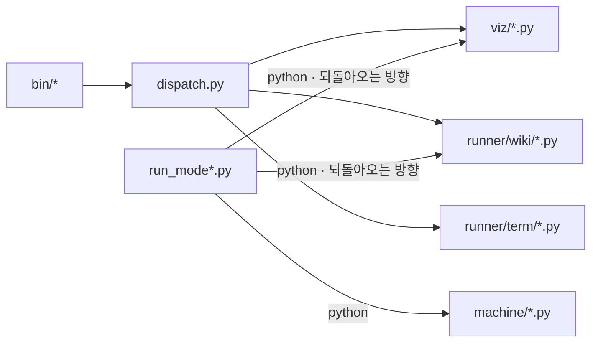

# runner/ — 러너축. 순서를 잡고 남을 부른다

> 루트 나침반은 [`../CLAUDE.md`](../CLAUDE.md). 결정론 기계는 [`../machine/CLAUDE.md`](../machine/CLAUDE.md), 시각은 [`../viz/CLAUDE.md`](../viz/CLAUDE.md), 시험 규약은 [`../test/CLAUDE.md`](../test/CLAUDE.md).

**여기 있는 코드는 스스로 계산하지 않는다.** 단계의 순서를 잡고, 자식 프로세스를 띄우고,
시간을 재고, LLM 칸을 부른다. 계산은 전부 `../machine/` 과 `../viz/` 가 한다.

## 무엇이 여기 있나

| 자리 | 하는 일 |
|---|---|
| `run_mode1.py` | Mode 1 의 `main` 과 옛 이름 재수출 파사드. 열두 단계 — `lang-hint→lang-decide→detect-changes→collect-graph→schedule-batches→annotate-symbols→snapshot-sources→verify-terms→outline-wiki→write-wiki→publish-wiki→verify-wiki`. LLM 칸은 넷(`lang-hint` · `annotate-symbols` · `outline-wiki` · `write-wiki`). `--cold` 는 전량(`detect-changes` 없음), `--resume` 은 `resume.json` 의 단계부터 |
| `mode1/` | Mode 1 의 단계 기계 — `context`(문맥 · 형 · 산출물 14개 `ARTIFACTS`) · `measured` · `machine_stage`(믹스인 · 베이스) · `diff`(`changes.json` 꼴) · `resume`(재개 JSON 꼴) · 단계 모듈 일곱 `lang` · `scan` · `graph` · `survey` · `survey_files`(`--strategy file` 의 `annotate-symbols`) · `terms` · `wiki` · `edges`(전이표 하나 · `ALIASES` · 팩토리). **계산은 그것을 쓰는 단계 클래스의 `@staticmethod`** 이고 둘이 쓰면 믹스인이다 — 단계 모듈에는 최상위 `def` 가 없다. 프롬프트 글은 `mode1/prompts/*.md` 에 산다 |
| `run_mode1_5.py` | Mode 1.5 — `collect→gate→[사람]→grade→emit`. `gate` 가 `GATE` 갈래로 멈춘다. `author` 단계는 없다 |
| `run_mode2.py` | Mode 2 — `init→[LLM]→build→check` |
| `measure.py` | 세 실행기가 함께 쓰는 **재는 코드** — LLM 결과의 꼴(`ClaudeResult`) · `parse_result` · 측정 표 · 하트비트. **`machine/` 을 import 하지 않는다** |
| `pipeline.py` | 세 실행기가 함께 쓰는 **단계 기계** — 갈래 넷 · `Stage` · `Artifact(schema · check)` · `load` · 전이표 · `StageDagGraph` · 시뮬레이터 · 드라이버 한 벌 · 팬아웃 호출 · `PromptResource`(프롬프트 파일을 읽는 믹스인). `measure.py` 와 같이 **`machine/` 을 import 하지 않는다** |
| `dispatch.py` | `bin/` 진입점 셋이 공유하는 명령 갈림길 (`run_dispatch`). `report` 만 예외다 |
| `wiki/` | Mode 1 의 얼갈이 — `prep` · `build` · `check` · `compdb` · `clang_doc` · `paths` (`.py`). `templates/vitepress.config.mts.tmpl` 은 위키 사이트 설정의 템플릿이다 |
| `term/` | Mode 1.5 의 얼갈이 — `collect` · `quiz` · `emit`. |
| `prompts/` · `mode1/prompts/` | LLM 프롬프트 글. `prompts/` 는 Mode 1.5 · 2 의 `ask.md` · `agent.md`, `mode1/prompts/` 는 Mode 1 의 네 단계(`lang-hint` · `annotate-symbols` · `outline-wiki` · `write-wiki`). 단계당 파일 하나(파일 이름이 단계 이름), 안은 `<!-- section: 이름 -->` 로 가른다 |

## 자주 쓰는 명령

실행기 셋은 저장소 루트에서 돌리고 첫 인자로 대상을 받는다 — 저장소 · Plan · 프로젝트와 slug.
`--dry-run` 은 자식 프로세스를 하나도 띄우지 않는다.

```bash
cd $REPO_ROOT
.venv/bin/python runner/run_mode1.py <저장소> --dry-run          # 자식 프로세스 0개. 폴백 간선까지 실제 흐름을 찍는다
.venv/bin/python runner/run_mode1.py <저장소> --only collect-graph --cold
.venv/bin/python runner/run_mode1.py <저장소> --resume --json evals/runs/$(date +%F)-mode1-<대상>-<조건>.json
.venv/bin/python runner/run_mode1_5.py <plan.md> --dry-run
.venv/bin/python runner/run_mode2.py <프로젝트> <slug> --dry-run
.venv/bin/python -m pytest runner/ -q                             # 러너 시험만
.venv/bin/python -m pytest runner/test_import_isolation.py -q     # measure.py · pipeline.py 가 machine/ 을 물지 않는가
```

**`bin/` 은 왜 여기 없나.** `~/.zshrc` 가 `$REPO_ROOT/bin` 을 PATH 에 넣으므로 **옮기면 셸이 깨진다.**
성격은 러너축이지만 자리는 뿌리에 고정이다.

## 두 방향의 자식 프로세스 — 순환이 아니다



**`dispatch.py` 는 확장자를 보고 해석기를 고른다** — `.py` 면 python, 아니면 node.

**Why — 서로 부르는데 왜 순환이 아닌가.** 파이썬 실행기가 최상위 오케스트레이터이고 얼갈이는
그 아래 한 단계다. 같은 프로세스 안에서 import 로 얽히는 것이 아니라 **자식 프로세스 경계**로
갈려 있어, 어느 쪽도 상대의 메모리를 보지 않는다.

**Gotcha — `run_mode1.py` 와 `mode1/` 만 `machine/` 을 import 한다.** `declmap` · `survey_plan` · `warmup` 셋이다.
축이 갈린 뒤로 같은 폴더가 아니게 되어 파일 머리에서 `sys.path` 에 `machine/` 을 직접 넣는다.
다른 러너는 러너끼리만 import 하므로 그 줄이 없다.

## 흐름은 진입점에서 미리 짓고 보장한다

`main()` 이 인자를 읽자마자 `build_*_graph()` 를 부른다. **어떤 자식 프로세스도 띄우기
전이다.** 팩토리가 `simulate()` 로 다섯을 보고 하나라도 어긋나면 `GraphError` 로 죽는다 —
완결성 · 매달림 · 비순환 · 도달성 · 산출물 사슬.

`--dry-run` 은 그 그래프를 `render()` 로 찍는다. 단계 이름의 나열이 아니라 폴백 간선까지
포함한 실제 흐름이다.

**전이표는 파이프라인 밖에 하나다.** `Stage` 는 자기 다음이 어딘지 모른다 — 흐름을
알려면 `MODE2_EDGES` · `MODE1_5_EDGES` · `mode1.edges.EDGES` 를 함께 본다. 대가로 흐름 전체가 한 화면에 있고
통째로 교체된다.

**`Pipeline.run` 은 재정의할 수 있다.** 다만 재정의는 루프를 다시 쓰는 자리가 아니라
`super().run()` 앞뒤에 자기 일을 붙이는 자리다. 지금 재정의하는 모드는 없다.

**Gotcha — `writes` 는 "이 단계의 파이썬 코드가 쓴다" 가 아니다.** "돌고 나면 있어야
한다" 는 선언이다. Mode 2 의 `agent` 는 `data.ts` 를 LLM 을 통해 채우고, Mode 1 의
`survey` 는 샤드를 LLM 자식 프로세스가 쓴다.

**Gotcha — 산출물 사슬 검사는 `OK` 갈래에서만 앞 단계의 `writes` 를 보장으로 센다.**
`FAIL` 이나 `SKIP` 으로 떨어진 단계는 자기 산출물을 내지 않았다.

**`SKIP` 은 "산출물 없이 다음으로" 다.** 산출물이 이미 있어 안 만드는 것은 `OK` 다(`outline-wiki`) —
`SKIP` 갈래에서는 `writes` 가 보장되지 않아 뒤 단계의 `reads` 가 성립하지 않는다. 시뮬레이터가 잡는다.

**Gotcha — 증분 그래프의 `--only prep` 은 거부된다.** `collect-graph` 가 `changes.json` 을 읽는다고 선언해서다.
`--only warmup,prep` 이나 `--only prep --cold` 로 간다. 옛 단계 이름은 `mode1.edges.ALIASES` 로 `--only` · `--skip` 에서 산다.

**선택 입력은 `reads` 에 넣지 않는다.** `reads` 는 없으면 죽는 것만 담는다. 없어도
정상인 것(`terms-db.json` · `terms.json` · `term-answer-key.json`)은 단계 안에서 본다.

## `.py` 는 직접 실행 가드를 둔다 — 규약

```python
if __name__ == "__main__":
    sys.exit(main())
```

가드가 없으면 시험이 import 하는 순간 CLI 본체가 돌아 `sys.exit()` 이 러너 자체를 죽인다.

## 이 모듈이 소유하는 것 (Owns)

`runner/**` 와 `../bin/**`. **소유하지 않는 것** — `../machine/*.py` 와 `../viz/*` 는
부르기만 하고 고치지 않는다.

## 다른 모듈과의 의존 (Cross-module dependencies)

| 방향 | 무엇 |
|---|---|
| `../bin/*` → 여기 | `report-wiki` · `report-spec` · `report-term` 셋이 `dispatch.py` 의 `run_dispatch` 를 쓴다. `report` 만 `report-spec` 을 자식 프로세스로 띄운다 |
| 여기 → `../machine/*` | `wiki/prep.py`(normalize·facts) · `wiki/check.py`(verify_citations) · `mode1/terms.py`(terms_db) · `mode1/scan.py`(declmap · warmup) |
| 여기 → `../viz/*` | `wiki/build.py`(demermaid) · `wiki/prep.py`(render_modules) · `dispatch` 표(init·build·check) |
| 여기 → `../tools/python.py` | 파이썬 해석기를 찾는다. 경로를 박지 않는다 |
| 여기 → `../tools/template.py` | `wiki/build.py`(위키 설정) 가 `{{이름}}` 자리를 채운다. `pipeline.py` 는 예외 `TemplateError` 만 쓴다 — 프롬프트 글은 Jinja2 로 렌더한다 |
| 여기 → `../config/*.toml` | `mode1/context.py` 의 `load_config` 가 `mode1.toml` 을, `run_mode2.py` 가 `report.toml` 을 읽는다 |

## 흔한 변경 패턴 (Common modification patterns)

```bash
# Mode 1 에 단계를 더한다 — 넷을 한꺼번에 고친다. 하나라도 빠지면 시작 전에 GraphError 로 죽는다(프롬프트는 test/test_prompt_resources.py 가 잡는다)
#   runner/mode1/<모듈>.py   Stage 하위 클래스 — name · emits · reads · writes · perform. 계산은 @staticmethod
#   runner/mode1/prompts/<단계>.md  LLM 단계면 프롬프트 리소스(파일 이름 = 단계 이름) · 클래스에 prompt_names 선언("<파일>#<절>", 절이 없으면 "<파일>")
#   runner/mode1/context.py  새 산출물이면 Artifact(schema · check) 를 만들고 ARTIFACTS 에 넣는다
#   runner/mode1/edges.py    ORDER 에 자리 · STAGES 에 인스턴스 · SKIP 을 내면 EDGES 에 그 갈래 · 옛 이름은 ALIASES
.venv/bin/python runner/run_mode1.py <저장소> --dry-run    # 시뮬레이터의 다섯 검사가 여기서 돈다

# Mode 1.5 · 2 는 STAGES 목록과 MODE1_5_EDGES · MODE2_EDGES 가 run_mode*.py 안에 있다 — 한 파일에서 끝난다

# bin 명령을 더한다 — 진입점의 table 한 줄 + 스크립트 파일 하나. dispatch.py 가 확장자로 해석기를 고른다
$EDITOR bin/report-<mode>                     # table={"<명령>": "viz/….py" 또는 "runner/…/….py"}

# 재는 코드가 필요하다 — run_mode1.py 가 아니라 measure.py 를 import 한다 (아래 Gotcha)
```

## 비직관적인 것 (Gotchas)

- **Note — 위키 정적 사이트는 대상 저장소가 아니라 이 저장소 안에서 짓는다.** 대상에는
  `node_modules` 가 없어 `Cannot find package 'vitepress'` 로 죽는다. 산출물만 되돌아간다.
- **주의 — 대상 저장소의 전수조사 원본은 `<repo>/docs/codegraph/terms-reading.json` 이다.**
  이 저장소 자신의 것만 `../machine/terms-reading.json` 으로 옮겨져 있어 두 경로가 다르다.
  `mode1/prompts/annotate-symbols.md` 의 `{{reading}}` 자리는 `context.reading_path` 가 채우며, 산출물 `READING` 의 자리도
  그 함수가 둘을 가른다 — 고칠 때 헷갈리지 말 것.
- **Gotcha — `run_mode1.py` 를 import 하면 해석기가 바뀐다.** 파일 머리의 `_bootstrap_venv()` 가
  `.venv` 밖 해석기를 `os.execv` 로 갈아치우고, `import survey_plan` 이 networkx 를 문다.
  **재는 코드가 필요할 뿐이면 `measure.py` 를 import 한다.** `run_mode1.py` 는 옛 이름을
  그대로 재수출하는 파사드라 둘 중 어느 쪽으로 불러도 같은 것이 나온다.
  `runner/test_import_isolation.py` 가 이 경계를 고정한다.
- **Gotcha — 형 자리의 `Any` 는 `pyright` 가 안 잡는다.** strict 모드는 `Unknown` 의 전파만
  잡고 손으로 적은 `Any` 는 통과시킨다(`reportExplicitAny` 는 basedpyright 전용이라 무시된다).
  `test/test_no_any.py` 가 글자로 막으며, 그 `COVERED` 목록이 지금 `Any` 0인 파일을 적어 둔다.
  아직 남은 곳 — `term/quiz.py` 12곳 · `wiki/check.py` 4곳.
- **바깥 JSON 은 `TypedDict` + `msgspec` 으로 읽는다. 좁히기 도우미(`as_*`)는 없다.** 산출물은
  `Artifact.schema`(꼴 — msgspec) 와 `check`(뜻 — 문항 수처럼 형으로 못 적는 규칙) 로 경계에서 검증하고,
  단계 안에서는 `P.load(path, T)` · `msgspec.convert(obj, T)` 로 읽는다. **안 맞으면 예외**이고
  `Pipeline.run` 이 `stage.perform` 둘레에서 `msgspec.DecodeError` 를 받아 `FAIL` 행으로 바꾼다 —
  옛 정책(조용히 0·빈 값)을 뒤집은 것이다. LLM 결과도 `measure.parse_result` 가 `ClaudeResult` 로 검증한다.
- **Gotcha — msgspec 은 한글 열쇠의 `TypedDict` 칸을 못 맞춘다** (🔵 0.21.1). 같은 파일의 리터럴(같은
  인터닝 객체)일 때만 맞고 `json.loads` · `decode` 로 들어온 열쇠는 "missing required field" 다. 판정 갈래
  `유효 · 재읽기 · 위치만 · 삭제됨` 은 그래서 `dict[str, list[str]]` 로 두고 넷이 다 있는 것은 쓰는 쪽이
  보장한다. 우회가 꼭 필요하면 `msgspec.Struct` 의 `rename={"valid": "유효"}` 는 된다.
- **Gotcha — 기계축 선언이 실물과 어긋난다.** `codegraph.json` 은 `survey_plan.CodeGraph` 로 strict 검증에
  실패하고(`GraphNode.file` 에 `null`), `warmup.json` 은 `warmup.Manifest` 로 실패한다(`Entry.mtime` 없음).
  러너는 `CodeGraphDoc`(최상위만)으로 보고 `cast` 로 넘긴다. 지문은 존재만 본다. 기계축 소유자 몫이다.
- 원본 문서 자리 규칙은 `config/report.toml` 한 곳이다. `test/test_config.py` 가 두 읽는 쪽이 같은 것을 보는지 고정한다.
