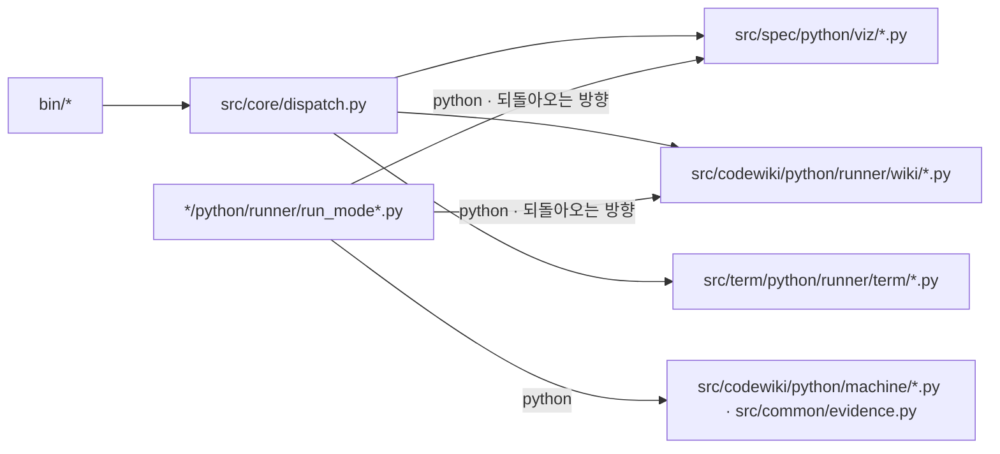

# src/core/ — 세 실행기가 함께 타는 단계 기계. 그리고 src/common/

> 루트 나침반은 [`../../CLAUDE.md`](../../CLAUDE.md). mode 쪽은 [`../codewiki/CLAUDE.md`](../codewiki/CLAUDE.md) · [`../term/CLAUDE.md`](../term/CLAUDE.md) · [`../spec/CLAUDE.md`](../spec/CLAUDE.md), 시험 규약은 [`../../test/CLAUDE.md`](../../test/CLAUDE.md).

**여기 있는 코드는 mode 를 모른다.** 세 실행기(`src/codewiki/python/runner/run_mode1.py` · `src/term/python/runner/run_mode1_5.py` ·
`src/spec/python/runner/run_mode2.py`)가 이 위에서 단계를 잇고, 시간을 재고, LLM 칸을 부른다. `bin/` 진입점의 명령 갈림길도 여기 있다.

## 무엇이 여기 있나

| 자리 | 하는 일 |
|---|---|
| `measure.py` | 세 실행기가 함께 쓰는 **재는 코드** — LLM 결과의 꼴(`ClaudeResult`) · `parse_result` · 측정 표 · 하트비트. **mode 폴더를 import 하지 않는다** |
| `pipeline.py` | 세 실행기가 함께 쓰는 **단계 기계** — 갈래 넷 · `Stage` · `Artifact(schema · check)` · `load` · 전이표 · `StageDagGraph` · 시뮬레이터 · 드라이버 한 벌 · 팬아웃 호출 · `PromptResource`(프롬프트 파일을 읽는 믹스인). 절 글은 Jinja2 로 렌더한다(`PromptResource.render_text`). `measure.py` 와 같이 **mode 폴더를 import 하지 않는다** |
| `dispatch.py` | `bin/` 진입점 셋이 공유하는 명령 갈림길 (`run_dispatch`). `report` 만 예외다 |
| `../common/python.py` | 파이썬 해석기를 기계에 상관없이 찾는다 — `REPORT_PYTHON` → `.venv` → PATH |
| `../common/template.py` | 리소스 파일의 `{{이름}}` 자리를 채운다. 자리와 값이 하나라도 어긋나면 예외 |
| `../common/evidence.py` · `../common/contract_types.py` | 대상 저장소에 봉인된 Mode 1 산출물을 계약대로 판정한다 — Mode 1.5 · 2 가 자식 프로세스로 부른다. 형은 계약 JSON 에서 생성한다(`tools/gen_contract_types.py`) |

## 자주 쓰는 명령

실행기 셋은 저장소 루트에서 돌리고 첫 인자로 대상을 받는다 — 저장소 · Plan · 프로젝트와 slug.
`--dry-run` 은 자식 프로세스를 하나도 띄우지 않는다.

```bash
cd $REPO_ROOT
.venv/bin/python src/codewiki/python/runner/run_mode1.py <저장소> --dry-run          # 자식 프로세스 0개. 폴백 간선까지 실제 흐름을 찍는다
.venv/bin/python src/codewiki/python/runner/run_mode1.py <저장소> --only collect-graph --cold
.venv/bin/python src/codewiki/python/runner/run_mode1.py <저장소> --resume --json qa/evals/runs/$(date +%F)-mode1-<대상>-<조건>.json
.venv/bin/python src/term/python/runner/run_mode1_5.py <plan.md> --terms-db <저장소>/docs/codegraph/terms-db.json --dry-run
.venv/bin/python src/spec/python/runner/run_mode2.py <프로젝트> <slug> --dry-run
.venv/bin/python -m pytest test/core test/common -q                 # 단계 기계 · 측정 · 갈림길 · 유틸 시험
.venv/bin/python -m pytest test/core/test_import_isolation.py -q     # Mode 1.5 · 2 를 import 해도 networkx 가 실리지 않는가
```

**`bin/` 은 왜 여기 없나.** `~/.zshrc` 가 `$REPO_ROOT/bin` 을 PATH 에 넣으므로 **옮기면 셸이 깨진다.**
성격은 러너축이지만 자리는 뿌리에 고정이다.

## 두 방향의 자식 프로세스 — 순환이 아니다



**`dispatch.py` 는 확장자를 보고 해석기를 고른다** — `.py` 면 python, 아니면 node.

**Why — 서로 부르는데 왜 순환이 아닌가.** 파이썬 실행기가 최상위 오케스트레이터이고 얼갈이는
그 아래 한 단계다. 같은 프로세스 안에서 import 로 얽히는 것이 아니라 **자식 프로세스 경계**로
갈려 있어, 어느 쪽도 상대의 메모리를 보지 않는다.

## 흐름은 진입점에서 미리 짓고 보장한다

`main()` 이 인자를 읽자마자 `build_*_graph()` 를 부른다. **어떤 자식 프로세스도 띄우기
전이다.** 팩토리가 `simulate()` 로 다섯을 보고 하나라도 어긋나면 `GraphError` 로 죽는다 —
완결성 · 매달림 · 비순환 · 도달성 · 산출물 사슬.

`--dry-run` 은 그 그래프를 `render()` 로 찍는다. 단계 이름의 나열이 아니라 폴백 간선까지
포함한 실제 흐름이다.

**전이표는 파이프라인 밖에 하나다.** `Stage` 는 자기 다음이 어딘지 모른다 — 흐름을
알려면 `MODE2_EDGES` · `MODE1_5_EDGES` · `mode1.edges.EDGES` 를 함께 본다. 대가로 흐름 전체가 한 화면에 있고
통째로 교체된다.

**`Pipeline.run` 은 재정의할 수 있다.** 다만 재정의는 루프를 다시 쓰는 자리가 아니라
`super().run()` 앞뒤에 자기 일을 붙이는 자리다. 지금 재정의하는 모드는 없다.

**Gotcha — `writes` 는 "이 단계의 파이썬 코드가 쓴다" 가 아니다.** "돌고 나면 있어야
한다" 는 선언이다. Mode 2 의 `agent` 는 `data.ts` 를 LLM 을 통해 채우고, Mode 1 의
`survey` 는 샤드를 LLM 자식 프로세스가 쓴다.

**Gotcha — 산출물 사슬 검사는 `OK` 갈래에서만 앞 단계의 `writes` 를 보장으로 센다.**
`FAIL` 이나 `SKIP` 으로 떨어진 단계는 자기 산출물을 내지 않았다.

**`SKIP` 은 "산출물 없이 다음으로" 다.** 산출물이 이미 있어 안 만드는 것은 `OK` 다(`outline-wiki`) —
`SKIP` 갈래에서는 `writes` 가 보장되지 않아 뒤 단계의 `reads` 가 성립하지 않는다. 시뮬레이터가 잡는다.

**선택 입력은 `reads` 에 넣지 않는다.** `reads` 는 없으면 죽는 것만 담는다. 없어도
정상인 것(`terms.json` · `term-answer-key.json` · 대상 저장소의 Mode 1 봉인)은 단계 안에서 본다.
Mode 1.5 의 용어 사전은 필수지만 `--terms-db`(argparse)와 `report-term collect` 의 봉인 관문이 막는다.

## `.py` 는 직접 실행 가드를 둔다 — 규약

```python
if __name__ == "__main__":
    sys.exit(main())
```

가드가 없으면 시험이 import 하는 순간 CLI 본체가 돌아 `sys.exit()` 이 러너 자체를 죽인다.

## 이 모듈이 소유하는 것 (Owns)

`src/core/**` · `src/common/**` · `bin/**` · `test/core/**` · `test/common/**`. **소유하지 않는 것** — mode 폴더의 단계와
`resource/` 의 글은 부르기만 하고 고치지 않는다.

## 다른 모듈과의 의존 (Cross-module dependencies)

| 방향 | 무엇 |
|---|---|
| `../../bin/*` → 여기 | `report-wiki` · `report-spec` · `report-term` 셋이 `dispatch.py` 의 `run_dispatch` 를 쓴다. `report` 만 `report-spec` 을 자식 프로세스로 띄운다 |
| `../codewiki/` · `../term/` · `../spec/` → 여기 | 세 실행기와 단계가 `pipeline` · `measure` 를 import 한다 |
| 여기 → `../common/` | `pipeline.py` 는 `template.TemplateError` 만, `dispatch.py` 는 `python.pythonPath` 를 쓴다 |
| 여기 → mode 폴더 | **없다.** `measure.py` · `pipeline.py` 는 어느 mode 도 import 하지 않는다 — `test/core/test_import_isolation.py` |

## 흔한 변경 패턴 (Common modification patterns)

```bash
# bin 명령을 더한다 — 진입점의 table 한 줄 + 스크립트 파일 하나. dispatch.py 가 확장자로 해석기를 고른다
# 재는 코드가 필요하다 — 실행기가 아니라 measure.py 를 import 한다
# 단계를 더한다 — 그 mode 의 CLAUDE.md(codewiki · term · spec)를 본다. 단계 기계 자체는 바뀌지 않는다
```

## 비직관적인 것 (Gotchas)

- **Gotcha — `run_mode1.py` 를 import 하면 해석기가 바뀐다.** 파일 머리의 `_bootstrap_venv()` 가
  `.venv` 밖 해석기를 `os.execv` 로 갈아치우고, `import survey_plan` 이 networkx 를 문다.
  **재는 코드가 필요할 뿐이면 `measure.py` 를 import 한다.** `run_mode1.py` 는 옛 이름을
  그대로 재수출하는 파사드라 둘 중 어느 쪽으로 불러도 같은 것이 나온다.
  `test/core/test_import_isolation.py` 가 이 경계를 고정한다.
- **Gotcha — 실행기를 스크립트로 띄우면 `sys.path[0]` 은 그 실행기의 폴더다.** `from core import …` 가
  되려면 `src/` 가 먼저 들어가야 해서(`src/` 는 패키지가 아니라 import 뿌리다), 세 실행기는 파일 머리에서 자기 폴더와 `src/` 를 함께 넣는다.
- **Gotcha — 형 자리의 `Any` 는 `pyright` 가 안 잡는다.** strict 모드는 `Unknown` 의 전파만
  잡고 손으로 적은 `Any` 는 통과시킨다(`reportExplicitAny` 는 basedpyright 전용이라 무시된다).
  `qa/gates/test_no_any.py` 가 글자로 막으며, 그 `COVERED` 목록이 지금 `Any` 0인 파일을 적어 둔다.
  아직 남은 곳 — `src/term/python/runner/term/quiz.py` 12곳 · `src/codewiki/python/runner/wiki/check.py` 4곳.
- **바깥 JSON 은 `TypedDict` + `msgspec` 으로 읽는다. 좁히기 도우미(`as_*`)는 없다.** 산출물은
  `Artifact.schema`(꼴 — msgspec) 와 `check`(뜻 — 문항 수처럼 형으로 못 적는 규칙) 로 경계에서 검증하고,
  단계 안에서는 `P.load(path, T)` · `msgspec.convert(obj, T)` 로 읽는다. **안 맞으면 예외**이고
  `Pipeline.run` 이 `stage.perform` 둘레에서 `msgspec.DecodeError` 를 받아 `FAIL` 행으로 바꾼다 —
  옛 정책(조용히 0·빈 값)을 뒤집은 것이다. LLM 결과도 `measure.parse_result` 가 `ClaudeResult` 로 검증한다.
- **Gotcha — msgspec 은 한글 열쇠의 `TypedDict` 칸을 못 맞춘다** (🔵 0.21.1). 같은 파일의 리터럴(같은
  인터닝 객체)일 때만 맞고 `json.loads` · `decode` 로 들어온 열쇠는 "missing required field" 다. 판정 갈래
  `유효 · 재읽기 · 위치만 · 삭제됨` 은 그래서 `dict[str, list[str]]` 로 두고 넷이 다 있는 것은 쓰는 쪽이
  보장한다. 우회가 꼭 필요하면 `msgspec.Struct` 의 `rename={"valid": "유효"}` 는 된다.
